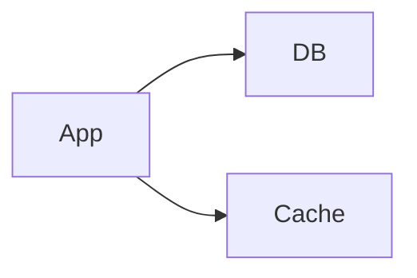
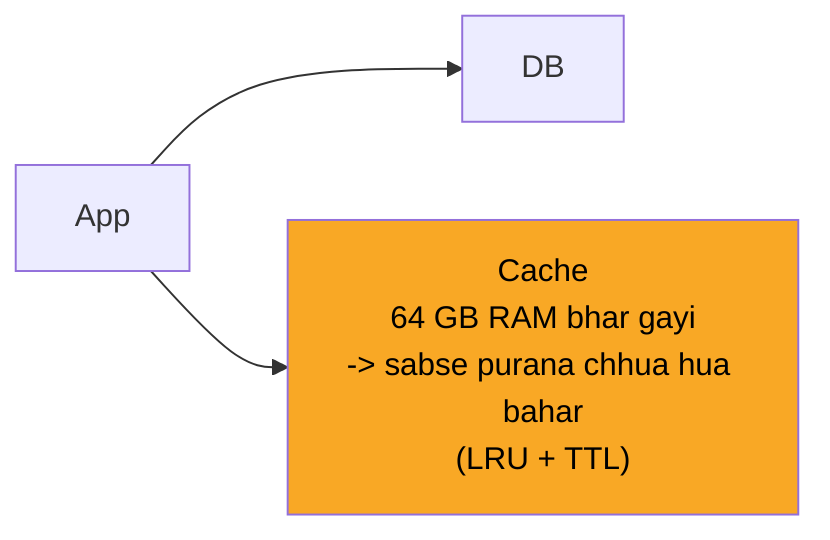
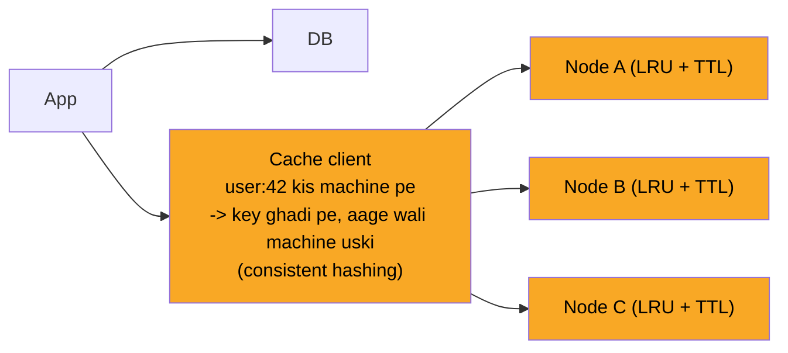
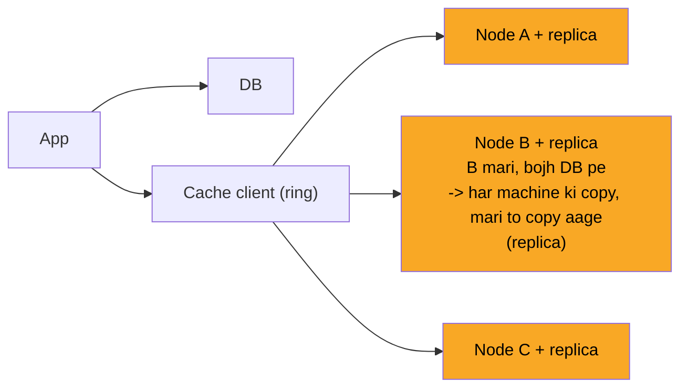
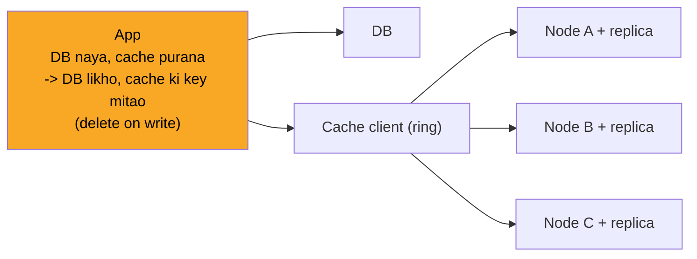
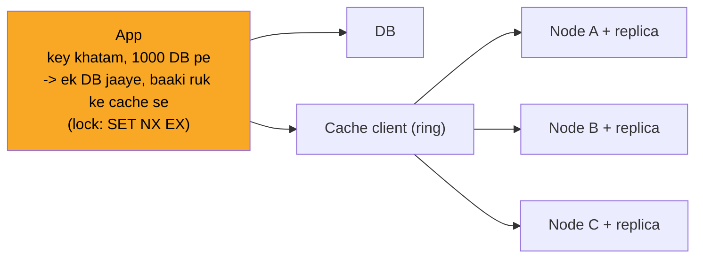
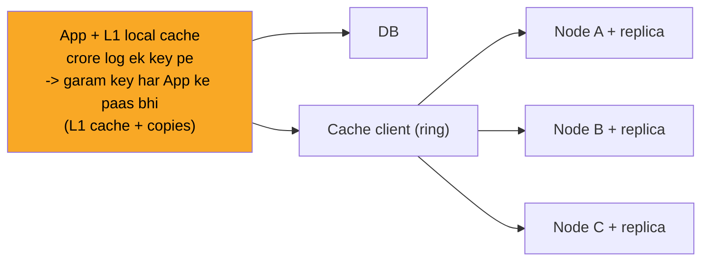
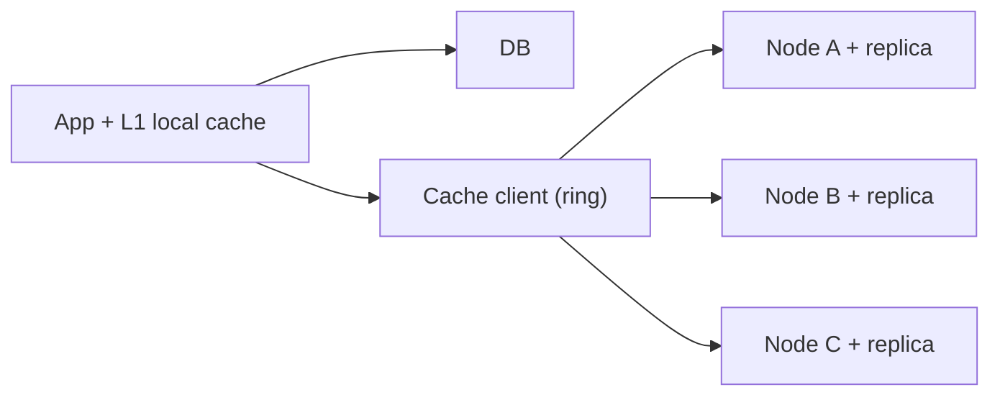

# Distributed Cache (Redis-jaisa)

> Tez RAM wala key-value store, jo ek machine se bada ho aur ek machine mare to bhi chale. Concept detail = FOUNDATIONS/04_caching.md
> Is design ka dil: **TEZ (<1 ms)** + **machine mare to bhi chale**. BookMyShow ka ulta: wahan sahi hona dil tha, yahan tezi.

---

## KAHANI (ek din, mere app ka cache, IPL final wala; har dikkat se design me ek dabba judta)

```
   KYA HUA                                       ILAAJ                                 DABBA JUDA
1  subah 64 GB RAM bhar gayi, kya hatayein    -> LRU + TTL (HashMap + DLL)             Cache (LRU + TTL)
2  data 1 TB, "user:42" kis machine pe        -> CONSISTENT HASHING + virtual nodes    Cache client + Nodes
3  dopahar machine B mari, bojh DB pe         -> REPLICA (async) + quorum failover     Node + replica
4  Ravi ne naam badla, cache me purana        -> DB me likho, cache key DELETE         (App: likhne pe delete)
5  7 baje "home page" key khatam, 1000 DB pe  -> LOCK: SET NX EX, sirf pehla DB jaaye  (App: SET NX lock)
6  raat IPL final, "live:score" pe crore log  -> L1 LOCAL CACHE + key ki copies        App + L1 local cache

POORA DESIGN (upar ke dabbe kram se):
   App + L1 -> Cache client (consistent hashing: key -> machine) -> Node (LRU + TTL) primary + copy
   miss -> DB (asli sach) · padhna = cache-aside · likhna = DB + cache key DELETE
```

---

## TASVEER (ByteByteGo / Alex Xu · CC BY-NC-ND 4.0)


Source: [How Can Cache Systems Go Wrong?](https://bytebytego.com/guides/how-can-cache-systems-go-wrong/)
(thundering herd / penetration / breakdown / crash)


Source: [Consistent Hashing Explained](https://bytebytego.com/guides/consistent-hashing/)
(machine jude ya gire to sirf thodi keys khiskein — ring)

---

## SHURU: pehle poocho, phir numbers

```
POOCHO:  "Ek machine ka cache (kya hatayein, TTL) ya kai machine wala (baantna, copy) — kis pe?"
         kaisa data, padhai zyada? · kitna PURANA chalega? (5
         min purana?)  <- isi se tay hota cache kab saaf karna
         kya hatane ka tareeka (LRU / LFU)? · cache DB ke aage hai ya khud asli store?

KYA KARE (FR):    get(key) · put(key, value, ttl) · delete(key)
                  scope bahar: disk pe bachana · pub/sub · transactions
KAISA CHALE (NFR): <1 ms (dil) · ek machine mare to chale · TB bhar data
                   "thodi der baad sahi" (eventual) chalega — asli sach DB me, cache sirf tez copy

NUMBERS (andaaza):
   ~1 TB data · ~10 lakh read / second · padhai zyada
   1 TB         -> ek machine ki RAM (64 GB) me nahi aata -> BAANTO (sharding)
   10 lakh / sec -> ek machine itna nahi deti -> machines me baanto
   machine mari -> saara bojh DB pe -> har machine ki COPY (replication)
   teeno milke "ek machine kaafi" khaarij -> isliye DISTRIBUTED
```

---

## ════ MOCK SE PEHLE: SIRF YE CARD PADHO ════

> Har card: pehle PEELA DABBA dekho (scene + ilaaj). Yaad aa gaya -> aage. Nahi aaya -> neeche
> DIKKAT / HAL / NAHI padho. AAGE POOCHEGA sirf jab interviewer aage kuch poochhe.

#### DABBA 0: SABSE SIMPLE (yahan se shuru, phir "kahan tootega")
```
Ek machine, uski RAM me ek HashMap. get / put O(1).
App pehle cache se poochhe: mila -> wahi do · nahi mila -> DB se laao -> cache me daalo -> do (CACHE-ASIDE).
```


#### 0 SHURU: CACHE-ASIDE (cache kaam kaise karta)
```
DIKKAT 1   Meri profile DB se padhne me ~10 ms (disk). 10 lakh log / second profile khol rahe
           -> DB ghutno pe.
HAL        DB ke aage RAM wala cache. App pehle cache se poochhe:
             mili (HIT) -> <1 ms me wapas
             nahi mili (MISS) -> DB se laao -> cache me daalo (TTL ke saath) -> wapas. Agli baar HIT.
           App khud cache sambhalta = CACHE-ASIDE (sabse aam tareeka).

DIKKAT 2   Likhna kaise? cache-aside / write-through / write-back?
HAL        Cache-aside: DB me likho, cache ki key DELETE.
           Write-through: DB aur cache dono me saath (hamesha taaza, par likhna dheema).
           Write-back: pehle sirf cache, DB me baad me (tez, par cache mara to data gaya -> paise pe kabhi
           nahi).

DIKKAT 3   Poora cache hi gir gaya?
HAL        Saari padhai DB pe. DB ke aage rate limit / load shedding (faltu request mana), warna DB bhi
           girega.

DIKKAT 4   Chal raha hai, kaise pata?
HAL        HIT RATIO sabse pehle (achanak gira = kuch toota) + p99 + kitni key nikaali ja rahi (evictions).
```

#### 1 Subah cache machine ki RAM bhar gayi, kya hatayein

```
TASVEER: LRU = HashMap + list
  AAGE (abhi chhua)  user:7 <-> user:42 <-> home <-> user:9  PEECHE (sabse purana)
  GET user:9  -> mila -> utha ke AAGE:  user:9 <-> user:7 <-> user:42 <-> home
  RAM bhari, SET user:55 -> PEECHE wala (home) bahar -> user:55 AAGE
  HashMap: key -> list ka dabba (dhoondhna O(1), hilana O(1))
```
```
AAGE POOCHEGA:
  NIYAM: RAM bhari to sabse purana chhua pehle jaaye; umar khatam = key bekaar. Hati key = sirf ek miss,
         App DB se laake wapas rakhta; sach DB me, cache sirf tez copy.
  SAFAR (ek key, RAM bhar gayi, har mod pe kya):
  RAM me jagah, sab theek -> key rakho, umar (TTL) ke saath; padho to RAM se
  RAM bhar gayi           -> sabse der se chhua hatao (LRU): wahi LRU jo LC 146 me
  har baar dhoondhoge?    -> nahi: hashmap + doubly linked list: chhua -> aage, peeche wala hatao, O(1)
  umar wali key kab hate  -> padhte waqt check (lazy) + peeche thodi safai (active): ghadi mehngi
  hatana hi band kiya     -> naya likhna error (noeviction); cache me allkeys-lru rakho
```

#### 2 Subah 11 tak data 1 TB: "user:42" kis machine pe?

```
DIKKAT     Subah 11 tak data 1 TB ho gaya, ek machine me 64 GB -> 16+ machine. "user:42" kis machine pe
           jaaye, aur App ko har baar kaise pata chale?
HAL        gol ghadi pe key aur machine (CONSISTENT HASHING): key ghadi ki disha me chale, PEHLI machine uski.
           VIRTUAL NODES se bojh barabar; App ki CACHE CLIENT library hisaab karti.
NAHI       hash(key) % N: N badla to lagbhag SAB key ki machine badli -> sab MISS -> DB gira.
```
```
TASVEER: ghadi 0..360, disha me chalo
  0 ------ A=100 ------ B=200 --- D=250 --- C=300 ------ 360 (= 0, wapas A)
  key 150 -> aage pehli machine = B
  key 350 -> aage koi nahi -> ghoom ke A
  D=250 juda -> sirf 201..250 wali key C se D pe; baaki sab apni jagah
```
```
AAGE POOCHEGA:
  NIYAM: machine jude / jaaye to sirf pados ki ~K/N key hilein (K = saari key, N = machine); App ko us
         hisse ki ek baar miss, baaki sab hit.
  SAFAR (key "user:42" ka ghar, har mod pe kya):
  key 150, sab theek      -> ghadi 0..360, aage pehli machine: A=100, B=200, C=300 -> B
  key 350                 -> aage koi nahi -> ghoom ke A (jaise circular array, i % n)
  D=250 juda              -> sirf 201..250 wali key C se D pe; baaki apni jagah
  ek machine pe zyada key -> har machine ghadi pe 100-200 jagah (virtual nodes): tukde barabar
  App ko kaise pata       -> naksha (config service); galat machine -> Redis "MOVED, wahan jao"
```

#### 3 Dopahar machine B mar gayi, uski key ka bojh DB pe

```
DIKKAT     Dopahar machine B mar gayi. Uske hisse ki saari key gayab -> un key ki saari padhai seedha DB pe.
HAL        har machine ki copy (REPLICA): doosri building me, likhna B pe, copy tak thodi der baad (ASYNC).
           Baaki B ko ping karti; zyadatar (quorum) bolein "B mari" -> copy naya B, App ko naya pata.
NAHI       sync copy: har likhai pe copy ke "haan" ka intezaar -> <1 ms gaya.
```
```
AAGE POOCHEGA:
  NIYAM: cache me tezi pehle: copy thodi der baad, aakhri likhai kho jaaye to chalta, kyunki sach DB me.
         Machine giri -> copy main bane, App ko us hisse me thodi der miss.
  SAFAR (machine B ka hissa, har mod pe kya):
  sab zinda, sab theek   -> har machine apna hissa, saath me uski copy chalti
  B gayi                 -> sirf B ki key pe asar: har machine ka apna hissa
  copy ko main banana    -> ~10-30 sec (pakka B mari?); us beech B ki key DB se, dheema
  copy peeche thi        -> aakhri kuch likhai kho sakti: cache me chalta, sach DB me
  network toota, do main -> zyadatar (quorum) tay kare, akeli likhna band (split brain)
```

#### 4 Ravi ne naam badla, sabko purana dikh raha

```
DIKKAT     Shaam ko Ravi ne naam "Ravi" se "Ravi K" kiya. DB me naya ho gaya, cache me abhi bhi "Ravi"
           -> sabko purana naam dikh raha.
HAL        DB likho, cache mitao (DELETE ON WRITE): DB update karo -> phir cache ki key DELETE (update nahi).
           Agli padhai MISS -> DB se "Ravi K" -> cache me.
NAHI       cache UPDATE: "X" phir "Y" likha, cache me pehle Y pahuncha phir X -> galat "X" baith gaya.
```
```
AAGE POOCHEGA:
  NIYAM: likho DB me, cache se hatao; kuch bhi pahunche, key khaali hi hogi -> agla padhne wala DB se naya
         laata. Umar = suraksha jaal: delete chhoota to bhi utni der hi purana.
  SAFAR (Ravi ka naya naam, har mod pe kya):
  naam badla, sab theek     -> pehle DB likho, phir cache key hatao: agla padhne wala DB se naya
  delete fail               -> umar (TTL) bachati: utni der hi purana; pakka -> DB ki diary se delete (CDC)
  purana beech me wapas     -> thodi der baad phir delete (double delete), ya version se likho
  Ravi ko apna purana dikha -> copy peeche: likhne wale ko kuch der primary se padhao
```

#### 5 7 baje "home page" key khatam, 1000 log ek saath DB pe

```
TASVEER: ek jaaye, baaki ruke
  7 baje "home" key khatam, 1000 request ek saath
  req 1:       SET lock:home 1 NX EX 5 -> mila -> DB se join -> cache me home -> lock chhoda
  req 2..1000: lock nahi mila -> 50-100 ms ruko -> cache se home (ya purani value)
  DB pe: 1000 ki jagah 1
```
```
AAGE POOCHEGA:
  NIYAM: khaali key pe ek hi DB jaaye, baaki ruke ya purani value le; App ko thoda dheema ya thoda purana
         chalta, DB pe 1000 ek saath kabhi nahi.
  SAFAR (home page key, har mod pe kya):
  key zinda, sab theek      -> sab cache se, DB pe kuch nahi
  key khatam, 1000 aaye     -> pehla lock le (SET lock:home NX EX 5), wahi DB se laaye; baaki ruke
  999 ruke                  -> 50-100 ms, ya purani value do: thodi purani home page chalti
  saari key ek saath khatam -> umar me random (60 min +- 5): ek saath nahi girti
  key DB me thi hi nahi     -> "nahi hai" bhi cache karo, chhoti umar: warna har baar DB
```

#### 6 Raat IPL final, "live:score" key ki machine akeli mar rahi

```
AAGE POOCHEGA:
  NIYAM: garam key ko faila do (App ke paas 1-2 sec ki copy, ya key ke tukde): ek key = ek machine, isliye
         bheed baanto; score thoda purana chalta, paisa nahi.
  SAFAR (live:score ki bheed, har mod pe kya):
  aam din, sab theek       -> key ek machine pe, sab Redis se
  ek machine pe crore      -> har App ke paas 1-2 sec copy (L1), ya key ki kai copy (score#1..#10)
  garam pata kaise         -> App me ginti + machine ka metric achanak upar -> copy / L1
  L1 me score kitna purana -> 1-2 sec: score chalta, paisa / stock nahi
  us key pe likhna (like)  -> key ke tukde like#0..#9: kisi ek me likho, padhte waqt jodo
```

---

## AAKHRI DABBA + WRAP (ek hi baar)

```
App + L1 local cache (nano-sec, hot key ka pehla ilaaj) -> Cache client (consistent hashing: key -> machine)
-> Machine (HashMap + DLL = LRU, + TTL) primary + copy (alag AZ) -> miss pe DB (asli sach)
PADHNA = cache-aside (~90% hit, DB pe bojh 10 guna kam) · PURANA = TTL + likhne pe delete
STAMPEDE = lock / soft-TTL · HOT KEY = copies / L1 local

DB:  cache = RAM wala key-value (<1 ms, join nahi, sirf key se) · DB peeche asli sach
     cache AP ki taraf: tezi > sahi hona, "thodi der baad sahi" chalta
```
```
JAWAB:    Cache = RAM me rakhi key-value, kai machines me baanti (ring se), har machine ki copy.
          App pehle cache se poochhta, na mile to DB se laake cache me rakhta. RAM bhare to purani key
          nikalti, har key ki umar hoti.
          Do dikkat dhyaan rakhni: purana data (badalne pe key hatao + umar) aur key khatam hote hi
          bheed (ek laaye, baaki ruke).
          Bahut garam key: har app server apne paas 1-2 second rakhe.
```


---

## 10 GUNA TRAFFIC — har dabba alag se

```
Cache client  -> machine judi / gayi -> consistent hashing + virtual nodes
Machine       -> RAM bhari -> LRU + TTL · mari -> copy promote · data badha -> machine jodo
hot key       -> copies + L1 local cache
umar khatam   -> lock · soft-TTL · kabhi khatam nahi · pehle se bharo
DB            -> purana data -> likhne pe delete + TTL
AAGE:         write-back (likhna bahut ho to) · kai region me cache

POOCHEGA: "How would you scale this to 10x?"      -> request ka raasta chalo
POOCHEGA: "What's the single point of failure?"   -> machine (copy), cache client config (sab app me copy)
POOCHEGA: "How do you know it's working?"         -> HIT RATIO sabse
          zaroori (gira = kuch toota) · p99 · evictions · alert
```

---

## POOCHE TO (gehra sawaal aaye tab)

```
SAFAR KE BAHAR WALE SAWAAL:
"LFU kyun nahi (kitni baar chhua)?" -> kal ki famous key aaj bhi baithi rehti, purani ginti nahi ghatti;
                                       default LRU
"Redis sach me poori LRU list rakhta?" -> nahi, andaaze wala LRU: kuch random key me sabse purani; poori list
                                          = har key pe memory
"Seedha hash % N kyun nahi?" -> N badla to har key ka % N badla: 4 -> 5 machine = ~80% key hilti; ring me N
                                nahi
"A-M ek pe, N-Z doosre pe kyun nahi?" -> ek range garam ho jaati (sab "S" naam), ek machine pe bojh; hash se
                                         key bikhar jaati
"Redis Cluster bhi ring hai?" -> nahi: CRC16(key) % 16384 slot -> machine; machine badhe to sirf kuch slot
                                 khiskao
"Copy se padh bhi lo?" -> haan, padhai bat-ti; thoda purana mil sakta, copy peeche chalti
"Umar (TTL) kitni rakhoge?" -> jitna purana jhel sake: profile = minute, price / stock = second
"Purani de sakte, to khatam hone hi kyun di?" -> umar khatam se thoda pehle taaza karo: key khaali hi na ho
"Sale 12 baje, pata tha na?" -> pehle hi cache bhar do + machine badhao: waqt pata = tayyari pehle
"Consistent hashing se bheed bat nahi jaati?" -> nahi: ek key = ek machine; ring key baant-ta, ek key ki bheed
                                                 nahi
"Kitni parat hui?" -> L1 (App RAM) -> L2 Redis -> DB; neeche wali dheemi, isliye upar se pehle
"Stampede aur hot key me farak?" -> stampede = key KHAALI (lock) · hot key = key BHARI, ek machine pe bheed
                                    (L1)

API:      GET key · PUT key value ttl · DELETE key
          jaan-boojh ke chhoti — query nahi, sirf key se -> index / planner nahi -> isiliye tez

MACHINE KE ANDAR: HashMap key -> value (O(1)) · LRU = HashMap + DLL · TTL lazy + active
                  RAM wala key-value (Redis-jaisa), DB peeche asli sach
                  <1 ms -> RAM (disk nahi) · join nahi -> key-value kaafi

KEY BAANTNA:    hash % N -> sab khiskti -> NAHI · CONSISTENT HASHING
                -> ring + ghadi ki disha + virtual nodes <- YAHI
                range -> ek range garam -> NAHI

TRADE-OFF:      tezi vs sahi hona — cache AP ki taraf, "thodi der baad sahi" chalta (CAP)

LIBRARY DESK: 10,000 kitaab godaam me (DB = dheema, sab kuch) · top-100 front desk pe (cache = RAM, tez)
   ek desk pe saari kitaab nahi aati + desk wala beemar pad sakta (machine band)
   -> kai desk (nodes) + kaunsi kitaab kis desk (sharding) + har
      desk ka backup banda (replication) = DISTRIBUTED CACHE
```

---

ARCHETYPE F · CONCEPTS: [caching](../../FOUNDATIONS/04_caching.md) · [sharding](../../FOUNDATIONS/06_database_sharding.md) · [replication](../../FOUNDATIONS/05_database_replication.md) · [← MASTER SHEET](../../00_MASTER_SHEET.md)
