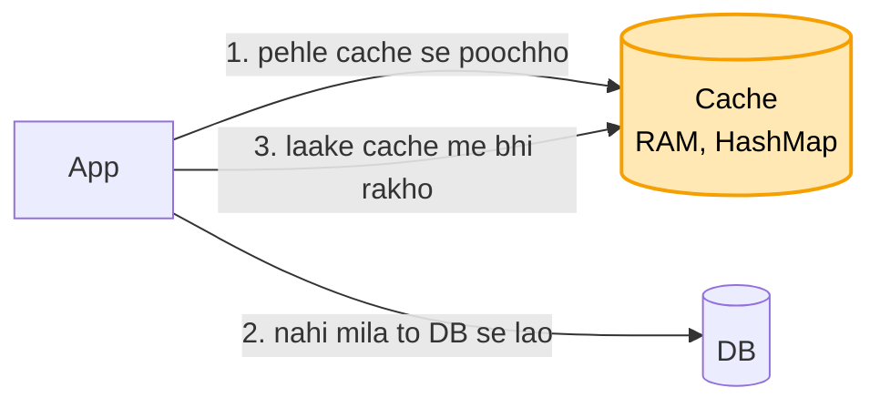
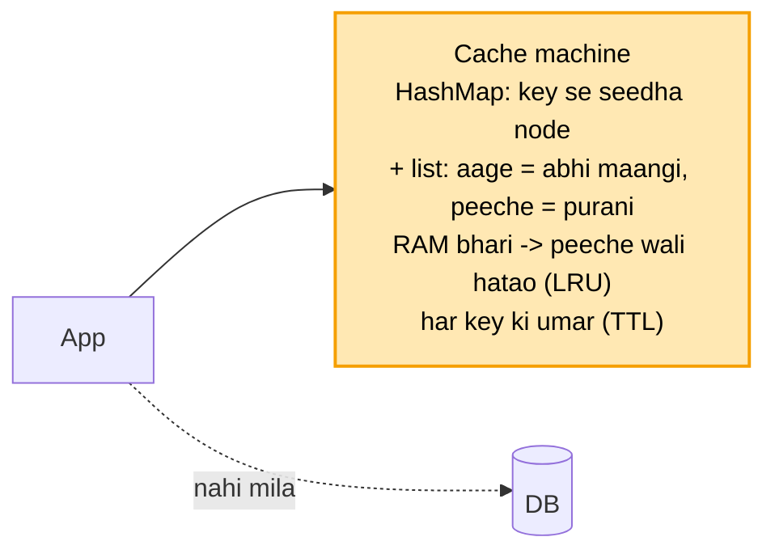
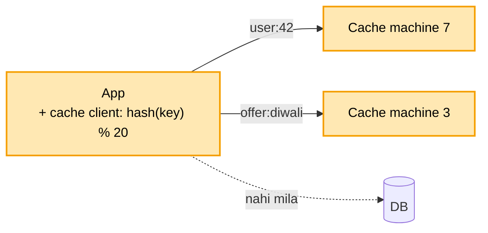

# Distributed cache: shuru se, ek kahani

Kram wahi jo interview me hota hai: **FR, phir NFR, phir numbers, phir design**. Design sabse seedhe dabbe se
shuru hota hai, aur har dikkat aane pe ek naya dabba judta hai. Diagram me peela dabba = abhi juda. Poori file
me ek hi kahani hai: Arpan ka shopping app.

---

## Cache hai kya, aur kyun chahiye

Arpan ka ek shopping app hai. Har baar koi home page kholta hai, to app DB se poochhta hai: "user 42 ka naam
kya hai, cart me kya hai, aaj ke offer kya hain". DB ye sab disk se padhta hai, aur ek baar padhne me
lagbhag 10 ms lagte hain.

Ab shaam ki bheed me har second 10 lakh baar ye sawaal aate hain. Zyadatar sawaal wahi ke wahi hote hain:
wahi offer, wahi user. DB har baar disk se wahi jawab dobara la raha hai, aur itni bheed me wo ghutno pe aa
jaata hai.

Ilaaj ye hai ki jo cheez baar-baar maangi ja rahi hai, use ek baar laake **RAM me rakh lo**. RAM se jawab 1 ms
se bhi kam me aata hai. Isi RAM wale dabbe ko **cache** kehte hain, jaise Redis.

Ye design "distributed" isliye hai kyunki ek machine kaafi nahi padti. Iske teen kaaran hain, aur ye teeno aage
ke kadam ban jaayenge:

```
DATA     1 TB data hai, aur ek machine ki RAM 64 GB. Saara ek machine me nahi aata  -> BAANTNA padega
BHEED    10 lakh request har second ek machine nahi jhel paati                     -> kai machine
GIRNA    ek hi machine ho aur wo mar jaaye, to saara bojh wapas DB pe              -> COPY rakhni padegi
```

## 1. FR: kya karna hai

```
get(key), put(key, value, kitni der rakhna), delete(key). Bas itna.
scope ke bahar: disk pe bachana. Asli sach DB me hai, cache sirf tez copy hai.
```

## 2. NFR: kaisa chalna chahiye

```
- TEZ: 1 ms se kam (cache ka poora kaam yahi hai)
- ek machine mare to bhi chale
- thodi der purana data chal jaata hai, asli sach DB me hai
```

## 3. Numbers

```
- 1 TB data
- 10 lakh read har second, padhna likhne se bahut zyada
```

Ek baat jo URL design se farak hai: URL me "link hamesha chale" sabse zaroori tha. Yahan sabse zaroori
**tezi** hai, kyunki cache isi kaam ke liye bana hai.

---

## 4. Design

### Kadam 1: sabse seedha (ek cache machine)

Ek cache machine lagao, jiski RAM me ek HashMap ho: key se value. App ko jab bhi kuch chahiye, wo is kram me
chalta hai:



```
App: "offer:diwali" chahiye
  -> pehle CACHE se poochho
       mila (HIT)    -> turant le lo, DB ko chhua bhi nahi          ~1 ms se kam
       nahi (MISS)   -> DB se lao, cache me bhi rakh do, phir do     ~10 ms, sirf pehli baar
  -> agli baar wahi key maangi to cache me mil jaayegi
```

Is tareeke ka naam **cache-aside** hai, kyunki cache DB ke bagal me baitha hai. App khud dono se baat karta
hai: pehle cache, aur na mile to DB.

Asar ye hota hai ki zyadatar request (lagbhag 90%) cache se hi nikal jaati hain. DB tak sirf 10% pahunchti
hain, to DB ka bojh 10 guna kam ho gaya.

Par cache machine ki RAM sirf 64 GB hai, aur roz naye offer, naye user, naye cart judte ja rahe hain.
Dopahar tak RAM bhar gayi. Ab nayi key rakhni hai, to purani me se kaunsi hatayein?

### Kadam 2: RAM bhar gayi, kaunsi key hatayein (LRU + TTL)

RAM bhar gayi aur nayi key aayi. Kisi purani key ko nikalna padega. Sawaal ye hai ki kise.

Seedhi baat: jo key **sabse der se kisi ne nahi maangi**, use hatao. Jo abhi-abhi maangi gayi, wo shayad phir
maangi jaayegi, use rakho. Isko **LRU** (Least Recently Used) kehte hain.



```
RAM me 4 key, aage = abhi maangi, peeche = sabse der se nahi maangi
   aage  [offer:diwali] [user:42] [cart:42] [offer:holi]  peeche
nayi key "user:99" aayi, RAM bhari  -> peeche wali "offer:holi" hatao, "user:99" aage lagao
"cart:42" maangi gayi               -> use uthake sabse aage rakh do
```

**Ye tez kaise hota hai:** cache 1 ms me jawab deta hai, to "sabse purani kaunsi" dhoondhne me poori RAM scan
nahi kar sakte. Isliye do cheezein saath rakhte hain:

```
HashMap             key se seedha uske node tak pahuncho           O(1)
Doubly linked list  key ka kram: aage = abhi, peeche = purani      aage lagana / peeche se hatana O(1)
```

Matlab dhoondhna, aage khiskaana aur hatana, teeno O(1). Ye wahi LRU cache hai jo DSA me design pattern me
banaya hai (LC 146).

**Doosra tareeka LFU kyun nahi** (jo sabse kam BAAR maangi gayi, wo hatao): Holi ka offer March me lakhon baar
khula tha, uski ginti bahut badi hai. October me use koi nahi kholta, par LFU use kabhi nahi hatayega kyunki
uski purani ginti badi hai. LRU me wo apne aap peeche khisak ke nikal jaata hai.

**Iske saath TTL (har key ki umar):** LRU sirf jagah ki dikkat sambhalta hai. Par Diwali ka offer raat 12 baje
khatam ho gaya. RAM khaali ho tab bhi wo key cache me padi rahegi aur log purana offer dekhte rahenge. Isliye
har key ke saath umar likhte hain (jaise 1 ghanta). Umar khatam hote hi key mit jaati hai, aur agli baar DB se
taaza aati hai.

Ab ek machine me jagah ka hisaab ho gaya. Par data hi 1 TB hai, aur ek machine ki RAM sirf 64 GB. Itna data ek
machine me aata hi nahi.

### Kadam 3: data 1 TB, ek machine me nahi aata (baanto)

1 TB data hai aur ek machine ki RAM 64 GB. To kai cache machine lagao, maan lo 20, aur data unme baant do. Har
machine pe data ka ek hissa.

Ab sawaal ye hai ki "user:42" kis machine pe hai, ye kaise pata chale? Agar har baar saari 20 machine se
poochein, to 1 ms wali tezi khatam ho jaayegi.

Ilaaj: key se hi machine nikaal lo.

```
machine = hash("user:42") % 20      -> maan lo 7 aaya
PUT  "user:42" -> seedha machine 7 pe rakho
GET  "user:42" -> wahi hash -> seedha machine 7 se poochho, baaki 19 ko chhuna hi nahi
```

Ye hisaab kaun karta hai? App ke andar ek chhoti library hoti hai, **cache client**. Usko pata hota hai ki
kitni machine hain, aur wahi key se machine nikaal ke seedha us machine pe jaata hai. Beech me koi alag dabba
nahi, isliye tezi bani rehti hai.



Par Diwali sale aayi, data aur badha, to 20 se 21 machine kar di. Ab `% 20` ki jagah `% 21` ho gaya, aur
lagbhag har key ki machine badal gayi. "user:42" machine 7 me pada hai, par client ab use machine 15 me
dhoondh raha hai. Lagbhag saare cache ek saath MISS hone lage, aur saari bheed seedha DB pe gir padi.
