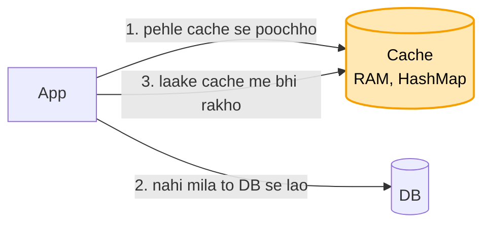

# Distributed cache: shuru se, ek kahani

Kram wahi jo interview me hota hai: **FR, phir NFR, phir numbers, phir design**. Design sabse seedhe dabbe se
shuru hota hai, aur har dikkat aane pe ek naya dabba judta hai. Diagram me peela dabba = abhi juda. Poori file
me ek hi kahani hai: Arpan ka shopping app.

---

## Cache hai kya, aur kyun chahiye

Arpan ka ek shopping app hai. Har baar koi home page kholta hai, to app DB se poochhta hai: "user 42 ka naam
kya hai, cart me kya hai, aaj ke offer kya hain". DB ye sab disk se padhta hai, aur ek baar padhne me
lagbhag 10 ms lagte hain.

Ab shaam ki bheed me har second 10 lakh baar ye sawaal aate hain. Zyadatar sawaal wahi ke wahi hote hain:
wahi offer, wahi user. DB har baar disk se wahi jawab dobara la raha hai, aur itni bheed me wo ghutno pe aa
jaata hai.

Ilaaj ye hai ki jo cheez baar-baar maangi ja rahi hai, use ek baar laake **RAM me rakh lo**. RAM se jawab 1 ms
se bhi kam me aata hai. Isi RAM wale dabbe ko **cache** kehte hain, jaise Redis.

Ye design "distributed" isliye hai kyunki ek machine kaafi nahi padti. Iske teen kaaran hain, aur ye teeno aage
ke kadam ban jaayenge:

```
DATA     1 TB data hai, aur ek machine ki RAM 64 GB. Saara ek machine me nahi aata  -> BAANTNA padega
BHEED    10 lakh request har second ek machine nahi jhel paati                     -> kai machine
GIRNA    ek hi machine ho aur wo mar jaaye, to saara bojh wapas DB pe              -> COPY rakhni padegi
```

## 1. FR: kya karna hai

```
get(key), put(key, value, kitni der rakhna), delete(key). Bas itna.
scope ke bahar: disk pe bachana. Asli sach DB me hai, cache sirf tez copy hai.
```

## 2. NFR: kaisa chalna chahiye

```
- TEZ: 1 ms se kam (cache ka poora kaam yahi hai)
- ek machine mare to bhi chale
- thodi der purana data chal jaata hai, asli sach DB me hai
```

## 3. Numbers

```
- 1 TB data
- 10 lakh read har second, padhna likhne se bahut zyada
```

Ek baat jo URL design se farak hai: URL me "link hamesha chale" sabse zaroori tha. Yahan sabse zaroori
**tezi** hai, kyunki cache isi kaam ke liye bana hai.

---

## 4. Design

### Kadam 1: sabse seedha (ek cache machine)

Ek cache machine lagao, jiski RAM me ek HashMap ho: key se value. App ko jab bhi kuch chahiye, wo is kram me
chalta hai:



```
App: "offer:diwali" chahiye
  -> pehle CACHE se poochho
       mila (HIT)    -> turant le lo, DB ko chhua bhi nahi          ~1 ms se kam
       nahi (MISS)   -> DB se lao, cache me bhi rakh do, phir do     ~10 ms, sirf pehli baar
  -> agli baar wahi key maangi to cache me mil jaayegi
```

Is tareeke ka naam **cache-aside** hai, kyunki cache DB ke bagal me baitha hai. App khud dono se baat karta
hai: pehle cache, aur na mile to DB.

Asar ye hota hai ki zyadatar request (lagbhag 90%) cache se hi nikal jaati hain. DB tak sirf 10% pahunchti
hain, to DB ka bojh 10 guna kam ho gaya.

Par cache machine ki RAM sirf 64 GB hai, aur roz naye offer, naye user, naye cart judte ja rahe hain.
Dopahar tak RAM bhar gayi. Ab nayi key rakhni hai, to purani me se kaunsi hatayein?
