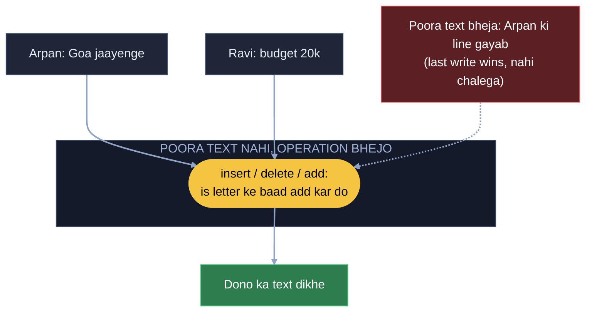
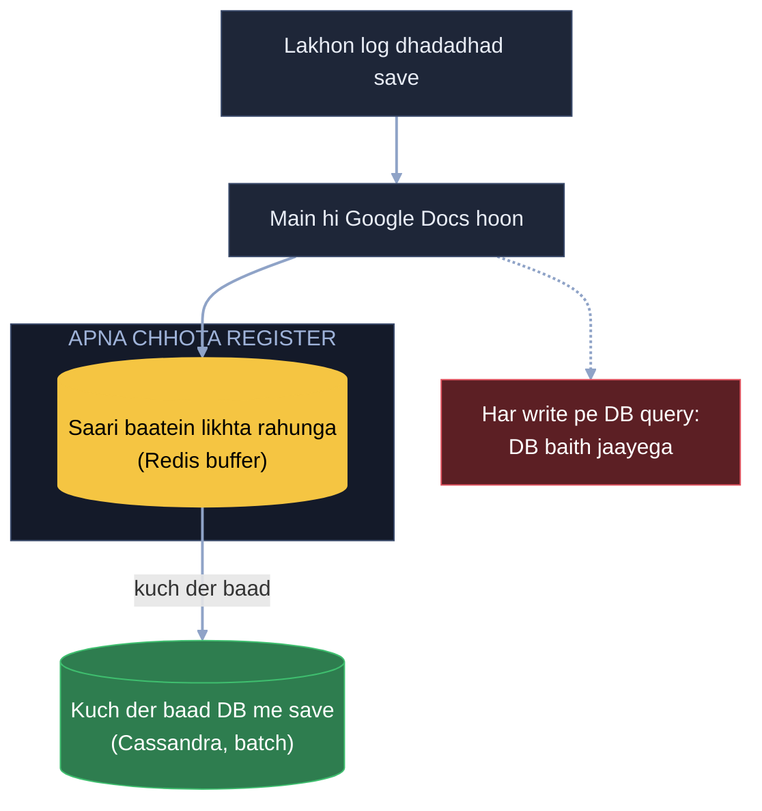
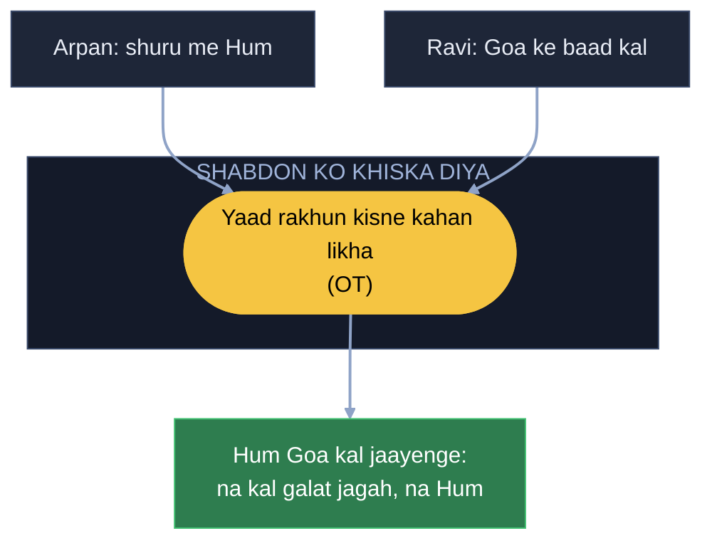
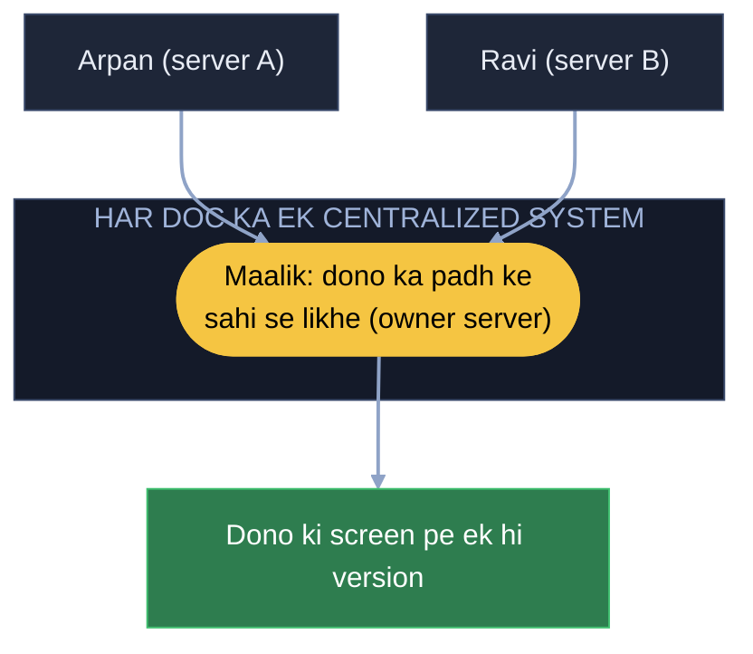
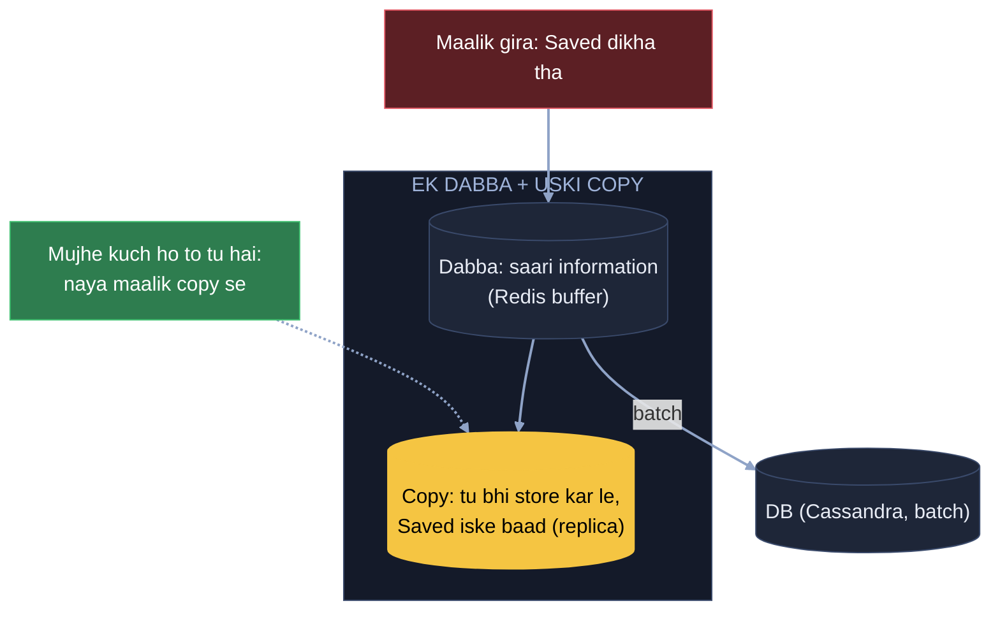
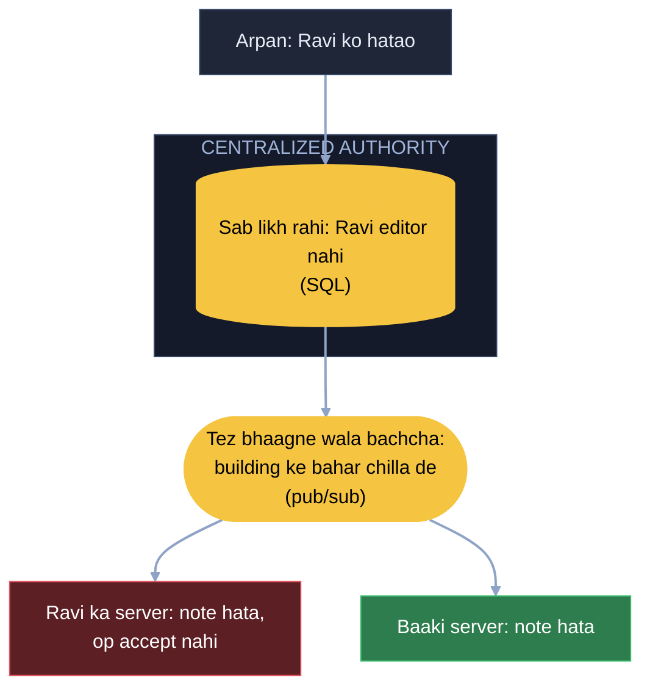
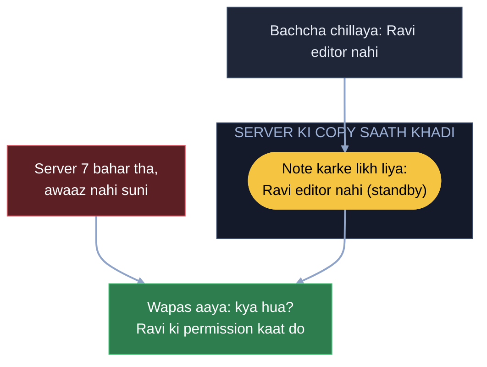

# Google Docs: Arpan aur Ravi ke "Trip plan" doc ki kahani

Arpan aur Ravi ek hi doc "Trip plan" pe saath likh rahe hain. Doc me hai `Goa jaayenge`. Kaam: dono ek saath likhein
to kisi ka likha gayab na ho, dono ki screen pe ek hi doc dikhe, aur "Saved" dikha to likha hua ude nahi (bas dabba aur
uski copy dono ek saath gire to aakhri kuch second, kadam 5).

Har kadam = **kahani** (dikkat aur hal, bolne wali bhasha) -> **Asli naam** (interview me yahi shabd) -> tasveer
(kahani ka shabd, bracket me asli naam).

---

## FR / NFR / Numbers (interview me pehle 2 minute)

```
FR      kai log ek doc ek saath edit karein · doosre ka likha turant dikhe, kisi ka likha mite nahi
        · kaun edit kar sakta, hataya to turant band
NFR     typing turant, ruke nahi · aakhir me sabka doc SAME · "Saved" dikha to ude nahi (sab copy ek saath gire to aakhri kuch second)
Numbers ~10 crore user, roz ~3-4 crore · har akshar ek badlaav
        -> likhna bahut zyada: har akshar pe DB nahi chal sakta
```

---

## 1. Ravi ke Save ne Arpan ki line gayab ki (poora text nahi, operation bhejo)

Jo "Save" dabata hai, uska poora text server pe jaake purane ko hata deta hai. Maine upar "Goa jaayenge" likh ke Save
kiya, Ravi ne neeche "budget 20k" likh ke Save kiya, par Ravi ki screen pe purana text tha, to meri line gayab. Dono ka
text dikhao, kisi ko gayab kyun karna. Ye to last write wins wali situation ho gayi, aur Google Docs me last write wins
nahi chalne ka, warna Google Docs ka matlab hi khatam. Poora text bhejenge to overwrite hoga hi, to poora text mat
bhejo, operation bhejo: insert, delete, add. Ravi ne kuch kiya to uska operation aayega "is letter ke baad add kar do",
aur main use "Goa jaayenge" ke baad, ya neeche, ya beech me kahin, wahin laga dunga.

**Asli naam:** last write wins nahi = dono ka badlaav bache, poora text nahi, operation bhej do = operation (op:
insert / delete), is letter ke baad add kar do = op me jagah (position) + kis version pe dekh ke likha (baseVersion). Server se dono ki screen tak op
turant = WebSocket (dono taraf khula taar).

**Maan lo Ravi ka "budget 20k" wala op dobara chala gaya ("mil gaya" kho gaya):** Har op ki apni id: server pehle id dekhe, ye op lag chuka to dobara mat lagao. Doc me "budget 20k budget 20k" nahi.
**Asli naam:** idempotency key (wahi ID dobara aaye to chhodo).



## 2. Har chhota badlaav DB pe (chhota register, kuch der baad DB)

Hazaron-laakhon log dhadadhad save kar rahe, aur har chhota badlaav DB pe jaaye to kitna DB write karega, Cassandra ki
bhi haalat ho jaayegi. Main hi Google Docs hoon: log baar-baar hata rahe, badal rahe, check kar rahe. To main apna ek
chhota register bana lunga, unki saari baatein usme likhta rahunga, phir kuch der baad DB me save kar dunga. Har write
pe DB query nahi maarunga, warna DB baith jaayega.

**Asli naam:** chhota register, saari baatein likhta rahunga = buffer (Redis), kuch der baad DB me save = batch write
(Cassandra), har write pe DB query nahi = har akshar pe DB nahi. Cassandra kyun: op log me sirf aage jodna, padhna
hamesha "is doc ke op, version ke kram se"; key `(docId, version)`; likhai bahut tez, machine jodo to data khud bat-ta;
join / transaction ki zarurat nahi, isliye Postgres nahi.

**Maan lo trip plan doc 2 saal purana, op log me 50 lakh op; Ravi ne aaj khola to kya server saare op shuru se lagayega:** Ye Banking ke master register wali baat hai: May wale ko 1 May ka balance chahiye to shuru se nahi jodte, master register se uthate hain. Waise hi har kuch hazaar op pe poore doc ki ek photo save kar lo. Ravi doc khole to sabse nayi photo uthao aur sirf uske baad ke thode op lagao. Doc turant khulega.
**Asli naam:** poore doc ki photo = snapshot, photo + baad ke op = snapshot + op log replay.



## 3. Ek hi second me dono ne likha, Ravi ka "kal" galat jagah (shabd khiska do)

Doc me `Goa jaayenge`. Ek hi second me maine shuru me "Hum " joda, aur Ravi ne "Goa" ke baad (jagah 3) " kal" joda.
Server pe mera pehle pahuncha, phir Ravi ka "jagah 3" lagaya to ban gaya `Hum kal Goa jaayenge`, Ravi ka kal galat
jagah. Maine likha "Hum Goa jaayenge", usne likha "Goa kal jaayenge", to poora ban jaayega "Hum Goa kal jaayenge".
Uska kal galat jagah nahi aur hamara Hum bhi galat jagah nahi, humne shabdon ko khiska diya. Main yaad rakhun ki Arpan
ne Goa se pehle Hum likha tha, to wahan Hum likh dun; Ravi ne Goa ke baad kal likha tha, to "Hum Goa kal jaayenge".
Koi dikkat hi nahi.

**Asli naam:** shabdon ko khiska diya = OT (Operational Transformation), yaad rakhun kisne kahan likha = op ki jagah
pichhle op ke hisaab se aage (op jis version pe bana, uske baad lage op ke hisaab se position aage-peeche). Kram
server tay karta, jo pehle pahuncha use agla version.



## 4. Do server, ek doc ki do shakal (har doc ka ek centralized maalik)

Lakhon doc, 100 server. Main server A se, Ravi server B se. Dono server apne-apne kram me OT lagaate, to ek hi doc ki
do alag shakal. To ek centralized system bana do. Do ladke apne-apne server pe likh rahe, main Google Docs hoon: dono
ka likha mere tak aaya, main dono ka sentence padh ke sahi se likh dunga, "Hum Goa kal jaayenge", aur dono ki screen
pe wahi, ek hi version. Par sabka ek nahi hoga, har doc ke liye alag. Main aur Ravi ek doc pe to hum dono ka ek
centralized system; 100 log ek doc pe to un 100 ka ek; 1 lakh log to unka ek. Us centralized system ka koi na koi
maalik hoga, sab uske hisaab se chalega.

**Asli naam:** centralized system, ek hi version = ek jagah kram aur OT, har doc ka alag centralized system, uska
maalik = har doc ka ek owner server (LB `docId` dekh ke ring pe owner chunta = consistent hashing, server jude / gire to sirf paas ke doc hilein, ek doc ke saare editor wahin).



## 5. "Saved" dikha, server gira, para uda (dabba aur uski copy)

Owner server ne 5 second ke badlaav register (apni memory) me jama kiye, mujhe "Saved" dikha diya. DB me likhne se
pehle server gira, aur mera poora para uda. To use ek chhoti memory me likh do. Chal maan le mere paas ek dabba hai, us
dabbe me saari information store kar raha. Kal wo dabba mar jaaye ya gir jaaye, to us dabbe ki ek aur copy bana dunga.
Ya main dabbe ko bolunga: ye meri information tu bhi store kar le. Kal mujhe kuch ho jaaye to tu hai, tujhe kuch ho
jaaye to main hoon.

**Asli naam:** ek dabba, saari information store = Redis buffer, us dabbe ki ek aur copy = Redis ki copy (replica),
"Saved" tab jab copy ne bhi likh liya (Redis copy apne aap thodi der baad likhti; "copy ne bhi likh liya" pakka karne ke liye WAIT); mujhe kuch ho to tu hai = owner gira to naya owner usi copy se uthaaye. DB
(Cassandra) me batch waise hi.

**Maan lo dabba aur copy dono gir gaye, batch abhi DB me nahi gaya:** dabba memory ke saath apni disk pe bhi likhe, gire
to disk se wapas (Kafka jaisa, line disk pe). Phir bhi sab gira to kuch second ki lines chhoot sakti hain, user dobara
likh lega. Aisa sochenge to design hi nahi banega: poori consistency chahiye to 2 kyun, 500 copy rakho, aur 500 ka
paisa bhi do. Interviewer dekhna chahta hai main sochta kaise hoon, har copy girana design nahi.
**Asli naam:** disk pe bhi = Redis AOF (persistence), kuch second chhoot = chhota data loss window, durability vs cost trade-off.



**Maan lo (12-Nov grill) poore data center ki bijli gayi, dabba aur copy dono ek hi jagah the:** ek jagah mat rakho. Arpan ka data
Mumbai me, copy Delhi ke data center me; Mumbai gaya to Delhi se. (Infra ka sawaal, kam hi hota.)
**Asli naam:** multi-region replica (alag data center me copy).

## 6. Ravi hata, phir bhi 2 minute likhta raha (memory me note + tez bhaagne wala bachcha)

Main doc ka maalik, maine Ravi ko hata diya. Par Ravi ke server ke paas permission ki purani copy, "Ravi = editor", to
hatne ke baad bhi Ravi 2 minute likhta raha. To main apni memory me chhota note daal dunga: ye banda editor nahi, iska
koi bhi operation aaye, accept nahi karunga. Par Ravi alag server pe hai, to main ek parchi rakhunga "Ravi ab editor
nahi", aur wo parchi ek tez bhaagne wale bachche ko dunga: jahan bhi Ravi ki permission hai wahan sab ja aur bata de
"Ravi ab editor nahi". Ek centralized authority hai jo sab likh rahi. Usne mana kiya to chhota banda building ke bahar
khada hoke chilla de "suno, Ravi editor nahi", to Ravi jis bhi server pe ho, wahan se uska editor note hat chuka hoga.
Bahut se answer ho sakte, ek sahi answer nahi: Redis pub/sub bolo ya building ke bahar koi chilla de.

**Asli naam:** centralized authority = permission ka asli sach (SQL: kaun, kis doc pe, kya kar sakta), memory me note =
server pe permission cache + har op pe check (har akshar pe SQL nahi), iska operation accept nahi = op reject, tez bhaagne wala bachcha / building ke bahar chilla de = pub/sub invalidation (Redis pub/sub).
**Maan lo Ravi hatne ke waqt offline tha:** laptop pe likhta raha, aadhe ghante baad net aaya aur saare edits ek saath aaye. Net aate hi
Ravi ko popup "tumhe owner ne hata diya". Server pe edit seedha nahi lagta, har edit pe dekho bhejne wale ke paas abhi edit ka haq hai ya nahi;
tha to merge, nahi to saare edits phenk do. Alag rakhna ho (Ravi baad me wapas mile) to wo FR ki baat, interviewer se poochh ke.
**Asli naam:** popup = permission revoked event, har edit pe haq = har op pe server-side permission check, phenk do = op reject, alag rakhna = rejected ops ka log (FR pe).




## 7. Server 7 ne awaaz suni hi nahi (server ki copy note kar leti)

Ladka chillaya "Ravi editor nahi", par server 7 us pal restart / net se bahar tha, awaaz suni hi nahi. Pub/sub dobara
nahi chillata. Server 7 ki memory me abhi bhi "Ravi = editor", aur Ravi wahin se likh raha. Par server akela nahi,
uski copy saath khadi hai. Server bola tha: "main thodi der bahar ja raha, kuch bhi ho to note karke likh lena, wapas
aake tujhse dekh lunga, tu meri copy hai." Ladka chillaya "Ravi editor nahi", copy ne likh liya. Server wapas aaya:
"kya hua?" "Bas ek awaaz thi, Ravi editor nahi." Achha, to Ravi ki permission kaat do, khatam kahani.

**Asli naam:** server ki copy jo peeche note kare = standby / replica server bhi pub/sub sunta (pub/sub ek hi baar bolta, chhoote to khoya), wapas aake copy se
dekh lunga = reconnect pe chhoote hue badlaav copy (ya SQL) se le ke note theek, phir hi Ravi ka op maano.



---

Notes (Arpan ke shabd) = [DOCS_HAND_NOTES.md](DOCS_HAND_NOTES.md)
