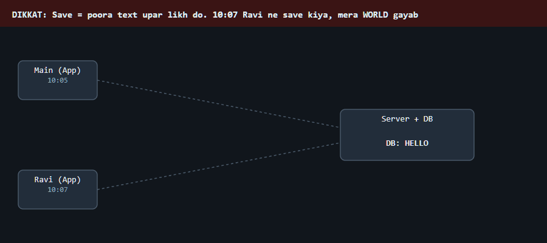
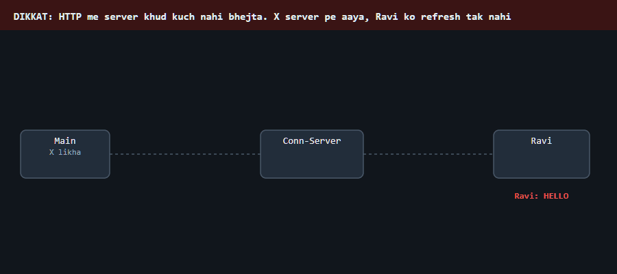
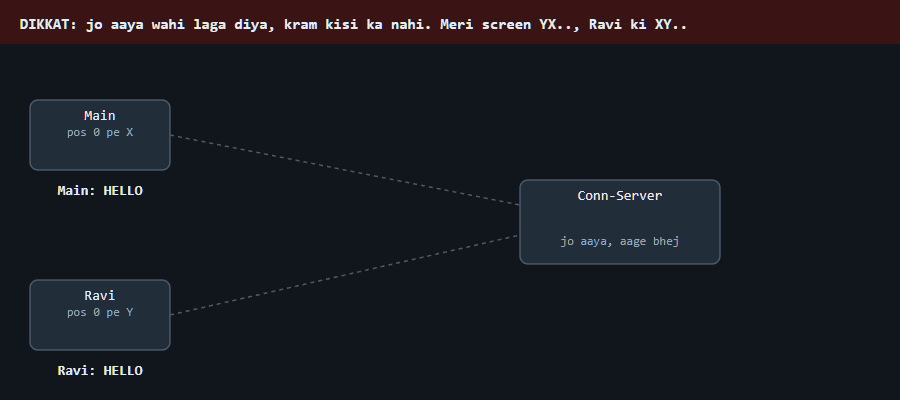
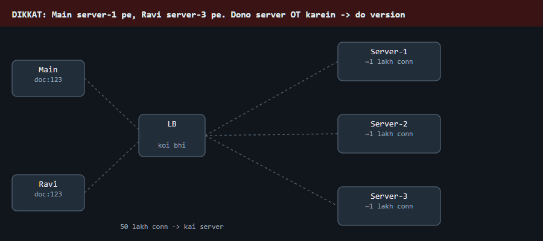
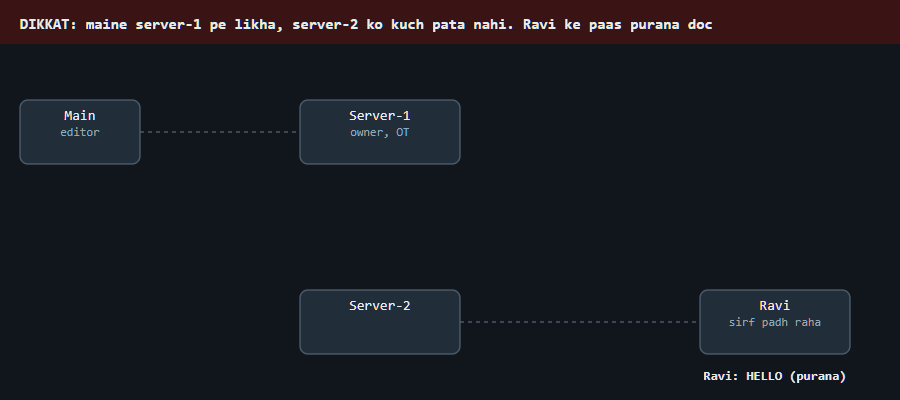
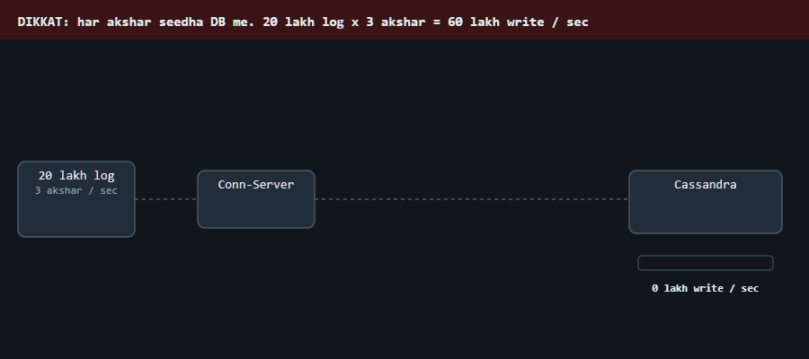
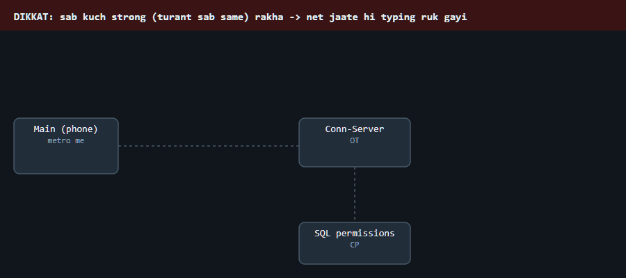
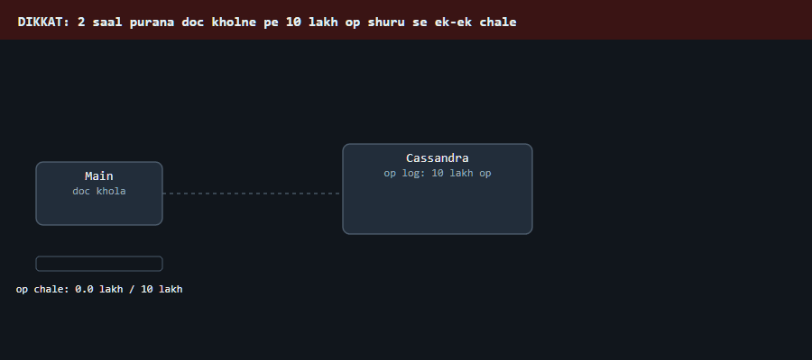

# Google Docs (Collaborative Editor)

> 2 ya zyada log ek doc ek saath edit karein. Kisi ka likha na mite, kuch kho na jaaye, turant dikhe.
> Dil: ek saath edit, koi likha khoye nahi, aur aakhir me sabke paas doc same (convergence).
>
> Mock me sirf heading + Cue + GIF. Neeche har card ek block: HAL (GIF ka ILAAJ) · KYUN · NAHI (doosra kyun nahi) · AGAR (cross-Q).
> Cross-Q: hal ke har bade shabd pe socho -> gira? · dheema / bheed? · do ek saath? · galat hua? · kaise / kitna?

---

## Poori tasveer (aakhir me design aisa banta hai)


---


## Shuru

```
FR      kai log ek doc saath edit karein, doosron ka likha turant dikhe, kisi ka likha na mite.
        Dhyaan sirf ek saath EDITING pe (comments, version history, formatting scope ke bahar)
NFR     typing turant ho aur kabhi na ruke (offline bhi). Aakhir me sabka doc same (convergence),
        "turant sab same" (strong) nahi
NUMBERS ~10 crore user, ~3-4 crore roz. Har akshar ek event, to likhna bahut zyada hai,
        isliye buffer + baantna (sharding). Pakka number yahan maayne nahi rakhta
PEHLE   sabse simple tha: poora text DB me rakho, aur Save pe poora text upar likh do (overwrite)
```

---

*ab tootega kahan? do log ek hi doc save karein to*

## 1. Ravi ne baad me save kiya, mera "WORLD" mit gaya

Cue: OPERATION + baseVersion (text nahi)



```
HAL     sirf badlaav (op) bhejo, kis version pe bana (baseVersion v7). Server khiska ke lagata
KYUN    server ke paas text nahi aata, badlaav aate hain. Server op ko agla version deta, lagata,
        aur Ravi ko bhej deta. Dono op v7 pe bane, to server samjhta ki saath bane,
        aur dono khiska ke lagata hai: "HELLO WORLD THERE"
NAHI    lock lagao -> RUKNA: user ko lock ya intezaar nahi chahiye.
        Purane version pe bana op bhi khisak ke lag jaata hai
AGAR    maine op se mitaya, aur Ravi ne wahin likha
        -> mitana bhi ek op hai. Server dono khiska ke lagata, Ravi ka akshar sahi jagah aata
        sirf op aate hain, to abhi ka doc kya hai?
        -> us doc ke saare op kram se, pehle se aakhri tak laga do. Doc = op ka jod
```

---

*ab badlaav bhej to diye, par Ravi ko dikhe kaise?*

## 2. Ravi ko mera likha refresh karne pe hi dikha

Cue: WEBSOCKET (khula, dono taraf)



```
HAL     connection khula rehta, dono taraf (WebSocket). Server khud bhejta, ~200 ms me dikhta
KYUN    ek hi khula connection dono taraf chalta hai. Server khud bhej deta, user ko refresh nahi karna padta
NAHI    HTTP -> EKTARFA: server khud kuch nahi bhej sakta.
        X server tak aaya, par Ravi ko refresh tak kuch nahi
AGAR    WebSocket connection chupchaap mar gaya
        -> har ~30 second ping / pong hota hai. Jawab nahi aaya to connection band, jagah khaali
        WebSocket connection toot gaya
        -> main likhta rehta hoon. Judte hi bolta "main v12 pe tha", server v13 se aage sab bhej deta
```

---

*ab dono ek hi jagah ek saath likhein to?*

## 3. 11 baje meeting me dono ne sabse upar ek saath type kiya

Cue: OT (server kram, op khiskao)



```
HAL     kram server tay karta (OT): X pehle v8, Y v9 aur 0 se 1 pe khiska. Dono ke paas XYHELLO
KYUN    kram sirf server ka hai, har op ko agla version milta, phone ki ghadi kabhi nahi.
        Aaya hua op us kram se khisakta hai, to sabki screen same rehti hai.
        Mujhe apna likha turant dikhta hai, baaki ka khisak ke aata hai
NAHI    jo aaya wahi laga do -> ALAG: meri screen "YX...", Ravi ki "XY...", do alag doc ban gaye
        kram timestamp se    -> TAKKAR: ek ms pe do op = same key, ek ne doosra chupchaap mita diya.
                                Isliye version
        CRDT                 -> FALTU: beech me server hai hi, har op usse guzarta.
                                OT yahi maangta (Docs bhi OT)
AGAR    CRDT hota kya hai?
        -> har akshar ki unique id hoti, kisi bhi kram me jodo to nateeja same. Offline chalta, memory zyada.
           OT op ko khiskata hai, CRDT id se apne aap judta hai
        OT ke beech Ravi ka op ~200 ms baad aaya, aur maine beech me likh diya tha
        -> mera app apne pending op khiska ke uska op lagata hai
        dono ne pos 0 pe likha, tie ho gaya
        -> server pe jo pehle aaya wo 0 pe, doosra 1 pe khisakta. Dono ke paas "XYHELLO"
```

---

*ab OT ek server pe hota hai, par connection itne saare*

## 4. 50 lakh connection khule, ek connection server nahi jhelta

Cue: RING: docId se ek OWNER server



```
HAL     docId se ring pe server chuno. doc:123 ka owner server-1, dono editor wahin, OT ek jagah
KYUN    ek server ~1 lakh connection hi jhelta hai, isliye kai server chahiye.
        Ek doc = ek owner server, to OT ek hi jagah hota hai.
        Editor docId se owner pe aata hai, viewer kahin bhi jud sakta hai
NAHI    editor alag-alag server pe (main server-1, Ravi server-3) -> TOOTA: OT kaun kare?
        do server = do version, doc toot gaya
PEHLE   pehle poochho: ek doc pe ek saath kitne log hain, 2-3 ya 100?
AGAR    ek doc pe 1000 log aa gaye
        -> 100 editor owner pe (OT sirf likhne walon ka), 900 viewer kahin bhi
        ring me server juda ya gira
        -> ring pe sirf uske pados ke doc khiskte hain, wo log dobara judte hain
        owner server gira, to doc kahan gaya?
        -> doc server pe nahi, DB me hai. Ring agla server deta, naya owner DB se doc banata.
           Editor dobara judte, version bata ke baaki op le lete. Doc nahi khota
```

---

*ab viewer kahin bhi hai, use op pahunche kaise?*

## 5. Ravi ab sirf padh raha, wo doosre server pe

Cue: REDIS PUB/SUB (doc ek channel)



```
HAL     har doc ka ek channel (Redis pub/sub). Server-1 op daalta, server-2 sunta, Ravi ko bhejta
KYUN    jis server pe us doc ka user hai, wo channel sunta hai (subscriber).
        Iska kaam sirf turant pahunchana hai, kuch store nahi karta (bheja aur bhool gaya).
        Bachana DB ka kaam hai, channel ka nahi. Viewer ka kuch chhoot gaya to version bata ke DB se le lo
AGAR    editor same server pe hai
        -> seedha push, pub/sub ki zaroorat hi nahi
        Ravi ka server restart ho gaya
        -> op channel se chala gaya (store nahi), par DB me hai. Ravi judta, version bata ke baaki le leta
        Redis pub/sub hi gir gaya
        -> copy main ban jaati hai (Sentinel). Live kuch second ruka, khoya kuch nahi
```

---

*ab sab live chal raha, par har akshar DB tak?*

## 6. 3 baje DB alert: har akshar pe DB me likha, DB baith gaya

Cue: REDIS BUFFER + BATCH, ACK = WAIT 1



```
HAL     op Redis buffer + copy dono me (WAIT 1, ~1 ms), tab ACK. Har 1 sec ek batch Cassandra me
KYUN    ACK tabhi jab op buffer aur copy dono me pahunch gaya.
        Cassandra ka batch ACK ke raaste me hai hi nahi.
        Isliye turant "saved" milta hai aur DB pe likhai kam hoti hai
AGAR    ACK se pehle Redis gira
        -> app op rakhta hai, bina ACK pakka nahi. Judte hi opId ke saath phir bhejo, pehle se hai to skip
        ACK ke baad Redis gira
        -> copy main ban gayi. ACK se pehle copy me likh chuke the, kuch nahi khoya
        batch dheema ho gaya
        -> typing nahi rukti, kyunki batch ACK ke raaste me nahi. Buffer badhta hai, to alert
        batch dobara likh diya
        -> (docId, version) same hai, to ek hi row banti hai. Kuch double nahi
        Cassandra hi kyun?
        -> wo sirf neeche jodta hai (commit log + RAM), likhai tez. Join chahiye nahi. Mongo bhi chalega
```

---

*ab net hi chala gaya to?*

## 7. Metro me mera net 1 second gaya, typing rukegi?

Cue: likhna AP, permission CP



```
HAL     likhna AP: typing chalti, op phone me pending. Permission CP: net aate hi SQL check
KYUN    typing kabhi na ruke (AP): net wapas aate hi op bhejo, server permission check karke khiska ke
        lagata, aakhir me sab same. Access kabhi galat na ho (CP): permission hatate hi roko,
        chahe thodi der ruke. Isliye permission alag SQL me
NAHI    net gaya to sab ruk jaaye -> RUKA: kaam ruk gaya, ye nahi chahiye
        sab kuch "turant sab same" (strong) -> RUKA: net jaate hi typing ruk jaati.
        Humein "aakhir me same" chahiye
PEHLE   pehle poochho: offline chahiye ya nahi? Isi ke jawab se poora CAP faisla tay hota hai
AGAR    pending op ke saath 1 ghanta offline raha
        -> pending op aur aakhri version rakho. Wapas aate hi bhejo, server khiska ke lagata, sab same
        offline me mera access hata diya
        -> pehle permission (CP). Judte hi SQL check, access nahi hai to pending op reject
```

---

*ab doc purana aur lamba ho gaya*

## 8. Raat ko 2 saal purana doc khola, 10 lakh op shuru se chale

Cue: SNAPSHOT + uske baad ke op



```
HAL     har 1000 op pe photo (snapshot), background job leta. Kholna = aakhri photo + baad ke op
KYUN    photo ek version tak ki hoti hai, to kholna = photo + uske baad ke ~1000 op. Shuru se kabhi nahi.
        Photo background job leta hai, user ko dikhta hi nahi
NAHI    har baar shuru se saare op ek-ek chalao -> DHEEMA: minuton tak khaali screen
AGAR    photo lete waqt kisi ne likha
        -> photo ek version tak hai (v9,99,000), baad ke op alag. Kuch nahi rukta
        kal ka purana version v5,00,500 maanga
        -> v5,00,000 ki photo + 500 op. Koi bhi purana version = us se pehli photo + beech ke op
        photo kitni baar lein?
        -> kam li to kholte waqt utne zyada op chalane padte. Har 1000 op pe theek hai
```

---

## Poora design ek saans me

```
CDN (app ki files) -> LB (editor: docId se owner server · viewer: koi bhi) -> Conn-Server (WebSocket + OT)
-> editors ko seedha PUSH · Redis pub/sub sirf un dekhne walon tak jo doosre server pe hain
-> Redis buffer (+ copy, phir ACK) -> BATCH -> Cassandra op log (docId, version) + snapshot
permission = alag SQL (CP) · edit AP (typing kabhi na ruke)
```

Bolne ke liye: har user doc ke hisaab se ek server se juda, ek doc ke sab editor ek server pe. Har akshar ek
badlaav. Server ek saath wale badlaav khiska ke lagata, kisi ka likha nahi khota, sabka doc same. Doosre servers
tak Redis se. Badlaav jama karke Cassandra me, photo ke saath taaki doc jaldi khule. Likhna kabhi na ruke,
permission turant lage (SQL).

---

## 10 guna traffic

- **WebSocket**: ~50 lakh connection. Alag connection line, aur docId se same server.
- **Conn-Server**: OT kahan? docId se baanto, ek doc = ek jagah.
- **Redis pub/sub**: bheed badhi to copy + aur machine.
- **DB likhna**: har akshar? Buffer + batch, docId se baanto.
- **Doc kholna**: 10 lakh op? Snapshot + baad ke op.

**Pooche: 10 guna kaise?** User ka raasta chalo, pehle jo toote wahi theek karo.

**Pooche: kahan se sab gir sakta?** Conn-Server (doosre pe dobara judo), Redis (copy).

**Pooche: chal raha hai, kaise pata?** Likha pahunchne ka p99, WebSocket toot-ne ki dar, buffer lag, alert.

---

## Pooche to (kisi card me nahi baitha)

API: GET /documents/{docId} -> snapshot + baad ke op. POST /documents/{docId}/edits -> ek op.
WebSocket /documents/{docId} -> live, dono taraf.

Op: { docId, userId, opType (insert / delete), position, char / text, baseVersion }. Server har op ko agla version
deta (kram). Timestamp sirf dikhane ke liye.

DB: op log Cassandra (bahut saara jodna, Mongo bhi chalega), snapshot taaki doc jaldi khule. Permission alag SQL
(rishte + CP).

Ek akshar ka safar: maine akshar likha, op bana. WebSocket se doc ke owner Conn-Server tak (Ravi bhi usi pe). OT ne
ek saath bane op ke hisaab se khiskaya, agla version diya, lagaya. Ravi ko seedha push, doosre server ke dekhne walon
ko Redis pub/sub se. Phir Redis buffer, batch, Cassandra edit log. Ravi ke app ne op liya, apni taraf khiskaya,
screen update.

App ki static files? CDN. JS / CSS sabke liye same, paas se aaye.

---

ARCHETYPE D (real-time) · CONCEPTS: [CAP](../../FOUNDATIONS/08_cap_theorem.md) · [pubsub/queues](../../FOUNDATIONS/07_message_queues.md) · [← MASTER SHEET](../../00_MASTER_SHEET.md)
