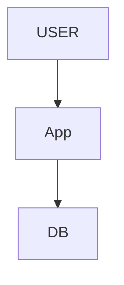
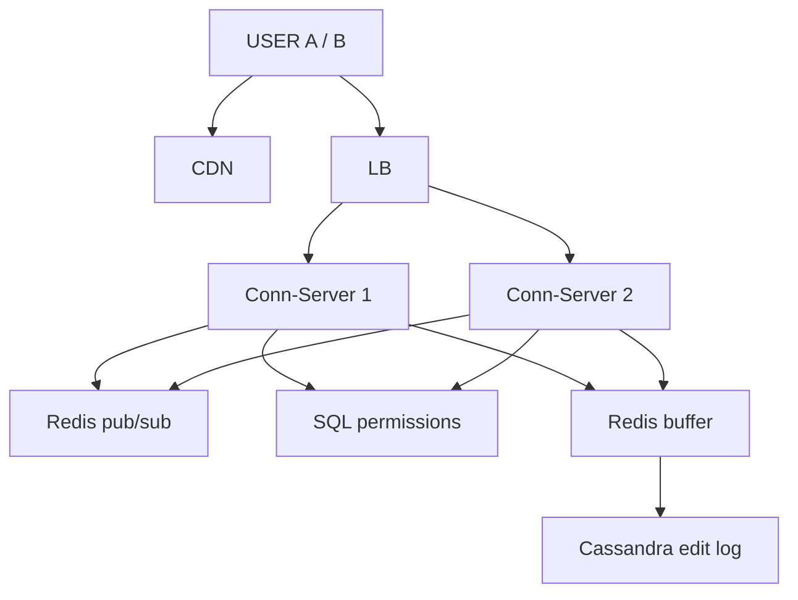
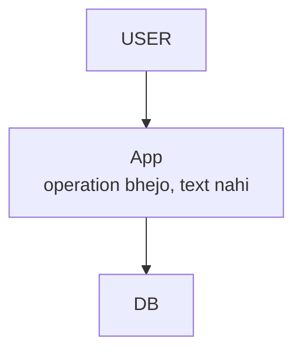
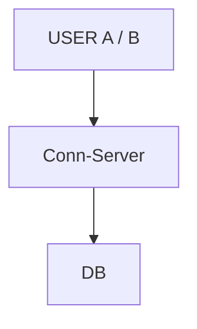
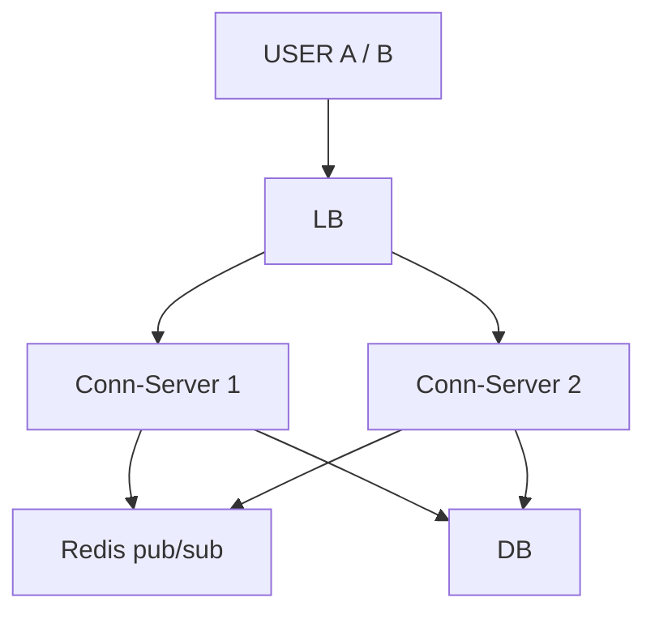
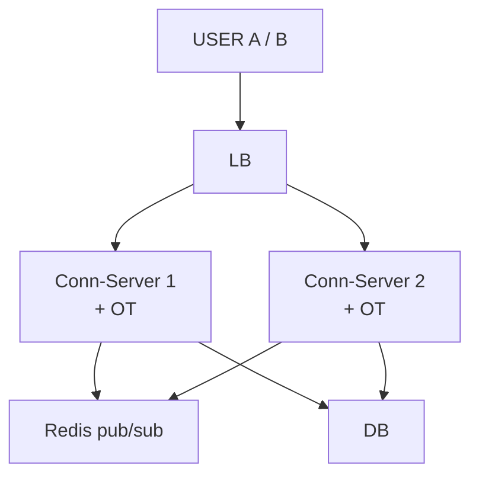
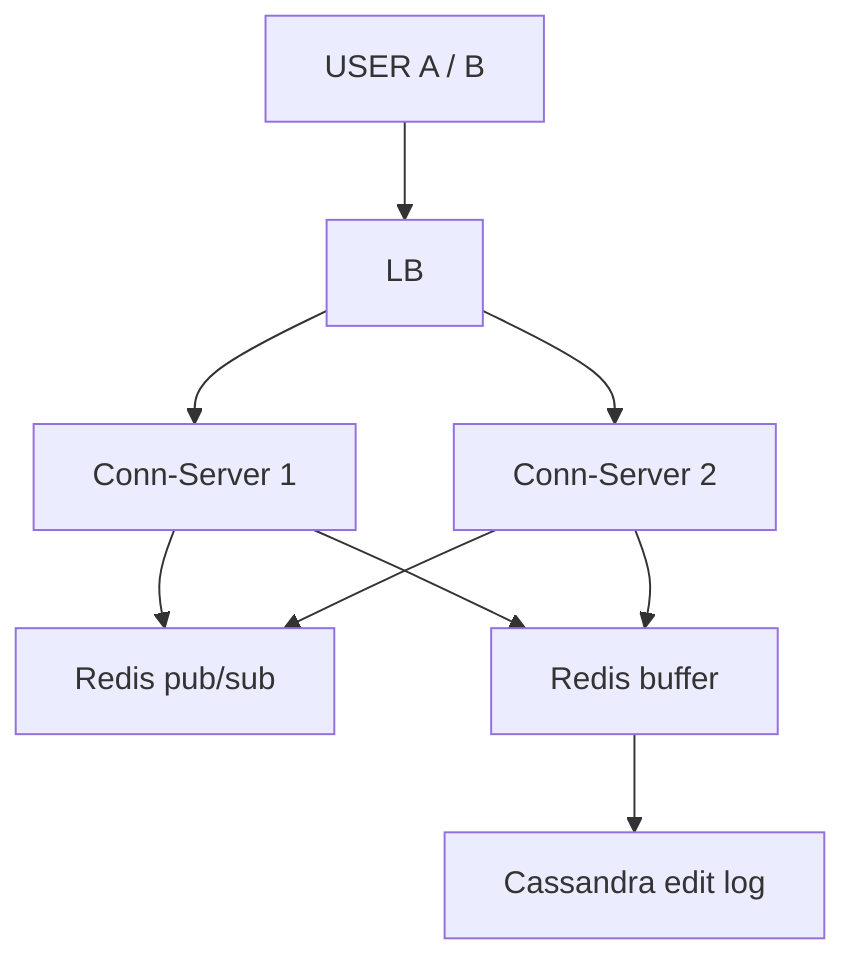
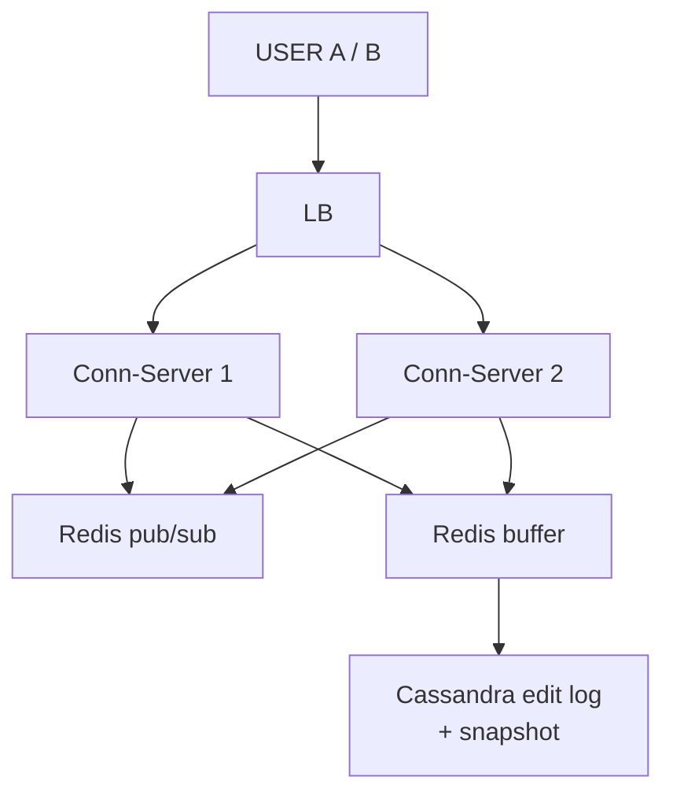
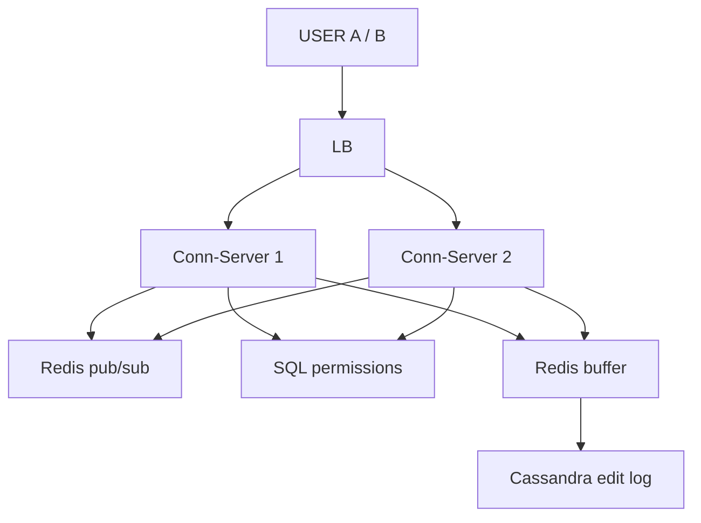

# Google Docs (Collaborative Editor)

> 2 ya zyada log ek doc EK SAATH edit karein -> kisi ka likha na mite, kuch kho na jaaye, turant dikhe, aakhir me sabke paas doc SAME.
> Is design ka dil: **ek saath edit + koi likha khoye nahi + aakhir me sab same (CONVERGENCE)**.
> 3 khaas cheez: har hisse ka alag CAP · WebSocket + Redis pub/sub · OT / CRDT.

---

## TASVEER (ByteByteGo / Alex Xu · CC BY-NC-ND 4.0)


Source: [How to Design Google Docs](https://bytebytego.com/guides/how-to-design-google-docs/)
(WebSocket + collaboration service + OT / CRDT + ops log — poora design ek tasveer me)

---

## SHURU: pehle poocho, phir numbers

```
POOCHO:  "Editing, comments, sharing / permission, version history, offline — main ek saath EDITING pe."
         ek doc pe ek saath kitne log? (2-3 ya 100) · OFFLINE
         chahiye?  <- iska jawab poora CAP faisla tay karta
         permission scope me? · rich text ya plain?

KYA KARE (FR):    kai log EK doc saath edit · doosron ka likha TURANT dikhe · kisi ka likha na mite
                  scope bahar: comments · version history · formatting
KAISA CHALE (NFR): typing TURANT (dil) · typing KABHI na ruke (offline bhi)
                   aakhir me sabka doc same — "turant sab same"
                   (strong) se NAHI, "aakhir me same" (convergence) se

NUMBERS (andaaza):
   ~10 crore user · ~3-4 crore roz · har akshar ek event -> LIKHNA bahut zyada
   -> beech me buffer + baantna (sharding) chahiye (pakka number yahan maayne nahi rakhta)
```

---

## ════ MOCK SE PEHLE: SIRF YE CARD PADHO ════

> Har dikkat ek card: KAHANI (kya hua, kaun, kitna) -> ILAAJ -> ANDAR KAISE (ilaaj kyun kaam karta) ->
> ISKE BAAD KYA TOOTEGA (interviewer yahin ghusta hai: dabba lagaya, ab kya?).

#### DABBA 0: SABSE SIMPLE (yahan se shuru, phir "kahan tootega")
```
Doc ka poora text DB me. "Save" dabao -> poora text upar likh do (overwrite).
```


#### [1](#d1) DONO NE SAATH SAVE KIYA, BAAD WALE NE PEHLE KA MITA DIYA
```
KAHANI:  Doc me "HELLO" tha. Arpan ne "HELLO WORLD" karke save kiya, usi waqt Ravi ne "HELLO THERE".
         Ravi ka save baad me pahuncha, usne poora text upar likh diya -> Arpan ka "WORLD" gayab
         (jo baad me aaya wo jeeta = LAST-WRITE-WINS).

ILAAJ:   Poora text mat bhejo, sirf kya badla wo bhejo (OPERATION): "position 5 pe ' WORLD' daala".
         Arpan ka op aur Ravi ka op dono lagao -> dono ka likha bacha.

ANDAR KAISE:
         op = { docId, userId, type (insert / delete), position, char, baseVersion }
         baseVersion = Arpan ne doc ka kaunsa version dekh ke ye op banaya.
         Arpan aur Ravi dono ne v7 dekh ke op banaya -> server ko pata
         ye do op ek saath (concurrent) bane -> card 4 sambhaalta.

ISKE BAAD KYA TOOTEGA:
  - Arpan ne "L" mitaya, Ravi ne usi jagah type kiya?
      -> mitana bhi ek op hai. OT dono ko adjust karta: Ravi ka
         akshar sahi jagah khisakta, Arpan sahi "L" mitata (card 4).
```

#### [2](#d2) RAVI KO ARPAN KA LIKHA KAB DIKHEGA?
```
KAHANI:  Normal HTTP me server khud kuch nahi bhej sakta, sirf jawab de
         sakta. To Ravi refresh kare tab Arpan ka likha dikhe? Bekaar.

ILAAJ:   WEBSOCKET: ek connection jo khula rehta aur dono taraf chalta.
         Arpan usi se type bhejta, aur usi se Ravi ka likha aata.

ANDAR KAISE:
         Pehle ek HTTP request "Upgrade: websocket" -> server "101
         Switching Protocols" -> wahi connection khula rehta,
         ab dono taraf chhote-chhote message.

ISKE BAAD KYA TOOTEGA:
  - Connection beech me toot gaya?
      -> dobara judo (ruk-ruk ke) + bolo "main v120 tak tha" -> server
         v121 se aage ke saare op bhej deta. Kuch nahi chhoota.
  - Arpan abhi bhi hai, kaise pata?
      -> har ~30 sec ping / pong. Jawab nahi = connection band, jagah khaali.
  - Baar-baar poochhna (polling) ya SSE kyun nahi?
      -> polling = crore log x har second bekaar sawaal + 1 sec
         der. SSE sirf server -> user, yahan dono taraf chahiye.
```

#### [3](#d3) ARPAN SERVER-1 PE, RAVI SERVER-2 PE
```
KAHANI:  Ek connection server itne connection nahi jhelta, to kai lagaye.
         Arpan server-1 se juda, Ravi server-2 se, dono ek hi doc pe.
         Arpan ne type kiya -> server-1 ko pata, par server-2 ko
         kaise pata chale? Server ek doosre ko jaante hi nahi.

ILAAJ:   REDIS PUB/SUB: server-1 Arpan ka op Redis pe PUBLISH kare
         -> jo servers us doc ko sun rahe, sabko pahunch jaata
         -> server-2 Ravi ko bhej deta.

ANDAR KAISE:
         Har doc ek channel (doc:123). Jis server pe doc:123 ka koi user hai, wo SUBSCRIBE karta.
         Server-1 --publish doc:123--> Redis --> Server-2 --> Ravi
         Redis pub/sub kuch STORE nahi karta (bheja aur bhool
         gaya). Iska kaam sirf turant dikhana, data bachana nahi.

ISKE BAAD KYA TOOTEGA:
  - Us waqt server-2 restart ho raha tha, sun hi nahi raha?
      -> pub/sub ka message gaya. Par op log me likha hai: Ravi dobara jude to version bata ke baaki le le.
  - Redis pub/sub hi gir gaya?
      -> copy pe switch (Sentinel). Kuch second live dikhna ruka, likha kuch nahi khoya (log me hai).
  - Kafka kyun nahi?
      -> Kafka store karta + thoda dheema. Live typing ko dobara padhna nahi chahiye, tezi chahiye.
```

#### [4](#d4) DONO NE EK SAATH POSITION 0 PE TYPE KIYA
```
KAHANI:  Doc "HELLO". Arpan ne position 0 pe "X" likha, usi pal Ravi ne position 0 pe "Y".
         Seedha lagaya -> Arpan ki screen pe "XHELLO" phir Y ->
         "YXHELLO"; Ravi ki pe "YHELLO" phir X -> "XYHELLO".
         Do alag doc ban gaye (diverge).

ILAAJ:   OT (Operational Transformation): doosre ka op aane pe usko apne op ke hisaab se khiska do.
         Dono taraf ek hi niyam -> dono ka doc same.
         (CRDT doosra raasta: har akshar ki apni unique id, kisi bhi kram me jodo, nateeja same.)

ANDAR KAISE:
         Niyam (tie-break): same jagah pe dono ne likha to Arpan ka pehle.
         Arpan ki screen: XHELLO. Ravi ka "Y at 0" aaya -> Arpan ka X
                          pehle hai -> Y ko 1 pe khiskao -> "XYHELLO"
         Ravi ki screen:  YHELLO. Arpan ka "X at 0" aaya -> Arpan pehle -> X 0 pe hi -> "XYHELLO"
         Dono ke paas "XYHELLO". Same.

ISKE BAAD KYA TOOTEGA:
  - Khiskana kaun karta, app ya server?
      -> dono. Server KRAM tay karta (har op ko agla version
         number) + aaye op ko khiskata. App apne pending op ko.
  - OT kyun, CRDT kyun nahi?
      -> beech me server hai (har op usi se guzarta) -> OT seedha baithta, Google Docs bhi OT.
         CRDT = bina server (offline-first, phone se phone). Keemat: har akshar ki id = memory zyada.
  - Ek doc ka OT do server pe chala?
      -> kram toot gaya. Isliye ek doc ke saare op EK server pe (card 8).
```

#### [5](#d5) HAR AKSHAR PE DB ME LIKHNA
```
KAHANI:  Crore log type kar rahe, har akshar pe ek DB write -> DB khatam.

ILAAJ:   Op pehle Redis BUFFER me jama, har ~1 sec / 500 op pe ek saath (BATCH) Cassandra me (edit log).
         Live dikhana to pub/sub se ho hi raha (card 3), DB sirf bachane ke liye.

ANDAR KAISE:
         Edit log: partition key = docId, uske andar kram = version (SERVER ka number).
         Timestamp se kram NAHI: ek hi millisecond pe do op = same key = ek
                                 ne doosre ko chupchaap mita diya, op gaya.
         Cassandra likhne me tez: pehle commit log (sirf neeche jodna) + RAM (memtable).

ISKE BAAD KYA TOOTEGA:
  - Arpan ka op Redis buffer me tha, Redis gir gaya -> op gaya?
      -> Redis ki copy async thi, poora nahi bachati. Ilaaj: Arpan ka
         app op apne paas rakhe jab tak server "mil gaya" (ACK) na bole,
         dobara jude to phir bheje (opId ke saath, server ke paas pehle se hai to skip).
         Server ACK tabhi de jab op pakka likh liya ho.
  - "Sahi hona chahiye to SQL lo"?
      -> nahi. DB data ki shakal se chuno: rishte (join) nahi, bas bahut saara jodna -> Cassandra.
```

#### [6](#d6) DOC KHOLA, 10 LAKH OP SHURU SE CHALANE PADE
```
KAHANI:  Arpan ne 2 saal purana doc khola. Server ne pehle op se 10
         lakh op dobara chalaye tab doc bana -> kholne me bahut der.

ILAAJ:   SNAPSHOT: har ~1000 op pe poore doc ki photo save. Kholna = aakhri photo + uske baad ke thode op.

ISKE BAAD KYA TOOTEGA:
  - Photo lete waqt koi type kar raha?
      -> photo ek version tak (v1000). Kholna = v1000 ki photo + v1001 se aage ke op. Kuch nahi rukta.
  - Kitni baar photo?
      -> har 1000 op ya har kuch minute, jo pehle ho.
```

#### [7](#d7) NETWORK EK SECOND GAYA, TYPING RUKEGI? (CAP)
```
KAHANI:  Arpan ka network 1 second ke liye gaya. Typing ruk jaaye, ya wo type karta rahe?

ILAAJ:   Har HISSE ka alag CAP:
         doc edit = AP: type karte raho, network aaye to bhej do. "Sabka ek doc" OT se aata (convergence).
         permission = CP: jiska access hataya use TURANT roko -> alag SQL me.

ANDAR KAISE:
         "Doc sahi chahiye -> CP" bolna galat: CP me network jaate hi typing ruk jaati.
         Yahan sahi hona "aakhir me sab same" se aata, typing rok ke nahi.

ISKE BAAD KYA TOOTEGA:
  - Arpan ne 1 ghanta offline type kiya?
      -> app ke paas pending op + aakhri version. Wapas aate hi bhejo, server khiska ke lagaye, sab same.
  - Arpan ka access hata diya, aur wo offline type kar raha tha?
      -> dobara jude to pehle permission check (SQL, CP). Access nahi -> pending op reject.
```

#### [8](#d8) CRORE WEBSOCKET CONNECTION
```
KAHANI:  Crore connection khule. Ek doc ke 5 editor alag-alag 5 server
         pe bikhre -> har server apna OT chala raha -> kram toota.

ILAAJ:   Alag CONNECTION server ki line. docId se baanto: ek doc ke saare editor + uska OT EK hi server pe.

ANDAR KAISE:
         URL me docId -> LB consistent hashing RING se server
         chunta. Server juda / gira -> sirf uske hisse ke doc hilte.
         (hash(docId) % N NAHI: N badla to lagbhag har doc ka server badla = sab dobara jude.)
         Ek doc pe ~100 editor tak ek server jhel leta. App ki static files CDN se.

ISKE BAAD KYA TOOTEGA:
  - Doc wala server gir gaya?
      -> ring pe agla server le leta. Sab dobara jude, photo + op se doc bana, version bata ke baaki op.
  - Likhe hue ka kram kaun tay kare?
      -> SERVER: har op ko doc ka agla version number. App ki ghadi kabhi nahi.
  - Ek doc pe 1000 log?
      -> jo sirf dekh rahe (likh nahi rahe) unhe alag rakho, pub/sub se updates.
```

```
AAKHRI DABBE (sab dikkat ke baad):
  CDN (app ki files) -> LB (docId se same server) -> Conn-Server (WebSocket + OT + buffer)
  -> Redis pub/sub (doosre Conn-Servers tak) -> unke users ko PUSH
  -> Redis buffer -> BATCH -> Cassandra op log (docId, version) + snapshot · permission = SQL

DB:  op log = Cassandra (bahut saara jodna; Mongo bhi chalega) · snapshot taaki doc jaldi khule
     permission = alag SQL (rishte + CP) · edit AP (typing kabhi na ruke)

END ME POOCHEGA:
  "Do log ek jagah type?" -> OT: ek saath bane op ko khiskao, sab same · (CRDT = har akshar ki unique id)
  "Kram kaun tay kare?"   -> server version deta; timestamp sirf dikhane ke liye
  "10x?"            -> alag connection line · Conn-Server docId se baanto · Redis copy
                       · DB buffer + batch · doc kholna = snapshot + baad ke op
  "SPOF?"           -> Conn-Server (doosre pe dobara judo), Redis (copy)
  "Chal raha, kaise pata?" -> likha doosre tak kitni der me
  pahuncha (p99) · WebSocket toot-ne ki dar · buffer lag · alert
```

AAKHRI DABBE ki tasveer:



---

## ════ DETAIL: HAR DIKKAT KI INTERVIEW LINE + TASVEER ════

> Card me poori kahani hai. Yahan har dikkat ki ek English line (interview me bolne ke liye) aur us waqt tak ka diagram.

---

<a id="d1"></a>

## DIKKAT 1 — dono ne saath save kiya, baad wale ne mita diya

```
JAWAB:    Poora doc bhej ke save karo to baad wala pehle wale ka likha mita deta.
          Isliye sirf ye bhejo ki kya badla: 'position 5 pe WORLD daala'. Saath me 'maine doc ka version
          7 dekh ke likha'.
          Arpan aur Ravi dono ke badlaav lag jaate, kisi ka likha nahi mitta.
```


---

<a id="d2"></a>

## DIKKAT 2 — Ravi ko Arpan ka likha kab dikhega

```
JAWAB:    Har user ka server se ek connection khula rehta (WebSocket). Arpan likhe to turant server tak,
          aur Ravi ka likha turant Arpan tak.
          Connection toota aur wapas juda to app bolta 'main version 120 tak tha', server 121 se aage ke
          saare badlaav bhej deta.
```


---

<a id="d3"></a>

## DIKKAT 3 — Arpan server-1 pe, Ravi server-2 pe

```
JAWAB:    Arpan server-1 pe, Ravi server-2 pe. Server-1 Arpan ka badlaav Redis pe 'doc:123' channel me
          daal deta, server-2 us channel ko sun raha hai, to Ravi tak pahuncha deta.
          Redis ye kahin save nahi karta, sirf aage bhejta. Kuch chhoot gaya to dobara judne pe log se
          mil jaata.
```


---

<a id="d4"></a>

## DIKKAT 4 — dono ne ek saath position 0 pe type kiya

```
POOCHEGA: "Two people type at the same position at the same time — what happens?"
          (Do log ek hi jagah ek saath type karein to?)

JAWAB:    Doc 'HELLO'. Arpan ne 0 pe X likha, Ravi ne bhi 0 pe Y. Seedha lagao to dono ki screen pe alag
          doc.
          Niyam: same jagah pe dono ne likha to Arpan ka pehle. Ravi ka Y ek aage khisak jaata. Dono ki
          screen pe 'XYHELLO'.
          Ye khiskana OT hai. Kisi ka likha nahi khota aur aakhir me sabka doc same.
```


---

<a id="d5"></a>

## DIKKAT 5 — har akshar pe DB me likhna

```
POOCHEGA: "The database takes too many writes. What do you do?"
          (DB pe likhai bahut zyada. Kya karoge?)

JAWAB:    Har akshar pe DB me likhna mehnga. Live dikhana to Redis se ho hi raha hai.
          Isliye badlaav pehle Redis me jama karo, har 1 second ek saath Cassandra me likh do. Ek doc ke
          saare badlaav ek jagah, server ke diye number ke kram me.

JAWAB:    Redis ki copy thodi der baad pahunchti, to Redis gira to kuch badlaav ja sakte.
          Isliye Arpan ka app badlaav apne paas rakhta jab tak server 'mil gaya' na bole, aur server
          'mil gaya' tab hi bolta jab pakka likh liya.
          Redis gira -> app wahi badlaav (wahi id ke saath) dobara bhejta, server pehle se dekha hua
          skip kar deta.
```


---

<a id="d6"></a>

## DIKKAT 6 — doc khola, 10 lakh op chalane pade

```
JAWAB:    2 saal purana doc kholne pe 10 lakh badlaav shuru se chalana dheema.
          Isliye har 1000 badlaav pe doc ki photo le lo. Kholte waqt aakhri photo + uske baad ke thode
          badlaav.
```


---

<a id="d7"></a>

## DIKKAT 7 — network ek second gaya, typing rukegi

```
POOCHEGA: "Consistency or availability — which do you pick?"
          (Consistency ya availability, kya chunoge?)

JAWAB:    Likhne ke liye: network jaaye to bhi type karte raho, baad me sab mil jaayega aur doc same ho
          jaayega.
          Permission ke liye ulta: kisi ka access hataya to turant rokna hai, chahe kuch der system
          ruke.
```


---

<a id="d8"></a>

## DIKKAT 8 — crore WebSocket connection

```
POOCHEGA: "How do you keep edits in order?"
          (Badlaav ka kram kaise rakhoge?)

JAWAB:    Kram server tay karta: har badlaav ko doc ka agla number deta, app ki ghadi pe bharosa nahi.
          Ek doc ke saare badlaav ek hi server pe, wahi ek-ek karke lagata, to kram kabhi nahi bigadta.
```


---
## 10 GUNA TRAFFIC — har dabba alag se

```
WebSocket      -> crore connection -> alag CONNECTION LINE + docId se same server
Conn-Server    -> OT kahan? -> docId se baanto (ek doc = ek jagah)
Redis pub/sub  -> bheed -> copy + aur machine
DB likhna      -> har akshar? -> buffer + batch, docId se baanto
doc kholna     -> 10 lakh op? -> SNAPSHOT + baad ke op

POOCHEGA: "How would you scale this to 10x?"      -> user ka raasta chalo, pehle jo toote
POOCHEGA: "What's the single point of failure?"   -> Conn-Server (doosre pe dobara judo), Redis (copy)
POOCHEGA: "How do you know it's working?"         -> likha pahunchne
          ka p99 · WebSocket toot-ne ki dar · buffer lag · alert
```

---

## POOCHE TO (gehra sawaal aaye tab)

```
API:      GET /documents/{docId} -> snapshot + baad ke op · POST /documents/{docId}/edits -> ek op
          WebSocket /documents/{docId} -> live, dono taraf

DATA:     har badlaav = OPERATION: { docId, userId, opType
          (insert / delete), position, char / text, baseVersion }
          server har op ko agla version deta (kram); timestamp sirf dikhane ke liye
          abhi ka doc = us doc ke saare op KRAM se lagao
          Cassandra theek (bahut saara jodna) · Mongo bhi chalega · permission = alag SQL (rishte + CP)

EK AKSHAR KA SAFAR:
          1. Arpan ne akshar likha -> op { docId, userId, insert, pos, char, baseVersion }
          2. WebSocket se Arpan ke Conn-Server tak
          3. OT: ek saath bane op ke hisaab se khiskao -> lagao
          4. Redis pub/sub publish -> baaki Conn-Servers -> unke user (Ravi) ko PUSH
          5. Redis buffer -> BATCH -> Cassandra edit log
          6. Ravi ke app ne op liya -> apni taraf khiskaya -> screen update

OT vs CRDT: OT = op bhejo, ek saath wale ko KHISKAO, sab same · CRDT
            = har akshar ki unique id, kisi bhi kram me jodo same
```

---

## AAKHRI DABBA + WRAP

```
CDN = app ki files · LB = docId se same server · Conn-Server = WebSocket + OT + buffer
Redis pub/sub = server se server · Redis buffer = batch
likhna · Cassandra = op log (docId, version) + snapshot
SQL = permission (CP)
```
```
JAWAB:    Har user doc ke hisaab se ek server se juda (ek doc ke sab log ek server pe). Har akshar ek
          badlaav.
          Server ek saath wale badlaav khiska ke lagata, kisi ka likha nahi khota, sabka doc same.
          Doosre servers tak Redis se.
          Badlaav jama karke Cassandra me, photo ke saath taaki doc jaldi khule. Likhna kabhi na ruke,
          permission turant lage (SQL).
```


ARCHETYPE D (real-time) · CONCEPTS: [CAP](../../FOUNDATIONS/08_cap_theorem.md) · [pubsub/queues](../../FOUNDATIONS/07_message_queues.md) · [← MASTER SHEET](../../00_MASTER_SHEET.md)
