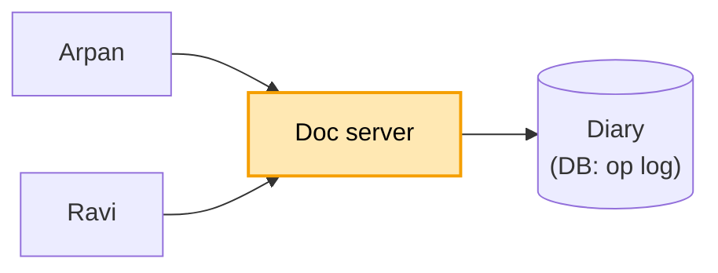
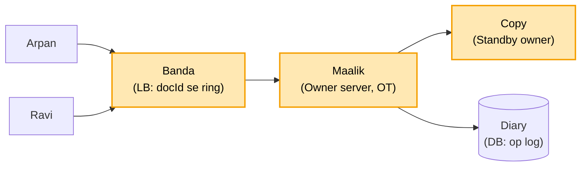
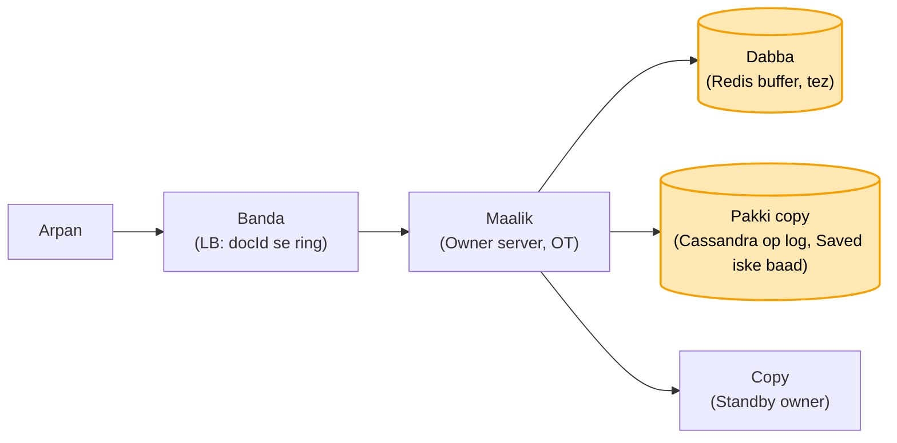
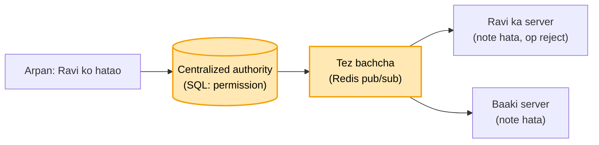

# Google Docs: Arpan aur Ravi ke "Trip plan" doc ki kahani

Arpan aur Ravi ek hi doc "Trip plan" pe saath likh rahe hain. Doc me hai `Goa jaayenge`. Kaam: dono ek saath likhein
to kisi ka likha gayab na ho, dono ki screen pe ek hi doc dikhe, aur "Saved" dikha to likha hua kabhi na ude.

Har kadam = **kahani** (dikkat aur hal, bolne wali bhasha) -> **Asli naam** (interview me yahi shabd) -> tasveer
(kahani ka shabd, bracket me asli naam).

---

## FR / NFR / Numbers (interview me pehle 2 minute)

```
FR      kai log ek doc ek saath edit karein · doosre ka likha turant dikhe, kisi ka likha mite nahi
NFR     typing turant, ruke nahi · aakhir me sabka doc SAME · "Saved" dikha to kabhi na ude
Numbers ~10 crore user, roz ~3-4 crore · har akshar ek badlaav
        -> likhna bahut zyada: har akshar pe DB nahi chal sakta
```

---

## 1. Ravi ke Save ne Arpan ki line gayab ki (poora text nahi, operation bhejo)

Jo "Save" dabata hai, uska poora text server pe jaake purane ko hata deta hai. Maine upar "Goa jaayenge" likh ke Save
kiya, Ravi ne neeche "budget 20k" likh ke Save kiya, par Ravi ki screen pe purana text tha, to meri line gayab. Ye to
last write wins wali situation ho gayi, aur Google Docs me last write wins nahi chalne ka, warna Google Docs ka matlab
hi khatam. Dono ka text dikhao, kisi ko gayab kyun karna. Poora text bhejenge to overwrite hoga hi, to poora text mat
bhejo, operation bhejo: insert, delete, add. Ravi ne kuch kiya to uska operation aayega "is letter ke baad add kar do",
aur main use "Goa jaayenge" ke baad, ya neeche, ya beech me kahin, wahin laga dunga.

**Asli naam:** last write wins nahi = dono ka badlaav bache, poora text nahi = operation (op: insert / delete), is
letter ke baad = op me jagah (position) + kis version pe dekh ke likha (baseVersion). Server se dono ki screen tak op
turant = WebSocket (dono taraf khula taar).



## 2. Ek hi second me dono ne likha, Ravi ka "kal" galat jagah (shabd khiska do)

Doc me `Goa jaayenge`. Ek hi second me maine shuru me "Hum " joda, aur Ravi ne "Goa" ke baad (jagah 3) " kal" joda.
Server pe mera pehle pahuncha, phir Ravi ka "jagah 3" lagaya to ban gaya `Hum kal Goa jaayenge`, Ravi ka kal galat
jagah. Maine likha "Hum Goa jaayenge", usne likha "Goa kal jaayenge", to poora banna chahiye "Hum Goa kal jaayenge".
Uska kal bhi galat jagah nahi, hamara Hum bhi nahi. Bas shabdon ko khiska do: main yaad rakhun ki Arpan ne Goa se
pehle Hum likha tha, to Ravi ki jagah utni aage khiska do. Koi dikkat hi nahi.

**Asli naam:** shabdon ko khiska do = OT (Operational Transformation), yaad rakhun kisne kahan likha = op jis version
pe bana, uske baad lage op ke hisaab se uski position aage-peeche. Kram server tay karta, jo pehle pahuncha use agla
version.

## 3. Do server, ek doc ki do shakal (har doc ka ek maalik, aur uski copy)

Lakhon doc, 100 server. Main server A se, Ravi server B se. Dono server apne-apne kram me OT lagaate, to ek hi doc ki
do alag shakal. To ek centralized system bana do. Main Google Docs hoon: dono ka likha mere tak aaya, main dono ka
sentence padh ke sahi se likh dunga, "Hum Goa kal jaayenge", aur dono ki screen pe wahi, ek hi version. Par sabka ek
nahi hoga, har doc ka alag. Main aur Ravi ek doc pe to hum dono ka ek centralized system; 100 log ek doc pe to un 100
ka ek; 1 lakh log to unka ek. Us system ka koi na koi maalik hoga, sab uske hisaab se chalega.

**Asli naam:** centralized system, ek hi version = ek doc ka kram aur OT ek hi jagah, har doc ka alag maalik = har doc
ka ek owner server (LB `docId` dekh ke ring pe owner chunta, ek doc ke saare editor wahin).



## 4. Har akshar DB pe (chhota register, kuch der baad DB)

Hazaron-laakhon log dhadadhad likh rahe, aur har chhota badlaav DB pe jaaye to kitna DB write karega, Cassandra ki bhi
haalat ho jaayegi. Main hi Google Docs hoon: log baar-baar hata rahe, badal rahe, check kar rahe. To main apna ek
chhota register bana lunga, unki saari baatein usme likhta rahunga, phir kuch der baad ek saath DB me save kar dunga.
Har write pe DB query nahi maarunga, warna DB baith jaayega.

**Asli naam:** chhota register = buffer (Redis), kuch der baad ek saath = batch write, DB = Cassandra (op log me sirf
aage jodna, padhna hamesha "is doc ke op, version ke kram se"; key `(docId, version)`; likhai bahut tez, machine jodo
to data khud bat-ta; join / transaction ki zarurat nahi, isliye Postgres nahi).

**Maan lo register me 5 second ka kaam jama tha, "Saved" dikha diya, aur DB me likhne se pehle server gira:** mera
poora para uda. To use ek chhoti memory me likho. Maan le mere paas ek dabba hai, us dabbe me saari information store
kar raha. Kal wo dabba mar jaaye ya gir jaaye, to us dabbe ki ek aur copy bana dunga. Ya main dabbe ko bolunga: ye
meri information tu bhi store kar le. Kal mujhe kuch ho jaaye to tu hai, tujhe kuch ho jaaye to main hoon. Dabbe aur
copy me likh gaya, tabhi "Saved".
**Asli naam:** dabba = Redis buffer (tez, chalta doc), dabbe ki copy = pakki jagah: har op turant
Cassandra me bhi (3 copy). Redis ki apni copy der se bharti, us pe "Saved" ka bharosa nahi. "Saved" = ACK tabhi jab
Cassandra ne likh liya. Mujhe kuch ho to tu hai = owner gira to naya owner (copy) Cassandra se doc utha ke aage chalta.



## 5. Ravi hata, phir bhi 2 minute likhta raha (memory me note + tez bhaagne wala bachcha)

Main doc ka maalik, maine Ravi ko hata diya. Par Ravi ke server ke paas permission ki purani copy, "Ravi = editor", to
hatne ke baad bhi Ravi 2 minute likhta raha. To main apni memory me chhota note daal dunga: ye banda editor nahi, iska
koi bhi operation aaye, accept nahi karunga. Par Ravi alag server pe hai, to main ek parchi rakhunga "Ravi ab editor
nahi", aur wo parchi ek tez bhaagne wale bachche ko dunga: jahan bhi Ravi ki permission hai wahan sab ja aur bata de.
Ek centralized authority hai jo sab likh rahi. Usne mana kiya to chhota banda building ke bahar khada hoke chilla de
"suno, Ravi editor nahi", to Ravi jis bhi server pe ho, wahan se uska editor note hat chuka hoga. Isme ek hi sahi
answer nahi, Redis pub/sub bolo ya building ke bahar koi chilla de, baat wahi.

**Asli naam:** centralized authority = permission ka asli sach (SQL: kaun, kis doc pe, kya kar sakta), memory me note
= server pe permission cache + har op pe check (har akshar pe SQL nahi), iska op accept nahi = op reject, tez bhaagne
wala bachcha / building ke bahar chilla de = pub/sub invalidation (Redis pub/sub), sab server note hata dete.

**Maan lo ladka chillaya aur server 7 us pal restart / net se bahar tha, awaaz suni hi nahi:** server akela nahi, uski
copy saath khadi hai aur wo bhi sunti hai. Server bola tha "kuch ho to note kar lena, wapas aake dekh lunga". Wapas
aaya, copy se poochha "kya hua?", "Ravi editor nahi" mila, note hata diya, ab Ravi ka op reject.
**Asli naam:** standby server bhi pub/sub sunta (pub/sub ek hi baar bolta, chhoote to khoya), reconnect pe chhoote
badlaav copy / SQL se le ke cache theek, uske baad hi op maano.



---

Notes (Arpan ke shabd) = [DOCS_HAND_NOTES.md](DOCS_HAND_NOTES.md) · [<- MASTER SHEET](../../00_MASTER_SHEET.md)
