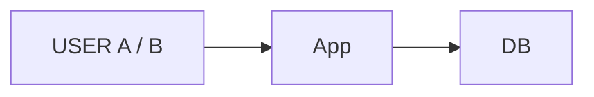
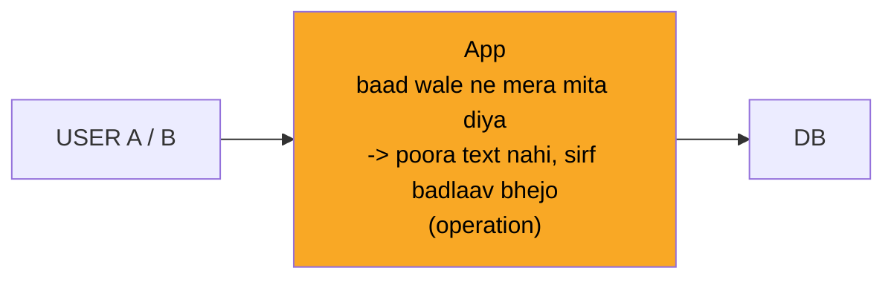
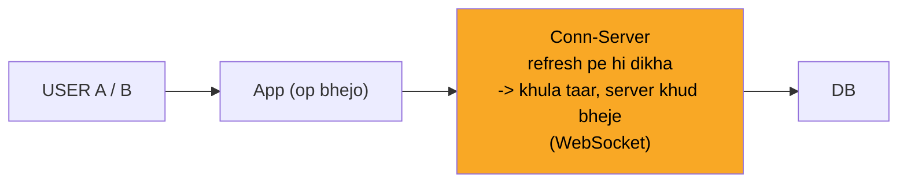
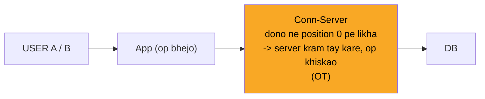
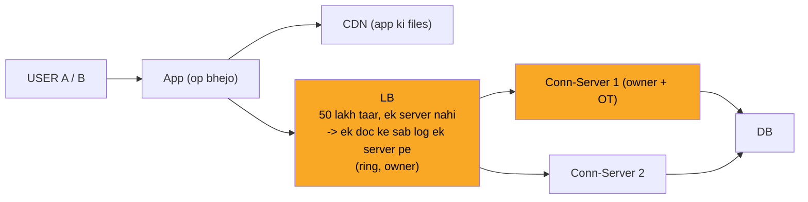
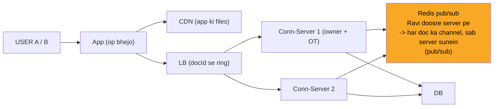
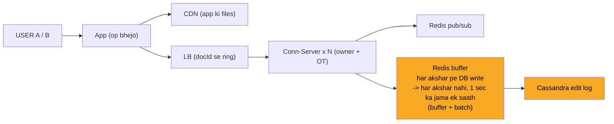
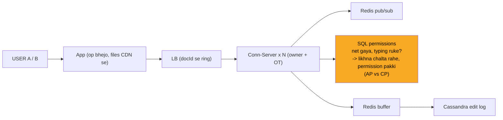
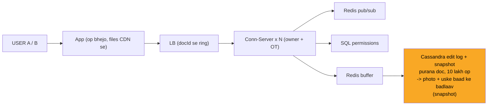
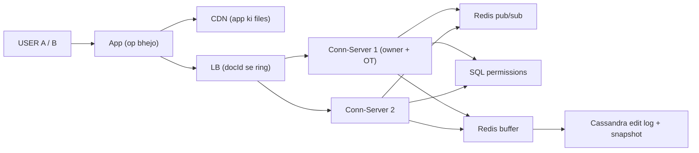

# Google Docs (Collaborative Editor)

> 2 ya zyada log ek doc EK SAATH edit karein -> kisi ka likha na mite, kuch kho na jaaye, turant dikhe, aakhir me sabke paas doc SAME.
> Is design ka dil: **ek saath edit + koi likha khoye nahi + aakhir me sab same (CONVERGENCE)**.
> 3 khaas cheez: har hisse ka alag CAP · WebSocket + Redis pub/sub · OT / CRDT.

---

## KAHANI (ek din, main aur Ravi ek doc pe; har dikkat se design me ek dabba judta)

```
   KYA HUA                                       ILAAJ                                DABBA JUDA
1  Ravi ne baad me save kiya, mera WORLD mita -> OPERATION + baseVersion (text nahi)  App (op bhejo)
2  Ravi ko mera likha refresh pe hi dikha     -> WEBSOCKET (khula taar, dono taraf)   Conn-Server
3  11 baje dono ne sabse upar ek saath likha  -> OT (server kram, op khiskao)         Conn-Server (OT)
4  50 lakh taar, ek server nahi jhelta        -> RING: docId se ek OWNER server       LB + Conn-Server (owner)
5  Ravi sirf padh raha, doosre server pe      -> REDIS PUB/SUB (doc ek channel)       Redis pub/sub
6  3 baje: har akshar pe DB write, DB baitha  -> REDIS BUFFER + BATCH, ACK = WAIT 1   Redis buffer + Cassandra
7  metro me mera net 1 sec gaya               -> likhna AP, permission CP             SQL permissions
8  raat ko 2 saal purana doc, 10 lakh op      -> SNAPSHOT + uske baad ke op           Cassandra (+ snapshot)

POORA DESIGN (upar ke dabbe kram se):
   User -> App (op) -> LB (docId se ring) -> Conn-Server OWNER (WebSocket + OT)
        -> Redis buffer -> BATCH -> Cassandra (op log + snapshot)
   doosre server ke viewer: Redis pub/sub · permission: SQL (CP) · app ki files: CDN
```

---

## TASVEER (ByteByteGo / Alex Xu · CC BY-NC-ND 4.0)


Source: [How to Design Google Docs](https://bytebytego.com/guides/how-to-design-google-docs/)
(WebSocket + collaboration service + OT / CRDT + ops log — poora design ek tasveer me)

---

## SHURU: pehle poocho, phir numbers

```
POOCHO:  "Editing, comments, sharing / permission, version history, offline — main ek saath EDITING pe."
         ek doc pe ek saath kitne log? (2-3 ya 100) · OFFLINE
         chahiye?  <- iska jawab poora CAP faisla tay karta
         permission scope me? · rich text ya plain?

KYA KARE (FR):    kai log EK doc saath edit · doosron ka likha TURANT dikhe · kisi ka likha na mite
                  scope bahar: comments · version history · formatting
KAISA CHALE (NFR): typing TURANT (dil) · typing KABHI na ruke (offline bhi)
                   aakhir me sabka doc same — "turant sab same"
                   (strong) se NAHI, "aakhir me same" (convergence) se

NUMBERS (andaaza):
   ~10 crore user · ~3-4 crore roz · har akshar ek event -> LIKHNA bahut zyada
   -> beech me buffer + baantna (sharding) chahiye (pakka number yahan maayne nahi rakhta)
```

---

## ════ MOCK SE PEHLE: SIRF YE CARD PADHO ════

> Har card: pehle PEELA DABBA dekho (scene + ilaaj). Yaad aa gaya -> aage. Nahi aaya -> neeche
> DIKKAT / HAL / NAHI padho. AAGE POOCHEGA sirf jab interviewer aage kuch poochhe.

#### DABBA 0: SABSE SIMPLE (yahan se shuru, phir "kahan tootega")
```
Doc ka poora text DB me. "Save" dabao -> poora text upar likh do (overwrite).
```


#### 1 Ravi ne baad me save kiya, mera "WORLD" mit gaya

```
DIKKAT     Doc me "HELLO". Maine "HELLO WORLD" karke 10:05 pe save kiya, Ravi ne purane "HELLO" pe
           "HELLO THERE" 10:07 pe -> poora text upar likha -> mera "WORLD" gayab (LAST-WRITE-WINS).
HAL        sirf badlaav bhejo (OPERATION): { docId, userId, type, position, char, baseVersion }.
           baseVersion = "v7 dekh ke likha"; dono v7 pe bane -> server khiska ke dono lagata, koi nahi mitta.
NAHI       doc pe lock, ek likhe baaki ruke: saath likhna hi khatam.
```
```
AAGE POOCHEGA:
  NIYAM: text nahi, badlaav bhejo; har badlaav batata wo kis version ko dekh ke bana.
  "Maine L mitaya, Ravi ne wahin likha?" -> mitana bhi ek op; OT dono ko adjust, Ravi ka akshar sahi jagah.
  "Abhi ka doc kya hai?"           -> us doc ke saare op KRAM se lagao.
```

#### 2 Ravi ko mera likha refresh karne pe hi dikha

```
DIKKAT     Ab op ja raha, par normal HTTP me server khud kuch nahi bhej sakta, sirf jawab deta.
           Ravi ko mera likha tabhi dikha jab usne refresh kiya. Bekaar.
HAL        khula taar, dono taraf (WEBSOCKET): pehle HTTP "Upgrade: websocket" -> server "101 Switching
           Protocols" -> connection khula rehta. Main likhun to turant server tak, server turant Ravi tak.
NAHI       polling: crore log x har second bekaar sawaal + 1 sec der · SSE: sirf server -> user.
```
```
AAGE POOCHEGA:
  NIYAM: ek khula taar, dono taraf; toota to version bata ke baaki le lo.
  "Connection beech me toota?"     -> ruk-ruk ke dobara judo + "main v120 tak tha" -> server v121 se aage sab.
  "Main abhi hoon, kaise pata?"    -> har ~30 sec ping / pong; jawab nahi = connection band, jagah khaali.
```

#### 3 11 baje meeting me dono ne sabse upar ek saath type kiya

```
DIKKAT     11 baje meeting, doc "HELLO", dono sabse upar likhne lage. Mera "X" (pos 0) ~200 ms me Ravi tak,
           usse pehle Ravi ka "Y" (pos 0) -> meri screen "YXHELLO", Ravi ki "XYHELLO". Do alag doc.
HAL        op khiskao, kram server ka (OT = Operational Transformation): doosre ka op apne hisaab se khiskao.
           Tie: server pe pehle mera -> meri screen Y ko 1 pe, Ravi ki X 0 pe hi -> dono ke paas "XYHELLO".
NAHI       phone ke time se kram: ghadi alag, aur position phir bhi khiskani padti.
```
```
AAGE POOCHEGA:
  NIYAM: kram server tay karta (har op ko agla version), aaya op us kram ke hisaab se khiskta; sab same.
  "Khiskana kaun karta?"           -> dono; server kram + aaye op ko khiskata, app apne pending op ko.
  "Kram kaun tay kare?"            -> owner SERVER: har op ko agla version number; app ki ghadi kabhi nahi.
  "OT kyun, CRDT kyun nahi?"       -> beech me server (har op usi se) -> OT seedha baithta; Docs bhi OT.
  "CRDT kya?"                      -> har akshar ki unique id, kisi bhi kram me jodo nateeja same; server nahi
                                      chahiye (offline-first, phone se phone); keemat: har id = memory zyada.
```

#### 4 50 lakh taar khule, ek connection server nahi jhelta

```
DIKKAT     Dopahar tak ~50 lakh WebSocket khule (3-4 crore roz ka ~15%), ek server ~1 lakh hi jhelta.
           Kai server lagaye -> mere doc ke editor alag-alag server pe, to OT kaun kare?
HAL        ek doc ek server (RING, OWNER): URL me docId -> LB consistent hashing ring se connection server
           chunta -> ek doc ke saare editor + OT EK server pe (OWNER). Viewer kisi bhi server pe.
NAHI       hash(docId) % N: N badla to lagbhag har doc ka server badla = sab dobara jude.
```
```
AAGE POOCHEGA:
  NIYAM: ek doc = ek owner server; editor docId se wahin, viewer kahin bhi.
  "Ek doc ka OT do server pe chala?" -> kram toot gaya; isliye ek doc ke saare op EK server pe (docId se).
  "Server juda / gira, kya hila?"  -> sirf uske hisse ke doc; ring pe agla server le leta, wo log dobara jude.
  "Gire server ka doc wapas?"      -> photo + Cassandra ke op + Redis buffer ke bache op (aakhri ~1 sec);
                                      phir har app version bata ke baaki op le.
  "Ek doc pe 1000 log?"            -> 100 editor tak owner jhel leta; baaki 900 viewer, pub/sub se.
  "App ki static files?"           -> CDN se.
```

#### 5 Ravi ab sirf padh raha, wo doosre server pe

```
DIKKAT     Lunch ke baad Ravi sirf padh raha (viewer), wo server-2 pe; doc ka owner server-1 jahan main likh
           raha. Maine type kiya -> server-1 ko pata, server-2 ko kaise pata chale?
HAL        har doc ka channel (REDIS PUB/SUB): doc:123; jis server pe us doc ka koi user, wo SUBSCRIBE kare.
           Server-1 -> publish -> Redis -> Server-2 -> Ravi. OT owner karta, pub/sub sirf pahunchata.
NAHI       Kafka: store karta + thoda dheema; live typing dobara padhni nahi, tezi chahiye.
```
```
AAGE POOCHEGA:
  NIYAM: pub/sub kuch STORE nahi karta (bheja aur bhool gaya): kaam turant dikhana, bachana op log ka.
  "Editors ko bhi pub/sub se?"     -> nahi; editor owner pe, seedha PUSH; pub/sub sirf baaki server ke viewer.
  "Server-2 restart ho raha tha?"  -> pub/sub message gaya; op log me hai, Ravi jude to version bata ke le.
  "Redis pub/sub hi gira?"         -> copy pe (Sentinel); kuch sec live dikhna ruka, likha kuch nahi khoya.
```

#### 6 3 baje DB alert: har akshar pe DB me likha, DB baith gaya

```
DIKKAT     3 baje DB alert: ~20 lakh log type, har ek ~3 akshar / sec -> ~60 lakh DB write / sec -> DB khatam.
HAL        jama karo, ek saath likho (REDIS BUFFER + BATCH): op Redis me, har 1 sec ek saath Cassandra me; ACK
           jab copy me bhi (WAIT 1). Edit log: partition key = docId, andar kram = version (SERVER ka number).
NAHI       "sahi chahiye to SQL lo": DB data ki shakal se chuno; join nahi, bas bahut jodna -> Cassandra.
```
```
AAGE POOCHEGA:
  NIYAM: ACK tabhi jab op Redis buffer + uski copy dono me; Cassandra ka batch ACK ke raaste me nahi.
  "Mera op buffer me, Redis gira?" -> app op apne paas rakhe jab tak ACK na aaye; dobara jude to phir bheje
                                      (opId ke saath, server ke paas pehle se hai to skip).
  "ACK ho chuka, phir Redis gira?" -> ACK buffer + copy dono me likh ke (Redis WAIT 1, ~1 ms); copy main bani.
  "1 sec batch typing rokega?"     -> nahi, batch ACK ke raaste me nahi -> typing turant.
  "Timestamp se kram?"             -> nahi: ek ms pe do op = same key = ek ne doosre ko chupchaap mita diya.
  "Cassandra likhne me tez kyun?"  -> commit log (sirf neeche jodna) + RAM (memtable).
  "Mongo?"                         -> wo bhi chalega (bahut saara jodna).
```

#### 7 Metro me mera net 1 second gaya, typing rukegi?

```
DIKKAT     Shaam ko metro me mera network 1 second ke liye gaya. Typing ruk jaaye, ya main likhta rahun?
HAL        har hisse ka alag faisla (CAP): likhna = AP, net jaaye to bhi type karo, baad me sab mil ke doc
           same. Permission = CP (SQL): kisi ka access hataya to turant roko, chahe kuch der system ruke.
NAHI       "doc sahi chahiye -> CP": CP me net jaate hi typing ruk jaati; yahan sahi = "aakhir me sab same".
```
```
AAGE POOCHEGA:
  NIYAM: typing kabhi na ruke (AP), access kabhi galat na ho (CP).
  "1 ghanta offline type kiya?"    -> app ke paas pending op + aakhri version; wapas aate hi bhejo,
                                      server khiska ke lagaye, sab same.
  "Access hata, offline likh raha?" -> jude to pehle permission check (SQL, CP); nahi -> pending reject.
```

#### 8 Raat ko 2 saal purana doc khola, 10 lakh op shuru se chale

```
AAGE POOCHEGA:
  NIYAM: photo ek version tak; kholna = photo + uske baad ke op.
  "Kaise kaam karta?"              -> har 1000 op pe photo (docId, version, text) -> S3 / Cassandra. Khola =
                                      aakhri photo (v9,99,000) + baad ke ~1000 op, 10 lakh nahi.
  "Photo ke waqt koi likh raha?"   -> photo v9,99,000 tak; kholna = wahi + v9,99,001 se aage; kuch nahi rukta.
  "Kitni baar photo?"              -> har 1000 op ya har kuch minute, jo pehle ho.
```

---

## AAKHRI DABBA + WRAP (ek hi baar)

```
CDN (app ki files) -> LB (editor: docId se owner server · viewer: koi bhi) -> Conn-Server (WebSocket + OT)
-> editors ko seedha PUSH · Redis pub/sub sirf un dekhne walon tak jo doosre server pe hain
-> Redis buffer (+ copy, phir ACK) -> BATCH -> Cassandra op log (docId, version) + snapshot · permission SQL

DB:  op log = Cassandra (bahut saara jodna; Mongo bhi chalega) · snapshot taaki doc jaldi khule
     permission = alag SQL (rishte + CP) · edit AP (typing kabhi na ruke)
```
```
JAWAB:    Har user doc ke hisaab se ek server se juda (ek doc ke sab editor ek server pe). Har akshar ek
          badlaav.
          Server ek saath wale badlaav khiska ke lagata, kisi ka likha nahi khota, sabka doc same.
          Doosre servers tak Redis se.
          Badlaav jama karke Cassandra me, photo ke saath taaki doc jaldi khule. Likhna kabhi na ruke,
          permission turant lage (SQL).
```


---

## 10 GUNA TRAFFIC — har dabba alag se

```
WebSocket      -> ~50 lakh connection -> alag CONNECTION LINE + docId se same server
Conn-Server    -> OT kahan? -> docId se baanto (ek doc = ek jagah)
Redis pub/sub  -> bheed -> copy + aur machine
DB likhna      -> har akshar? -> buffer + batch, docId se baanto
doc kholna     -> 10 lakh op? -> SNAPSHOT + baad ke op

POOCHEGA: "How would you scale this to 10x?"      -> user ka raasta chalo, pehle jo toote
POOCHEGA: "What's the single point of failure?"   -> Conn-Server (doosre pe dobara judo), Redis (copy)
POOCHEGA: "How do you know it's working?"         -> likha pahunchne
          ka p99 · WebSocket toot-ne ki dar · buffer lag · alert
```

---

## POOCHE TO (gehra sawaal aaye tab)

```
API:      GET /documents/{docId} -> snapshot + baad ke op · POST /documents/{docId}/edits -> ek op
          WebSocket /documents/{docId} -> live, dono taraf

DATA:     har badlaav = OPERATION: { docId, userId, opType
          (insert / delete), position, char / text, baseVersion }
          server har op ko agla version deta (kram); timestamp sirf dikhane ke liye
          abhi ka doc = us doc ke saare op KRAM se lagao
          Cassandra theek (bahut saara jodna) · Mongo bhi chalega · permission = alag SQL (rishte + CP)

EK AKSHAR KA SAFAR:
          1. Maine akshar likha -> op { docId, userId, insert, pos, char, baseVersion }
          2. WebSocket se doc ke owner Conn-Server tak (Ravi bhi usi pe)
          3. OT: ek saath bane op ke hisaab se khiskao -> agla version number -> lagao
          4. Ravi ko seedha PUSH · doosre server ke dekhne walon ko Redis pub/sub se
          5. Redis buffer -> BATCH -> Cassandra edit log
          6. Ravi ke app ne op liya -> apni taraf khiskaya -> screen update

OT vs CRDT: OT = op bhejo, ek saath wale ko KHISKAO, sab same · CRDT
            = har akshar ki unique id, kisi bhi kram me jodo same
```

---

ARCHETYPE D (real-time) · CONCEPTS: [CAP](../../FOUNDATIONS/08_cap_theorem.md) · [pubsub/queues](../../FOUNDATIONS/07_message_queues.md) · [← MASTER SHEET](../../00_MASTER_SHEET.md)
