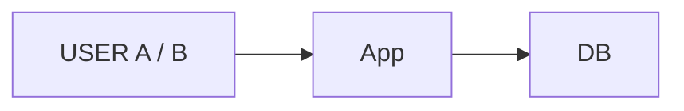
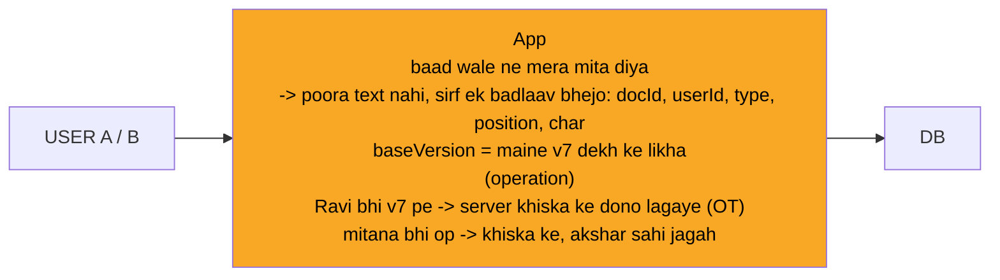
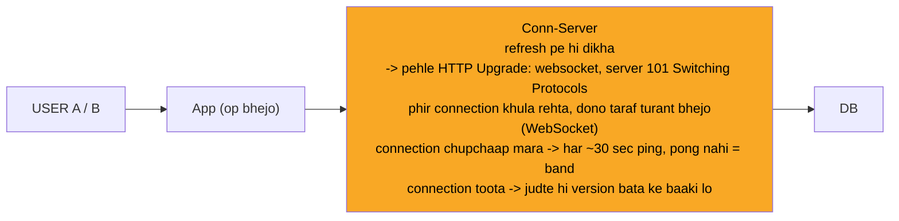
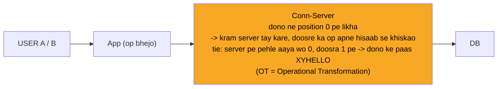
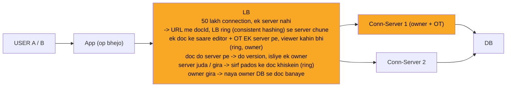
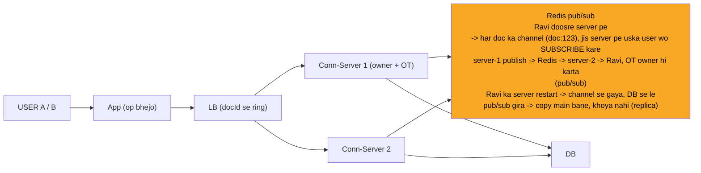
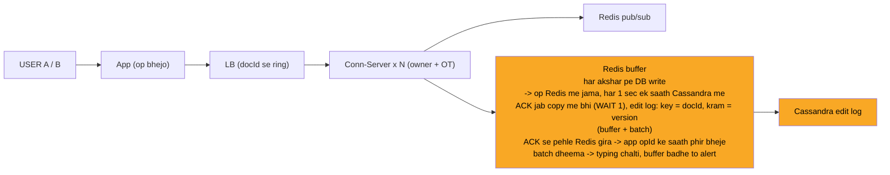
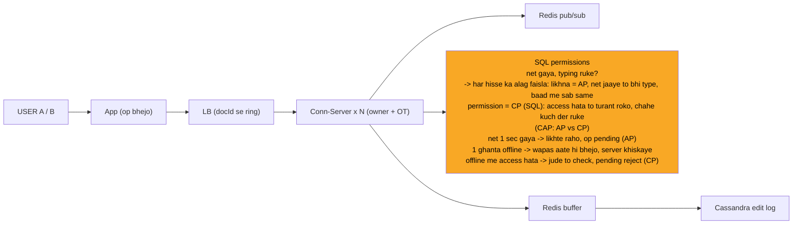
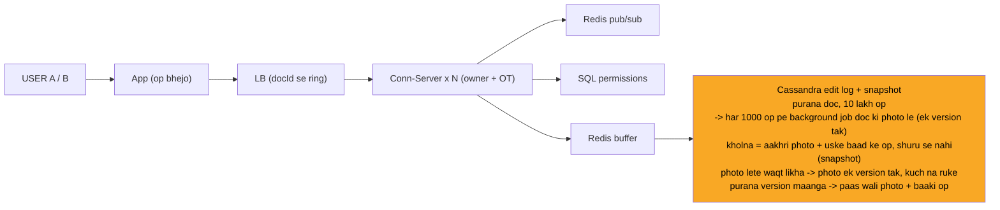
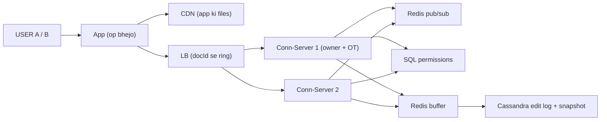

# Google Docs (Collaborative Editor)

> 2 ya zyada log ek doc EK SAATH edit karein -> kisi ka likha na mite, kuch kho na jaaye, turant dikhe, aakhir me sabke paas doc SAME.
> Is design ka dil: **ek saath edit + koi likha khoye nahi + aakhir me sab same (CONVERGENCE)**.
> 3 khaas cheez: har hisse ka alag CAP · WebSocket + Redis pub/sub · OT / CRDT.

---

## KAHANI (ek din, main aur Ravi ek doc pe; har dikkat se design me ek dabba judta)

```
   KYA HUA                                       ILAAJ                                DABBA JUDA
1  Ravi ne baad me save kiya, mera WORLD mita -> OPERATION + baseVersion (text nahi)  App (op bhejo)
2  Ravi ko mera likha refresh pe hi dikha     -> WEBSOCKET (khula, dono taraf)         Conn-Server
3  11 baje dono ne sabse upar ek saath likha  -> OT (server kram, op khiskao)         Conn-Server (OT)
4  50 lakh connection, ek server na jhele     -> RING: docId se ek OWNER server       LB + Conn-Server (owner)
5  Ravi sirf padh raha, doosre server pe      -> REDIS PUB/SUB (doc ek channel)       Redis pub/sub
6  3 baje: har akshar pe DB write, DB baitha  -> REDIS BUFFER + BATCH, ACK = WAIT 1   Redis buffer + Cassandra
7  metro me mera net 1 sec gaya               -> likhna AP, permission CP             SQL permissions
8  raat ko 2 saal purana doc, 10 lakh op      -> SNAPSHOT + uske baad ke op           Cassandra (+ snapshot)

POORA DESIGN (upar ke dabbe kram se):
   User -> App (op) -> LB (docId se ring) -> Conn-Server OWNER (WebSocket + OT)
        -> Redis buffer -> BATCH -> Cassandra (op log + snapshot)
   doosre server ke viewer: Redis pub/sub · permission: SQL (CP) · app ki files: CDN
```

---

## TASVEER (ByteByteGo / Alex Xu · CC BY-NC-ND 4.0)


Source: [How to Design Google Docs](https://bytebytego.com/guides/how-to-design-google-docs/)
(WebSocket + collaboration service + OT / CRDT + ops log — poora design ek tasveer me)

---

## SHURU: pehle poocho, phir numbers

```
POOCHO:  "Editing, comments, sharing / permission, version history, offline — main ek saath EDITING pe."
         ek doc pe ek saath kitne log? (2-3 ya 100) · OFFLINE
         chahiye?  <- iska jawab poora CAP faisla tay karta
         permission scope me? · rich text ya plain?

KYA KARE (FR):    kai log EK doc saath edit · doosron ka likha TURANT dikhe · kisi ka likha na mite
                  scope bahar: comments · version history · formatting
KAISA CHALE (NFR): typing TURANT (dil) · typing KABHI na ruke (offline bhi)
                   aakhir me sabka doc same — "turant sab same"
                   (strong) se NAHI, "aakhir me same" (convergence) se

NUMBERS (andaaza):
   ~10 crore user · ~3-4 crore roz · har akshar ek event -> LIKHNA bahut zyada
   -> beech me buffer + baantna (sharding) chahiye (pakka number yahan maayne nahi rakhta)
```

---

## ════ MOCK SE PEHLE: SIRF YE CARD PADHO ════

> Har card: pehle PEELA DABBA dekho (scene + ilaaj). Yaad aa gaya -> aage. Nahi aaya -> neeche
> DIKKAT / HAL / NAHI padho. AAGE POOCHEGA sirf jab interviewer aage kuch poochhe.

#### DABBA 0: SABSE SIMPLE (yahan se shuru, phir "kahan tootega")
```
Doc ka poora text DB me. "Save" dabao -> poora text upar likh do (overwrite).
```


#### 1 Ravi ne baad me save kiya, mera "WORLD" mit gaya
```
DIKKAT     Doc me "HELLO". Maine "HELLO WORLD" karke 10:05 pe save kiya, Ravi ne purane "HELLO" pe
           "HELLO THERE" 10:07 pe -> poora text upar likha -> mera "WORLD" gayab (LAST-WRITE-WINS).
```

```
NAHI       doc pe lock, ek likhe baaki ruke: saath likhna hi khatam.
```
```
AAGE POOCHEGA:
  NIYAM: text nahi, badlaav (op) bhejo + kis version ko dekh ke bana; server milata, kisi ka likha nahi mitta.
         user ko lock / intezaar nahi; purane version pe bana op bhi khisak ke lagta.
  SAFAR (mera ek op, har mod pe kya):
  sab theek              -> maine likha -> op + baseVersion v7 -> server agla version de ke lagaye, Ravi ko
                            bheje
  Ravi bhi v7 pe likha   -> server samjhe dono saath bane -> khiska ke dono lagaye, kisi ka nahi mitta
  maine mitaya, wo wahin -> mitana bhi op: server dono ko khiska ke lagaye, Ravi ka akshar sahi jagah
```

#### 2 Ravi ko mera likha refresh karne pe hi dikha
```
DIKKAT     Ab op ja raha, par normal HTTP me server khud kuch nahi bhej sakta, sirf jawab deta.
           Ravi ko mera likha tabhi dikha jab usne refresh kiya. Bekaar.
```

```
NAHI       polling: crore log x har second bekaar sawaal + 1 sec der · SSE: sirf server -> user.
```
```
AAGE POOCHEGA:
  NIYAM: ek khula connection dono taraf: server khud bhejta, user refresh nahi karta.
         connection toota to user likhta rahe; judte hi "main v12 pe tha" bata ke baaki op le lo.
  SAFAR (mera connection, har mod pe kya):
  sab theek            -> connection khula -> server khud bhejta, Ravi refresh nahi karta (WebSocket)
  connection chupchaap mara? -> har ~30 sec ping / pong: jawab nahi = band, jagah khaali
  connection toota           -> main likhta rahun; judte hi "main v12 pe tha" -> server v13 se aage sab
```

#### 3 11 baje meeting me dono ne sabse upar ek saath type kiya
```
DIKKAT     11 baje meeting, doc "HELLO", dono sabse upar likhne lage. Mera "X" (pos 0) ~200 ms me Ravi tak,
           usse pehle Ravi ka "Y" (pos 0) -> meri screen "YXHELLO", Ravi ki "XYHELLO". Do alag doc.
```

```
NAHI       phone ke time se kram: ghadi alag, aur position phir bhi khiskani padti.
```
```
TASVEER: OT, ek hi pos 0
doc "HELLO", dono ne v7 dekh ke likha:   main X @0   ·   Ravi Y @0
server ka kram:  pehle X (mera), phir Y
meri screen:  "XHELLO" + Y aaya  -> X pehle laga, Y ko 1 pe khiskao -> "XYHELLO"
Ravi screen:  "YHELLO" + X aaya  -> X server pe pehla, @0 hi rahe   -> "XYHELLO"
-> dono ke paas "XYHELLO", koi nahi mita
```
```
AAGE POOCHEGA:
  NIYAM: kram sirf server ka (har op ko agla version), phone ki ghadi kabhi nahi; aaya op us kram se khiskta.
         nateeja: sabki screen same; mujhe apna likha turant dikhe, baaki ka khisak ke aaye.
  SAFAR (do log ek saath, har mod pe kya):
  sab theek            -> dono ne upar likha -> server kram deta (v8, v9), doosra op khiskata, sab same
  Ravi ka ~200 ms baad -> mera beech me likha: app apne pending op khiska ke uska lagata
  dono pos 0 (tie)     -> server pe pehle aaya wo 0 pe, doosra 1 pe khiska -> dono ke paas "XYHELLO"
```

#### 4 50 lakh connection khule, ek connection server nahi jhelta
```
DIKKAT     Dopahar tak ~50 lakh WebSocket khule (3-4 crore roz ka ~15%), ek server ~1 lakh hi jhelta.
           Kai server lagaye -> mere doc ke editor alag-alag server pe, to OT kaun kare?
```

```
NAHI       hash(docId) % N: N badla to lagbhag har doc ka server badla = sab dobara jude.
```
```
AAGE POOCHEGA:
  NIYAM: ek doc = ek owner server (OT wahin); editor docId se wahin, viewer kahin bhi.
         owner gira -> ring agla server deta, editor dobara jude, version bata ke baaki op le; doc nahi khota.
  SAFAR (ek doc ka ghar, har mod pe kya):
  sab theek              -> editor aaya -> docId se ring pe EK owner server: OT ek jagah (do server = do
                            version)
  1000 log ek doc pe     -> 100 editor owner pe (OT sirf likhne walon ka); 900 viewer kahin bhi
  server juda / gira     -> ring pe sirf uske pados ke doc khiskte; wo log dobara jude
  owner gira, doc kahan? -> doc server pe nahi, DB me hai: naya owner DB se banaye; app version bata ke
                            baaki le
```

#### 5 Ravi ab sirf padh raha, wo doosre server pe
```
DIKKAT     Lunch ke baad Ravi sirf padh raha (viewer), wo server-2 pe; doc ka owner server-1 jahan main likh
           raha. Maine type kiya -> server-1 ko pata, server-2 ko kaise pata chale?
```

```
NAHI       Kafka: store karta + thoda dheema; live typing dobara padhni nahi, tezi chahiye.
```
```
AAGE POOCHEGA:
  NIYAM: pub/sub sirf PAHUNCHATA, kuch store nahi (bheja aur bhool gaya): kaam turant dikhana.
         viewer ka chhoota to version se DB se le lo; bachana DB ka kaam, channel ka nahi.
  SAFAR (mera op Ravi tak, har mod pe kya):
  sab theek              -> editor same server pe -> seedha push, pub/sub ki zaroorat nahi
  Ravi doosre server pe  -> doc ke channel pe op daalo, uska server sunta (pub/sub)
  Ravi ka server restart -> op channel se gaya (pub/sub store nahi karta), par DB me hai: jude, version
                            bata ke le
  Redis pub/sub gira     -> copy main bane (Sentinel): live kuch sec ruka, khoya kuch nahi
```

#### 6 3 baje DB alert: har akshar pe DB me likha, DB baith gaya
```
DIKKAT     3 baje DB alert: ~20 lakh log type, har ek ~3 akshar / sec -> ~60 lakh DB write / sec -> DB khatam.
```

```
NAHI       "sahi chahiye to SQL lo": DB data ki shakal se chuno; join nahi, bas bahut jodna -> Cassandra.
```
```
TASVEER: jama karo, ek saath likho
~20 lakh log x ~3 akshar / sec = ~60 lakh op / sec   (har op DB me = DB baitha)
op -> Redis buffer (ACK jab copy me bhi, WAIT 1)
har 1 sec -> ek batch -> Cassandra (partition = docId, andar kram = version)
-> DB pe har akshar nahi, har second ek dher
```
```
AAGE POOCHEGA:
  NIYAM: ACK tabhi jab op Redis buffer + uski copy dono me; Cassandra ka batch ACK ke raaste me nahi.
         user ko turant "saved"; Redis gira to copy se; batch dobara likha = (docId, version) same, ek hi row.
  SAFAR (mera op pakka hone tak, har mod pe kya):
  sab theek               -> op -> Redis buffer + copy (WAIT 1, ~1 ms) -> ACK "saved"; har 1 sec batch
                             Cassandra me
  ACK se pehle Redis gira -> app op rakhe: bina ACK pakka nahi; jude to opId ke saath phir bhejo, hai to
                             skip
  ACK ke baad gira        -> copy main bani: ACK se pehle copy me likh chuke the
  batch dheema hua        -> typing nahi rukti (batch ACK ke raaste me nahi); buffer badhe -> alert
  batch dobara likha      -> (docId, version) same = ek hi row, kuch double nahi
```

#### 7 Metro me mera net 1 second gaya, typing rukegi?
```
DIKKAT     Shaam ko metro me mera network 1 second ke liye gaya. Typing ruk jaaye, ya main likhta rahun?
```

```
NAHI       "doc sahi chahiye -> CP": CP me net jaate hi typing ruk jaati; yahan sahi = "aakhir me sab same".
```
```
AAGE POOCHEGA:
  NIYAM: typing kabhi na ruke (AP): net gaya to likhta rahe, judte hi op bhejo, aakhir me sab same.
         access kabhi galat na ho (CP): permission hatate hi roko, chahe thodi der ruke.
  SAFAR (net gaya, har mod pe kya):
  sab theek              -> net hai -> har op turant server ko
  net 1 sec gaya         -> likhta raho, op pending (AP): typing kabhi na ruke
  1 ghanta offline       -> pending op + aakhri version; wapas aate hi bhejo, server khiska ke lagaye, sab
                            same
  offline me access hata -> pehle permission (CP): jude to SQL check, nahi -> pending reject
```

#### 8 Raat ko 2 saal purana doc khola, 10 lakh op shuru se chale

```
TASVEER: photo + baad ke op
op:   v1 .................. v9,99,000 | v9,99,001 ...... v10,00,000
      [ photo yahan tak (snapshot) ]   [ sirf ye ~1000 op chalao ]
kholna = aakhri photo + uske baad ke op   (10 lakh shuru se nahi)
purana version dekhna = us se pehli photo + beech ke op
```
```
AAGE POOCHEGA:
  NIYAM: photo ek version tak; kholna = photo + uske baad ke op, shuru se kabhi nahi.
         koi bhi purana version dekhna = us se pehli photo + beech ke op.
  SAFAR (purana doc kholna, har mod pe kya):
  sab theek               -> background job har 1000 op photo leta (user ko nahi dikhta) -> doc khola =
                             aakhri photo + baad ke ~1000 op
  photo lete waqt likha   -> photo ek version tak (v9,99,000), baad ke op alag: kuch nahi rukta
  kal ka v5,00,500 maanga -> v5,00,000 ki photo + 500 op: shuru se nahi
```

---

## AAKHRI DABBA + WRAP (ek hi baar)

```
CDN (app ki files) -> LB (editor: docId se owner server · viewer: koi bhi) -> Conn-Server (WebSocket + OT)
-> editors ko seedha PUSH · Redis pub/sub sirf un dekhne walon tak jo doosre server pe hain
-> Redis buffer (+ copy, phir ACK) -> BATCH -> Cassandra op log (docId, version) + snapshot · permission SQL

DB:  op log = Cassandra (bahut saara jodna; Mongo bhi chalega) · snapshot taaki doc jaldi khule
     permission = alag SQL (rishte + CP) · edit AP (typing kabhi na ruke)
```
```
JAWAB:    Har user doc ke hisaab se ek server se juda (ek doc ke sab editor ek server pe). Har akshar ek
          badlaav.
          Server ek saath wale badlaav khiska ke lagata, kisi ka likha nahi khota, sabka doc same.
          Doosre servers tak Redis se.
          Badlaav jama karke Cassandra me, photo ke saath taaki doc jaldi khule. Likhna kabhi na ruke,
          permission turant lage (SQL).
```


---

## 10 GUNA TRAFFIC — har dabba alag se

```
WebSocket      -> ~50 lakh connection -> alag CONNECTION LINE + docId se same server
Conn-Server    -> OT kahan? -> docId se baanto (ek doc = ek jagah)
Redis pub/sub  -> bheed -> copy + aur machine
DB likhna      -> har akshar? -> buffer + batch, docId se baanto
doc kholna     -> 10 lakh op? -> SNAPSHOT + baad ke op

POOCHEGA: "How would you scale this to 10x?"      -> user ka raasta chalo, pehle jo toote
POOCHEGA: "What's the single point of failure?"   -> Conn-Server (doosre pe dobara judo), Redis (copy)
POOCHEGA: "How do you know it's working?"         -> likha pahunchne
          ka p99 · WebSocket toot-ne ki dar · buffer lag · alert
```

---

## POOCHE TO (gehra sawaal aaye tab)

```
API:      GET /documents/{docId} -> snapshot + baad ke op · POST /documents/{docId}/edits -> ek op
          WebSocket /documents/{docId} -> live, dono taraf

DATA:     har badlaav = OPERATION: { docId, userId, opType
          (insert / delete), position, char / text, baseVersion }
          server har op ko agla version deta (kram); timestamp sirf dikhane ke liye
          abhi ka doc = us doc ke saare op KRAM se lagao
          Cassandra theek (bahut saara jodna) · Mongo bhi chalega · permission = alag SQL (rishte + CP)

EK AKSHAR KA SAFAR:
          1. Maine akshar likha -> op { docId, userId, insert, pos, char, baseVersion }
          2. WebSocket se doc ke owner Conn-Server tak (Ravi bhi usi pe)
          3. OT: ek saath bane op ke hisaab se khiskao -> agla version number -> lagao
          4. Ravi ko seedha PUSH · doosre server ke dekhne walon ko Redis pub/sub se
          5. Redis buffer -> BATCH -> Cassandra edit log
          6. Ravi ke app ne op liya -> apni taraf khiskaya -> screen update

OT vs CRDT: OT = op bhejo, ek saath wale ko KHISKAO, sab same · CRDT
            = har akshar ki unique id, kisi bhi kram me jodo same

AUR SAWAAL (safar ke mod nahi):
  abhi ka doc kya?             -> saare op kram se, pehle se aakhri tak: doc = op ka jod
  OT kyun, CRDT nahi?          -> beech me server hai, har op usse guzarta: OT wahi maangta (Docs bhi OT)
  CRDT hota kya?               -> har akshar ki unique id: kisi bhi kram me jodo same; offline chale, memory
                                  zyada
  kram timestamp se kyun nahi? -> ek ms pe do op = same key, ek ne doosra chupchaap mitaya -> version
  Cassandra kyun?              -> sirf neeche jodta (commit log + RAM): likhai tez, join nahi; Mongo bhi
                                  chalega
  App ki static files?         -> CDN: JS / CSS sabke liye same, paas se aaye
  photo kitni baar?            -> kam li to kholte waqt utne zyada op chalane padte (har 1000 op theek)
```

---

ARCHETYPE D (real-time) · CONCEPTS: [CAP](../../FOUNDATIONS/08_cap_theorem.md) · [pubsub/queues](../../FOUNDATIONS/07_message_queues.md) · [← MASTER SHEET](../../00_MASTER_SHEET.md)
