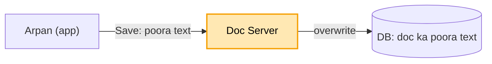
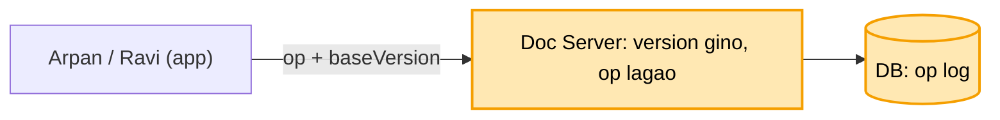
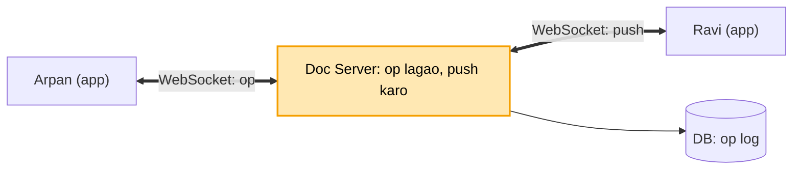
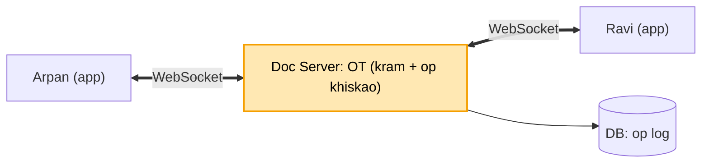
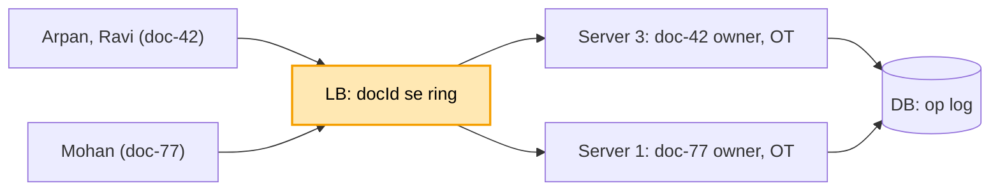
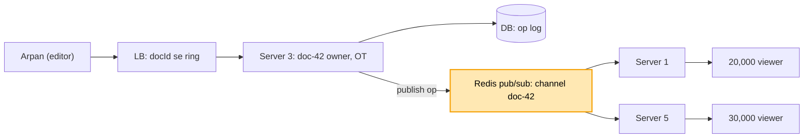
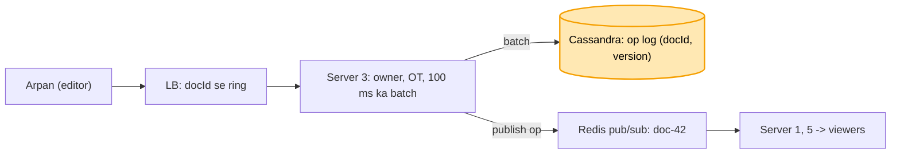

# Google Docs: shuru se, ek kahani

Kram wahi jo interview me hota hai: **FR, phir NFR, phir numbers, phir design**. Design sabse seedhe dabbe
se shuru hota hai, aur har dikkat aane pe ek naya dabba judta hai. Diagram me peela dabba = abhi juda. Poori
file me ek hi kahani hai: Arpan aur Ravi ek hi doc pe saath kaam kar rahe hain.

---

## 1. FR: kya karna hai

```
1. kai log ek doc ek saath edit karein
2. doosre ka likha turant dikhe, kisi ka likha mite nahi
scope ke bahar: comments, version history, formatting
```

## 2. NFR: kaisa chalna chahiye

```
- typing turant ho, kabhi ruke nahi (net jaaye tab bhi)
- aakhir me sabka doc SAME ho (convergence). "har pal sab same" zaroori nahi
```

## 3. Numbers

```
- ~10 crore user, roz ~3-4 crore
- har akshar ek badlaav hai, to likhna bahut zyada hoga. Bas itna yaad rakhna.
```

---

## 4. Design

### Kadam 1: sabse seedha (poora text, Save pe overwrite)

Ek server hai aur ek DB. Doc ka poora text DB me ek row me pada hai. Arpan "Save" dabata hai to app poora
text bhej deti hai, aur server purane text ke upar likh deta hai (overwrite).



Ek aadmi ke liye ye chal jaata hai.

Par Arpan aur Ravi dono ne doc khola. Text tha "HELLO". Arpan ne aage "WORLD" joda aur save kiya. Ravi ki
screen pe abhi bhi purana "HELLO" tha. Usne beech me "!" joda aur Arpan ke baad save kiya. Ab DB me Ravi ka
poora text hai, "HEL!LO". Arpan ka "WORLD" mit gaya, aur kisi ko error bhi nahi aaya.

### Kadam 2: poora text nahi, sirf BADLAAV bhejo (operation + version)

Dikkat ye thi ki poora text upar likhne se doosre ka kaam mit jaata hai. Ilaaj: app poora text nahi bhejti,
sirf **kya badla** wo bhejti hai. Isko **operation (op)** kehte hain.

Server har doc ka ek **version** number rakhta hai. Har op ke saath app batati hai ki maine kis version pe dekh
ke ye likha (**baseVersion**).

```
doc: "HELLO"  (version 1)

Arpan: op = insert "WORLD" at 5, base v1  --> server lagata --> "HELLOWORLD"  (v2)
Ravi : op = insert "!" at 3,     base v1  --> server: ye v1 pe bana, ab v2 hai
                                              -> ise abhi ke text pe lagao --> "HEL!LOWORLD"  (v3)
```



Ab dono ka likha bach gaya. DB me poora text nahi, ops ki list jaati hai (op log). Doc = sab ops ko kram se
lagao.

Doosra kyun nahi (yahan asli choice hai):
- **Lock** (ek waqt me ek hi edit kare): Arpan type kar raha ho to Ravi ruka rahega. Docs ka matlab hi saath
  likhna hai.
- **Version mila nahi to reject** (Jira jaisa: "kisi ne badla, dobara karo"): har akshar pe Ravi ka likha
  wapas aa jaata. Isliye reject nahi karte, op ko khiska ke lagate hain.

Par Arpan ne "WORLD" likha, aur Ravi ki screen pe ye tab dikha jab usne page refresh kiya. "Saath kaam" ho hi
nahi raha.

### Kadam 3: Ravi ko turant dikhe (WebSocket)

Dikkat ye hai ki Ravi ko Arpan ka likha tabhi dikhta hai jab wo khud server se maange (refresh). Ilaaj: app aur
server ke beech ek **khula connection** rakho jo dono taraf chalta hai. Isko **WebSocket** kehte hain.

```
Arpan (app) ==WebSocket==> [ Doc Server ] ==WebSocket==> Ravi (app)
   op: insert "WORLD"         lagao, v2          turant push: "v2: insert WORLD at 5"
```



Arpan ka har op isi connection se jaata hai. Server us op ko lagata hai aur usi pal Ravi ke connection pe push
kar deta hai, Ravi ko poochna nahi padta.

Doosra kyun nahi (asli choice):
- **Polling** (Ravi ki app har second poochhe "kuch naya?"): zyadatar jawab "kuch nahi" aata hai, crore users
  ki faaltu requests banti hain, aur 1 sec ki der bhi rehti hai.
- **SSE** (sirf server se app ki taraf): Docs me dono taraf har akshar chalta hai. SSE ke saath bhejne ke liye
  har akshar pe alag HTTP request lagani padti.

Par doc me "ABC" likha hai. Ek hi pal me Arpan ne "A" mitaya, aur Ravi ne B aur C ke beech "X" daala
(position 2 pe).
- Arpan ki screen: pehle uska apna kaam, "BC". Phir Ravi ka op "X at 2" aaya, to "BCX" bana.
- Ravi ki screen: pehle uska apna kaam, "ABXC". Phir Arpan ka op "position 0 mitao" aaya, to "BXC" bana.

Dono ki screen pe alag doc hai. Ek ke paas "BCX", doosre ke paas "BXC".

### Kadam 4: dono ka doc same karo (OT: server kram tay kare, op khiskao)

Dikkat ye thi ki dono ne apna op pehle lagaya aur doosre ka baad me. Doosre ka op purani position wala tha,
isliye galat jagah laga. Ilaaj ke do hisse hain:

1. **Kram server tay karta hai.** Jo op server pe pehle pahuncha, use agla version milta hai. Ye kram sab
   maante hain.
2. **Baad wala op khiskao.** Server dekhta hai ki tera op jis version pe bana tha, uske baad kya-kya laga. Phir
   position usi hisaab se aage-peeche kar deta hai. Isko **OT (Operational Transformation)** kehte hain.

```
doc "ABC" (v1)
server pe pehle aaya:  Arpan "position 0 mitao"  -> "BC" (v2)
phir aaya:             Ravi "X at 2", base v1
  server: v1 ke baad position 0 pe ek akshar mita, jo 2 se PEHLE hai
       -> Ravi ka op ek khisko: "X at 1" -> "BXC" (v3)
  Arpan ko push: "X at 1"  -> uske "BC" pe -> "BXC"
  Ravi ki app bhi Arpan ka op apne op ke hisaab se khiskati -> "BXC"
sab ke paas "BXC"
```

Seedhi baat: A, position 2 se pehle hata, to Ravi ka X bhi ek ghar peeche khisak gaya.



Isi wajah se ek doc ke saare op **ek hi jagah** se guzarne chahiye. Wahi ek kram bana sakta hai.

Doosra kyun nahi (asli choice): **CRDT**. Isme har akshar ka apna pakka id hota hai ("X, B ke baad"), to kram
ke liye server ki zarurat nahi padti. Offline aur peer-to-peer me achha hai. Par har akshar ke saath extra data
chalta hai, memory zyada lagti hai. Google Docs OT use karta hai kyunki uske paas server hamesha hai.
Offline-first apps CRDT lete hain.

Par ab sab users ke WebSocket ek Doc Server pe khule hain. Roz 3-4 crore log, ek saath ~50 lakh connection. Ek
machine itne khule connection nahi sambhal sakti.

### Kadam 5: kai server, par ek doc ka ek hi OWNER server (docId se ring)

Dikkat ye hai ki 50 lakh connection ek machine pe nahi aate, to kai Doc Server lagane padenge. Lekin OT ka
niyam hai ki ek doc ke saare op ek hi jagah se guzrein. Agar Arpan server 1 pe hai aur Ravi server 2 pe, to do
jagah alag kram banega aur doc phir se alag ho jaayega.

Ilaaj: har doc ka ek **owner server** tay karo. LB connection ko `docId` dekh ke bhejta hai, aur ek doc ke
saare editor usi server pe pahunchte hain.

```
Arpan: doc-42 kholo  --> LB: hash(doc-42) ring pe -> Server 3
Ravi : doc-42 kholo  --> LB: hash(doc-42) ring pe -> Server 3   (dono ek jagah, OT ek jagah)
Mohan: doc-77 kholo  --> LB: -> Server 1                        (alag doc, alag server)
```



Doosra kyun nahi:
- **Round robin** (jo server khaali ho): Arpan aur Ravi alag server pe pahunch jaate, aur OT do jagah chalta.
- **hash % N**: ek server badhaya ya gira to lagbhag saare doc ka owner badal jaata, aur sab connection ek
  saath tootte. **Ring** me sirf us server ke doc hilte hain (cache design wali hi baat).

Par company ka "All-hands" doc hai. Ek aadmi likh raha hai aur 50,000 log padh rahe hain. Sab doc-42 ke owner
Server 3 pe aaye, to wo akela server phir se bhar gaya.

### Kadam 6: padhne wale kisi bhi server pe (Redis pub/sub)

Dikkat ye hai ki 50,000 padhne wale (viewer) owner server pe aa gaye. Lekin viewer koi op nahi bhejta, to use
OT ki zarurat nahi hai. Use bas naye op milne chahiye.

Ilaaj: **editor** (jo likh raha) owner server pe hi jaata hai. **Viewer** kisi bhi server pe jaa sakta hai.
Owner har naya op Redis ke ek channel `doc-42` pe daal deta hai. Jin servers pe doc-42 ke viewer jude hain, wo
us channel ko sun rahe hote hain, aur op apne viewers ko push kar dete hain. Isko **pub/sub** kehte hain
(publish = daalo, subscribe = suno).

```
Arpan (editor) --> Server 3 (owner, OT) --op v8--> [ Redis channel: doc-42 ]
                                                       |--> Server 1 --> 20,000 viewer
                                                       |--> Server 5 --> 30,000 viewer
```



Ab owner pe sirf editor hain, jo kam hote hain. Viewers saare servers me bant gaye.

Doosra kyun nahi: **Kafka**. Kafka op ko disk pe likhta hai aur baad me dobara padhne deta hai. Yahan iski
zarurat nahi, kyunki har op pehle se DB ke op log me hai. Pub/sub sirf "abhi bata do" ka kaam karta hai, aur
tez hai. Agar kisi viewer ka op chhoot gaya (v8 ke baad seedha v10 aaya), to uski app version ka gap dekh ke
beech ke op DB se maang leti hai.

Par har akshar ek op hai, aur har op pe DB me ek likhai ho rahi hai. Lakhon log type kar rahe hain, to DB pe
har second lakhon likhai pad rahi hain. Raat 3 baje alert aaya ki DB baith gaya.

### Kadam 7: op log Cassandra me, aur ek-ek nahi, jama karke (batch)

Dikkat ye hai ki likhai bahut zyada hai, har akshar ek row. Ilaaj ke do hisse hain:

1. **Cassandra.** Op log me hum sirf aage jodte hain, purana kabhi badalte nahi. Aur padhna bhi hamesha "is doc
   ke op, version ke kram se" hota hai. Cassandra isi kaam ke liye bana hai: likhai bahut tez hoti hai, aur
   machine jodte jao to data khud bant jaata hai.
   ```
   key = (docId, version)  ->  docId se partition (ek doc ek jagah), version se sort
   ```
2. **Batch.** Owner server har akshar pe alag likhai nahi karta. ~100 ms ke saare op jama karta hai aur ek saath
   likhta hai. Arpan ne ek second me 5 akshar likhe to 5 ki jagah 1 likhai hoti hai.



Doosra kyun nahi: **Postgres**. Ek machine ki likhai ki ek had hoti hai. Uske upar sharding khud karni padti,
aur join ya transaction ki yahan zarurat hi nahi hai. Sirf jodna hai aur docId se padhna hai, to Cassandra.

Par batch ke 100 ms ke op abhi owner server ki memory me hain. Server ne Arpan ko "mil gaya" (ACK) bol diya
tha. Usi pal Server 3 gir gaya. Arpan ki aakhri line na DB me gayi, na kahin aur. Wo line kho gayi.
