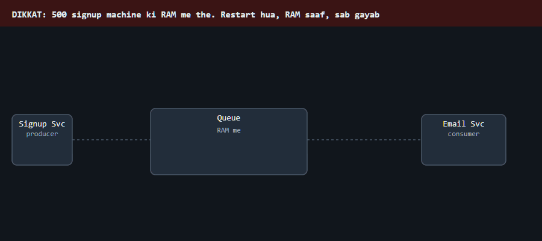
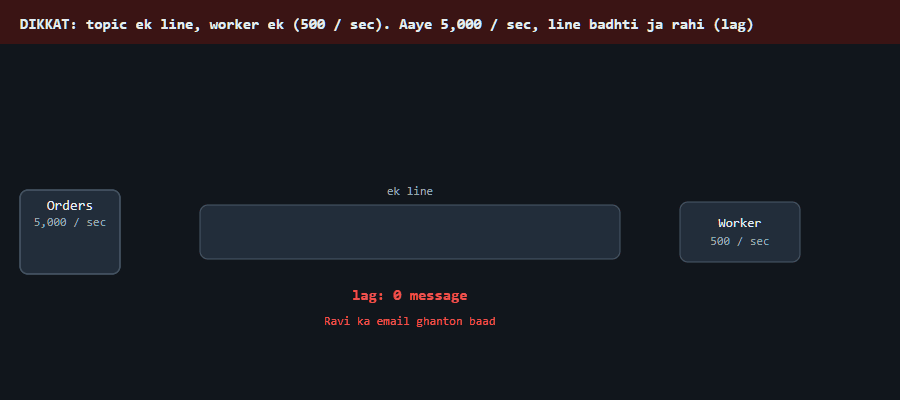
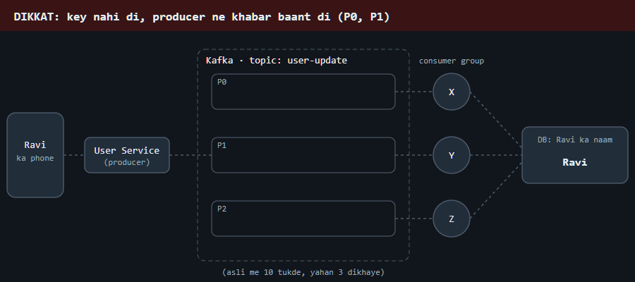
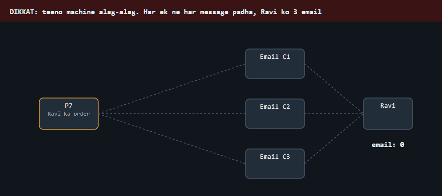
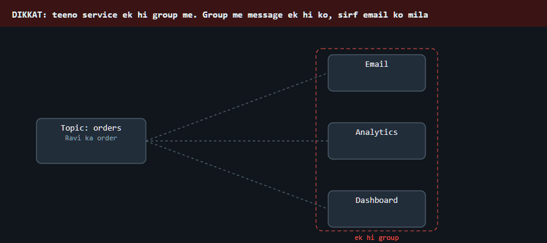
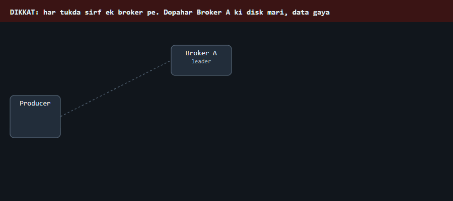
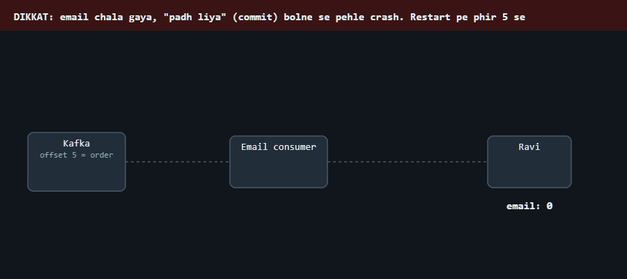
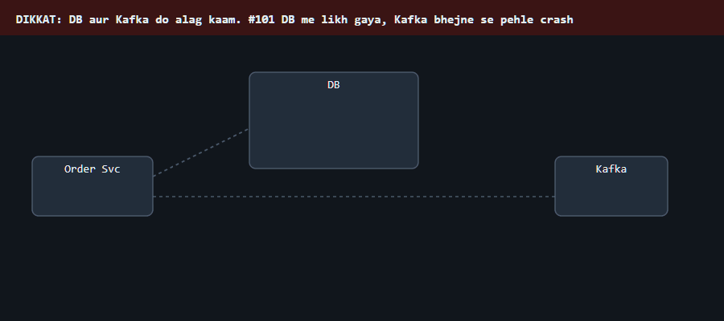
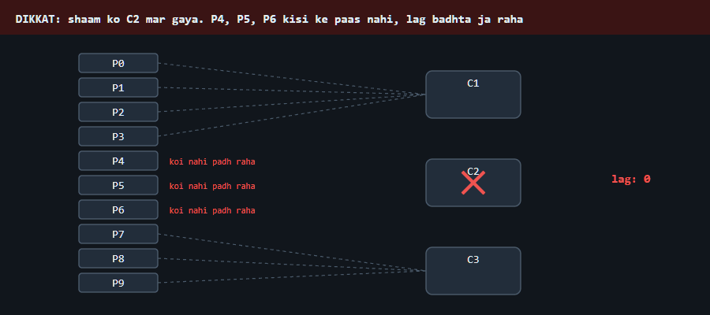
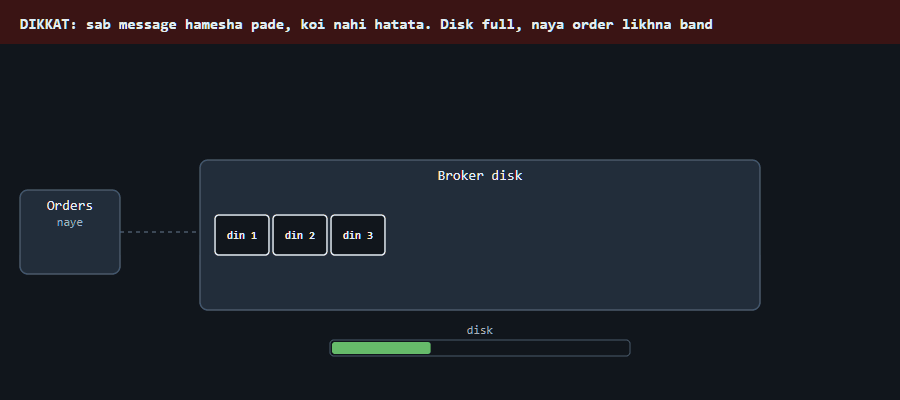

# Design a Message Queue (Kafka-jaisa)

> Ek dabba jo khabar (event) le le aur kai services ko unki apni speed se de de, bina kisi ko roke, bina kuch khoye.
> Dil: kisi ko roko mat (bahut saari khabar har second), kuch khoye nahi, aur ek user ki khabar kram me.
>
> Mock me sirf heading + Cue + GIF. Neeche har card: **hal** · **kyun** · **nahi** (doosra kyun nahi) · **agar ...:** (cross-Q).
> Cross-Q: hal ke har bade shabd pe socho -> gira? · dheema / bheed? · do ek saath? · galat hua? · kaise / kitna?

---

## Poori tasveer (aakhir me design aisa banta hai)


---


## Shuru

- **FR:** producer daale, consumer uthaye · ek message kai service tak (email + dashboard + analytics) · purana dobara padh sakein · ek user ki khabar kram me
- **NFR:** khoye nahi · ek machine gire to bhi chale · lakhon har second (dil) · daalna ms me · ek key ka kram · 7 din rakho (replay) · consumer thoda peeche (lag) theek
- **numbers:** 10 crore message roz / ~86,400 sec = ~1,200 / sec, bheed me 3-5 guna ~5,000 / sec. ~1 KB -> ~100 GB roz, 7 din ~700 GB, 3 copy ~2 TB.

---

*ab tootega kahan? sabse pehle machine restart pe, kyunki sab RAM me hai*

## 1. Subah queue machine restart hui, 500 signup gayab

**Cue:** LOG disk pe + OFFSET · dabba: Log



- **pehle:** sabse simple = ek machine, uski memory me ek queue. Producer daale, consumer uthaye.
- **hal:** disk pe file, message aakhir me judta, padhne se mitta nahi (log)
- **hal:** har padhne wala sirf apna number yaad rakhe, kahan tak padha (offset). Email 120 tak -> restart ke baad 121 se.
- **kyun:** message disk pe pada. Consumer gira to wapas aake apne offset se aage, producer ko pata bhi nahi. Consumer page cache se padhta.
- **nahi:** RAM wali queue -> restart hua aur sab gaya
- **agar consumer restart hua:** kahan tak padha, kaun yaad rakhta? -> Kafka khud (__consumer_offsets)
- **agar log dobara padhna:** kaise? -> offset peeche karo (replay). Khabar padi hai.
- **agar offset ka number:** byte hai? -> nahi, kram number 0, 1, 2. Chhoti .index file batati file me kahan hai.
- **agar disk pe likhna:** dheema nahi? -> nahi. Sirf aakhir me jodna = sequential, disk ka sabse tez kaam.

---

*ab sale aayi, ek worker kitna jhelega?*

## 2. 10 baje sale shuru, 5,000 / sec aaye, ek worker 500 hi bhej paata

**Cue:** PARTITION (tukde, alag machine) · dabba: Brokers A / B / C



- **hal:** topic ke 10 tukde (partition), har tukda alag machine, har tukda apna worker. 10 x 500 = 5,000.
- **kyun:** partition = kitne ek saath padh sakein. Ek partition ek worker. Bheed badhe to aur partition.
- **nahi:** ek line me aur worker -> ek tukda ek hi worker padhta, partition se zyada worker = baaki khaali
- **agar worker 12, tukde 10:** kya hoga? -> 2 khaali baithe. Ek tukda ek hi worker.
- **agar worker badhaye, lag phir bhi badha:** kya dekhoge? -> pehle tukdon ki ginti dekho, worker baad me
- **agar partition kitne:** kaise tay? -> jitne worker ek saath chahiye (order topic ~10: 5,000 / sec, ek worker 500). Shuru me thoda zyada, baad me badle to key ka tukda hilta.
- **agar 10 tukde, 3 broker:** kaise baante? -> barabar. Kaunsa kahan, ye naksha Controller ka.

---

*ab tukde ho gaye, par ek user ki khabar kram me?*

## 3. Ravi ne naam do baar badla, purana naam reh gaya

**Cue:** KEY = userId (ek partition, kram) · dabba: Producer (key)



- **hal:** ek user hamesha ek hi tukde me (key = userId). hash % 10 se P7, Ravi ki har khabar P7 me, kram pakka.
- **kyun:** kram sirf EK partition ke andar milta. Jiska kram chahiye wahi key. Same key = same partition.
- **nahi:** poore topic ka kram -> alag key ka aapas me kram nahi milta, aur chahiye bhi nahi. Ek user ka kaafi.
- **pehle poochho:** kram poore topic ka chahiye ya ek user ka kaafi?
- **agar producer ne retry kiya, ulta pahuncha:** kram? -> har message ka number. 1 fail, 2 gaya, 1 phir aaya, to bhi theek (idempotent producer).
- **agar hash % 10 se 20 tukde kiye:** kram? -> % 10 se % 20, key ka tukda badla, thodi der kram toota. Isliye shuru me zyada rakho.
- **agar key di hi nahi:** kahan jaayega? -> round-robin / sticky. Koi kram nahi.
- **agar ek key ka tukda garam (bheed):** kya karoge? -> key todo (userId#bucket). Sirf tab jab us key pe kram zaroori nahi.
- **agar RabbitMQ / SQS lagate:** kram milta? -> guarantee nahi, kai consumer ek line se padhte. SQS FIFO ya ek consumer = kram, par speed kam.

---

*ab ek service ki kai machine padh rahi*

## 4. Email service ki 3 machine, Ravi ko 3 order email

**Cue:** CONSUMER GROUP (ek team) · dabba: Group email



- **hal:** teeno ek team (consumer group), ek group.id. Har tukda team ke ek hi member ko.
- **hal:** P0-3 C1 ko, P4-6 C2 ko, P7-9 C3 ko. Ravi P7 pe, sirf C3, ek email.
- **kyun:** ek group ke andar ek partition = ek hi machine. To ek khabar team me ek hi baar.
- **agar group.id galat (machine ka naam):** kya hoga? -> teen alag team ban gayi, teeno ne bheja. 3 email.
- **agar team me machine badhani:** kaise? -> tukde bhi badhao. 10 tukde + 12 machine = 2 khaali.
- **agar team ki ek machine giri:** uske tukde? -> baaki ko (rebalance)

---

*ab group me baant diya, par doosri service ko bhi wahi khabar chahiye*

## 5. Ravi ka order analytics aur dashboard ko bhi chahiye

**Cue:** HAR SERVICE KA APNA GROUP · dabba: Group analytics, dashboard



- **hal:** har service ka apna group, har group ko poori khabar (alag consumer group). Email, analytics, dashboard teen group, har ek ka apna offset.
- **kyun:** group ke andar baanto, alag group = sabko. Har group apni jagah (offset) yaad rakhta. Ye MQ ka dil hai.
- **nahi:** teeno service ek hi group -> ek group me ek message ek hi ko, sirf email ko mila, analytics / dashboard ko kuch nahi
- **pehle poochho:** ek message kai service ko (sabko) jaaye ya kisi ek ko? -> ye sawaal poora design badalta
- **agar nayi service aaj judi:** kya badle? -> naya group. Producer kuch nahi badalta.
- **agar naye group ko 7 din purana chahiye:** offset? -> naye group ka offset nahi hota. Tum batao, shuru se ya ab se (auto.offset.reset).
- **agar ek group dheema (peeche):** doosra rukta? -> nahi, offset alag-alag. Dashboard 95 pe hai to bhi email nahi rukta.

---

*ab machine hi mar gayi to?*

## 6. Dopahar Broker A ki disk mar gayi, data gaya

**Cue:** LEADER + ISR, acks=all · dabba: Brokers (ISR) + Controller



- **hal:** har tukde ka ek leader + 2 copy. Leader A likhta, B aur C copy lete (ISR).
- **hal:** saari ISR copy ne le liya, tab producer ko OK (acks=all)
- **kyun:** "done" tabhi jab ISR copy pe bhi likha. Producer ko OK = khabar bachi. Naya leader sirf ISR se.
- **kyun:** 3 copy = kam se kam 3 broker (har copy alag machine)
- **nahi:** acks=1 -> leader ki memory pe hi "OK", leader replica se pehle gira to khabar gayi
- **pehle poochho:** message kho sakta hai ya bilkul nahi? -> ye sawaal poora design badalta
- **agar ISR copy kam pad gayi:** likhte rahein? -> min.insync=2, to likhna band. Khone se rukna behtar.
- **agar leader A gira:** naya leader kaun? -> Controller (KRaft) ISR me se B ko leader banata. Ek faisla, do leader nahi.
- **agar follower peeche chal raha:** leader ban sakta? -> nahi. Aakhri khabar uske paas nahi.
- **agar acks badalna:** kaunse option? -> 0 = bhej ke bhaag (kho sakta). 1 = sirf leader (click / log). all = saari ISR (paisa).

---

*ab broker pe to bach gaya, consumer pe kho sakta?*

## 7. Email bheja, "padh liya" bolne se pehle crash

**Cue:** PEHLE KAAM PHIR COMMIT + IDEMPOTENT · dabba: Redis (eventId)



- **hal:** pehle kaam, phir commit. Har khabar ka eventId Redis me dekho (idempotent consumer).
- **hal:** 5 phir aaya, Redis me E-5 pehle se, to skip. Ravi ko ek email.
- **kyun:** pehle kaam phir commit -> khabar kabhi nahi khoti, bas dobara aa sakti. Dobara aaye to eventId se pehchano.
- **kyun:** pehchaan consumer karta, Kafka nahi
- **nahi:** pehle commit, phir kaam -> commit hua, kaam se pehle crash, restart pe aage se padhta. Wo khabar chhoot gayi.
- **dhyaan:** "duplicate nahi aayega" mat bolna, baad me "at-least-once, duplicate aayega" bologe to dono katengi
- **dhyaan:** sahi = khabar khoti nahi, duplicate aa sakta, consumer pehchaan ke sambhalta (idempotent) -> asar exactly-once
- **agar eventId ki jagah userId se dedup:** kya hoga? -> Ravi ka agla sahi event bhi skip. Pehchaan eventId se, kram userId se.
- **agar Redis se eventId jaldi mita:** kya hoga? -> dobara aayi to phir bhejega. eventId ki umar (TTL) retry window se lambi.
- **agar exactly-once poocha:** Kafka me nahi hota? -> sirf Kafka se Kafka (transactions). Email / DB ke liye consumer khud pehchaane.

---

*ab consumer sambhal gaya, par producer khud bhejne se pehle gira to?*

## 8. Order #101 DB me bana, Kafka bhejne se pehle server gira

**Cue:** OUTBOX + relay · dabba: Producer + Outbox



- **hal:** order aur khabar ek hi transaction me (outbox): BEGIN, orders(101) + outbox(E-101, sent = false), COMMIT. Dono ya koi nahi.
- **hal:** relay har 1 second sent = false wali row Kafka ko bhejta, ACK aaya to sent = true. Kafka ko bhejna DB commit ke BAAD, relay se.
- **kyun:** server kuch yaad nahi rakhta, DB ka sent column yaad rakhta. Order hai to khabar bhi hai.
- **nahi:** Saga -> wo faile kaam ko ulta karta (refund). Yahan ulta nahi, khabar raaste me kho rahi. Pehle pakka likho = outbox.
- **agar COMMIT se pehle crash:** kya bacha? -> kuch nahi hua, na order na outbox. Ravi ko error, wo dobara karega.
- **agar COMMIT ke baad crash:** khabar? -> row padi hai. Relay uthte hi sent = false wali bhejta. Late, par khoya nahi.
- **agar relay sent = true se pehle gira:** kya hoga? -> khabar dobara jaati. Consumer E-101 dekh ke skip, Ravi ko EK email.
- **agar outbox table badi ho gayi:** kya karo? -> sent = true wali roz saaf (delete / partition drop)
- **agar poore raaste kuch na khoye:** kaise? -> outbox + acks=all + kaam ke baad commit + eventId dedup + kharab ki alag line (DLQ)

---

*ab sab bach gaya, par ek consumer mara to?*

## 9. Shaam ko C2 mar gaya, lag badhta ja raha

**Cue:** REBALANCE + LAG alert + DLQ · dabba: DLQ



- **hal:** mare ke tukde baaki ko (rebalance): P4, P5 C1 ko, P6 C3 ko
- **hal:** jo khabar baar-baar fail ho, wo alag line me (DLQ)
- **kyun:** koi partition bina padhne wale ke nahi rehta. Kharab khabar poori line nahi rokti, theek karke baad me dobara chalao.
- **agar lag naapna:** kaise? -> lag = aakhri offset - group kahan tak padha. Sab theek ho to ~0.
- **agar rebalance ke baad bhi lag badh raha:** kya karo? -> alert. Consumer badhao (tukdon tak), dheema kaam alag.
- **agar ek khabar baar-baar fail:** kab DLQ? -> kuch koshish, phir alag line (DLQ). Warna poora tukda atka.
- **agar ek khabar dheemi (5 min):** kya hoga? -> poora tukda atka, kyunki kram se padhta. Dheema kaam alag topic / pool.
- **agar rebalance chal raha:** sab ruk jaate? -> purane me haan (eager). Cooperative (Kafka 2.4+) me sirf jinke tukde badle.

---

*ab khabar padi rehti hai, disk ka kya?*

## 10. Raat ko broker ki disk bharti ja rahi

**Cue:** RETENTION 7 din + COMPACTION · dabba: Brokers (retention)



- **hal:** 7 din rakho, phir purana segment (~1 GB) poora udao (retention). Padh liya to delete nahi. Sasta.
- **kyun:** jo rakha hai usi se replay. Purani khabar retention se jaati, poora segment ek saath.
- **kyun:** MQ ka asli number JAGAH hai. Kafka padh ke delete nahi karta, rakhta hai. Log ise sirf "pipe" samajh lete.
- **nahi:** padhte hi delete -> replay nahi hota. Disk sirf retention se khaali hoti, padhne se nahi.
- **pehle poochho:** purana dobara padhna (replay) chahiye?
- **agar bug theek kiya, replay chahiye:** kaise? -> offset peeche karo, ya naya group shuru se (replay). Data pada hai.
- **agar consumer 7 din (retention se lamba) band raha:** data? -> gaya. Retention consumer ki sabse lambi chhutti se lambi rakho, aur lag pe alert.
- **agar har key ki sirf aakhri value chahiye:** kaise? -> compaction. Sirf aakhri khabar rakho (profile / config).

---

## Poora design ek saans me

```
Producer (key + acks, outbox) -> key se partition -> LEADER broker pe jodo (offset) -> follower copy (ISR)
-> har consumer group apne offset se padhe -> kaam -> commit · khabar retention tak padi (replay)
Controller (KRaft) = naksha, do leader na banein · Redis = eventId dedup · DLQ = kharab message alag
message = append-only file (segment ~1 GB + index), DB nahi · offset = __consumer_offsets
```

Bolne ke liye: bhejne wala khabar key ke saath bhejta, key se tukda tay hota, tukde ke andar kram. Har tukde ki
copy, leader gira to saath chal rahi copy leader. Zaroori khabar tabhi done jab saath chal rahi saari copy (ISR) me
likh gayi. Har service ki apni team, to ek khabar sab tak. Worker kaam ke baad "padh liya" bolta, id se dobara skip,
kharab khabar DLQ me. 7 din rakhte, dobara padh sakte.

---

## 10 guna traffic

- **Partition**: consumer badhaye par partition 10 hi, to extra khaali baithe, lag badhta. Partition badhao. Par
  partition badhane se hash(key) % n badalta, purani key doosre tukde pe ja sakti, kram toot sakta. Isliye shuru me
  kuch extra partition.
- **Dheema consumer**: aage wala (email API / DB) dheema. Consumer badhao (partition tak), batch, bhaari kaam alag topic.
- **Garam partition**: ek bade customer ki key pe saara bojh. Key todo (userId#1..4), us key ka pakka kram chhodo. Ya
  us customer ka alag topic. Consistent hashing ek garam key ko nahi bachata.
- **Broker disk**: 2 TB tha, 10 guna = 20 TB. Retention 7 se 2-3 din, compaction, broker jodo, tiered storage / S3.
- **Rebalance ki aandhi**: baar-baar deploy. Session-timeout theek karo, static membership, ek-ek karke deploy.
- **Producer**: har jagah acks=all = dheema. Khabar ke hisaab se (payment = all, log = 1).

**Pooche: garam key / garam partition?** Pehle machine badi karo, phir usi dabbe ko kai hisson me todo. Todna sahi
direction. Badi machine kaafi kyun nahi? Group me ek partition ko ek hi consumer padhta, machine badi, padhne wala
phir bhi ek. Misaal: user-9 ke saare event P2 pe. Key = "user-9#" + (eventId % 4), to 4 partition, 4 consumer saath
padhein. Keemat: user-9 ka poora pakka kram gaya (har tukde ke andar bacha). Kram sach me chahiye to key chhoti cheez
pe rakho (orderId / accountId), jahan kram chahiye bas wahan.

**Pooche: 10 guna kaise?** Message ka raasta chalo.

**Pooche: kahan se sab gir sakta?** Leader (ISR se promote), controller (KRaft quorum).

**Pooche: chal raha hai, kaise pata?** Consumer lag, under-replicated partitions, DLQ size, alert.

---

## Pooche to (kisi card me nahi baitha)

API: producer send(topic, key, value) -> (partition, offset) ki rasid, acks = 0 / 1 / all. Consumer subscribe(topic,
groupId), poll(timeout) ek saath kai, commit(offset), seek(partition, offset) = replay. Admin createTopic(name,
partitions, replicationFactor) / deleteTopic / describeTopic. send() ek saath kai bhejta (batch), isliye bahut tez.
Queue ki apni API jaan-boojh ke chhoti hai: send, poll, commit, seek. Saara business logic consumer me, broker me
nahi. Isliye broker itna tez.

Pull hai, push nahi: consumer apni speed se maangta, dheema consumer dab ke nahi marta. Keemat: agle poll tak thodi
der. Push hota to broker dhakelta, dheema consumer doob jaata.

Message: offset (broker deta), timestamp, key (hash(key) % n), value (JSON / Avro), headers (traceId, eventType,
retryCount).

Disk pe: /topic-user-signup/partition-0/ ke andar 00000000000000000000.log (message, sirf jodte, segment ~1 GB),
00000000000000000000.index (offset se file me jagah). Segment bhara to naya, jaise 00000000000512340000.log.

Data 3 kism ka. Message (bahut, tez): append-only file, DB nahi, bachav = copy + acks. Naksha (kam, 100% sahi: topic /
partition / leader / ISR): pakka sahi jagah (Zookeeper / KRaft-Raft), kyunki do broker khud ko ek partition ka leader
samjhein to split-brain, data kharab. Consumer offset: __consumer_offsets.

Kab Kafka: bhejne wale ko jawab ka intezaar nahi (signup ke baad email / analytics), ek khabar kai service, bahut
saari khabar + replay (log, clickstream, audit), bhejne / lene wale ki speed alag (bheed ka buffer).

Kab nahi: turant jawab chahiye to REST / gRPC. Poore system ka pakka kram, ya simple kaam ki line + har message ka
retry, to RabbitMQ / SQS (Kafka bahut bhaari). Chhota system, 2 service, to ek aur cheez sambhaalna mehnga.

Keemat: "thodi der baad sahi" (lag), duplicate sambhaalna padta, debug mushkil (flow bikhra), ek aur cluster paalna
(partition / retention / lag dekhna).

Shabd atke to seedhi baat bolo. Partition = topic kai hisson me, har hissa alag machine pe. Offset = har hissa ek
numbered list, har consumer yaad rakhta kis number tak padha. Consumer group = consumers ki ek team jo hisse aapas me
baant leti. ISR = wo copy jo main ke saath poori barabar chal rahi. Idempotent = wahi event do baar aaye to bhi kaam
ek hi baar, kyunki event id rakhi hai. Compaction = har key ki sirf aakhri value rakho, purani phenko.

Chhe baat, poora design ek-ek line me:
1. Kyun: ek doosre ka intezaar todna. Producer bhej ke aage, consumer apni speed.
2. Topic / partition: partition = scale, append-only log + offset. Key se kram EK partition me, poore topic me nahi.
3. Group: group ke andar baanto, alag group = sabko. Kitne ek saath = partition ginti tak.
4. Copy: leader / follower, naya leader sirf ISR se. acks 0 / 1 / all = tezi vs bachav.
5. Delivery: at-least-once + idempotent consumer = asar exactly-once. Retention se replay.
6. Trade-off: async + sabko + replay to Kafka. Turant jawab / poora kram to Kafka nahi.

---

## HANDS-ON — EVENT KAHAN KHOTA HAI: 3 jagah crash karwa ke dekha

Grill sawaal (bank): "paisa kata -> event SMS / fraud / statement tak. Ek bhi event kho na jaaye, kaise?"
SAGA nahi: saga = faile kaam ko ULTA karna. Yahan ulta nahi, event RASTE me kho raha.
Sahi soch jo thi: "pehle pakka likho" = OUTBOX.
CODE: `04_HLD/HANDS_ON/04_event_loss/EventLossDemo.java` (nakli, Docker nahi) · line 24 `FIX = false / true` -> `java EventLossDemo.java`

```
[Bank DB] --1--> [Kafka] --2--> (replica) --3--> [SMS service]
1 e3: paisa kata, event bhejne se PEHLE app crash          (producer)
2 e4: leader ne liya, replica se PEHLE leader gira          (broker)
3 e2: SMS service ne offset commit kiya, SMS se PEHLE crash (consumer)
```
```
ROUND 1  FIX = false
  e1 DB + Kafka · e2 DB + Kafka · e3 DB, CRASH bhejne se pehle -> event kabhi nahi gaya
  e4 DB, Kafka acks=1 leader memory me "OK", CRASH replica se pehle -> e4 GAYA (producer ko laga bhej diya)
  e5 DB + Kafka
  consumer: e1 commit(1) SMS · e2 commit(2) CRASH SMS se pehle -> restart 2 ke aage -> e2 CHHOOTA
            · e5 commit(3) SMS
  NATEEJA: DB [e1..e5] · Kafka [e1, e2, e5] · SMS [e1, e5] · KHOYE [e2, e3, e4]

ROUND 2  FIX = true
  e1..e5 DB debit + OUTBOX row, ek transaction · e3 CRASH bhejne se pehle -> outbox me pada
  relay (restart ke baad bhi) outbox -> Kafka: e1, e2, e3 pahunche
  e4 acks=all leader + replica dono pe, TAB "OK" · CRASH leader -> replica naya leader, e4 uske paas
  e5 pahuncha
  consumer: e1 SMS, commit(1) · e2 SMS, CRASH commit se pehle -> e2 PHIR aaya -> eventId dekha
            -> DUPLICATE chhoda
            e3 SMS commit(3) · e4 SMS commit(4) · e5 SMS commit(5)
  NATEEJA: DB [e1..e5] · Kafka [e1..e5] · SMS [e1..e5] · KHOYE []
```
```
               FIX = false                                   FIX = true
e3 producer    debit hua, bhejne se pehle crash -> KHOYA     debit + outbox EK txn, relay ne bheja -> BACHA
e4 Kafka       acks=1 leader "OK", replica se pehle -> KHOYA acks=all replica ke baad "OK" -> BACHA
e2 consumer    pehle commit, SMS se pehle crash -> KHOYA     pehle SMS, baad commit, phir aaya, dedup -> BACHA

EK NIYAM: "ho gaya" tabhi bolo jab sach me PAKKA
OUTBOX      chhota LEDGER: "ye bhejna hai" debit ke SAATH, USI ek txn
                           -> "paisa kata, likha nahi" ho hi nahi sakta
acks=all    replica pe likhne ke BAAD "OK" (acks=1 = leader ki memory pe "OK" -> leader gira = gaya)
OFFSET BAAD kaam PEHLE, commit BAAD -> crash = event phir aayega (at-least-once)
IDEMPOTENT  eventId yaad, dobara aaye to chhodo
DLQ         baar-baar fail -> retry ke baad DLQ, baaki na ruke (simulation me nahi)
SAGA ≠ ye   saga kaam ULTA karta (refund). Yahan sirf raste me khona rokna.

JAWAB:    Teen jagah se khabar khoti thi, teeno band ki:
          1) Paisa kata aur khabar ek saath DB me (outbox), to bhejne se pehle crash me khabar nahi khoti.
          2) Kafka me 'saath chal rahi saari copy (ISR) me likh gaya tabhi done'.
          3) Worker kaam ke baad 'padh liya' bolta, id se dobara skip, kharab khabar DLQ me.
          Chala ke dekha: bina iske 5 me se 3 khabar kho gayi, iske saath ek bhi nahi.
```

---

ARCHETYPE B/F · CONCEPTS: [message-queues](../../FOUNDATIONS/07_message_queues.md) · [replication](../../FOUNDATIONS/05_database_replication.md) · [sharding/partition](../../FOUNDATIONS/06_database_sharding.md) · saath: [notification](../04_notification_system/04_notification_system.md) · [← MASTER SHEET](../../00_MASTER_SHEET.md)
