# Design a Message Queue (Kafka-jaisa)

> Ek dabba jo khabar (event) le le aur kai services ko unki apni speed se de de — bina kisi ko roke, bina kuch khoye.
> Is design ka dil: **kisi ko roko mat (bahut saari khabar / second)** + **kuch khoye nahi** + **ek user ki khabar kram me**.

---

## KAHANI (ek din, main = order team ka engineer, aaj SALE; har dikkat se design me ek dabba judta)

```
    KYA HUA                                   ILAAJ                                 DABBA JUDA
1   subah queue restart, 500 signup gayab  -> LOG disk pe + OFFSET                  Log
2   10 baje sale, 5,000 / sec, worker 500  -> PARTITION (tukde, alag machine)       Brokers A / B / C
3   Ravi ne naam do baar badla, ulta laga  -> KEY = userId (ek partition, kram)     Producer (key)
4   email ki 3 machine, Ravi ko 3 email    -> CONSUMER GROUP (ek team)              Group email
5   analytics + dashboard ko bhi chahiye   -> HAR SERVICE KA APNA GROUP             Group analytics, dashboard
6   dopahar Broker A ki disk mari          -> LEADER + ISR, acks=all                Brokers (ISR) + Controller
7   email bheja, commit se pehle crash     -> PEHLE KAAM PHIR COMMIT + IDEMPOTENT   Redis (eventId)
8   order DB me bana, Kafka se pehle gira  -> OUTBOX + relay                        Producer + Outbox
9   shaam ko C2 mara, lag badhta gaya      -> REBALANCE + LAG alert + DLQ           DLQ
10  raat ko broker ki disk bhar rahi       -> RETENTION 7 din + COMPACTION          Brokers (retention)

POORA DESIGN (upar ke dabbe kram se):
   Producer (key + acks, outbox) -> key se partition -> LEADER broker (offset) -> ISR copy
   -> har service ka apna group, apne offset se -> kaam -> commit · Redis = eventId dedup · DLQ
   Controller (KRaft) = naksha · khabar 7 din padi (replay)
```

---

## TASVEER (ByteByteGo / Alex Xu · CC BY-NC-ND 4.0)


Source: [Can Kafka Lose Messages?](https://bytebytego.com/guides/can-kafka-lose-messages/)
(HANDS-ON — khabar kahan khoti: producer / broker / consumer, wahi 3 jagah)


Source: [Delivery Semantics](https://bytebytego.com/guides/delivery-semantics/)
(at-most-once / at-least-once / exactly-once — offset commit PEHLE ya BAAD)

---

## SHURU: pehle poocho, phir numbers

```
POOCHO:  "Kram, khona-nahi, delivery guarantee, dobara padhna — kis pe focus?"
         message KHO sakta hai ya bilkul nahi? · KRAM poore topic ka chahiye ya ek user ka kaafi?
         ek message KAI service ko (sabko) ya kisi ek ko? · purana dobara padhna (replay)?
         (pehla aur teesra sawaal poora design badalte)

KYA KARE (FR):    producer DAALE · consumer UTHAYE · EK message
                  KAI service tak (email + dashboard + analytics)
                  purana dobara padh sakein · ek user ki khabar KRAM me
KAISA CHALE (NFR): khoye nahi · ek machine gire to chale · lakhon / second (dil) · daalna ms me
                   ek key ka kram · 7 din rakho (replay) · consumer thoda peeche chale (lag) to THEEK

★ "DUPLICATE NAHI AAYEGA" MAT BOLNA: baad me "at-least-once, duplicate aayega" bologe to dono baatein kat-ti
  -> "aapne to no-duplicate bola tha?"
  SAHI: "No message loss. Duplicates ARE possible, and we handle them with idempotent consumers —
         so the EFFECT is exactly-once."

NUMBERS (andaaza):
   10 crore message / din, ~86,400 second -> ~1,200 / second -> bheed me 3-5 guna -> ~5,000 / second
   ~1 KB ek message -> ~100 GB / din · 7 din rakho ~700 GB · 3 copy ~2 TB
   3 copy = kam se kam 3 BROKER (har copy alag machine) · order topic ~10 PARTITION (5,000 / sec,
     ek worker 500); shuru me thoda zyada rakho (partition = kitne ek saath padh sakein)
   MQ ka asli number JAGAH hai (Kafka padh ke delete nahi karta, RAKHTA) — log ise sirf "pipe" samajh lete
```

---

## ════ MOCK SE PEHLE: SIRF YE CARD PADHO ════

> Har card: pehle PEELA DABBA dekho (scene + ilaaj). Yaad aa gaya -> aage. Nahi aaya -> neeche
> DIKKAT / HAL / NAHI padho. AAGE POOCHEGA sirf jab interviewer aage kuch poochhe.

#### DABBA 0: SABSE SIMPLE (yahan se shuru, phir "kahan tootega")
```
Ek machine, uski memory me ek queue. Producer daale, consumer uthaye.
```
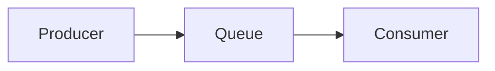

#### 1 Subah queue machine restart hui, 500 signup gayab
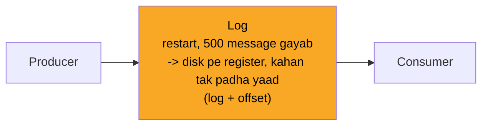
```
DIKKAT     Subah, sale se pehle signup khule. Queue machine ki memory me 500 signup message, machine restart
           -> memory saaf -> 500 gayab. Email service ko pata hi nahi chala ki 500 log aaye.
HAL        disk pe register, padha kahan tak (LOG + OFFSET): sirf aakhir me jodo: P0: [0][1][2][3][4][5].
           Har message ka number = OFFSET, padhne se mit-ta nahi. Email ne 2 tak padha -> restart -> "3 se".
NAHI       DB me queue: insert = index + lock = idhar-udhar likhna; queue me WHERE nahi, bas "X ke baad do".
```
```
AAGE POOCHEGA:
  NIYAM: message padhne se mit-ta nahi (disk pe log); har padhne wala sirf apna number (offset) yaad rakhta.
         consumer gira -> wapas aake apne offset se aage; producer ko pata bhi nahi chalta.
  "Disk pe likhna dheema nahi?"   -> SIRF AAKHIR ME JODNA: kyunki sequential likhai disk ka sabse tez kaam;
                                     padhna OS page cache se, RAM jaisa.
  "Offset yaad kaun rakhta?"      -> KAFKA KHUD (__consumer_offsets): kyunki restart pe pata ho kahan se;
                                     (group, topic, partition) -> offset.
  "Offset matlab byte?"           -> NAHI, KRAM NUMBER: kyunki 0, 1, 2 ginti hai; chhoti .index file batati
                                     offset 3 file me kahan.
  "To peeche jaake dobara padhe?" -> HAAN (REPLAY): kyunki padhne se message mit-ta nahi, bas offset peeche
                                     karo.
```

#### 2 10 baje sale shuru, 5,000 / sec aaye, ek worker 500 hi bhej paata
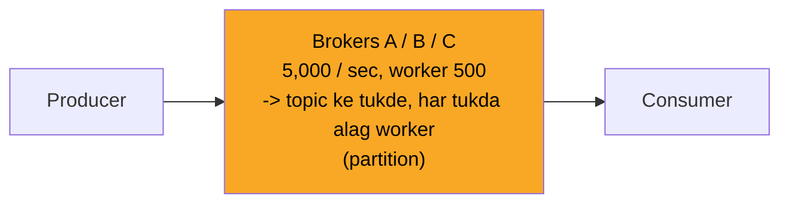
```
DIKKAT     10 baje sale: "order-events" pe 5,000 khabar / sec. Email worker ~500 / sec hi bhej paata
           (har email ek API call). Topic ek line -> ek hi worker kram se padhe -> ghanton ki line (lag).
HAL        topic ke tukde (PARTITION): topic ke 10 tukde (P0-P9), teen broker A / B / C pe bate; har tukda
           alag worker -> 10 tukde = 10 worker = ~5,000 / sec. Likhai aur jagah bhi bat gayi.
NAHI       copy (replica) badhao: copy sirf bachav ke liye, padhna bhi leader se hi; padhne wale = partition.
```
```
AAGE POOCHEGA:
  NIYAM: partition = kitne ek saath padh sakein (ek partition ek worker); bheed badhe -> aur partition.
         worker partition se zyada = baaki khaali baithe; lag badhe to pehle partition ginti dekho.
  "Kitne partition rakhoge?"    -> JITNE CONSUMER EK SAATH (abhi 10): kyunki ek partition = ek worker; shuru
                                   me thoda zyada, baad me badhaye to key ka partition badlega.
  "Ek partition garam ho gaya?" -> KEY TODO (userId#bucket): kyunki ek key = ek partition; todna tabhi jab us
                                   key pe kram zaroori nahi.
```

#### 3 Ravi ne naam do baar badla, purana naam reh gaya
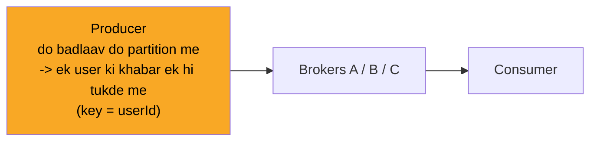
```
DIKKAT     Ravi ne naam "Ravi K" kiya, 1 min baad "Ravi Kumar". Pehla P0 me, doosra P1 me. P0 ka consumer
           10 min peeche (lag) -> pehle "Ravi Kumar" laga, phir "Ravi K" -> galat naam reh gaya.
HAL        ek user ek tukda (KEY = userId): Kafka kram sirf EK partition ke andar deta. hash(userId) % 10 ->
           hamesha P7 -> dono badlaav P7 me, kram se.
NAHI       poore topic ka kram: matlab sirf ek partition = speed khatam. Kram sirf key ke andar.
```
```
AAGE POOCHEGA:
  NIYAM: kram sirf EK partition ke andar: jiska kram chahiye wahi key (userId); same key = same partition.
         alag key ka aapas me kram nahi milta, aur chahiye bhi nahi.
  "Partition 10 se 20 kiye?"       -> % 10 SE % 20: kyunki key ka partition badla -> naye event naye
                                      partition, thodi der kram toota; isliye shuru me zyada.
  "Producer retry kram ulta kare?" -> SEQUENCE NUMBER: kyunki 1 fail, 2 gaya, phir 1 = ulta; har message ka
                                      number -> kram + duplicate theek (enable.idempotence).
```

#### 4 Email service ki 3 machine, Ravi ko 3 order email
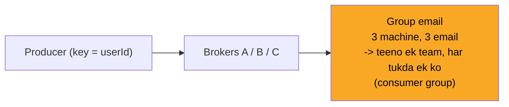
```
TASVEER: ek team, tukde baante
topic order-events:  P0 P1 P2 P3 | P4 P5 P6 | P7 P8 P9
group email:         C1          | C2       | C3
Ravi: hash(userId) % 10 = P7  -> sirf C3 padhta -> ek hi email
C2 gaya -> P4-6 baaki machines me (rebalance) · 12 machine = 2 khaali (10 hi tukde)
```
```
AAGE POOCHEGA:
  NIYAM: ek group ke andar ek partition = ek hi machine -> ek khabar team me ek hi baar.
         machine gayi -> uska partition baaki ko (rebalance); machine partition se zyada = khaali baithi.
  "Kaise kaam karta?"            -> EK GROUP.ID: pehle group.id = machine ka naam = teen alag team, teeno ne
                                    bheja. Ab ek: P0-3 -> C1 · P4-6 -> C2 · P7-9 -> C3; Ravi P7 -> sirf C3.
  "Consumer aur badhaane hain?"  -> PARTITION BHI BADHAO: kyunki ek partition = ek machine; 10 partition + 12
                                    consumer = 2 khaali baithe.
  "Ek message 5 min ka kaam ho?" -> POORA PARTITION ATKA: kyunki kram se padhta, aage wala atka to peeche sab;
                                    dheema kaam alag topic / pool.
  "RabbitMQ / SQS me aisa?"      -> KRAM KI GUARANTEE NAHI: kyunki standard me kai consumer ek line se; SQS
                                    FIFO ya ek consumer = kram, speed kam.
```

#### 5 Ravi ka order analytics aur dashboard ko bhi chahiye
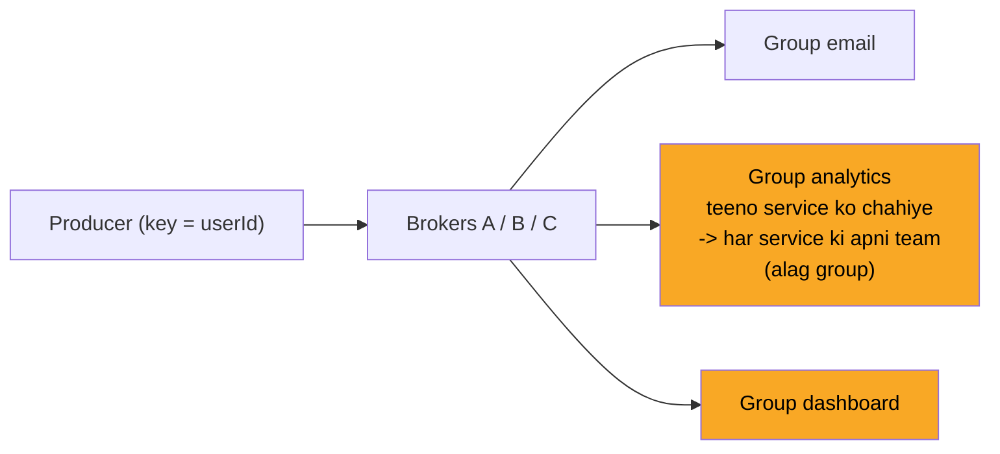
```
DIKKAT     Ravi ka order email ko bhi chahiye, analytics ko bhi, dashboard ko bhi. Ek group = sirf ek ko.
HAL        har service ki apni team (APNA GROUP): topic ek; email, analytics, dashboard group alag.
           Team ke andar kaam bat-ta, alag team = poori khabar. Har group ka apna offset.
NAHI       har service ka alag topic: producer ek event teen baar bheje -> "ek message kai service" hi toota.
```
```
AAGE POOCHEGA:
  NIYAM: group ke andar baanto, alag group = sabko (har group ka apna offset); ye MQ ka dil hai.
         nayi service = naya group, producer kuch nahi badalta; ek group peeche ho to doosra nahi rukta.
  "Naya group aaj juda, 7 din purana?" -> AUTO.OFFSET.RESET: kyunki naye group ka offset hai hi nahi; earliest
                                          = shuru se · latest = sirf ab ke baad.
```

#### 6 Dopahar Broker A ki disk mar gayi, data gaya
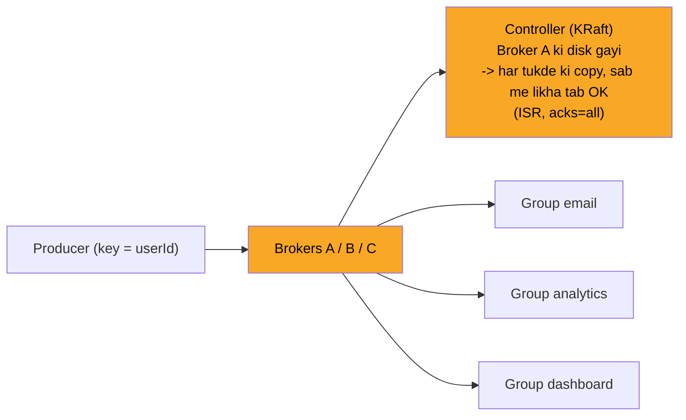
```
DIKKAT     Dopahar Broker A ki disk mari. Har partition ki ek hi copy thi -> P0 ka data hamesha ke liye gaya.
HAL        har tukde ki copy (LEADER + ISR): LEADER + 2 follower alag machine pe; saath chalti copy = ISR.
           Leader gira -> Controller (KRaft) ISR se naya chunta. Zaroori: acks=all (saari ISR ne liya tab OK).
NAHI       acks=1 sab jagah: leader ne "OK" bola, copy se pehle gira -> khabar gayi.
```
```
TASVEER: leader + copy, acks=all
P0:  A = LEADER   ·   B = follower   ·   C = follower        saath chalti copy = ISR {A, B, C}
producer -> A ne likha -> B, C ne bhi liya -> tab "OK" (acks=all)
A ki disk mari -> Controller (KRaft) ISR se B ko naya leader -> data bacha
jo follower peeche reh gaya wo ISR se bahar -> leader nahi ban sakta
```
```
AAGE POOCHEGA:
  NIYAM: "done" tabhi jab ISR copy pe bhi likha (acks=all); naya leader sirf ISR se.
         producer ko OK = khabar bachi; copy kam pad jaaye to likhna band, khona nahi.
  SAFAR (ek khabar likhna):
  producer bheje         -> leader A likhe, B + C copy lein (ISR)
  "OK" kab?              -> acks=all: saari ISR ne li tab: leader mare to bhi bachi
                            acks=1 sirf leader (click / log) · acks=0 bhej ke bhaag
  copy kam pad gayi      -> min.insync=2 -> likhna band: khone se rukna behtar
  A mara                 -> Controller (KRaft) ISR se B ko leader: ek faisla, do leader nahi
  peeche wala follower   -> leader nahi ban sakta: aakhri khabar uske paas nahi
```

#### 7 Email bheja, "padh liya" bolne se pehle crash
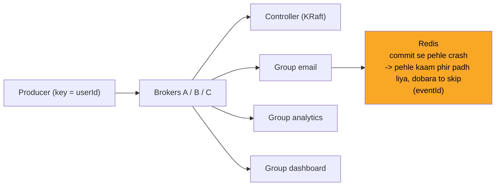
```
DIKKAT     Email service ne offset 5 padha (Ravi ka order). Email bheja -> "padh liya" (commit) se pehle CRASH
           -> restart pe phir 5 -> Ravi ko 2 email.
HAL        pehle kaam, phir 'padh liya' (COMMIT) (at-least-once: khoyega nahi, kabhi do baar) + consumer
           IDEMPOTENT: eventId Redis me hai? hai = skip.
NAHI       pehle commit, phir kaam: email se pehle CRASH -> restart 6 se -> event 5 KHO gaya.
```
```
AAGE POOCHEGA:
  NIYAM: pehle kaam, phir commit -> khona kabhi nahi, par dobara aa sakta; dobara aaye to eventId se pehchano.
         pehchaan consumer karta, Kafka nahi; isliye Ravi ko do email nahi jaata.
  "Dedup kis key se?"           -> EVENTID: kyunki userId se dedup kiya to Ravi ka agla sahi event bhi skip.
                                   DO key: kram = userId · dedup = eventId.
  "Kafka me exactly-once nahi?" -> SIRF KAFKA SE KAFKA: kyunki transactions + idempotent producer Kafka ke
                                   andar hi; email / DB ke liye consumer idempotency.
```

#### 8 Order #101 DB me bana, Kafka bhejne se pehle server gira
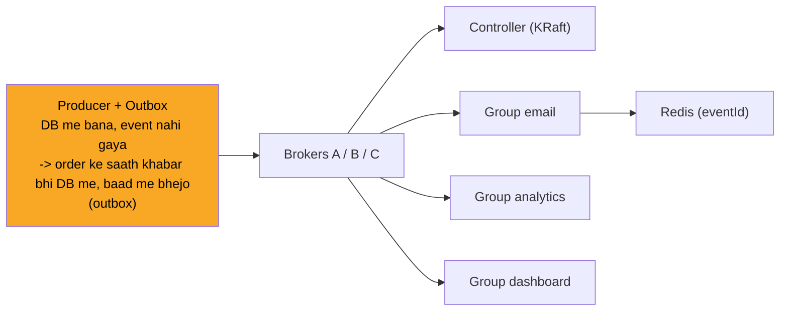
```
DIKKAT     Ravi ka order #101 DB me bana, Kafka bhejne se pehle order server gira -> event gaya hi nahi.
HAL        khabar bhi order ke saath DB me (OUTBOX, usi transaction me): BEGIN · INSERT orders(101) · INSERT
           outbox(E-101, sent = false) · COMMIT. Relay (alag thread, har 1 sec) sent = false wali row Kafka
           bheje, ACK aaye to sent = true.
NAHI       "offset bachayega": nahi, offset consumer ki taraf hai; ye producer ki taraf ki dikkat.
```
```
TASVEER: order + khabar ek saath
BEGIN -> orders(101) + outbox(E-101, sent = false) -> COMMIT      (dono ya koi nahi)
relay (har 1 sec): sent = false wali row -> Kafka -> ACK -> sent = true
server COMMIT se pehle gira -> na order, na khabar · baad me gira -> row padi, relay bhej dega
relay ACK se pehle gira -> khabar dobara jaati -> consumer eventId se skip
```
```
AAGE POOCHEGA:
  NIYAM: server kuch yaad nahi rakhta, DB ka sent column yaad rakhta (order + khabar ek transaction).
         relay gira -> sent = false wali dobara jaati -> consumer ko dobara mil sakti, eventId se skip.
  "COMMIT se pehle crash?"           -> KUCH NAHI HUA: kyunki transaction poori nahi; DB me na order na
                                        outbox, Ravi ko error, wo dobara karega.
  "COMMIT ke baad, bhejne se pehle?" -> RELAY BHEJEGA: kyunki row sent = false padi hai; uthte hi bhejta.
                                        Late, khoya nahi.
  "Bhej diya, sent = true se pehle?" -> DO BAAR JAAYEGA: kyunki relay phir bhejta; consumer E-101 dekh ke
                                        doosri skip -> Ravi ko EK email.
  "Outbox table badi ho gayi?"       -> SAAF KARO: kyunki sent = true wali ka kaam khatam; roz delete /
                                        partition drop.
  "Kuch na khoye, poora jawab?"      -> PAANCH CHEEZ: kyunki har kadam ka ek ched band: outbox + acks=all +
                                        kaam ke baad commit + idempotent consumer + DLQ.
```

#### 9 Shaam ko C2 mar gaya, lag badhta ja raha
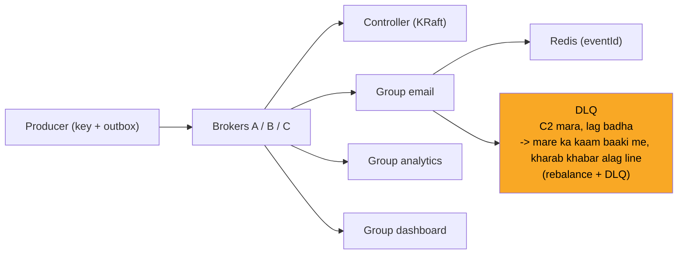
```
AAGE POOCHEGA:
  NIYAM: koi partition bina padhne wale ke nahi (rebalance), koi kharab khabar poori line na roke (DLQ).
         lag badhe -> alert; kharab khabar alag line me, theek karke baad me dobara.
  "Kaise kaam karta?"           -> REBALANCE: C2 ke P4-6 -> C1 aur C3 me bat gaye. LAG = aakhri offset - group
                                   kahan tak padha; badhe to alert.
  "Ek khabar baar-baar fail?"   -> DLQ: kyunki kram se padhta, ek atki to poora partition atka; kuch koshish
                                   ke baad alag line.
  "Rebalance me sab ruk jaate?" -> PURANE ME HAAN (eager): kyunki sab chhod ke dobara baant-te; cooperative
                                   (Kafka 2.4+) me sirf jinke badle.
  "Lag phir bhi badh raha?"     -> CONSUMER BADHAO (partition tak): kyunki ek partition ek consumer; dheema
                                   kaam alag, lag pe alert.
```

#### 10 Raat ko broker ki disk bharti ja rahi
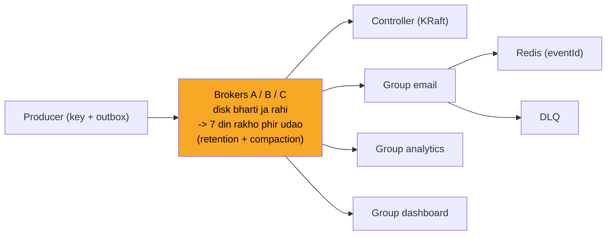
```
AAGE POOCHEGA:
  NIYAM: jo rakha hai usi se REPLAY; rakhna consumer ki sabse lambi chhutti se lamba.
         purani khabar retention se jaati (poora segment); har key ki aakhri hi chahiye to compaction.
  "Kaise kaam karta?"         -> RETENTION 7 DIN: padh ke delete nahi; phir purani segment (~1 GB) poori udao
                                 = sasta. COMPACTION: har key ki sirf aakhri khabar.
  "Rakhne ka fayda kya?"      -> REPLAY: kyunki data pada hai; naya group shuru se padhe, ya bug theek karke
                                 offset peeche.
  "7 din consumer band raha?" -> DATA GAYA: kyunki retention khatam; isliye lag pe alert + retention consumer
                                 ki sabse lambi chhutti se lambi.
  "Compaction kis data pe?"   -> PROFILE / CONFIG: kyunki har key ka bas aakhri haal chahiye, beech ka nahi.
```

---

## AAKHRI DABBA + WRAP (ek hi baar)

```
Producer (key + acks, outbox) -> key se partition -> LEADER broker pe jodo (offset) -> follower copy (ISR)
-> har consumer group apne offset se padhe -> kaam -> commit · khabar retention tak padi (replay)
Controller (KRaft) = naksha, do leader na banein · Redis = eventId dedup · DLQ = kharab message alag

DB:  message = append-only file (segment ~1 GB + index), DB nahi; bachav = copy + acks
     naksha (kaun leader) = pakka sahi (KRaft / Zookeeper) · offset = __consumer_offsets
```
```
JAWAB:    Bhejne wala khabar key ke saath bhejta, key se tukda tay hota, tukde ke andar kram.
          Har tukde ki copy, leader gira to saath chal rahi copy leader.
          Zaroori khabar 'saath chal rahi saari copy (ISR) me likh gaya tabhi done'.
          Har service ki apni team, to ek khabar sab tak. Worker kaam ke baad 'padh liya' bolta, id se
          dobara skip, kharab khabar DLQ me. 7 din rakhte, dobara padh sakte.
```
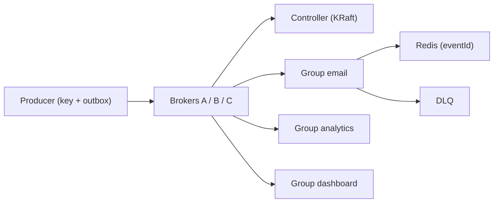

---

## 10 GUNA TRAFFIC — har dabba alag se

```
partition      -> consumer badhaye par partition 10 hi -> extra KHAALI baithe, lag badhta -> PARTITION BADHAO
                  ★ "Adding partitions changes hash(key) % n, so an existing key can move to a different
                    partition and its ordering can break — that's why we start with a few extra partitions."
dheema consumer -> aage wala (email API / DB) dheema -> consumer badhao (partition tak) · batch
                  · bhaari kaam alag topic
GARAM PARTITION -> ek bade customer ki key pe saara bojh
                  -> key todo (userId#1..4), us key ka pakka kram chhodo
                  (ya us customer ka alag topic) · consistent hashing ek garam key ko nahi bachata
broker disk    -> 2 TB tha, 10 guna = 20 TB -> retention 7 se 2-3 din · compaction · broker jodo
                  · tiered storage / S3
rebalance ki aandhi -> baar-baar deploy -> session-timeout theek karo · static membership · ek-ek karke deploy
producer       -> har jagah acks=all = dheema -> khabar ke hisaab se (payment = all, log = 1)

POOCHEGA: "What about a hot key / hot partition?"   -> upar GARAM PARTITION
          TERA JAWAB: "pehle machine badi karo, phir usi dabbe ko
                      kai hisson me todo" -> TODNA = sahi direction
          BADI MACHINE KAAFI KYUN NAHI: group me ek partition ko EK
          hi consumer padhta -> machine badi, padhne wala phir bhi ek
          MISAAL: user-9 ke saare event P2 pe -> key = "user-9#" +
                  (eventId % 4) -> 4 partition, 4 consumer saath padhein
          KEEMAT: user-9 ka POORA pakka kram gaya (har tukde ke andar bacha)
                  kram sach me chahiye -> key chhoti cheez pe rakho
                  (orderId / accountId), jahan kram chahiye bas wahan
POOCHEGA: "How would you scale this to 10x?"        -> message ka raasta chalo
POOCHEGA: "What's the single point of failure?"     -> leader (ISR promote), controller (KRaft quorum)
POOCHEGA: "How do you know it's working?"
          -> CONSUMER LAG · under-replicated partitions · DLQ size · alert
```

---

## POOCHE TO (gehra sawaal aaye tab)

```
API:      PRODUCER  send(topic, key, value) -> (partition, offset) rasid · acks = 0 / 1 / all
          CONSUMER  subscribe(topic, groupId) · poll(timeout) ek saath
          kai · commit(offset) · seek(partition, offset) = REPLAY
          ADMIN     createTopic(name, partitions, replicationFactor) / deleteTopic / describeTopic
          PULL hai, PUSH nahi: consumer apni speed se maangta, dheema consumer dab ke nahi marta
                               keemat: agle poll tak thodi der (push hota to
                               broker dhakelta -> dheema consumer doob jaata)
          send() ek saath kai bhejta (batch) -> isliye bahut tez
          "The queue's own API is deliberately tiny — send, poll, commit, seek. All the business logic lives
           in the consumer, not in the broker. That's why the broker can be so fast."

MESSAGE:  offset (BROKER deta) · timestamp · key (hash(key) % n) · value
          (JSON / Avro) · headers (traceId, eventType, retryCount)
DISK:     /topic-user-signup/partition-0/
             00000000000000000000.log     message, sirf jodte (segment ~1 GB)
             00000000000000000000.index   offset -> file me jagah
             00000000000512340000.log     segment bhara -> naya

DATA 3 KISM:  MESSAGE (bahut, tez) -> append-only file, bachav = copy + acks (DB nahi)
              NAKSHA (kam, 100% sahi: topic / partition / leader / ISR) -> pakka sahi (Zookeeper / KRaft-Raft)
                        kyun: do broker khud ko ek partition ka leader samjhein = SPLIT-BRAIN = data kharab
              CONSUMER OFFSET -> __consumer_offsets

KAB KAFKA:    bhejne wale ko jawab ka intezaar nahi (signup ke baad email / analytics) · EK khabar KAI service
              bahut saari khabar + replay (log, clickstream, audit)
              · bhejne / lene wale ki speed alag (bheed ka buffer)
KAB NAHI:     TURANT jawab chahiye -> REST / gRPC · poore system ka
              pakka kram · simple kaam ki line + har message ka retry
              -> RabbitMQ / SQS (Kafka bahut bhaari) · chhota
                 system, 2 service -> ek aur cheez sambhaalna mehnga
KEEMAT:       "thodi der baad sahi" (LAG) · duplicate sambhaalna padta · debug mushkil (flow bikhra)
              · ek aur cluster paalna (partition / retention / lag dekhna)

SHABD ATKE TO (bina shabd ke bolo):
   partition      -> "the topic is split into parts, and each part sits on a different machine"
   offset         -> "each part is like a numbered list, and every consumer remembers which number
                      it has read up to"
   consumer group -> "a set of consumers that act as one team and divide the parts among themselves"
   ISR            -> "the copies that are fully caught up with the main one"
   idempotent     -> "even if the same event comes twice, the work happens only once,
                      because we store the event id"
   compaction     -> "for each key we keep only the latest value and throw away the older ones"

CHHE BAAT (poora design ek-ek line me):
   1 KYUN        ek doosre ka intezaar todna -> producer bhej ke aage, consumer apni speed
   2 TOPIC/PART  partition = scale + append-only log + offset · key -> kram EK PARTITION me (poore topic nahi)
   3 GROUP       group ke andar baanto · alag group = sabko · kitne ek saath = partition ginti tak
   4 COPY        leader / follower · naya leader sirf ISR se · acks 0 / 1 / all = tezi vs bachav
   5 DELIVERY    at-least-once + idempotent consumer = asar exactly-once · retention -> replay
   6 TRADE-OFF   async + sabko + replay -> Kafka · turant jawab / poora kram -> Kafka NAHI
```

---

## HANDS-ON — EVENT KAHAN KHOTA HAI: 3 jagah crash karwa ke dekha

> Grill sawaal (bank): "paisa kata -> event SMS / fraud / statement tak. Ek bhi event kho na jaaye, kaise?"
> SAGA nahi: saga = faile kaam ko ULTA karna. Yahan ulta nahi, event RASTE me kho raha.
> Sahi soch jo thi: "pehle pakka likho" = OUTBOX.
> CODE: `04_HLD/HANDS_ON/04_event_loss/EventLossDemo.java` (nakli, Docker nahi) · line 24 `FIX = false / true` -> `java EventLossDemo.java`

```
[Bank DB] --1--> [Kafka] --2--> (replica) --3--> [SMS service]
1 e3: paisa kata, event bhejne se PEHLE app crash          (producer)
2 e4: leader ne liya, replica se PEHLE leader gira          (broker)
3 e2: SMS service ne offset commit kiya, SMS se PEHLE crash (consumer)
```
```
ROUND 1  FIX = false
  e1 DB + Kafka · e2 DB + Kafka · e3 DB, CRASH bhejne se pehle -> event kabhi nahi gaya
  e4 DB, Kafka acks=1 leader memory me "OK", CRASH replica se pehle -> e4 GAYA (producer ko laga bhej diya)
  e5 DB + Kafka
  consumer: e1 commit(1) SMS · e2 commit(2) CRASH SMS se pehle -> restart 2 ke aage -> e2 CHHOOTA
            · e5 commit(3) SMS
  NATEEJA: DB [e1..e5] · Kafka [e1, e2, e5] · SMS [e1, e5] · KHOYE [e2, e3, e4]

ROUND 2  FIX = true
  e1..e5 DB debit + OUTBOX row, ek transaction · e3 CRASH bhejne se pehle -> outbox me pada
  relay (restart ke baad bhi) outbox -> Kafka: e1, e2, e3 pahunche
  e4 acks=all leader + replica dono pe, TAB "OK" · CRASH leader -> replica naya leader, e4 uske paas
  e5 pahuncha
  consumer: e1 SMS, commit(1) · e2 SMS, CRASH commit se pehle -> e2 PHIR aaya -> eventId dekha
            -> DUPLICATE chhoda
            e3 SMS commit(3) · e4 SMS commit(4) · e5 SMS commit(5)
  NATEEJA: DB [e1..e5] · Kafka [e1..e5] · SMS [e1..e5] · KHOYE []
```
```
               FIX = false                                   FIX = true
e3 producer    debit hua, bhejne se pehle crash -> KHOYA     debit + outbox EK txn, relay ne bheja -> BACHA
e4 Kafka       acks=1 leader "OK", replica se pehle -> KHOYA acks=all replica ke baad "OK" -> BACHA
e2 consumer    pehle commit, SMS se pehle crash -> KHOYA     pehle SMS, baad commit, phir aaya, dedup -> BACHA

EK NIYAM: "ho gaya" tabhi bolo jab sach me PAKKA
OUTBOX      chhota LEDGER: "ye bhejna hai" debit ke SAATH, USI ek txn
                           -> "paisa kata, likha nahi" ho hi nahi sakta
acks=all    replica pe likhne ke BAAD "OK" (acks=1 = leader ki memory pe "OK" -> leader gira = gaya)
OFFSET BAAD kaam PEHLE, commit BAAD -> crash = event phir aayega (at-least-once)
IDEMPOTENT  eventId yaad, dobara aaye to chhodo
DLQ         baar-baar fail -> retry ke baad DLQ, baaki na ruke (simulation me nahi)
SAGA ≠ ye   saga kaam ULTA karta (refund). Yahan sirf raste me khona rokna.

JAWAB:    Teen jagah se khabar khoti thi, teeno band ki:
          1) Paisa kata aur khabar ek saath DB me (outbox), to bhejne se pehle crash me khabar nahi khoti.
          2) Kafka me 'saath chal rahi saari copy (ISR) me likh gaya tabhi done'.
          3) Worker kaam ke baad 'padh liya' bolta, id se dobara skip, kharab khabar DLQ me.
          Chala ke dekha: bina iske 5 me se 3 khabar kho gayi, iske saath ek bhi nahi.
```

ARCHETYPE B/F · CONCEPTS: [message-queues](../../FOUNDATIONS/07_message_queues.md) · [replication](../../FOUNDATIONS/05_database_replication.md) · [sharding/partition](../../FOUNDATIONS/06_database_sharding.md) · saath: [notification](../04_notification_system/04_notification_system.md) · [← MASTER SHEET](../../00_MASTER_SHEET.md)
