# Design a Message Queue (Kafka-jaisa)

> **Pehle ye dekh: [Kafka concepts (tasveer se)](kafka_concepts.md)** · topic · partition · consumer group

> Ek dabba jo khabar (event) le le aur kai services ko unki apni speed se de de, bina kisi ko roke, bina kuch khoye.
> Dil: kisi ko roko mat (bahut saari khabar har second), kuch khoye nahi, aur ek user ki khabar kram me.
>
> Mock me sirf heading + Cue + poster. Poster me sab: upar "Pehle aisa tha", tasveer (ilaaj), hara "Kyun chalta", laal number = kya toot sakta + kaise bacha, peela = doosra tareeka kyun nahi, grey = baaki.
> Cross-Q: hal ke har bade shabd pe socho -> gira? · dheema / bheed? · do ek saath? · galat hua? · kaise / kitna?

---

## Poori tasveer (aakhir me design aisa banta hai)



---


## Shuru

```
FR      producer daale, consumer uthaye. Ek message kai service tak jaaye (email + dashboard + analytics).
        Purana dobara padh sakein. Ek user ki khabar kram me aaye
NFR     kuch khoye nahi. Ek machine gire to bhi chale. Lakhon message har second (dil). Daalna ms me.
        Ek key ka kram. 7 din rakho (replay). Consumer thoda peeche chale (lag) to theek hai
NUMBERS 10 crore message roz / ~86,400 sec = ~1,200 / sec, bheed me 3-5 guna, ~5,000 / sec.
        ~1 KB ka message -> ~100 GB roz, 7 din ~700 GB, 3 copy ~2 TB
PEHLE   sabse simple = ek machine, uski memory me ek queue. Producer daale, consumer uthaye
```

> [!IMPORTANT]
> **RAIL: har design isi kram me chalta (8 dabbe, sab file me same)**
> kaam chala → bheed aayi → machine giri → do log ek saath → kuch dheema → data bada → door ke log → bahar ka hamla
>
> | rail | is design me | card |
> |---|---|---|
> | 1 kaam chala | Arpan ka order email tak · Arpan ka order 3 service ko (email, analytics, dashboard) | 1, 5 |
> | 2 bheed aayi | 10 baje sale, 5,000 / sec, ek worker 500 | 2 |
> | 3 machine giri | queue restart, 500 gayab · Broker A ki disk mari (**is design ka khaas: kuch khoye nahi**) · Kafka se pehle server gira | 1, 6, 8 |
> | 4 do log ek saath | Arpan ne naam do baar badla · 3 machine, 3 email · email bheja, commit se pehle crash | 3, 4, 7 |
> | 5 kuch dheema | C2 mara, lag badhta · ek khabar dheemi, tukda atka (card 9 ka cross-Q) | 9 |
> | 6 data bada | disk bharti ja rahi, 7 din ~700 GB | 10 |
> | 7 door ke log | nahi aata | - |
> | 8 bahar ka hamla | nahi aata | - |


> [!NOTE]
> **AWS pe kaunsa DB (interview me naam bolna ho to)** · SQL wala = RDS, Cassandra RDS pe nahi chalta
>
> - Kafka khud → **Amazon MSK** (managed Kafka): broker, copy, Controller AWS sambhalta

---

*ab tootega kahan? sabse pehle machine restart pe, kyunki sab RAM me hai*

## 1. Subah queue machine restart hui, Arpan ka order + 499 aur gayab

**Rail 3 MACHINE GIRI (restart)** · Cue: LOG disk pe + OFFSET


---

*ab sale aayi, ek worker kitna jhelega?*

## 2. 10 baje sale shuru, 5,000 / sec aaye, ek worker 500 hi bhej paata

**Rail 2 BHEED AAYI** · Cue: PARTITION (tukde, alag machine)


---

*ab tukde ho gaye, par Arpan ki khabar kram me?*

## 3. Arpan ne naam do baar badla, purana naam reh gaya

**Rail 4 DO LOG EK SAATH (kram)** · Cue: KEY = userId (ek partition, kram)


---

*ab ek service ki kai machine padh rahi*

## 4. Email service ki 3 machine, Arpan ko 3 order email

**Rail 4 DO LOG EK SAATH (group)** · Cue: CONSUMER GROUP (ek team)


---

*ab group me baant diya, par doosri service ko bhi wahi khabar chahiye*

## 5. Arpan ka order analytics aur dashboard ko bhi chahiye

**Rail 1 KAAM CHALA (kai service)** · Cue: HAR SERVICE KA APNA GROUP


---

*ab machine hi mar gayi to?*

## 6. Dopahar Broker A ki disk mar gayi, data gaya

**Rail 3 MACHINE GIRI (khaas)** · Cue: LEADER + ISR, acks=all


---

*ab broker pe to bach gaya, consumer pe kho sakta?*

## 7. Email bheja, "padh liya" bolne se pehle crash

**Rail 4 DO LOG EK SAATH (dobara)** · Cue: PEHLE KAAM PHIR COMMIT + IDEMPOTENT


---

*ab consumer sambhal gaya, par producer khud bhejne se pehle gira to?*

## 8. Order #101 DB me bana, Kafka bhejne se pehle server gira

**Rail 3 MACHINE GIRI (producer)** · Cue: OUTBOX + relay


---

*ab sab bach gaya, par ek consumer mara to?*

## 9. Shaam ko C2 mar gaya, lag badhta ja raha

**Rail 5 KUCH DHEEMA (lag)** · Cue: REBALANCE + LAG alert + DLQ


---

*ab khabar padi rehti hai, disk ka kya?*

## 10. Raat ko broker ki disk bharti ja rahi

**Rail 6 DATA BADA (disk)** · Cue: RETENTION 7 din + COMPACTION


---

## Poora design ek saans me

```
Producer (key + acks, outbox) -> key se partition -> LEADER broker pe jodo (offset) -> follower copy (ISR)
-> har consumer group apne offset se padhe -> kaam -> commit · khabar retention tak padi (replay)
Controller (KRaft) = naksha, do leader na banein · Redis = eventId dedup · DLQ = kharab message alag
message = append-only file (segment ~1 GB + index), DB nahi · offset = __consumer_offsets
```

Bolne ke liye: bhejne wala khabar key ke saath bhejta, key se tukda tay hota, tukde ke andar kram. Har tukde ki
copy, leader gira to saath chal rahi copy leader. Zaroori khabar tabhi done jab saath chal rahi saari copy (ISR) me
likh gayi. Har service ki apni team, to ek khabar sab tak. Worker kaam ke baad "padh liya" bolta, id se dobara skip,
kharab khabar DLQ me. 7 din rakhte, dobara padh sakte.

---

## 10 guna traffic

- **Partition**: consumer badhaye par partition 10 hi, to extra khaali baithe, lag badhta. Partition badhao. Par
  partition badhane se hash(key) % n badalta, purani key doosre tukde pe ja sakti, kram toot sakta. Isliye shuru me
  kuch extra partition.
- **Dheema consumer**: aage wala (email API / DB) dheema. Consumer badhao (partition tak), batch, bhaari kaam alag topic.
- **Garam partition**: ek bade customer ki key pe saara bojh. Key todo (userId#1..4), us key ka pakka kram chhodo. Ya
  us customer ka alag topic. Consistent hashing ek garam key ko nahi bachata.
- **Broker disk**: 2 TB tha, 10 guna = 20 TB. Retention 7 se 2-3 din, compaction, broker jodo, tiered storage / S3.
- **Rebalance ki aandhi**: baar-baar deploy. Session-timeout theek karo, static membership, ek-ek karke deploy.
- **Producer**: har jagah acks=all = dheema. Khabar ke hisaab se (payment = all, log = 1).

**Pooche: garam key / garam partition?** Pehle machine badi karo, phir usi dabbe ko kai hisson me todo. Todna sahi
direction. Badi machine kaafi kyun nahi? Group me ek partition ko ek hi consumer padhta, machine badi, padhne wala
phir bhi ek. Misaal: user-9 ke saare event P2 pe. Key = "user-9#" + (eventId % 4), to 4 partition, 4 consumer saath
padhein. Keemat: user-9 ka poora pakka kram gaya (har tukde ke andar bacha). Kram sach me chahiye to key chhoti cheez
pe rakho (orderId / accountId), jahan kram chahiye bas wahan.

**Pooche: 10 guna kaise?** Message ka raasta chalo.

**Pooche: kahan se sab gir sakta?** Leader (ISR se promote), controller (KRaft quorum).

**Pooche: chal raha hai, kaise pata?** Consumer lag, under-replicated partitions, DLQ size, alert.

---

## Pooche to (kisi card me nahi baitha)

API: producer send(topic, key, value) -> (partition, offset) ki rasid, acks = 0 / 1 / all. Consumer subscribe(topic,
groupId), poll(timeout) ek saath kai, commit(offset), seek(partition, offset) = replay. Admin createTopic(name,
partitions, replicationFactor) / deleteTopic / describeTopic. send() ek saath kai bhejta (batch), isliye bahut tez.
Queue ki apni API jaan-boojh ke chhoti hai: send, poll, commit, seek. Saara business logic consumer me, broker me
nahi. Isliye broker itna tez.

Pull hai, push nahi: consumer apni speed se maangta, dheema consumer dab ke nahi marta. Keemat: agle poll tak thodi
der. Push hota to broker dhakelta, dheema consumer doob jaata.

Message: offset (broker deta), timestamp, key (hash(key) % n), value (JSON / Avro), headers (traceId, eventType,
retryCount).

Disk pe: /order-events/partition-0/ ke andar 00000000000000000000.log (message, sirf jodte, segment ~1 GB),
00000000000000000000.index (offset se file me jagah). Segment bhara to naya, jaise 00000000000512340000.log.

Data 3 kism ka. Message (bahut, tez): append-only file, DB nahi, bachav = copy + acks. Naksha (kam, 100% sahi: topic /
partition / leader / ISR): pakka sahi jagah (Zookeeper / KRaft-Raft), kyunki do broker khud ko ek partition ka leader
samjhein to split-brain, data kharab. Consumer offset: __consumer_offsets.

Kab Kafka: bhejne wale ko jawab ka intezaar nahi (order ke baad email / analytics), ek khabar kai service, bahut
saari khabar + replay (log, clickstream, audit), bhejne / lene wale ki speed alag (bheed ka buffer).

Kab nahi: turant jawab chahiye to REST / gRPC. Poore system ka pakka kram, ya simple kaam ki line + har message ka
retry, to RabbitMQ / SQS (Kafka bahut bhaari). Chhota system, 2 service, to ek aur cheez sambhaalna mehnga.

Keemat: "thodi der baad sahi" (lag), duplicate sambhaalna padta, debug mushkil (flow bikhra), ek aur cluster paalna
(partition / retention / lag dekhna).

Shabd atke to seedhi baat bolo. Partition = topic kai hisson me, har hissa alag machine pe. Offset = har hissa ek
numbered list, har consumer yaad rakhta kis number tak padha. Consumer group = consumers ki ek team jo hisse aapas me
baant leti. ISR = wo copy jo leader ke saath poori barabar chal rahi. Idempotent = wahi event do baar aaye to bhi kaam
ek hi baar, kyunki event id rakhi hai. Compaction = har key ki sirf aakhri value rakho, purani phenko.

Chhe baat, poora design ek-ek line me:
1. Kyun: ek doosre ka intezaar todna. Producer bhej ke aage, consumer apni speed.
2. Topic / partition: partition = scale, append-only log + offset. Key se kram EK partition me, poore topic me nahi.
3. Group: group ke andar baanto, alag group = sabko. Kitne ek saath = partition ginti tak.
4. Copy: leader / follower, naya leader sirf ISR se. acks 0 / 1 / all = tezi vs bachav.
5. Delivery: at-least-once + idempotent consumer = asar exactly-once. Retention se replay.
6. Trade-off: async + sabko + replay to Kafka. Turant jawab / poora kram to Kafka nahi.

---

## HANDS-ON — EVENT KAHAN KHOTA HAI: 3 jagah crash karwa ke dekha

Grill sawaal (bank): "paisa kata -> event SMS / fraud / statement tak. Ek bhi event kho na jaaye, kaise?"
SAGA nahi: saga = faile kaam ko ULTA karna. Yahan ulta nahi, event RASTE me kho raha.
Sahi soch jo thi: "pehle pakka likho" = OUTBOX.
CODE: `04_HLD/HANDS_ON/04_event_loss/EventLossDemo.java` (nakli, Docker nahi) · line 24 `FIX = false / true` -> `java EventLossDemo.java`

```
[Bank DB] --1--> [Kafka] --2--> (replica) --3--> [SMS service]
1 e3: paisa kata, event bhejne se PEHLE app crash          (producer)
2 e4: leader ne liya, replica se PEHLE leader gira          (broker)
3 e2: SMS service ne offset commit kiya, SMS se PEHLE crash (consumer)
```
```
ROUND 1  FIX = false
  e1 DB + Kafka · e2 DB + Kafka · e3 DB, CRASH bhejne se pehle -> event kabhi nahi gaya
  e4 DB, Kafka acks=1 leader memory me "OK", CRASH replica se pehle -> e4 GAYA (producer ko laga bhej diya)
  e5 DB + Kafka
  consumer: e1 commit(1) SMS · e2 commit(2) CRASH SMS se pehle -> restart 2 ke aage -> e2 CHHOOTA
            · e5 commit(3) SMS
  NATEEJA: DB [e1..e5] · Kafka [e1, e2, e5] · SMS [e1, e5] · KHOYE [e2, e3, e4]

ROUND 2  FIX = true
  e1..e5 DB debit + OUTBOX row, ek transaction · e3 CRASH bhejne se pehle -> outbox me pada
  relay (restart ke baad bhi) outbox -> Kafka: e1, e2, e3 pahunche
  e4 acks=all leader + replica dono pe, TAB "OK" · CRASH leader -> replica naya leader, e4 uske paas
  e5 pahuncha
  consumer: e1 SMS, commit(1) · e2 SMS, CRASH commit se pehle -> e2 PHIR aaya -> eventId dekha
            -> DUPLICATE chhoda
            e3 SMS commit(3) · e4 SMS commit(4) · e5 SMS commit(5)
  NATEEJA: DB [e1..e5] · Kafka [e1..e5] · SMS [e1..e5] · KHOYE []
```
```
               FIX = false                                   FIX = true
e3 producer    debit hua, bhejne se pehle crash -> KHOYA     debit + outbox EK txn, relay ne bheja -> BACHA
e4 Kafka       acks=1 leader "OK", replica se pehle -> KHOYA acks=all replica ke baad "OK" -> BACHA
e2 consumer    pehle commit, SMS se pehle crash -> KHOYA     pehle SMS, baad commit, phir aaya, dedup -> BACHA

EK NIYAM: "ho gaya" tabhi bolo jab sach me PAKKA
OUTBOX      chhota LEDGER: "ye bhejna hai" debit ke SAATH, USI ek txn
                           -> "paisa kata, likha nahi" ho hi nahi sakta
acks=all    replica pe likhne ke BAAD "OK" (acks=1 = leader ki memory pe "OK" -> leader gira = gaya)
OFFSET BAAD kaam PEHLE, commit BAAD -> crash = event phir aayega (at-least-once)
IDEMPOTENT  eventId yaad, dobara aaye to chhodo
DLQ         baar-baar fail -> retry ke baad DLQ, baaki na ruke (simulation me nahi)
SAGA ≠ ye   saga kaam ULTA karta (refund). Yahan sirf raste me khona rokna.

JAWAB:    Teen jagah se khabar khoti thi, teeno band ki:
          1) Paisa kata aur khabar ek saath DB me (outbox), to bhejne se pehle crash me khabar nahi khoti.
          2) Kafka me 'saath chal rahi saari copy (ISR) me likh gaya tabhi done'.
          3) Worker kaam ke baad 'padh liya' bolta, id se dobara skip, kharab khabar DLQ me.
          Chala ke dekha: bina iske 5 me se 3 khabar kho gayi, iske saath ek bhi nahi.
```

---

ARCHETYPE B/F · CONCEPTS: [message-queues](../../FOUNDATIONS/07_message_queues.md) · [replication](../../FOUNDATIONS/05_database_replication.md) · [sharding/partition](../../FOUNDATIONS/06_database_sharding.md) · saath: [notification](../04_notification_system/04_notification_system.md) · [← MASTER SHEET](../../00_MASTER_SHEET.md)
