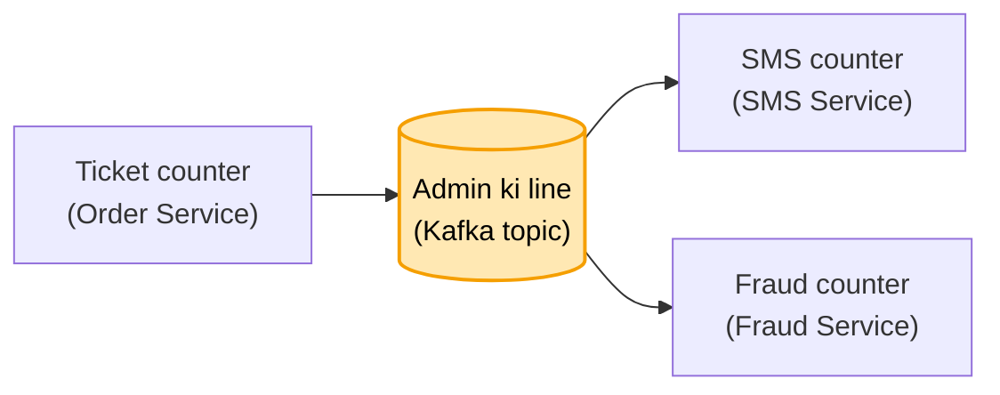
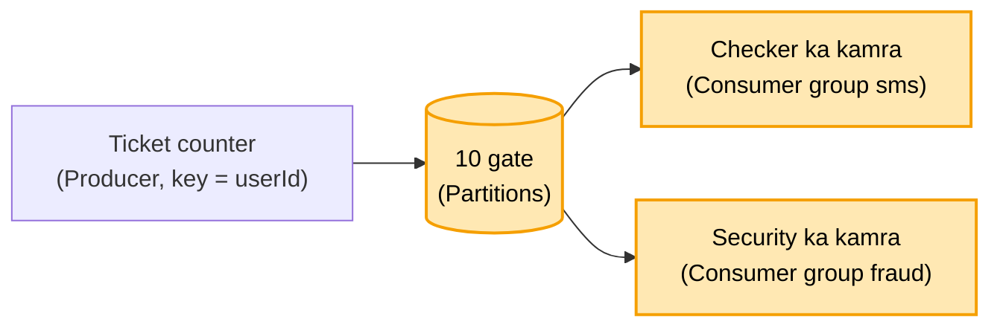
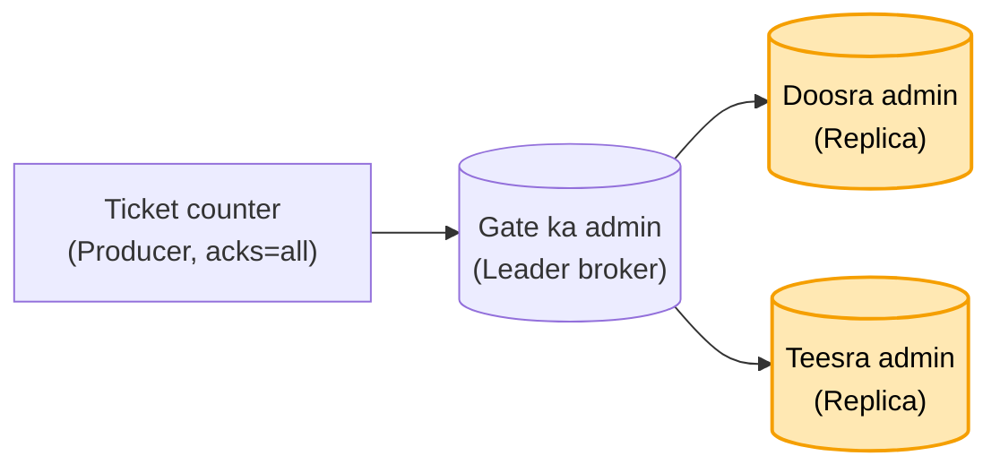
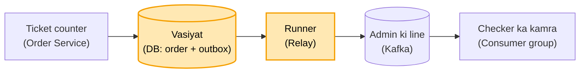

# Message queue (Kafka): stadium ki kahani

Match ka din, stadium ke bahar bahut bheed. Bahar ticket counter (Order Service) se fan nikalte hain, gate pe admin
line sambhalta hai, aur andar checker ka kamra aur counter hain (SMS, Fraud). Har fan ek khabar hai ("Arpan ne order
kiya"). Kaam: har fan andar pahunche, koi gum na ho, koi do baar punch na ho, aur ek atka to baaki na rukein.

Har kadam = **kahani** (dikkat aur hal, bolne wali bhasha) -> **Asli naam** (interview me yahi shabd) -> tasveer
(kahani ka shabd, bracket me asli naam).

---

## FR / NFR / Numbers (interview me pehle 2 minute)

```
FR      Order Service ki khabar SMS, Fraud, Analytics tak pahunche · Order Service kisi ka intezaar na kare
        · ek user ki khabar kram me (order, pay, cancel)
NFR     khabar kabhi na khoye · sale ki bheed me bhi chale · ek service dheemi ho to baaki na rukein
Numbers roz 10 crore khabar = ~1,200 / sec, sale me ~5,000 / sec · ek checker ~500 / sec -> 10 gate
        ek khabar ~1 KB -> roz ~100 GB, 7 din x 3 copy = ~2 TB disk
```

---

## 1. Bheed ek saath ghus rahi (admin ki line)

Stadium ke bahar bahut bheed, sab ek saath andar ghusna chahte hain. To ek admin ne bola: line banao, ek-ek karke
jao, seat mili to baith jao. Ticket counter fan ko line me khada karta hai aur agle ka ticket kaatne lagta hai,
andar ke kisi counter ka intezaar nahi karta. Andar wale apni raftaar se line se lete hain. Bas yahi hai Kafka mere
liye: bheed ko kaabu karne wala banda. Spike aaya, usne rok liya.

**Asli naam:** admin = Kafka (broker), line = topic (`order-events`), fan = khabar (event), ticket counter = producer
(Order Service), andar ke counter = consumer (SMS, Fraud). Khabar disk pe likhi jaati hai aur padhne se mit-ti nahi,
isliye ek hi khabar SMS aur Fraud dono padh lete hain, aur peeche ja ke dobara bhi padh sakte hain (RabbitMQ me ack
hote hi queue se hat jaati, dobara nahi padh sakte). Async + spike ka buffer.



## 2. Line me ek aadmi ruk gaya (seat booked hai)

Maan le line me ek aadmi ruk gaya, wahin se peeche sab disturb ho gaye. Wo line se nikla, bahar chala gaya. Par uski
seat booked hai, wapas aaya to wahi baithega, uski seat pe koi aur nahi baith sakta. To line dobara shuru kari, koi
gum nahi hua, kuch dikkat nahi.

**Asli naam:** ruka hua aadmi = consumer (SMS counter) gir gaya ya dheema hua, seat booked = offset (har padhne wale
ka bookmark), wapas aaya to wahin se = restart ke baad offset se padhna. Khabar padhne se mit-ti nahi, 7 din disk pe rehti hai (retention). Fraud dheema hua to bas wo peeche rahega,
SMS nahi rukega.

## 3. Ek admin se bheed nahi sambhal rahi (aur gate + hash)

Diwali sale, har second 5,000 fan, akela admin nahi sambhal pa raha, aur andar ek checker 500 / sec hi punch kar
paata hai. To aur gate khade karo, har gate ke andar apni line. 5,000 / 500 = 10 gate, taaki 10 checker ek saath
punch kar sakein. Kaun kis gate pe jaaye, wahan hash aa gaya: Arpan ki teeno khabar (order, pay, cancel) hamesha ek
hi gate se jaayengi, to unka kram nahi bigdega.

**Asli naam:** gate = partition (10, alag broker pe), hash = key se partition (`hash(userId) % 10`). Kram sirf ek
partition ke andar pakka hai, poore topic me nahi, isliye key = userId.

## 4. Har ticket 3 baar punch (ek kamra, alag kamra)

SMS wale andar 3 ticket checker laaye, aur teeno har fan ka ticket punch kar rahe. Har ticket 3 baar punch, Arpan ko ek order
ke 3 SMS, line teen guna dheemi. To un teeno ko mila de, ek bana de, ek kamre me baitha de. Is kamre me 3 baithe hain,
koi bhi fan aaye, bas in 3 me se ek pe bhej. Jisne punch kar diya, baaki 2 usko dekhe hi nahi.

**Asli naam:** kamra = consumer group (`group.id = sms`), checker = consumer, 3 me se ek pe = ek partition group me
ek hi consumer ko. 10 gate hain to 11va checker khaali baithega. Checker gira to uske gate baaki checkers me bat jaate
hain (rebalance).

**Maan lo har fan ki talaashi bhi honi hai, 2 security wale aaye:** unhe checker ke kamre me bitha diya to "sirf ek
ke paas" wala niyam unpe bhi lagega, talaashi chhoot jaayegi. To alag baitha do: pehle ticket checker ka room, phir
security ka room. Ek ko paar karo, phir doosre room me jao.
**Asli naam:** alag room = alag consumer group (`fraud`), har group ko saari khabar ki poori copy aur apna offset.



## 5. Gate ka admin hi gir gaya (doosra admin + vasiyat ki copy)

Line chalane wala admin bahar chala gaya. Koi dikkat nahi, uski jagah koi aur admin le sakta hai, uske paas wahi list
ki copy hai, aur wahin se shuru, bookmark se. Par ek pench: admin ne ticket counter ko "aa gaya" bol diya tha, aur
naye admin ke paas aakhri kuch logon ki list hi nahi thi. Jaise baap ne vasiyat ek hi copy me likhi, ghar walon ko
bol diya "likh di", phir wo copy jal gayi. To "likh di" aise bolna ki pehle uski copy aur bana, copy wala bhi likh
de, wo bole "likh liya", sab bolein, tab "likh di".

**Asli naam:** doosra admin = replica (har partition ki 3 copy, alag broker pe), admin gira = in-sync replica leader
ban jaati hai. Copy wale bhi bolein tab "likh di" = `acks=all`, kam se kam 2 ki haan = `min.insync.replicas = 2`. 2
pakki copy na hon to likhna band: khabar khone se behtar thodi der rukna.



## 6. Checker register me likhne se pehle gira (pehle aaya? dekh lo)

Checker ne fan ka ticket punch karke seat pe baitha diya, par register me "ye fan ho gaya" likhne se pehle gir gaya.
Naya checker register dekhta, wahan abhi purana hi likha hai, to wahi fan dobara aata. To check kar le ki ye pehle
aaya hai. Aa chuka to chhod do, bas register me likh do. Bas, samajh ja.

**Asli naam:** punch = kaam (SMS bhejna), register me likhna = offset commit. Pehle kaam phir commit = at-least-once:
khabar kabhi khoti nahi, bas kabhi dobara aati (ulta karte to commit ho jaata aur SMS kabhi na jaata). Pehle aaya? =
idempotency: har khabar ki `eventId` (jaise `E-6`), Redis / DB me dekh ke dobara wali chhodo. Ye padhne wale ka kaam
hai, Kafka ka nahi.

## 7. Ticket counter khabar bhejne se pehle gira (vasiyat)

Arpan ne order cancel kiya. Ticket counter ne apne DB me "cancel" likha, aur gate tak khabar bhejne se pehle hi gir
gaya. SMS aur Fraud ko kabhi pata hi nahi chala. To yahan pe vasiyat: wo pehle kahin likh de ki haan, main ye daal
dunga. Kabhi koi mar bhi jaaye, to wo cheez ek jagah mil jaaye. Jaise real life me hota hai: baap marne se pehle apni
sampatti likh ke chala jaata hai. Baad me ek runner vasiyat padh ke khabar gate tak pahuncha deta hai.

**Asli naam:** vasiyat = outbox (khabar order ke saath usi DB transaction me, `sent = false`), runner = relay
(outbox se utha ke `acks=all` se Kafka ko bhejta, phir `sent = true`). Relay ne dobara bhej di to kadam 6 ka
`eventId` pakad leta hai.

**Maan lo Kafka ne likhna band kar diya (min.insync wala niyam):** Arpan ka order fail nahi hota. Order DB me ho
chuka, khabar vasiyat me padi hai, Kafka theek hote hi runner bhej dega.



## 8. Galat ticket wala baar-baar ghus raha (bouncer + side ki line)

Ek fan ka ticket hi galat hai. Wo baar-baar gate pe ghusne ki koshish karta, har baar mana, aur peeche poori line
atki. Use line se hata, usko ghusne hi mat de: tu bahar, tu aayega hi nahi. Aur mere paas ek aisi cheez ho jo use gate
pe hi rok de, andar hi na aane de. Matlab bouncer.

**Asli naam:** line se hata = DLQ (alag topic `sms-dlq`: do-teen try ke baad wahan daalo, commit karo, agli khabar pe
badho; DLQ pe alert, insaan theek karke dobara chalaye). Bouncer = validation (Order Service bhejne se pehle number
aur format jaanch le, galat khabar topic me aaye hi nahi).

**Maan lo andar ka SMS counter 10 minute ke liye band, jo fan wahan pahunche sab fail:** sab DLQ me nahi bhejunga,
wo 11ve minute khul sakta hai. Pehle dekhunga ki kya waqai wo band hai, main check karunga. Aur ek service nahi, bahut
saari services hain. Waqai band hai to uska traffic kahin aur bhej dunga. Jaise aam road pe: road band hai to traffic
divert kar do.
**Asli naam:** sab DLQ me nahi, ruko = circuit breaker (padhna roko, khabar topic me padi, commit nahi hua), waqai
band? = health check / heartbeat, traffic divert = fallback (doosri SMS company). DLQ sirf us khabar ke liye jo akeli
fail ho.

## 9. Koi 7 din peeche reh gaya (aur checker + alert)

Gate ki 7 din purani list ka panna phaad diya jaata hai, aur Fraud wala line me 7 din se zyada peeche reh gaya, to
uski khabar hamesha ke liye gayi. Wahan bheed bahut zyada hai, to us gate pe aur checker bitha do. Use itna peeche
rehne hi mat do na, aisa karo ki wo bheed 7 din tak peeche na rahe.

**Asli naam:** 7 din ka panna = retention, kitna peeche = consumer lag (gate ki aakhri khabar minus uska offset), aur
checker = consumer badhao (partition ki ginti tak, yahan 10). Retention badhana bas waqt kharidna hai.

**Maan lo wo dheere-dheere peeche ja raha, aaj 1 din, kal 2 din:** alert laga do. Wo peeche ja raha, alert aa gaya,
aur alert aise bolta: "abe ye bahut peeche hai, jaldi-jaldi kaam karo, itna peeche kyun ja raha hai."
**Asli naam:** consumer lag alert (lag 1 ghante se zyada to alert).

---

Notes (Arpan ke shabd) = [KAFKA_HAND_NOTES.md](KAFKA_HAND_NOTES.md) · [Kafka concepts](kafka_concepts.md) · [<- MASTER SHEET](../../00_MASTER_SHEET.md)
