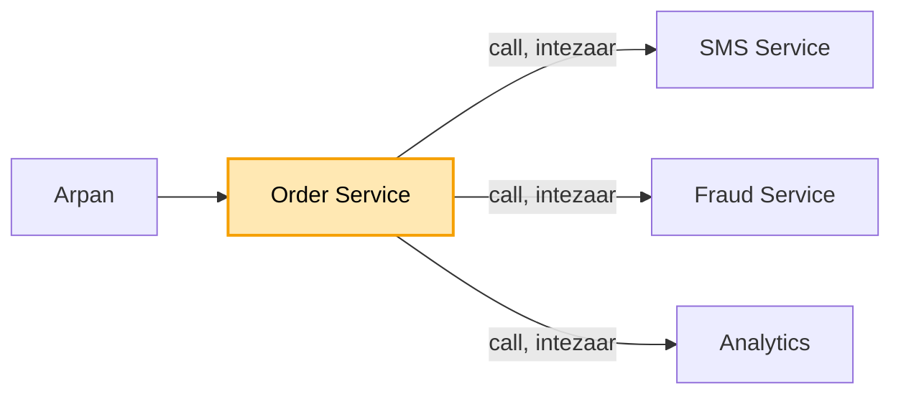
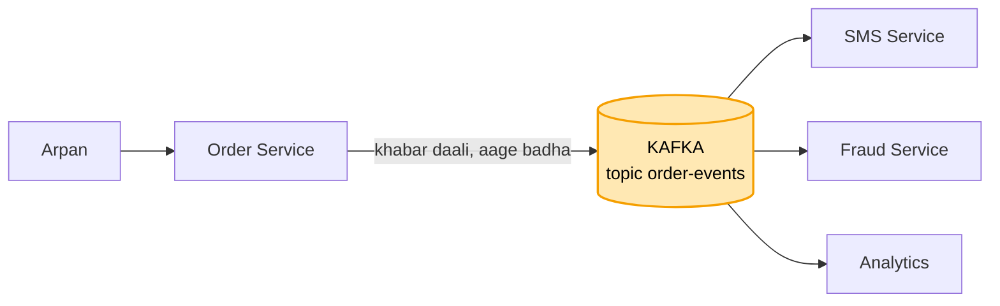
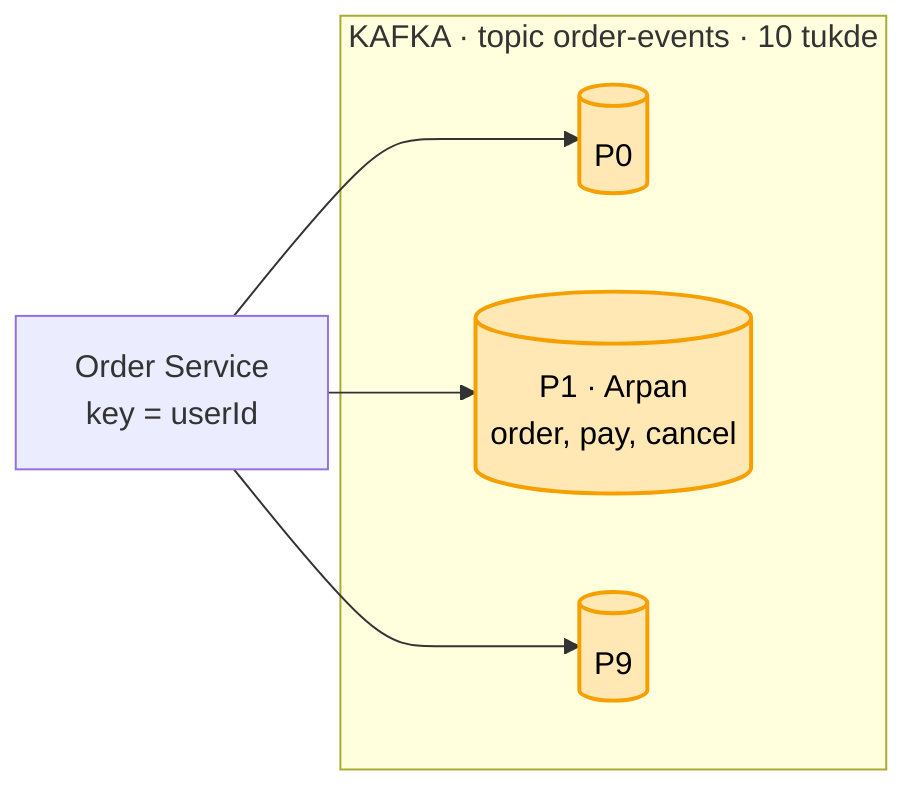
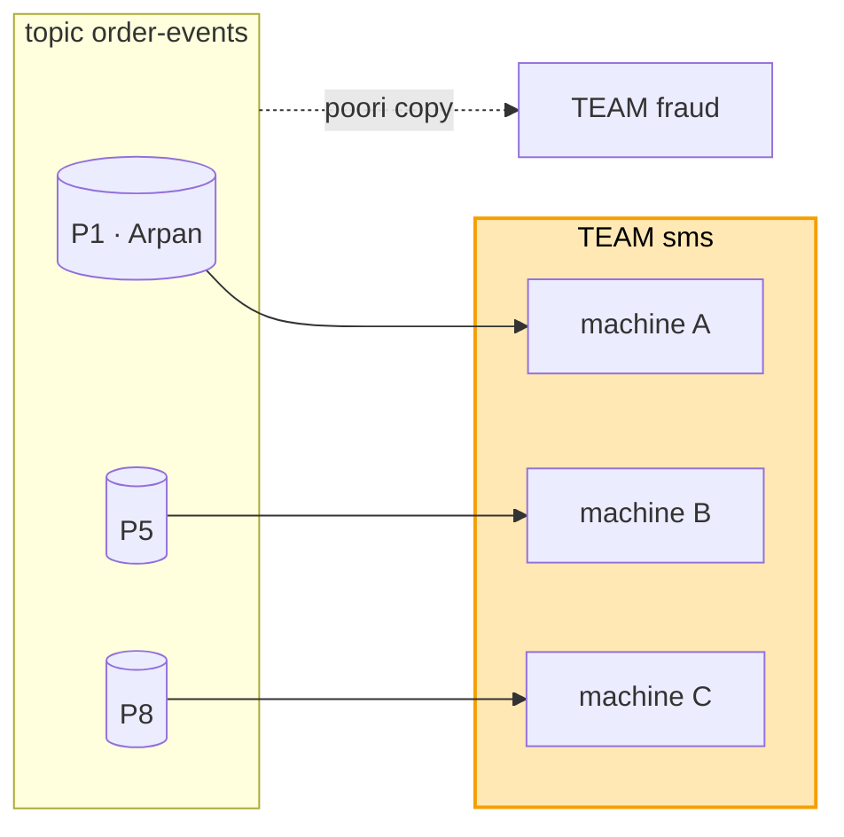
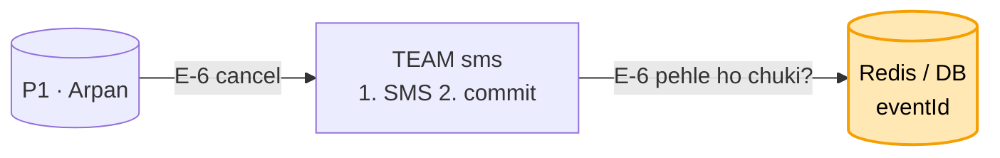
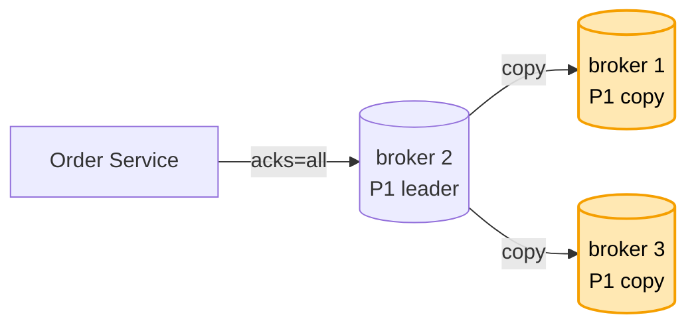
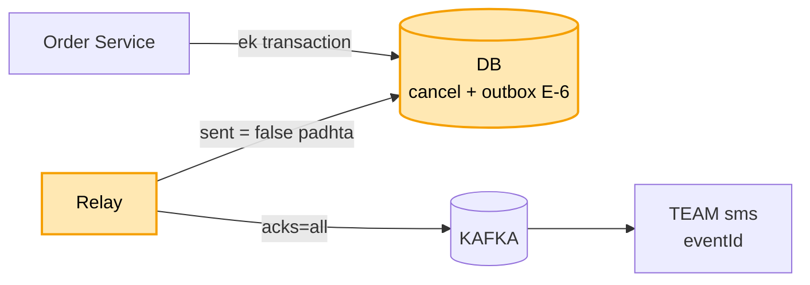
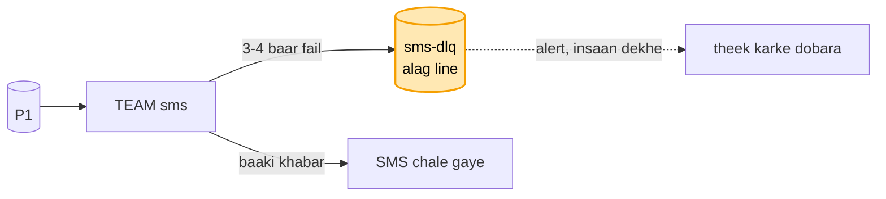

# Message queue (Kafka): shuru se, ek kahani

Kram wahi jo interview me hota hai: **FR, phir NFR, phir numbers, phir design**. Design sabse seedhe dabbe
se shuru hota hai, aur har dikkat aane pe ek naya dabba judta hai. Diagram me peela dabba = abhi juda. Poori
file me ek hi kahani hai: Arpan ne Swiggy pe order kiya. Concepts kahani se padhne hon to
[kafka_concepts.md](kafka_concepts.md). Kafka ya RabbitMQ, farak aur kab kaunsa: [kafka_ya_rabbitmq_kab_kaunsa.md](kafka_ya_rabbitmq_kab_kaunsa.md). Kafka kaise bana: [kahani](../../KAHANIYAN/kafka.md).

**CUE (yahi shabd yaad rakhne hain, kram se):**
seedha call (dheema) -> Kafka topic (disk, padhne se mitta nahi) -> 10 tukde + key = userId
-> team (consumer group) -> pehle kaam phir commit + eventId -> 3 copy + acks=all + min.insync.replicas
-> outbox -> DLQ

---

## 1. FR: kya karna hai

```
1. Order Service ki khabar ("Arpan ne order kiya") kai service tak pahunche: SMS, Fraud, Analytics
2. Order Service kisi ka intezaar na kare
3. ek user ki khabar kram me pahunche (order, phir pay, phir cancel)
scope ke bahar (poochh ke hata do): duniya bhar ke region, exactly-once (Kafka se bahar)
```

## 2. NFR: kaisa chalna chahiye

```
- khabar kabhi na khoye
- bheed me bhi chale (sale me 5,000 / sec)
- ek service dheemi ho to baaki na rukein
```

## 3. Numbers

```
- roz 10 crore khabar -> ~1,200 / sec, sale me ~5,000 / sec
- ek worker ~500 khabar / sec sambhal paata hai -> 5,000 / 500 = 10 tukde chahiye
- ek khabar ~1 KB -> roz ~100 GB -> 7 din rakho to ~700 GB -> 3 copy = ~2 TB disk
```

"10 tukde" kadam 3 me kaam aayega, aur "7 din, 3 copy" baad me.

---

## 4. Design

### Kadam 1: sabse seedha (Order Service seedha sabko call kare)

Arpan ne order kiya. Order Service order banata hai, phir khud SMS Service, Fraud Service aur Analytics ko ek-ek karke
call karta hai, har ek ke jawab ka intezaar karta hai, aur tab jaake Arpan ko "order ho gaya" bolta hai.



Dikkat: SMS Service dheema hai to Arpan ka order bhi dheema ho jaata hai. SMS Service gira to order hi fail, jabki
order ka SMS se koi lena-dena nahi. Aur kal koi naya Coupon Service aaya, to Order Service ka code badalna padega.

Order Service ko kisi ka intezaar nahi karna. Wo khabar kahin daal de aur aage badh jaaye, aur jise chahiye wo
wahan se le le. Par "kahin" ka matlab kahan?

### Kadam 2: khabar kahan daalein (Kafka topic, disk pe)

Order Service khabar ek line (queue) me daal deta hai aur aage badh jaata hai. SMS, Fraud aur Analytics usi line
se padhte hain. Par line kaisi ho? Ye asli choice hai:

```
SERVER KI MEMORY ME LIST  -> server restart = saari khabar gayab. NFR "kabhi na khoye" toota
RABBITMQ (aam queue)      -> khabar ek ne padhi to line se nikal gayi (mit gayi).
                             SMS ne padhi to Fraud ko mili hi nahi. Exchange se har service ki apni
                             queue ban jaati hai, par padhne ke baad message hat jaata hai, replay nahi
KAFKA (topic, disk pe)    -> khabar disk pe likhi jaati hai, padhne se mit-ti NAHI.
                             SMS, Fraud, Analytics teeno wahi khabar padhte hain, apni-apni jagah se
```

**Isliye Kafka.** Line ko Kafka me **topic** kehte hain (`order-events`). Padhne se khabar mit-ti nahi,
isliye ek hi khabar teen service padh leti hain, aur kal Coupon Service aaya to wo bas padhna shuru kar degi,
Order Service me ek line nahi badalti. Har service apna bookmark rakhti hai ki agla kaunsa padhna (**offset**), to
Fraud dheema hua to bas wo peeche rahega, SMS nahi rukega. Disk pe hai, to kuch din (jaise 7 din) rakhi
rehti hai, aur kisi service me bug tha to bookmark peeche karke dobara padh sakte hain.



**Maan lo Kafka kab, kab nahi poochha:** kab: intezaar todna, ek khabar kai service, replay, bheed ka buffer. Nahi: turant jawab chahiye (REST / gRPC), chhota system (ek aur cheez paalna mehnga).

**Maan lo pull ya push poochha:** pull: padhne wala apni speed se maangta, dheema padhne wala doobta nahi.

**Maan lo disk bhar rahi:** 7 din se purani khabar hatao (retention).

**Maan lo sirf aakhri value chahiye:** compaction: har key ki sirf aakhri khabar rakho (jaise user ka aakhri pata).

**API:** seek(offset) = dobara padhna.

**AWS pe:** Kafka ki machines hum khud nahi chalate, AWS ka **MSK** (Managed Kafka) lete hain. Broker, copy, gira to naya leader, ye AWS sambhalta hai. Topic aur partition hum tay karte hain.

Par Diwali sale me har second 5,000 order. Saari khabar ek topic me, aur topic ek hi machine pe. Upar se SMS
ka ek worker sirf 500 / sec sambhal paata hai. Line lambi hoti ja rahi hai.

### Kadam 3: bheed (topic ke tukde = partition, aur key)

Ilaaj: topic `order-events` ko andar se **10 tukdon** me baanto, har tukda alag machine pe. Ek tukde ko
**partition** kehte hain. 10 isliye ki numbers me nikla tha: sale me 5,000 / sec, ek worker 500 / sec, to
5,000 / 500 = 10. Ek tukda ek worker padhega, to 10 tukde = 10 worker ek saath.

Par tukde karte hi nayi dikkat aati hai: kram. Arpan ki 3 khabar (order, pay, cancel) alag-alag tukdon me
gayi, to padhne wala kis kram me padhe, koi bharosa nahi. "cancel" pehle padh liya to gadbad. Kafka me kram
sirf ek tukde ke andar pakka hota hai, poore topic me nahi.

Ilaaj: **key**. Order Service har khabar ke saath ek key deta hai, `userId`. Same key hamesha same tukde me
jaati hai:

```
tukda = hash(arpan) % 10 = 1   -> Arpan ki teeno khabar P1 me, kram se: order, pay, cancel
Ravi ki khabar                -> P6 me (alag tukda, Arpan se koi lena-dena nahi)
```

Ye chat wali baat hi hai: wahan kram sirf ek chat ke andar chahiye tha, yahan sirf ek user ke andar.



Tukde 10 se 20 kiye to? Tukda = hash(key) % ginti hai. Ginti badli to key ka tukda badal jaata hai: Arpan ki
purani khabar P1 me rahegi, nayi kahin aur, thodi der kram toot sakta hai. Isliye asli system me shuru me hi
zaroorat se 2-3 guna tukde rakh lete hain (yahan samjhane ke liye 10).

**Maan lo garam key (ek user ki bahut khabar):** key me number jodo (user-9#1 .. #4), 4 tukde, 4 machine. Keemat: us user ka poora kram gaya, har tukde ke andar bacha.

**API:** send(topic, key, value) -> (tukda, number).

Par SMS Service ki 3 machine lagayi taaki 10 tukde jaldi padhe jaayein. Teeno machine saare tukde padhne lagin,
aur Arpan ko ek order ke 3 SMS chale gaye.

### Kadam 4: 3 machine, 3 SMS (consumer group)

Teeno machine saare tukde padh rahi thi, to Arpan ki khabar teeno ke paas pahunchi aur teeno ne SMS bhej diya.

Ilaaj: teeno machine ko ek **team** bana do, sabko ek hi team ka naam do (`group.id = "sms"`). Isse
**consumer group** kehte hain. Kafka ka niyam hai: ek team ke andar har tukda sirf ek machine ko milta hai.

```
TEAM sms (3 machine), 10 tukde:
  machine A -> P0, P1, P2, P3     (P1 = Arpan, to Arpan ka SMS sirf A bhejegi)
  machine B -> P4, P5, P6
  machine C -> P7, P8, P9
```

Arpan ko ab ek hi SMS jaata hai. Fraud alag team hai (`group.id = "fraud"`), to use apni poori copy milti
hai, aur har team apna bookmark (offset) alag rakhti hai. Machine B gir gayi to Kafka uske tukde (P4, P5,
P6) A aur C me baant deta hai, ise **rebalance** kehte hain.

11vi machine lagayi to? 10 hi tukde hain, aur ek tukda ek hi machine ko milta hai. 11vi machine ke liye koi
tukda bacha hi nahi, wo khaali baithegi. Tez karna hai to pehle tukde badhao.



**Maan lo machine badhi / giri:** rebalance: Kafka tukde dobara baant-ta hai. Naye tareeke (cooperative) me sirf wahi machine rukti jiske tukde badle.

**Maan lo kaam lamba, poll nahi kiya:** Kafka machine ko mara samajh ke uske tukde le leta hai (max.poll.interval.ms). Ek baar me kam khabar uthao, ya time badhao.

Par machine A ne Arpan ka SMS bheja, aur bookmark aage karne se pehle gir gayi. P1 machine B ke paas gaya, B
ne bookmark dekha (abhi bhi purana), aur wahi khabar dobara padhi. Arpan ko 2 SMS.

### Kadam 5: bookmark se pehle gira, 2 SMS (pehle kaam phir commit + eventId)

Machine A ka kaam teen kadam ka tha: khabar padho, SMS bhejo, phir Kafka ko batao "agli baar yahan se"
(bookmark aage karna = **commit**). SMS bheja aur commit se pehle gir gayi. Bookmark purana hi raha, to B ne
wahi khabar dobara padhi.

Ulta karte (pehle commit, phir SMS) to commit hua aur SMS se pehle gira, bookmark aage chala gaya, aur ye
SMS kabhi jaata hi nahi. Ye usse bhi bura hai. Isliye kram pakka hai: **pehle kaam, phir commit**. Khabar
kabhi khoti nahi, bas kabhi-kabhi dobara aa jaati hai. Iska naam hai **at-least-once**: kam se kam ek baar,
kabhi do baar.

Dobara aayi khabar pakadne ke liye har khabar ki apni id hoti hai (**eventId**, jaise `E-6`). SMS bhejne se
pehle machine dekhti hai ki ye id pehle ho chuki ya nahi:

```
E-6 aayi -> Redis / DB me dekho: E-6 ho chuki?
             nahi -> SMS bhejo, E-6 likh do, commit
             haan -> chhod do (dobara SMS nahi), commit
```

Ye chat wala `clientMsgId` aur banking wali idempotency key hi hai: dobara aaye to id se pehchaano. Ye
pehchaanna padhne wale (SMS Service) ka kaam hai, Kafka ka nahi.

Exactly-once (theek ek baar) Kafka sirf Kafka se Kafka tak deta hai. SMS bahar ki cheez hai, wahan eventId
hi rasta hai. Interview me bolo: "at-least-once + eventId se dohra kaam nahi."



**API:** poll() · commit(offset).

Par Arpan ki khabar P1 me thi, aur P1 Kafka ki ek machine (broker) pe tha. Us machine ki disk mar gayi. P1
sirf wahin tha, to Arpan ki saari khabar hamesha ke liye gayi.

### Kadam 6: Kafka ki machine mari (3 copy, acks=all, min.insync.replicas)

Ilaaj: har tukde ki **3 copy**, teen alag machine pe. Jis machine pe likhna-padhna hota hai wo **leader**
hai, baaki do copy. P1 ka leader broker 2 pe, copy broker 1 aur 3 pe. Broker 2 ki disk mari to 1 ya 3 naya leader ban
jaata hai, aur Arpan ki khabar bach jaati hai. Naya leader kaun banega, ye Kafka ki ek machine tay karti hai
jo sab pe nazar rakhti hai: **Controller**.

Par ek pench: leader (broker 2) ne khabar likhi aur turant Order Service ko "ho gaya" bol diya, aur copy tak khabar
pahunchne se pehle hi broker 2 mar gaya. Copy ke paas wo khabar thi hi nahi, to khabar gayi.

Ilaaj: **acks=all**. Leader "ho gaya" tabhi bolta hai jab pakki copies pe bhi likh jaaye.

```
acks=0    bhej ke bhool jao (sabse tez, khabar kho sakti)
acks=1    sirf leader ne likha to "ho gaya" (leader mara to aakhri khabar gayi)
acks=all  saari pakki copies pe likha tab "ho gaya"     <- order / paisa ke liye
```

"Pakki copy" wo hai jo leader ke saath bilkul taaza chal rahi hai. Unki list ko **ISR** (in-sync replicas) kehte hain. Peeche
chal rahi copy ko leader nahi banate, warna aakhri khabar kho jaayegi.

Sab copies gir gayi aur sirf leader bacha, to `acks=all` me "saari pakki copy" sirf leader khud hai, aur wo
"ho gaya" bol dega jabki copy ek bhi nahi. Isliye saath me **min.insync.replicas = 2**: kam se kam 2 pakki copy na
hon to likhna hi band. Khabar khone se behtar hai thodi der ruk jaana.



Par ab bhejne wala bacha. Arpan ne order cancel kiya. Order Service ne DB me likha "order = cancel", aur Kafka
ko khabar bhejne se pehle gir gaya. DB me cancel ho gaya, par SMS aur Fraud ko kabhi pata hi nahi chala.

### Kadam 7: bhejne wala gira (outbox)

Order Service ko do kaam karne the: DB me "order = cancel" likhna, aur Kafka ko khabar dena. DB aur Kafka do
alag cheezein hain, dono me ek saath, ek hi baar me likhne ka koi tareeka nahi. Pehla kaam hua, doosre se
pehle Order Service gira.

Ilaaj: **outbox**. Khabar bhi usi DB me likh do, cancel ke saath, ek transaction me. Khabar jis table me
jaati hai use outbox kehte hain. Ek chhota program **relay** har second outbox me `sent = false` wali khabar
dhoondhta hai, Kafka ko bhejta hai (acks=all), aur Kafka "OK" bole to `sent = true` likh deta hai.

```
BEGIN
  UPDATE orders SET status = cancel WHERE id = 101
  INSERT outbox (E-6, "arpan ne cancel kiya", sent = false)
COMMIT                      -> dono likhe gaye, ya koi nahi
```

Ab Order Service kahin bhi gire, kuch nahi khota. Transaction se pehle gira to na cancel likha na khabar, Arpan
dobara dabayega. Transaction ke baad gira to khabar outbox me padi hai, relay bhej dega. Relay ne bheja aur
`sent = true` likhne se pehle gira, to relay dobara bhejega, aur SMS Service us dohri khabar ko eventId se pakad
lega (kadam 5). Ye banking kadam 6 wala outbox hi hai.

Relay DB ko baar-baar poochta rahe to DB pe bojh? Bahut bada scale ho to relay ki jagah **CDC (change data capture, jaise Debezium)**
lagate hain, jo DB ka apna log (Postgres ka WAL / MySQL ka binlog) padh ke khabar Kafka ko deta hai, table ko poochhna hi nahi
padta.



Ab teeno jagah bachav: bhejne wala = outbox · Kafka = 3 copy + acks=all + min.insync.replicas · padhne wala = pehle
kaam phir commit + eventId.

Par ek khabar me galti thi (Arpan ka phone number hi galat). SMS Service use bhejne ki koshish karta raha, fail
hota raha, commit nahi kiya, aur P1 ki baaki saari khabar uske peeche atak gayi.

### Kadam 8: ek kharab khabar ne line rok di (DLQ)

Ek tukde me kram se padhna hota hai, aur machine agli khabar tabhi uthati hai jab pichhli ka commit ho
jaaye. Arpan ki khabar me phone number galat tha, to SMS kabhi jaayega hi nahi. SMS Service baar-baar koshish
karta raha, aur P1 wale baaki users ki khabar uske peeche atak gayi.

Ilaaj: **DLQ (dead letter queue)**, kharab khabar ki alag line. Khabar fail hui to 3-4 baar ruk-ruk ke
koshish karo. Phir bhi fail to use ek alag topic (`sms-dlq`) me daal do, commit karo, aur agli khabar pe
badho. DLQ pe alert jaata hai, insaan dekhta hai, number theek karke dobara chalata hai. Ek kharab khabar
poori line nahi rokti, aur khabar khoti bhi nahi.

Turant DLQ kyun nahi, 3-4 baar koshish kyun? Kai baar fail hona kuch der ka hota hai (SMS company ek second
ke liye dheemi thi), do-teen baar try karne pe chal jaata hai. Galat number jaisi galti har baar fail hogi,
wahi DLQ me jaati hai.



---

## 5. Wrap (30 second me poora design, NFR se milao)

Order Service order aur khabar ek transaction me DB me likhta hai (outbox), relay khabar Kafka ko bhejta hai
(acks=all). Kafka me topic `order-events` 10 tukdon me hai, key = userId taaki ek user ki khabar kram me
rahe, aur har tukde ki 3 copy hain (min.insync.replicas = 2). SMS, Fraud aur Analytics alag-alag team hain, har team
ko poori khabar milti hai, aur team ke andar ek tukda ek machine ko. Padhne wala pehle kaam karta hai phir
commit, dobara aayi khabar eventId se pakadta hai, aur baar-baar fail hone wali khabar DLQ me jaati hai.

```
intezaar nahi        -> Order Service khabar daal ke aage, sab apni speed se padhte
khabar na khoye      -> outbox (bhejne wala) · 3 copy + acks=all + min.insync.replicas (Kafka) · pehle kaam phir commit
kram                 -> key = userId, ek tukde me kram
bheed                -> 10 tukde, team me tukde baant ke padhna
ek dheema, baaki chalein -> har team ka apna bookmark
```

**Chal raha kaise pata:** lag naapo (tukde ki aakhri khabar - team ka bookmark), had se zyada = alert, machine badhao (tukdon ki ginti tak). Saath me DLQ ka size, peeche chal rahi copies.
