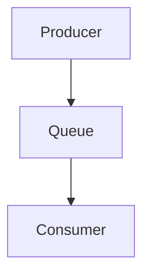
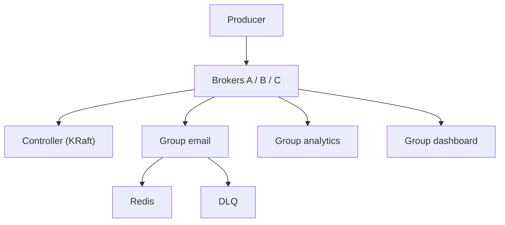
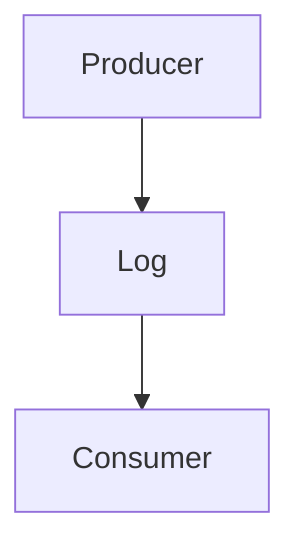
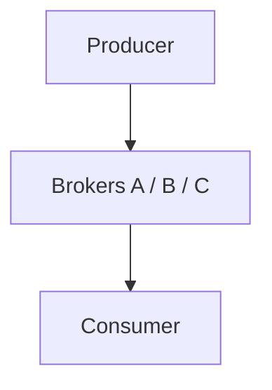
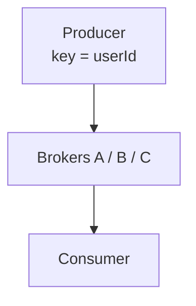
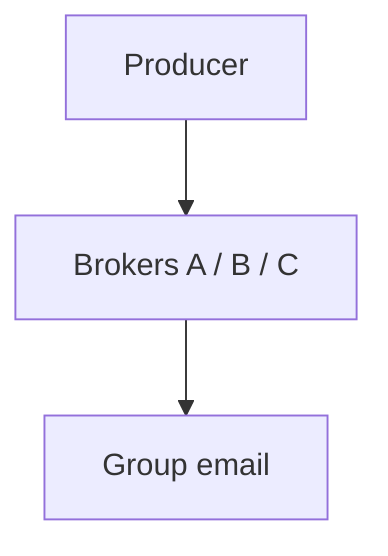
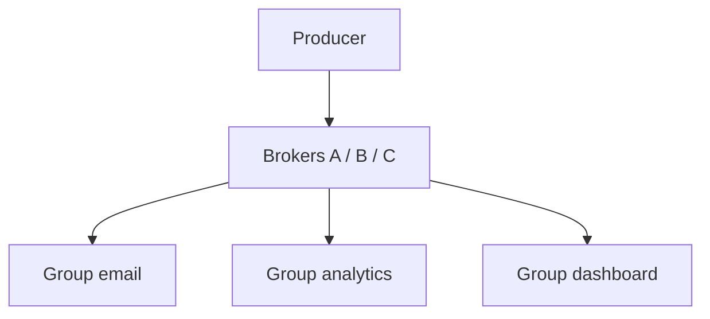
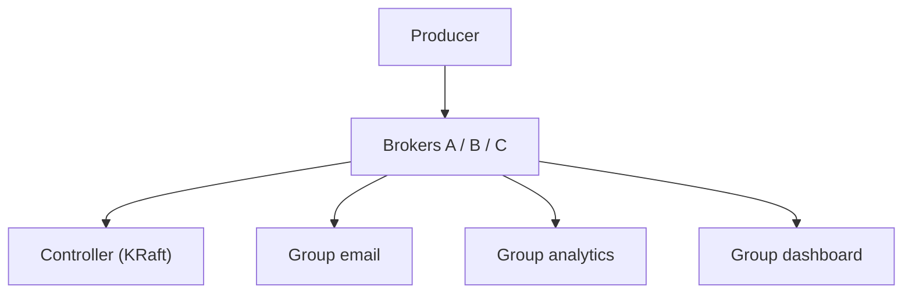
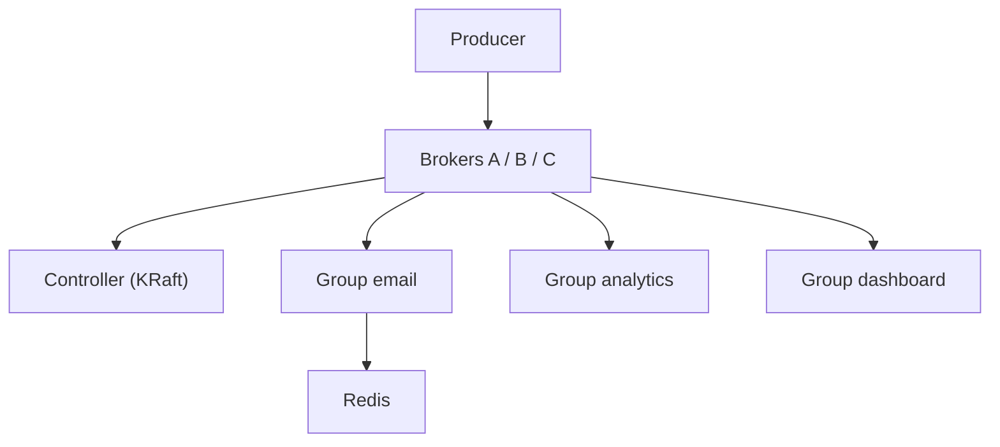

# Design a Message Queue (Kafka-jaisa)

> Ek dabba jo khabar (event) le le aur kai services ko unki apni speed se de de — bina kisi ko roke, bina kuch khoye.
> Is design ka dil: **kisi ko roko mat (bahut saari khabar / second)** + **kuch khoye nahi** + **ek user ki khabar kram me**.

---

## TASVEER (ByteByteGo / Alex Xu · CC BY-NC-ND 4.0)


Source: [Can Kafka Lose Messages?](https://bytebytego.com/guides/can-kafka-lose-messages/)
(HANDS-ON — khabar kahan khoti: producer / broker / consumer, wahi 3 jagah)


Source: [Delivery Semantics](https://bytebytego.com/guides/delivery-semantics/)
(at-most-once / at-least-once / exactly-once — offset commit PEHLE ya BAAD)

---

## SHURU: pehle poocho, phir numbers

```
POOCHO:  "Kram, khona-nahi, delivery guarantee, dobara padhna — kis pe focus?"
         message KHO sakta hai ya bilkul nahi? · KRAM poore topic ka chahiye ya ek user ka kaafi?
         ek message KAI service ko (sabko) ya kisi ek ko? · purana dobara padhna (replay)?
         (pehla aur teesra sawaal poora design badalte)

KYA KARE (FR):    producer DAALE · consumer UTHAYE · EK message KAI service tak (email + dashboard + analytics)
                  purana dobara padh sakein · ek user ki khabar KRAM me
KAISA CHALE (NFR): khoye nahi · ek machine gire to chale · lakhon / second (dil) · daalna ms me
                   ek key ka kram · 7 din rakho (replay) · consumer thoda peeche chale (lag) to THEEK

★ "DUPLICATE NAHI AAYEGA" MAT BOLNA: baad me "at-least-once, duplicate aayega" bologe to dono baatein kat-ti
  -> "aapne to no-duplicate bola tha?"
  SAHI: "No message loss. Duplicates ARE possible, and we handle them with idempotent consumers —
         so the EFFECT is exactly-once."

NUMBERS (andaaza):
   10 crore message / din, din me ~1 lakh second -> ~1,200 / second -> bheed me 3-5 guna -> ~5,000 / second
   ~1 KB ek message -> ~100 GB / din · 7 din rakho ~700 GB · 3 copy ~2 TB
   ~2 TB, ek broker ~1-2 TB -> 3-4 BROKER · har topic 3-6 PARTITION (partition = kitne ek saath padh sakein)
   MQ ka asli number JAGAH hai (Kafka padh ke delete nahi karta, RAKHTA) — log ise sirf "pipe" samajh lete
```

---

## ════ MOCK SE PEHLE: SIRF YE CARD PADHO ════

> Har dikkat ek card: KAHANI (kya hua, kaun, kitna) -> ILAAJ -> ANDAR KAISE (ilaaj kyun kaam karta) ->
> ISKE BAAD KYA TOOTEGA (interviewer yahin ghusta hai: dabba lagaya, ab kya?).

#### DABBA 0: SABSE SIMPLE (yahan se shuru, phir "kahan tootega")
```
Ek machine, uski memory me ek queue. Producer daale, consumer uthaye.
```


#### [1](#d1) CONSUMER RESTART HUA, MESSAGE GAYAB
```
KAHANI:  Queue machine ki memory me thi, 500 signup message pade the. Machine restart -> memory saaf -> 500 gayab.
         Email service ko pata hi nahi chala ki 500 log aaye the.

ILAAJ:   Disk pe APPEND-ONLY LOG (sirf neeche jodte jao). Har message ka number = OFFSET.
         Padh ke delete NAHI -> restart pe wahin se aage, ya peeche jaake dobara (REPLAY).

ANDAR KAISE:
         P0: [0][1][2][3][4][5] -> naya hamesha AAKHIR me judta.
         Email service ne 2 tak padha (offset = 2) -> restart -> "3 se do" -> kuch nahi khoya.
         Offset = kram number (byte nahi). Ek chhoti .index file batati "offset 3 file me kis jagah".

ISKE BAAD KYA TOOTEGA:
  - Disk pe likhna dheema nahi?
      -> sirf aakhir me jodna (sequential) = disk ka sabse tez kaam. Padhna OS ke page cache se, RAM jaisa.
  - DB me queue kyun nahi bana lete?
      -> DB insert = index + lock = idhar-udhar likhna. Queue me WHERE hota hi nahi, bas "offset X ke baad do".
  - Offset yaad kaun rakhta?
      -> Kafka khud, ek andar wale topic __consumer_offsets me: (group, topic, partition) -> offset.
```

#### [2](#d2) EK MACHINE ME 2 TB AUR 5,000 / SEC NAHI AAYEGA
```
KAHANI:  Ek broker (Kafka machine) me 2 TB nahi samaata, aur 5,000 likhai / second bhi akela nahi jhelta.

ILAAJ:   Topic ke tukde = PARTITION. Har partition alag broker pe, apna alag log.

ANDAR KAISE:
         topic "user-signup": P0 -> Broker A · P1 -> Broker B · P2 -> Broker C.
         Bojh teen machine me bat gaya. Aur badhe -> aur broker + aur partition.

ISKE BAAD KYA TOOTEGA:
  - Kitne partition rakhoge?
      -> jitne consumer ek saath chahiye + aage ki badhat (12-30). Baad me badhaye to key ka partition badlega (card 3).
  - Copy (replica) se likhna scale hoga?
      -> nahi. Copy sirf bachav ke liye. Likhna partition se scale hota.
  - Ek partition garam (ek key ki bahut khabar)?
      -> key ko tukdon me todo (userId#bucket), agar us key pe kram zaroori nahi.
```

#### [3](#d3) ARPAN KE TEEN EVENT TEEN PARTITION ME (KRAM ULTA)
```
KAHANI:  Arpan ke teen event: signup P0 me gaya, profile-update P2 me, delete-account P1 me.
         P1 jaldi padha gaya -> delete pehle hua, signup baad me. Ulta.
         Kafka kram sirf EK partition ke andar deta, partitions ke beech nahi.

ILAAJ:   Producer har message ke saath KEY bheje (userId). Ek user ke saare event ek hi partition me -> kram pakka.

ANDAR KAISE:
         partition = hash(Arpan ka userId) % 3 -> hamesha P2 -> signup, update, delete teeno P2 me, kram se.
         Poore topic ka kram chahiye = sirf ek partition = speed khatam. Isliye kram sirf key ke andar.

ISKE BAAD KYA TOOTEGA:
  - Partition 3 se 6 kiye to Arpan ka partition badla?
      -> haan, % 3 se % 6 hua -> naye event naye partition me, thodi der kram toota. Isliye shuru me hi zyada partition.
  - Producer ka dobara bhejna kram ulta kare (1 fail, 2 gaya, phir 1)?
      -> idempotent producer (enable.idempotence): har message ka sequence number -> kram + duplicate dono theek.
```

#### [4](#d4) EMAIL SERVICE KE 3 INSTANCE, ARPAN KO 3 EMAIL
```
KAHANI:  Email service ki 3 machine (C1, C2, C3), teeno poora topic padh rahi. Arpan ka signup teeno ne padha -> Arpan ko 3 welcome email.

ILAAJ:   Teeno EK CONSUMER GROUP me. Group ke andar ek partition ko sirf EK consumer padhta.

ANDAR KAISE:
         P0 -> C1 · P1 -> C2 · P2 -> C3. Arpan ka event P2 me -> sirf C3 padhta -> ek email.
         3 partition + 5 consumer = 2 khaali baithe (partition se zyada consumer bekaar).
         (RabbitMQ / SQS me har message kisi bhi consumer ko, kram ki guarantee nahi.)

ISKE BAAD KYA TOOTEGA:
  - Kaam zyada, consumer badhaane hain?
      -> partition bhi badhao. Consumer > partition = khaali baithe.
  - Ek message 5 min ka kaam, poora partition atka?
      -> haan (aage wala atka to peeche sab atke). Dheema kaam alag topic / worker pool ko do.
```

#### [5](#d5) ARPAN KA SIGNUP TEENO SERVICE KO CHAHIYE
```
KAHANI:  Arpan ka signup event email service ko bhi chahiye, analytics ko bhi, dashboard ko bhi.
         Card 4 ka group lagaya to ek hi ko milega.

ILAAJ:   Topic EK, har service ka APNA GROUP. SAME group = kaam baanto · ALAG group = har group ko poora.

ANDAR KAISE:
         email group, analytics group, dashboard group -> teeno ko Arpan ka event milta.
         Har group ka apna offset. Analytics 1 ghanta peeche hai to email ko koi farak nahi.

ISKE BAAD KYA TOOTEGA:
  - Har service ka alag topic bana do?
      -> NAHI. Producer ko ek event teen baar bhejna padega -> "ek message kai service" hi toota. Ye MQ ka dil hai.
  - Naya group aaj juda, purane 7 din padhega?
      -> auto.offset.reset = earliest -> shuru se · latest -> sirf ab ke baad ka.
```

#### [6](#d6) BROKER A KI DISK GAYI, DATA GAYA
```
KAHANI:  Har partition ki ek hi copy thi. Broker A ki disk mar gayi -> P0 ka saara data hamesha ke liye gaya.

ILAAJ:   REPLICATION: har partition ka ek LEADER (saara padhna / likhna) + 2 FOLLOWER (alag broker / alag AZ).
         Leader mara -> jo follower saath-saath chal raha tha (ISR) wo naya leader. Faisla CONTROLLER karta (KRaft, pehle ZooKeeper).

ANDAR KAISE:
         Producer kitna pakka chahta (acks):
           acks=0  bhej ke bhaag gaya (kho sakta)
           acks=1  leader ne likh liya tab "done"
           acks=all leader + saare ISR follower ne likh liya tab "done"
         paisa / order = acks=all · click / log = acks=1.

ISKE BAAD KYA TOOTEGA:
  - acks=all + min.insync.replicas=2 ka matlab?
      -> leader + kam se kam 1 follower ke paas likha tab "done". Leader mara to bhi data follower pe hai.
  - ISR me sirf leader bacha?
      -> 2 se kam -> producer ko error (likhna band). Data khone se behtar.
  - Peeche chal raha follower (ISR se bahar) leader ban gaya?
      -> uske paas aakhri message nahi -> data gaya. Isliye sirf ISR wala hi leader.
```

#### [7](#d7) KAAM HO GAYA PAR COMMIT SE PEHLE CRASH (+ OUTBOX)
```
KAHANI:  SMS service ne offset 5 padha (Arpan ka order).
         A) SMS bheja -> "padh liya" (commit) bolne se pehle CRASH -> restart pe phir 5 -> Arpan ko 2 SMS.
         B) pehle commit kiya -> SMS bhejne se pehle CRASH -> restart 6 se -> event 5 KHO gaya, SMS gaya hi nahi.

ILAAJ:   Pehle KAAM, phir COMMIT (at-least-once: khoyega nahi, kabhi do baar aa sakta)
         + consumer IDEMPOTENT: eventId Redis me hai? hai = skip.
         DO alag key: KRAM ke liye userId (partition key) · DEDUP ke liye eventId.
         userId se dedup kiya to Arpan ka agla sahi event bhi skip ho jaata.

ANDAR KAISE (producer ki taraf = OUTBOX):
         Order #101 DB me bana, par Kafka ko bhejne se pehle server gira -> event kabhi gaya hi nahi.
         Ilaaj: order aur outbox ki row EK hi DB transaction me:
           BEGIN · INSERT orders(101) · INSERT outbox(E-101, sent = false) · COMMIT
         Relay (alag thread, har 1 sec) sent = false wali row Kafka bheje, ACK aaye to sent = true.
         Crash kahan hua, teen case:
           1 COMMIT se pehle         -> DB me kuch nahi, Arpan ko error dikha, wo dobara karega. Kuch bana hi nahi.
           2 COMMIT ke baad, bhejne se pehle -> outbox me sent = false -> relay uthte hi bhej deta. Late, khoya nahi.
           3 bhej diya, sent = true likhne se pehle -> relay phir bhejta -> Kafka me 2 copy
             -> consumer E-101 dekh ke doosri skip -> Arpan ko EK email.
         Nichod: server kuch yaad nahi rakhta, DB ka sent column yaad rakhta. Shaq ho to dobara bhejo,
         duplicate ka ilaaj consumer pe.

ISKE BAAD KYA TOOTEGA:
  - Exactly-once Kafka me hota hi nahi?
      -> Kafka transactions + idempotent producer = Kafka se Kafka tak. Bahar (SMS, DB) ke liye consumer idempotency.
  - "Event Kafka tak pahuncha hi nahi" pe offset ka jawab do?
      -> nahi chalta. Offset = consumer ki taraf. Ye producer ki taraf hai -> OUTBOX.
  - Outbox table badi ho gayi?
      -> sent wali rows roz saaf / partition drop.
  - Kuch na khoye, poora jawab?
      -> acks=all + kaam ke baad commit + idempotent consumer + DLQ.
```

#### [8](#d8) CONSUMER MARA / PEECHE CHAL RAHA
```
KAHANI:  C2 mar gaya -> P1 ko koi padh hi nahi raha, khabar jama ho rahi.
         Ya consumer dheema -> peeche-peeche (lag) badhta ja raha.

ILAAJ:   REBALANCE: C2 ki dhadkan (heartbeat) band -> coordinator C2 ke partition baaki me baant deta.
         LAG dekho, consumer badhao. Baar-baar fail wala message -> ruk ke dobara, N baar ke baad DLQ (alag topic). Baaki na atkein.

ANDAR KAISE:
         Pehle: C1->P0, C2->P1, C3->P2 · C2 mara -> C1->P0,P1 · C3->P2.
         lag = partition ka aakhri offset - group ne kahan tak padha.

ISKE BAAD KYA TOOTEGA:
  - Rebalance me saare consumer ruk jaate?
      -> purana tareeka (eager) haan. Cooperative rebalance (Kafka 2.4+) -> sirf jinke partition badle wo rukte.
  - Lag badhta ja raha?
      -> consumer badhao (partition tak), dheema kaam alag, lag pe alert.
```

#### [9](#d9) 7 DIN RAKHOGE TO DISK BHAREGI
```
KAHANI:  Kafka padh ke delete nahi karta (ye log hai, queue nahi) -> disk bharti ja rahi.

ILAAJ:   RETENTION: 7 din (ya size) se purani SEGMENT file poori delete.
         Sirf aakhri value chahiye -> COMPACTION (har key ka sirf aakhri message rakho).

ANDAR KAISE:
         Log chhoti-chhoti segment file me (~1 GB). Purani poori file uda do = sasta.
         Compaction: Arpan ki profile 10 baar badli -> sirf aakhri wali rakho (profile / config jaisa data).
         Jo rakha hai usse REPLAY: naya group shuru se padhe, ya bug theek karke offset peeche le jao.

ISKE BAAD KYA TOOTEGA:
  - 7 din me consumer ne padha hi nahi (band tha)?
      -> data gaya. Isliye lag pe alert + retention consumer ki sabse lambi band-hone ki der se zyada.
```

```
AAKHRI DABBE (sab dikkat ke baad):
  Producer (key + acks) -> key se partition -> LEADER broker pe jodo (offset) -> follower copy (ISR)
  -> har consumer group apne offset se padhe -> kaam -> commit · khabar retention tak padi (replay)
  Controller (KRaft) = naksha, do leader na banein · Redis = eventId dedup · DLQ = kharab message alag

DB:  message = append-only file (segment ~1 GB + index), DB nahi; bachav = copy + acks
     naksha (kaun leader) = pakka sahi (KRaft / Zookeeper) · offset = __consumer_offsets

END ME POOCHEGA:
  "Kram?"           -> sirf EK PARTITION ke andar (same key = same partition), poore topic ka nahi
  "Exactly-once?"   -> at-least-once + idempotent consumer (eventId) = asar exactly-once
  "Garam partition?" -> key todo (user-9#0..3) -> 4 partition; us key ka pakka kram jaata
  "10x?"            -> partition badhao (shuru me extra rakho, baad me badhane se key ka partition badalta)
                       · consumer badhao (partition tak) · broker disk: retention / tiered storage
  "SPOF?"           -> leader (ISR se promote), controller (KRaft quorum)
  "Chal raha, kaise pata?" -> CONSUMER LAG · under-replicated partitions · DLQ size · alert
```

AAKHRI DABBE ki tasveer:



---

## ════ DETAIL: HAR DIKKAT KI INTERVIEW LINE + TASVEER ════

> Card me poori kahani hai. Yahan har dikkat ki ek English line (interview me bolne ke liye) aur us waqt tak ka diagram.

---

<a id="d1"></a>

## DIKKAT 1 — consumer restart hua, message gayab

```
BOL: "Messages go to an append-only log on disk, each with an offset, and reading does not delete them, so a restarted consumer continues from its committed offset or replays from earlier."
```


---

<a id="d2"></a>

## DIKKAT 2 — ek machine me 2 TB aur 5,000 / sec nahi

```
BOL: "A topic is split into partitions spread across brokers, so storage and write throughput scale with the number of partitions; replicas are for safety, not for scaling writes."
```


---

<a id="d3"></a>

## DIKKAT 3 — Arpan ke teen event teen partition me

```
BOL: "Ordering only exists within a partition, so the producer sends a key like the user id and all events for that user land in the same partition, in order."
```


---

<a id="d4"></a>

## DIKKAT 4 — email ke 3 instance, Arpan ko 3 email

```
BOL: "Instances of one service form a consumer group, and within a group each partition is read by exactly one consumer, so each event is processed once by that service."
```


---

<a id="d5"></a>

## DIKKAT 5 — signup teeno service ko chahiye

```
BOL: "One topic, and each service has its own consumer group with its own offset, so the same event reaches email, analytics and the dashboard independently."
```


---

<a id="d6"></a>

## DIKKAT 6 — Broker A ki disk gayi

```
BOL: "Each partition has a leader and followers on other brokers; only an in-sync replica can become the new leader, and critical events use acks=all with min.insync.replicas=2 so a write survives losing the leader."
```


---

<a id="d7"></a>

## DIKKAT 7 — kaam ke baad, commit se pehle crash

```
BOL: "Consumers commit the offset only after the work is done, so a crash means redelivery, not loss, and they dedupe on event id. On the producer side the outbox pattern writes the event in the same DB transaction as the data, and a relay publishes it."
```


---

<a id="d8"></a>

## DIKKAT 8 — consumer mara / peeche chal raha

```
BOL: "When a consumer dies its partitions are rebalanced to the rest of the group; I alert on consumer lag, and a message that keeps failing goes to a DLQ after a few retries so it does not block the partition."
```


---

<a id="d9"></a>

## DIKKAT 9 — 7 din rakhoge to disk bharegi

```
BOL: "Retention deletes whole old segment files by time or size, and compacted topics keep only the latest value per key; the retained log is what lets a new group or a fixed consumer replay."
```


---
## 10 GUNA TRAFFIC — har dabba alag se

```
partition      -> consumer badhaye par partition 3 hi -> extra KHAALI baithe, lag badhta -> PARTITION BADHAO
                  ★ "Adding partitions changes hash(key) % n, so an existing key can move to a different partition
                     and its ordering can break — that's why we start with a few extra partitions."
dheema consumer -> aage wala (email API / DB) dheema -> consumer badhao (partition tak) · batch · bhaari kaam alag topic
GARAM PARTITION -> ek bade customer ki key pe saara bojh -> key todo (userId#1..4), us key ka pakka kram chhodo
                  (ya us customer ka alag topic) · consistent hashing ek garam key ko nahi bachata
broker disk    -> 2 TB tha, 10 guna = 20 TB -> retention 7 se 2-3 din · compaction · broker jodo · tiered storage / S3
rebalance ki aandhi -> baar-baar deploy -> session-timeout theek karo · static membership · ek-ek karke deploy
producer       -> har jagah acks=all = dheema -> khabar ke hisaab se (payment = all, log = 1)

POOCHEGA: "What about a hot key / hot partition?"   -> upar GARAM PARTITION
          TERA JAWAB: "pehle machine badi karo, phir usi dabbe ko kai hisson me todo" -> TODNA = sahi direction
          BADI MACHINE KAAFI KYUN NAHI: group me ek partition ko EK hi consumer padhta -> machine badi, padhne wala phir bhi ek
          MISAAL: user-9 ke saare event P2 pe -> key = "user-9#" + (eventId % 4) -> 4 partition, 4 consumer saath padhein
          KEEMAT: user-9 ka POORA pakka kram gaya (har tukde ke andar bacha)
                  kram sach me chahiye -> key chhoti cheez pe rakho (orderId / accountId), jahan kram chahiye bas wahan
          BOL: "A hot key pins one partition and one consumer, so a bigger box doesn't help much.
                I'd salt that key into N sub-keys to spread it over N partitions, accepting that strict
                ordering for that one customer is lost — or key by a finer id where ordering actually matters."
POOCHEGA: "How would you scale this to 10x?"        -> message ka raasta chalo
POOCHEGA: "What's the single point of failure?"     -> leader (ISR promote), controller (KRaft quorum)
POOCHEGA: "How do you know it's working?"           -> CONSUMER LAG · under-replicated partitions · DLQ size · alert
```

---

## POOCHE TO (gehra sawaal aaye tab)

```
API:      PRODUCER  send(topic, key, value) -> (partition, offset) rasid · acks = 0 / 1 / all
          CONSUMER  subscribe(topic, groupId) · poll(timeout) ek saath kai · commit(offset) · seek(partition, offset) = REPLAY
          ADMIN     createTopic(name, partitions, replicationFactor) / deleteTopic / describeTopic
          PULL hai, PUSH nahi: consumer apni speed se maangta, dheema consumer dab ke nahi marta
                               keemat: agle poll tak thodi der (push hota to broker dhakelta -> dheema consumer doob jaata)
          send() ek saath kai bhejta (batch) -> isliye bahut tez
          "The queue's own API is deliberately tiny — send, poll, commit, seek. All the business logic lives
           in the consumer, not in the broker. That's why the broker can be so fast."

MESSAGE:  offset (BROKER deta) · timestamp · key (hash(key) % n) · value (JSON / Avro) · headers (traceId, eventType, retryCount)
DISK:     /topic-user-signup/partition-0/
             00000000000000000000.log     message, sirf jodte (segment ~1 GB)
             00000000000000000000.index   offset -> file me jagah
             00000000000512340000.log     segment bhara -> naya

DATA 3 KISM:  MESSAGE (bahut, tez) -> append-only file, bachav = copy + acks (DB nahi)
              NAKSHA (kam, 100% sahi: topic / partition / leader / ISR) -> pakka sahi (Zookeeper / KRaft-Raft)
                        kyun: do broker khud ko ek partition ka leader samjhein = SPLIT-BRAIN = data kharab
              CONSUMER OFFSET -> __consumer_offsets

KAB KAFKA:    bhejne wale ko jawab ka intezaar nahi (signup ke baad email / analytics) · EK khabar KAI service
              bahut saari khabar + replay (log, clickstream, audit) · bhejne / lene wale ki speed alag (bheed ka buffer)
KAB NAHI:     TURANT jawab chahiye -> REST / gRPC · poore system ka pakka kram · simple kaam ki line + har message ka retry
              -> RabbitMQ / SQS (Kafka bahut bhaari) · chhota system, 2 service -> ek aur cheez sambhaalna mehnga
KEEMAT:       "thodi der baad sahi" (LAG) · duplicate sambhaalna padta · debug mushkil (flow bikhra)
              · ek aur cluster paalna (partition / retention / lag dekhna)

SHABD ATKE TO (bina shabd ke bolo):
   partition      -> "the topic is split into parts, and each part sits on a different machine"
   offset         -> "each part is like a numbered list, and every consumer remembers which number it has read up to"
   consumer group -> "a set of consumers that act as one team and divide the parts among themselves"
   ISR            -> "the copies that are fully caught up with the main one"
   idempotent     -> "even if the same event comes twice, the work happens only once, because we store the event id"
   compaction     -> "for each key we keep only the latest value and throw away the older ones"
```

---

## AAKHRI DABBA + WRAP

```
Producer = key + acks · Brokers = partition (append-only log + offset), leader + ISR follower, retention
Controller = naksha, do leader na banein · Groups = ek group me baanto, alag group = sabko
Redis = eventId dedup · DLQ = kharab message alag
```
```
RAASTA: producer -> key se partition -> LEADER pe jodo (offset) -> follower copy (ISR)
        -> har group apne offset se padhe -> kaam -> commit -> khabar 7 din padi (replay)

1 KYUN        ek doosre ka intezaar todna -> producer bhej ke aage, consumer apni speed
2 TOPIC/PART  partition = scale + append-only log + offset · key -> kram EK PARTITION me (poore topic me nahi)
3 GROUP       group ke andar baanto · alag group = sabko · kitne ek saath = partition ginti tak
4 COPY        leader / follower · naya leader sirf ISR se · acks 0 / 1 / all = tezi vs bachav
5 DELIVERY    at-least-once + idempotent consumer = asar exactly-once · retention -> replay
6 TRADE-OFF   async + sabko + replay -> Kafka · turant jawab / poora kram -> Kafka NAHI
```
```
BOL: "Producers write keyed events to partitioned, append-only logs spread across brokers, so ordering is
      per key. Each partition is replicated; a new leader comes only from the in-sync replicas, and important
      events use acks=all. Each service is its own consumer group, so one event reaches all of them. Delivery
      is at-least-once: consumers commit after processing, are idempotent on event id, and send poison
      messages to a DLQ. Retention keeps the log so we can replay."
```


---

## HANDS-ON — EVENT KAHAN KHOTA HAI: 3 jagah crash karwa ke dekha

> Grill sawaal (bank): "paisa kata -> event SMS / fraud / statement tak. Ek bhi event kho na jaaye, kaise?"
> SAGA nahi: saga = faile kaam ko ULTA karna. Yahan ulta nahi, event RASTE me kho raha.
> Sahi soch jo thi: "pehle pakka likho" = OUTBOX.
> CODE: `04_HLD/HANDS_ON/04_event_loss/EventLossDemo.java` (nakli, Docker nahi) · line 24 `FIX = false / true` -> `java EventLossDemo.java`

```
[Bank DB] --1--> [Kafka] --2--> (replica) --3--> [SMS service]
1 e3: paisa kata, event bhejne se PEHLE app crash          (producer)
2 e4: leader ne liya, replica se PEHLE leader gira          (broker)
3 e2: SMS service ne offset commit kiya, SMS se PEHLE crash (consumer)
```
```
ROUND 1  FIX = false
  e1 DB + Kafka · e2 DB + Kafka · e3 DB, CRASH bhejne se pehle -> event kabhi nahi gaya
  e4 DB, Kafka acks=1 leader memory me "OK", CRASH replica se pehle -> e4 GAYA (producer ko laga bhej diya)
  e5 DB + Kafka
  consumer: e1 commit(1) SMS · e2 commit(2) CRASH SMS se pehle -> restart 2 ke aage -> e2 CHHOOTA · e5 commit(3) SMS
  NATEEJA: DB [e1..e5] · Kafka [e1, e2, e5] · SMS [e1, e5] · KHOYE [e2, e3, e4]

ROUND 2  FIX = true
  e1..e5 DB debit + OUTBOX row, ek transaction · e3 CRASH bhejne se pehle -> outbox me pada
  relay (restart ke baad bhi) outbox -> Kafka: e1, e2, e3 pahunche
  e4 acks=all leader + replica dono pe, TAB "OK" · CRASH leader -> replica naya leader, e4 uske paas · e5 pahuncha
  consumer: e1 SMS, commit(1) · e2 SMS, CRASH commit se pehle -> e2 PHIR aaya -> eventId dekha -> DUPLICATE chhoda
            e3 SMS commit(3) · e4 SMS commit(4) · e5 SMS commit(5)
  NATEEJA: DB [e1..e5] · Kafka [e1..e5] · SMS [e1..e5] · KHOYE []
```
```
               FIX = false                                   FIX = true
e3 producer    debit hua, bhejne se pehle crash -> KHOYA     debit + outbox EK txn, relay ne bheja -> BACHA
e4 Kafka       acks=1 leader "OK", replica se pehle -> KHOYA acks=all replica ke baad "OK" -> BACHA
e2 consumer    pehle commit, SMS se pehle crash -> KHOYA     pehle SMS, baad commit, phir aaya, dedup -> BACHA

EK NIYAM: "ho gaya" tabhi bolo jab sach me PAKKA
OUTBOX      chhota LEDGER: "ye bhejna hai" debit ke SAATH, USI ek txn -> "paisa kata, likha nahi" ho hi nahi sakta
acks=all    replica pe likhne ke BAAD "OK" (acks=1 = leader ki memory pe "OK" -> leader gira = gaya)
OFFSET BAAD kaam PEHLE, commit BAAD -> crash = event phir aayega (at-least-once)
IDEMPOTENT  eventId yaad, dobara aaye to chhodo
DLQ         baar-baar fail -> retry ke baad DLQ, baaki na ruke (simulation me nahi)
SAGA ≠ ye   saga kaam ULTA karta (refund). Yahan sirf raste me khona rokna.

BOL: "At-least-once delivery: an outbox so the debit and the event commit in the same transaction, acks=all
      with replication on Kafka, and consumers that commit the offset only after processing. Consumers are
      idempotent on event id, and poison messages go to a DLQ. I simulated a crash at each of the three
      points: without these, 3 of 5 events were lost; with them, none."
```

ARCHETYPE B/F · CONCEPTS: [message-queues](../../FOUNDATIONS/07_message_queues.md) · [replication](../../FOUNDATIONS/05_database_replication.md) · [sharding/partition](../../FOUNDATIONS/06_database_sharding.md) · saath: [notification](../04_notification_system/04_notification_system.md) · [← MASTER SHEET](../../00_MASTER_SHEET.md)
