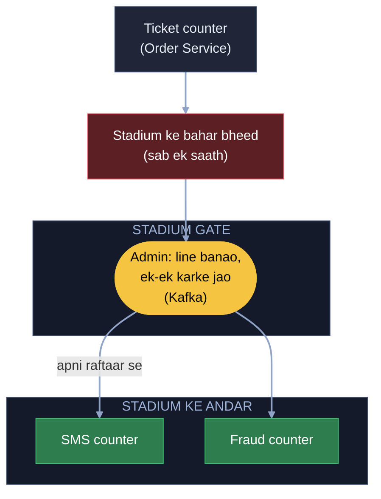
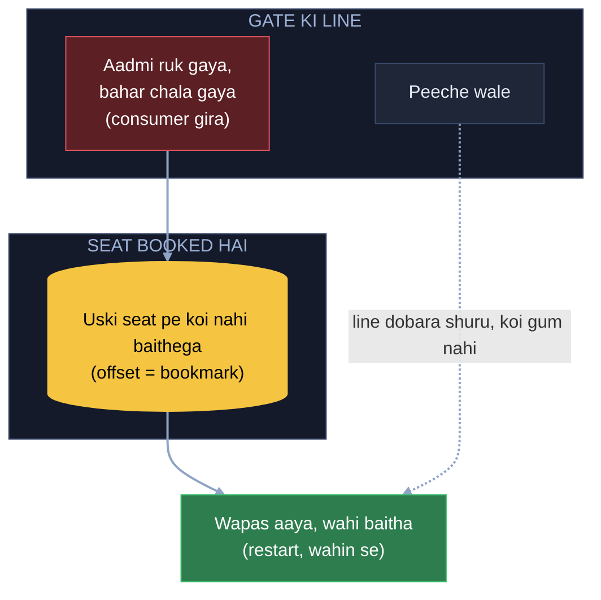
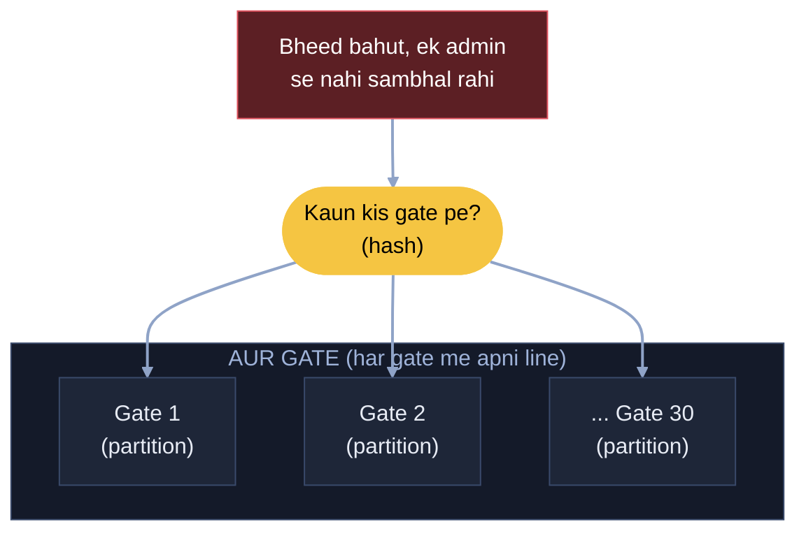
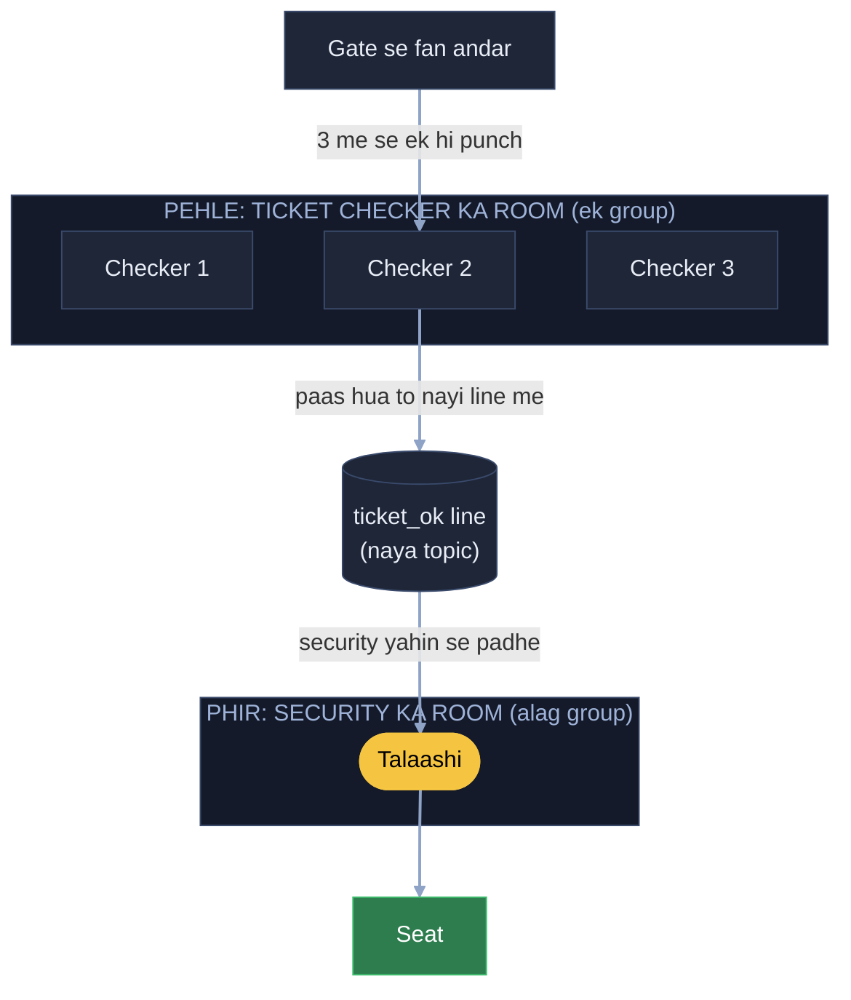
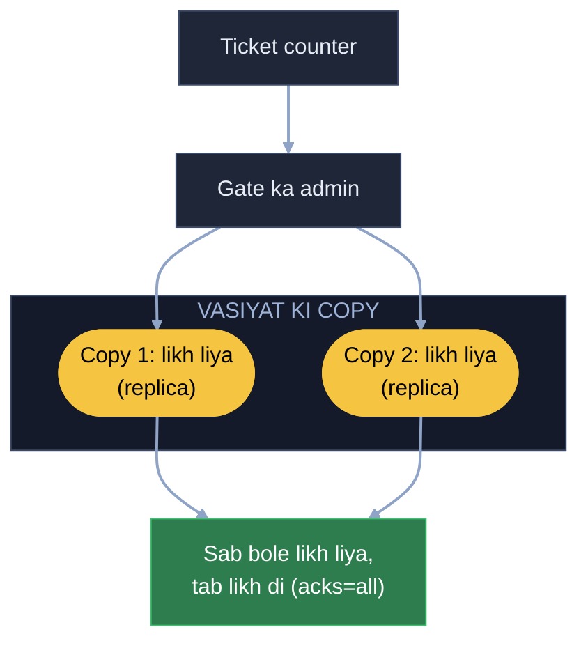
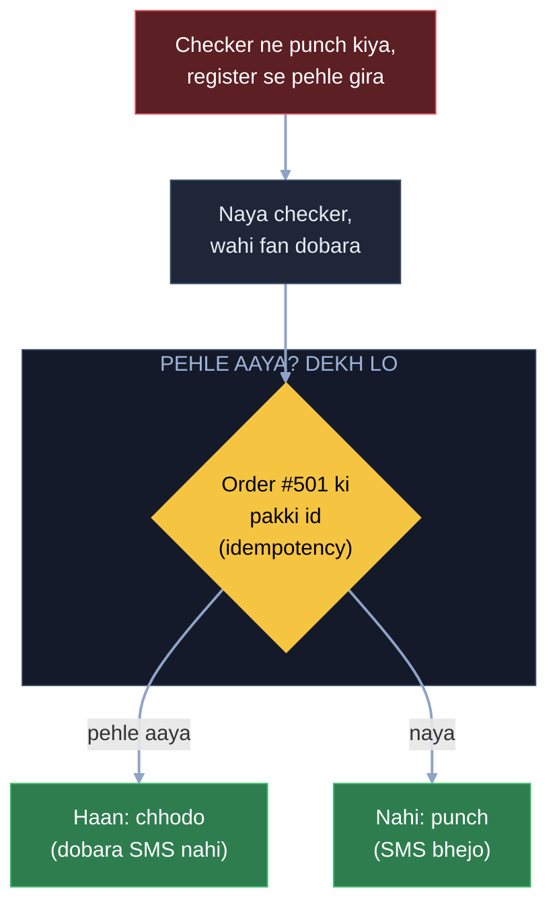
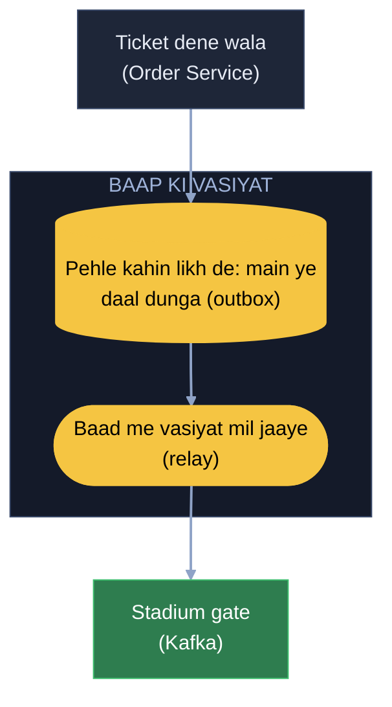
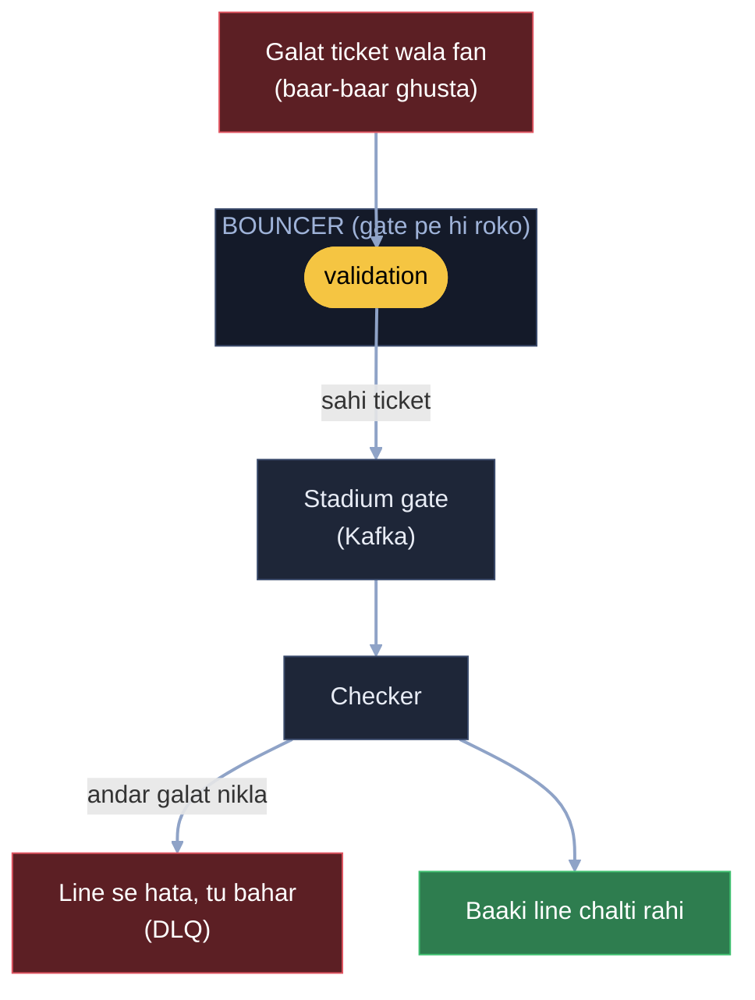
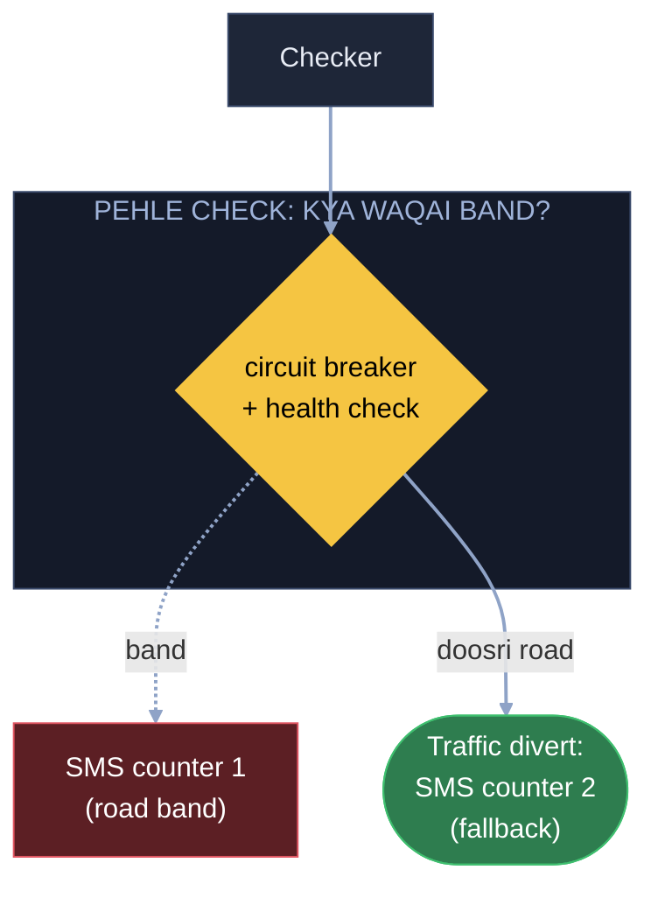
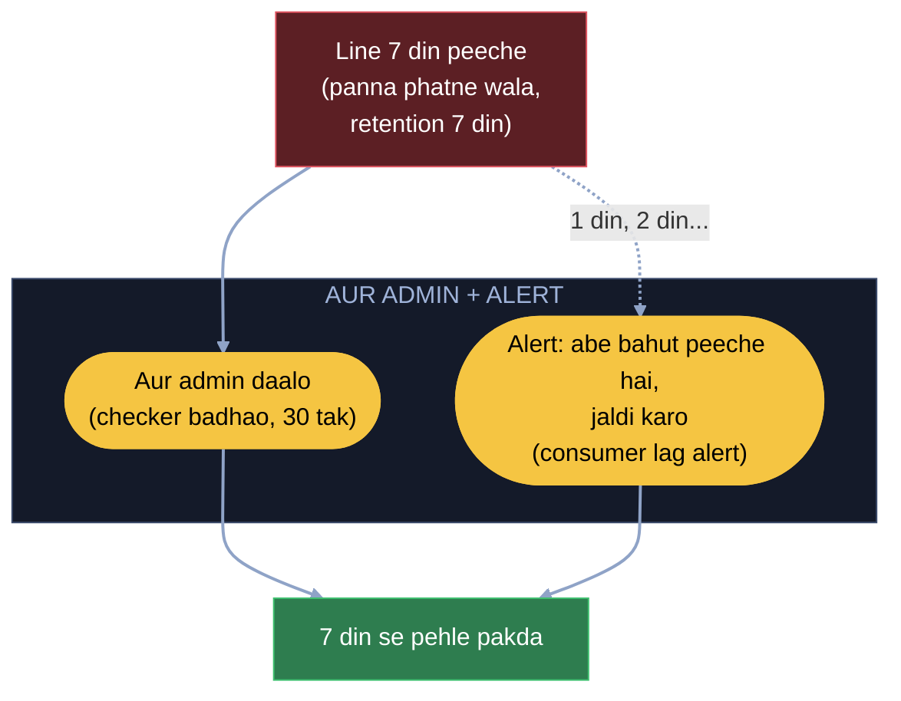

# Message queue (Kafka): stadium ki kahani

Match ka din, stadium ke bahar bahut bheed. Bahar ticket counter (Order Service) se fan nikalte hain, gate pe admin
line sambhalta hai, aur andar checker ka kamra aur counter hain (SMS, Fraud). Har fan ek khabar hai ("Arpan ne order
kiya"). Kaam: har fan andar pahunche, koi gum na ho, koi do baar punch na ho, aur ek atka to baaki na rukein.

Har kadam = **kahani** (dikkat aur hal, bolne wali bhasha) -> **Asli naam** (interview me yahi shabd) -> tasveer
(kahani ka shabd, bracket me asli naam).

---

## FR / NFR / Numbers (interview me pehle 2 minute)

```
FR      Order Service ki khabar SMS, Fraud, Analytics tak pahunche · Order Service kisi ka intezaar na kare
        · ek user ki khabar kram me (order, pay, cancel)
NFR     khabar kabhi na khoye · do baar aaye to bhi kaam ek baar · sale ki bheed me bhi chale
        · ek service dheemi ho to baaki na rukein · ek kharab khabar line na roke
Numbers roz 10 crore khabar = ~1,200 / sec, sale me ~5,000 / sec · ek checker ~500 / sec -> 10 checker, gate 30 (aage checker badhane ki jagah)
        ek khabar ~1 KB -> roz ~100 GB, 7 din x 3 copy = ~2 TB disk
```

---

## 1. Bheed ek saath ghus rahi (admin ki line)

Stadium ke bahar bahut bheed, sab ek saath andar ghusna chahte hain. To ek admin ne bola: line banao, ek-ek karke
jao, seat mili to baith jao. Bas yahi hai Kafka mere
liye: bheed ko kaabu karne wala banda, bheed ko rokne wala. Spike aaya, usne rok diya.

**Asli naam:** bheed ko kaabu karne wala = Kafka (beech ki queue / broker), line = topic (`order-events`), fan =
khabar (event), ticket counter = producer (Order Service), andar ke counter = consumer (SMS, Fraud). Line banao,
ek-ek karke jao = khabar line me, padhne wale apni raftaar se (async). Spike aaya, rok diya = spike / load sambhalna (buffer). Khabar disk pe likhi jaati hai aur padhne se mit-ti nahi,
isliye ek hi khabar SMS aur Fraud dono padh lete hain, aur peeche ja ke dobara bhi padh sakte hain (RabbitMQ me ack
hote hi queue se hat jaati, dobara nahi padh sakte).



## 2. Line me ek aadmi ruk gaya (seat booked hai)

Maan le stadium me line hai, ek aadmi ruk gaya, wahin se peeche sab disturb ho gaye. Wo line se nikla, bahar chala
gaya. Par uski seat booked hai, wahi baithega, uski seat pe koi aur nahi baith sakta. To line dobara shuru kari, koi
gum nahi hua, kuch dikkat nahi.

**Asli naam:** ruka hua aadmi = consumer (jaise SMS counter) gir gaya ya dheema hua, seat booked wahi baithega =
offset (har padhne wale ka bookmark), line dobara shuru, koi gum nahi = restart ke baad offset se wahin se padhna,
khabar padhne se mit-ti nahi, 7 din disk pe rehti hai (retention). Fraud dheema hua to bas wo peeche rahega, SMS nahi
rukega.



## 3. Ek admin se bheed nahi sambhal rahi (aur gate + hash)

Bheed bahut hai, akela admin nahi sambhal pa raha. To inke liye aur gate khade karo, har gate ke andar apni line. Yahi Kafka karta hai: broker,
partition, aur unke andar line. Kaun kis gate pe jaaye, wahan hash aa gaya.

**Asli naam:** aur gate = partition (yahan 30, alag broker pe), har gate ke andar apni line = kram sirf ek partition
ke andar, kaun kis gate pe, hash = key ka hash se partition (`hash(userId) % 30`), isliye key = userId (kram sirf ek partition ke andar pakka hai, poore topic me nahi).



## 4. Har ticket 3 baar punch (ek kamra, alag kamra)

Gate ke andar 3 ticket checker, aur teeno har fan ka ticket punch kar rahe. Har ticket 3 baar punch, line teen guna
dheemi. To un teeno ko mila de, ek bana de, ek kamre me hi baitha de. Is kamre me 3 baithe hain, koi bhi fan aaye, bas
in 3 me se ek pe bhej. Jisne punch kar diya, baaki 2 usko dekhe hi nahi.

**Asli naam:** ek kamre me baitha de, ek bana de = consumer group (`group.id = sms`), checker = consumer, 3 me se ek
pe bhej = ek partition group me ek hi consumer ko, baaki 2 dekhe hi nahi = group me ek khabar ek hi checker ke paas (par commit se pehle gira to dobara aa sakti, [kadam 6](#6-checker-register-me-likhne-se-pehle-gira-pehle-aaya-dekh-lo)). 30 gate hain to 31va checker khaali baithega. Checker gira
to uske gate baaki checkers me bat jaate hain (rebalance).

**Maan lo har fan ki talaashi bhi honi hai, 2 security wale aaye:** unhe checker ke kamre me bitha diya to "sirf ek
ke paas" wala niyam unpe bhi lagega, talaashi chhoot jaayegi. To alag baitha do: pehle ticket checker ka room, phir
security ka room. Ek ko paar karo, phir doosre room me jao.
**Asli naam:** alag room = alag consumer group (`fraud`). "Pehle checker, phir security" = checker jo paas kare use
nayi line me daale (naya topic `ticket_ok`), security group usi nayi line se padhe, kyunki talaashi ticket ke baad hi.
Talaashi ka ticket se lena-dena na hota, to dono group seedha ek hi topic se, apni-apni copy aur apne offset se padhte;
ek dheema to doosra nahi rukta.

**Maan lo checker ke room me scanner hang, 10 minute sab atke:** ticket check zaroori hai, bina ticket wale ki talaashi
kyun, wahin se nikaal do; order maintain karna hai, jaise pehle order phir pay. Scanner atka to ek mat rakho, copy rakho:
2-3 scanner, 2-3 room, ek kharab to doosre se traffic chalta rahe.
**Asli naam:** 2-3 scanner / room = group me zyada consumer (ek gira to uske partition baaki me bat jaate, rebalance);
pehle ticket phir talaashi = do topic ki chain (`ticket_ok`).



## 5. Admin ne "aa gaya" bola, phir gira (vasiyat ki copy)

Admin ne ticket counter ko "aa gaya" bol diya, phir wo gira, aur uski jagah lene wale admin ke paas aakhri kuch
logon ki list hi nahi thi. Jaise baap ne vasiyat ek hi copy me likhi, ghar walon ko bol diya "likh di", phir wo copy
jal gayi. To "likh di" aise bolna ki pehle uski copy aur bana, aur copy wala bhi likh de, tab "likh di". Matlab
replica hai, replica ne bol diya "likh liya", sab bolein, tab.

**Asli naam:** copy bhi likh de, tab likh di = `acks=all`, replica ne bol diya likh liya = in-sync replica ki haan
(`min.insync.replicas = 2`). Vasiyat ki copy = replica (har partition ki 3 copy, alag broker pe), admin gira to in-sync
replica leader ban jaati. 2 pakki copy na hon to likhna band: khabar khone se behtar thodi der rukna.



## 6. Checker register me likhne se pehle gira (pehle aaya? dekh lo)

Checker ne fan ka ticket punch karke seat pe baitha diya, par register me "ye fan ho gaya" likhne se pehle gir gaya.
Naya checker register dekhta, wahan abhi purana hi likha hai, to wahi fan dobara bhejega. To idempotency check kar le
ki ye pehle aaya hai. Aa chuka to chhod do. Bas, samajh ja.

**Asli naam:** register me likhna = offset commit, wahi fan dobara = pehle kaam phir commit, to khabar khoti nahi par
kabhi dobara aati (at-least-once). Check kar le ki pehle aaya hai = idempotency (`eventId` se dobara wali khabar pakad
ke chhodna, Redis / DB me dekh ke). Ye padhne wale ka kaam hai, Kafka ka nahi.

**Maan lo worker ne order #501 ka SMS bhej diya, par bookmark (commit) khiskaane se pehle gir gaya:** naya worker wahi
message dobara uthata hai, Arpan ko do SMS nahi jaane chahiye. Pehli soch: parchi pe likh lo "Ravi ko 10,000 dene
hain", de diye to parchi pe DONE, aur paise dena + DONE likhna ek hi kaam bana do, ya dono ho ya koi nahi. Pench:
paise dena (SMS company) aur parchi (hamara DB) do alag jagah hain, ek jhatke me nahi ho sakte. SMS chala gaya aur
DONE likhne se pehle gira, ye beech ka pal kabhi nahi hatega, isliye dobara aana maan ke chalo. Aakhri: har message ki
ek pakki id bana do; wahi id dobara aaye to discard kar do, chahe naya worker laaye ya doosri SMS company se jaaye.

**Asli naam:** at-least-once, idempotent consumer (idempotency key = eventId / order id), wahi id SMS company ko bhi
bhejo taaki wo bhi dobara na bheje.



## 7. Ticket counter khabar bhejne se pehle gira (baap ki vasiyat)

Ticket dene wala (Order Service) gate tak khabar bhejne se pehle hi gir gaya. To yahan pe outbox: wo pehle kahin likh de ki haan, main ye daal
dunga. Kabhi koi mar bhi jaaye, to wo cheez ek jagah mil jaaye. Jaise real life me hota hai: baap marne se pehle apni
sampatti likh ke chala jaata hai, aur baad me vasiyat mil jaati hai.

**Asli naam:** pehle kahin likh de = outbox (khabar order ke saath usi DB transaction me, `sent = false`), baap ki vasiyat, baad me
mil jaaye = relay outbox se utha ke `acks=all` se Kafka ko bhejta, phir `sent = true`. Relay ne dobara bhej di
to `eventId` pakad leta hai.



## 8. Galat ticket wala baar-baar ghus raha (bouncer + line se hata)

Ek fan ka ticket hi galat hai. Wo baar-baar gate pe ghusne ki koshish karta, har baar mana, aur peeche poori line
atki. Use line se hata, usko ghusne hi mat de: tu bahar, tu aayega hi nahi. Matlab mere paas ek aisi cheez ho jo use
gate pe hi rok de, andar hi na aane de. Matlab bouncer.

**Asli naam:** line se hata = DLQ (alag line `sms-dlq`: do-teen try ke baad wahan daalo, commit karo, agli khabar pe badho; DLQ pe alert, insaan theek
karke dobara chalaye), bouncer gate pe hi rok de = galat khabar
ko pehle hi rokna (validation: Order Service bhejne se pehle number aur format jaanch le).

**Maan lo Arpan ki "pay" khabar DLQ me gayi, peeche ki "cancel" chal gayi, kram toota:** Cinema hall ka ticket checker: 3 logon ka group aaya (order, pay, cancel). Ek gadbad nikla to use jaane nahi dunga. Ya to teeno mat jao, ya pehla (order) chala gaya to baaki do (pay, cancel) abhi mat jao; jab wo theek ho jaaye to pay aur cancel ek saath dobara jaayenge. Isse kram nahi tootega. Jaise ticket pe likha A1, A2, A3: A1 andar chala gaya, A2 ruk gaya, to A3 ko A2 ki seat pe nahi bhejunga. A2 jaayega to A3 jaayega, A2 cancel to A3 bhi ruka. Stadium me do saathi aaye, ek ki jeb me hathiyar nikla: dono bahar, ek nahi. Pehle PAY, phir CANCEL; PAY nahi hua to dono hi nahi, dono baad me line me.
**Asli naam:** "3 logon ka group" = ek user ki khabar (key = userId, ek partition), "gadbad wala atka to baaki do bhi ruko" = us key ki aage ki khabar bhi park karo (DLQ + same key ki parking), theek hone pe kram se dobara; baaki users chalte rahein. Kafka kram ek partition ke andar pakka deta hai; yahan kram humare consumer ne toda, jab pay ko DLQ bhej ke cancel pe aage badh gaya.



## 9. SMS counter 10 minute band, sab DLQ me ja rahe (pehle check, phir traffic divert)

Andar ka SMS counter 10 minute ke liye band. Jo fan wahan pahunchta hai sab fail, sab alag line (DLQ) me ja rahe.
Nahi, maan lo 10 minute kuch dikkat hai, wo 11ve minute khul sakta hai, to sab DLQ me nahi bhejunga. Pehle dekhunga
ki kya hai, kya waqai wo band hai, main check karunga. Aur ek service nahi, bahut saari services hain. Agar wo waqai
band hai to uska traffic kahin aur bhej dunga. Jaise aam road pe: mujhe kahin jaana hai, wo road band hai, to traffic
divert kar do.

**Asli naam:** sab DLQ me nahi, pehle check = circuit breaker (padhna roko, khabar topic me padi, commit nahi hua), check karunga kya waqai band = heartbeat / health
check, traffic divert = fallback (doosri SMS company). DLQ sirf us khabar ke liye jo akeli fail ho.



## 10. Koi 7 din peeche reh gaya (aur admin + alert)

Koi line me 7 din se zyada peeche reh gaya, aur gate ki 7 din purani list ka panna phaad diya jaata hai, to uski
khabar hamesha ke liye gayi. Wahan bheed bahut zyada hai, aur admin daalo wahan. Use itna peeche rehne hi mat do na,
wahan aisa karo taaki wo bheed 7 din tak peeche na rahe.

**Asli naam:** 7 din ka panna = retention, kitna peeche = consumer lag (gate ki aakhri khabar minus uska offset), aur
admin daalo = pehle checker (consumer) badhao, gate (30) tak; gate
bhar gaye tab gate (partition) bhi badhao, isliye shuru se zyada gate rakhe the. Itna peeche rehne hi mat do =
retention khatam hone se pehle lag pakadna. Gate badhao to hash badal ke kram bigad sakta. Retention badhana bas waqt
kharidna hai.

**Maan lo wo dheere-dheere peeche ja raha, aaj 1 din, kal 2 din, 7 din hone se pehle kaise pata chalega:** alert laga
do. Wo peeche ja raha, alert aa gaya. Wo aise bolta: "abe ye bahut peeche hai, admin jaldi-jaldi kaam karo, itna
peeche kyun ja raha hai."
**Asli naam:** consumer lag alert (lag 1 ghante se zyada to alert).



---

Notes (Arpan ke shabd) = [KAFKA_HAND_NOTES.md](KAFKA_HAND_NOTES.md) · [Kafka concepts](kafka_concepts.md)
