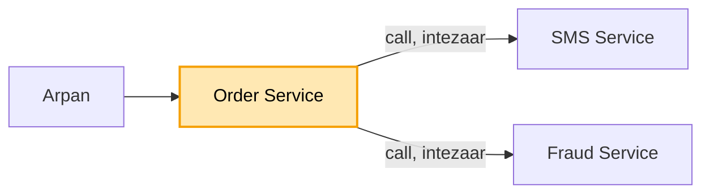
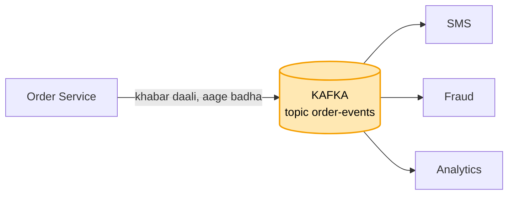
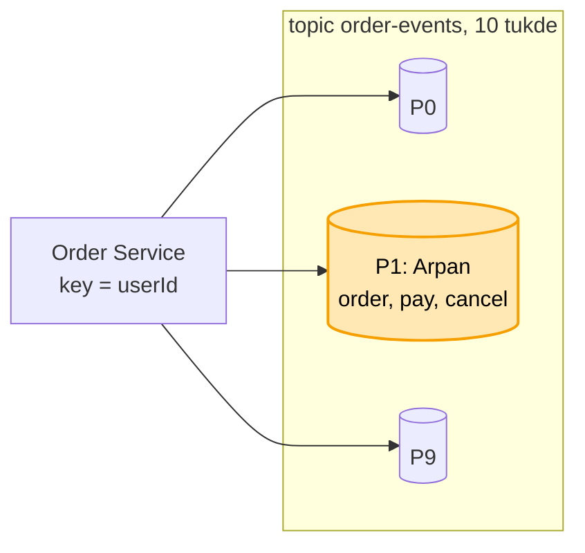
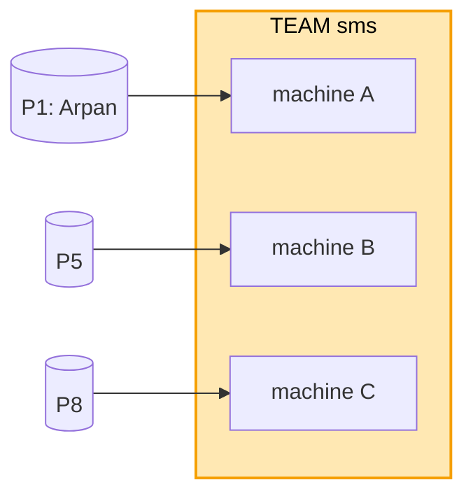
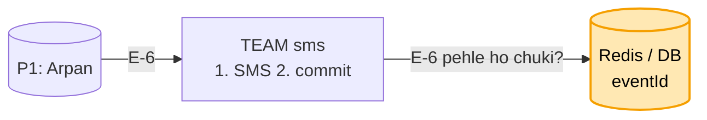
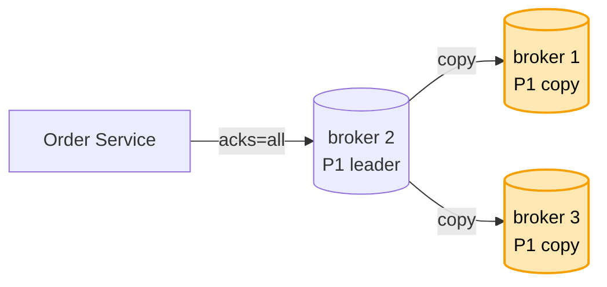
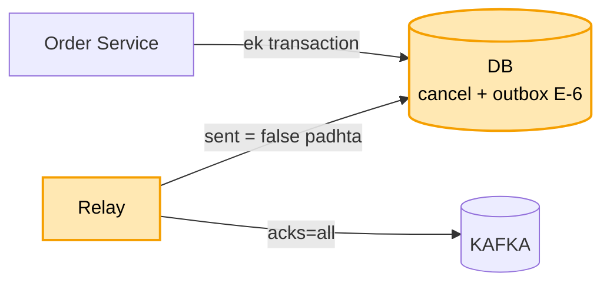
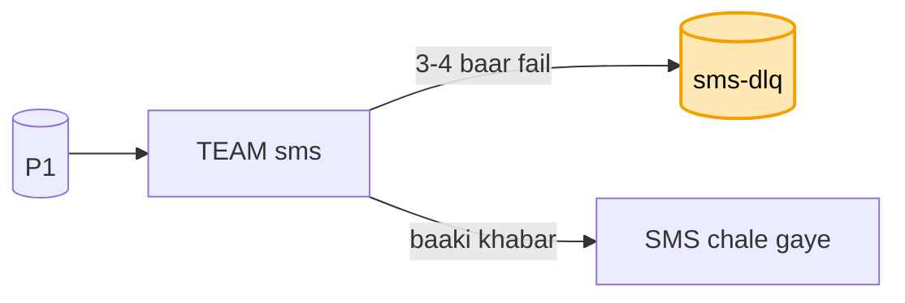

# Kafka (message queue): hand notes (mock se pehle ye padho)

Har line waise likhi hai jaise interview me bolni hai. Padho, aur waise hi bolo.

### Shuru

**Kaam:** Arpan ne Swiggy pe order kiya. Order Service ki ye khabar kai service tak pahunchni chahiye, jaise SMS, Fraud aur Analytics. Order Service kisi ka intezaar nahi karega. Aur ek user ki khabar kram me pahunchni chahiye: pehle order, phir pay, phir cancel.

**Bahar:** Duniya bhar ke region aur exactly-once main scope se bahar rakhta hoon. Exactly-once Kafka sirf Kafka se Kafka tak deta hai, bahar ki service ke liye nahi.

**Sabse upar:** Khabar kabhi nahi khoni chahiye. Sale ki bheed me bhi chale. Aur ek service dheemi ho to baaki na rukein.

**Numbers:** Roz 10 crore khabar, matlab ~1,200 har second, aur sale me ~5,000 har second. Ek worker ~500 har second sambhal paata hai, to 5,000 / 500 = 10 tukde chahiye. Ek khabar ~1 KB hai, to roz ~100 GB, 7 din rakho to ~700 GB, aur 3 copy ke saath ~2 TB disk.

### Banking aur chat se aaya (naya nahi)

Outbox banking kadam 6 se aaya hai. eventId wahi hai jo chat ka clientMsgId aur banking ki idempotency key. Key se kram wahi chat wali baat hai.

&nbsp;

**1. SEEDHA CALL (DHEEMA)**

Sabse seedha ye hai ki Order Service order banaye, phir khud SMS, Fraud aur Analytics ko ek-ek karke call kare, aur sabka jawab aane ke baad Arpan ko "order ho gaya" bole.

Par isme dikkat ye hai ki SMS Service dheemi hai to Arpan ka order bhi dheema ho jaata hai, aur SMS Service giri to order hi fail, jabki order ka SMS se koi lena-dena nahi. Aur kal naya Coupon Service aaya, to Order Service ka code badalna padega.

Isliye Order Service ko kisi ka intezaar nahi karna chahiye. Wo khabar kahin daal de aur aage badh jaaye. Par ab sawaal hai ki kahin matlab kahan?

&nbsp;

**2. KAFKA TOPIC (DISK, PADHNE SE MIT-TA NAHI)**

Main khabar ek line me daalta hoon, aur yahan asli choice hai ki line kaisi ho. Server ki memory me list rakhi to restart pe saari khabar gayab. RabbitMQ jaisi aam queue me ek ne khabar padhi to wo line se nikal jaati hai, to replay nahi hota. Isliye main Kafka leta hoon, kyunki Kafka khabar disk pe likhta hai aur padhne se wo mit-ti nahi.

Is line ko Kafka me topic kehte hain, jaise `order-events`. Ek hi khabar teeno service padh leti hain, aur kal Coupon Service aaya to wo bas padhna shuru kar degi, Order Service me ek line nahi badalti.

**Bookmark (offset):** har service apna bookmark rakhti hai ki agla kaunsa padhna hai. Isliye Fraud dheema hua to bas wo peeche rahega, SMS nahi rukega.

**Maan lo kisi service me bug tha:** khabar 7 din disk pe rehti hai, to bookmark peeche karke dobara padh leta hoon. 7 din se purani khabar apne aap hat-ti hai, yahi retention hai.

**Maan lo pooche Kafka kab nahi:** jab turant jawab chahiye, tab REST ya gRPC. Aur chhota system ho to Kafka paalna mehnga padta hai.

AWS pe Kafka main khud nahi chalata, AWS ka MSK leta hoon. Broker, copy, aur gira to naya leader, ye AWS sambhalta hai. Topic aur tukde main tay karta hoon.

Par Diwali sale me har second 5,000 order aaye. Topic ek machine pe hai, aur SMS ka ek worker sirf 500 sambhal paata hai, to line lambi hoti ja rahi hai.

&nbsp;

**3. 10 TUKDE + KEY = userId**

Isliye topic ko andar se 10 tukdon me baant-ta hoon, har tukda alag machine pe. Ek tukde ko partition kehte hain. 10 isliye kyunki numbers me nikla tha: 5,000 / 500. Ek tukda ek worker padhega, to 10 worker ek saath chalenge.

Par tukde karte hi kram ki dikkat aati hai. Arpan ki teen khabar alag tukdon me gayi to "cancel" pehle padh liya ja sakta hai, kyunki Kafka me kram sirf ek tukde ke andar pakka hota hai.

**Key:** isliye har khabar ke saath main key deta hoon, `userId`. Same key hamesha same tukde me jaati hai, hash(arpan) % 10 = 1, to Arpan ki teeno khabar P1 me kram se rehti hain. Ravi ki P6 me jaati hain, Arpan se koi lena-dena nahi.

**Maan lo tukde 10 se 20 karne pade:** hash(key) % ginti hai, to ginti badalte hi key ka tukda badal jaata hai, aur thodi der kram toot sakta hai. Isliye main shuru me hi zaroorat se 2-3 guna tukde rakhta hoon.

**Maan lo ek user ki bahut khabar (garam key):** key me number jodta hoon, jaise user-9#1 se #4, to wo 4 tukdon me bat jaata hai. Keemat ye ki us user ka poora kram chala jaata hai, bas har tukde ke andar bachta hai.

Par SMS Service ki 3 machine lagayi taaki tukde jaldi padhe jaayein. Teeno saare tukde padhne lagin, aur Arpan ko ek order ke 3 SMS chale gaye.

&nbsp;

**4. TEAM (CONSUMER GROUP)**

Isliye teeno machine ko ek team bana deta hoon, sabko ek hi naam deta hoon `group.id = sms`. Ise consumer group kehte hain. Kafka ka niyam hai ki ek team ke andar har tukda sirf ek machine ko milta hai. To P1 sirf machine A ke paas hai, aur Arpan ko ek hi SMS jaata hai.

Fraud alag team hai, `group.id = fraud`, to use apni poori copy milti hai, aur uska bookmark bhi alag hai.

**Maan lo machine B gir gayi:** Kafka uske tukde A aur C me baant deta hai, isse rebalance kehte hain.

**Maan lo 11vi machine lagayi:** tukde 10 hi hain aur ek tukda ek machine ko milta hai, to 11vi khaali baithegi. Tez karna hai to pehle tukde badhane padenge.

**Maan lo ek khabar pe kaam bahut lamba chala:** Kafka machine ko mara samajh ke uske tukde le leta hai. Isliye ek baar me kam khabar uthata hoon, ya wo time badhata hoon.

Par machine A ne Arpan ka SMS bheja, aur bookmark aage karne se pehle gir gayi. P1 machine B ke paas gaya, B ne purana bookmark dekha, aur wahi khabar dobara padhi. Arpan ko 2 SMS.

&nbsp;

**5. PEHLE KAAM, PHIR COMMIT + eventId**

Machine ka kaam teen kadam ka hai: khabar padho, SMS bhejo, aur phir Kafka ko batao "agli baar yahan se". Bookmark aage karne ko commit kehte hain.

Main kram pakka rakhta hoon ki pehle kaam, phir commit, kyunki ulta kiya to commit hone ke baad gira to SMS kabhi jaayega hi nahi, wo usse bhi bura hai. Isse khabar kabhi khoti nahi, bas kabhi-kabhi dobara aa jaati hai. Iska naam at-least-once hai.

**eventId:** dobara aayi khabar pakadne ke liye har khabar ki apni id hoti hai, jaise E-6. SMS bhejne se pehle machine Redis ya DB me dekhti hai ki E-6 ho chuki ya nahi. Nahi hui to SMS bhejo, E-6 likh do, commit. Ho chuki to chhod do, bas commit. Ye pehchaanna SMS Service ka kaam hai, Kafka ka nahi.

**Maan lo pooche exactly-once:** wo Kafka sirf Kafka se Kafka tak deta hai, SMS bahar ki cheez hai. Isliye main bolta hoon at-least-once aur eventId se dohra kaam nahi.

Par Arpan ki khabar P1 me thi, aur P1 Kafka ki ek hi machine (broker) pe tha. Us machine ki disk mar gayi, to Arpan ki saari khabar hamesha ke liye gayi.

&nbsp;

**6. 3 COPY + acks=all + min.insync.replicas**

Isliye har tukde ki 3 copy rakhta hoon, teen alag machine pe. Jis pe likhna-padhna hota hai wo leader hai, baaki do copy. Leader mara to ek copy naya leader ban jaati hai, aur ye Kafka ka Controller tay karta hai.

**acks=all:** par leader ne khabar likhi, turant "ho gaya" bola, aur copy tak pahunchne se pehle mar gaya, to khabar gayi. Isliye main acks=all rakhta hoon: leader "ho gaya" tabhi bolta hai jab saari pakki copies pe likh jaaye. Order aur paisa ke liye yahi.

**Pakki copy (ISR):** wo copy jo leader ke saath bilkul taaza chal rahi hai. Peeche chal rahi copy ko leader nahi banate, warna aakhri khabar kho jaati.

**Maan lo saari copies giri, sirf leader bacha:** to acks=all me pakki copy sirf leader khud hai, aur wo "ho gaya" bol dega. Isliye saath me min.insync.replicas = 2 rakhta hoon: kam se kam 2 pakki copy na hon to likhna hi band. Khabar khone se behtar hai thodi der ruk jaana.

Par ab bhejne wala bacha. Arpan ne order cancel kiya. Order Service ne DB me "cancel" likha, aur Kafka ko bhejne se pehle gir gaya. DB me cancel ho gaya, par SMS aur Fraud ko kabhi pata hi nahi chala.

&nbsp;

**7. OUTBOX**

DB aur Kafka do alag cheezein hain, dono me ek saath ek hi baar me likhne ka koi tareeka nahi. Isliye main khabar bhi usi DB me likhta hoon, cancel ke saath, ek hi transaction me. Jis table me khabar jaati hai use outbox kehte hain.

**Relay:** ek chhota program har second outbox me `sent = false` wali khabar uthata hai, Kafka ko bhejta hai acks=all ke saath, aur Kafka "OK" bole to `sent = true` likh deta hai.

**Maan lo Order Service kahin bhi gira:** transaction se pehle gira to na cancel likha na khabar, Arpan dobara dabayega. Transaction ke baad gira to khabar outbox me padi hai, relay bhej dega.

**Maan lo relay ne bheja aur sent = true likhne se pehle gira:** to relay dobara bhejega, aur SMS Service us dohri khabar ko eventId se pakad legi.

**Maan lo bahut bada scale, relay DB ko baar-baar poochta:** tab relay ki jagah CDC lagata hoon, jaise Debezium, jo DB ka apna log padh ke Kafka ko deta hai.

Ab teeno jagah bachav hai: bhejne wale ke liye outbox, Kafka ke liye 3 copy aur acks=all, padhne wale ke liye pehle kaam phir commit aur eventId.

Par ek khabar me Arpan ka phone number hi galat tha. SMS Service baar-baar koshish karti rahi, commit nahi kiya, aur P1 ki baaki saari khabar uske peeche atak gayi.

&nbsp;

**8. DLQ (KHARAB KHABAR KI ALAG LINE)**

Ek tukde me kram se padhna hota hai, to ek kharab khabar poori line rok deti hai. Isliye main DLQ rakhta hoon, yani dead letter queue, kharab khabar ki alag line. Khabar fail hui to 3-4 baar ruk-ruk ke koshish karta hoon. Phir bhi fail to use `sms-dlq` topic me daal ke commit karta hoon aur agli khabar pe badhta hoon.

**Turant DLQ kyun nahi:** kyunki kai baar fail hona thodi der ka hota hai, jaise SMS company ek second ke liye dheemi thi, to do-teen baar me chal jaata hai. Galat number jaisi galti har baar fail hogi, wahi DLQ me jaati hai.

DLQ pe alert jaata hai, insaan number theek karke dobara chalata hai. To ek kharab khabar line nahi rokti, aur khoti bhi nahi.

&nbsp;

### Wrap

Order Service order aur khabar ek transaction me DB me likhta hai, yani outbox, aur relay khabar Kafka ko acks=all ke saath bhejta hai. Topic 10 tukdon me hai, key userId hai taaki ek user ka kram bache, aur har tukde ki 3 copy hain min.insync.replicas 2 ke saath. SMS, Fraud aur Analytics alag team hain, har team ko poori khabar milti hai, aur team ke andar ek tukda ek machine ko. Padhne wala pehle kaam karta hai phir commit, dohri khabar eventId se pakadta hai, aur baar-baar fail hone wali khabar DLQ me jaati hai.

**Chal raha hai kaise pata:** lag naapta hoon, yani tukde ki aakhri khabar aur team ke bookmark ka farak. Had se zyada ho to alert aur machine badhao, tukdon ki ginti tak. Saath me DLQ ka size aur peeche chal rahi copies.

Poora design (har kadam ka "kyun") = [12_message_queue_kafka.md](12_message_queue_kafka.md) · concepts = [kafka_concepts.md](kafka_concepts.md)
