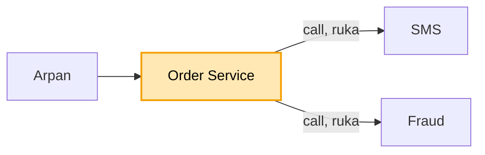
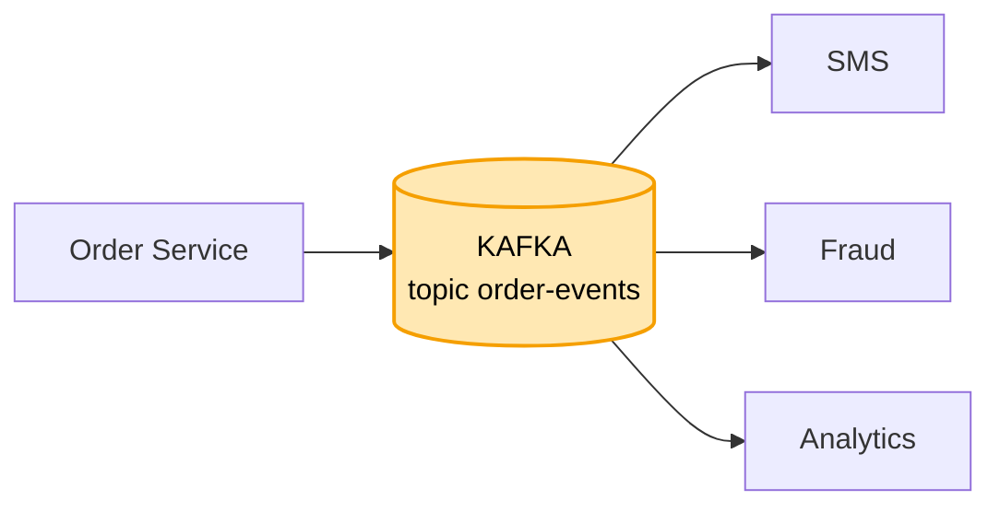
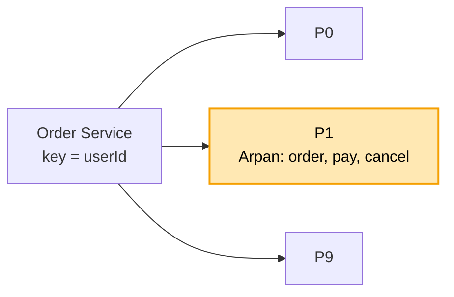
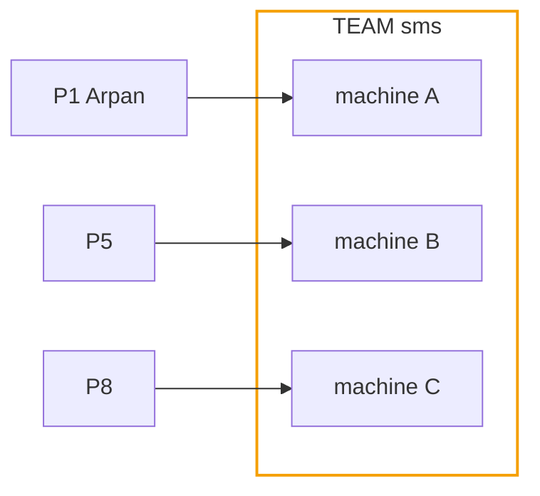
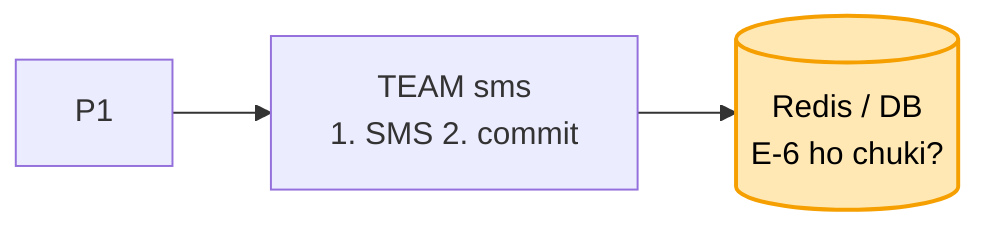
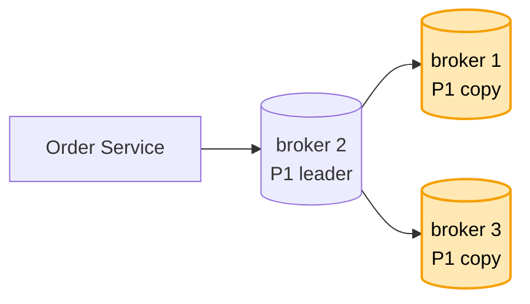
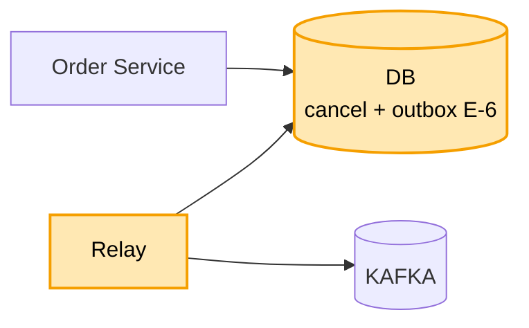
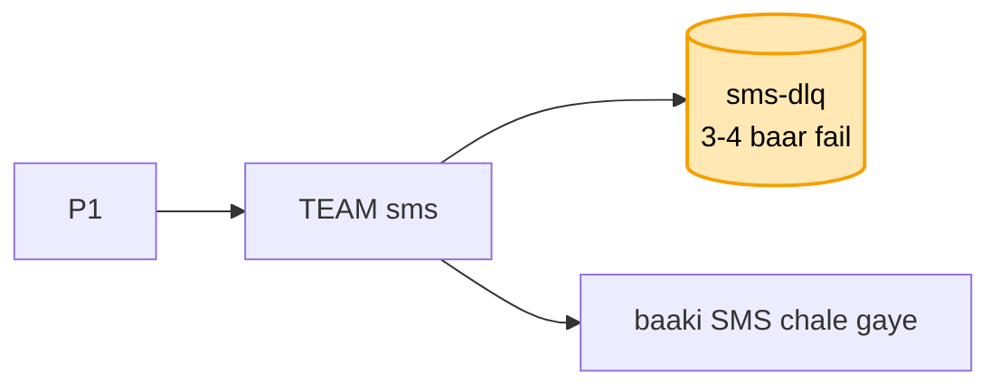

# Kafka (message queue): hand notes (mock se pehle ye padho)

Har line waise likhi hai jaise interview me bolni hai. Padho, aur waise hi bolo.

### Shuru

**Kaam:** Arpan ne Swiggy pe order kiya. Ye khabar SMS, Fraud aur Analytics tak jaani hai. Order Service kisi ka intezaar nahi karegi. Ek user ki khabar kram se jaayegi: order, phir pay, phir cancel.

**Bahar:** duniya bhar ke region aur exactly-once scope se bahar.

**Sabse upar:** khabar kabhi nahi khoni chahiye. Sale ki bheed jhelni hai. Ek service dheemi ho to baaki na rukein.

**Numbers:** roz 10 crore khabar, yani ~1,200 har second, sale me ~5,000 har second. Ek worker 500 sambhalta hai, to 10 tukde. Ek khabar 1 KB, roz 100 GB, 7 din ~700 GB, 3 copy ke saath ~2 TB.

**Pehle se aaya:** outbox = banking, eventId = chat ka clientMsgId, key se kram = chat.

&nbsp;

**1. SEEDHA CALL (DHEEMA)**

Order Service khud SMS, Fraud aur Analytics ko call karti hai aur sabke jawab ka intezaar karti hai.
SMS dheema to Arpan ka order bhi dheema. SMS gira to order hi fail.
Isliye Order Service khabar kahin daal ke aage badh jaaye.
Par kahin matlab kahan?

&nbsp;

**2. KAFKA TOPIC (DISK PE, PADHNE SE MIT-TA NAHI)**

Memory me rakha to restart pe sab gayab. RabbitMQ me ek ne padhi to khabar line se hat jaati hai. Kafka khabar disk pe likhta hai, padhne se mit-ti nahi.
Isliye teeno service wahi khabar padhti hain. Kal Coupon Service aaye to bas padhna shuru kar de.
Har service ka apna bookmark (offset), to Fraud dheema ho to SMS nahi rukta.

**Maan lo kisi service me bug tha:** bookmark peeche karke dobara padh leta hoon, khabar 7 din disk pe rehti hai (retention).

**Maan lo Kafka kab nahi:** jab turant jawab chahiye, tab REST.

AWS pe MSK leta hoon: broker aur copy AWS sambhalta hai, topic aur tukde main tay karta hoon.
Par sale me har second 5,000 khabar, aur ek worker sirf 500 sambhalta hai.

&nbsp;

**3. 10 TUKDE + KEY = userId**

Topic ko 10 tukdon (partition) me baant-ta hoon: 5,000 / 500 = 10, to 10 worker ek saath padhte hain.
Par tukde karte hi Arpan ka "cancel" "order" se pehle padha ja sakta hai, kyunki kram sirf ek tukde ke andar pakka hai.
Isliye key = userId. Same user hamesha same tukde me, to Arpan ka sab P1 me kram se.

**Maan lo tukde 10 se 20 karne pade:** hash % 10 se hash % 20 hote hi Arpan ka tukda badal jaata hai, kram thodi der toot sakta hai. Isliye shuru me hi 2-3 guna tukde rakhta hoon.

**Maan lo ek hi key pe itni khabar ki uska ek tukda akela na sambhale (garam key):** key ke peeche #1 se #4 jod deta hoon, khabar 4 tukdon me bat jaati hai. Keemat: us key ka kram toot jaata hai. Isliye ye sirf wahan jahan kram zaroori nahi, jaise Analytics.

Par SMS ki 3 machine lagayi, teeno ne saare tukde padhe, Arpan ko 3 SMS.

&nbsp;

**4. TEAM (CONSUMER GROUP)**

Teeno machine ek team (`group.id = sms`). Team ke andar ek tukda ek hi machine ko, to Arpan ko ek hi SMS.
Fraud alag team hai: apni poori copy, apna bookmark.

**Maan lo machine B giri:** uske tukde A aur C me bat jaate hain (rebalance).

**Maan lo 11vi machine lagayi:** khaali baithegi, tukde 10 hi hain.

**Maan lo Fraud dheema hai, roz peeche ja raha, 6 din peeche pahunch gaya:** 7 din pe khabar mit jaayegi aur Fraud ke liye hamesha ke liye kho jaayegi. Isliye lag naapta hoon, yani aakhri khabar aur Fraud ke bookmark ka farak. Lag 1 ghante se zyada to alert, aur Fraud ki machine badhao, 10 tak. Usse aage chahiye to tukde badhao. Retention badhana sirf waqt kharidna hai.

**Maan lo ek khabar pe kaam bahut lamba chala:** Kafka machine ko mara samajh ke tukda le leta hai. Isliye ek baar me kam khabar uthata hoon.

Par A ne SMS bheja aur bookmark aage karne se pehle giri. B ne purana bookmark dekha, Arpan ko 2 SMS.

&nbsp;

**5. PEHLE KAAM, PHIR COMMIT + eventId**

Kram pakka: pehle SMS, phir commit (bookmark aage). Ulta kiya to commit ke baad gire pe SMS kabhi nahi jaata.
Isse khabar kabhi khoti nahi, bas kabhi dobara aati hai (at-least-once).
Dobara aayi khabar eventId (E-6) se pakadta hoon: E-6 ho chuki to SMS nahi, bas commit.

**Maan lo exactly-once:** wo Kafka se Kafka tak hi. SMS bahar hai, wahan at-least-once + eventId.

Par P1 ek hi broker pe tha. Uski disk mari, Arpan ki saari khabar gayi.

&nbsp;

**6. 3 COPY + acks=all + min.insync.replicas = 2**

Har tukde ki 3 copy. Leader mara to ek copy leader ban jaati hai, ye Controller tay karta hai.
acks=all: leader "ho gaya" tabhi bolta hai jab pakki copies (ISR) pe bhi likh jaaye.

**Maan lo dono copy giri, sirf leader bacha:** wo akela "ho gaya" bol dega. Isliye min.insync.replicas = 2: 2 pakki copy na hon to likhna band.

**Maan lo likhna band hua aur usi waqt Arpan ne order kiya:** order fail nahi hota, kyunki khabar pehle DB ke outbox me jaati hai. Wo agla kadam.

Par ab bhejne wala bacha. Order Service ne DB me cancel likha, aur Kafka ko bhejne se pehle giri.

&nbsp;

**7. OUTBOX**

DB aur Kafka me ek saath likhne ka tareeka nahi. Isliye khabar bhi usi DB me, ek transaction me (outbox).
Relay `sent = false` wali khabar Kafka ko bhejta hai (acks=all), "OK" pe `sent = true`.

**Maan lo Order Service transaction ke baad giri:** khabar outbox me padi hai, relay bhej dega.

**Maan lo relay ne bheja aur sent = true se pehle gira:** dobara bhejega, SMS eventId se pakad lega.

**Maan lo Kafka ne likhna band kiya (min.insync):** Arpan ka order fail nahi. Order DB me ho chuka, khabar outbox me padi, Kafka theek hote hi relay bhej dega.

**Maan lo bahut bada scale:** relay ki jagah CDC (Debezium), jo DB ka log padhta hai.

Par Arpan ka phone number hi galat tha. SMS baar-baar fail, P1 ki baaki khabar uske peeche atak gayi.

&nbsp;

**8. DLQ (KHARAB KHABAR KI ALAG LINE)**

Khabar 3-4 baar ruk-ruk ke try. Phir bhi fail to `sms-dlq` me daal ke commit, aur aage.
Turant DLQ nahi, kyunki aksar fail hona thodi der ka hota hai, 2-3 try me chal jaata hai.
DLQ pe alert jaata hai, insaan number theek karke dobara chalata hai.

**Maan lo SMS company hi 10 minute band ho gayi:** ab har khabar fail hogi, lakhon DLQ me chali jaayengi. Galti khabar ki nahi, company ki hai. Isliye jab lagaataar sab fail hone lage, padhna rok deta hoon (circuit breaker). Khabar topic me hi padi rehti hai. Har kuch second ek check (heartbeat), company wapas to wahin se padhna shuru. DLQ sirf us khabar ke liye jo akeli fail ho, jaise galat number.

&nbsp;

### Wrap

Outbox se khabar nikalti hai, relay acks=all ke saath Kafka ko bhejta hai. Topic ke 10 tukde, key = userId, har tukde ki 3 copy, min.insync 2. Har service apni team: pehle kaam phir commit, eventId se dohra nahi, lag pe alert, kharab khabar DLQ me, company band to breaker.

Poora design = [12_message_queue_kafka.md](12_message_queue_kafka.md) · concepts = [kafka_concepts.md](kafka_concepts.md)
