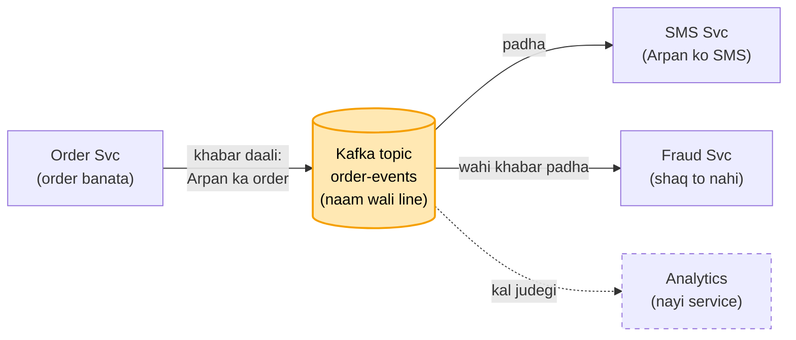
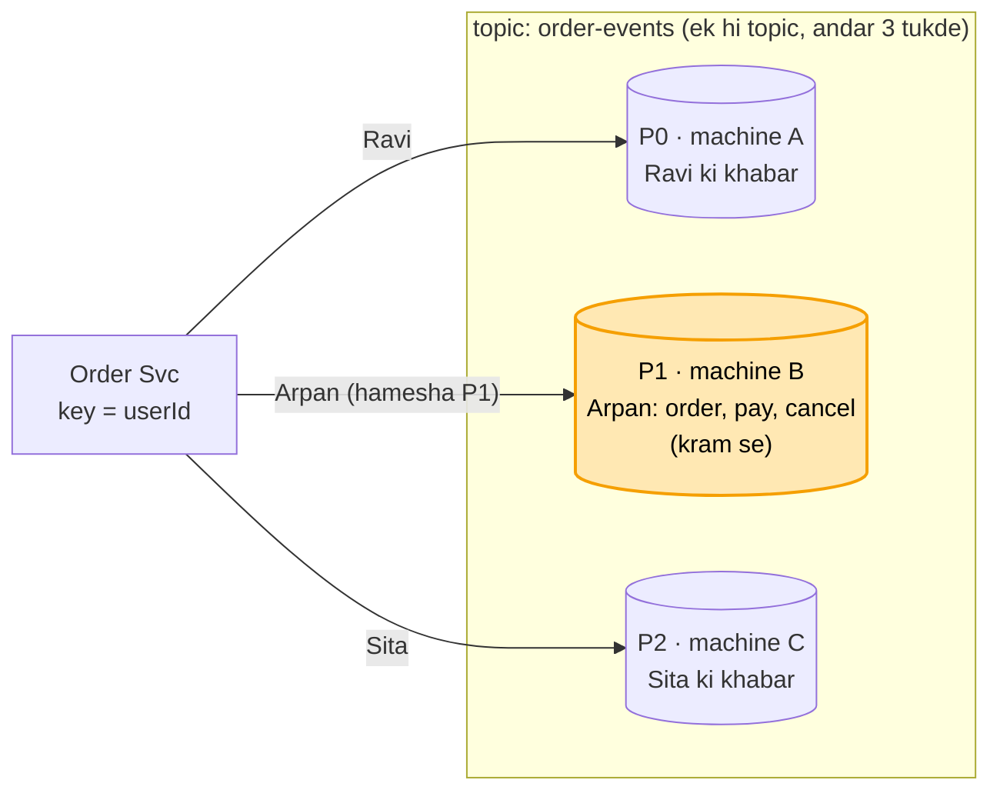
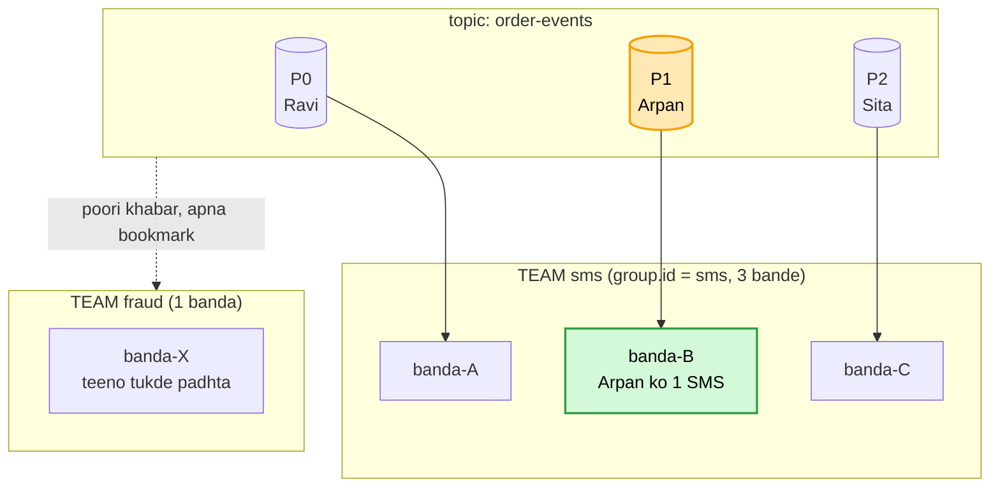
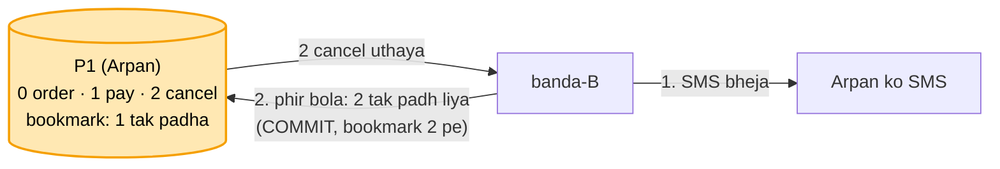
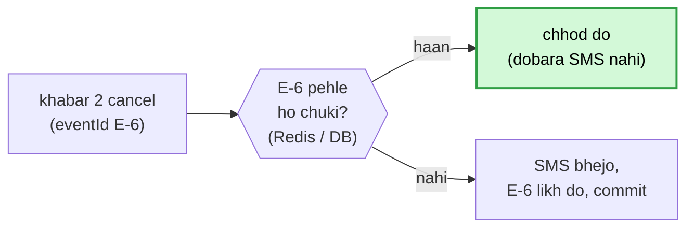
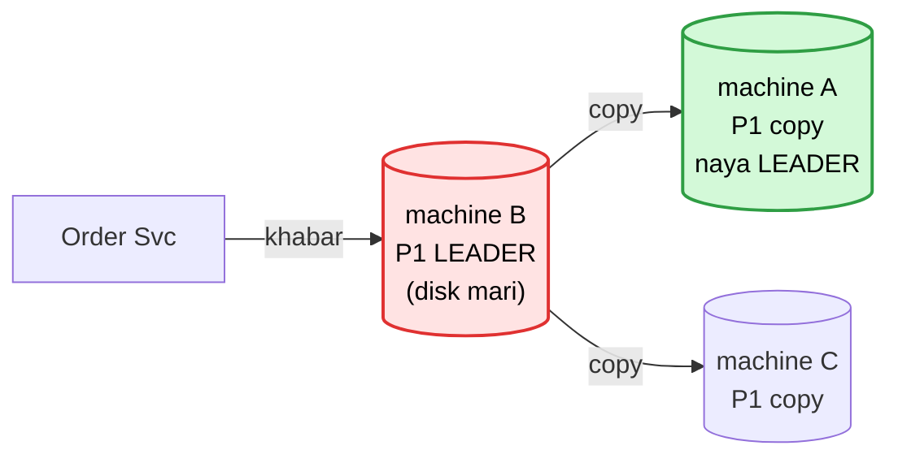
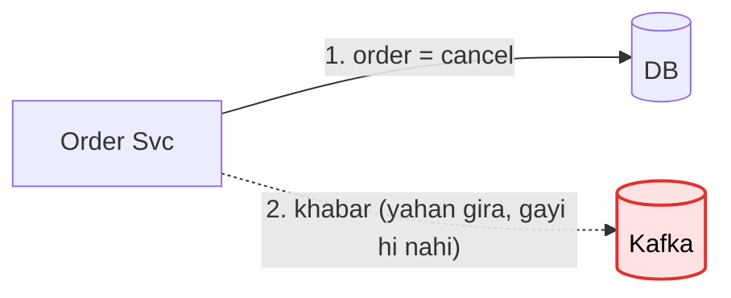
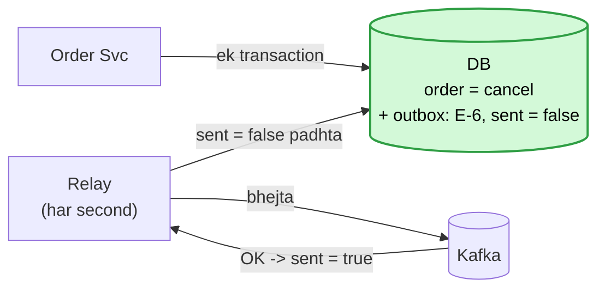

# Kafka concepts: ek-ek karke

Kahani: Arpan ne Swiggy pe order kiya. Order Svc ka kaam bas order banana hai. Is order ki khabar do aur
service ko chahiye: SMS Svc (Arpan ko SMS) aur Fraud Svc (order shaq wala to nahi).

---

## 1. Topic

- Order Svc khabar ek naam wali line me daal deta hai. Line ka naam "order-events". Kafka me aisi naam wali
  line ko **topic** kehte hain.
- Order Svc ko pata hi nahi aage kaun padh raha. Khabar daal ke apne kaam pe.
- SMS aur Fraud dono isi topic se padhte hain. Padhne se khabar mitti nahi, isliye dono ko poori khabar.
- Kal teesri service aaye (Analytics), to bas isi topic se padhe. Order Svc me ek line nahi badalti.

---

## 2. Partition (topic ke tukde)

**Peeche se:** order-events ek topic, ek line, Kafka ki ek machine pe.
**Ab:** Diwali sale, har second lakhon order. Ek machine itna bojh nahi utha paati.

- Topic wahi ek, order-events. Andar 3 tukde. Ek tukde ko **partition** kehte hain.
- Har tukda alag machine pe, to bojh teen machine me bat gaya.
- Kaunsi khabar kis tukde me, ye Order Svc ek **key** se tay karta hai. Key = user ki id. Same user ki khabar
  hamesha same tukde me, isliye Arpan ki saari khabar (order, pay, cancel) P1 me.
- Kram (order, phir pay, phir cancel) sirf ek tukde ke andar pakka. Isliye key = userId, taaki ek user ki
  khabar ek tukde me rahe aur kram me rahe.

---

## 3. Consumer group (ek service ki team)

**Peeche se:** order-events ke 3 tukde P0, P1, P2. Arpan ki khabar P1 me.
**Ab:** SMS Svc ki 3 machine hain (banda-A, banda-B, banda-C). Teeno ne saare tukde padhe to Arpan ko 3 SMS.

- SMS Svc ki teeno machine ko ek team bana do: sabko ek hi team ka naam (group.id = "sms"). Is team ko
  **consumer group** kehte hain.
- Team ke andar har tukda sirf ek bande ko. P1 sirf banda-B ke paas, isliye Arpan ko ek hi SMS.
- Fraud Svc alag team ("fraud"). Use bhi poori khabar, teeno tukde. SMS ne padha to fraud ka kuch kam nahi.
- Har team apna bookmark rakhti ki kahan tak padha (**offset**). Fraud dheema chale to bhi SMS nahi rukta.
- banda-B gira to Kafka uska tukda P1 banda-A ya banda-C ko de deta. Ise **rebalance** kehte hain.

---

## 4. Commit (bookmark kab aage karein)

**Peeche se:** SMS team me P1 (Arpan ki khabar) banda-B padhta hai. Team ka bookmark (offset) batata kahan tak padha.
**Ab:** banda-B kaam karte-karte beech me gir gaya to?

- Bookmark aage karne ko **commit** kehte hain.
- SMS bheja, commit se pehle gira: bookmark abhi 1 pe. banda-A ko P1 mila, wo "2 cancel" dobara padhta. Arpan ko 2 SMS.
- Ulta kram (pehle commit, phir SMS), beech me gira: bookmark 2 pe, banda-A 3 se padhta. "2 cancel" ka SMS kabhi
  nahi gaya. Ye 2 SMS se bhi bura.
- Isliye kram pakka: pehle kaam (SMS), phir commit. Khabar kabhi khoti nahi, bas kabhi dobara aa sakti.

Dobara aayi khabar kaise pakdein: har khabar ki apni id (eventId). Id kahin likh ke rakho (Redis ya DB).

- Ye pehchaanna padhne wale (SMS Svc) ka kaam hai, Kafka ka nahi.

---

## 5. Broker gira (copy aur leader)

**Peeche se:** hissa 4 me padhne wali taraf pakki: pehle SMS, phir commit, dobara aaye to eventId.
**Ab:** Arpan ki teeno khabar (P1) Kafka ki machine B pe. Kafka ki machine ko **broker** kehte hain. B ki disk mari to?

- Ilaaj: har tukde ki 3 copy, teen alag machine pe. Jis pe likhna-padhna hota wo **leader**, baaki do copy.
- Leader mara to bachi copy me se naya leader. Ye faisla Kafka ki ek machine karti jo baaki pe nazar rakhti:
  **Controller**.
- B ne Order Svc ko "ho gaya" bola aur copy banne se pehle mar gaya to khabar gayi. Isliye "ho gaya" tabhi bolo jab
  copy pe bhi likh jaaye: **acks=all**.
- Peeche chalti copy ko leader nahi banate (aakhri khabar kho jaati). Sirf poori taaza copy "pakki". Pakki copies ki
  list = **ISR**.
- Sirf leader bacha, koi pakki copy nahi: likhna rok do (**min.insync = 2**). Khone se behtar thodi der rukna.

---

## 6. Outbox (Kafka tak pahunchne se pehle bhejne wala gira)

**Peeche se:** hissa 4 me padhne wala gira to bache (commit, eventId), hissa 5 me Kafka machine giri to bache (3 copy).
**Ab:** bacha bhejne wala, Order Svc. Arpan ne order cancel kiya. Order Svc ko DB me likhna hai aur Kafka ko khabar deni hai.

- DB aur Kafka do alag cheezein. Dono me ek saath, ek hi baar me likhne ka tareeka nahi. Beech me gira to ek me
  likha, doosre me nahi: SMS aur Fraud ko cancel ka pata hi nahi chala.
- Ilaaj: khabar bhi usi DB me, cancel ke saath, **ek hi transaction** me (dono likhe jaayenge ya koi nahi).
  Is alag table ko **outbox** kehte hain.

- **Relay** = chhota alag program. Har second outbox me dekhta kaunsi khabar abhi bheji nahi (sent = false), Kafka
  ko bhejta, Kafka OK bole to sent = true.
- Transaction se pehle gira: na cancel likha, na khabar. Arpan dobara dabayega, kuch galat nahi.
- Relay ne bheja, sent = true likhne se pehle gira: relay dobara bhejega. SMS Svc eventId se pakad lega (hissa 4).
- Outbox table bharti gayi: sent = true wali purani row roz saaf karo.

---

Teeno jagah bachav ek line me: **bhejne wala = outbox · Kafka = 3 copy + acks=all · padhne wala = pehle kaam phir
commit + eventId**.
