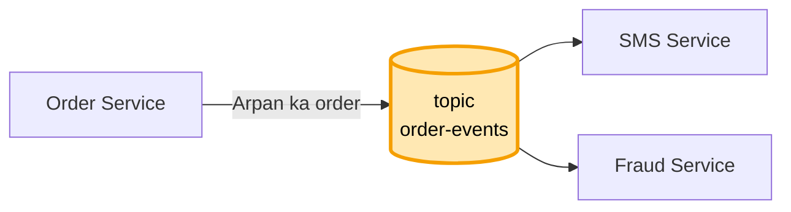
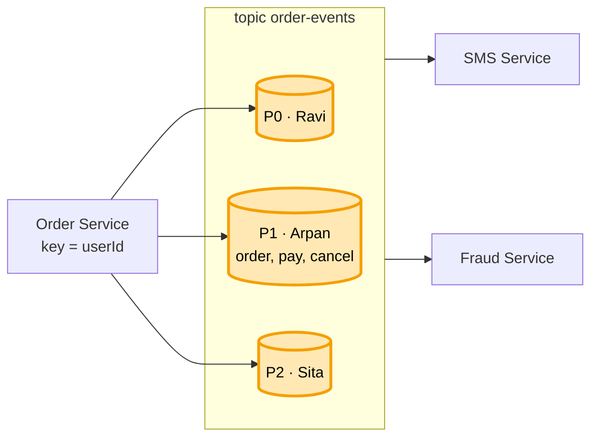
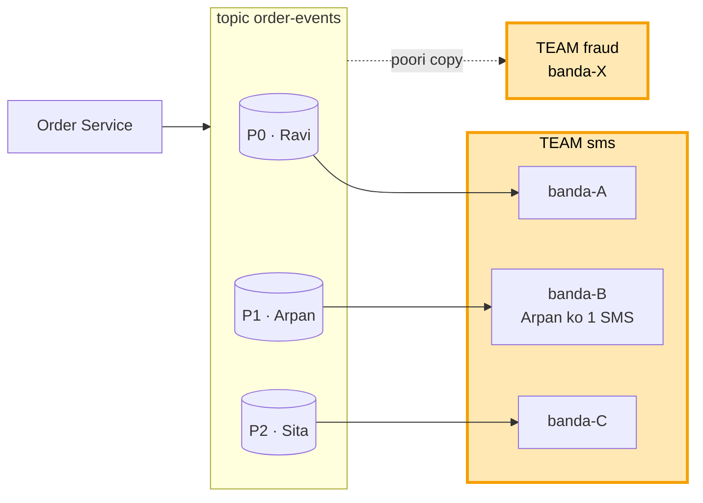
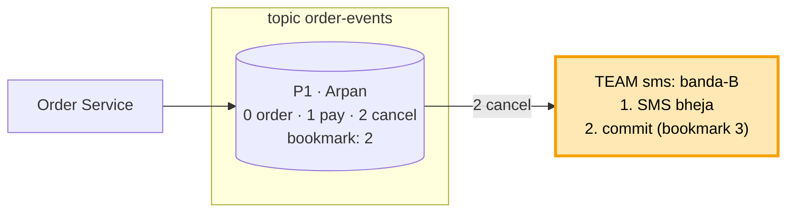
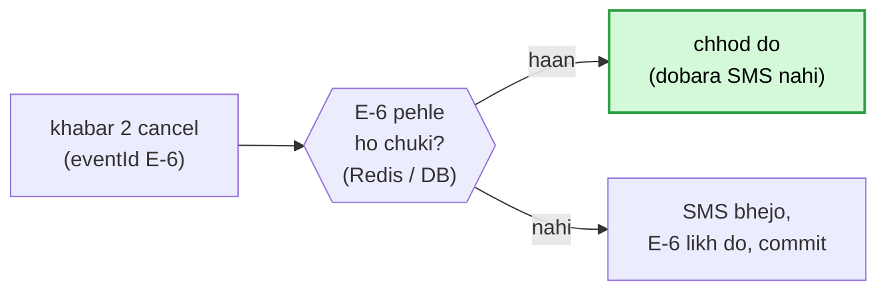
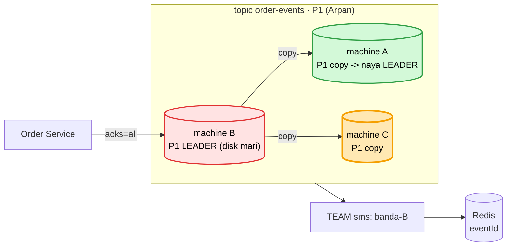
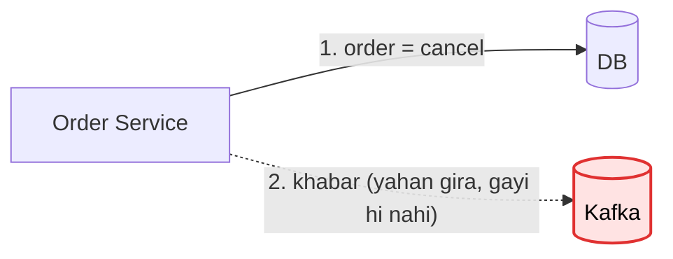
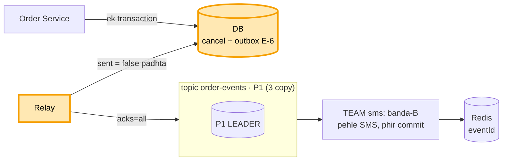
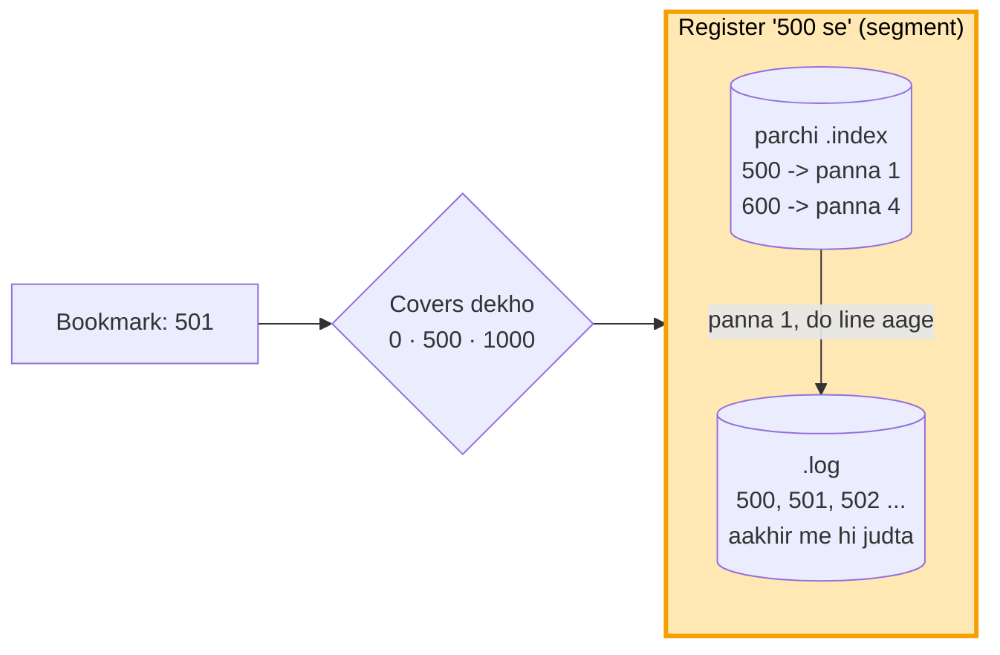

# Kafka concepts: ek kahani

Match ka din, stadium ke bahar bahut bheed. Arpan ne ticket counter se match ka ticket liya. Ticket counter (**Order
Service**) ka kaam bas ticket banana hai. Par is ticket ki khabar andar do jagah chahiye: checker ka kamra (**SMS
Service**), jo Arpan ko "seat pakki" ka SMS bhejega, aur security ka kamra (**Fraud Service**), jo dekhega ki ticket
nakli to nahi. Kahani wahi stadium wali hai jo [hand notes](KAFKA_HAND_NOTES.md) aur [main file](12_message_queue_kafka.md)
me hai.

Har diagram pichhle diagram ko hi aage badhata hai. **Peela = jo abhi naya juda**, baaki wahi purana.

---

## 1. Topic

Ticket counter ko andar ke kamron ka intezaar nahi karna. Gate pe admin ne bola: line banao, ek-ek karke jao. Counter
bas Arpan ki khabar gate ki line me daal deta hai aur agle fan ka ticket kaatne lag jaata hai. Is line ka naam
"order-events" hai. Kafka me aisi naam wali line ko **topic** kehte hain.

Checker (SMS) aur security (Fraud) dono isi line (topic) se padhte hain. Padhne se khabar mitti nahi, isliye dono ko poori
khabar milti hai. Kal koi teesra kamra khule, jaise ginti wala (Analytics), to wo bhi bas isi line se padhna shuru kar
dega. Ticket counter me ek line nahi badalti.

Sab theek chal raha tha. Phir India-Pakistan ka match aaya.

---

## 2. Partition

Bade match me har second hazaaron ticket (~5,000) katne lage. Saare isi ek line (topic) order-events me ja rahe the, aur ye
line ek hi gate (ek machine) pe thi. Akela admin itni bheed nahi sambhal paaya, line lambi hoti gayi, Arpan bhi atak gaya.

To humne topic nahi badla. Isi order-events ke liye aur gate khol diye: 3 gate, har gate ki apni line, har gate
alag machine pe. Ek gate (tukde) ko **partition** kehte hain.

Ab bojh teen gate me bat gaya. Par sawaal aaya: Arpan ki khabar kis gate pe jaaye? Arpan ne pehle ticket liya, phir
pay kiya, phir cancel kiya. Ye teeno alag gate pe gaye to andar kaun pehle pahunche, iska koi bharosa nahi. Kram sirf
ek gate ki line ke andar pakka hota hai.

Isliye ticket counter har khabar ke saath ek **key** deta hai: user ki id. Kaun kis gate pe jaaye, ye key ke hash se
tay hota hai, aur same key hamesha same gate pe jaati hai. Arpan ki teeno khabar P1 gate pe, aur wahan kram se.

Gate ban gaye. Par ab checker ke kamre ko bhi bheed jhelni thi, to wahan 3 checker bitha diye.

---

## 3. Consumer group

Checker ke kamre (SMS Service) me 3 checker hain: banda-A, banda-B, banda-C. Agar teeno har gate ke saare fan dekhein,
to Arpan ka ticket teeno punch karenge aur Arpan ko 3 SMS chale jaayenge.

To teeno ko ek hi kamre me ek team bana ke bitha diya. Sabko ek hi team ka naam diya (group.id = "sms"). Is team ko
**consumer group** kehte hain. Kamre ke andar har gate ki line sirf ek checker ko milti hai, jisne punch kar diya,
baaki do us fan ko dekhte hi nahi.

P1 gate sirf banda-B ke paas hai, to Arpan ko ek hi SMS jaata hai. Security (Fraud Service) alag kamra hai, alag team
("fraud"), use apni poori line milti hai. Har kamra apne register me bookmark rakhta hai ki agli baar line ka kaunsa
number bhejna hai, jaise "seat booked, wahi baithega", koi aur us jagah nahi ghusta. Ise **offset** kehte hain. Isliye
security dheemi chale to bhi checker nahi rukta. Aur banda-B gir jaaye to Kafka uska gate P1 banda-A ya banda-C ko de
deta hai, ise **rebalance** kehte hain.

Par banda-B girta kab hai, ye bhi maayne rakhta hai. Ek din wo kaam karte-karte beech me gir gaya.

---

## 4. Commit

Checker banda-B ka kaam teen kadam ka hai: P1 gate ki line se agli khabar uthao ("2 cancel"), Arpan ko SMS bhejo, phir
register me likho "agli baar 3 se bhejna". Ye aakhri kadam, register me bookmark aage karna, **commit** kehlata hai.
Bookmark pe hamesha **agla** number hota hai: "2 cancel" ho gaya to bookmark 3.

banda-B ne SMS bheja (fan ko seat pe baitha diya) aur register me likhne (commit) se pehle gir gaya. Bookmark abhi 2 pe hai. P1
gate banda-A ko mila, usne register dekha aur "2 cancel" dobara uthaya. Naya checker wahi fan dobara bhej raha hai:
Arpan ko 2 SMS chale gaye.

Ulta karte (pehle commit, phir SMS) to aur bura hota: bookmark 3 pe chala jaata, banda-A 3 se bhejta, aur
"2 cancel" ka SMS kabhi jaata hi nahi.

Isliye kram pakka hai: pehle kaam, phir commit. Khabar kabhi khoti nahi, bas kabhi dobara aa jaati hai. Dobara aayi
khabar pakadne ke liye har khabar ki apni id hoti hai (eventId), jaise har ticket ka apna number. SMS bhejne se pehle
checker dekhta hai ki ye id pehle aa chuki ya nahi. Id kahin likh ke rakhte hain, jaise Redis ya DB me.

Ye pehchaanna padhne wale (checker, SMS Service) ka kaam hai, gate (Kafka) ka nahi.

Padhne wali taraf ab pakki thi. Phir ek din gate ki apni machine hi mar gayi.

---

## 5. Leader aur copy

Arpan ki teeno khabar P1 gate pe thi, aur P1 ka register gate-ghar B (Kafka ki machine B) me rakha tha. Kafka ki har
machine ko **broker** kehte hain. Broker khabar RAM me nahi rakhta, **disk** pe register ke aakhir me jodta jaata hai
(beech me kuch badalta nahi, jaise ledger, hissa 7). Isliye machine restart ho to register wahin hai, khabar bachi.
Padhne se bhi register se nahi mitti, kuch din (**retention**, aam taur pe 7 din) baad hi hat-ti hai.

Gate-ghar B ki disk mar gayi. Agar P1 ka register sirf wahin hota, to Arpan ki khabar hamesha ke liye chali jaati.

Isliye har gate ke register ki 3 copy rakhte hain, teen alag gate-ghar (machine) me. Jis machine pe likhna-padhna hota
hai wo **leader** hai, baaki do copy hain. Leader mara to bachi copy me se ek naya leader ban jaata hai. Ye faisla
Kafka ki ek machine karti hai jo baaki sab pe nazar rakhti hai, jaise stadium ka head admin. Use **Controller** kehte
hain.

Par ek pench tha. Agar B ne ticket counter (Order Service) ko "aa gaya" bol diya aur copy tak khabar pahunchne se pehle
hi mar gaya, to copy ke paas wo khabar thi hi nahi. Vasiyat jaisa: baap ne ek hi copy me likhi, ghar walon ko bol diya
"likh di", phir wo copy jal gayi. Isliye "aa gaya" tabhi bolte hain jab copy pe bhi likh jaaye, ise **acks=all** kehte
hain.

Koi copy peeche chal rahi ho to use leader nahi banate, warna aakhri khabar kho jaayegi. Sirf poori taaza copy
"pakki" maani jaati hai, aur pakki copies ki list ko **ISR** (in-sync replicas) kehte hain. Aur agar sirf leader bacha ho, koi pakki
copy nahi, to likhna hi rok dete hain (**min.insync.replicas = 2**). Khabar khone se behtar thodi der rukna hai.

Ek baat aur: broker har khabar ko usi pal disk pe pakka nahi karta, pehle OS ki memory me jaati hai, thodi der baad
disk pe. To khabar ek disk ke bharose nahi bachti, **teen machine ki copy** se bachti hai. Teeno ek saath giren,
ye bahut kam hota hai. Ek line: disk pe likha (restart se bacha) + 3 copy (machine mari to bhi bacha) + acks=all
(copy hone ke baad hi "ho gaya").

Ab gate (Kafka) bhi pakka tha aur padhne wala bhi. Bacha ek: bhejne wala, ticket counter (Order Service) khud.

---

## 6. Outbox

Arpan ne ticket cancel kiya. Ticket counter (Order Service) ko do kaam karne the: apne khate (DB) me likhna "order =
cancel", aur gate (Kafka) ko khabar dena. Pehla kaam hua, aur doosre se pehle counter gir gaya.

Khate (DB) me cancel ho gaya, par checker (SMS) aur security (Fraud) ko kabhi pata hi nahi chala. Khata aur gate do
alag cheezein hain, dono me ek saath, ek hi baar me likhne ka koi tareeka nahi.

To counter ne khabar bhi usi khate me likh di, cancel ke saath, ek hi transaction me: "gate ko bhejna baaki". Ek
transaction ka matlab: dono likhe jaayenge ya koi nahi. Khabar jis alag table me jaati hai use **outbox** kehte hain.
Phir ek chhotu (alag chhota program, **relay**) har second outbox me dekhta hai ki kaunsi parchi abhi gate tak nahi
gayi (sent = false), use gate (Kafka) tak le jaata hai, aur gate OK bole to sent = true likh deta hai.

Ab ticket counter kahin bhi gire, kuch nahi khota. Transaction se pehle gira to na cancel likha, na khabar, Arpan
dobara dabayega. Chhotu (relay) ne bheja aur sent = true likhne se pehle gira, to wo dobara bhejega, aur checker
banda-B us dohri khabar ko eventId se pakad lega (hissa 4). Outbox table bharti jaaye to purani sent = true wali row
roz saaf kar dete hain.

Is tarah teeno jagah bachav ho gaya: **bhejne wala (counter) = outbox · gate (Kafka) = 3 copy + acks=all · padhne
wala (checker) = pehle kaam phir commit + eventId**.

## 7. Partition andar se: register (disk pe kaise rakha jaata hai)

Ye design ka faisla nahi, Kafka ka andar ka kaam hai; interview me design me nahi poochte. Par ye wahi kahani hai jo
bank aur Twitter me pehle aa chuki hai.

Stadium ke gate pe admin ek register me har aane wale ka naam likhta hai. Wo beech ke panne pe nahi likhta, aur
purana naam kaat ke dobara nahi likhta. Bas aakhri line ke neeche agla naam jodta jaata hai. Kafka bhi disk pe yahi
karta hai: har partition ek register hai, aur naya message hamesha uske aakhir me judta hai. Beech me jagah dhoond ke
likhna dheema hota hai, aakhir me jodte jaana sabse tez, isliye Kafka itna tez likh paata hai. Ise **append-only log**
kehte hain.

Register bhar jaaye to admin purana band karke almari me rakh deta hai aur naya register khol leta hai. Har register
ke cover pe likha hota hai ki wo kis number se shuru hua: "0 se", "500 se", "1000 se". Ek register = **segment**
(`.log` file). 7 din purana maal hatana ho to Kafka panne kaat-kaat ke nahi hatata; jo poora register 7 din se purana
ho, use seedha almari se phenk deta hai. Ise **retention** kehte hain.

Bookmark (hissa 3) pe 501 likha hai, to 501 kaise milta hai? Do kadam. Pehle covers dekho: 501 "500 se" wale register
me hai (covers kram me lage hain, to binary search). Phir us register ke saath lagi chhoti parchi dekho, jaise kitaab
ki vishay-suchi: "500 -> panna 1, 600 -> panna 4". Parchi har number ke liye nahi likhti, beech-beech ke, taaki chhoti
rahe. Panna 1 pe jao, do-chaar line aage padho, 501 mil gaya. Ye parchi **`.index`** file hai (offset se jagah,
beech-beech ki entry = sparse index).

Pehle kahan bola: kaato mat neeche likho = Banking 4 (ledger) · mahine ke mahine tod do = Banking 11 · purana head
office = Banking 12 · ID se seedha page, 1 lakh panne nahi palatne = Twitter 16.
