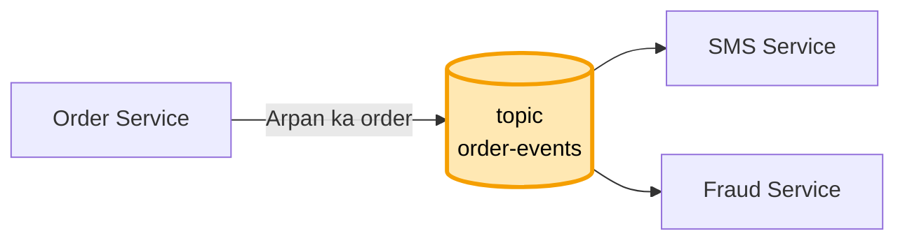
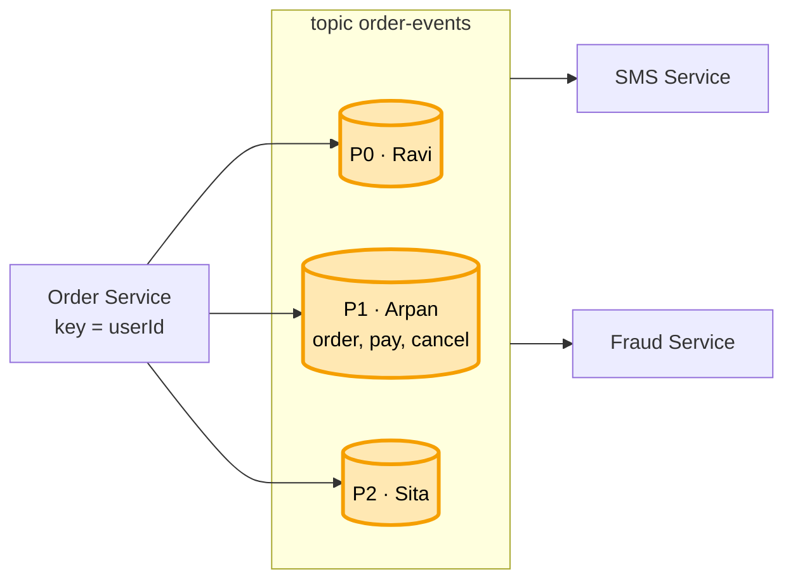
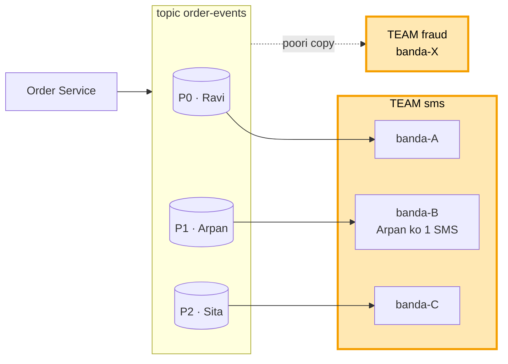
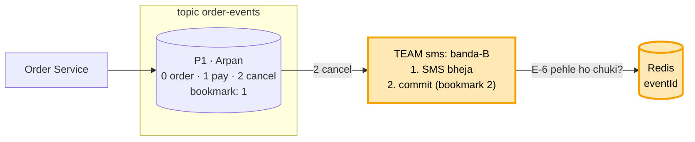
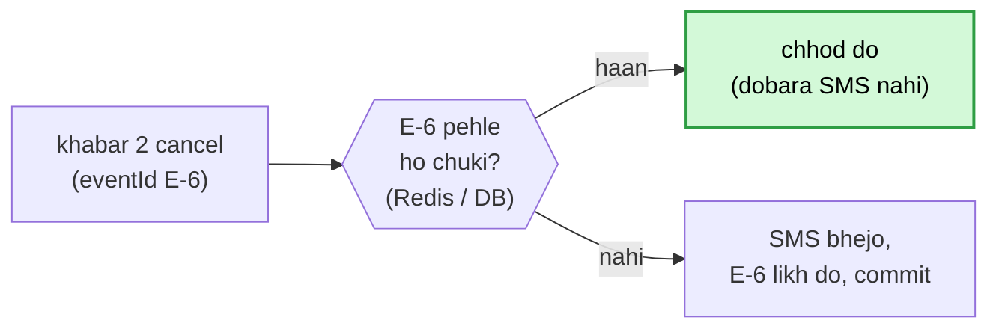
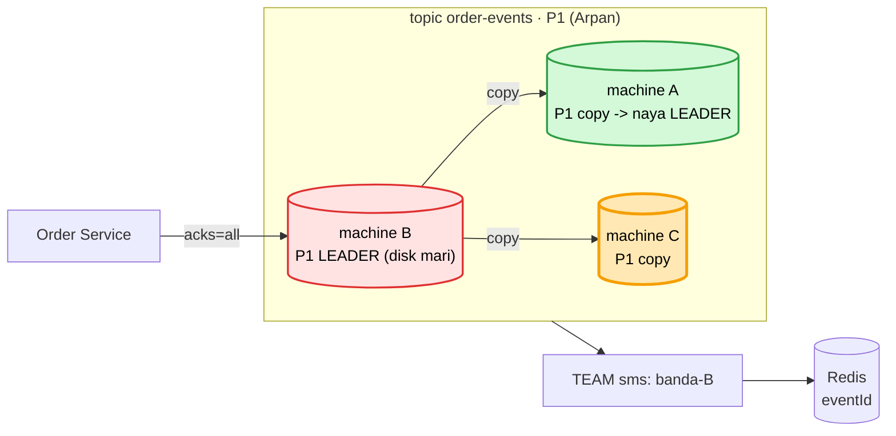
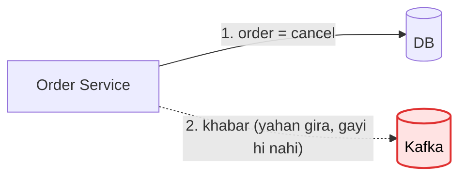
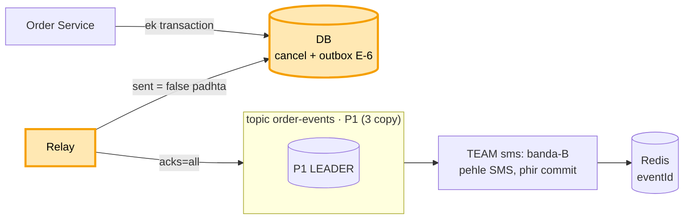

# Kafka concepts: ek kahani

Arpan ne Swiggy pe order kiya. Order Service ka kaam bas order banana hai. Par is order ki khabar do aur service ko
chahiye: SMS Service, jo Arpan ko SMS bhejegi, aur Fraud Service, jo dekhegi ki order shaq wala to nahi.

Har diagram pichhle diagram ko hi aage badhata hai. **Peela = jo abhi naya juda**, baaki wahi purana.

---

## 1. Topic

Order Service ko SMS aur Fraud ka intezaar nahi karna. Wo bas khabar ek naam wali line me daal deta hai aur apne
kaam pe lag jaata hai. Is line ka naam "order-events" hai. Kafka me aisi naam wali line ko **topic** kehte hain.

SMS aur Fraud dono isi topic se padhte hain. Padhne se khabar mitti nahi, isliye dono ko poori khabar milti hai.
Kal koi teesri service aaye, jaise Analytics, to wo bhi bas isi topic se padhna shuru kar degi. Order Service me ek
line nahi badalti.

Sab theek chal raha tha. Phir Diwali sale aayi.

---

## 2. Partition

Sale me har second lakhon order aane lage. Saare isi ek topic order-events me ja rahe the, aur ye topic ek hi
machine pe tha. Wo machine itna bojh nahi jhel paayi, line lambi hoti gayi, Arpan ka order bhi atak gaya.

To humne topic badla nahi. Isi order-events ko andar se 3 tukdon me baant diya, aur har tukda alag machine pe
rakh diya. Ek tukde ko **partition** kehte hain.

Ab bojh teen machine me bat gaya. Par sawaal aaya: Arpan ki khabar kis tukde me jaaye? Arpan ne pehle order kiya,
phir pay, phir cancel. Ye teeno alag tukdon me gaye to kaun pehle padha jaaye, iska koi bharosa nahi. Kram sirf ek
tukde ke andar pakka hota hai.

Isliye Order Service har khabar ke saath ek **key** deta hai: user ki id. Same key hamesha same tukde me jaati hai.
Arpan ki teeno khabar P1 me, aur wahan kram se.

Tukde ban gaye. Par ab SMS Service ko bhi bheed jhelni thi, to uski 3 machine chalayi gayi.

---

## 3. Consumer group

SMS Service ki 3 machine hain: banda-A, banda-B, banda-C. Agar teeno saare tukde padhein, to Arpan ki khabar teeno ke
paas jaayegi aur Arpan ko 3 SMS chale jaayenge.

To teeno machine ko ek team bana diya. Sabko ek hi team ka naam diya (group.id = "sms"). Is team ko
**consumer group** kehte hain. Team ke andar har tukda sirf ek bande ko milta hai.

P1 sirf banda-B ke paas hai, to Arpan ko ek hi SMS jaata hai. Fraud Service alag team hai ("fraud"), use apni poori
copy milti hai. Har team apna bookmark rakhti hai ki kahan tak padha, ise **offset** kehte hain. Isliye Fraud
dheema chale to bhi SMS nahi rukta. Aur banda-B gir jaaye to Kafka uska tukda P1 banda-A ya banda-C ko de deta
hai, ise **rebalance** kehte hain.

Par banda-B girta kab hai, ye bhi maayne rakhta hai. Ek din wo kaam karte-karte beech me gir gaya.

---

## 4. Commit

banda-B ka kaam teen kadam ka hai: P1 se agli khabar uthao ("2 cancel"), Arpan ko SMS bhejo, phir Kafka ko batao
"2 tak padh liya". Ye aakhri kadam, bookmark aage karna, **commit** kehlata hai.

banda-B ne SMS bheja aur commit se pehle gir gaya. Bookmark abhi 1 pe hai. P1 banda-A ko mila, usne bookmark dekha
aur "2 cancel" dobara padha. Arpan ko 2 SMS chale gaye.

Ulta karte (pehle commit, phir SMS) to aur bura hota: bookmark 2 pe chala jaata, banda-A 3 se padhta, aur "2 cancel"
ka SMS kabhi jaata hi nahi.

Isliye kram pakka hai: pehle kaam, phir commit. Khabar kabhi khoti nahi, bas kabhi dobara aa jaati hai. Dobara aayi
khabar pakadne ke liye har khabar ki apni id hoti hai (eventId). SMS bhejne se pehle banda dekhta hai ki ye id pehle
ho chuki ya nahi. Id kahin likh ke rakhte hain, jaise Redis ya DB me.

Ye pehchaanna padhne wale (SMS Service) ka kaam hai, Kafka ka nahi.

Padhne wali taraf ab pakki thi. Phir ek din Kafka ki apni machine hi mar gayi.

---

## 5. Leader aur copy

Arpan ki teeno khabar P1 me thi, aur P1 Kafka ki machine B pe tha. Kafka ki har machine ko **broker** kehte hain.
Machine B ki disk mar gayi. Agar P1 sirf wahin hota, to Arpan ki khabar hamesha ke liye chali jaati.

Isliye har tukde ki 3 copy rakhte hain, teen alag machine pe. Jis machine pe likhna-padhna hota hai wo **leader**
hai, baaki do copy hain. Leader mara to bachi copy me se ek naya leader ban jaata hai. Ye faisla Kafka ki ek
machine karti hai jo baaki sab pe nazar rakhti hai, use **Controller** kehte hain.

Par ek pench tha. Agar B ne Order Service ko "ho gaya" bol diya aur copy tak khabar pahunchne se pehle hi mar gaya, to
copy ke paas wo khabar thi hi nahi. Isliye "ho gaya" tabhi bolte hain jab copy pe bhi likh jaaye, ise **acks=all**
kehte hain.

Koi copy peeche chal rahi ho to use leader nahi banate, warna aakhri khabar kho jaayegi. Sirf poori taaza copy
"pakki" maani jaati hai, aur pakki copies ki list ko **ISR** (in-sync replicas) kehte hain. Aur agar sirf leader bacha ho, koi pakki
copy nahi, to likhna hi rok dete hain (**min.insync.replicas = 2**). Khabar khone se behtar thodi der rukna hai.

Ab Kafka bhi pakka tha aur padhne wala bhi. Bacha ek: bhejne wala, Order Service khud.

---

## 6. Outbox

Arpan ne order cancel kiya. Order Service ko do kaam karne the: DB me likhna "order = cancel", aur Kafka ko khabar
dena. Pehla kaam hua, aur doosre se pehle Order Service gir gaya.

DB me cancel ho gaya, par SMS aur Fraud ko kabhi pata hi nahi chala. DB aur Kafka do alag cheezein hain, dono me ek
saath, ek hi baar me likhne ka koi tareeka nahi.

To khabar bhi usi DB me likh di, cancel ke saath, ek hi transaction me. Ek transaction ka matlab: dono likhe
jaayenge ya koi nahi. Khabar jis alag table me jaati hai use **outbox** kehte hain. Phir ek chhota alag program,
**relay**, har second outbox me dekhta hai ki kaunsi khabar abhi bheji nahi gayi (sent = false), use Kafka ko
bhejta hai, aur Kafka OK bole to sent = true likh deta hai.

Ab Order Service kahin bhi gire, kuch nahi khota. Transaction se pehle gira to na cancel likha, na khabar, Arpan dobara
dabayega. Relay ne bheja aur sent = true likhne se pehle gira, to relay dobara bhejega, aur banda-B us dohri khabar
ko eventId se pakad lega (hissa 4). Outbox table bharti jaaye to purani sent = true wali row roz saaf kar dete hain.

Is tarah teeno jagah bachav ho gaya: **bhejne wala = outbox · Kafka = 3 copy + acks=all · padhne wala = pehle kaam
phir commit + eventId**.
