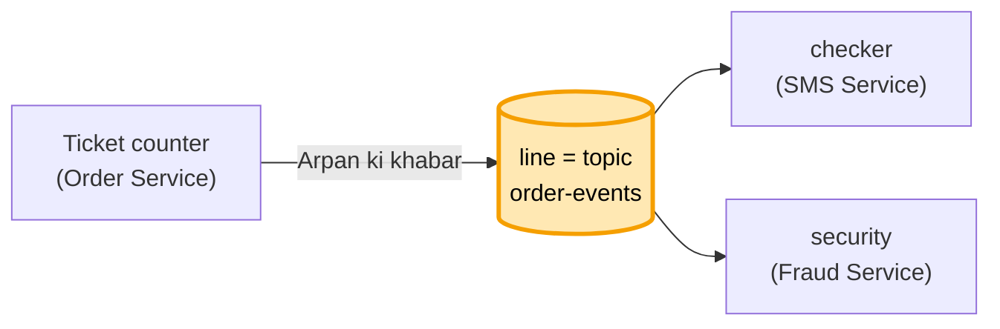
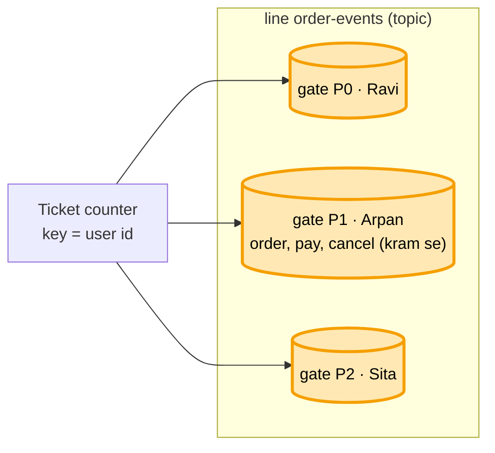
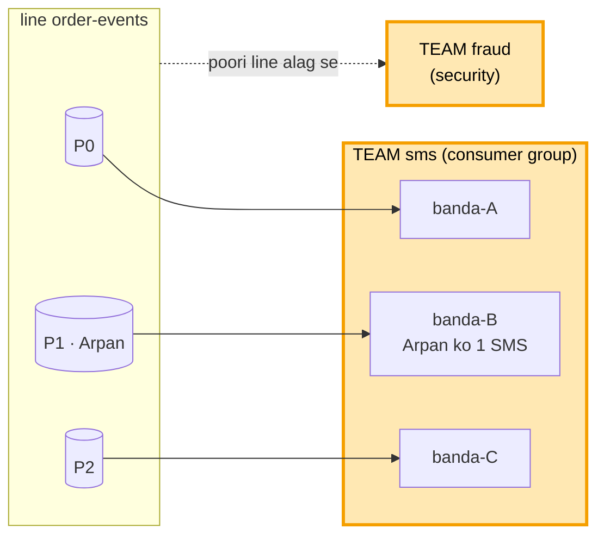
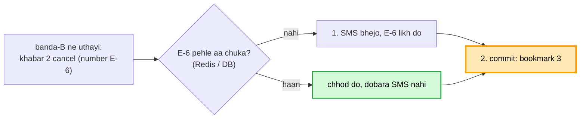
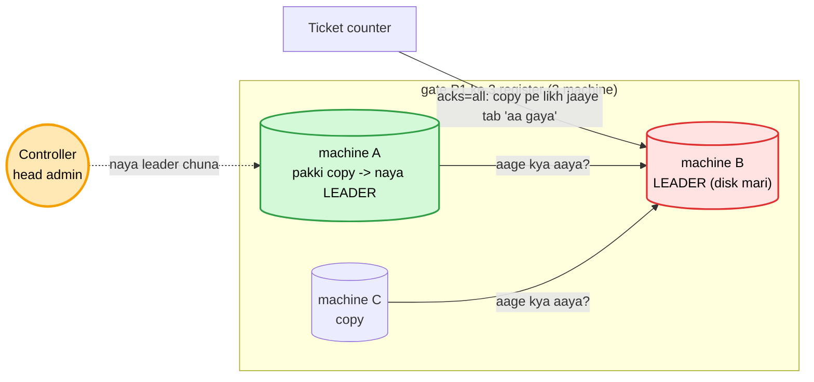
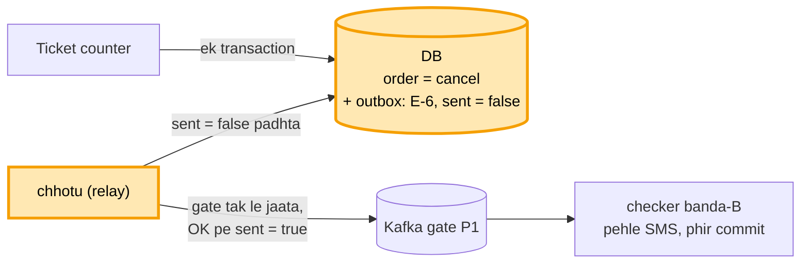
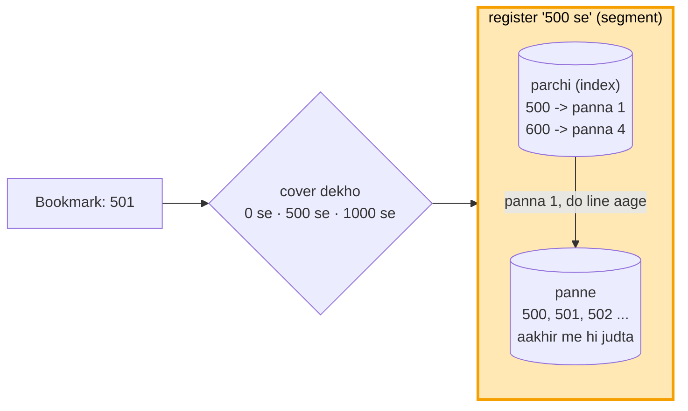

# Kafka concepts: stadium ki kahani

Match ka din hai, stadium ke bahar bahut bheed hai. Arpan ticket counter se ticket leta hai.
Har hissa pichhle hisse se aage badhta hai. Jo hissa Arpan ne chat me samjha, wahi yahan likha hai.

---

## 1. Topic

Ticket counter (Order Service) ka kaam bas ticket kaatna hai. Ticket ki khabar andar do kamron ko chahiye: checker
(SMS Service, Arpan ko "seat pakki" ka SMS bhejega) aur security (Fraud Service, dekhega ki ticket nakli to nahi).

Counter kisi kamre ka intezaar nahi karta. Khabar gate ki line me daal deta hai aur agle fan ka ticket kaatne lagta hai.
Stadium me jo line lagti hai, wahi **topic** hai (naam: order-events).

Dono kamre isi line se padhte hain. Padhne se khabar mitti nahi. Kal koi naya kamra khule, to wo bhi isi line se padh
lega, counter me kuch nahi badalta.



---

## 2. Partition

India-Pakistan ka match aaya, har second hazaaron ticket. Ek gate pe itni bheed nahi sambhli.

Topic wahi rakha, bas usi line ke liye 3 gate khol diye. Har gate = **partition**, alag machine pe. Jaise 1000 ki ek
line thi, use 300, 300 aur 400 ki teen alag line me baant diya. Line (topic) wahi rahi, bas gate badh gaye.

Par Arpan ne ticket liya, phir pay kiya, phir cancel kiya. Teeno alag gate pe gaye to andar kaun pehle pahunche, iska
koi bharosa nahi. Kram sirf ek gate ke andar pakka hota hai.

Isliye counter har khabar ke saath **key** deta hai (user id). Same key hamesha same gate pe jaati hai, to Arpan ki
teeno khabar P1 pe, aur kram se.

Jaise teen dost: alag-alag line me ghuse to andar kaun pehle pahunchega, koi kram nahi. Ek hi line me saath ghuse to
pehle main, phir wo, phir wo.



---

## 3. Consumer group

Checker ke kamre (SMS Service) me 3 checker baithe hain: banda-A, banda-B, banda-C. Agar teeno har gate ke saare fan
dekhein, to Arpan ka ticket teeno punch karenge aur Arpan ko 3 SMS chale jaayenge.

Isliye teeno ko ek **team** bana diya (naam "sms"). Is team ko **consumer group** kehte hain. Team ke andar har gate
sirf ek checker ko milta hai:

```
P0 -> banda-A     P1 (Arpan) -> banda-B     P2 -> banda-C
```

Kyun ek gate pe ek hi checker? P1 ki line me Arpan ki teen khabar kram se khadi hain: order, pay, cancel. P1 pe do
checker hote to ek "order" uthata, doosra "cancel". Cancel wala tez nikla to cancel pehle ho jaata, order baad me. Jo
kram hissa 2 me key laga ke bachaya tha, wo toot jaata. Isliye ek gate pe ek hi checker.

Arpan ka ticket sirf banda-B punch karega, to Arpan ko ek hi SMS jaayega. banda-B ne dekh liya, to banda-A aur banda-C
use nahi dekhte.



Security (Fraud) alag kamra hai aur uski alag team hai. Use apni poori line alag se milti hai. Har team apne register me
likhti hai ki line me kahan tak dekh liya (ye **offset** hai). Isliye security dheemi chale to bhi checker nahi rukta,
dono ka hisaab alag hai.

Aur agar banda-B gir gaya, to Kafka uska gate P1 banda-A ya banda-C ko de deta hai. Ise **rebalance** kehte hain.

**Maan lo Diwali sale me tune SMS team me 2 checker aur bitha diye, ab 5 checker aur 3 gate:** ek gate ek hi checker
ko milta hai, to naye do khaali baithenge. Isliye gate bhi badha do: P0, P1, P2, P3, P4. Ab 5 checker 5 gate pe, line
aur bat gayi, kaam tez. (Technical me: pehle partition badhao, phir consumer; consumer partition se zyada ho to khaali.)

---

## 4. Commit

Checker banda-B ka kaam teen kadam ka hai:

```
1. P1 ki line se agli khabar uthao ("2 cancel")
2. Arpan ko SMS bhejo
3. register me likho "agli baar 3 se bhejna"
```

Teesra kadam, yaani register me bookmark aage karna, **commit** kehlata hai.

Ek din banda-B ne SMS bheja aur register me likhne se pehle gir gaya. Bookmark abhi 2 pe hi tha. P1 banda-A ko mila,
usne register dekha aur "2 cancel" dobara uthaya. Arpan ko 2 SMS chale gaye.

Ulta karte (pehle register, phir SMS) to aur bura hota: bookmark 3 pe chala jaata, aur "2 cancel" ka SMS kabhi jaata hi
nahi.

Isliye **pehle kaam, phir commit**. Khabar kabhi khoti nahi, bas kabhi dobara aa jaati hai.

Dobara aayi khabar pakadne ke liye har khabar ka apna number hota hai (eventId), jaise har ticket ka. SMS bhejne se pehle
checker dekhta hai ki ye number pehle aa chuka ya nahi (Redis ya DB me likha rehta hai). Aa chuka to chhod do, nahi aaya
to SMS bhejo aur number likh do. Ye pehchaanna checker (SMS Service) ka kaam hai, gate (Kafka) ka nahi.



---

## 5. Leader aur copy

P1 gate ka register machine B pe rakha hai. Kafka ki har machine ko **broker** kehte hain. Broker khabar disk pe
register ke aakhir me jodta jaata hai, isliye machine restart ho to bhi register wahin rehta hai. Padhne se khabar nahi
mitti, kuch din baad (aam taur pe 7 din) hi hat-ti hai (**retention**).

Ek din machine B ki disk mar gayi. Agar P1 ka register sirf wahin hota, to Arpan ki khabar hamesha ke liye chali jaati.

Isliye har gate ke register ki 3 copy rakhte hain, teen alag machine pe. Jis machine pe likhna-padhna hota hai wo
**leader** hai, baaki do copy hain. Kafka me leader hota hai, Cassandra jaisa sab barabar wala system nahi. Copy khud
leader se poochti rehti hai "aage kya aaya". Leader mara to jo copy ekdum saath (sync) chal rahi thi, wo uski jagah le
leti hai. Ye faisla stadium ka head admin karta hai, use **Controller** kehte hain.

Pench: B ne ticket counter ko "aa gaya" bol diya aur copy tak khabar pahunchne se pehle hi mar gaya. Copy ke paas wo
khabar thi hi nahi. Jab tak copy pe khabar na pahunche, "aa gaya" kyun bolna? Jaise baap ne bola "vasiyat likh di", par
jab tak mujhe ye nahi pata ki kahan likhi aur kahan rakhi hai, main doosron ko "haan, hai" nahi bolunga. Isliye
"aa gaya" tabhi bolte hain jab copy pe bhi likh jaaye: **acks=all**.

Jo copy peeche chal rahi ho, use leader nahi banate, warna aakhri khabar kho jaayegi. Poori taaza copy hi "pakki" maani
jaati hai, pakki copies ki list = **ISR**. Agar sirf leader bacha ho aur koi pakki copy na ho, to likhna hi rok dete hain
(**min.insync.replicas = 2**). Khabar khone se behtar thodi der rukna.

Ek line me: disk pe likha (restart se bacha) + 3 copy (machine mari to bhi bacha) + acks=all (copy pe likhne ke baad hi
"ho gaya").



---

## 6. Outbox

Arpan ne ticket cancel kiya. Ticket counter (Order Service) ko do kaam karne the: apne DB me "order = cancel" likhna,
aur gate (Kafka) ko khabar dena. Likhne se pehle gira to theek, kuch likha hi nahi. Par DB me likh liya aur khabar
bhejne se pehle gir gaya, to checker (SMS) aur security (Fraud) ko kabhi pata hi nahi chalega.

Isliye usi DB me ek table banao, **outbox**, aur cancel ke saath khabar bhi usi me likh do, ek hi transaction me: ya
dono likhe jaayenge, ya kuch nahi. Phir ek chhotu (**relay**) outbox me dekhta hai ki kaunsi parchi sent = false hai,
use gate tak le jaata hai, aur gate OK bole to sent = true. Chhotu bhejne ke baad aur sent = true likhne se pehle gira,
to dobara bhejega, aur checker us dohri khabar ko eventId se pakad lega (hissa 4).

Teeno jagah bachav: **bhejne wala (counter) = outbox · gate (Kafka) = 3 copy + acks=all · padhne wala (checker) = pehle
kaam phir commit + eventId**.



---

## 7. Register (partition disk pe kaise rakha jaata hai)

Ye Kafka ka andar ka kaam hai, design ka faisla nahi.

Gate pe admin ek register me har aane wale ka naam likhta hai. Beech ke panne pe nahi likhta, purana kaat ke dobara
nahi likhta, bas aakhri line ke neeche agla naam jodta jaata hai. Kafka bhi disk pe yahi karta hai: naya message hamesha
aakhir me judta hai. Aakhir me jodna sabse tez, isliye Kafka itna tez likh paata hai (**append-only log**).

Register bhar jaaye to admin use almari me rakh deta hai aur naya khol leta hai. Har register ke cover pe likha hai ki
wo kis number se shuru hua: "0 se", "500 se", "1000 se". Ek register = **segment**. 7 din purana maal hatana ho to panne
nahi kaatta, poora purana register phenk deta hai (**retention**).

Bookmark pe 501 likha hai, to 501 kaise milta hai? Pehle cover dekho: 501 "500 se" wale register me hai. Phir register
ke saath lagi chhoti parchi dekho, kitaab ki vishay-suchi jaisi: "500 -> panna 1, 600 -> panna 4". Panna 1 pe jao,
do-chaar line aage padho, 501 mil gaya. Ye parchi **index** hai.



Pehle kahan dekha: kaato mat, neeche likho = Banking 4 (ledger) · mahine ke mahine tod do = Banking 11 · ID se seedha
page, 1 lakh panne nahi palatne = Twitter 16.
