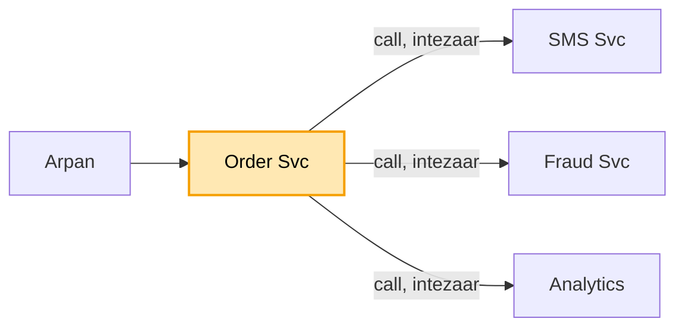

# Message queue (Kafka): shuru se, ek kahani

Kram wahi jo interview me hota hai: **FR, phir NFR, phir numbers, phir design**. Design sabse seedhe dabbe se
shuru hota hai, aur har dikkat aane pe ek naya dabba judta hai. Diagram me peela dabba = abhi juda. Poori file
me ek hi kahani hai: Arpan ne Swiggy pe order kiya. Concepts kahani se padhne hon to
[kafka_concepts.md](kafka_concepts.md).

---

## 1. FR: kya karna hai

```
1. Order Svc ki khabar ("Arpan ne order kiya") kai service tak pahunche: SMS, Fraud, Analytics
2. Order Svc kisi ka intezaar na kare
3. ek user ki khabar kram me pahunche (order, phir pay, phir cancel)
scope ke bahar (poochh ke hata do): duniya bhar ke region, exactly-once (Kafka se bahar)
```

## 2. NFR: kaisa chalna chahiye

```
- khabar kabhi na khoye
- bheed me bhi chale (sale me 5,000 / sec)
- ek service dheemi ho to baaki na rukein
```

## 3. Numbers

```
- roz 10 crore khabar -> ~1,200 / sec, sale me ~5,000 / sec
- ek worker ~500 khabar / sec sambhal paata hai -> 5,000 / 500 = 10 tukde chahiye
- ek khabar ~1 KB -> roz ~100 GB -> 7 din rakho to ~700 GB -> 3 copy = ~2 TB disk
```

"10 tukde" kadam 3 me kaam aayega, aur "7 din, 3 copy" baad me.

---

## 4. Design

### Kadam 1: sabse seedha (Order Svc seedha sabko call kare)

Arpan ne order kiya. Order Svc order banata hai, phir khud SMS Svc, Fraud Svc aur Analytics ko ek-ek karke
call karta hai, har ek ke jawab ka intezaar karta hai, aur tab jaake Arpan ko "order ho gaya" bolta hai.



Dikkat: SMS Svc dheema hai to Arpan ka order bhi dheema ho jaata hai. SMS Svc gira to order hi fail, jabki
order ka SMS se koi lena-dena nahi. Aur kal koi naya Coupon Svc aaya, to Order Svc ka code badalna padega.

Order Svc ko kisi ka intezaar nahi karna. Wo khabar kahin daal de aur aage badh jaaye, aur jise chahiye wo
wahan se le le. Par "kahin" ka matlab kahan?
