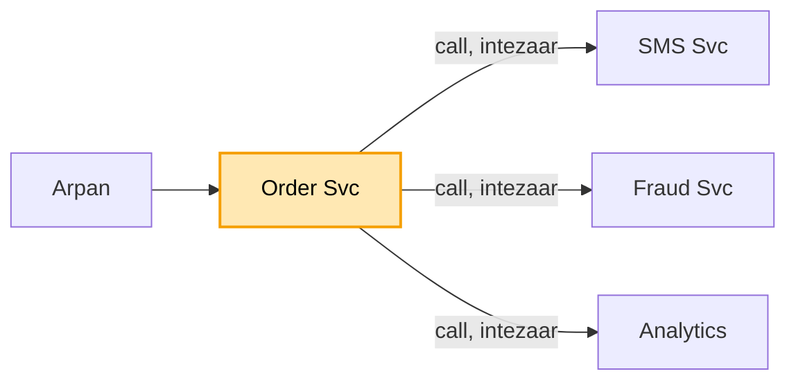
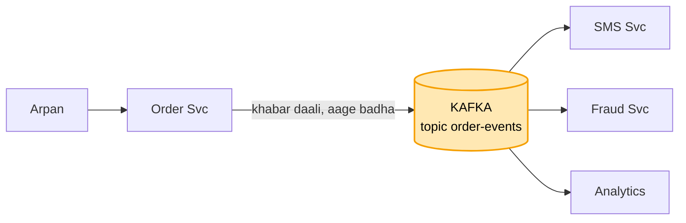
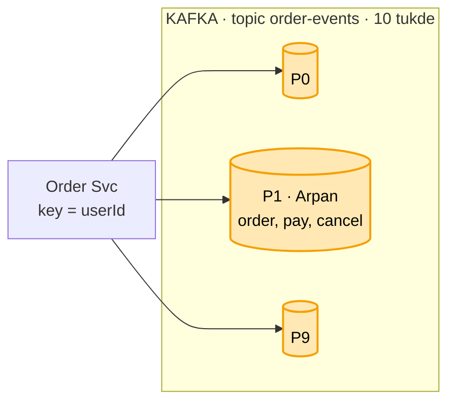

# Message queue (Kafka): shuru se, ek kahani

Kram wahi jo interview me hota hai: **FR, phir NFR, phir numbers, phir design**. Design sabse seedhe dabbe
se shuru hota hai, aur har dikkat aane pe ek naya dabba judta hai. Diagram me peela dabba = abhi juda. Poori
file me ek hi kahani hai: Arpan ne Swiggy pe order kiya. Concepts kahani se padhne hon to
[kafka_concepts.md](kafka_concepts.md).

---

## 1. FR: kya karna hai

```
1. Order Svc ki khabar ("Arpan ne order kiya") kai service tak pahunche: SMS, Fraud, Analytics
2. Order Svc kisi ka intezaar na kare
3. ek user ki khabar kram me pahunche (order, phir pay, phir cancel)
scope ke bahar (poochh ke hata do): duniya bhar ke region, exactly-once (Kafka se bahar)
```

## 2. NFR: kaisa chalna chahiye

```
- khabar kabhi na khoye
- bheed me bhi chale (sale me 5,000 / sec)
- ek service dheemi ho to baaki na rukein
```

## 3. Numbers

```
- roz 10 crore khabar -> ~1,200 / sec, sale me ~5,000 / sec
- ek worker ~500 khabar / sec sambhal paata hai -> 5,000 / 500 = 10 tukde chahiye
- ek khabar ~1 KB -> roz ~100 GB -> 7 din rakho to ~700 GB -> 3 copy = ~2 TB disk
```

"10 tukde" kadam 3 me kaam aayega, aur "7 din, 3 copy" baad me.

---

## 4. Design

### Kadam 1: sabse seedha (Order Svc seedha sabko call kare)

Arpan ne order kiya. Order Svc order banata hai, phir khud SMS Svc, Fraud Svc aur Analytics ko ek-ek karke
call karta hai, har ek ke jawab ka intezaar karta hai, aur tab jaake Arpan ko "order ho gaya" bolta hai.



Dikkat: SMS Svc dheema hai to Arpan ka order bhi dheema ho jaata hai. SMS Svc gira to order hi fail, jabki
order ka SMS se koi lena-dena nahi. Aur kal koi naya Coupon Svc aaya, to Order Svc ka code badalna padega.

Order Svc ko kisi ka intezaar nahi karna. Wo khabar kahin daal de aur aage badh jaaye, aur jise chahiye wo
wahan se le le. Par "kahin" ka matlab kahan?

### Kadam 2: khabar kahan daalein (Kafka topic, disk pe)

Order Svc khabar ek line (queue) me daal deta hai aur aage badh jaata hai. SMS, Fraud aur Analytics usi line
se padhte hain. Par line kaisi ho? Ye asli choice hai:

```
SERVER KI MEMORY ME LIST  -> server restart = saari khabar gayab. NFR "kabhi na khoye" toota
RABBITMQ (aam queue)      -> khabar ek ne padhi to line se nikal gayi (mit gayi).
                             SMS ne padhi to Fraud ko mili hi nahi. Har service ke liye alag line banao
KAFKA (topic, disk pe)    -> khabar disk pe likhi jaati hai, padhne se mit-ti NAHI.
                             SMS, Fraud, Analytics teeno wahi khabar padhte hain, apni-apni jagah se
```

**Isliye Kafka.** Line ko Kafka me **topic** kehte hain (`order-events`). Padhne se khabar mit-ti nahi,
isliye ek hi khabar teen service padh leti hain, aur kal Coupon Svc aaya to wo bas padhna shuru kar degi,
Order Svc me ek line nahi badalti. Har service apna bookmark rakhti hai ki kahan tak padha (**offset**), to
Fraud dheema hua to bas wo peeche rahega, SMS nahi rukega. Disk pe hai, to kuch din (jaise 7 din) rakhi
rehti hai, aur kisi service me bug tha to bookmark peeche karke dobara padh sakte hain.



Par Diwali sale me har second 5,000 order. Saari khabar ek topic me, aur topic ek hi machine pe. Upar se SMS
ka ek worker sirf 500 / sec sambhal paata hai. Line lambi hoti ja rahi hai.

### Kadam 3: bheed (topic ke tukde = partition, aur key)

Ilaaj: topic `order-events` ko andar se **10 tukdon** me baanto, har tukda alag machine pe. Ek tukde ko
**partition** kehte hain. 10 isliye ki numbers me nikla tha: sale me 5,000 / sec, ek worker 500 / sec, to
5,000 / 500 = 10. Ek tukda ek worker padhega, to 10 tukde = 10 worker ek saath.

Par tukde karte hi nayi dikkat aati hai: kram. Arpan ki 3 khabar (order, pay, cancel) alag-alag tukdon me
gayi, to padhne wala kis kram me padhe, koi bharosa nahi. "cancel" pehle padh liya to gadbad. Kafka me kram
sirf ek tukde ke andar pakka hota hai, poore topic me nahi.

Ilaaj: **key**. Order Svc har khabar ke saath ek key deta hai, `userId`. Same key hamesha same tukde me
jaati hai:

```
tukda = hash(arpan) % 10 = 1   -> Arpan ki teeno khabar P1 me, kram se: order, pay, cancel
Ravi ki khabar                -> P6 me (alag tukda, Arpan se koi lena-dena nahi)
```

Ye chat wali baat hi hai: wahan kram sirf ek chat ke andar chahiye tha, yahan sirf ek user ke andar.



Tukde 10 se 20 kiye to? Tukda = hash(key) % ginti hai. Ginti badli to key ka tukda badal jaata hai: Arpan ki
purani khabar P1 me rahegi, nayi kahin aur, thodi der kram toot sakta hai. Isliye shuru me hi zaroorat se
2-3 guna tukde rakhte hain.

Par SMS Svc ki 3 machine lagayi taaki 10 tukde jaldi padhe jaayein. Teeno machine saare tukde padhne lagin,
aur Arpan ko ek order ke 3 SMS chale gaye.

