# Kafka: ek kahani, shuru se

Arpan ne order kiya. Order Svc ko ye khabar Email Svc tak pahunchani hai ("order #101 bana, Arpan ko email bhejo").
Shuru me sab seedha hai. Har baar ek dikkat aati hai, aur design me ek naya dabba judta hai. Har diagram pichhle wale
ko hi aage badhata hai. **Peela = jo abhi naya juda.** Laal = jo toota.

Jo shabd tu design me bolega, interviewer ka sawaal usi se uthega. Isliye har naye shabd ke neeche uske sawaal hain.
Sawaal banane ki chaabi:

```
DABBA -> gir gaya?  bheed aa gayi?  dheema ho gaya?
TEER  -> pahuncha hi nahi?  do baar pahuncha?  der se pahuncha?
SHABD -> ye kyun, doosra kyun nahi?
```

Ginti (interviewer pooche to):
```
roz 10 crore khabar / ~86,400 sec = ~1,200 har second, sale me ~5,000 har second
ek khabar ~1 KB -> roz ~100 GB, 7 din ~700 GB, 3 copy -> ~2 TB disk
```

---

## 0. Sabse seedha

Shuru me Order Svc khud Email Svc ko bulata hai, aur jab tak Email Svc jawab na de, rukta hai.

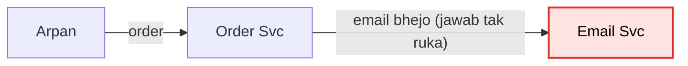

Ek din Email Svc dheema ho gaya, har email me 5 second. Arpan ka order bhi 5 second atka raha. Aur jis din Email Svc
band hua, us din order hi fail ho gaya, jabki order me koi galti nahi thi. Email ki dikkat order ko le doobi.

---

## 1. Beech me ek line

To dono ko alag kar diya. Beech me ek line rakh di: Order Svc khabar line me daal ke aage badh jaata hai, Email Svc
apni speed se line se uthata hai. Ise **queue** kehte hain.

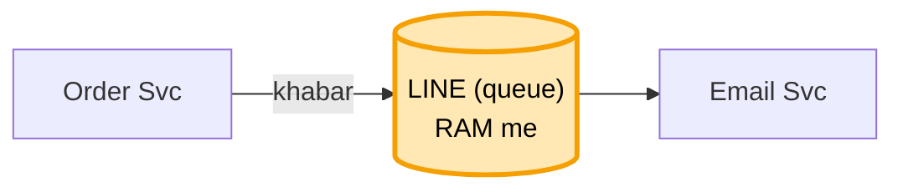

Ab Email band bhi ho, to order chalta hai. Khabar line me padi rehti hai.

Tune **queue** bola, to sawaal:
```
line kahan rakhi?        -> ek machine ki RAM me
wo machine restart hui?  -> RAM khaali, saari khabar gayi
```

Aur yahi hua. Ek raat wo machine restart hui, aur line me padi saari khabar ud gayi.

---

## 2. Line disk pe, aur bookmark

To line ko RAM ki jagah disk pe likhna tha, taaki restart pe bhi bachi rahe. Aisi line khud banane ki jagah ek
bana-banaya tool lete hain: **Kafka**. Kafka bas yahi hai: khabar ki ek line jo disk pe likhi rehti hai. Kafka me is
line ko **log** kehte hain (nayi khabar sirf aakhir me judti hai), line ke naam ko **topic** (jaise "order"), aur
Kafka ki har machine ko **broker**.

Padhne se khabar mitti nahi. Isliye Email Svc khud yaad rakhta hai ki kahan tak padha, ek bookmark ki tarah. Ise
**offset** kehte hain. Restart hua to bookmark dekh ke wahin se aage padhta hai.

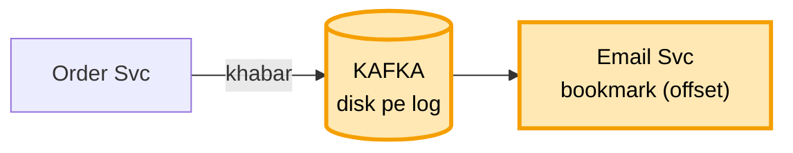

Tune **log, offset** bola, to sawaal:
```
padhne se khabar mitti kyun nahi?  -> taaki dobara padh sakein (replay), aur doosri service bhi padhe
bookmark kahan rakha?              -> Kafka khud rakhta hai
kal ki khabar dobara padhni hai?   -> bookmark peeche kar do, khabar disk pe padi hai
disk bharti gayi?                  -> 7 din se purani khabar hata do (retention), aage 10 me
121 number wali khabar disk pe kahan hai?  -> Kafka ek chhoti index file rakhta: number -> jagah
```

Khabar ab bachi rehti thi. Par phir sale aayi.

---

## 3. Bheed aayi

Sale me har second 5,000 order aane lage. Email Svc ka ek worker (Email Svc ki ek chalti copy) sirf 500 utha paata
tha. Line lambi hoti gayi, Arpan ka order bhi fas gaya.

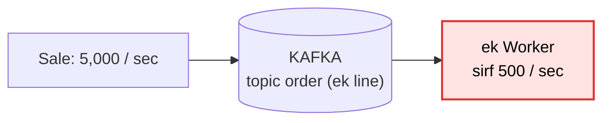

Aur worker badha nahi sakte the, kyunki ek line ko ek waqt me ek hi worker padh sakta hai. Do worker ek line se
uthayenge to ek hi order do baar utha lenge, ya kram bigad jaayega. To topic ko hi 10 tukdon me baant diya, aur har
tukde ka apna worker. Ek tukde ko **partition** kehte hain.

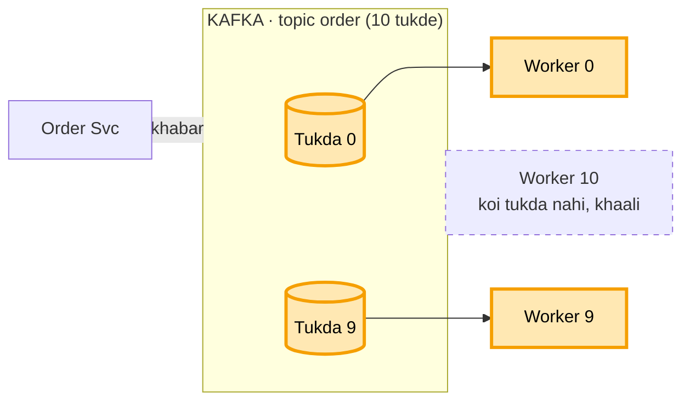

10 tukde, 10 worker, 10 x 500 = 5,000 har second. 11va worker lagao to wo khaali baithega, kyunki uske liye koi tukda
bacha hi nahi.

Tune **partition** bola, to sawaal:
```
11va worker lagaya?          -> khaali baithega. Pehle tukde badhao
10 tukde, 5 worker?          -> ek worker 2 tukde padhega, chalega, bas dheema
kitne tukde rakhein?         -> jitne worker ek saath chahiye. 5,000 / 500 = 10. Thoda zyada rakho
tukde baad me badhaye?       -> chalta hai, par kram toot sakta hai (aage 4 me)
tukde alag machine pe?       -> haan, 3 broker me barabar baante, ek pe bojh nahi
kaunsa tukda kis broker pe?  -> Controller (Kafka ki ek machine jo baaki pe nazar rakhti) ka naksha batata
```

Bheed sambhal li. Par us din Arpan ne apna naam do baar badla, aur kuch ajeeb hua.

---

## 4. Kram toota

Arpan ne pehle naam "A" kiya, phir "B". "A" tukda 1 me gaya, "B" tukda 5 me. Tukda 1 ka worker dheema tha, tukda 5 ka
tez. "B" pehle chhapa, "A" baad me. Aakhir me purana naam "A" bacha.

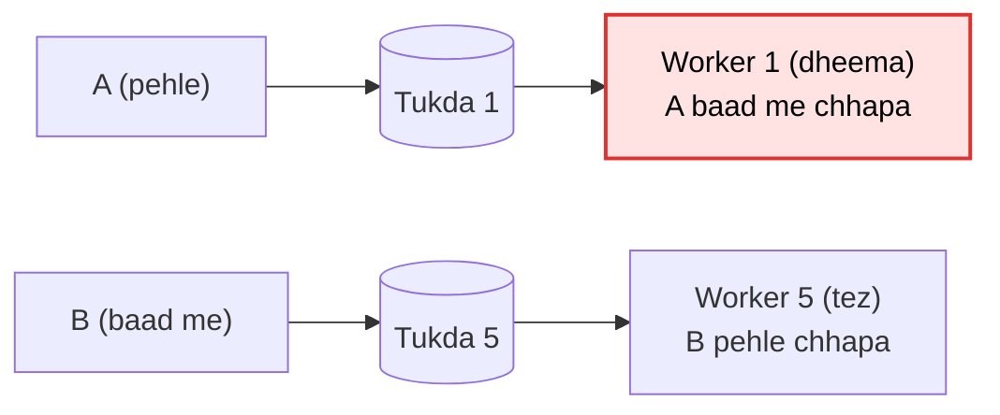

Kram sirf ek tukde ke andar pakka hota hai. To Arpan ki saari khabar ek hi tukde me jaani chahiye. Isliye Order Svc
har khabar ke saath ek **key** deta hai: Arpan ki userId. Same key hamesha same tukde me jaati hai.

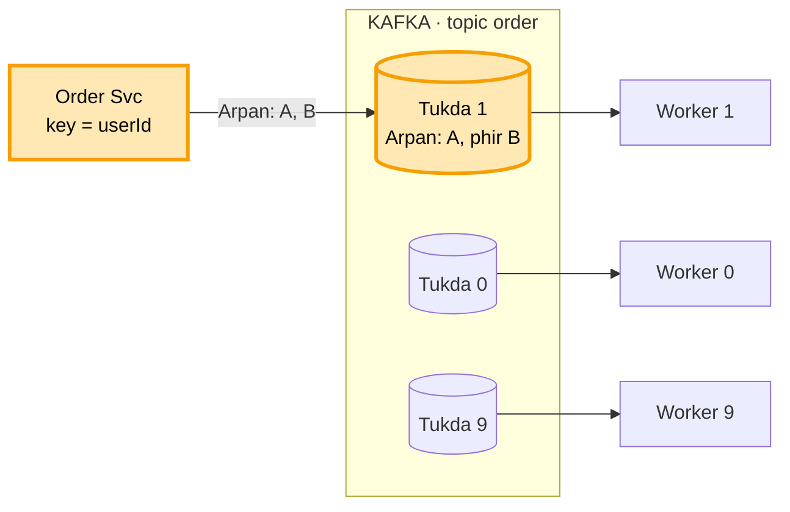

Tune **key = userId** bola, to sawaal:
```
key nahi di?                     -> khabar kisi bhi tukde me, kram nahi bachta
poore topic ka ek kram chahiye?  -> ek hi tukda, phir wahi bheed. Aksar ek user ka kram kaafi
ek celeb ki itni khabar ki uska tukda bhar gaya?
                                 -> key me number jodo (userId#1, #2), kram chhodna padega
tukde 10 se 20 kiye?             -> key ka tukda badal gaya, kuch der kram toota. Isliye shuru me zyada rakho
Order Svc ne A bheja, wo network me atka, retry kiya, tab tak B pahunch gaya?
                                 -> Order Svc har khabar pe number lagata (1, 2). Kafka number dekh ke kram
                                    theek rakhta aur dobara aayi khabar nahi likhta (idempotent producer)
RabbitMQ / SQS (doosre queue tool) me kram?
                                 -> pakka nahi milta. SQS FIFO ya ek hi padhne wala ho tab, par speed kam
```

Kram theek ho gaya. Phir Email Svc ko 3 machine pe chalaya, aur Arpan ko ek order ke 3 email aa gaye.

---

## 5. Ek service = ek team

Upar 3 me maan liya tha ki Kafka har tukda ek worker ko deta hai. Par Kafka ko kaise pata ki ye teen machine ek hi
Email Svc ki hain? Bataya nahi, to Kafka har machine ko alag padhne wala maanta hai, aur tukda 7 teeno ko de deta hai.

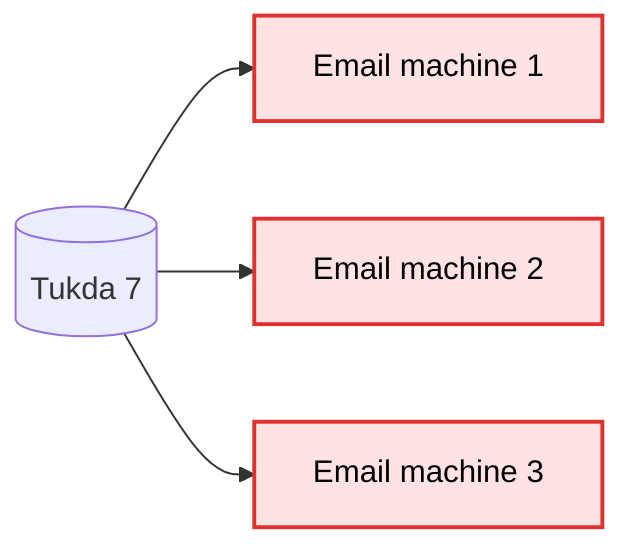

To teeno machine ko ek team bana diya: sabko ek hi team ka naam diya (group.id). Is team ko **consumer group** kehte
hain. Team ke andar har tukda sirf ek machine ko milta hai.

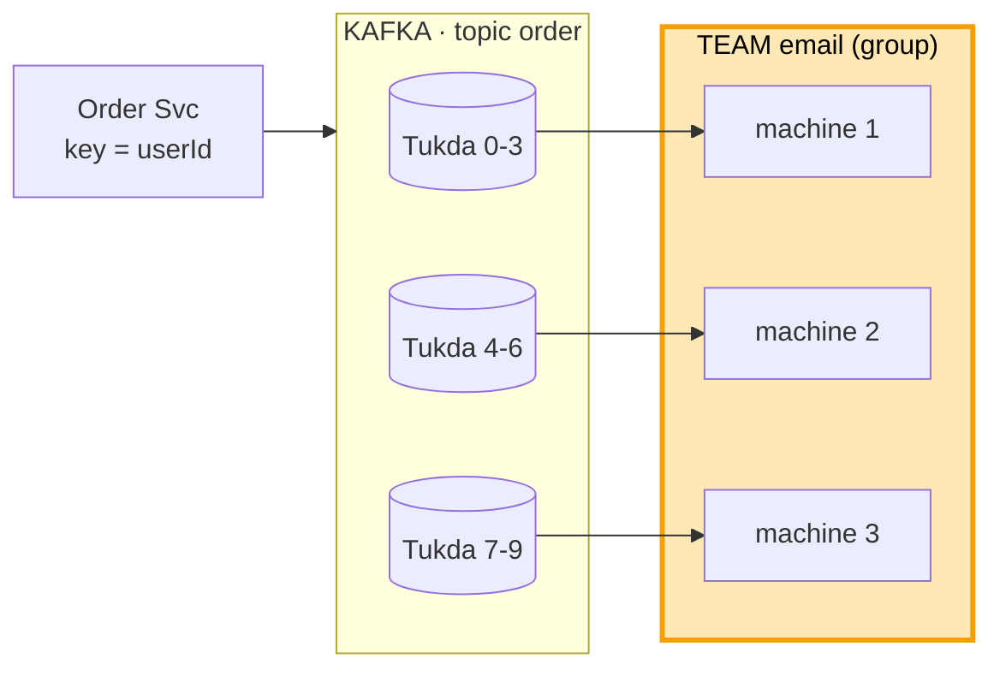

Tune **consumer group** bola, to sawaal:
```
team ki ek machine gir gayi?      -> uske tukde baaki machine ko mil jaate (rebalance), aage 10 me
har machine ka group.id alag?     -> Kafka teeno ko alag team samjhega, phir 3 email
team me machine badhani hai?      -> tukde bhi badhao, warna nayi machine khaali
```

Email theek ho gaya. Phir Analytics aur Dashboard wale aaye: unhe bhi wahi order chahiye tha.

---

## 6. Har service ki apni team

Agar Analytics aur Dashboard bhi email wali team me ghus jaate, to team me ek khabar ek hi ko jaati, baaki do ko kuch
nahi milta. To har service ki apni alag team, apna bookmark. Har team ko poori khabar milti hai, aur Dashboard dheema
ho to bhi Email nahi rukta.

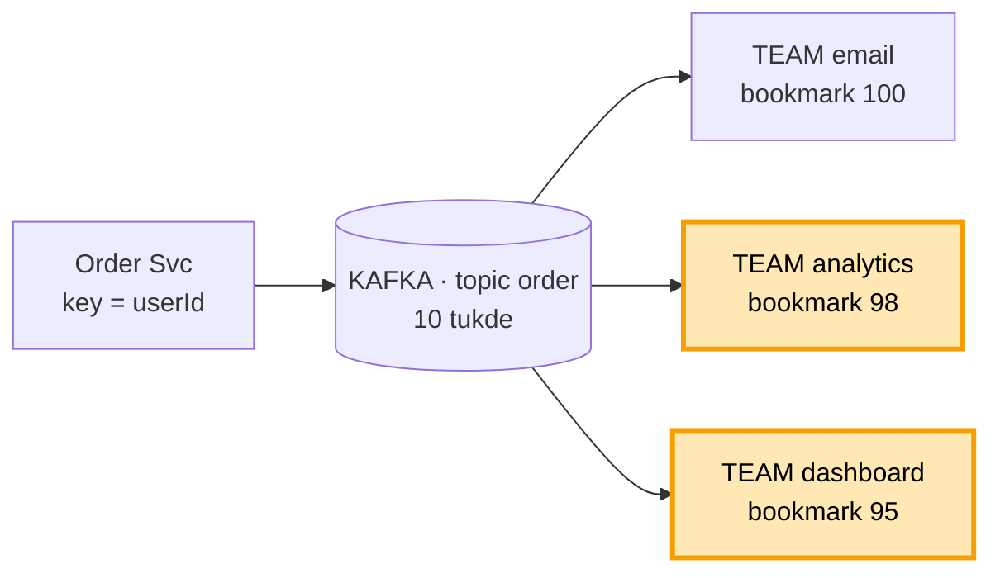

Tune **har service ka apna group** bola, to sawaal:
```
teeno ko ek hi team me daal dete?  -> team me ek khabar ek ko, baaki do ko kuch nahi milta
nayi service judni hai?            -> bas naya group. Order Svc me kuch nahi badalta
nayi service shuru se padhe ya ab se?  -> tay karna padta hai (auto.offset.reset)
```

Padhne wali taraf sab theek tha. Phir ek din Kafka ki apni machine hi mar gayi.

---

## 7. Kafka ki machine mari

Khabar Kafka ki machine A ki disk pe thi. A ki disk mar gayi, aur khabar uske saath chali gayi.

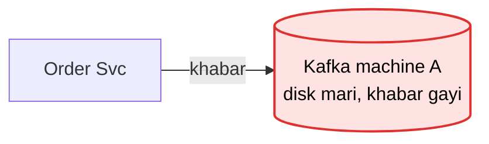

To har tukde ki 3 copy rakhte hain, teen alag machine pe. Jis pe likhna-padhna hota hai wo **leader**, baaki do copy.
Leader mara to copy me se naya leader banta hai. Order Svc ko "ho gaya" tabhi milta hai jab copy pe bhi likh jaaye,
ise **acks=all** kehte hain.

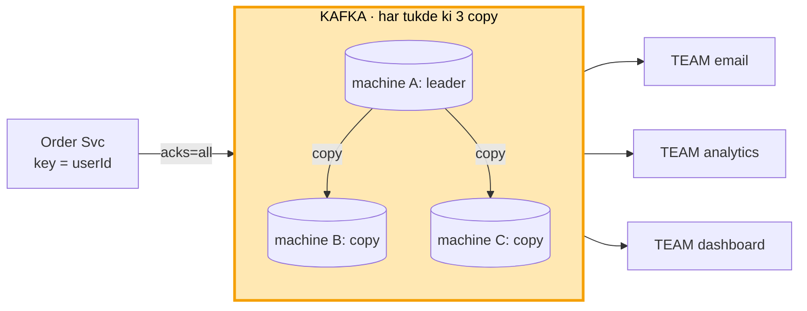

Tune **leader, copy, acks** bola, to sawaal:
```
A ne "ho gaya" bola, copy banne se pehle mar gaya?  -> khabar gayi. Isliye "ho gaya" tab bolo jab copy
                                                       bhi likh jaaye (acks=all)
ek copy peeche chal rahi?           -> sirf poori taaza copy "pakki" (ISR). Leader pakki me se hi banta
dono copy bhi gayi, sirf A bacha?   -> likhna rok do (min.insync = 2). Khone se behtar rukna
naya leader kaun chunta?            -> Controller: Kafka ki ek machine jo baaki sab pe nazar rakhti (KRaft).
                                       Ek hi faisla, do leader kabhi nahi
acks ke teen tareeke?               -> 0 = bhej ke bhool jao, 1 = sirf leader (click, log ke liye theek),
                                       all = saari pakki copy (paisa, order)
3 copy ke liye kitni machine?       -> kam se kam 3 alag machine
pehle kya poochho?                  -> khabar kho sakti hai ya bilkul nahi? Isi se acks tay hota
```

Kafka ab pakka tha. Par ek din padhne wala worker hi kaam karte-karte gir gaya.

---

## 8. Worker beech me gira

Worker ne email bheja, aur bookmark aage karne se pehle gir gaya. Bookmark hila hi nahi, to restart pe wahi khabar
dobara aayi, aur Arpan ko 2 email chale gaye.

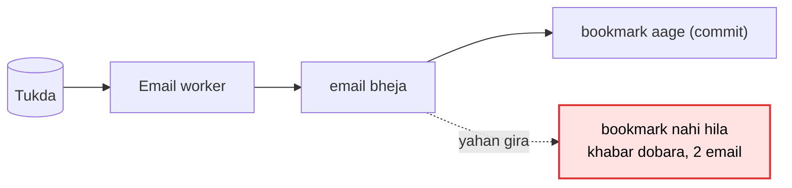

Ulta karte (pehle bookmark, phir email) to aur bura hota: beech me girne pe email kabhi jaata hi nahi. To kram pakka:
pehle kaam, phir bookmark. Bookmark aage karne ko **commit** kehte hain.

Dobara aayi khabar pakadne ke liye har khabar ki apni id hoti hai (**eventId**, jaise E-5). Jis id ka kaam ho chuka,
use ek tez jagah likh lete hain, jaise Redis (RAM wala tez store, DB bhi chalega). Khabar aaye to pehle dekho: "ye id
pehle dekhi?" Haan to chhod do.

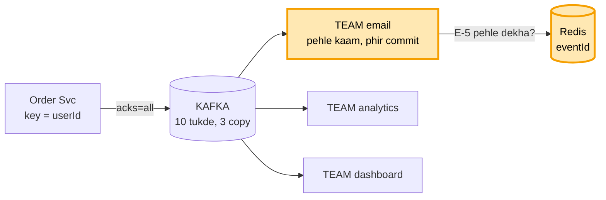

Tune **pehle kaam phir commit, eventId** bola, to sawaal:
```
"duplicate kabhi nahi aayega"?  -> galat. Khabar khoti nahi, dobara aa sakti. Padhne wala pehchaanta
userId se pehchano?             -> galat. Arpan ka agla sahi order bhi chhoot jaayega. Pehchaan eventId se
Redis se E-5 jaldi mit gaya?    -> dobara aayi to pehchani nahi. Utni der rakho jitni der dobara aa sakti
exactly-once milta hai?         -> sirf Kafka se Kafka tak. Email / DB ke liye padhne wala khud pehchaane
```

Padhne wala aur Kafka, dono pakke. Bacha bhejne wala, Order Svc khud.

---

## 9. Bhejne wala hi gira

Order Svc ke do kaam hain: pehle order apne DB me likhna, phir Kafka ko khabar dena. Order DB me likh gaya, aur Kafka
ko bhejne se pehle Order Svc gir gaya. Order to bana, par Email Svc ko kabhi pata hi nahi chala.

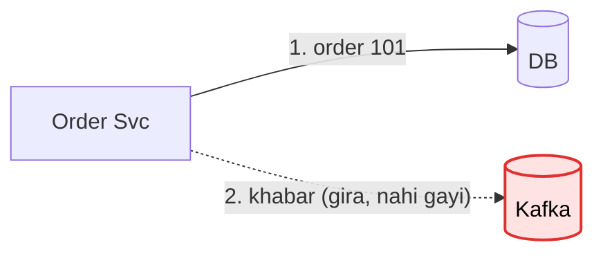

DB aur Kafka do alag cheezein hain, dono me ek saath likhne ka tareeka nahi. To khabar bhi usi DB me likh di, order ke
saath, ek hi transaction me (dono likhe jaayenge ya koi nahi). Is table ko **outbox** kehte hain. Ek chhota alag
program, **relay**, har second outbox me bachi khabar (sent = false) uthata hai, Kafka ko bhejta hai, aur OK aane pe
sent = true likh deta hai.

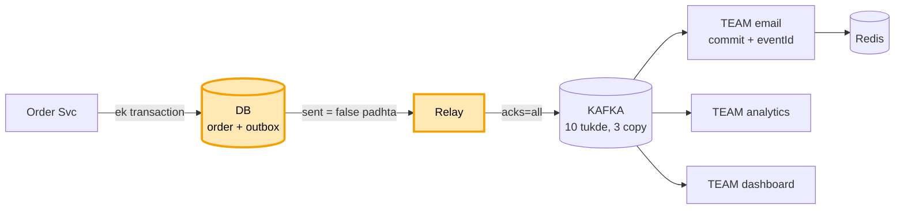

Tune **outbox, relay** bola, to sawaal:
```
order likhne se pehle gira?        -> kuch nahi likha. Arpan dobara order karega, galat kuch nahi
relay ne bheja, sent = true se pehle gira?  -> khabar dobara jaayegi. Padhne wala E-101 pehchaan lega
outbox table bharti gayi?          -> sent = true wali row roz saaf karo
saga kyun nahi?                    -> saga = kadam-kadam kaam, fail pe pichhla kaam ulta. Wo galti ulatne ke
                                      liye hai. Yahan kuch ulatna nahi, khabar ko bachana hai
poora bachav ek line me?           -> outbox + acks=all + pehle kaam phir commit + eventId + DLQ
```

Ab koi bhi gire, khabar nahi khoti. Bachi roz ki chhoti-moti baatein.

---

## 10. Roz ki baatein: machine mari, khabar atki, disk bhari

Email team ki machine 2 mar gayi. Uske tukde 4, 5, 6 bina padhne wale ke the. Kafka ne unhe baaki machines me baant
diya, ise **rebalance** kehte hain. Ek khabar baar-baar fail ho rahi thi aur uske peeche sab ruke the, to use kuch
koshish ke baad alag line me daal diya, **DLQ**. Kitna padhna baaki hai (**lag**) badhne lage to alert. Aur disk na
bhare, isliye 7 din se purani khabar ek saath hata dete hain (**retention**).

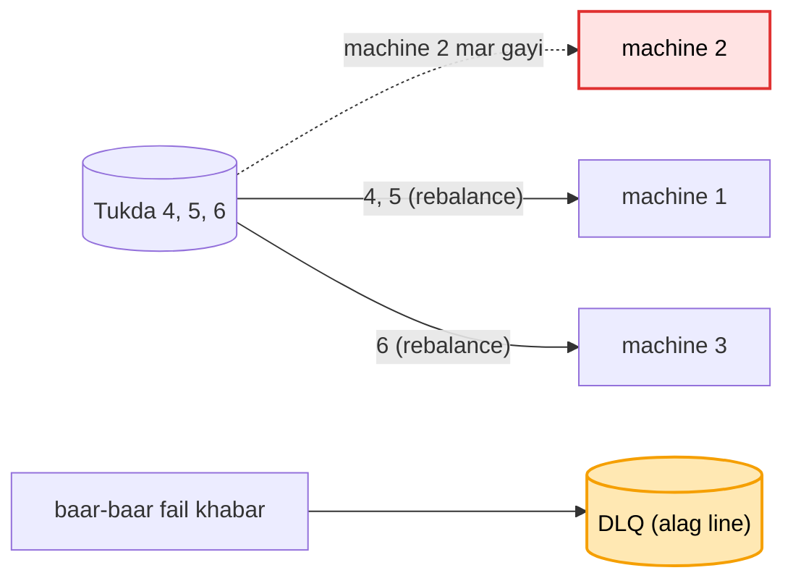

Ye poora design hai:

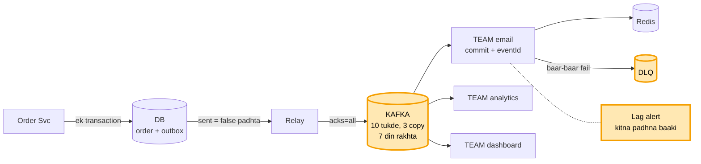

Tune **rebalance, lag, DLQ, retention** bola, to sawaal:
```
rebalance me sab ruk jaate?        -> purane tareeke me haan. Naye tareeke (cooperative) me sirf wahi
                                      machine rukti jinke tukde badle
lag kaise naapein?                 -> aakhri khabar ka number - team ne kahan tak padha
lag badh raha?                     -> alert + worker badhao. Ek khabar 5 min le to use alag
                                      workers ki alag line me bhejo
DLQ wali khabar ka kya?            -> theek karke dobara chalao
padhte hi delete kyun nahi?        -> dobara padhna (replay) band ho jaata
Email Svc 7 din se zyada band?     -> wo khabar ud chuki. Retention sabse lambi chhutti se lamba rakho
ek user ka sirf aakhri naam chahiye?  -> compaction: har key ki sirf aakhri value rakho
Kafka ka asli number kya?          -> disk ki jagah, kyunki Kafka khabar rakhta hai, sirf aage nahi bhejta
```
