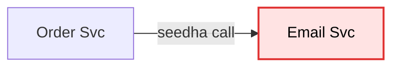
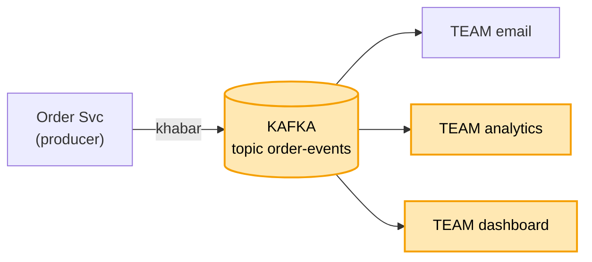
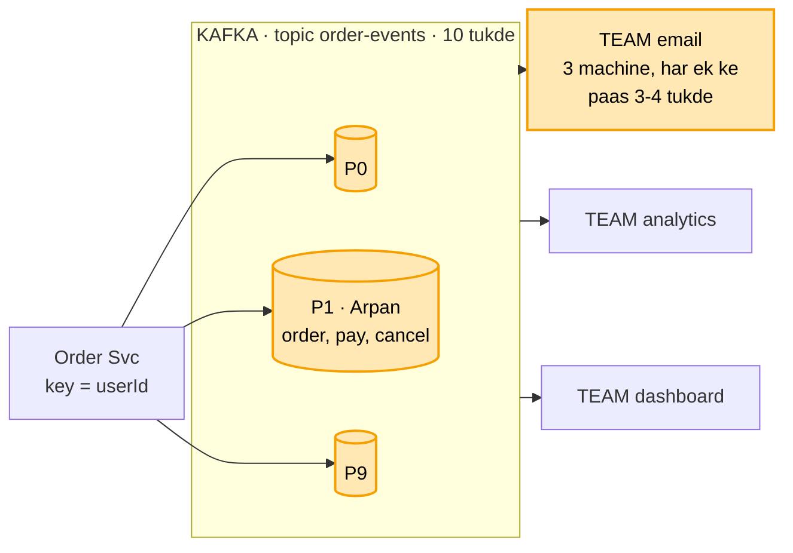
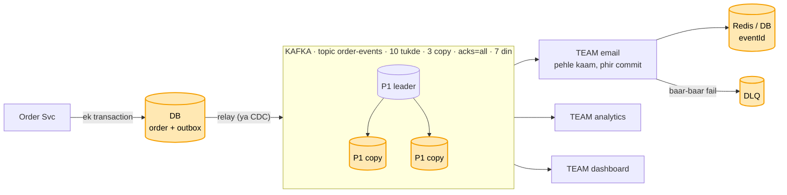

# Kafka (message queue): interview me aise bolo

Ek hi page, jaise interview me likhte-bolte ho. Upar chhote notes (bullet + tir), neeche ek hi diagram jo badhta jaata
hai. Kram 4 hisson ka: **1 daayra -> 2 ginti -> 3 dabbe (chhote se badhao) -> 4 khud todo, jodo**. API nahi, sirf khabar ka
chhota box. Neeche cross-Q: har dabba, har teer "gira to kya".

Samajh chahiye to pehle [kafka_concepts.md](kafka_concepts.md) (kahani se, 6 hisse).

---

## 1. Daayra (pehle poochho, chhota karo)

```
Message queue me kya-kya:  producer (bhejne wala) · topic (line) · consumer (padhne wala) · retention

Is design me sirf 2 kaam:
 - Order Svc ki khabar kai service tak (Email, Analytics, Dashboard), Order Svc kisi ka intezaar na kare
 - khabar kabhi na khoye, aur ek user ki khabar kram me
```

Bolo: "Sab kuch nahi, ye 2 kaam pakde. Theek hai?" Interviewer haan bole tab aage.

---

## 2. Ginti (sirf jo design badle)

```
 - roz 10 crore khabar / ~86,400 sec -> ~1,200 / sec,  sale me ~5,000 / sec
 - ek worker ~500 / sec -> 5,000 / 500 = 10 tukde (partition)
 - ek khabar ~1 KB -> roz ~100 GB -> 7 din ~700 GB -> 3 copy ~2 TB disk
```

---

## 3. Dabbe: chhote se shuru, bolte-bolte badhao

Ek saath poora mat banao. Pehle 2 dabbe, phir har dikkat pe ek-do dabbe aur. Peela = abhi juda.

**Kadam 1: sabse seedha.** "Arpan ne order kiya. Order Svc seedha Email Svc ko call kare."



"Dikkat: Email dheema to order dheema. Email gira to order bhi atka. Aur kal Analytics ko bhi khabar chahiye to
Order Svc ka code badlega. Isliye beech me ek line rakhte hain."

**Kadam 2: beech me Kafka.** "Order Svc khabar Kafka ke topic order-events me daal ke aage badh jaata hai."



Khabar ka chhota box (main table jaisa):
```
khabar:  eventId · userId (key) · type (ORDER_CREATED) · time · data
```

"Kafka disk pe likhta, padhne se khabar mitti nahi. Email, Analytics, Dashboard teeno alag team (consumer group):
har team ko poori khabar, har team apna bookmark (offset). Nayi service aaye to bas nayi team, Order Svc me kuch
nahi badalta."

"Ab ginti yaad karo: sale me 5,000 khabar / sec, ek worker ~500 hi sambhalta. Ek line pe ek hi padhne wala, to
line lambi hoti jaayegi."

**Kadam 3: topic ke tukde.** "Isi topic ko 10 tukdon (partition) me baanto, har tukda alag machine pe."



"Team ke andar ek tukda sirf ek machine ko, to Arpan ko ek hi email. Arpan ki saari khabar key = userId se ek hi
tukde (P1) me, to kram pakka. Kram sirf ek tukde ke andar milta, poore topic me nahi."

"Kyun" pehle hi bolo, poochhne ka intezaar mat karo: "Kafka isliye ki padhne se khabar mitti nahi (kai team padh
sakein, dobara padh sakein), aur tukdon se bheed bat jaati."

"Dono kaam chal gaye. Ab dekhte hain kya toot sakta hai."

---

## 4. Khud todo, phir jodo

Interviewer ke poochhne se pehle khud bolo. Teen jagah:

```
 - bheed:          ek worker kam -> 10 tukde, 10 worker. 11va khaali. Tukde peak ke 2-3 guna rakho
 - machine giri:   Kafka machine mari -> har tukde ki 3 copy, acks=all (saari pakki copy), min.insync = 2
 - khabar kho / dobara:
     bhejne wala gira  -> outbox: order + khabar ek transaction me, relay bhejta
     padhne wala gira  -> pehle kaam, phir commit. Dobara aaye to eventId (Redis / DB) se pakdo
     ek khabar atki    -> 3-4 koshish, phir DLQ
```

**Kadam 4: wahi diagram badhao.**



Khatam: "Dono kaam pure: Order Svc kisi ka intezaar nahi karta, kai team ko khabar milti, khabar khoti nahi, kram
pakka." Waqt ho to ek naya kona: "duniya bhar me ho to har region me Kafka, ya ek user ka sirf aakhri haal chahiye
to compaction."

---

# Cross-Q (interviewer ruk ke poochhe tab)

## Har dabba, har teer: gira to kya? (cross-Q yahin se)

Design me jo dabba aur teer bola, interviewer unhi ko todta hai. Dabbe ke liye: gira / bheed / dheema. Teer ke liye:
pahuncha hi nahi / do baar / der se. Har ek ka jawab:

```
DABBA: Order Svc
  gira, order likhne se pehle  -> kuch nahi likha. Arpan dobara order karega
  gira, order likha, khabar nahi bheji -> khabar outbox me order ke saath likhi hai, relay bhej dega (neeche: outbox)
  bheed                        -> Order Svc ki kai machine, aage LB. Khabar likhna sirf ek row, tez
  dheema                       -> Kafka aur Email pe asar nahi, bas khabar thodi der se

DABBA: DB (order + outbox)
  gira                         -> order hi nahi banta, Arpan ko error. DB ki copy (replica) primary banti
  outbox bharti gayi           -> sent = true wali row roz saaf
  dheema                       -> relay peeche, khabar late. Khoti kuch nahi

DABBA: Relay
  gira                         -> khabar outbox me sent = false padi. Uthte hi wahin se bhejega
  do relay ek saath chal gaye  -> ek khabar do baar ja sakti. Padhne wala eventId se pakad leta
  bheed / dheema               -> DB ko baar-baar poochna bhaari. Bada scale = CDC (Debezium, DB ka log
                                  padhta)

DABBA: Kafka machine (leader)
  gira                         -> pakki copy (ISR) naya leader. acks=all tha, khabar copy pe thi, kuch nahi
                                  gaya
  saari copy giri, sirf leader -> min.insync = 2, likhna band. Relay retry karta, khabar outbox me padi rehti
  bheed                        -> tukde badhao, nayi machine (broker) jodo
  disk bhari                   -> 7 din se purani khabar ek saath hatao (retention)

DABBA: Email worker
  gira                         -> uske tukde baaki worker ko (rebalance). Bookmark se aage padhte
  gira, email bhej ke, commit se pehle -> khabar dobara aati. eventId se pakdo, dohra email nahi (neeche: commit, eventId)
  bheed / dheema               -> lag badhta, alert. Worker badhao, par tukdon ki ginti tak hi
  ek khabar baar-baar fail     -> 3-4 koshish, phir DLQ. Baaki line nahi rukti

DABBA: Redis (eventId)
  gira / dheema                -> email nahi rukta. Pakki jaanch DB me (eventId UNIQUE). Redis sirf tez jaanch

DABBA: Email company (bahar ki)
  gira / dheema                -> 2-3 sec me chhodo (timeout), ruk-ruk ke dobara (backoff), phir bhi nahi
                                  to DLQ
  Email team ruki to?          -> Analytics, Dashboard nahi rukte. Har team ka apna bookmark

DABBA: Analytics / Dashboard team
  gira / dheema                -> sirf wo peeche, baaki nahi rukte. Uthke apne bookmark se aage
  7 din se zyada band          -> wo khabar ud chuki (retention). Retention sabse lambi chhutti se lamba

TEER: Relay -> Kafka
  pahuncha hi nahi             -> Kafka ne OK nahi bola, sent = false raha, relay dobara bhejega
  do baar pahuncha             -> Kafka library ka retry: idempotent producer dohra nahi likhta.
                                  Relay ka dobara bhejna: padhne wala eventId se pakadta
  der se                       -> khabar late, kram ek tukde me phir bhi sahi

TEER: Leader -> copy
  pahuncha hi nahi             -> wo copy peeche, pakki list (ISR) se bahar. Baaki pakki copy pe likh ke
                                  "ho gaya"
  der se                       -> wahi: peeche wali copy leader nahi banti

TEER: Kafka -> Email worker
  pahuncha hi nahi             -> bookmark nahi hila, agli baar wahi khabar milegi
  do baar pahuncha             -> eventId se pakdo
  der se                       -> lag. Alert + worker badhao

TEER: Email worker -> Email company
  pahuncha hi nahi             -> timeout + dobara. Commit tabhi jab email chala gaya
  do baar pahuncha             -> email company ko bhi wahi id do, ya "SENDING" pehle likho
  der se                       -> timeout pe chhodo, dobara

TEER: Email worker -> Redis
  pahuncha hi nahi             -> DB wali UNIQUE jaanch pe girao, email ruke nahi
```

## Shabd ke hisaab se aur sawaal

### log, offset
```
padhne se khabar mitti kyun nahi?  -> taaki dobara padh sakein (replay), aur doosri service bhi padhe
bookmark kahan rakha?              -> padhne wala commit karta, Kafka use ek andar ke topic
                                      (__consumer_offsets)
                                      me rakhta. Restart pe wahin se
kal ki khabar dobara padhni hai?   -> bookmark peeche kar do, khabar disk pe padi hai
disk bharti gayi?                  -> 7 din se purani khabar hata do (retention), neeche: retention
121 number wali khabar disk pe kahan hai?  -> Kafka ek chhoti index file rakhta: number -> jagah
```

### partition
```
11va worker lagaya?          -> khaali baithega. Pehle tukde badhao
10 tukde, 5 worker?          -> ek worker 2 tukde padhega, chalega, bas dheema
kitne tukde rakhein?         -> jitne worker ek saath chahiye. 5,000 / 500 = 10. Thoda zyada rakho
tukde baad me badhaye?       -> chalta hai, par kram toot sakta hai (neeche: key)
tukde alag machine pe?       -> haan, 3 broker me barabar baante, ek pe bojh nahi
kaunsa tukda kis broker pe?  -> Controller ka naksha batata (Kafka ki kuch machines ka group, KRaft)
```

### key, consumer group
```
key nahi di?                     -> khabar kisi bhi tukde me, kram nahi bachta
poore topic ka ek kram chahiye?  -> ek hi tukda, phir wahi bheed. Aksar ek user ka kram kaafi
ek celeb ki itni khabar ki uska tukda bhar gaya?
                                 -> key me number jodo (userId#1, #2), kram chhodna padega
tukde 10 se 20 kiye?             -> tukda = hash(key) % ginti. Ginti badli to key ka tukda badla: Arpan ki
                                    purani khabar purane tukde me, nayi naye me, kuch der kram toota.
                                    Isliye shuru me peak se 2-3 guna tukde rakho
Order Svc ne A bheja, wo network me atka, retry kiya, tab tak B pahunch gaya?
                                 -> Order Svc ki Kafka library khud har khabar pe number lagati (1, 2).
                                    Kafka number dekh ke kram theek rakhta aur dobara aayi khabar nahi likhta
                                    (idempotent producer, setting enable.idempotence=true)
RabbitMQ / SQS (doosre queue tool) me kram?
                                 -> pakka nahi milta. SQS FIFO ya ek hi padhne wala ho tab, par speed kam
team ki ek machine gir gayi?      -> uske tukde baaki machine ko mil jaate (rebalance), neeche: rebalance
har machine ka group.id alag?     -> Kafka teeno ko alag team samjhega, phir 3 email
team me machine badhani hai?      -> tukde bhi badhao, warna nayi machine khaali
teeno ko ek hi team me daal dete?  -> team me ek khabar ek ko, baaki do ko kuch nahi milta
nayi service judni hai?            -> bas naya group. Order Svc me kuch nahi badalta
nayi service shuru se padhe ya ab se?  -> tay karna padta hai (auto.offset.reset)
```

### copy, acks
```
A ne "ho gaya" bola, copy banne se pehle mar gaya?  -> khabar gayi. Isliye "ho gaya" tab bolo jab copy
                                                       bhi likh jaaye (acks=all)
ek copy peeche chal rahi?           -> sirf poori taaza copy "pakki" (ISR). Leader pakki me se hi banta
dono copy bhi gayi, sirf A bacha?   -> likhna rok do (min.insync = 2). Khone se behtar rukna
naya leader kaun chunta?            -> Controller: kuch Kafka machines ka group, sab pe nazar (KRaft).
                                       Ek hi faisla, do leader kabhi nahi
acks=all matlab saari copy?        -> nahi, saari PAKKI copy (ISR). Isliye min.insync = 2 saath zaroori, warna
                                       sirf leader bacha ho to bhi "ho gaya" mil jaata
acks ke teen tareeke?               -> 0 = bhej ke bhool jao, 1 = sirf leader (click, log ke liye theek),
                                       all = saari pakki copy (paisa, order)
3 copy ke liye kitni machine?       -> kam se kam 3 alag machine
pehle kya poochho?                  -> khabar kho sakti hai ya bilkul nahi? Isi se acks tay hota
```

### commit, eventId
```
"duplicate kabhi nahi aayega"?  -> galat. Khabar khoti nahi, dobara aa sakti. Padhne wala pehchaanta
userId se pehchano?             -> galat. Arpan ka agla sahi order bhi chhoot jaayega. Pehchaan eventId se
Redis se E-5 jaldi mit gaya?    -> dobara aayi to pehchani nahi. Utni der rakho jitni der dobara aa sakti
idempotent producer aur eventId ek hi cheez?
                                -> nahi. Idempotent producer: Order Svc ke retry se Kafka me dohri khabar nahi
                                   likhi jaati. eventId: padhne wala dohra KAAM (dohra email) nahi karta
email gaya, eventId likhne se pehle gira?
                                -> dobara email ja sakta. Ilaaj: email company ko bhi wahi id do (wo khud
                                   dohra rok de), ya pehle "SENDING" likho, phir email, phir "SENT"
Redis hi gir gaya to?           -> email nahi rukta. Pakki deewar DB me: processed table me eventId UNIQUE.
                                   Redis sirf tez jaanch hai, sach DB me
bookmark khud aage na badhe?    -> haan, auto-commit band (enable.auto.commit=false), kaam ke baad khud commit
pehle kaam phir commit ka naam?  -> at-least-once: khabar kam se kam ek baar, kabhi do baar
exactly-once chahiye?           -> Kafka transactions (padho -> likho -> commit ek saath), sirf Kafka se
                                   Kafka. Humein nahi chahiye, eventId kaafi
```

### outbox
```
order likhne se pehle gira?        -> kuch nahi likha. Arpan dobara order karega, galat kuch nahi
relay ne bheja, sent = true se pehle gira?  -> khabar dobara jaayegi. Padhne wala E-101 pehchaan lega
outbox table bharti gayi?          -> sent = true wali row roz saaf karo
5,000 / sec pe relay DB ko baar-baar poochhe (sent = false)?
                                   -> DB pe bojh. Bada scale ho to CDC: Debezium DB ka apna log (WAL / binlog)
                                      padh ke Kafka ko deta, table ko poochhna hi nahi padta
saga kyun nahi?                    -> saga = kadam-kadam kaam, fail pe pichhla kaam ulta. Wo galti ulatne ke
                                      liye hai. Yahan kuch ulatna nahi, khabar ko bachana hai
poora bachav ek line me?           -> outbox + acks=all + pehle kaam phir commit + eventId + DLQ
```

### rebalance, lag, DLQ, retention
```
rebalance me sab ruk jaate?        -> purane tareeke (eager) me poori team 1-2 sec rukti. Naye (cooperative)
                                      me sirf wahi machine rukti jinke tukde badle
worker ka kaam lamba, poll nahi kiya?
                                   -> Kafka use mara samjhta (max.poll.interval.ms), rebalance. Email
                                      dheema ho to yahi hota: ek baar me kam khabar lo, ya time badhao
lag kaise naapein?                 -> tukde ki aakhri khabar ka number (latest offset) - team ka bookmark
                                      (consumer offset). Alert isi farak pe
lag badh raha?                     -> alert + worker badhao. Ek khabar 5 min le to use alag
                                      workers ki alag line me bhejo
DLQ wali khabar ka kya?            -> theek karke dobara chalao
padhte hi delete kyun nahi?        -> dobara padhna (replay) band ho jaata
Email Svc 7 din se zyada band?     -> wo khabar ud chuki. Retention sabse lambi chhutti se lamba rakho
retention aur compaction me farak?  -> retention = waqt se hatao (7 din se purani sab). Compaction = har key
                                      ki sirf aakhri khabar rakho (jaise user ka aakhri pata)
Kafka ka asli number kya?          -> disk ki jagah, kyunki Kafka khabar rakhta hai, sirf aage nahi bhejta
```
