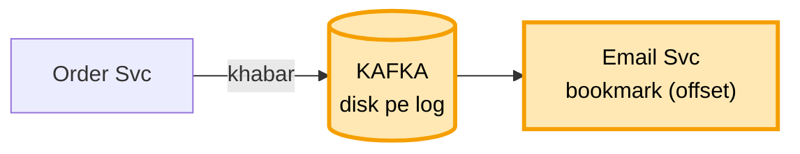
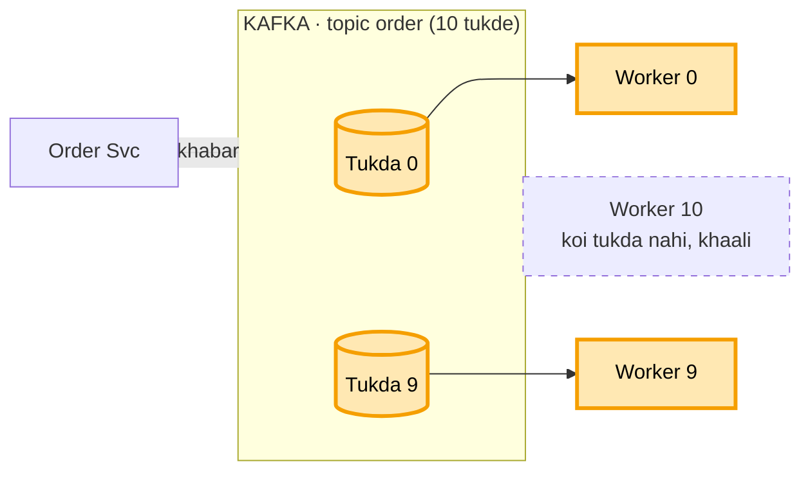
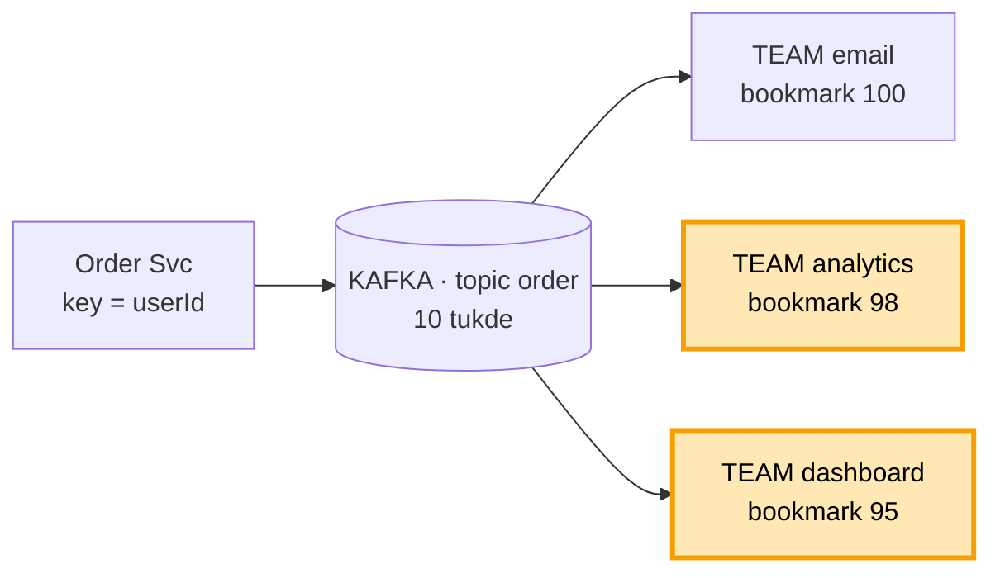
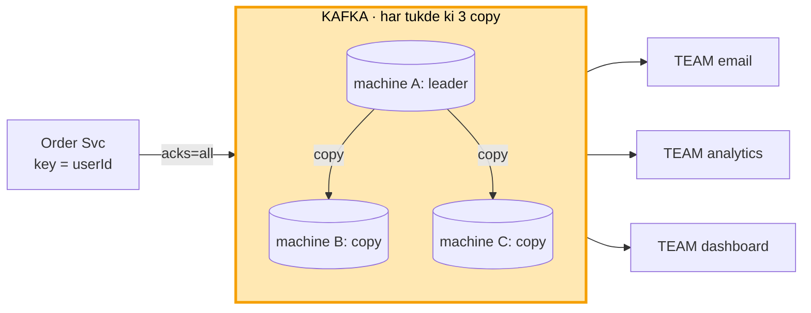
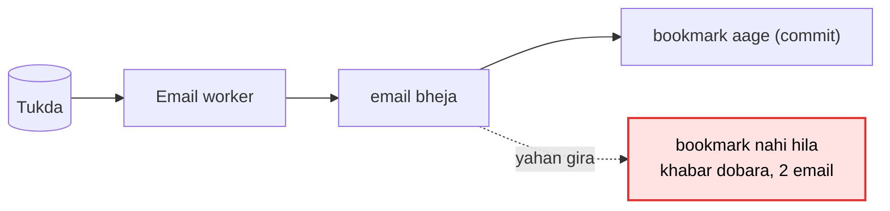
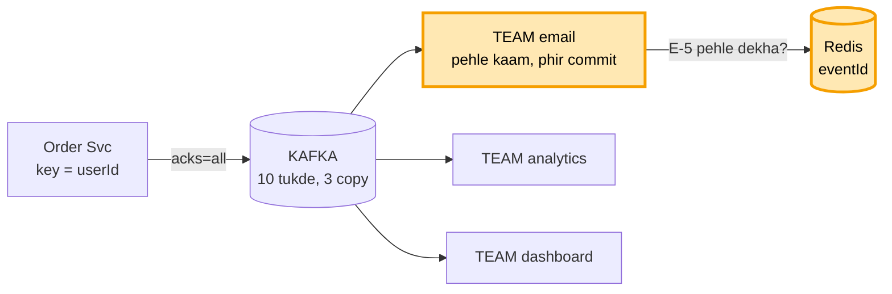
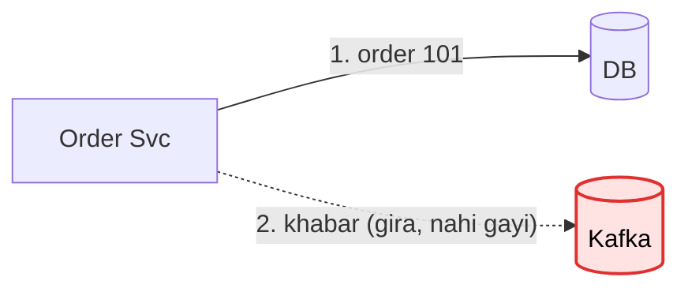
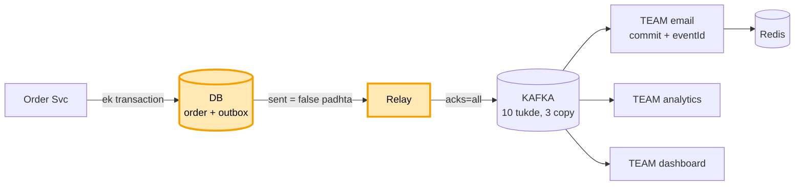
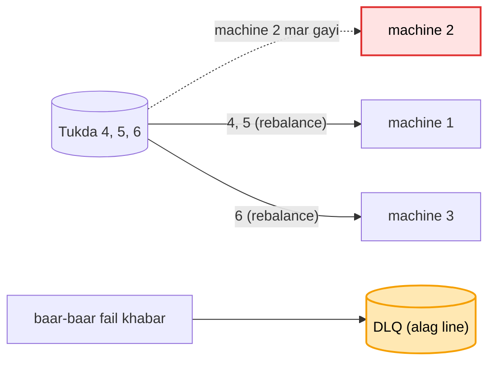
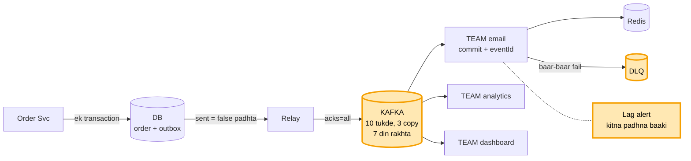

# Kafka (message queue)

Arpan ne order kiya. Order Svc ko ye khabar Email Svc tak pahunchani hai ("order #101 bana, Arpan ko email bhejo").
Shuru me sab seedha hai. Har baar ek dikkat aati hai, aur design me ek naya dabba judta hai. Har diagram pichhle wale
ko hi aage badhata hai. **Peela = jo abhi naya juda.** Laal = jo toota.

Jo shabd tu design me bolega, interviewer ka sawaal usi se uthega. Isliye har naye shabd ke neeche uske sawaal hain.
Sawaal banane ki chaabi:

```
DABBA -> gir gaya?  bheed aa gayi?  dheema ho gaya?
TEER  -> pahuncha hi nahi?  do baar pahuncha?  der se pahuncha?
SHABD -> ye kyun, doosra kyun nahi?
```

Ginti (interviewer pooche to):
```
roz 10 crore khabar / ~86,400 sec = ~1,200 har second, sale me ~5,000 har second
ek khabar ~1 KB -> roz ~100 GB, 7 din ~700 GB, 3 copy -> ~2 TB disk
```

---

# BHAAG 1: INTERVIEW ME AISE BOLO

Shuru se khatam tak ek raasta, rail ke 4 stop. 5-7 minute ka, chaaho to 20 minute tak khol sakte ho. Har stop pe bas
ek shabd yaad rakhna hai:

```
kaam chala  -> LOG + OFFSET
bheed       -> PARTITION
do ek saath -> KEY + CONSUMER GROUP
machine giri-> 3 COPY + acks=all
```

## Stop 1: kaam chala

Order Svc ko Arpan ke order ke baad email bhejna hai. Agar wo khud Email Svc ko bulaye aur jawab ka intezaar kare, to
Email dheema hua to order bhi dheema, Email band to order fail. Isliye beech me Kafka: Order Svc khabar daal ke aage
badh jaata hai. Kafka khabar disk pe ek line me likhta hai (**log**), to restart pe bhi bachti hai, aur padhne se mitti
nahi. Email Svc apna bookmark rakhta hai ki kahan tak padha (**offset**).



## Stop 2: bheed

Sale me har second 5,000 order aaye, ek Email worker sirf 500 utha paata. Ek line ko ek hi worker padh sakta hai, to
topic ko 10 tukdon me baant diya (**partition**), har tukde ka apna worker: 10 x 500 = 5,000.



## Stop 3: do ek saath

Do baatein ek saath aati hain. Pehli: Arpan ne naam "A" phir "B" kiya, dono alag tukdon me gaye to kram ulta ho sakta
hai. Isliye har khabar ke saath **key = userId**, same user hamesha same tukde me, kram pakka. Doosri: Email Svc ki
3 machine, aur Analytics, Dashboard bhi wahi khabar chahte. To har service ki ek team (**consumer group**): team ke
andar ek tukda ek hi machine ko (ek email), aur har service ki apni team ko poori khabar.



## Stop 4: machine giri

Kafka ki machine ki disk mari to khabar na jaaye, isliye har tukde ki 3 copy, alag machine pe. Ek leader, do copy.
Order Svc ko "ho gaya" tabhi jab saari pakki copy (ISR) pe bhi likh jaaye (**acks=all**), aur kam se kam 2 pakki
copy zinda hon (**min.insync = 2**). Leader mara to pakki copy naya leader.



## Khatam

Poora diagram ek baar dikhao, phir bolo: "Khabar do baar aaye ya beech me kho jaaye, aur kharab khabar atak jaaye, in
pe aap poochein to main gehra ja sakta hoon." Yahin se cross-Q shuru hote hain. Har dabbe aur teer ke "gira to kya" neeche Bhaag 2 me.

---

# BHAAG 2: INTERVIEWER GEHRA JAAYE TO

Ye roz bolne ke liye nahi. Jab interviewer kisi stop pe ruk ke poochhe, tab yahan.

## Har dabba, har teer: gira to kya? (cross-Q yahin se)

Design me jo dabba aur teer bola, interviewer unhi ko todta hai. Dabbe ke liye: gira / bheed / dheema. Teer ke liye:
pahuncha hi nahi / do baar / der se. Har ek ka jawab:

```
DABBA: Order Svc
  gira, order likhne se pehle  -> kuch nahi likha. Arpan dobara order karega
  gira, order likha, khabar nahi bheji -> khabar outbox me order ke saath likhi hai, relay bhej dega (Gehra 2)
  bheed                        -> Order Svc ki kai machine, aage LB. Khabar likhna sirf ek row, tez
  dheema                       -> Kafka aur Email pe asar nahi, bas khabar thodi der se

DABBA: DB (order + outbox)
  gira                         -> order hi nahi banta, Arpan ko error. DB ki copy (replica) primary banti
  outbox bharti gayi           -> sent = true wali row roz saaf
  dheema                       -> relay peeche, khabar late. Khoti kuch nahi

DABBA: Relay
  gira                         -> khabar outbox me sent = false padi. Uthte hi wahin se bhejega
  do relay ek saath chal gaye  -> ek khabar do baar ja sakti. Padhne wala eventId se pakad leta
  bheed / dheema               -> DB ko baar-baar poochna bhaari. Bada scale = CDC (Debezium, DB ka log padhta)

DABBA: Kafka machine (leader)
  gira                         -> pakki copy (ISR) naya leader. acks=all tha, to khabar copy pe thi, kuch nahi gaya
  saari copy giri, sirf leader -> min.insync = 2, likhna band. Relay retry karta, khabar outbox me padi rehti
  bheed                        -> tukde badhao, nayi machine (broker) jodo
  disk bhari                   -> 7 din se purani khabar ek saath hatao (retention)

DABBA: Email worker
  gira                         -> uske tukde baaki worker ko (rebalance). Bookmark se aage padhte
  gira, email bhej ke, commit se pehle -> khabar dobara aati. eventId se pakdo, dohra email nahi (Gehra 1)
  bheed / dheema               -> lag badhta, alert. Worker badhao, par tukdon ki ginti tak hi
  ek khabar baar-baar fail     -> 3-4 koshish, phir DLQ. Baaki line nahi rukti

DABBA: Redis (eventId)
  gira / dheema                -> email nahi rukta. Pakki jaanch DB me (eventId UNIQUE). Redis sirf tez jaanch

DABBA: Email company (bahar ki)
  gira / dheema                -> 2-3 sec me chhodo (timeout), ruk-ruk ke dobara (backoff), phir bhi nahi to DLQ
  Email team ruki to?          -> Analytics, Dashboard nahi rukte. Har team ka apna bookmark

DABBA: Analytics / Dashboard team
  gira / dheema                -> sirf wo peeche, baaki nahi rukte. Uthke apne bookmark se aage
  7 din se zyada band          -> wo khabar ud chuki (retention). Retention sabse lambi chhutti se lamba

TEER: Relay -> Kafka
  pahuncha hi nahi             -> Kafka ne OK nahi bola, sent = false raha, relay dobara bhejega
  do baar pahuncha             -> Kafka library ka retry: idempotent producer dohra nahi likhta.
                                  Relay ka dobara bhejna: padhne wala eventId se pakadta
  der se                       -> khabar late, kram ek tukde me phir bhi sahi

TEER: Leader -> copy
  pahuncha hi nahi             -> wo copy peeche, pakki list (ISR) se bahar. Baaki pakki copy pe likh ke "ho gaya"
  der se                       -> wahi: peeche wali copy leader nahi banti

TEER: Kafka -> Email worker
  pahuncha hi nahi             -> bookmark nahi hila, agli baar wahi khabar milegi
  do baar pahuncha             -> eventId se pakdo
  der se                       -> lag. Alert + worker badhao

TEER: Email worker -> Email company
  pahuncha hi nahi             -> timeout + dobara. Commit tabhi jab email chala gaya
  do baar pahuncha             -> email company ko bhi wahi id do, ya "SENDING" pehle likho
  der se                       -> timeout pe chhodo, dobara

TEER: Email worker -> Redis
  pahuncha hi nahi             -> DB wali UNIQUE jaanch pe girao, email ruke nahi
```

## Stop 1 (log, offset) pe sawaal
```
padhne se khabar mitti kyun nahi?  -> taaki dobara padh sakein (replay), aur doosri service bhi padhe
bookmark kahan rakha?              -> padhne wala commit karta, Kafka use ek andar ke topic (__consumer_offsets)
                                      me rakhta. Restart pe wahin se
kal ki khabar dobara padhni hai?   -> bookmark peeche kar do, khabar disk pe padi hai
disk bharti gayi?                  -> 7 din se purani khabar hata do (retention), neeche Gehra 3
121 number wali khabar disk pe kahan hai?  -> Kafka ek chhoti index file rakhta: number -> jagah
```

## Stop 2 (partition) pe sawaal
```
11va worker lagaya?          -> khaali baithega. Pehle tukde badhao
10 tukde, 5 worker?          -> ek worker 2 tukde padhega, chalega, bas dheema
kitne tukde rakhein?         -> jitne worker ek saath chahiye. 5,000 / 500 = 10. Thoda zyada rakho
tukde baad me badhaye?       -> chalta hai, par kram toot sakta hai (Stop 3)
tukde alag machine pe?       -> haan, 3 broker me barabar baante, ek pe bojh nahi
kaunsa tukda kis broker pe?  -> Controller ka naksha batata (Kafka ki kuch machines ka group, KRaft)
```

## Stop 3 (key, consumer group) pe sawaal
```
key nahi di?                     -> khabar kisi bhi tukde me, kram nahi bachta
poore topic ka ek kram chahiye?  -> ek hi tukda, phir wahi bheed. Aksar ek user ka kram kaafi
ek celeb ki itni khabar ki uska tukda bhar gaya?
                                 -> key me number jodo (userId#1, #2), kram chhodna padega
tukde 10 se 20 kiye?             -> tukda = hash(key) % ginti. Ginti badli to key ka tukda badla, kuch der kram
                                    toota. Isliye shuru me peak se 2-3 guna tukde rakho
Order Svc ne A bheja, wo network me atka, retry kiya, tab tak B pahunch gaya?
                                 -> Order Svc ki Kafka library khud har khabar pe number lagati (1, 2), hum nahi.
                                    Kafka number dekh ke kram theek rakhta aur dobara aayi khabar nahi likhta
                                    (idempotent producer, setting enable.idempotence=true)
RabbitMQ / SQS (doosre queue tool) me kram?
                                 -> pakka nahi milta. SQS FIFO ya ek hi padhne wala ho tab, par speed kam
team ki ek machine gir gayi?      -> uske tukde baaki machine ko mil jaate (rebalance), neeche Gehra 3
har machine ka group.id alag?     -> Kafka teeno ko alag team samjhega, phir 3 email
team me machine badhani hai?      -> tukde bhi badhao, warna nayi machine khaali
teeno ko ek hi team me daal dete?  -> team me ek khabar ek ko, baaki do ko kuch nahi milta
nayi service judni hai?            -> bas naya group. Order Svc me kuch nahi badalta
nayi service shuru se padhe ya ab se?  -> tay karna padta hai (auto.offset.reset)
```

## Stop 4 (copy, acks) pe sawaal
```
A ne "ho gaya" bola, copy banne se pehle mar gaya?  -> khabar gayi. Isliye "ho gaya" tab bolo jab copy
                                                       bhi likh jaaye (acks=all)
ek copy peeche chal rahi?           -> sirf poori taaza copy "pakki" (ISR). Leader pakki me se hi banta
dono copy bhi gayi, sirf A bacha?   -> likhna rok do (min.insync = 2). Khone se behtar rukna
naya leader kaun chunta?            -> Controller: Kafka ki kuch machines ka group jo baaki pe nazar rakhta (KRaft).
                                       Ek hi faisla, do leader kabhi nahi
acks=all matlab saari copy?        -> nahi, saari PAKKI copy (ISR). Isliye min.insync = 2 saath zaroori, warna
                                       sirf leader bacha ho to bhi "ho gaya" mil jaata
acks ke teen tareeke?               -> 0 = bhej ke bhool jao, 1 = sirf leader (click, log ke liye theek),
                                       all = saari pakki copy (paisa, order)
3 copy ke liye kitni machine?       -> kam se kam 3 alag machine
pehle kya poochho?                  -> khabar kho sakti hai ya bilkul nahi? Isi se acks tay hota
```

---

## Gehra 1: khabar do baar aayi (pehle kaam phir commit + eventId)

Email worker ne email bheja aur bookmark aage karne se pehle gir gaya. Bookmark hila hi nahi, to restart pe wahi khabar
dobara aayi, Arpan ko 2 email.



Ulta karte (pehle bookmark, phir email) to beech me girne pe email kabhi jaata hi nahi, jo usse bura hai. To kram
pakka: pehle kaam, phir bookmark (bookmark aage karna = **commit**). Dobara aayi khabar pakadne ke liye har khabar ki
apni id (**eventId**). Jis id ka kaam ho chuka use Redis (ya DB) me likh lo, khabar aaye to pehle dekho.



```
"duplicate kabhi nahi aayega"?  -> galat. Khabar khoti nahi, dobara aa sakti. Padhne wala pehchaanta
userId se pehchano?             -> galat. Arpan ka agla sahi order bhi chhoot jaayega. Pehchaan eventId se
Redis se E-5 jaldi mit gaya?    -> dobara aayi to pehchani nahi. Utni der rakho jitni der dobara aa sakti
exactly-once milta hai?         -> sirf Kafka se Kafka tak. Email / DB ke liye padhne wala khud pehchaane
idempotent producer aur eventId ek hi cheez?
                                -> nahi. Idempotent producer: Order Svc ke retry se Kafka me dohri khabar nahi
                                   likhi jaati. eventId: padhne wala dohra KAAM (dohra email) nahi karta
email gaya, eventId likhne se pehle gira?
                                -> dobara email ja sakta. Ilaaj: email company ko bhi wahi id do (wo khud
                                   dohra rok de), ya pehle "SENDING" likho, phir email, phir "SENT"
Redis hi gir gaya to?           -> email nahi rukta. Pakki deewar DB me: processed table me eventId UNIQUE.
                                   Redis sirf tez jaanch hai, sach DB me
bookmark khud aage na badhe?    -> haan, auto-commit band (enable.auto.commit=false), kaam ke baad khud commit
```

## Gehra 2: bhejne wala hi gira (outbox)

Order Svc ne order DB me likha, Kafka ko bhejne se pehle gir gaya. Order bana, Email ko kabhi pata nahi chala.



DB aur Kafka me ek saath likhne ka tareeka nahi. To khabar bhi usi DB me, order ke saath, ek transaction me
(**outbox** table). Chhota program **relay** outbox se bachi khabar (sent = false) Kafka ko bhejta hai.



```
order likhne se pehle gira?        -> kuch nahi likha. Arpan dobara order karega, galat kuch nahi
relay ne bheja, sent = true se pehle gira?  -> khabar dobara jaayegi. Padhne wala E-101 pehchaan lega
outbox table bharti gayi?          -> sent = true wali row roz saaf karo
5,000 / sec pe relay DB ko baar-baar poochhe (sent = false)?
                                   -> DB pe bojh. Bada scale ho to CDC: Debezium DB ka apna log (WAL / binlog)
                                      padh ke Kafka ko deta, table ko poochhna hi nahi padta
saga kyun nahi?                    -> saga = kadam-kadam kaam, fail pe pichhla kaam ulta. Wo galti ulatne ke
                                      liye hai. Yahan kuch ulatna nahi, khabar ko bachana hai
poora bachav ek line me?           -> outbox + acks=all + pehle kaam phir commit + eventId + DLQ
```

## Gehra 3: roz ki baatein (rebalance, DLQ, lag, retention)

Team ki machine mari to uske tukde baaki ko (**rebalance**). Ek khabar baar-baar fail ho to alag line (**DLQ**), baaki
na ruke. Kitna padhna baaki (**lag**) badhe to alert. Disk na bhare, 7 din se purani khabar ek saath hatao
(**retention**).





```
rebalance me sab ruk jaate?        -> purane tareeke me haan. Naye tareeke (cooperative) me sirf wahi
                                      machine rukti jinke tukde badle
lag kaise naapein?                 -> aakhri khabar ka number - team ne kahan tak padha
lag badh raha?                     -> alert + worker badhao. Ek khabar 5 min le to use alag
                                      workers ki alag line me bhejo
DLQ wali khabar ka kya?            -> theek karke dobara chalao
padhte hi delete kyun nahi?        -> dobara padhna (replay) band ho jaata
Email Svc 7 din se zyada band?     -> wo khabar ud chuki. Retention sabse lambi chhutti se lamba rakho
ek user ka sirf aakhri naam chahiye?  -> compaction: har key ki sirf aakhri value rakho
Kafka ka asli number kya?          -> disk ki jagah, kyunki Kafka khabar rakhta hai, sirf aage nahi bhejta
```
