# Kafka: shuru se, dabbe aur teer se

Ek kahani: Arpan ne order kiya. Order Svc ko khabar email wale ko deni hai ("order #101 bana, email bhejo").
Shuru me sab ek dabbe me. Har kadam pe ek dikkat aati hai, ek dabba ya ek shabd judta hai.
Jo shabd tu bolega, sawaal wahi se uthega. Isliye har shabd ke neeche uske sawaal aur jawab:

```
DABBA -> gir gaya?  bheed aa gayi?  dheema ho gaya?
TEER  -> pahuncha hi nahi?  do baar pahuncha?  der se pahuncha?
SHABD -> ye kyun, doosra kyun nahi?
```

Ginti (interviewer pooche to):
```
roz 10 crore khabar / ~86,400 sec = ~1,200 har second, sale me ~5,000 har second
ek khabar ~1 KB -> roz ~100 GB, 7 din ~700 GB, 3 copy -> ~2 TB disk
```

---

## Kadam 0: sabse seedha

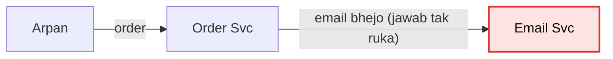

Order Svc khud Email Svc ko bulata hai aur jawab aane tak rukta hai.

Dikkat:
```
Email Svc dheema (5 sec)  -> Arpan ka order bhi 5 sec ruka
Email Svc band            -> order hi fail, jabki order to sahi tha
```

---

## Kadam 1: beech me ek line (queue)

**Peeche se:** Kadam 0 me Order Svc seedha Email Svc ko bulata tha. Email dheema hua to order bhi ruk gaya.
**To:** dono ko alag karo. Beech me ek line rakh do, Order Svc khabar daale aur aage badh jaaye.

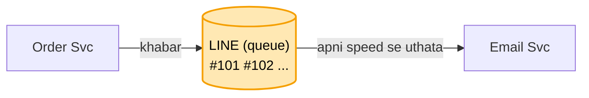

Order Svc khabar line me daal ke aage badh jaata hai. Email Svc apni speed se uthata hai.
Email band ho, tab bhi order chalta hai, khabar line me padi rehti hai.

Shabd bola: **queue (line)**. Sawaal:
```
line kahan rakhi?        -> ek machine ki RAM me
wo machine restart hui?  -> RAM khaali, saari khabar gayi        <- AGLA KADAM
```

---

## Kadam 2: line disk pe, aur "kahan tak padha" ka bookmark

**Peeche se:** Kadam 1 me line ek machine ki RAM me thi. Machine restart hui, RAM khaali, saari khabar gayi.
**To:** line ko RAM ki jagah disk pe likho, taaki restart pe bhi bachi rahe. Aisi disk wali line khud banane
ki jagah ek bana-banaya tool lete hain: **Kafka**. Kafka bas yahi hai: khabar ki ek line jo disk pe likhi
rehti hai. Isliye is kadam se dabbe ka naam "LINE" ki jagah "KAFKA".
Is line ko Kafka me **log** kehte hain (aisi line jisme nayi khabar sirf aakhir me judti hai), aur line ke
naam ko **topic** (jaise topic "order"). Kafka ki har machine ko **broker** kehte hain.

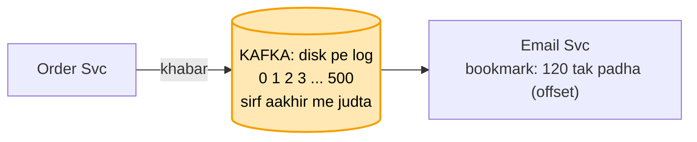

Khabar disk pe likhi jaati hai, padhne se mitti nahi. Email Svc yaad rakhta hai kahan tak padha (offset).
Restart hua to bookmark dekh ke 121 se aage padhta hai.

Shabd bola: **log, offset**. Sawaal:
```
padhne se khabar mitti kyun nahi?  -> taaki dobara padh sakein (replay), aur doosri service bhi padhe
bookmark kahan rakha?              -> Kafka khud rakhta hai
kal ki khabar dobara padhni hai?   -> bookmark peeche kar do, khabar disk pe padi hai
disk bharti gayi?                  -> 7 din se purani khabar hata do (retention)    <- KADAM 10
121 number wali khabar disk pe kahan hai?  -> Kafka ek chhoti index file rakhta: number -> jagah
```

---

## Kadam 3: bheed aayi, ek worker kam pada

**Peeche se:** Kadam 2 me khabar Kafka ki disk pe surakshit hai, Email Svc bookmark se padhta hai.
**Ab:** khabar bachi rehti hai, par padhne wala ek hi hai. Bheed aayi to?

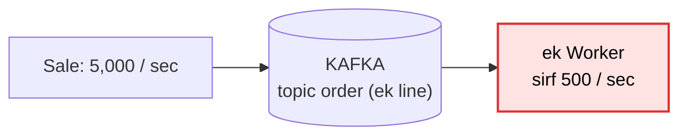

Worker = Email Svc ki ek chalti copy, jo khabar utha ke email bhejti hai.
Ek line ko ek waqt me ek hi worker padh sakta hai. Do worker ek line se uthayenge to ek hi order
do baar utha sakte hain, ya kram bigad jaayega. Isliye line ke tukde karo:

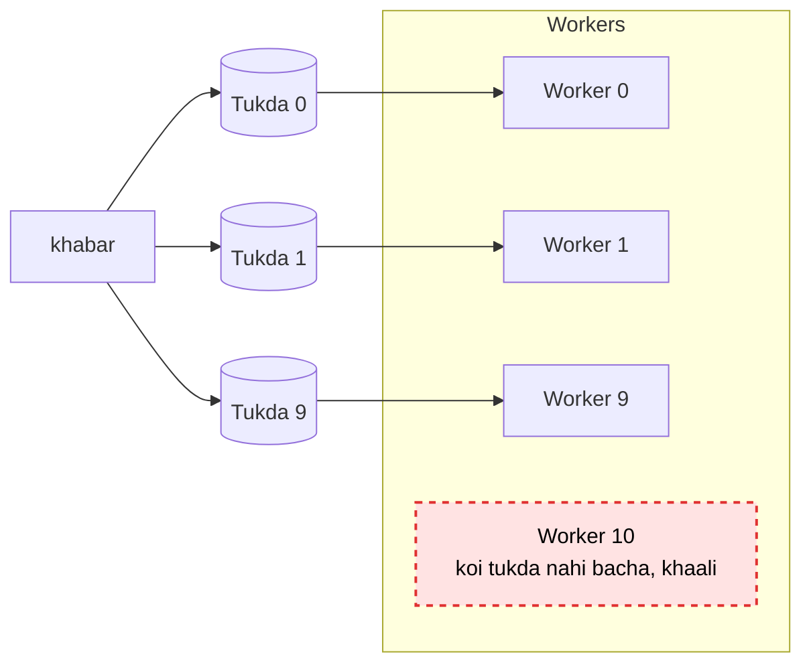

10 tukde, 10 worker, 10 x 500 = 5,000 har second. Kaunsa tukda kis worker ko, ye Kafka khud baantta hai
(kaise, wo Kadam 5 me).

Shabd bola: **partition (tukda)**. Sawaal:
```
11va worker lagaya?          -> khaali baithega. Pehle tukde badhao
10 tukde, 5 worker?          -> ek worker 2 tukde padhega, chalega, bas dheema
kitne tukde rakhein?         -> jitne worker ek saath chahiye. 5,000 / 500 = 10. Thoda zyada rakho
tukde baad me badhaye?       -> chalta hai, par kram toot sakta hai      <- KADAM 4
tukde alag machine pe?       -> haan, 3 broker (Kafka machine) me barabar baante, ek pe bojh nahi
kaunsa tukda kis broker pe?  -> Controller (Kafka ki ek machine jo baaki pe nazar rakhti) ka naksha batata
```

---

## Kadam 4: kram toota

**Peeche se:** Kadam 3 me line ke 10 tukde kiye, har tukde ka apna worker. Bheed sambhal li.
**Ab:** khabar alag-alag tukdon me ja rahi hai, aur har worker apni speed se padhta hai. Kram ka kya?

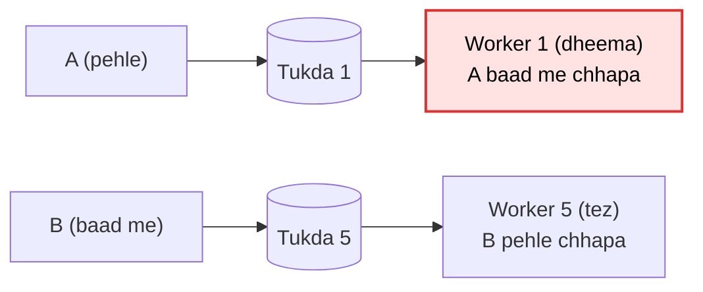

Kram sirf ek tukde ke andar milta hai. To Arpan ki saari khabar ek hi tukde me bhejo.
Har khabar ke saath ek key do: key = Arpan ka userId. Same key hamesha same tukde me jaati hai.

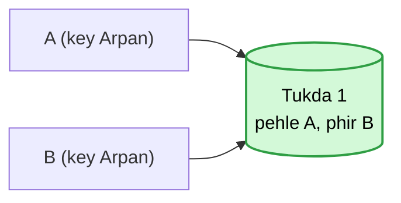

Shabd bola: **key = userId**. Sawaal:
```
key nahi di?                     -> khabar kisi bhi tukde me, kram nahi bachta
poore topic ka ek kram chahiye?  -> ek hi tukda, phir wahi bheed. Aksar ek user ka kram kaafi
ek celeb ki itni khabar ki uska tukda bhar gaya?
                                 -> key me number jodo (userId#1, #2), kram chhodna padega
tukde 10 se 20 kiye?             -> key ka tukda badal gaya, kuch der kram toota. Isliye shuru me zyada rakho
Order Svc ne A bheja, wo network me atka, retry kiya, tab tak B pahunch gaya?
                                 -> Order Svc har khabar pe number lagata (1, 2). Kafka number dekh ke kram
                                    theek rakhta aur dobara aayi khabar nahi likhta (idempotent producer)
RabbitMQ / SQS (doosre queue tool) me kram?
                                 -> pakka nahi milta. SQS FIFO ya ek hi padhne wala ho tab, par speed kam
```

---

## Kadam 5: Email Svc ki 3 machine, Arpan ko 3 email

**Peeche se:** Kadam 4 me key = userId se Arpan ki saari khabar ek tukde me, kram se.
**Ab:** Kadam 3 me maana tha ki Kafka har tukda ek worker ko deta hai. Par Kafka ko kaise pata ki ye teen
machine ek hi Email Svc ki hain? Na bataya to Kafka har machine ko alag padhne wala maanta hai:

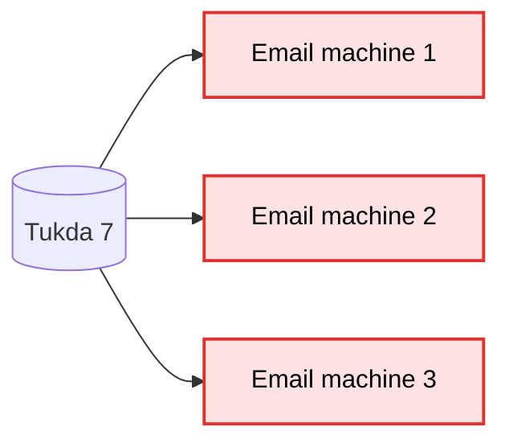

Teeno machine ko ek team bana do: sabko ek hi team ka naam do (group.id).
Is team ko consumer group kehte hain.
Team ke andar har tukda sirf ek machine ko milta hai.

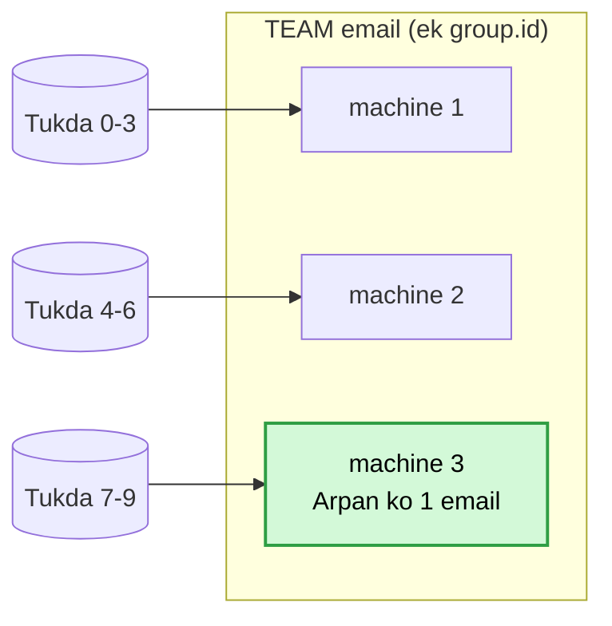

Shabd bola: **consumer group**. Sawaal:
```
team ki ek machine gir gayi?      -> uske tukde baaki machine ko mil jaate (rebalance)   <- KADAM 10
har machine ka group.id alag?     -> Kafka teeno ko alag team samjhega, phir 3 email
team me machine badhani hai?      -> tukde bhi badhao, warna nayi machine khaali
```

---

## Kadam 6: wahi order Analytics aur Dashboard ko bhi chahiye

**Peeche se:** Kadam 5 me Email ki 3 machine ek team bani, khabar team me ek hi baar.
**Ab:** sirf Email nahi, Analytics aur Dashboard ko bhi wahi order chahiye. Teeno ek team me daalein?

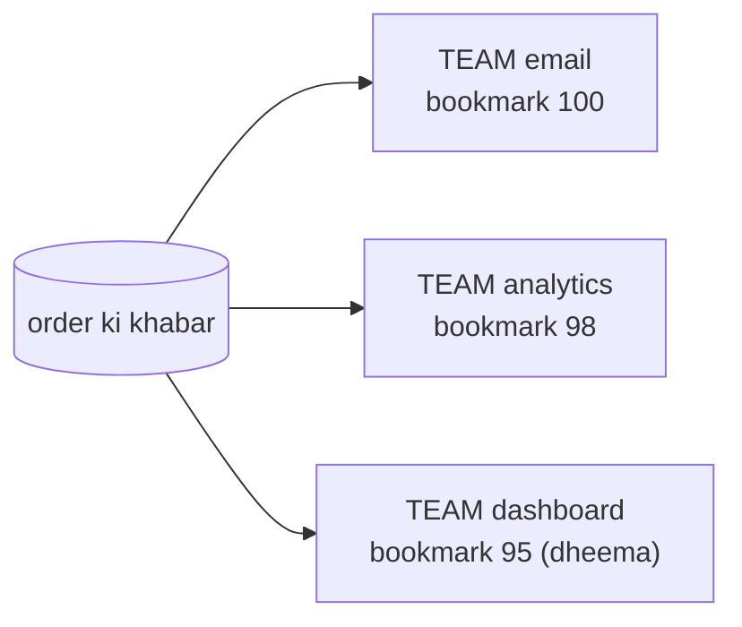

Har service ki apni team, apna bookmark. Har team ko poori khabar milti hai.
Dashboard dheema hai to bhi Email nahi rukta.

Shabd bola: **har service ka apna group**. Sawaal:
```
teeno ko ek hi team me daal dete?  -> team me ek khabar ek ko, baaki do ko kuch nahi milta
nayi service judni hai?            -> bas naya group. Order Svc me kuch nahi badalta
nayi service shuru se padhe ya ab se?  -> tay karna padta hai (auto.offset.reset)
```

---

## Kadam 7: Kafka ki machine hi mar gayi

**Peeche se:** Kadam 6 tak padhne wali taraf sab theek: tukde, team, har service ka bookmark.
**Ab:** khabar to Kafka ki ek machine ki disk pe rakhi hai. Wahi machine mar gayi to?

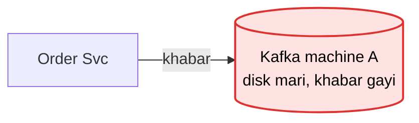

Har tukde ki 3 copy, 3 alag machine pe. Ek leader (likhna yahin), do copy.

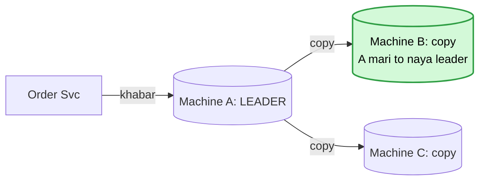

Shabd bola: **leader, copy (replica), acks**. Sawaal:
```
A ne "ho gaya" bola, copy banne se pehle mar gaya?  -> khabar gayi. Isliye "ho gaya" tab bolo jab copy
                                                       bhi likh jaaye (acks=all)
ek copy peeche chal rahi?           -> sirf poori taaza copy "pakki" (ISR). Leader pakki me se hi banta
dono copy bhi gayi, sirf A bacha?   -> likhna rok do (min.insync = 2). Khone se behtar rukna
naya leader kaun chunta?            -> Controller: Kafka ki ek machine jo baaki sab pe nazar rakhti (KRaft).
                                       Ek hi faisla, do leader kabhi nahi
acks ke teen tareeke?               -> 0 = bhej ke bhool jao, 1 = sirf leader (click, log ke liye theek),
                                       all = saari pakki copy (paisa, order)
3 copy ke liye kitni machine?       -> kam se kam 3 alag machine
pehle kya poochho?                  -> khabar kho sakti hai ya bilkul nahi? Isi se acks tay hota
```

---

## Kadam 8: worker beech me gira

**Peeche se:** Kadam 7 me Kafka ki taraf khabar bach gayi (3 copy, acks=all).
**Ab:** Kafka se khabar padhne wala worker kaam karte-karte gir gaya to?

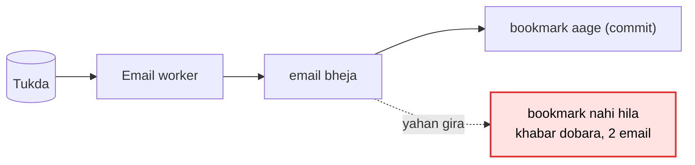

Bookmark nahi hila, to restart pe wahi khabar dobara aati hai. Arpan ko 2 email.
Ulta karo (pehle bookmark, phir email) to beech me girne pe email kabhi nahi jaata. Ye usse bura hai.

To kram: pehle kaam, phir bookmark (bookmark aage karne ko "commit" kehte hain). Aur dobara aaye to pehchano.
Har khabar ki apni id hoti hai (eventId, jaise E-5). Jo id ka kaam ho chuka, use ek tez jagah likh lo,
jaise Redis (RAM wala tez store, DB bhi chalega):

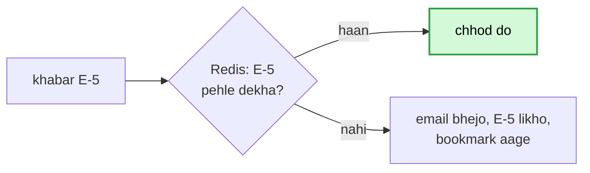

Shabd bola: **pehle kaam phir commit, eventId**. Sawaal:
```
"duplicate kabhi nahi aayega"?  -> galat. Khabar khoti nahi, dobara aa sakti. Padhne wala pehchaanta
userId se pehchano?             -> galat. Arpan ka agla sahi order bhi chhoot jaayega. Pehchaan eventId se
Redis se E-5 jaldi mit gaya?    -> dobara aayi to pehchani nahi. Utni der rakho jitni der dobara aa sakti
exactly-once milta hai?         -> sirf Kafka se Kafka tak. Email / DB ke liye padhne wala khud pehchaane
```

---

## Kadam 9: bhejne wala hi gira

**Peeche se:** Kadam 8 me padhne wala gire to bhi theek: pehle kaam, phir bookmark, eventId se pehchaan.
**Ab:** padhne wala aur Kafka dono surakshit. Bacha bhejne wala, Order Svc. Wo gira to?

Order Svc do kaam karta hai: pehle order apne DB me likhta, phir Kafka ko khabar deta.

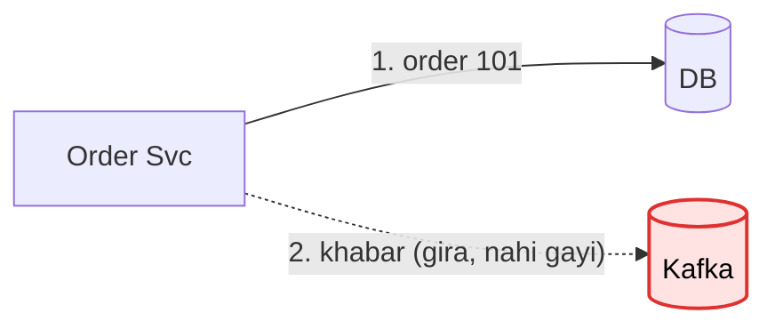

Khabar bhi usi DB me, order ke saath, ek hi transaction me likho (outbox table).
Ek chhota relay har second outbox se padh ke Kafka ko bhejta hai.

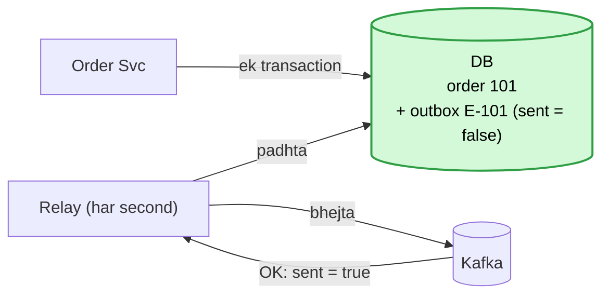

Shabd bola: **outbox, relay**. Sawaal:
```
order likhne se pehle gira?        -> kuch nahi likha. Arpan dobara order karega, galat kuch nahi
relay ne bheja, sent = true se pehle gira?  -> khabar dobara jaayegi. Padhne wala E-101 pehchaan lega
outbox table bharti gayi?          -> sent = true wali row roz saaf karo
saga kyun nahi?                    -> saga = kadam-kadam kaam, fail pe pichhla kaam ulta. Wo galti ulatne ke
                                      liye hai. Yahan kuch ulatna nahi, khabar ko bachana hai
poora bachav ek line me?           -> outbox + acks=all + pehle kaam phir bookmark + eventId + DLQ
```

---

## Kadam 10: line lambi, aur disk bhari

**Peeche se:** Kadam 9 me teeno jagah bachav: bhejne wala (outbox), Kafka (copy), padhne wala (eventId).
**Ab:** sab chal raha hai, par roz ki baatein: koi machine marti hai, koi khabar atakti hai, disk bharti hai.

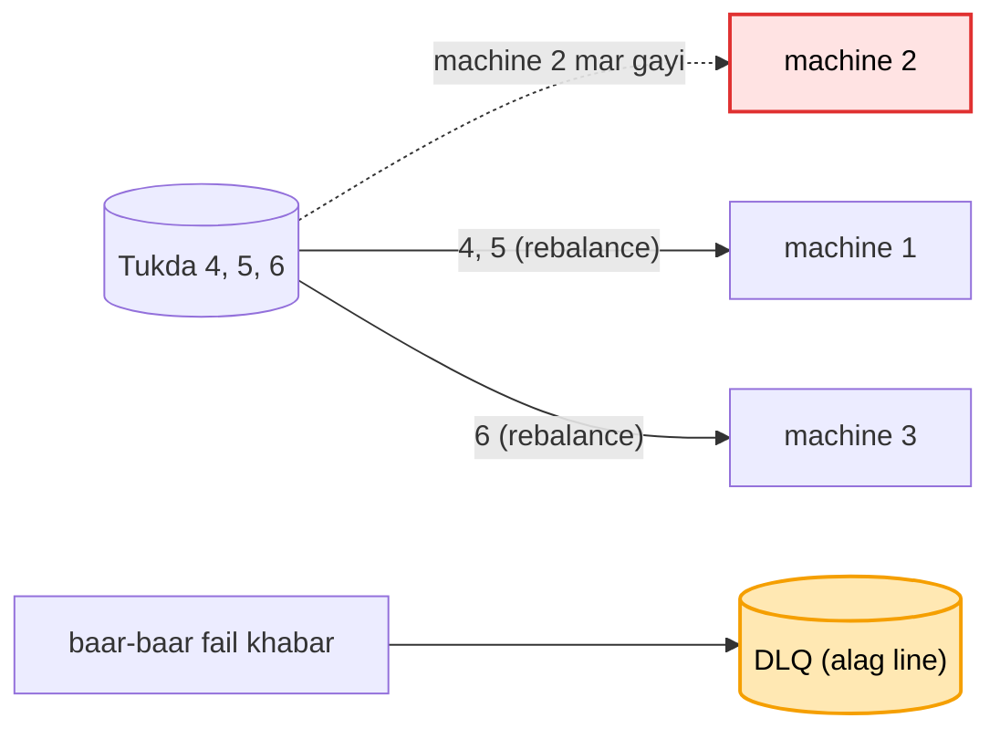

Shabd bola: **rebalance, lag, DLQ, retention**. Sawaal:
```
rebalance me sab ruk jaate?        -> purane tareeke me haan. Naye tareeke (cooperative) me sirf wahi
                                      machine rukti jinke tukde badle
lag kaise naapein?                 -> aakhri khabar ka number - team ne kahan tak padha
lag badh raha?                     -> alert + worker badhao. Ek khabar 5 min le to use alag
                                      workers ki alag line me bhejo
DLQ wali khabar ka kya?            -> theek karke dobara chalao
padhte hi delete kyun nahi?        -> dobara padhna (replay) band ho jaata
Email Svc 7 din se zyada band?     -> wo khabar ud chuki. Retention sabse lambi chhutti se lamba rakho
ek user ka sirf aakhri naam chahiye?  -> compaction: har key ki sirf aakhri value rakho
Kafka ka asli number kya?          -> disk ki jagah, kyunki Kafka khabar rakhta hai, sirf aage nahi bhejta
```

---

## Poora design ek saath

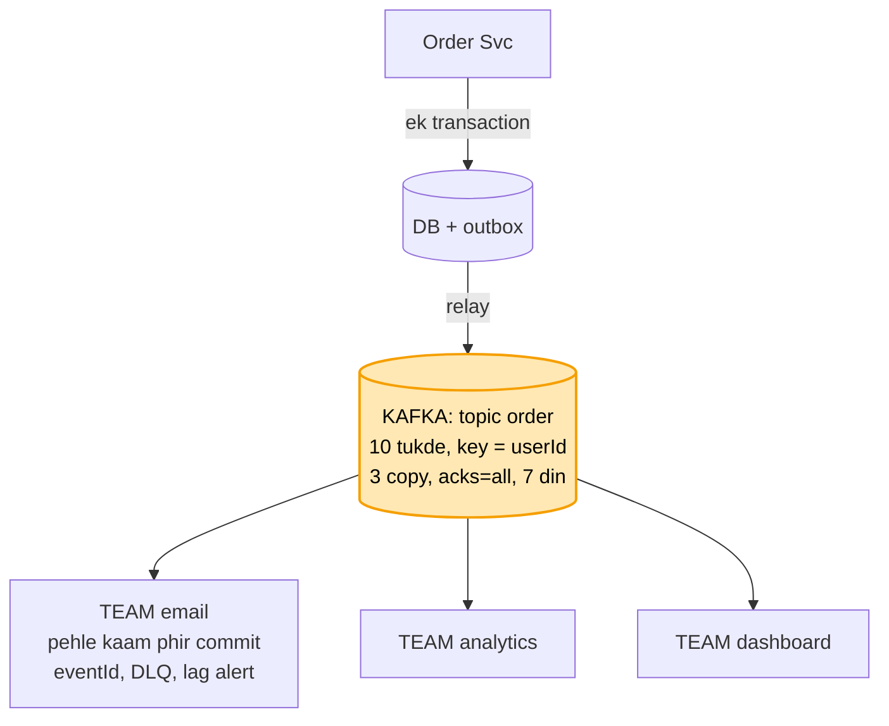
