# Mini Banking System (accounts · transactions · balances)

> Ek bank ke andar accounts, un pe paisa daalo / nikaalo / bhejo, aur balance dikhao.
> Is design ka dil: **khaata (ledger) SACH hai, balance sirf uska jod (nateeja)** + paisa na bane na gayab ho.
> KYUN YE DESIGN: candidates batate: payment flow · transaction ledger · ATM · do account ke beech
> bank ke andar transfer. JP ka sabse sambhavit HLD.

---

## KAHANI (ek din, 1 tareekh = salary day, main aur Ravi; har dikkat se design me ek dabba judta)

```
    KYA HUA                                     ILAAJ                                 DABBA JUDA
1   8 baje Ravi ko 500, beech me server gira -> EK TRANSACTION (WAL)                  SQL DB
2   8:30 network gaya, app ne dobara bheja   -> IDEMPOTENCY KEY (UNIQUE)              Banking Svc (+ key)
3   9:00 Netflix auto-debit + mera UPI       -> CHECK + KAATNA EK QUERY               (SQL DB: balance >= x)
4   mera 500 kahan gaya? (support / audit)  -> KHAATA (ledger) usi transaction me    (SQL DB: ledger table)
5   10 baje salary, Ravi ko rent, SMS giri    -> OUTBOX, Kafka key = account_id        Kafka
6   salary ke baad maine balance khola       -> BALANCE = CACHE, raat RECONCILIATION  Reconciliation job
7   11 baje sabki salary, ek machine bhari   -> KAI MACHINE + LB, DB sync copy        LB + Banking Svc x N
8   bheed me sab balance dekh rahe           -> READ REPLICA + read-your-own-writes   Read replica
9   dukaan ko 500, usi sec 200 refund        -> CHHOTI ID PEHLE LOCK                  (SQL DB: lock kram)
10  CA ka export, page 5000 dheema           -> KEYSET (ts, id) + index               (SQL DB: index)
11  raat: 5 saal khaata ek table me          -> MAHINE KE TUKDE + S3, snapshot        Archive (S3)

POORA DESIGN (upar ke dabbe kram se):
   User -> LB -> Banking Svc (idempotency key) -> SQL DB: EK transaction (khaata + balance + outbox)
        -> Kafka (commit ke baad, key = account_id) · Read replica = balance / history
   Reconciliation (raat) · Archive S3 (mahine ke tukde, had se pehle delete nahi)
```

---

## TASVEER (ByteByteGo / Alex Xu · CC BY-NC-ND 4.0)


Source: [Read Replica Pattern](https://bytebytego.com/guides/read-replica-pattern/)
(transfer ke baad purana balance = replica peeche -> turant wala padhna PRIMARY se)

---

## SHURU: pehle poocho, phir numbers

```
POOCHO:  "Bahut bada hai — use-cases baandh lete hain. Ek hi bank ke andar, ya doosre bank ko bhi?"
         ("let's discuss use cases first" — scope pehle,
          warna interviewer jitna bada system chaahe sar pe daal dega)

KYA KARE (FR):    user ke ek / kai ACCOUNT · DEPOSIT · WITHDRAW ·
                  TRANSFER A -> B (DONO isi bank) · BALANCE · HISTORY
                  ★ "dono isi bank" — ye ek shabd poora design badalta
                  bahar: doosra bank · loan · byaaj · card · KYC
KAISA CHALE (NFR): SAHI hona sabse upar (paisa na GUM, na BANE, hisaab
                   har waqt barabar) · har paisa TRACE ho (audit)
                   dobara bhejne pe DOBARA na kate (idempotent) · balance dekhna TEZ (sabse zyada padha jaata)

NUMBERS (andaaza):
   50 lakh account · 1 crore transaction / din, din me ~86,400 second -> ~120 likhai / second
   padhna >> likhna (log balance baar-baar dekhte)
   120 / second = ek theek-thaak Postgres machine ka DASVA hissa
       -> SHARDING KI ZAROORAT NAHI, primary + replica kaafi
   khaata: 1 crore x 2 line x 365 = ~730 crore line / saal -> 3 saal ~22 arab · 5 saal ~36 arab

DATA SE TEEN SAWAAL:
   1. transfer me DO row badalti -> dono ya koi nahi, kaun sambhalega?
   2. ek account pe do transfer ek saath -> kaun rokega?
   3. balance minus me na jaaye -> niyam kahan likha?
```

---

## ════ MOCK SE PEHLE: SIRF YE CARD PADHO ════

> Har card: pehle PEELA DABBA dekho (scene + ilaaj). Yaad aa gaya -> aage. Nahi aaya -> neeche
> DIKKAT / NAHI padho. AAGE POOCHEGA sirf jab interviewer aage kuch poochhe.

#### DABBA 0: SABSE SIMPLE (yahan se shuru, phir "kahan tootega")
```
Banking Service (saara niyam / logic) -> SQL DB. Jaan-boojh ke seedha.
```


#### 1 Maine Ravi ko 500 bheje, beech me server gira
KIYA: dono kaam ek transaction me, ya dono ya koi nahi (transaction)


```
AAGE POOCHEGA:
  NIYAM: ek DB = ek transaction, aadha kabhi nahi (crash pe DB khud ulta); padhne wale ko aadha nahi dikhta.
  SAFAR (mere 500, Ravi tak):
  BEGIN -> -500 Arpan -> +500 Ravi -> COMMIT -> dono hue ya koi nahi
  beech me server gira       -> DB log (WAL) se: COMMIT hua tha = poora, nahi = ulta
  -500 ke baad koi padhe     -> COMMIT se pehle ka hi dikhta: aadha kisi ko nahi dikhta
```

#### 2 Send dabaya, network gaya, app ne dobara bheja
KIYA: screen khulte hi ek id, retry pe wahi id (idempotency key)


```
AAGE POOCHEGA:
  NIYAM: aadha nahi = transaction, do baar nahi = id; user / app ka retry hamesha safe, wahi id = wahi jawab.
         id APP banata (screen khulte), server nahi: dobara bhejne wala wahi id laata.
  SAFAR (ek Send, dobara aaya):
  screen khuli -> id bani    -> Send pe wahi id DB me (UNIQUE): pehli baar = paisa kata
  network gaya, app dobara   -> WAHI id aayi -> pehla jawab wapas, paisa doosri baar nahi
  dono ek saath pahunche     -> DB khud rokta: doosra insert fail (UNIQUE = taala)
  wahi id, amount 5000       -> request ka hash mila nahi -> 422, purana jawab nahi
```

#### 3 9 baje Netflix ka auto-debit aur mera UPI ek saath
KIYA: check aur kaatna ek hi query me (atomic UPDATE)


```
AAGE POOCHEGA:
  NIYAM: check + kaat ek query me, DB me (raaste kai, DB ek); haara = 0 row -> user ko saaf "paisa kam".
  SAFAR (300 me se kaat):
  akela kaat                 -> ek UPDATE (balance >= 200): 300 -> 100, ho gaya
  Netflix + UPI ek saath     -> row pe taala, dono line me: pehla 300 -> 100
  doosra                     -> 100 >= 200? nahi -> 0 row -> 422 "paisa kam", kuch nahi kata
```

#### 4 Maine poochha: mere 500 kahan gaye, kab?
KIYA: har transfer ki 2 line khaate me, usi transaction me (ledger)


```
AAGE POOCHEGA:
  NIYAM: khaata usi txn me jahan paisa hila; sirf INSERT, galti = ulti line; rollback = khaata bhi gaya.
  SAFAR (ek transfer ka khaata):
  transfer hua               -> usi txn me 2 line: Arpan -500, Ravi +500 (ledger)
  txn wapas (paisa kam)      -> khaata bhi wapas: jhoothi line bachti hi nahi
  galat line likhi gayi      -> UPDATE nahi, ulti line jodo: galti bhi khaate me dikhe
  support: kab, kisko?       -> har line me waqt + transfer id: kab, kisko, kyun, sab ek jagah
```

#### 5 Salary aayi, Ravi ko rent bheja, SMS service giri
KIYA: DB me ek aur table "outbox": SMS ki chitthi bhi usi transaction me likho


```
AAGE POOCHEGA:
  NIYAM: transfer side-kaam (SMS) pe na ruke; khabar outbox me usi txn, Kafka commit ke BAAD; dobara aa sakti.
  SAFAR (rent ke baad SMS):
  rent COMMIT                -> usi txn me outbox row; relay ~1 sec me Kafka: SMS pe nahi rukta
  SMS service ghanta giri    -> khabar Kafka me padi rehti: wapas aate hi wahin se padh leti
  relay sent=true se pehle gira -> khabar dobara jaati: SMS service eventId se skip
  outbox bharti jaaye        -> roz saaf: sent=true ka kaam khatam
```

#### 6 Salary ke baad maine balance khola
KIYA: khaata hi sach, balance uska jod, raat ko dono milao (reconciliation)


```
AAGE POOCHEGA:
  NIYAM: sach = khaata, balance uska jod (cache); farak = alert + account roko, pehle KYUN, phir khaata jeete.
  SAFAR (balance khola):
  balance padha              -> column (cache): har baar 50,000 line jodna dheema
  raat milaan (reconciliation) -> khaata jod == column? haan = theek
  raat farak: 29,800 vs 30,300 -> alert + account roko: pehle KYUN, phir khaata jeete
```

#### 7 11 baje sabki salary aa gayi, ek Banking service bhar gayi
KIYA: kai machine, LB baante, machine kuch yaad nahi rakhti (stateless)


```
AAGE POOCHEGA:
  NIYAM: service kuch yaad nahi rakhti (jitni lagao); sach DB me, copy sync; gira to app wahi id se dobara.
  SAFAR (salary ki bheed me ek transfer):
  transfer aaya              -> LB koi bhi machine ko de: machine kuch yaad nahi rakhti, sach DB me
  ek machine bhari           -> machine badhao, LB baante
  ek machine giri            -> LB list se hatata (health check)
  adhoora transfer           -> app WAHI id se dobara
  LB khud akela?             -> nahi: LB bhi do zone me, ek gire to doosra
```

#### 8 Salary ki bheed me sab balance dekh rahe, transfer dheeme
KIYA: padhna copy se, likhna sirf primary pe (read replica)


```
AAGE POOCHEGA:
  NIYAM: copy thodi peeche: dikhana copy se, paise ka faisla primary pe; abhi likha to primary se padho.
         failover standby = sync (kuch nahi khota); read replica = async (peeche), alag cheez.
  SAFAR (balance dekhna vs bhejna):
  balance / history dekhna   -> copy se: bheed padhne ki; primary ka log (WAL) copy tak
  paise ka faisla            -> sirf primary pe: copy peeche ho sakti
  abhi bheja, copy 5 sec peeche -> apna abhi likha primary se padho (last_write_at, Redis)
                                warna purana dikha to dobara bhejunga
  copy minute bhar peeche    -> kitni peeche naapo (lag) -> alert, us copy ko list se hatao
```

#### 9 Ravi ki dukaan ko 500, usi second dukaan se 200 refund (deadlock)
KIYA: taala hamesha ek kram me, chhoti id pehle (lock order)


```
AAGE POOCHEGA:
  NIYAM: taala hamesha ek kram me (chhoti id pehle); phir bhi phansa to DB ek ko wapas, app wahi id se dobara.
  SAFAR (500 dukaan ko, 200 refund usi pal):
  Txn1 akela                 -> taala Arpan, phir dukaan -> ho gaya
  Txn2 usi pal, ulta kram    -> taala dukaan, intezaar Arpan = gol ghera (deadlock)
  kram ke baad bhi phansa    -> DB ghera khud pakadta, ek ko wapas: app ruk ke WAHI id se
```

#### 10 Shaam ko dukaan ke CA ka export, page 5000 pe atka
KIYA: pichhle page ki aakhri line yaad, agla page usse aage (keyset)


```
AAGE POOCHEGA:
  NIYAM: "kahan tak dekha" yaad, "kitne chhode" nahi; page 1 ya 5000 ek jaisa, nayi line aaye to dohraav nahi.
  SAFAR (CA ka export, page dar page):
  page 1                     -> 20 line + aakhri (ts, id) yaad
  agla page                  -> "is (ts, id) se purani 20": index se seedha, chhodna nahi
  ek hi ts pe do line        -> (ts, id) dono: id barabari todti, line chhoot / dohraav nahi
  beech me nayi line aayi    -> purana page nahi khiskta: ginti nahi, "kahan tak" yaad
```

#### 11 Raat ko: 5 saal ka khaata ek hi table me
KIYA: mahine ke tukde, band mahina S3 pe (partition + archive)


```
AAGE POOCHEGA:
  NIYAM: naya paas, purana sasta (S3), kanoon (5 saal) tak pakka; jod = snapshot + baad ki line, poora nahi.
  SAFAR (purani line kahan jaati):
  is mahine ki line          -> apne mahine ke tukde me (partition), paas aur tez
  mahina band                -> alag karke S3 (sasta); 5 saal (PMLA) se pehle delete nahi
  S3 gaye, balance ka jod    -> poora nahi: mahine ka snapshot + baad ki line
  RBI ko 2021 ka statement   -> S3 pe hi query (Athena, Parquet), ya wo tukda wapas laao
  koi purani file badal de   -> S3 pe taala: na delete na badal (Object Lock, WORM)
```

---

## AAKHRI DABBA + WRAP (ek hi baar)

```
User -> LB -> Banking Svc (stateless, idempotency check)
-> SQL DB: EK transaction (dono khaata line + dono balance + idempotency key + outbox)
-> Kafka (commit ke BAAD, outbox se: SMS / fraud / analytics / statement) · Read replica = balance / history
Reconciliation (raat ko: snapshot + baad ki line vs balance -> ALERT)
Archive S3 (band mahine, had se pehle delete nahi)

DB:  SQL -> paisa na khoye na bane: EK transaction (ek DB me SAGA nahi)
     khaata = SACH (sirf jodo, double-entry, mahine ke tukde) · balance = CACHE (jod, usi transaction me)
```
```
JAWAB:    Ek transfer ka sab kuch (dono khaata line, dono balance, id, SMS wali khabar) ek transaction
          me, SQL me. Paisa na khota na banta.
          Khaata sach, balance uska jod, raat ko milaan. Balance check aur lock ka kram DB me.
          Padhai copy se, history 'pichhli line ke baad se', purane mahine sasti jagah, SMS commit ke
          baad Kafka se.
```

---

## 10 GUNA TRAFFIC — har dabba alag se

```
KRAM:  sasta pehle, SHARD aakhir me
  1. READ REPLICA (pehla kadam, padhna >> likhna) · keemat: thoda peeche -> apna abhi-kiya transfer PRIMARY se
  2. MAHINE ke tukde (archive + query dono ke liye)
  3. SHARD by account_id = AAKHRI, keemat badi: Arpan shard-1, Ravi
     shard-2 -> transfer ek transaction NAHI -> wapas SAGA / 2PC
     -> beech me crash wali dikkat wapas · hamare 120 / sec pe ye sawaal hi nahi; pehle badi machine + replica
  LIKHAI se DB maar kha raha (replica ke baad bhi):
     cache / index = sirf PADHAI ka ilaaj (har naya index INSERT dheema karta) -> likhai ke liye SHARD
     by account_id: ek account ki KHAATA LINE ek shard pe; do shard ke beech transfer -> SAGA
     · zaroori-nahi wali likhai (statement, SMS) queue pe
  BADI TABLE (jagah) -> mahine ke tukde + archive (had se pehle DELETE nahi)
  ✗ "badi transaction chhoti karo" = galat: kaatna + daalna EK transaction me hi
  replica sirf PADHAI baantti, likhai ke liye SHARD · desh / date = bura key (ek garam)

POOCHEGA: "Replicas are in, but writes are still killing the DB. What now?"
          (Copy laga di, par likhai abhi bhi DB ko maar rahi. Ab?)

JAWAB:    Copy sirf padhai ka bojh baantti, likhai sab main DB pe hi jaati. Index bhi sirf padhai tez
          karta, likhai ulta dheemi.
          Likhai bahut ho to account id se baanto: Arpan ki saari khaata line ek tukde pe. Do tukdon ke
          beech transfer -> SAGA. SMS / statement jaisa kaam line me daal do.
          Jagah ke liye mahine ke tukde, purane sasti jagah. Kanoon ki had (5+ saal) se pehle delete nahi.
POOCHEGA: "How would you scale this to 10x?"      -> pehle jo toote
          (padhai -> replica, jagah -> tukde, likhai -> shard)
POOCHEGA: "What's the single point of failure?"   -> DB primary (sync copy), Banking Svc (LB + kai machine)
```

---

## POOCHE TO (gehra sawaal aaye tab)

```
API:      GET /accounts/{id}/balance · GET /accounts/{id}/transactions?cursor=...&limit=20
          POST /transfers { from, to, amount }
          POST /accounts/{id}/deposit { amount } · POST /accounts/{id}/withdraw { amount }
          har POST me Idempotency-Key header
          har request pe OWNER CHECK: userId JWT se (body / URL se nahi); from_account ka maalik
          nahi -> 403 (Ravi "Arpan ke account se 500" bheje to). Balance / history pe bhi.

DB:       ledger_entries (SACH, sirf jodo, mahine ke tukde) · accounts.balance (CACHE, jod)
          idempotency_keys (UNIQUE) · outbox · account_balance_snapshot (mahine ke aakhir ka balance)

"Transfer me CP ya AP?"      -> TRANSFER / BALANCE = CP: galat balance dikhane se mana karna behtar;
                               SMS / statement = AP (2 sec late chalta).
"Sab chal raha, pata kaise?" -> ALERT: reconciliation + p99 + error rate + queue lag + DB connection,
                               aur har transfer ka trace id.

"Niyam Java me likh do?"     -> nahi, DB me: raaste kai (API / batch / haath se), DB ek.
"Khaata Kafka me kyun nahi?" -> Kafka aur DB alag, ek txn nahi; rollback pe Kafka me jhoothi line.
"Relay likhna hi na pade?"   -> DB ke log se seedha Kafka (CDC, Debezium).
"Sync copy = dheema?"        -> haan, ek network chakkar; paise me chalega, async me aakhri transfer khota.
"Seedha page 500?"           -> keyset me nahi: "kahan tak" yaad, "kitne chhode" nahi; agla / pichhla kaafi.
"Ravi doosre bank?"          -> do bank = do DB, ek txn nahi: PENDING + SAGA, raat milaan.
"Send button band, kaafi?"   -> nahi: retry app khud karta (timeout), isliye id phir bhi chahiye.
"SMS ulte kram me?"          -> Kafka key = account_id: ek account ki khabar ek partition, kram se.
"(ts, id) app ko kaise?"     -> band lifafe me (next_cursor, base64): app andar nahi dekhti.
"Id kab tak rakhein?"        -> 24-48 ghante, phir saaf: retry itni der me hi aata (card 2).
"Main DB hi gira?"           -> sync copy (doosri building) promote, ~1-2 min (Multi-AZ); us beech error
                               -> app dobara, WAHI id: do baar nahi katta (card 2).

PAANCH CHEEZ JINPE YE ROUND TAY HOTA (source: "ye interview INHI se tay hote hain"):
   IDEMPOTENCY · TRANSACTIONS · QUEUES · RECONCILIATION · AUDIT
   + ACID vs eventual (network toote to SAHI hona chuno, chalte rehne ki keemat pe)
   + asli khaate ke liye RELATIONAL DB, NoSQL nahi
```

---

ARCHETYPE C · CONCEPTS: [db-what-when](../../FOUNDATIONS/09_databases_what_when.md) · [CAP](../../FOUNDATIONS/08_cap_theorem.md) · [saga/ms-comm](../../FOUNDATIONS/10_ms_communication.md) · [caching](../../FOUNDATIONS/04_caching.md) · saath: [payment-system](../06_payment_system/06_payment_system.md) (iska bada bhai) · [stock-broker](../05_stock_broker_trading/05_stock_broker_trading.md) · [← MASTER SHEET](../../00_MASTER_SHEET.md)
