# Banking: mohalle ki bank branch ki kahani

Mohalle ki bank branch: ek cashier, aur ek register jisme sabke khaate likhe hain. Arpan apne khaate se Ravi ko 500
bhejta hai, dono ek hi bank me. Kaam: paisa na gum ho, na do baar kate, aur har paise ka hisaab mile.

Har kadam = **kahani** (dikkat aur hal, bolne wali bhasha) -> **Asli naam** (interview me yahi shabd) -> tasveer
(kahani ka shabd, bracket me asli naam).

Kadam 1-13 = ek transfer sahi kaise ho. Kadam 14-20 = mahine ki statement, yaani "billions of records" wala sawaal.

---

## FR / NFR / Numbers (interview me pehle 2 minute)

```
FR      paisa daalo, nikaalo, balance + history dekho · transfer A se B, DONO isi bank me (doosra bank scope se bahar)
        · paisa jaate hi Ravi ko khabar
NFR     paisa na gum ho, na bane, na do baar kate · har paise ka hisaab mile (audit) · balance dekhna tez
        · salary ke din ki bheed jhele (counter badhao, DB wahi)
Numbers 50 lakh account, roz 1 crore transaction = ~120 likhai / sec, padhna isse kahin zyada
        -> bheed chhoti, asli dikkat SAHI hona: ek SQL DB kaafi, shard nahi
```

---

## 1. Bijli gayi, Arpan ke kate, Ravi ko nahi mile (500 wapas de do)

Arpan ne parchi di "Ravi ko 500 bhej do". Cashier ne Arpan ke 500 kaate, Ravi me jodne jaata usi pal bijli chali
gayi. Mere 500 kat gaye, Ravi ko kuch nahi mila, to bhai aisa karo na, mujhe mere 500 wapas de do, dikkat hi khatam.
Ya dono kaam honge, ya koi nahi.

**Asli naam:** cashier = Banking Service (server), register = DB (Postgres), "mere 500 wapas de do" = transaction
rollback (BEGIN, Arpan -500, Ravi +500, COMMIT; COMMIT se pehle gira to dono ulte). SQL isliye: ek transfer me do row
ek saath pakki badalni hain (ACID), aur 120 likhai / sec ke liye NoSQL ki kai-machine wali taakat chahiye hi nahi.

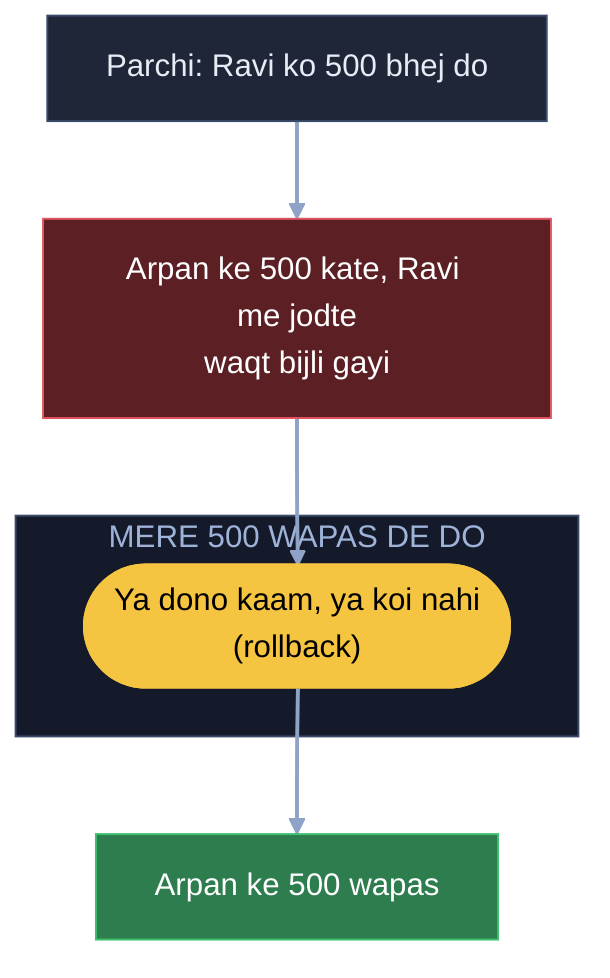

## 2. Receipt se pehle line kati, wahi parchi dobara (log dekh ke mana + parchi ki key)

Ravi ko 500 pahunch gaye, par receipt milne se pehle Arpan ki line kat gayi. Use pata nahi chala, usne wahi parchi
dobara di. Wo cheez hamare paas hai na, humne likh di thi. Bhale hi uski line kati ho, wo dobara bheje, log to hamare
paas hai. Hum dekh lenge ki 500 chale gaye, to mana kar do: "nahi bhai, 500 tumhare already bhej diye hain."

**Maan lo agle din Arpan sach me Ravi ko phir 500 bhejna chahta hai:** diary me pehle se "Arpan se Ravi, 500" hai, to
cashier use bhi mana kar dega. Wahi purani parchi hai ya nayi, kaise pehchaane? To ek key bana do, aisi jo badle hi na.
Maine ek parchi pe likh diya ki Ravi ko 500 bhejne hain is waqt, aur parchi bank wale ko de di. Mujhe nahi pata gaye ki
nahi, to main dobara wahi same parchi dunga, key thodi badli. Wo dekhega: "abe yaar ye to same hi hai, ise kyun wapas
bhejna, hatao." Nayi baar bhejna hai to nayi parchi, nayi key.

**Asli naam:** "log hamare paas hai, dekh ke mana" = DB me pehle wala record dekh ke dobara mat kaato. Parchi ki key =
idempotency key (app Send screen khulte hi UUID banati, jaise `k-77`, dobara bhejne pe wahi). Server key usi transaction me
ek table me likhta jispe UNIQUE hai: key pehle aa chuki to paisa nahi kat-ta, purana jawab wapas. Amount se pehchaan
nahi, kyunki Arpan sach me do baar 500 bhej sakta hai.

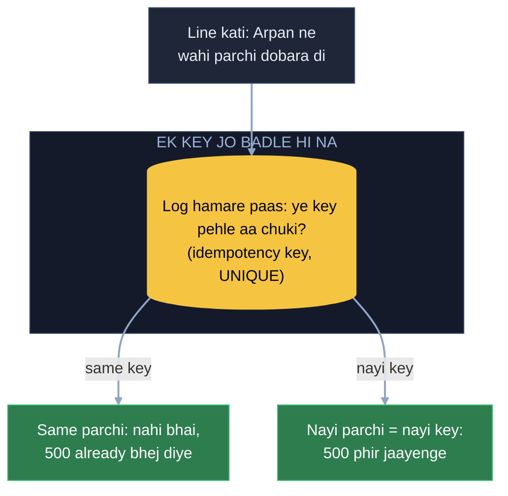

## 3. Do counter, 600 the, dono ne kaat diya (dekhna aur kaatna ek kram me)

Branch me do counter. Arpan ke khaate me 600. Ek hi pal me do parchi, Netflix 500 aur UPI 500, alag counter pe. Dono
cashier ne 600 dekha, dono ne kaat diya, balance -400. To dekhna aur kaatna ek hi kram me kar lo. Jisne pehle 600
dekha, wo pehle kaat de: Netflix ke 500 turant kat gaye, ab account me 100 hain, to agla counter 600 nahi, 100
dekhega. Doosre wale ko 600 dikhne hi nahi chahiye.

**Asli naam:** ek kram = ek hi query me check + kaato (`UPDATE ... SET balance = balance - 500 WHERE id = arpan AND
balance >= 500`: 1 row badli = kata, 0 row = paisa kam, mana). Doosre ko 600 na dikhe = row lock: UPI ki query ruk ke
naye 100 pe jaanchti hai.

**Maan lo ek hi pal me do parchi: counter 1 pe "Arpan se Ravi 500", counter 2 pe "Ravi se Arpan 300". Counter 1 ne Arpan ka khaata pakda, Ravi ka maang raha; counter 2 ne Ravi ka pakda, Arpan ka maang raha. Dono ek doosre ka intezaar, koi nahi hilta:** Dono counter wale apna-apna khaata pakad ke khade, na ye chhodta na wo. Do raaste hain. Pehla: main Ravi se bolunga "chal bhai, hum dono ek hi line me lagenge, ek hi counter pe", to ek ke baad ek kaam hoga. Doosra: main bolunga "koi baat nahi, pehle mere khaate se kaat ke Ravi me daal de". Wo ho gaya to khaata free, phir doosri parchi bhi ho jaayegi. Aur ye atkan sirf ek hi bank ke DB ke andar hota hai, alag bank me nahi. User ko kabhi pata nahi chalta: DB khud tod deta hai, app dobara chala deta hai, papa ke 10 aur mere 10 dono chale jaate hain.
**Asli naam:** "dono ek doosre ka khaata pakad ke baithe" = deadlock. "ek hi line, ek counter" = ek ke baad ek (serialize); 10 counter bane rahein aur phir bhi na atkein, uske liye har counter pehle chhota account number pakde (lock ordering). "pehle ek poora, phir doosra" = DB atkan pakadta hai (deadlock detection), ek parchi rollback, doosri poori, phir pehli dobara (retry).

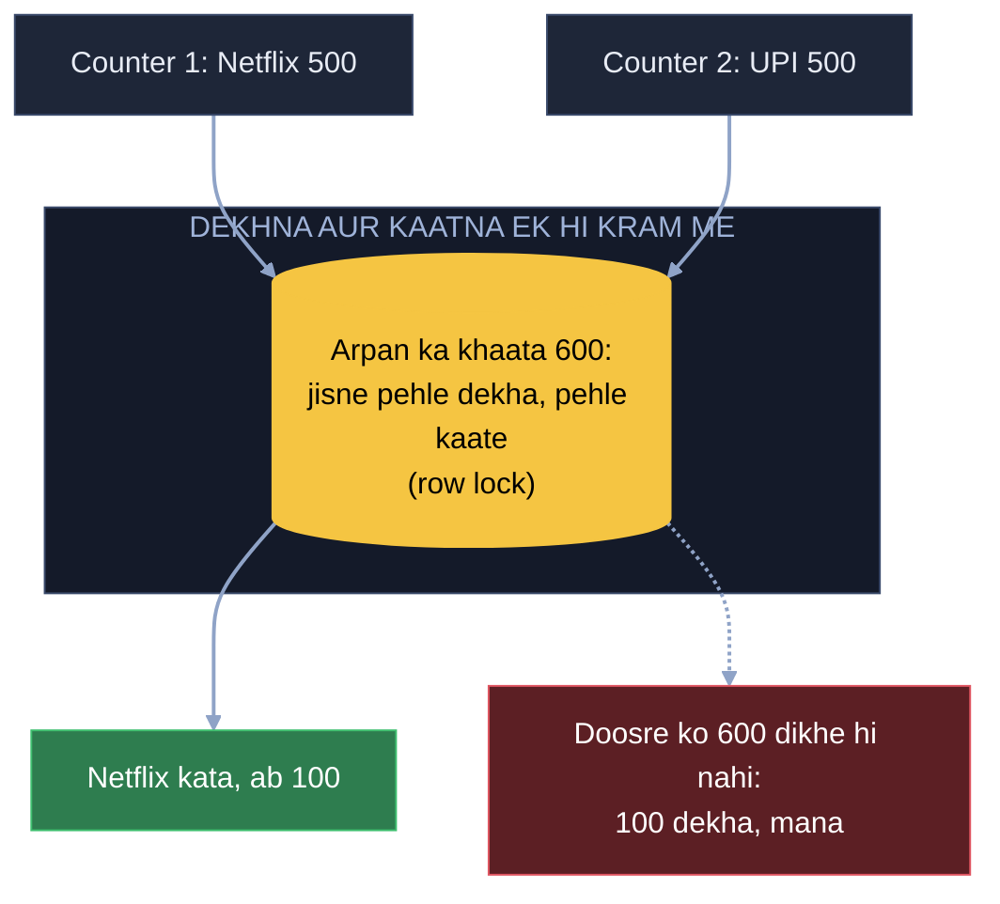

## 4. Ravi bola "500 mile hi nahi" (alag diary, kaato mat)

Hafte baad Ravi aaya: "Arpan ke 500 mile hi nahi". Register me sirf aaj ka balance hai, purana number har baar kaat
ke naya likha. Saabit kaise karein? To ek alag diary rakh lo, usme kaato mat, bas neeche likhte jao, jodte jao. Ya ek
copy me do column bana lo: ek me update likhte ja rahe, koi dikkat nahi, par doosre me update mat karo, neeche likhte
jao: Ravi me +500 hua, yahan se -500 hua. Do alag cheez rakho.

**Asli naam:** diary = ledger (append-only: sirf INSERT, kabhi UPDATE / DELETE nahi; galti hui to ulti line daalo),
+500 / -500 = double-entry (har transfer ki do line, jod 0). Update wala column = balance column, alag, bas tez padhne
ke liye. Dono usi transaction me likhe jaate hain, ledger isi DB ki ek alag table hai.

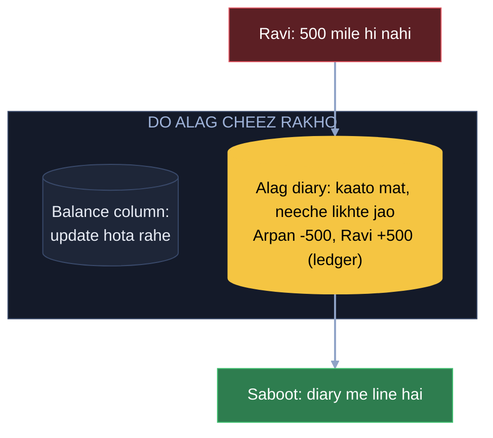

## 5. Khabar dene se pehle bijli gayi (likh lo)

Paisa jaate hi Ravi ko khabar deni thi. Cashier ne paisa bheja, aur ladke ko "Ravi ko khabar do" bolne se pehle bijli
chali gayi: ladke ko pata hi nahi ki kisko khabar deni hai. Jo kisi ko yaad nahi rehta, to likh lo na bhai. Hum bhi to
yahan likh rahe hain kyunki mujhe kal yaad nahi hoga, same to same cashier ke saath hai. Ab cashier kabhi bhi aaye ya
jaaye, wo likha hai, agli baar koi bhi ladka aayega to wo pahuncha hi dega.

**Asli naam:** likh lo = outbox (khabar usi transaction me ek table me, `sent = false`), ladka = relay (outbox se utha
ke SMS Service ko bheje, gaya to `sent = true`, SMS gira to dobara try). Transfer SMS pe nahi atakta, aur SMS khota
bhi nahi.

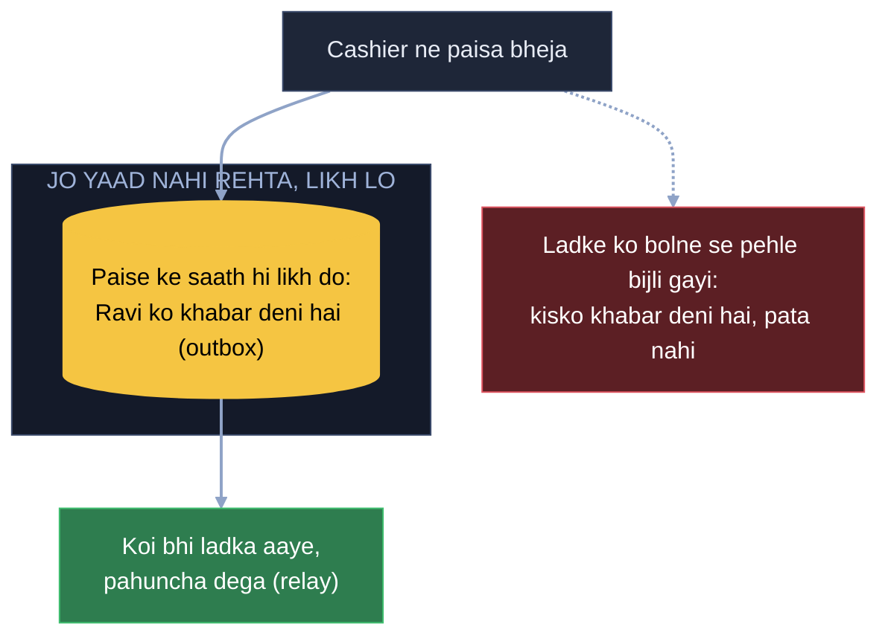

## 6. Salary ka din, line sadak tak (10 cashier, 10 counter)

Mahine ki 1 tareekh, sabki salary, poora mohalla branch me. Ek hi cashier, line sadak tak. To cashier badha do: ek
tha, 10 kar do, 10 counter kar do. Bheed badh gayi, kaam khatam. Aam taur pe bhi yahi hota hai, bank me ek counter
pe bheed ho to hum doosre counter pe jaate hain, movies me bhi same.

**Asli naam:** 10 cashier = kai Banking Service machine (stateless, sach DB me), doosre counter pe bhejna = load
balancer (khaali machine pe bheje).

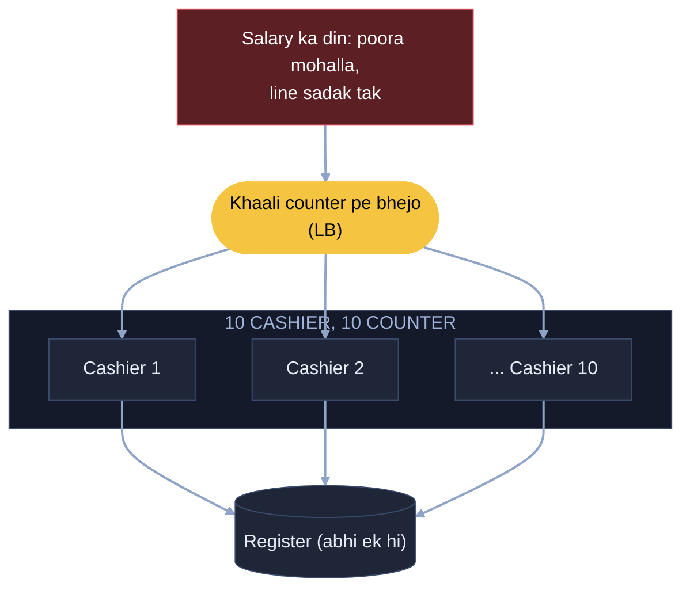

## 7. Register jal gaya (laptop me copy, ghar le jao)

Cashier 10 ho gaye, par register abhi bhi ek hi. Raat ko branch me aag lagi, register jal gaya. To use kai jagah store
karo. Jaise meri ek important copy hai, usme notes likhe hain, main use office me chhod gaya, raat me aag lagi to
notes kho jaayenge. Main aisa nahi karunga: use laptop me save karke laptop ghar le jaaunga. Ab copy me aag lage chahe
kuch bhi, laptop me mera saamaan hai.

**Asli naam:** laptop ghar = DB ki copy doosri jagah (replica, RDS Multi-AZ, primary gira to copy primary banti).

**Maan lo laptop me shaam ko ek baar save karta hai, 2 baje copy me zaroori line likhi, 3 baje aag:** jaise hi copy pe
likha, turant laptop pe likh lo, dikkat hi khatam. Wo cheez tab tak pakki nahi jab tak laptop me nahi aati. Copy pe
likh liya, turant laptop pe lao, phir pakka maano.
**Asli naam:** turant laptop pe, tabhi pakka = sync copy (thoda dheema, par ek bhi transfer nahi khota; 120 / sec pe
dheemapan dikhta bhi nahi). Shaam ko ek baar = async (aakhri likha kho jaata), paise me nahi chalta.

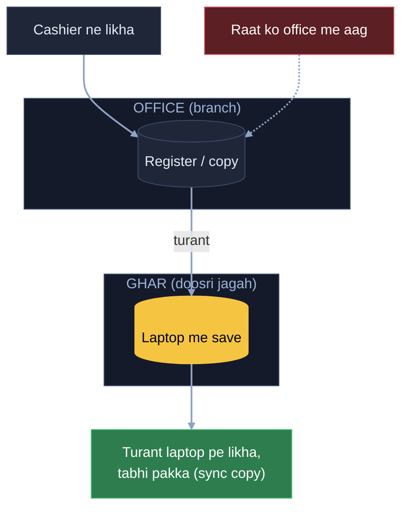

## 8. Sab sirf balance dekhne aaye (photocopy ka alag desk)

Salary ke din sab sirf balance dekhne aa rahe. Saare cashier register pe jhuke, jo sach me paisa bhejne aaya uska
kaam atka. To alag-alag baant do: jo sirf dekhne aa rahe unko sirf dikhao, jo karne aa rahe unko sirf karao. Register
uske liye khaali chhodo jo waqai kuch kaam kar raha hai. Register ki photocopy bana do, photocopy ek alag desk pe rakh
lo. Jo sirf padh raha, use photocopy pe bhejo. Jo kuch likh raha, use main register pe le aao.

**Asli naam:** photocopy alag desk = read replica (async, balance / history wahan se), main register = primary (sirf
likhne wale, transfer).

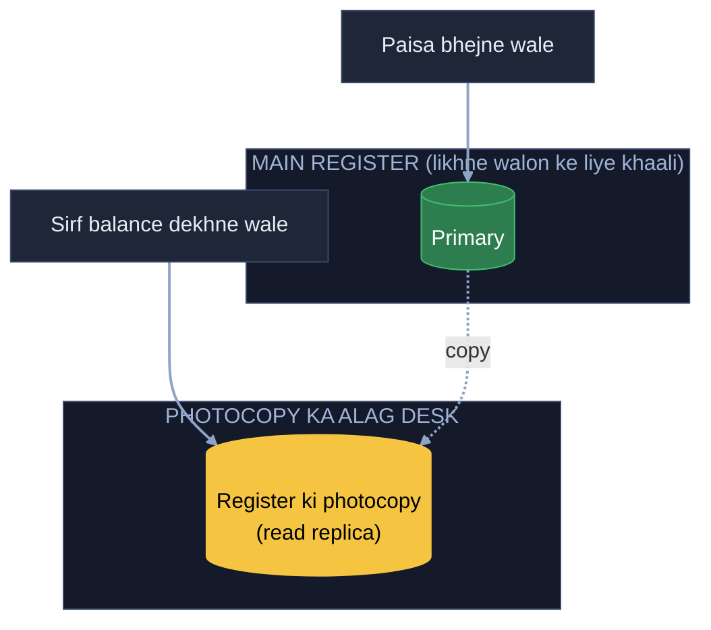

## 9. Photocopy peeche, Arpan ne ghabra ke dobara bheja (thodi der main register se)

Photocopy main register se thodi peeche chalti hai. Arpan ne abhi 500 bheje, turant photocopy desk pe gaya, wahan
purana balance. Ghabra ke dobara bhej diya. To jisne update kiya, use thodi der main register se padhao. Thodi der
baad jab photocopy sync ho jaaye, phir wahin se padh lo. Har cheez ka system hai yahan.

**Asli naam:** jisne update kiya, thodi der main se = read-your-writes (abhi transfer kiya to kuch second primary se),
sync ho jaaye to wahin se = phir read replica (baaki sab replica se).

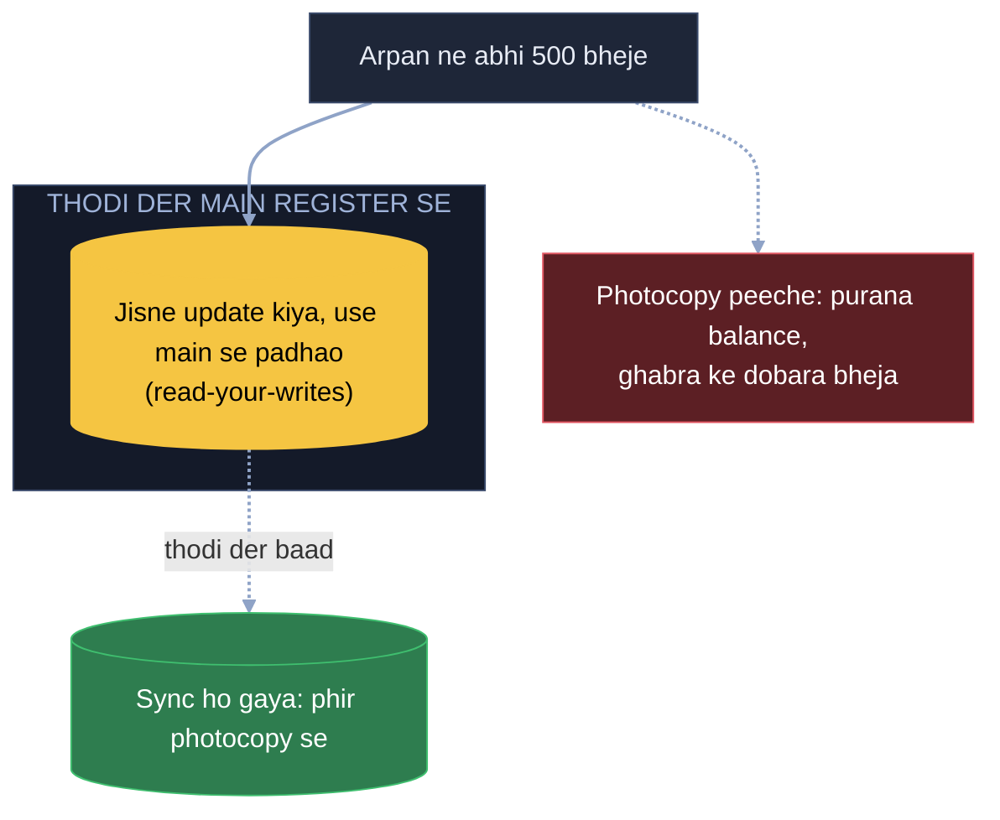

## 10. Haath se balance 100 se 600 (diary se milao)

Raat ko kisi bank wale ne main register me Arpan ka balance haath se 100 ki jagah 600 kar diya, diary me koi line
nahi. Agle din Arpan ne 600 nikaal liye. To use main diary se milwao na. Asli to diary hai: balance koi bhi haath se
update kar dega, wahan dikkat hai. Diary me hum sab likh rahe, -500 +500, ye hai asli sach, na ki wo column jo koi bhi
galti se update kar de.

**Asli naam:** diary se milao = raat ka milaan (reconciliation job, read replica pe: balance == ledger ka jod? nahi to
ALERT, insaan ulti line se theek kare). Asli sach diary = ledger = source of truth, balance bas copy.

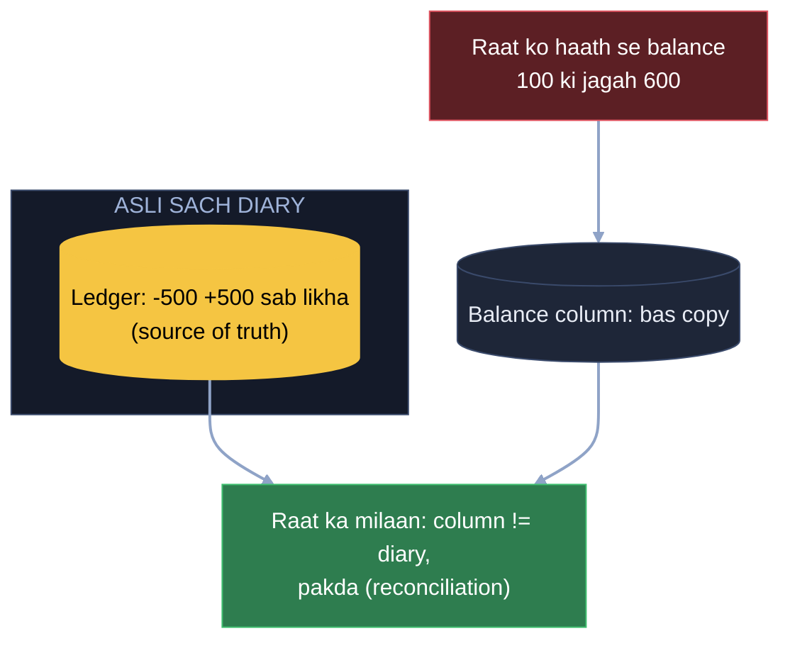

## 11. 5 saal ki diary har raat jodna bhaari (mahine ke mahine tod do)

Arpan ka khaata 5 saal purana, diary me hazaaron line. Har raat milaan ke liye 5 saal ki line shuru se jodna bhaari,
raat khatam par jod poora nahi. To data tod do: 5 saal purana data thodi badlega. Maine 10 mahine pehle 10,000 ka
kharcha kiya, wo ab badlega thodi. Mahine ke mahine tod do: January se March tak itna kharch kiya, jud gaya, mil gaya,
likh do. March se April tak itna, use jod do. Pichhle mahine ka khaata change nahi hota, agle mahine ka hota rehta hai.

**Asli naam:** mahine ke mahine tod do = ledger ke mahine ke partition, pichhla jud gaya, likh do = snapshot (mahine
ka total; balance = pichhla snapshot + uske baad ki lines), purana data badlega nahi = purani line immutable.

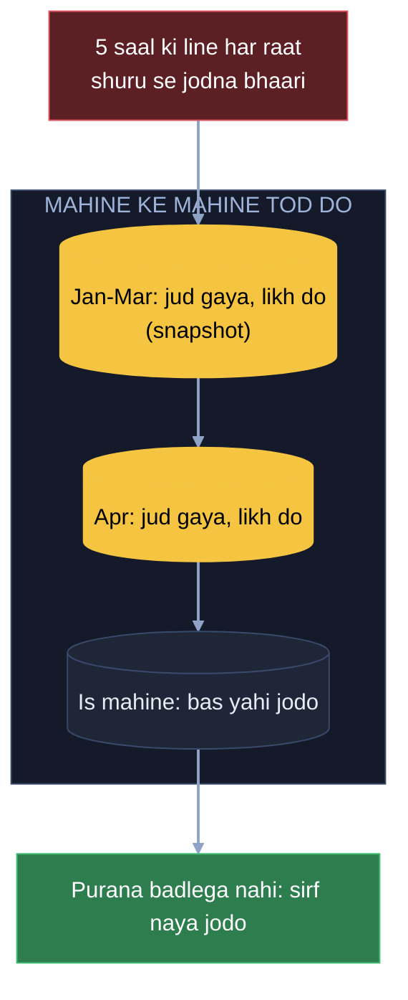

## 12. Diary almari me nahi samati, RBI bole 10 saal rakho (head office bhej do)

5 saal me diary itni moti ki branch ki almari me jagah nahi. RBI ka niyam: purani line phenk nahi sakte, 10 saal
rakhni hain. Hamara chhota bank hai, branch mere shehar me, par uski koi main jagah to hogi na, head office. To use
apne bank ki jagah head office bhej do, wahan safe rahega. Data kahin gaya nahi.

**Asli naam:** head office me bhej do = purana ledger S3 me (sasta, lambe samay ke liye), data kahin gaya nahi =
archive, phenka nahi.

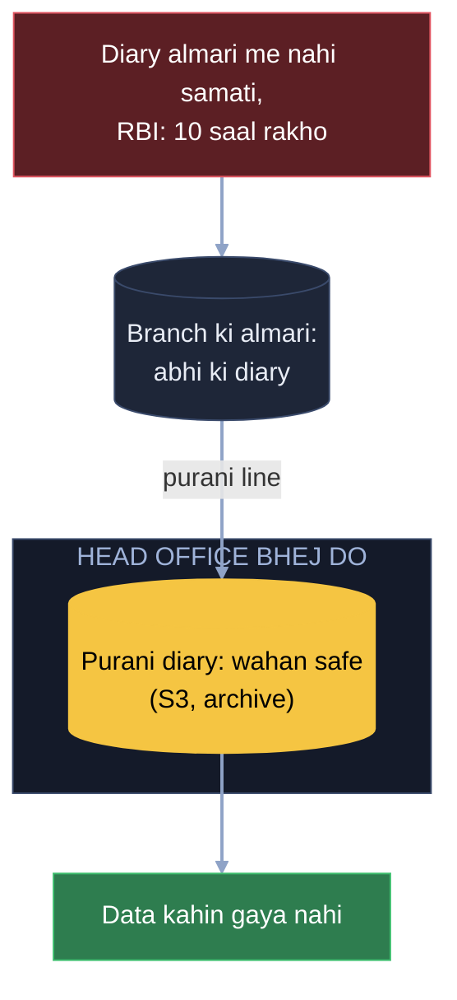

## 13. Ijazat wala hi "-500" ko "-50" kar de (kai copy + kohinoor)

Ijazat wala aadmi hi godown me ja ke "Arpan -500" ko "Arpan -50" kar de. To uski multiple copies rakh lo: 3-4 copy
alag-alag chupchap kahin aur kone me daba do, taaki wo sab na badal paaye, ek hi badal paaye. Usne ek file badal bhi di
to doosri copy me same data hoga. Aakhir me saari file milao: ek me hi -500 ki jagah -50 hai, baaki me nahi, matlab
isne chhedchhaad ki. Aur ek aur: version ka lock laga do, ki wo file koi change hi na kar sake. Wo kohinoor heera hai:
na koi chhoo sakta, na chhed sakta, na badal sakta. Use taala maar do, wo chupchap wahin pada rahega.

**Asli naam:** kai copy chhupa ke, milao = copies doosri jagah (doosra region) se chhedchhaad pakadna, version ka lock
= versioning, kohinoor, koi badal na sake = S3 Object Lock (compliance mode, 10 saal, admin bhi badal ya mita na sake).

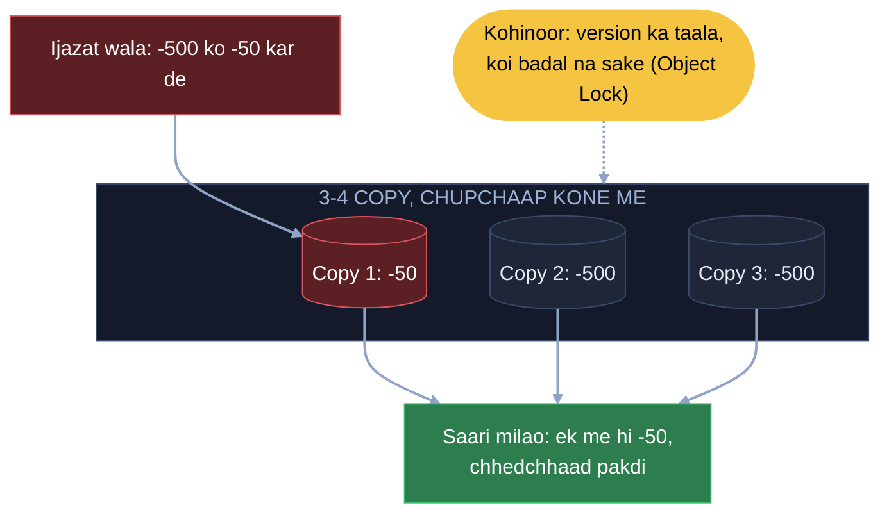

---

# Mahine ki statement (billions of records)

Interviewer bole "billions of records process karne ka system banao", to yahi hissa. Wahi branch, wahi register, par
ab ek transfer nahi: bank ke crore khaate, arbon transaction, aur har customer ki har mahine ki statement banni hai.
31 March ko sab ek saath maangte hain. Peeche kaam karne wale ladke = chhotu. Yahi dhaancha salary credit, bijli ke
bill aur mahine ki report me bhi lagta hai.

```
FR      har customer ki har mahine ki statement, download karo · har line ke saath running balance
NFR     31 March ki bheed pe bhi turant mile · statement sahi (der se aaya transaction: turant chahiye ya ekdam pakki,
        ye pehle poochho, kadam 15) · asli payment na atke
Numbers crore khaate, arbon transaction -> ek machine me nahi samata, ek chhotu se nahi banega -> kaam baanto
```

## 14. 31 March ko 1 crore log ek saath (pehle se bana ke rakho)

31 March ko ek hi din 1 crore log statement maangne aa gaye. Statement tab banni shuru hui jab maangi, aur sab atke.
Ye isliye hua kyunki arbon line se statement banane me time lagta hai, Kafka me daal ke magic se turant nahi ban
jaati. To pehle ye poochho ki statement turant chahiye kya, aur kya turant ban bhi sakti hai. Phir intezaar mat karo
ki user aaye tab banayenge. Peeche chhotu laga do: January ki January me, February ki February me bana ke rakh do.
31 March ko jo bhi aaye, Ravi ho ya Shubham, utha ke turant de do.

**Asli naam:** pehle se bana ke rakho = precompute (batch job, mahina band hote hi chalta), peeche chhotu = background
workers (Kafka se kaam baanta, har message = ek khaata + mahina), bani statement = S3 me PDF, 31 March ko user seedha
wahan se download karta. Turant chahiye kya = pehla faisla batch ya stream: statement mahine me ek baar banti, isliye
batch.

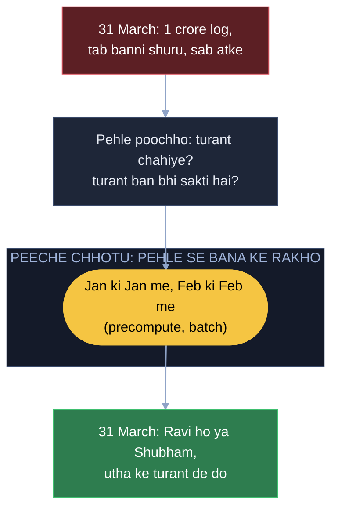

## 15. 28 Feb ka transaction der se aaya (record se milao, nayi statement)

28 Feb raat ka ek transaction der se aaya. Ravi ki Feb statement tab tak ban chuki thi, shayad bhej bhi di, aur usme ye
line hai hi nahi. Isliye statement banane ke baad ek chhotu use bank ke record se milata hai ki sach me sahi hai. Phir
bhi koi transaction baad me aaya, to do raaste hain. Pehla: use jod ke nayi statement bana do aur Ravi ke account me
daal do, wo dobara download kar lega. Doosra: statement thodi der se banao, 1 March ki subah nahi to thoda baad, taaki
der wale bhi aa jaayen. Ekdam pakki chahiye to banao, verify karo ki kuch chhoota nahi, tab do. Kaunsa raasta, ye
interviewer se poochho: turant chahiye ya ekdam pakki.

**Asli naam:** record se milao = reconciliation (statement ka jod == ledger ka jod?, kadam 10 wala milaan), nayi
statement, dobara download = revised statement (naya version, purana bhi rakha), thodi der se banao = cutoff + grace
window, turant ya ekdam pakki = consistency vs immediacy ka faisla.

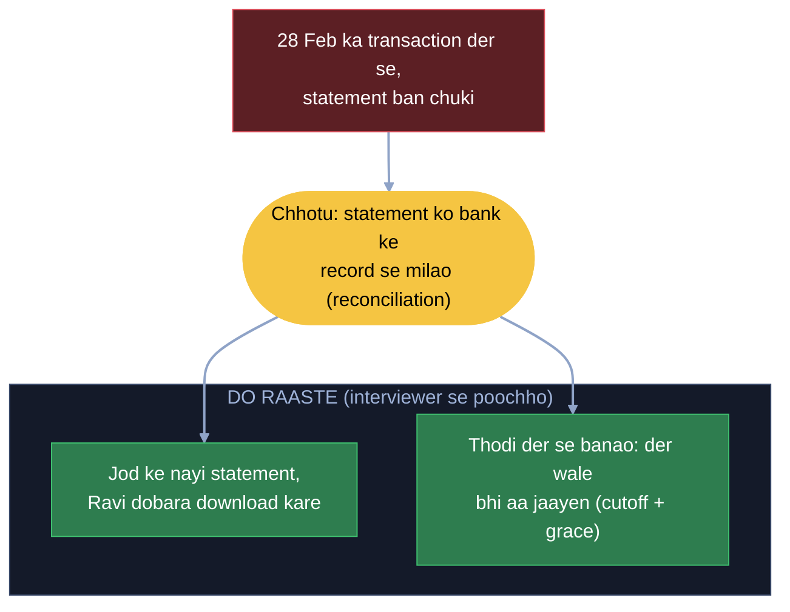

## 16. Chhotu aadha kaam karke gira (wahin se utha le)

Chhotu aadha kaam karke gir gaya. Ye Kafka me kai baar ho chuka hai. Chhotu jitna karta hai DB me likhta jaata hai, to
gira to naya chhotu wahin se utha leta hai, shuru se nahi.

**Asli naam:** DB me likhta jaata, wahin se utha le = checkpoint (kaun se khaate ho gaye), jo ban chuka wo dobara nahi
= idempotency (statement id = khaata + mahina, dobara bani to wahi purani file).

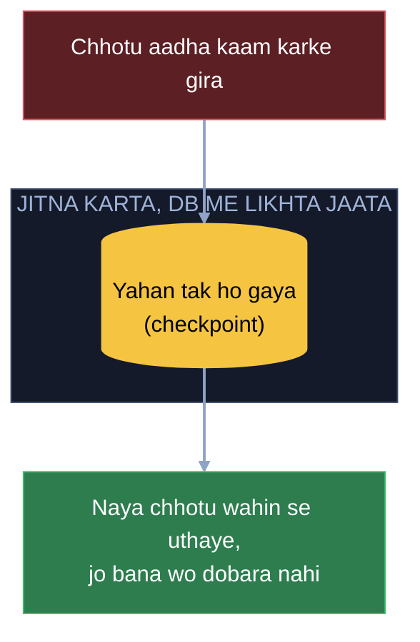

## 17. 9 chhotu khaali, ek laga pada (khaali ladke madad karo)

Kaam khaate ke hisaab se 10 chhotu me baanta. 9 chhotu kaam khatam karke baithe hain, ek bahut der se laga pada hai.
Ye isliye hua kyunki har khaata barabar nahi: aam aadmi ke mahine me 50 transaction, ek bade merchant ke crore. Jab
ladke khaali baithe hain to naye ladke kyun lane? Ek bhara pada hai, baaki khaali, to kaam baant lo. Idhar aao sab,
is bande ki madad karo.

**Asli naam:** ek ke paas bahut kaam = hot key / data skew, khaali ladke madad karo = work stealing (kaam chhote
tukdon me, khaali worker agla tukda utha le). Naye worker lagane ki zaroorat nahi.

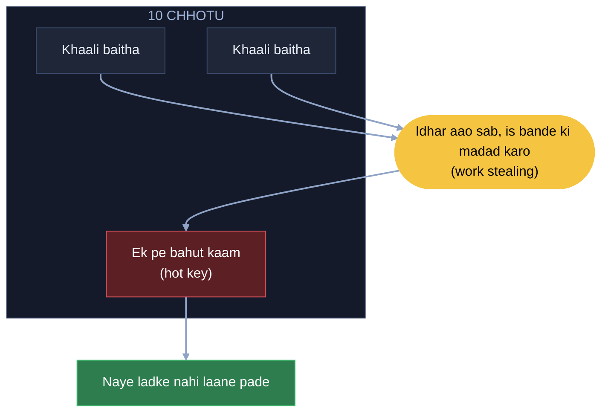

## 18. Ek khaata, 5 crore transaction, ek statement (bada aadmi jode)

Wo bada kaam ek hi merchant ka hai: 5 crore transaction, aur statement ek hi banni hai. To ek parchi pe sab mat baitho,
kaam baant do: 20 lakh tu le, 30 lakh tu le. Sab apna hissa karke laaye. Phir ek bada aadmi bulao jo isi kaam me
expert hai, wo sabke tukde jod ke ek statement bana dega. Thoda time lagega, chalega.

**Asli naam:** kaam baant do = map (har chhotu apne tukde ka hisaab), bada aadmi jod ke ek banaye = reduce (saare tukde
kram se jod ke ek statement), dono milke = MapReduce.

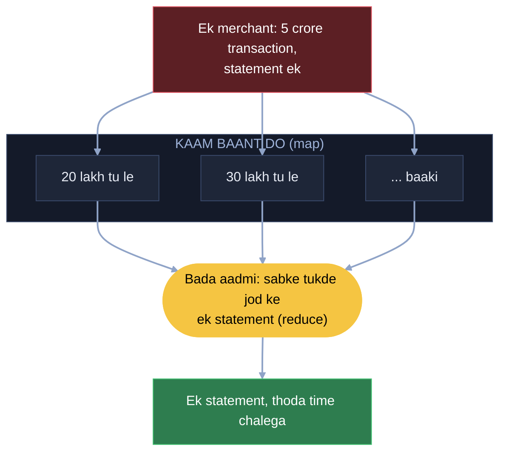

## 19. May wale ko 1 May ka balance chahiye (master register se utha le)

Statement me har line ke saath running balance chhapta hai. May wale chhotu ko pehli line pe 1 May ka opening balance
likhna hai, aur wo April wale ke khatam hone pe hi pata chalega. Matlab kaam baanta, par sab line me lag gaye. To
tukde mahine ke hisaab se do: April wala April, May wala May. Andaze se balance nahi likh sakte, statement galat ho
jaayegi. Aur balance to master register me pehle se likha hai. Intezaar kyun? May wala chhotu master register se 1 May
ka balance utha le, apne notepad me likh le, aur kaam shuru kar de.

**Asli naam:** mahine ke tukde = mahine ke partition, master register me likha balance = balance snapshot (kadam 11
wala: har mahine ke ant ka balance alag likha). Isliye har chhotu apna mahina akela banata, kisi ka intezaar nahi.

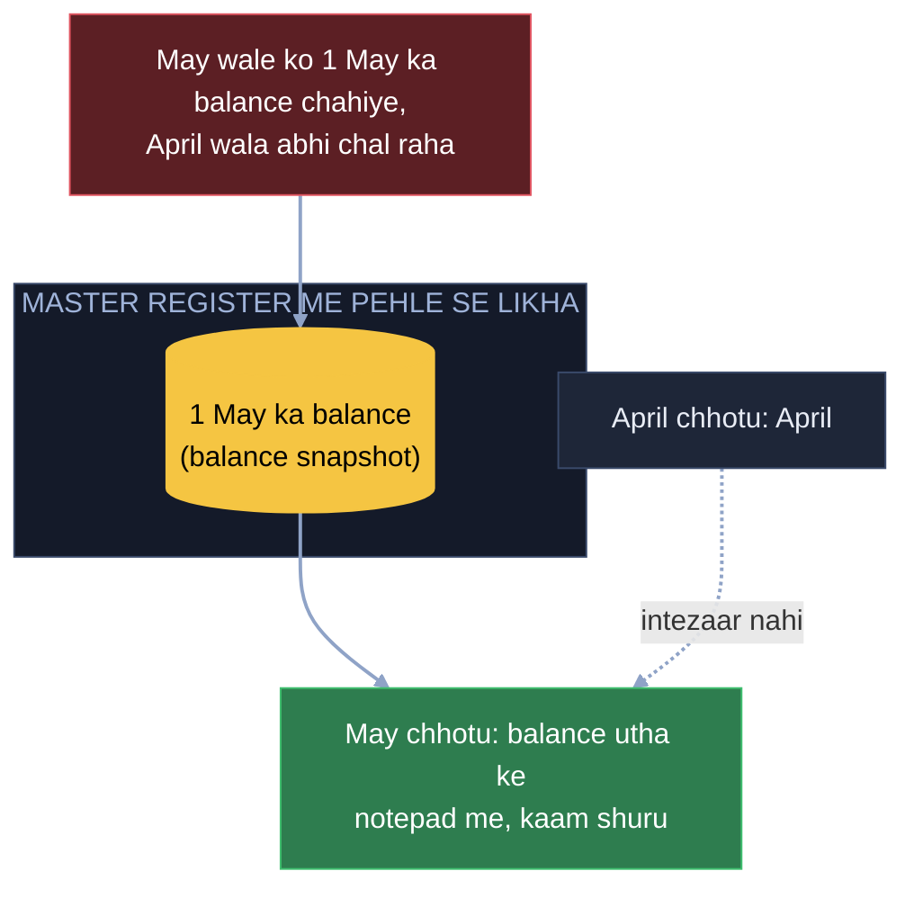

## 20. Raat 2 baje chhotu ne register gher liya, chai ki payment atki (photocopy se padho)

Raat 2 baje saare chhotu main register se arbon line padh rahe hain. Usi waqt log UPI kar rahe hain, aur ₹50 ki chai
ki payment 20 second atak gayi. Ye kadam 8 wali hi dikkat hai: padhne wale ne register gher liya. To chhotu photocopy
se padhein, main register asli payment ke liye khaali rahe.

**Asli naam:** photocopy se padho = read replica (batch sirf replica pe), main register asli payment ke liye = primary.

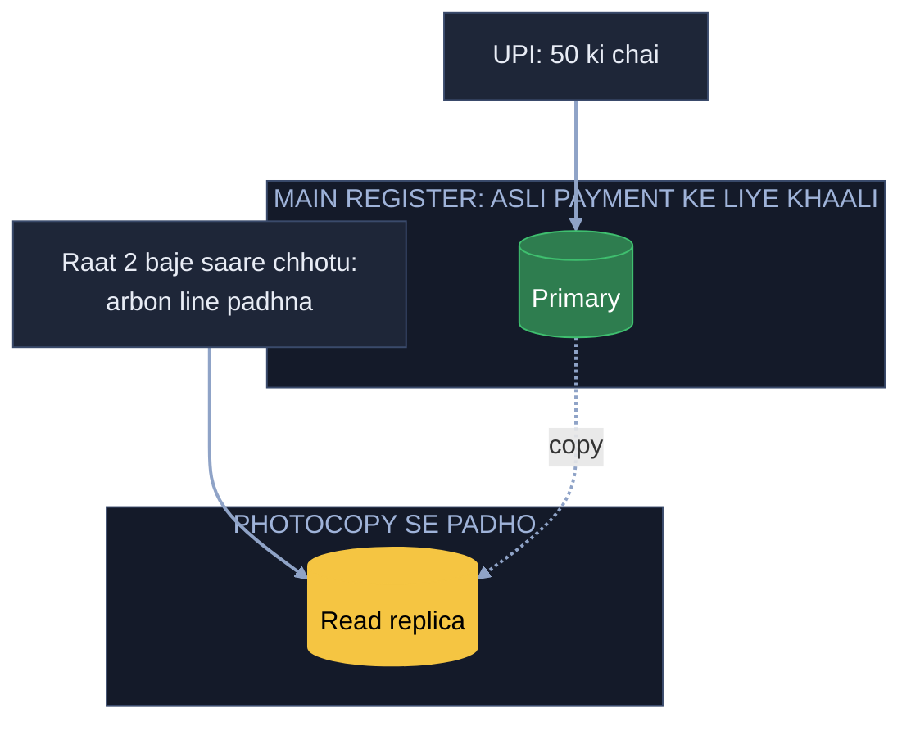

---

Notes (Arpan ke shabd) = [BANKING_HAND_NOTES.md](BANKING_HAND_NOTES.md)
