# Mini Banking System (accounts · transactions · balances)

> Ek bank ke andar accounts, un pe paisa daalo / nikaalo / bhejo, aur balance dikhao.
> Is design ka dil: **khaata (ledger) SACH hai, balance sirf uska jod (nateeja)** + paisa na bane na gayab ho.
> KYUN YE DESIGN: candidates batate: payment flow · transaction ledger · ATM · do account ke beech
> bank ke andar transfer. JP ka sabse sambhavit HLD.

---

## KAHANI (ek din, 1 tareekh = salary day, main aur Ravi; har dikkat se design me ek dabba judta)

```
    KYA HUA                                     ILAAJ                                 DABBA JUDA
1   8 baje Ravi ko 500, beech me server gira -> EK TRANSACTION (WAL)                  SQL DB
2   8:30 network gaya, app ne dobara bheja   -> IDEMPOTENCY KEY (UNIQUE)              Banking Svc (+ key)
3   9:00 Netflix auto-debit + mera UPI       -> CHECK + KAATNA EK QUERY               (SQL DB: balance >= x)
4   mera 500 kahan gaya? (support / audit)  -> KHAATA (ledger) usi transaction me    (SQL DB: ledger table)
5   10 baje salary, Ravi ko rent, SMS giri    -> OUTBOX, Kafka key = account_id        Kafka
6   salary ke baad maine balance khola       -> BALANCE = CACHE, raat RECONCILIATION  Reconciliation job
7   11 baje sabki salary, ek machine bhari   -> KAI MACHINE + LB, DB sync copy        LB + Banking Svc x N
8   bheed me sab balance dekh rahe           -> READ REPLICA + read-your-own-writes   Read replica
9   dukaan ko 500, usi sec 200 refund        -> CHHOTI ID PEHLE LOCK                  (SQL DB: lock kram)
10  CA ka export, page 5000 dheema           -> KEYSET (ts, id) + index               (SQL DB: index)
11  raat: 5 saal khaata ek table me          -> MAHINE KE TUKDE + S3, snapshot        Archive (S3)

POORA DESIGN (upar ke dabbe kram se):
   User -> LB -> Banking Svc (idempotency key) -> SQL DB: EK transaction (khaata + balance + outbox)
        -> Kafka (commit ke baad, key = account_id) · Read replica = balance / history
   Reconciliation (raat) · Archive S3 (mahine ke tukde, had se pehle delete nahi)
```

---

## TASVEER (ByteByteGo / Alex Xu · CC BY-NC-ND 4.0)


Source: [Read Replica Pattern](https://bytebytego.com/guides/read-replica-pattern/)
(transfer ke baad purana balance = replica peeche -> turant wala padhna PRIMARY se)

---

## SHURU: pehle poocho, phir numbers

```
POOCHO:  "Bahut bada hai — use-cases baandh lete hain. Ek hi bank ke andar, ya doosre bank ko bhi?"
         ("let's discuss use cases first" — scope pehle,
          warna interviewer jitna bada system chaahe sar pe daal dega)

KYA KARE (FR):    user ke ek / kai ACCOUNT · DEPOSIT · WITHDRAW ·
                  TRANSFER A -> B (DONO isi bank) · BALANCE · HISTORY
                  ★ "dono isi bank" — ye ek shabd poora design badalta
                  bahar: doosra bank · loan · byaaj · card · KYC
KAISA CHALE (NFR): SAHI hona sabse upar (paisa na GUM, na BANE, hisaab
                   har waqt barabar) · har paisa TRACE ho (audit)
                   dobara bhejne pe DOBARA na kate (idempotent) · balance dekhna TEZ (sabse zyada padha jaata)

NUMBERS (andaaza):
   50 lakh account · 1 crore transaction / din, din me ~86,400 second -> ~120 likhai / second
   padhna >> likhna (log balance baar-baar dekhte)
   120 / second = ek theek-thaak Postgres machine ka DASVA hissa
       -> SHARDING KI ZAROORAT NAHI, primary + replica kaafi
   khaata: 1 crore x 2 line x 365 = ~730 crore line / saal -> 3 saal ~22 arab · 5 saal ~36 arab

DATA SE TEEN SAWAAL:
   1. transfer me DO row badalti -> dono ya koi nahi, kaun sambhalega?
   2. ek account pe do transfer ek saath -> kaun rokega?
   3. balance minus me na jaaye -> niyam kahan likha?
```

---

## ════ MOCK SE PEHLE: SIRF YE CARD PADHO ════

> Har card: pehle PEELA DABBA dekho (scene + ilaaj). Yaad aa gaya -> aage. Nahi aaya -> neeche
> DIKKAT / HAL / NAHI padho. AAGE POOCHEGA sirf jab interviewer aage kuch poochhe.

#### DABBA 0: SABSE SIMPLE (yahan se shuru, phir "kahan tootega")
```
Banking Service (saara niyam / logic) -> SQL DB. Jaan-boojh ke seedha.
```
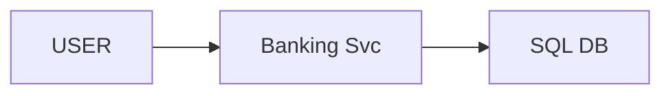

#### 1 Maine Ravi ko 500 bheje, beech me server gira
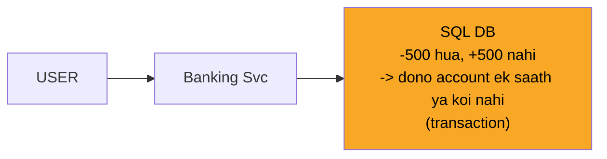
```
DIKKAT     1 tareekh subah 8 baje maine Ravi ko 500 bheje. Mere 500 kate, Ravi ke account me daalne se PEHLE
           server gira. 500 na mere paas, na Ravi ke paas. Gayab.
HAL        dono ek saath ya koi nahi (TRANSACTION, ek DB): BEGIN; UPDATE Arpan -500; UPDATE Ravi +500; COMMIT;
           DB pehle diary (WAL) me likhta; utha to COMMIT hua tha -> poora, nahi -> ulta. Aadha kabhi nahi.
NAHI       SAGA / queue laga do: ek DB me kaatna aur daalna alag ho jaate, dikkat khud ban jaati.
```
```
AAGE POOCHEGA:
  NIYAM: ek DB = ek transaction, aadha kabhi nahi (crash pe DB khud ulta); alag bank / DB = SAGA + PENDING.
  "Ravi doosre bank me ho to?" -> PENDING + SAGA: kyunki do bank = do DB, ek transaction ho hi nahi sakta;
                                  raat ko milaan (reconciliation).
  "Yahan CP chahiye ya AP?"    -> TRANSFER / BALANCE = CP: kyunki galat balance dikhane se mana karna behtar.
                                  SMS / statement = AP (2 sec late chalta).
```

#### 2 Send dabaya, network gaya, app ne dobara bheja
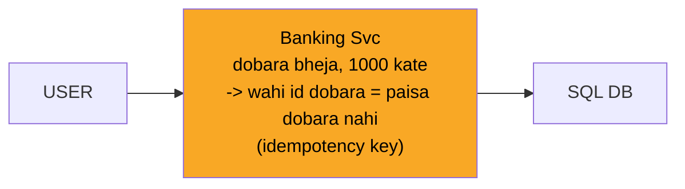
```
DIKKAT     8:30 lift me maine Send dabaya, 500 kat bhi gaye, par jawab aate waqt network gaya. App ne timeout
           pe khud dobara bheja -> 1000 kat gaye, bhejne the 500.
HAL        wahi id dobara = paisa nahi (IDEMPOTENCY KEY): screen khulte id bane, dobara WAHI; DB me UNIQUE.
           Wahi id aayi -> pehla jawab wapas, paisa doosri baar nahi katta. Send button pehli tap pe band.
NAHI       app me "pehle dekho, phir daalo": dono ne dekha "nahi hai", dono ne daala (race).
```
```
AAGE POOCHEGA:
  NIYAM: aadha nahi = transaction, do baar nahi = id; user / app ka retry hamesha safe, wahi id = wahi jawab.
  "UNIQUE lagane se kya mila?"     -> DB KHUD ROKTA: kyunki do request ek saath aayein to bhi doosra insert
                                      fail (UNIQUE = taala jaisa).
  "Key wahi, amount 5000?"         -> BODY KA HASH MILAO: kyunki key ke saath request ka hash rakha; mel nahi
                                      = 422, purana jawab nahi.
  "Ye key table to badhti rahegi?" -> 24-48 GHANTE BAAD SAAF: kyunki retry itni der me hi aata, uske baad key
                                      ka kaam khatam.
```

#### 3 9 baje Netflix ka auto-debit aur mera UPI ek saath
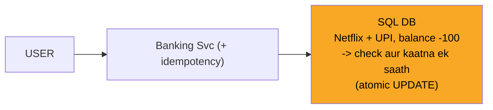
```
DIKKAT     Mere paas 300. 9:00 Netflix ka 200 ka auto-debit chala, usi second maine UPI se Ravi ko 200 bheje.
           Do request, do thread, dono ne balance 300 padha -> dono pass -> dono kate -> mera balance -100.
HAL        check aur kaatna ek saath (ATOMIC UPDATE):
             UPDATE account SET balance = balance - 200 WHERE id = 'Arpan' AND balance >= 200
           Row pe taala -> dono line me. Pehla: 300 -> 100. Doosra: 100 >= 200? nahi -> 0 row -> reject.
NAHI       Java synchronized: Banking Svc ki kai machine, lock sirf ek ke andar.
```
```
AAGE POOCHEGA:
  NIYAM: check + kaat ek query me, DB me (raaste kai, DB ek); haara = 0 row -> user ko saaf "paisa kam".
  "0 row aaya, user ko kya?"  -> 422 INSUFFICIENT BALANCE: kyunki 0 row = shart fail, kuch kata nahi; poora
                                 transaction wapas.
  "Ye niyam Java me likh do?" -> DB ME HI (WHERE balance >= x, ya CHECK): kyunki raaste kai (API / batch /
                                 haath se), DB ek.
```

#### 4 Maine poochha: mere 500 kahan gaye, kab?
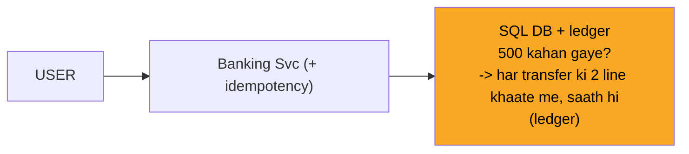
```
DIKKAT     Subah se paisa kai baar hila. Maine support se poochha "mere 500 kahan gaye, kab?" (audit bhi yahi)
           -> har len-den ka pakka khaata chahiye.
HAL        har transfer khaate me (LEDGER = DB ki table), usi transaction me 2 line: Arpan -500, Ravi +500.
           Sirf INSERT, kabhi badla nahi: BEGIN · INSERT ledger x2 · UPDATE balance x2 · COMMIT.
NAHI       khaata Kafka me: DB transaction wapas hua (paisa kam tha), Kafka me "Arpan -500" -> khaata jhooth.
```
```
AAGE POOCHEGA:
  NIYAM: khaata usi txn me jahan paisa hila; sirf INSERT, galti = ulti line; rollback = khaata bhi gaya.
  "Khaata Kafka me kyun nahi?" -> EK TRANSACTION HO HI NAHI SAKTA: kyunki Kafka aur DB alag; rollback hua to
                                  Kafka me jhoothi line bachti.
  "Galat line, UPDATE kar do?" -> NAHI, ULTI LINE JODO: kyunki khaata sirf INSERT, kabhi badla nahi; galti bhi
                                  khaate me dikhe.
```

#### 5 Salary aayi, Ravi ko rent bheja, SMS service giri
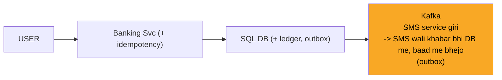
```
DIKKAT     10 baje salary 50,000 aayi, 1 min baad Ravi ko 20,000 rent bheja. Har transfer ke baad SMS, fraud,
           statement chahiye. Par SMS service giri hui hai -> transfer na ruke, aur SMS khoye bhi nahi.
HAL        khabar bhi DB me (OUTBOX = ek aur table), usi transaction me: har khaata line ki row, sent=false.
           COMMIT ke BAAD relay har ~1 sec: sent=false -> Kafka (acks=all) -> sent=true.
NAHI       commit ke baad seedha Kafka: commit aur bhejne ke beech app gira = event gayab, SMS kabhi nahi.
```
```
AAGE POOCHEGA:
  NIYAM: transfer side-kaam (SMS) pe na ruke; khabar outbox me usi txn, Kafka commit ke BAAD; dobara aa sakti.
  "SMS ulte kram me aaye?"           -> KEY = ACCOUNT_ID: kyunki ek account ke sab event ek partition me, kram
                                        se; Ravi ka apna partition.
  "Relay sent = true se pehle gira?" -> EVENT DOBARA, SMS SKIP: kyunki relay phir bhejega; SMS service eventId
                                        dekh ke dobara nahi bhejti.
  "Relay likhna hi na pade to?"      -> CDC (Debezium): kyunki DB ki diary (WAL) me har commit hai; wahi padh
                                        ke seedha Kafka.
  "Outbox table bharti jaayegi?"     -> ROZ SAAF: kyunki sent = true wali rows ka kaam khatam (ya partition
                                        drop).
```

#### 6 Salary ke baad maine balance khola
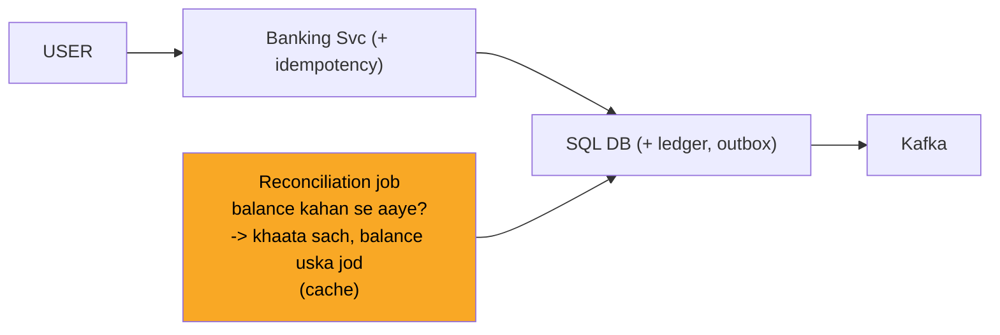
```
AAGE POOCHEGA:
  NIYAM: sach = khaata, balance uska jod (cache); farak = alert + account roko, pehle KYUN, phir khaata jeete.
  "Kaise kaam karta?"             -> BALANCE = KHAATE KA JOD (cache), usi transaction me: kyunki har baar
                                     50,000 line jodna dheema. Raat RECONCILIATION: jod 29,800 = column.
  "Raat farak: 29,800 vs 30,300?" -> ALERT + ACCOUNT ROKO: kyunki chupchaap theek kiya to bug zinda; pehle
                                     KYUN, phir khaata jeetega.
  "Sab chal raha, pata kaise?"    -> ALERT: reconciliation + p99 + error rate + queue lag + DB connection, aur
                                     har transfer ka trace id; kyunki dikkat inhi me pehle dikhti.
```

#### 7 11 baje sabki salary aa gayi, ek Banking service bhar gayi
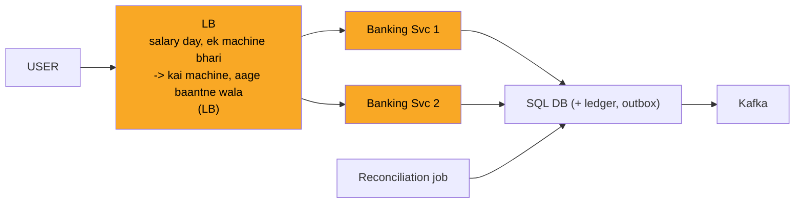
```
AAGE POOCHEGA:
  NIYAM: service kuch yaad nahi rakhti (jitni lagao); sach DB me, copy sync; gira to app wahi id se dobara.
  "Ab main DB hi gir gaya?"     -> SYNC COPY doosri building me: kyunki har transfer copy me likh ke hi
                                   "done"; Patroni / RDS Multi-AZ copy promote, ~1-2 min.
  "Sync = har transfer dheema?" -> HAAN, EK NETWORK CHAKKAR: kyunki paise me ye chalega; async me aakhri
                                   transfer kho sakta.
  "Un 1-2 min ke transfer?"     -> ERROR -> APP DOBARA, SAME KEY: kyunki idempotency key hai, do baar nahi
                                   katega.
```

#### 8 Salary ki bheed me sab balance dekh rahe, transfer dheeme
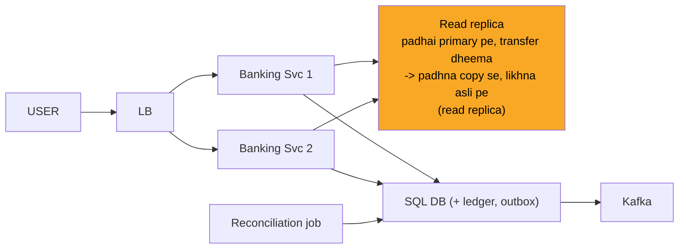
```
AAGE POOCHEGA:
  NIYAM: copy thodi peeche: dikhana copy se, paise ka faisla primary pe; abhi likha to primary se padho.
  "Kaise kaam karta?"                  -> PADHNA COPY SE, LIKHNA PRIMARY PE: kyunki bheed padhne ki hai;
                                          primary ki diary (WAL) copy tak jaati, copy wahi badlaav lagati.
  "Copy 5 sec peeche, purana balance?" -> ABHI LIKHA TO PRIMARY SE (read-your-own-writes): kyunki purana dikha
                                          to dobara bhejunga; last_write_at (Redis) se kuch sec.
  "Copy minute bhar peeche?"           -> LAG PE ALERT: kyunki itna purana dikhana galat; had paar -> us copy
                                          ko padhne wali list se hatao.
```

#### 9 Ravi ki dukaan ko 500, usi second dukaan se 200 refund (deadlock)
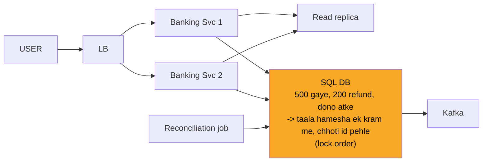
```
AAGE POOCHEGA:
  NIYAM: taala hamesha ek kram me (chhoti id pehle); phir bhi phansa to DB ek ko wapas, app wahi id se dobara.
  "Kaise kaam karta?"          -> GOL GHERA: Txn1 ka mujh pe taala + Ravi ka intezaar, Txn2 ulta (MySQL 1213).
                                  Dono CHHOTI ID PEHLE lock karein -> ek ruka, doosra poora.
  "Kram ke baad bhi deadlock?" -> DB EK KO WAPAS KARTA: kyunki DB ghera khud pakadta; app ruk ke dobara, same
                                  idempotency key.
```

#### 10 Shaam ko dukaan ke CA ka export, page 5000 pe atka
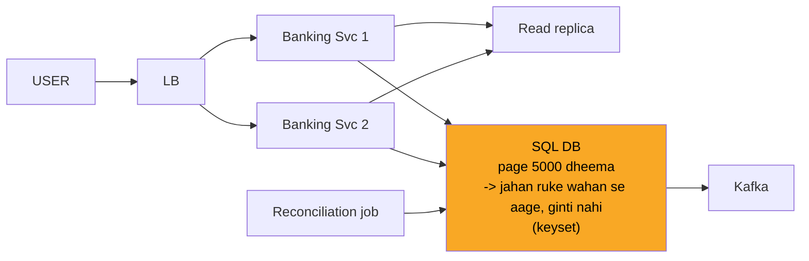
```
DIKKAT     Ravi ki dukaan: roz ~500 UPI, 3 saal = ~5 lakh line. CA ka tool 20-20 ke page maangta. Page 5000 pe
           LIMIT 20 OFFSET 100000 -> DB 1,00,020 line PADH ke phenkta. Beech me nayi line -> ek line dobara.
HAL        aakhri line se aage (KEYSET): pichhle page ki aakhri (ts, id) yaad, agla page "isse purani 20":
             WHERE account_id = ? AND (ts, id) < (:last_ts, :last_id) ORDER BY ts DESC, id DESC LIMIT 20
           Index (account_id, ts DESC, id DESC) se seedha wahan -> page 1 ho ya 5000, ek jaisa tez.
NAHI       saari 5 lakh line ek baar me bhejo: memory bhari, request timeout.
```
```
AAGE POOCHEGA:
  NIYAM: "kahan tak dekha" yaad, "kitne chhode" nahi; page 1 ya 5000 ek jaisa, nayi line aaye to dohraav nahi.
  "Ek hi ts pe do line ho to?" -> (ts, id) DONO: kyunki sirf ts pe line chhoot ya dobara aa sakti; id barabari
                                  todti.
  "Seedha page 500 pe?"        -> KEYSET ME NAHI: kyunki "kahan tak dekha" yaad hai, "kitne chhode" nahi; sirf
                                  agla / pichhla, statement ke liye theek.
  "(ts, id) app ko kaise?"     -> NEXT_CURSOR: (ts, id) ko base64 karke; kyunki app ko andar ka matlab jaanna
                                  hi nahi.
```

#### 11 Raat ko: 5 saal ka khaata ek hi table me
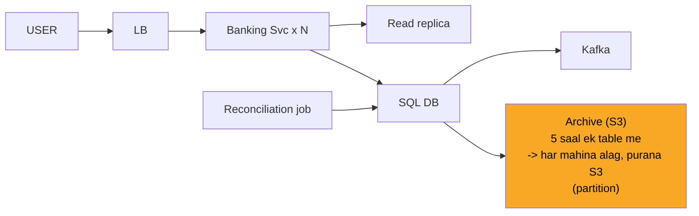
```
DIKKAT     5 saal ka khaata (~36 arab line) ek table me. Log roz sirf 3 mahine dekhte, par har query / backup
           arabon line ke saath. Aur kanoon (PMLA / RBI) kam se kam 5 saal rakhwata, bank 8-10.
HAL        mahine alag (PARTITION): khaata mahine ke partition me; band mahina DETACH (table se alag) -> S3
           (sasta). Had (PMLA min 5 saal) se pehle delete nahi.
NAHI       "archive = sharding": archive jagah ghatata, shard likhne ka bojh baantta.
```
```
AAGE POOCHEGA:
  NIYAM: naya paas, purana sasta (S3), kanoon (5 saal) tak pakka; jod = snapshot + baad ki line, poora nahi.
  "S3 gaye, 22 arab ka SUM?"   -> SNAPSHOT: kyunki poora kabhi mat jodo; mahine ke aakhir ka balance (31-Mar
                                  Arpan = 45,000) + baad ki line = "opening balance".
  "RBI ko 2021 ka statement?"  -> S3 PE ATHENA QUERY (Parquet): kyunki data wahin pada hai; ya us mahine ka
                                  tukda wapas laao.
  "Archive file koi badal de?" -> S3 OBJECT LOCK (WORM): kyunki kanoon ka record hai; na delete na badal,
                                  saalon tak.
```

---

## AAKHRI DABBA + WRAP (ek hi baar)

```
User -> LB -> Banking Svc (stateless, idempotency check)
-> SQL DB: EK transaction (dono khaata line + dono balance + idempotency key + outbox)
-> Kafka (commit ke BAAD, outbox se: SMS / fraud / analytics / statement) · Read replica = balance / history
Reconciliation (raat ko: snapshot + baad ki line vs balance -> ALERT)
Archive S3 (band mahine, had se pehle delete nahi)

DB:  SQL -> paisa na khoye na bane: EK transaction (ek DB me SAGA nahi)
     khaata = SACH (sirf jodo, double-entry, mahine ke tukde) · balance = CACHE (jod, usi transaction me)
```
```
JAWAB:    Ek transfer ka sab kuch (dono khaata line, dono balance, id, SMS wali khabar) ek transaction
          me, SQL me. Paisa na khota na banta.
          Khaata sach, balance uska jod, raat ko milaan. Balance check aur lock ka kram DB me.
          Padhai copy se, history 'pichhli line ke baad se', purane mahine sasti jagah, SMS commit ke
          baad Kafka se.
```
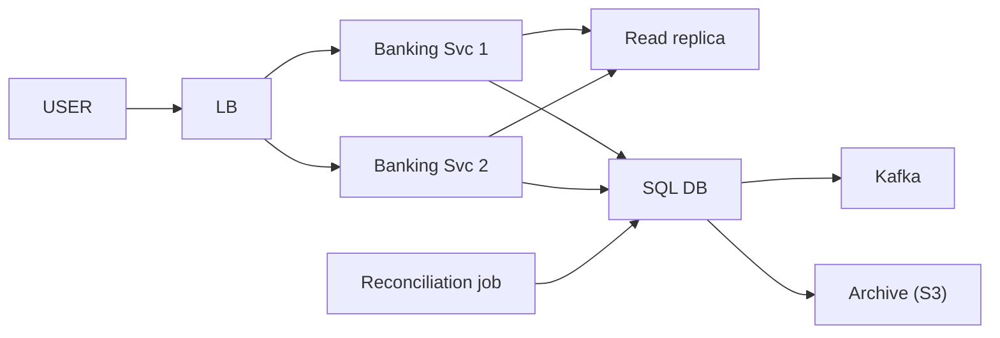

---

## 10 GUNA TRAFFIC — har dabba alag se

```
KRAM:  sasta pehle, SHARD aakhir me
  1. READ REPLICA (pehla kadam, padhna >> likhna) · keemat: thoda peeche -> apna abhi-kiya transfer PRIMARY se
  2. MAHINE ke tukde (archive + query dono ke liye)
  3. SHARD by account_id = AAKHRI, keemat badi: Arpan shard-1, Ravi
     shard-2 -> transfer ek transaction NAHI -> wapas SAGA / 2PC
     -> beech me crash wali dikkat wapas · hamare 120 / sec pe ye sawaal hi nahi; pehle badi machine + replica
  LIKHAI se DB maar kha raha (replica ke baad bhi):
     cache / index = sirf PADHAI ka ilaaj (har naya index INSERT dheema karta) -> likhai ke liye SHARD
     by account_id: ek account ki KHAATA LINE ek shard pe; do shard ke beech transfer -> SAGA
     · zaroori-nahi wali likhai (statement, SMS) queue pe
  BADI TABLE (jagah) -> mahine ke tukde + archive (had se pehle DELETE nahi)
  ✗ "badi transaction chhoti karo" = galat: kaatna + daalna EK transaction me hi
  replica sirf PADHAI baantti, likhai ke liye SHARD · desh / date = bura key (ek garam)

POOCHEGA: "Replicas are in, but writes are still killing the DB. What now?"
          (Copy laga di, par likhai abhi bhi DB ko maar rahi. Ab?)

JAWAB:    Copy sirf padhai ka bojh baantti, likhai sab main DB pe hi jaati. Index bhi sirf padhai tez
          karta, likhai ulta dheemi.
          Likhai bahut ho to account id se baanto: Arpan ki saari khaata line ek tukde pe. Do tukdon ke
          beech transfer -> SAGA. SMS / statement jaisa kaam line me daal do.
          Jagah ke liye mahine ke tukde, purane sasti jagah. Kanoon ki had (5+ saal) se pehle delete nahi.
POOCHEGA: "How would you scale this to 10x?"      -> pehle jo toote
          (padhai -> replica, jagah -> tukde, likhai -> shard)
POOCHEGA: "What's the single point of failure?"   -> DB primary (sync copy), Banking Svc (LB + kai machine)
```

---

## POOCHE TO (gehra sawaal aaye tab)

```
API:      GET /accounts/{id}/balance · GET /accounts/{id}/transactions?cursor=...&limit=20
          POST /transfers { from, to, amount }
          POST /accounts/{id}/deposit { amount } · POST /accounts/{id}/withdraw { amount }
          har POST me Idempotency-Key header
          har request pe OWNER CHECK: userId JWT se (body / URL se nahi); from_account ka maalik
          nahi -> 403 (Ravi "Arpan ke account se 500" bheje to). Balance / history pe bhi.

DB:       ledger_entries (SACH, sirf jodo, mahine ke tukde) · accounts.balance (CACHE, jod)
          idempotency_keys (UNIQUE) · outbox · account_balance_snapshot (mahine ke aakhir ka balance)

PAANCH CHEEZ JINPE YE ROUND TAY HOTA (source: "ye interview INHI se tay hote hain"):
   IDEMPOTENCY · TRANSACTIONS · QUEUES · RECONCILIATION · AUDIT
   + ACID vs eventual (network toote to SAHI hona chuno, chalte rehne ki keemat pe)
   + asli khaate ke liye RELATIONAL DB, NoSQL nahi
```

---

ARCHETYPE C · CONCEPTS: [db-what-when](../../FOUNDATIONS/09_databases_what_when.md) · [CAP](../../FOUNDATIONS/08_cap_theorem.md) · [saga/ms-comm](../../FOUNDATIONS/10_ms_communication.md) · [caching](../../FOUNDATIONS/04_caching.md) · saath: [payment-system](../06_payment_system/06_payment_system.md) (iska bada bhai) · [stock-broker](../05_stock_broker_trading/05_stock_broker_trading.md) · [← MASTER SHEET](../../00_MASTER_SHEET.md)
