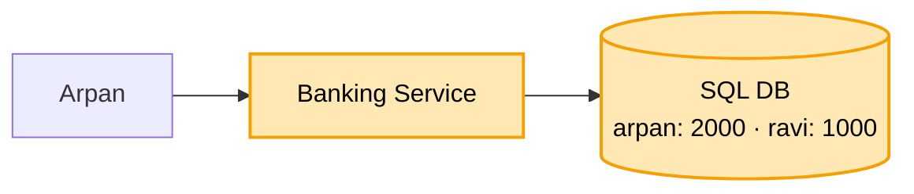
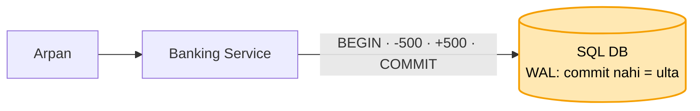
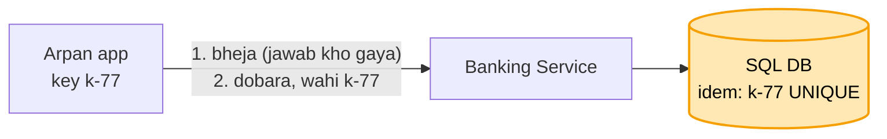
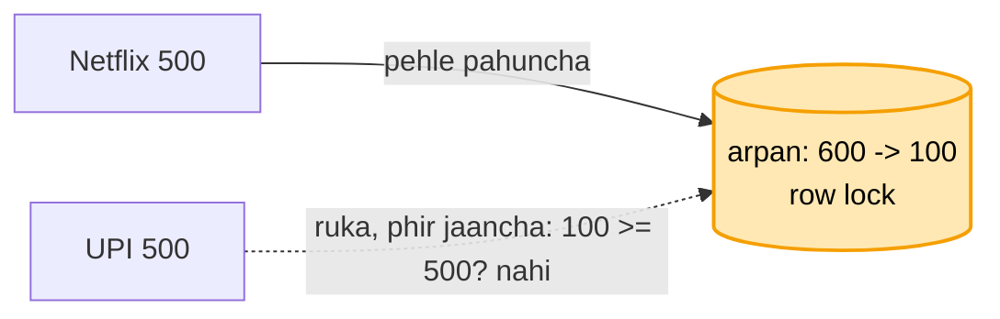
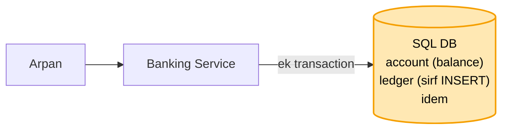
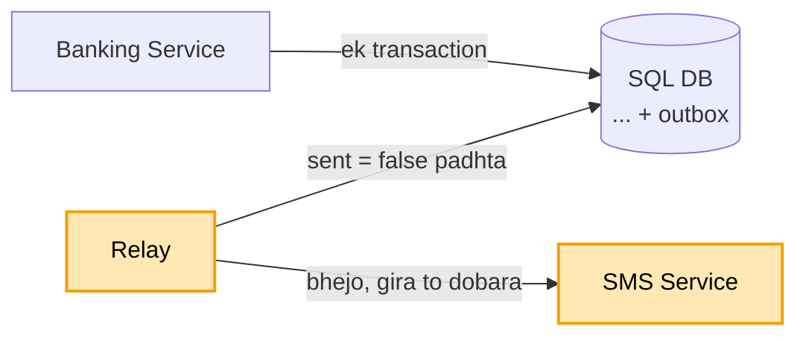
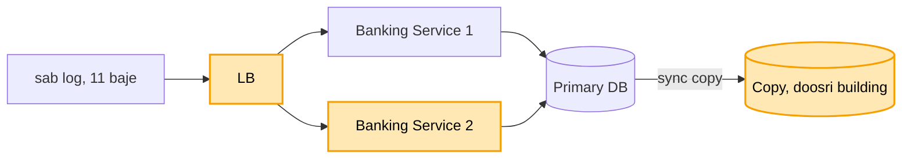
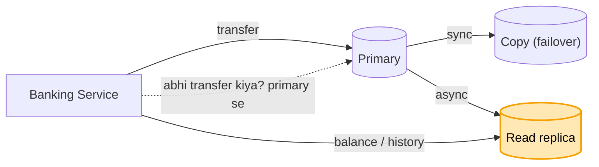
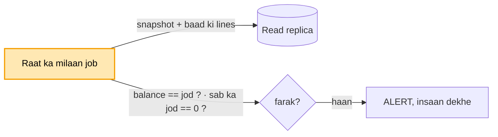
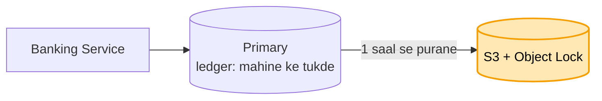

# Mini banking: shuru se, ek kahani

Kram wahi jo interview me hota hai: **FR, phir NFR, phir numbers, phir design**. Design sabse seedhe dabbe se
shuru hota hai, aur har dikkat aane pe ek naya dabba judta hai. Diagram me peela dabba = abhi juda. Poori file
me ek hi kahani hai: Arpan ne Ravi ko 500 bheje. Ye JP ka sabse sambhavit HLD hai. Paisa bank ke bahar jaaye
(PSP = payment company jaise Razorpay, doosra bank) to [payment](../06_payment_system/06_payment_system.md) dekho.
Yahi dhaancha [BookMyShow](../09_bookmyshow/09_bookmyshow.md) me bhi: kadam 3 (key) = [BookMyShow kadam 6](../09_bookmyshow/09_bookmyshow.md#kadam-6-pay-dobara--paisa-banking-kadam-3--payment-file),
kadam 4 (ek query) = [BookMyShow kadam 2](../09_bookmyshow/09_bookmyshow.md#kadam-2-padhna-aur-likhna-ek-hi-query-me-banking-kadam-4-wala-hi) (balance ki jagah seat).

**CUE (yahi shabd yaad rakhne hain, kram se):**
service + SQL -> ek transaction (WAL) -> idempotency key -> check + kaato ek query -> ledger (double-entry)
-> outbox (SMS) -> LB + sync copy -> read replica -> raat ka milaan -> mahine ke tukde + S3

---

## 1. FR: kya karna hai

```
1. account: paisa daalo, nikaalo, balance dekho, history dekho
2. transfer A se B, DONO isi bank me
scope ke bahar (poochh ke hata do): doosra bank, loan, byaaj, card, KYC
```

"Dono isi bank" ye ek shabd poora design badal deta hai, isliye ye pehle poochho.

## 2. NFR: kaisa chalna chahiye

```
- SAHI sabse upar: paisa na gum ho, na bane. Hisaab har waqt barabar
- har paisa trace ho (audit)
- dobara bhejne pe dobara na kate
- balance dekhna tez ho
```

## 3. Numbers

```
- 50 lakh account, roz 1 crore transaction -> ~120 likhai har second, padhna isse kahin zyada
- 120 likhai / second ek Postgres ki taakat ka dasva hissa hai
```

Matlab yahan bheed badi dikkat nahi hai, **sahi hona** badi dikkat hai. Isliye shard nahi chahiye, ek SQL DB
kaafi hai. Ye URL se ulta hai: wahan dikkat speed aur size ki thi.

---

## 4. Design

### Kadam 1: sabse seedha (Banking Service + SQL DB)

Ek Banking Service aur peeche ek SQL DB. Arpan ne Ravi ko 500 bheje:

```
UPDATE account SET balance = balance - 500 WHERE id = arpan
UPDATE account SET balance = balance + 500 WHERE id = ravi
```



### DB kaunsa: SQL ya NoSQL?

Data dekho: account aur unka balance. Kaam: ek transfer me do row ek saath badalni hain (Arpan -500, Ravi
+500), aur dono badlein ya koi nahi.

Kai row ek saath pakka badalna SQL ka seedha kaam hai (ACID). Bheed chhoti hai (120 likhai / second), to NoSQL
ki "bahut bada data, kai machine" wali taakat yahan chahiye hi nahi. Isliye SQL (Postgres).

**Maan lo owner check poochha:** userId JWT se lo, body / URL se nahi. from_account ka maalik nahi to 403.

Par pehla UPDATE hua (Arpan se 500 kat gaye), aur doosre se pehle server gir gaya. Ravi ko kuch nahi mila.
Paisa gayab.

### Kadam 2: beech me server gira, paisa gayab (ek transaction)

Ilaaj: dono UPDATE ko ek **transaction** me band karo. Matlab ya to dono honge, ya koi nahi.

```
BEGIN
  UPDATE account SET balance = balance - 500 WHERE id = arpan
  UPDATE account SET balance = balance + 500 WHERE id = ravi
COMMIT
```

COMMIT se pehle server gira to DB pehla UPDATE bhi ulta kar deta hai (rollback). Arpan ke 2000 wapas 2000,
Ravi ke 1000 waise hi 1000. Paisa na gaya, na bana.

DB ko kaise pata ki kya ulta karna hai? **WAL (write-ahead log)** se. DB asli table badalne se pehle har
badlaav ek log me likhta hai. Restart hone pe DB log padhta hai: jo transaction COMMIT nahi hua tha use ulta
kar deta hai, aur jo COMMIT ho gaya tha wo pakka rehta hai, bijli jaane pe bhi.



Saga yahan kyun nahi? Saga (kadam-kadam kaam, fail pe pichhla ulta) tab lagta hai jab paisa do alag DB me ho,
jaise doosra bank. Yahan dono account ek hi DB me hain, to ek transaction seedha aur pakka hai. Payment wali
file me doosra bank aata hai, wahan saga hai.

Par Arpan ne Send dabaya, transaction ho bhi gaya, par jawab aane se pehle metro me network chala gaya. App ne
socha fail hua aur dobara bhej diya. 1000 kat gaye.

### Kadam 3: network gaya, app ne dobara bheja (idempotency key)

Server ke liye dono request bilkul alag thi. Use pata hi nahi chala ki doosri request pehli ka hi dobara
bhejna hai.

Ilaaj: har payment pe ek pehchaan, **idempotency key**. App Send wali screen khulte hi ek id bana leti hai
(UUID, jaise `k-77`). Har request ke saath wahi id jaati hai, dobara bhejne pe bhi wahi `k-77`. Server ye id
usi transaction me ek table me likhta hai, aur us table pe **UNIQUE** laga hota hai.

```
BEGIN
  INSERT INTO idem (key, result) VALUES ('k-77', ...)    <- UNIQUE
  Arpan -500 · Ravi +500
COMMIT
dobara k-77 aaya -> INSERT fail (UNIQUE) -> paisa nahi kata, purana jawab wapas ("ho gaya")
```



Key screen khulte hi kyun, Send dabane pe kyun nahi? Retry app hi karti hai. Id pehle se bani ho tabhi dobara
bhejne pe wahi jaayegi. Send pe har baar nayi banti to dobara bhejna bhi naya payment ban jaata.

UNIQUE kyun? "Pehle dekho hai ya nahi, phir likho" kyun nahi? Kyunki do retry ek saath aaye to dono dekhenge
"nahi hai", aur dono paisa kaat denge. UNIQUE ka niyam DB khud lagata hai, to do mein se ek hi jeetta hai.

Aur "same insaan, same amount, 1 minute me dobara = block" kyun nahi? Kyunki Arpan sach me do baar 500 bhejna
chahe (do alag cheez kharidi), to wo bhi ruk jaata. Pehchaan request ki id se honi chahiye, amount se nahi.

Koi wahi `k-77` le ke amount 5000 bhej de to? Key ke saath request ka hash bhi rakho (amount + kisko). Key
same hai par amount alag, to mana kar do (422).

**API:** POST /transfers { from, to, amount } + Idempotency-Key header.

Par Arpan ke wallet me 600 hain. Raat 9 baje Netflix ka 500 ka auto-debit aur Arpan ka 500 ka UPI, dono ek
saath aaye. Dono ne balance padha (600), dono ko laga "chalega", aur dono kat gaye. Balance -400.

### Kadam 4: do kataai ek saath, balance -400 (check + kaato ek query me)

Dono ne pehle padha (600), phir jaancha ("500 hai"), phir kaata. Ye teen alag kadam the, aur beech me doosra
ghus gaya.

Ilaaj: jaanch aur kataai **ek hi query** me karo:

```
UPDATE account SET balance = balance - 500
WHERE id = 'arpan' AND balance >= 500
-> 1 row badli = kat gaya
-> 0 row badli = paisa kam tha, mana
```

Ye kyun chalta hai? UPDATE jis row ko chhuta hai, us pe lock lagta hai (row lock). Netflix ki query pehle
pahunchi, row lock hui, 600 se 100 hua. UPI ki query tab tak ruk ke intezaar karti hai. Lock khulne pe wo
`balance >= 500` ko naye number (100) pe jaanchti hai: jaanch fail, 0 row, mana.



Do transfer ulti disha me ek saath aaye (Arpan dukaan ko bheje, aur usi second dukaan Arpan ko refund kare) to
deadlock ho sakta hai. Jo SQL DB liya hai, wahi use khud pakad ke tod deta hai: ek transfer fail hota hai
(Postgres me "deadlock detected" error), app use dobara chalati hai, aur idempotency key ki wajah se paisa dohra nahi katta.
Hone hi na dena ho to dono row ko hamesha chhoti account id pehle lock karo.

Par Ravi ne complaint daali: "500 nahi mile". Bank ko saboot dena hai ki 500 kab, kahan se, kahan gaye.
DB me sirf `balance = 100` hai, kyunki UPDATE ne purana number mita diya. NFR "har paisa trace ho" toot gaya.

### Kadam 5: "500 nahi mile" pe saboot nahi (khaata = ledger)

Balance column UPDATE hota hai, to purana number mit jaata hai aur itihaas kahin nahi bachta. Logs bhi kuch
din me mit jaate hain, aur transaction ke saath pakke nahi likhe jaate.

Ilaaj: har paisa hilne pe ek **khaata (ledger)** me line likho. Usi transaction me, aur **double-entry**: har
transfer ki do line, ek jagah se gaya aur ek jagah aaya.

```
transaction  account  amount  time       kisko / kisse
t-91         arpan    -500    21:00:03   ravi
t-91         ravi     +500    21:00:03   arpan

BEGIN
  idem k-77 · Arpan -500 (check ke saath) · Ravi +500
  INSERT ledger (t-91, arpan, -500) · INSERT ledger (t-91, ravi, +500)
COMMIT
```

Khaate me sirf INSERT hota hai, kabhi UPDATE ya DELETE nahi. Galti hui to ulti line daalo (+500 wapas), purani
line mat mitao. Isi se audit hota hai.

Double-entry isliye ki har transfer ki dono line jod ke 0 aati hain (-500 + 500). Poore khaate ka jod kabhi 0
na aaye, to pakka koi galti hai. Paisa na bana, na gaya, ye ek jod se pata chal jaata hai.

Khaata hi sach hai. Balance us account ki saari lines ka jod hai, balance column bas tez padhne ke liye ek
copy hai.

To do table alag kaam karti hain: account table me balance UPDATE hota hai (tez padhne aur kadam 4 wale check
ke liye). Ledger ek alag table hai jo kabhi badli nahi jaati, usme sirf nayi line judti hai (append).

Ledger isi DB ki ek alag table hai, poori DB nahi. Is ek kitaab se teen cheezein banti hain: app ki history
aur PDF statement, raat ka milaan (kadam 9), aur RBI / audit ki report. Report RBI ke format me ledger se
(job ya query se) banti hai. Poori DB ki copy kisi ko nahi jaati.



Par paisa Ravi ko chala gaya, ab Ravi ko SMS jaana chahiye: "500 aaye". SMS service ko transaction ke andar
call kiya, aur SMS service giri hui thi. Ab ya to poora transfer ruk jaata hai, ya transfer ho jaata hai aur
SMS kabhi nahi jaata.

### Kadam 6: SMS service giri (outbox)

SMS ko transaction ke andar bhejo to SMS dheema ya gira hua ho to transfer bhi ruk jaata hai, paise ka kaam
SMS pe atak gaya. COMMIT ke baad seedha SMS bhejo to COMMIT hua aur SMS bhejne se pehle server gira, to SMS
kabhi nahi gaya.

Ilaaj: **outbox**. SMS ki khabar bhi usi transaction me DB ki ek table (outbox) me likh do. Ek chhota
**relay** program outbox se `sent = false` wali khabar uthata hai aur SMS Service ko bhejta hai. Gaya to
`sent = true`. SMS Service gira hai to relay ruk-ruk ke dobara koshish karta hai; tab tak khabar table me padi.

```
BEGIN
  idem · Arpan -500 · Ravi +500 · ledger 2 line
  INSERT outbox ("ravi ko 500 aaye", sent = false)
COMMIT
relay -> outbox se sent = false wali khabar -> SMS Service -> SMS -> sent = true
```

Transfer hua to khabar bhi pakki likhi gayi, dono ek saath. SMS Service gira to khabar outbox me padi rehti hai,
uthne pe relay bhej dega, transfer pe koi asar nahi. Relay ek account ki khabar `id` ke kram se uthata hai,
taaki Ravi ki SMS kram se jaayein ("500 aaye", phir "200 gaye").



Kafka kyun nahi yahan? Dikkat sirf itni thi "SMS gira to transfer na ruke, SMS khoye nahi", aur outbox ye
akela kar deta hai. Kafka tab aata jab yahi khabar kai service ko chahiye (fraud jaanch, statement): tab relay
khabar Kafka me daale (key = `account_id`) aur sab wahan se padhein. Abhi FR me sirf SMS hai.

Ye wahi outbox hai jo Kafka wali file me padha tha. Wahan Order Service tha, yahan Banking Service.

Par subah 11 baje sabki salary ek saath aayi. Ek Banking Service machine itni requests nahi jhel paayi. Aur DB ek
hi hai: wo gira to poora bank band.

### Kadam 7: salary ki bheed + ek hi DB (kai machine + DB ki sync copy)

Ilaaj 1: kai Banking Service machine, aur aage LB. Ye isliye chalta hai kyunki Banking Service apne andar kuch yaad
nahi rakhta (stateless). Saara sach DB me hai, to koi bhi machine koi bhi request le sakti hai.

Ilaaj 2: DB ki **copy doosri building me** (AWS RDS Multi-AZ). Primary gira to copy turant primary ban jaati
hai.

Yahan ek asli choice hai: copy sync ho ya async? Async copy me primary likh ke turant "ho gaya" bol deta hai
aur copy baad me pakadti hai. Primary gira to aakhri kuch transfer copy tak pahunche hi nahi, paise ka hisaab
gaya. Sync copy me "ho gaya" tabhi bolte hain jab copy pe bhi likh gaya. Thoda dheema hai, par ek bhi transfer
nahi khota. **Isliye sync.** Paise me "thoda dheema" chalta hai, "transfer kho gaya" nahi chalta. Aur likhai
sirf 120 / sec hai, to dheemapan dikhta bhi nahi.



**Maan lo CP ya AP poochha:** transfer / balance = CP (galat balance dikhane se mana karna behtar) · SMS / statement = AP (2 sec late chalega).

**AWS pe:** RDS (Postgres) Multi-AZ.

Par salary aate hi sab apna balance aur history dekh rahe hain. Padhna likhne se kahin zyada hai, aur saari
padhai bhi primary pe ho rahi hai. Primary bhar gaya, aur transfer dheeme ho gaye.

### Kadam 8: sab balance dekh rahe, transfer dheeme (read replica)

Ilaaj: **read replica**, yaani primary ki ek aur copy, sirf padhne ke liye. Balance aur history wahan se
padho, primary sirf transfer sambhale. Padhai aur badhe to replica 2-3 kar do.

Ye copy async hai (kadam 7 wali sync copy failover ke liye thi, ye alag hai). Ye kuch ms peeche chal sakti
hai. Sirf padhne ke liye hai, to thoda peeche hona chalta hai, aur isse primary dheema nahi hota.

Par ek pench: Arpan ne abhi Ravi ko 500 bheje aur turant balance khola. Replica abhi peeche thi, to purana
balance dikha (600). Arpan ghabra gaya: "paisa gaya ya nahi?" Iska ilaaj (read-your-own-writes): jisne abhi
transfer kiya, uska balance kuch second primary se padho, baaki sab replica se. Ya transfer ke jawab me hi
naya balance bhej do.



History me neeche scroll karo to agla page "jahan pichhla page khatam hua, wahan se aage" aata hai (keyset:
time + id, index ke saath). OFFSET nahi lagate, kyunki door ke page dheeme ho jaate hain. Statement app me
turant replica se banta hai, bahut lamba range ho to kuch bank email pe bhejte hain.

**API:** GET /accounts/{id}/balance · GET /accounts/{id}/transactions?cursor=..

Par balance ek column hai aur khaata alag lines me. Kisi bug ya haath se kiye galat UPDATE se dono me farak aa
gaya: balance 600 dikha raha hai, par khaate ka jod 100 hai. Kisi ko pata hi nahi chala.

### Kadam 9: balance aur khaata alag ho gaye (raat ka milaan = reconciliation)

Ilaaj: raat ko ek **milaan ka job** chalao, read replica pe, taaki primary pe bojh na pade:

```
har account:   balance column == khaate ki lines ka jod ?     nahi -> ALERT
poora bank:    saari lines ka jod == 0 ? (double-entry)        nahi -> ALERT
```

Galti mili to khud se theek mat karo, ALERT do. Insaan dekhe ki galti kahan hai, phir ulti line daal ke theek
kare (kadam 5 ka niyam: kuch mitta nahi).

5 saal ki saari lines roz jodna bahut bhaari hai. Isliye har mahine ke end me har account ka pakka balance
likh lo (**snapshot**). Aaj ka sahi balance = pichhla snapshot + uske baad ki lines ka jod. 5 saal nahi, bas
ek mahine ki lines jodni padti hain.



Asli bank me bhi yahi hota hai. Din khatam hone pe **end of day (EOD)** batch chalta hai, jisme hisaab band
hota hai, snapshot banta hai aur milaan hota hai (SBI ka TCS BaNCS, HDFC ka Finacle, dono me ye roz hota hai).
Aur har bank NPCI ki settlement file se apna khaata milaata hai. Interview me bolo: "Banks me end of day
reconciliation hota hai: khaate se balance milao, farak pe alert."

Par 5 saal ka khaata ek hi table me hai. Roz 1 crore transfer ki 2 line, yaani 5 saal me ~36 arab line. Table
aur index RAM me nahi samate, har query dheemi. Aur purana khaata phenk bhi nahi sakte, RBI aur audit maangte
hain.

### Kadam 10: 5 saal ka khaata (mahine ke tukde + S3)

Ilaaj 1: table ko **mahine ke hisaab se tukdon** me baanto (partition, Postgres me `PARTITION BY RANGE
(time)`). Bahar se table ek hi dikhti hai (`ledger`), tukde DB khud sambhalta hai. "Arpan ki is mahine ki
history" sirf is mahine wala tukda dekhti hai, baaki tukde chhuti hi nahi. Har tukde ka index chhota hai, to
RAM me aa jaata hai. Naya mahina shuru hone pe naya tukda ban jaata hai.

Ilaaj 2: purane mahine sasti jagah pe, **S3** me. 1 saal se purane tukde S3 me file ban ke chale jaate hain
aur DB se hat jaate hain. S3 Object Lock lagate hain, taaki likhne ke baad koi unhe badal ya mita na sake
(audit ke liye). Kabhi zaroorat pade to S3 se padh lo (Athena se), dheema chalega, par ye roz ka kaam nahi
hai.

Purani lines hat gayi, to balance sahi kaise rahega? Kadam 9 ka snapshot isi kaam aata hai: balance = pichhla
snapshot + uske baad ki lines. Purani lines ki zaroorat hi nahi padti.

Yahan bhi ek asli choice hai: partition ya shard? Shard me data alag-alag machine pe jaata hai, wo tab chahiye
jab ek machine likhai na jhel sake. Partition me ek hi DB rehta hai, bas table ke andar tukde. Hamari likhai
sirf 120 / sec hai, ek machine kaafi hai, **isliye partition**. Shard karte to Arpan ek machine pe aur Ravi
doosri pe ho sakte the, tab ek transaction nahi chalta, aur kadam 2 ka saara bharosa toot jaata.



**Maan lo 10 guna traffic:** padhai badhi: replica · jagah badhi: tukde + S3 · likhai badhi: tab account_id se shard (do shard ke beech transfer = saga). 120 / sec pe ye sawaal hi nahi.

**Maan lo tables poochhi:** account (balance) · ledger (sirf INSERT, mahine ke tukde) · idem (UNIQUE) · outbox · snapshot.

**AWS pe:** S3 Object Lock · Athena.

---

## 5. Wrap (30 second me poora design, NFR se milao)

Request LB se kisi bhi Banking Service machine pe jaati hai. Transfer SQL primary pe ek transaction me hota hai:
idempotency key, check karke kaatna (ek query), dono balance, ledger ki 2 line, aur outbox me SMS ki khabar.
Primary ki sync copy doosri building me hai, aur read replica balance / history ke liye. Ledger mahine ke
tukdon me hai, purane mahine S3 me. Relay outbox se SMS Service ko bhejta hai (gira to dobara). Raat ko milaan
job: snapshot + lines ko balance se milao, sabka jod 0, farak pe alert.

```
SAHI (na gum, na bane)  -> ek transaction (WAL) · check + kaato ek query · double-entry ledger ·
                           raat ka milaan
trace ho                -> ledger me sirf INSERT · S3 Object Lock
dobara na kate          -> idempotency key (UNIQUE)
balance tez             -> read replica (jisne abhi transfer kiya, wo primary se)
```

**Chal raha kaise pata:** milaan ka alert, p99 (100 me se 99 transfer kitni der me), error rate, outbox me kitni sent = false, har transfer ka trace id.

**Maan lo poochha round kis pe tay hota:** idempotency, transaction, queue, reconciliation, audit. Paise me ACID, eventual nahi, aur asli khaate ke liye SQL, NoSQL nahi.
