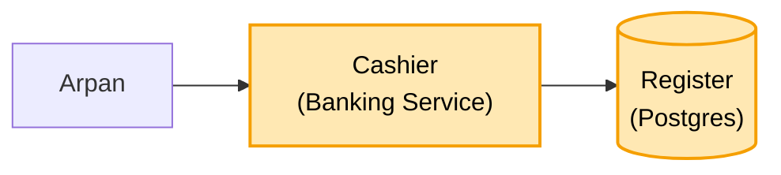
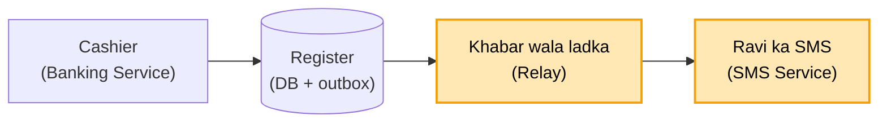
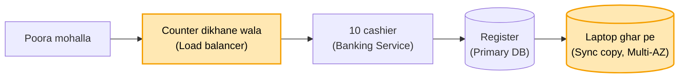
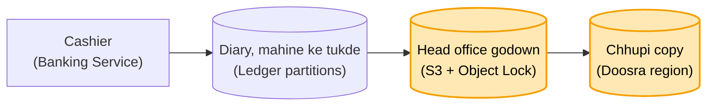

# Banking: mohalle ki bank branch ki kahani

Mohalle ki bank branch: ek cashier, aur ek register jisme sabke khaate likhe hain. Arpan apne khaate se Ravi ko 500
bhejta hai, dono ek hi bank me. Kaam: paisa na gum ho, na do baar kate, aur har paise ka hisaab mile.

Har kadam = **kahani** (dikkat aur hal, bolne wali bhasha) -> **Asli naam** (interview me yahi shabd) -> tasveer
(kahani ka shabd, bracket me asli naam).

---

## FR / NFR / Numbers (interview me pehle 2 minute)

```
FR      paisa daalo, nikaalo, balance + history dekho · transfer A se B, DONO isi bank me (doosra bank scope se bahar)
NFR     paisa na gum ho, na bane, na do baar kate · har paise ka hisaab mile (audit) · balance dekhna tez
Numbers 50 lakh account, roz 1 crore transaction = ~120 likhai / sec, padhna isse kahin zyada
        -> bheed chhoti, asli dikkat SAHI hona: ek SQL DB kaafi, shard nahi
```

---

## 1. Bijli gayi, Arpan ke kate, Ravi ko nahi mile (500 wapas + rough copy)

Arpan ne parchi di "Ravi ko 500 bhej do". Cashier ne Arpan ke 500 kaate, Ravi me jodne jaata usi pal bijli chali
gayi. Mere 500 kat gaye, Ravi ko kuch nahi mila, to mujhe mere 500 wapas de do na, dikkat hi khatam. Ya dono kaam
honge, ya koi nahi.

**Asli naam:** cashier = Banking Service (server), register = DB (Postgres), 500 wapas = transaction rollback (BEGIN,
Arpan -500, Ravi +500, COMMIT; COMMIT se pehle gira to dono ulte). SQL isliye: ek transfer me do row ek saath pakki
badalni hain (ACID), aur 120 likhai / sec ke liye NoSQL ki kai-machine wali taakat chahiye hi nahi.



## 2. Receipt se pehle line kati, wahi parchi dobara (parchi ki key)

Ravi ko 500 pahunch gaye, par receipt milne se pehle Arpan ki line kat gayi. Use pata nahi chala, usne wahi parchi
dobara di. Wo cheez hamare paas hai na, humne register me likh di thi. Hum dekh lenge ki 500 chale gaye, to mana kar
do: "nahi bhai, 500 tumhare already bhej diye hain."

**Maan lo agle din Arpan sach me Ravi ko phir 500 bhejna chahta hai:** register me pehle se "Arpan se Ravi, 500" hai,
to cashier use bhi mana kar dega. To ek key bana do. Maine ek parchi pe likh diya ki Ravi ko 500 bhejne hain, aur
parchi bank wale ko de di. Mujhe nahi pata gaye ki nahi, to main dobara wahi same parchi dunga, key thodi badli. Wo
dekhega: "abe yaar ye to same hi hai, hatao." Nayi baar bhejna hai to nayi parchi, nayi key.

**Asli naam:** parchi ki key = idempotency key (app Send screen khulte hi UUID banati, jaise `k-77`, dobara bhejne pe
wahi). Server key usi transaction me ek table me likhta jispe UNIQUE hai: key pehle aa chuki to paisa nahi kat-ta,
purana jawab wapas. Amount se pehchaan nahi, kyunki Arpan sach me do baar 500 bhej sakta hai.

## 3. Do counter, 600 the, dono ne kaat diya (dekhna aur kaatna ek kram me)

Branch me do counter. Arpan ke khaate me 600. Ek hi pal me do parchi, Netflix 500 aur UPI 500, alag counter pe. Dono
cashier ne 600 dekha, dono ne kaat diya, balance -400. To dekhna aur kaatna ek hi kram me kar lo. Jisne pehle 600
dekha, wo pehle kaat de: Netflix ke 500 turant kat gaye, ab account me 100 hain, to agla counter 600 nahi, 100
dekhega. Doosre wale ko 600 dikhne hi nahi chahiye.

**Asli naam:** ek kram = ek hi query me check + kaato (`UPDATE ... SET balance = balance - 500 WHERE id = arpan AND
balance >= 500`: 1 row badli = kata, 0 row = paisa kam, mana). Doosre ko 600 na dikhe = row lock: UPI ki query ruk ke
naye 100 pe jaanchti hai.

## 4. Ravi bola "500 mile hi nahi" (alag diary, kaato mat)

Hafte baad Ravi aaya: "Arpan ke 500 mile hi nahi". Register me sirf aaj ka balance hai, purana number har baar kaat
ke naya likha. Saabit kaise karein? To ek alag diary rakh lo, usme kaato mat, bas neeche likhte jao, jodte jao: Ravi
me +500 hua, yahan se -500 hua. Register ka balance wala column update hota rahe, koi dikkat nahi, par diary me kabhi
mat kaato. Do alag cheez rakho.

**Asli naam:** diary = ledger (append-only: sirf INSERT, kabhi UPDATE / DELETE nahi; galti hui to ulti line daalo),
+500 / -500 = double-entry (har transfer ki do line, jod 0). Balance column alag, bas tez padhne ke liye. Dono usi
transaction me likhe jaate hain, ledger isi DB ki ek alag table hai.

## 5. Khabar dene se pehle bijli gayi (likh lo)

Paisa jaate hi Ravi ko khabar deni thi. Cashier khabar ke liye ruke to line ruke. Cashier ne paisa bheja, aur ladke ko
"Ravi ko khabar do" bolne se pehle bijli chali gayi: ladke ko pata hi nahi ki kisko khabar deni hai. Jo kisi ko yaad nahi rehta, to likh lo na bhai. Hum bhi to yahan
likh rahe hain kyunki mujhe kal yaad nahi hoga, same to same cashier ke saath hai. Ab cashier kabhi bhi aaye ya
jaaye, wo likha hai, agli baar koi bhi ladka aayega to wo pahuncha hi dega.
**Asli naam:** likh lo = outbox (khabar usi transaction me ek table me, `sent = false`), ladka = relay (outbox se utha
ke SMS Service ko bheje, gaya to `sent = true`, SMS gira to dobara try). Transfer
SMS pe nahi atakta, aur SMS khota bhi nahi.



## 6. Salary ka din, register jal gaya (10 counter + laptop me copy)

Mahine ki 1 tareekh, sabki salary, poora mohalla branch me. Ek hi cashier, line sadak tak. To cashier badha do: ek
tha, 10 kar do, 10 counter kar do. Aam taur pe bhi yahi hota hai, bank me ek counter pe bheed ho to hum doosre
counter pe jaate hain.

Par cashier 10 ho gaye, register abhi bhi ek hi. Raat ko branch me aag lagi, register jal gaya. To use kai jagah
store karo. Jaise meri ek important copy hai, main use office me chhod gaya, raat me aag lagi to notes kho jaayenge.
Main aisa nahi karunga: use laptop me save karke laptop ghar le jaaunga.

**Asli naam:** 10 cashier = kai Banking Service machine (stateless, sach DB me), doosre counter pe bhejna = load
balancer, laptop ghar = DB ki copy doosri building me (RDS Multi-AZ, primary gira to copy primary banti).

**Maan lo laptop me shaam ko ek baar save karta hai, 2 baje zaroori line likhi, 3 baje aag:** jaise hi copy pe likha,
turant laptop pe likh lo, dikkat hi khatam. Wo cheez tab tak pakki nahi jab tak laptop me nahi aati.
**Asli naam:** turant laptop pe, tabhi pakka = sync copy (thoda dheema, par ek bhi transfer nahi khota; 120 / sec pe
dheemapan dikhta bhi nahi). Shaam ko ek baar = async (aakhri likha kho jaata), paise me nahi chalta.



## 7. Sab sirf balance dekhne aaye (photocopy ka alag desk)

Salary ke din sab sirf balance dekhne aa rahe. Saare cashier register pe jhuke, jo sach me paisa bhejne aaya uska
kaam atka. To alag-alag baant do: jo sirf dekhne aa rahe unko sirf dikhao, jo karne aa rahe unko sirf karao. Register
ki photocopy bana do, photocopy ek alag desk pe rakh lo. Jo sirf padh raha, use photocopy pe bhejo. Jo kuch likh
raha, use main register pe le aao.

**Asli naam:** photocopy alag desk = read replica (async, balance / history wahan se), main register = primary (sirf
transfer).

**Maan lo photocopy thodi peeche chalti hai, Arpan ne abhi 500 bheje aur turant photocopy desk pe purana balance
dekh ke ghabra ke dobara bhej diya:** jisne update kiya, use thodi der main register se padhao. Thodi der baad jab
photocopy sync ho jaaye, phir wahin se.
**Asli naam:** read-your-writes (abhi transfer kiya to kuch second primary se, baaki sab replica se).

## 8. Haath se balance badla, 5 saal jodna bhaari (diary se milao + mahine ka jod)

Raat ko kisi bank wale ne main register me Arpan ka balance haath se 100 ki jagah 600 kar diya, diary me koi line
nahi. Agle din Arpan ne 600 nikaal liye. To use diary se milwao na. Asli to diary hai: usme hum sab likh rahe, -500
+500, ye hai asli sach, na ki wo column jo koi bhi galti se update kar de.

Par Arpan ka khaata 5 saal purana, diary me hazaaron line. Har raat 5 saal ki line shuru se jodna bhaari, raat khatam
par jod poora nahi. To data tod do: 10 mahine purana kharcha ab badlega thodi. Mahine ke mahine tod do. January se
March itna kharch kiya, jud gaya, mil gaya, likh do. Pichhle mahine ka khaata change nahi hota, agle mahine ka hota
rehta hai.

**Asli naam:** diary se milao = raat ka milaan (reconciliation job, read replica pe: balance == ledger ka jod? poore
bank ka jod == 0? nahi to ALERT, insaan ulti line se theek kare). Ledger = source of truth, balance bas copy. Mahine
ke mahine = ledger ke mahine ke partition, pichhla jud gaya = snapshot (balance = pichhla snapshot + uske baad ki
lines), purani line immutable.

## 9. Diary almari me nahi samati, koi line badal de (head office + kohinoor)

5 saal me diary itni moti ki branch ki almari me jagah nahi, aur RBI ka niyam: purani line phenk nahi sakte, 10 saal
rakhni hain. To use bank ki jagah head office bhej do, wahan safe rahega. Data kahin gaya nahi.

**Asli naam:** head office = S3 (1 saal se purane mahine wahan, sasta, lambe samay ke liye; archive, phenka nahi).

**Maan lo ijazat wala aadmi hi andar ja ke "Arpan -500" ko "Arpan -50" kar de:** uski 3-4 copy alag-alag chupchap
kahin aur kone me daba do, taaki wo sab na badal paaye. Aakhir me saari copy milao: ek me hi -50 hai, baaki me -500,
matlab isne chhedchhaad ki. Aur ek aur: version ka lock laga do. Wo kohinoor heera hai, na koi chhoo sakta, na badal
sakta. Use taala maar do, wo chupchap wahin pada rahega.
**Asli naam:** kai copy chhupa ke milao = copies doosri jagah (doosra region), version ka lock = versioning, kohinoor
= S3 Object Lock (compliance mode, 10 saal, admin bhi badal ya mita na sake).



---

Notes (Arpan ke shabd) = [BANKING_HAND_NOTES.md](BANKING_HAND_NOTES.md) · [<- MASTER SHEET](../../00_MASTER_SHEET.md)
