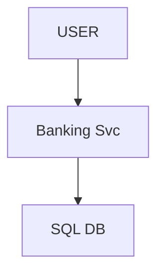
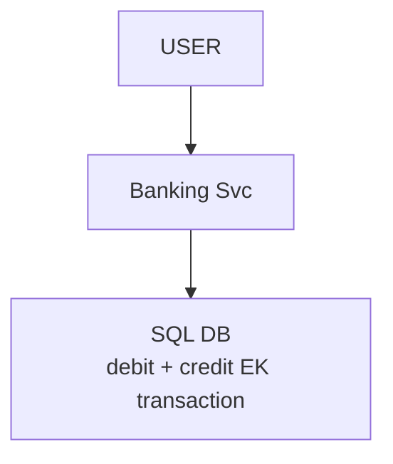
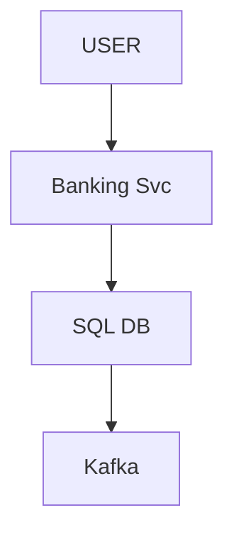
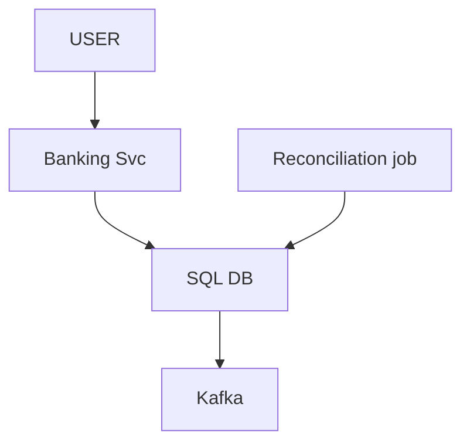
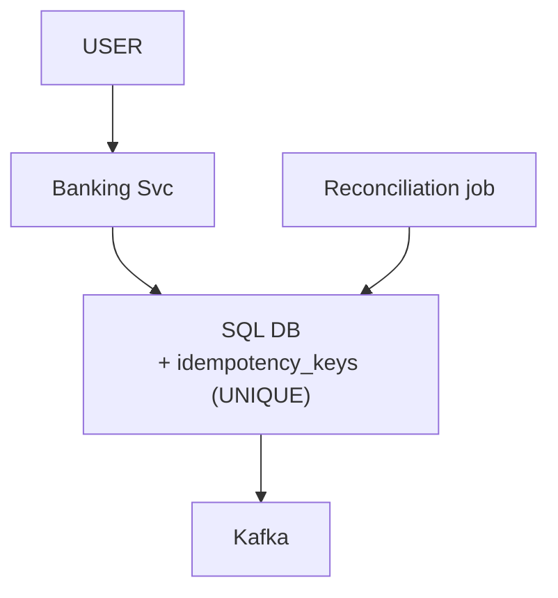
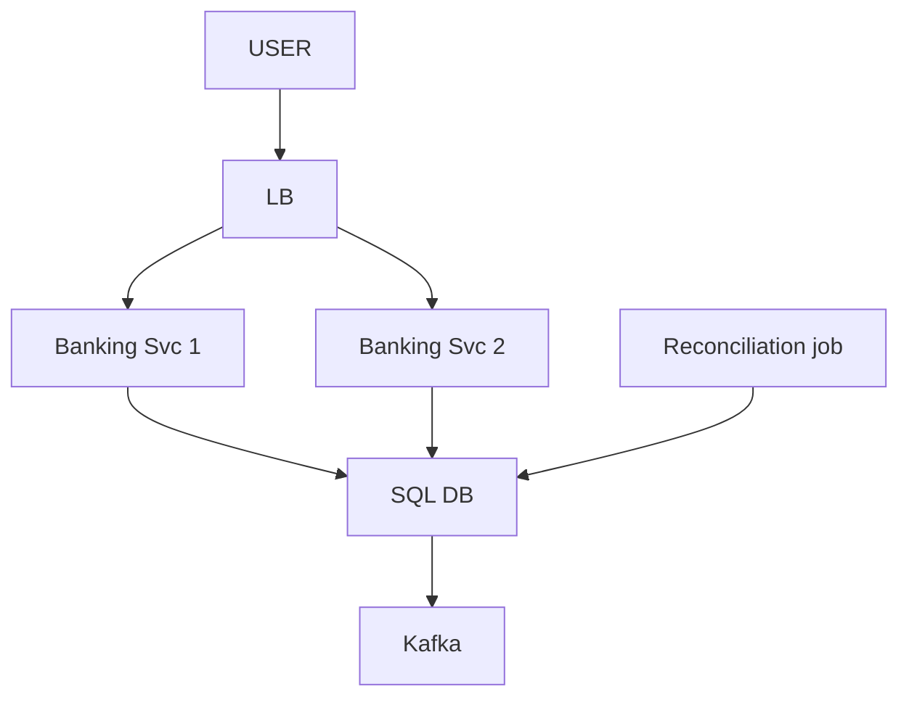
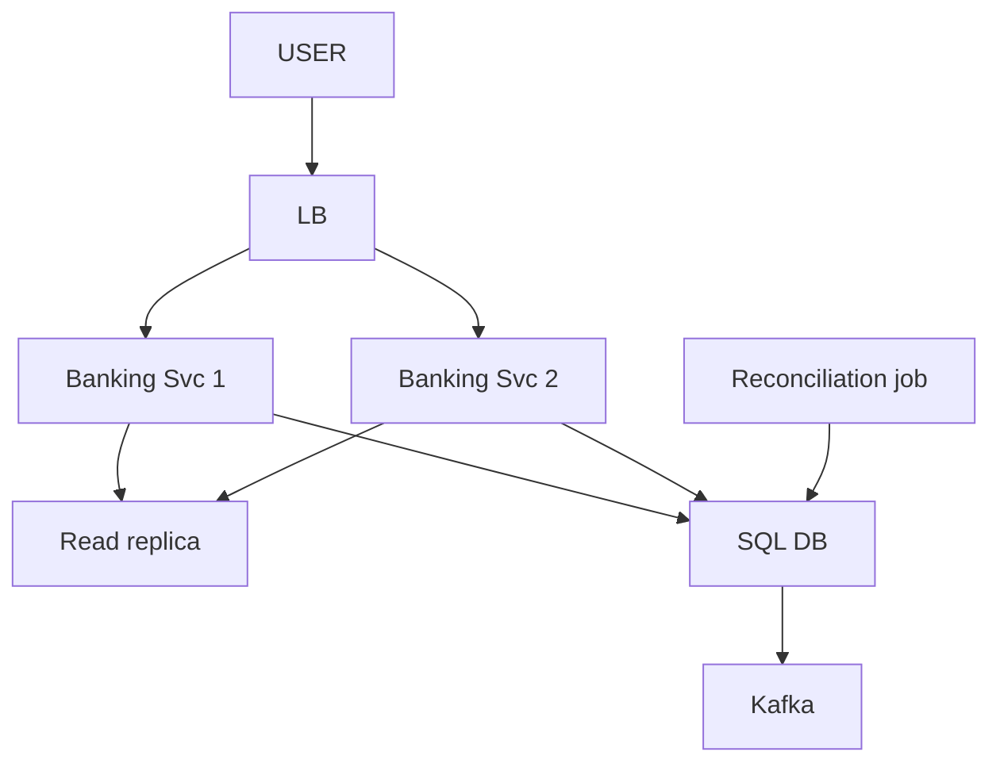
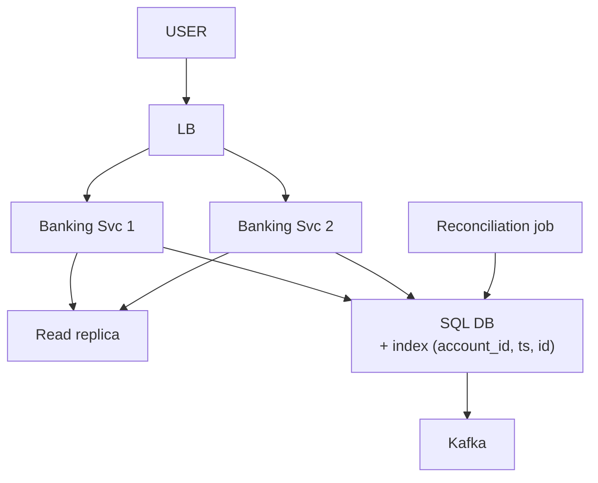
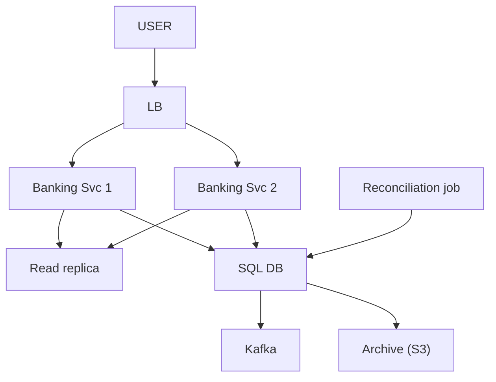

# Mini Banking System (accounts · transactions · balances)

> Ek bank ke andar accounts, un pe paisa daalo / nikaalo / bhejo, aur balance dikhao.
> Is design ka dil: **khaata (ledger) SACH hai, balance sirf uska jod (nateeja)** + paisa na bane na gayab ho.
> KYUN YE DESIGN: candidates batate: payment flow · transaction ledger · ATM · do account ke beech
> bank ke andar transfer. JP ka sabse sambhavit HLD.

```
PAANCH CHEEZ JINPE YE ROUND TAY HOTA (source: "ye interview INHI se tay hote hain"):
   IDEMPOTENCY · TRANSACTIONS · QUEUES · RECONCILIATION · AUDIT
   + ACID vs eventual (network toote to SAHI hona chuno, chalte rehne ki keemat pe)
   + asli khaate ke liye RELATIONAL DB, NoSQL nahi
```

---

## TASVEER (ByteByteGo / Alex Xu · CC BY-NC-ND 4.0)


Source: [Read Replica Pattern](https://bytebytego.com/guides/read-replica-pattern/)
(dikkat 7 — transfer ke baad purana balance = replica peeche; ilaaj: turant wala padhna PRIMARY se)

---

## SHURU: pehle poocho, phir numbers

```
POOCHO:  "Bahut bada hai — use-cases baandh lete hain. Ek hi bank ke andar, ya doosre bank ko bhi?"
         ("let's discuss use cases first" — scope pehle,
          warna interviewer jitna bada system chaahe sar pe daal dega)

KYA KARE (FR):    user ke ek / kai ACCOUNT · DEPOSIT · WITHDRAW ·
                  TRANSFER A -> B (DONO isi bank) · BALANCE · HISTORY
                  ★ "dono isi bank" — ye ek shabd poora design badalta (dikkat 1)
                  bahar: doosra bank · loan · byaaj · card · KYC
KAISA CHALE (NFR): SAHI hona sabse upar (paisa na GUM, na BANE, hisaab
                   har waqt barabar) · har paisa TRACE ho (audit)
                   dobara bhejne pe DOBARA na kate (idempotent) · balance dekhna TEZ (sabse zyada padha jaata)

NUMBERS (andaaza):
   50 lakh account · 1 crore transaction / din, din me ~86,400 second -> ~120 likhai / second
   padhna >> likhna (log balance baar-baar dekhte)
   120 / second = ek theek-thaak Postgres machine ka DASVA hissa
       -> SHARDING KI ZAROORAT NAHI, primary + replica kaafi

DATA SE TEEN SAWAAL (jawab dikkat me):
   1. transfer me DO row badalti -> dono ya koi nahi, kaun sambhalega?   (dikkat 1)
   2. ek account pe do transfer ek saath -> kaun rokega?                 (dikkat 5)
   3. balance minus me na jaaye -> niyam kahan likha?                    (dikkat 5)
```

---

## ════ MOCK SE PEHLE: SIRF YE CARD PADHO ════

> Har dikkat ek card: KAHANI (kya hua, kaun, kitna) -> ILAAJ -> ANDAR KAISE (ilaaj kyun kaam karta) ->
> ISKE BAAD KYA TOOTEGA (interviewer yahin ghusta hai: dabba lagaya, ab kya?).

#### DABBA 0: SABSE SIMPLE (yahan se shuru, phir "kahan tootega")
```
Banking Service (saara niyam / logic) -> SQL DB. Jaan-boojh ke seedha.
```


#### 1 TRANSFER KE BEECH SERVER GIRA: ARPAN -500 HUA, RAVI +500 NAHI
```
KAHANI:  Arpan ne Ravi ko 500 bheje. Arpan ke 500 kat gaye,
         Ravi ke account me daalne se PEHLE server gir gaya.
         500 na Arpan ke paas, na Ravi ke paas. Gayab.

ILAAJ:   Arpan aur Ravi dono ka account ek hi DB me. To 'Arpan se 500 kaato' aur 'Ravi ko 500 do' ek hi
         transaction me: beech me crash hua to dono wapas, aadha nahi.
         Step-step wala tareeka (saga) tab chahiye jab dono alag bank ya alag system me hon.
```

```
ANDAR KAISE:
         BEGIN; UPDATE Arpan -500; UPDATE Ravi +500; COMMIT;
         DB har badlaav pehle apni diary (WAL) me likhta. Gira aur utha -> diary dekh ke:
         COMMIT ho chuka tha to poora karta, nahi hua tha to ulta. Aadha kabhi nahi bachta.

ISKE BAAD KYA TOOTEGA:
  - SAGA / queue laga do?
      -> ek DB me NAHI. Kaatna aur daalna alag-alag ho jaate, dikkat
         khud ban jaati. SAGA sirf alag service / DB / bank pe.
  - Arpan aur Ravi alag bank me?
      -> ek transaction nahi ho sakta -> PENDING + SAGA / reconciliation (payment design wala raasta).
  - CP ya AP?
      -> transfer / balance = CP (galat balance dikhane se mana karna
         behtar). SMS / statement / analytics = AP (2 sec late chalta).
```

#### 2 KHAATA (LEDGER) KAHAN LIKHO, KAFKA KAB? (GALTI WAPAS wala)
```
KAHANI:  Do zaroorat:
         (1) RBI poochhta "Arpan ke 500 kahan se aaye, kahan
         gaye, kab?" -> har len-den ka pakka khaata chahiye.
         (2) Transfer ke baad Arpan ko SMS, fraud check, statement
         -> par SMS service giri to transfer nahi rukna chahiye.

ILAAJ:   KHAATA (ledger) = DB ki ek TABLE (Kafka nahi). Har transfer
         ki 2 line: Arpan -500, Ravi +500 (jod 0). Sirf INSERT.
         OUTBOX = DB ki ek aur table, "SMS bhejo" wala event usme.
         khaata + balance + outbox = EK hi transaction.
         COMMIT ke BAAD ek relay outbox se event Kafka bhejta -> SMS / fraud / statement.
```

```
ANDAR KAISE:
         BEGIN
           INSERT ledger (Arpan -500), INSERT ledger (Ravi +500)
           UPDATE balance Arpan, UPDATE balance Ravi
           INSERT outbox (E-77 "Arpan ne 500 bheje", sent = false)
         COMMIT
         Relay har ~1 sec: outbox me sent = false -> Kafka (acks=all) -> sent = true.
         (ya CDC / Debezium: DB ki diary (WAL) padh ke seedha Kafka.)
         Relay "sent = true" likhne se pehle gira -> E-77 dobara jaata -> SMS service eventId dekh ke skip.

ISKE BAAD KYA TOOTEGA:
  - Khaata pehle Kafka me likh diya, phir DB transaction wapas hua (Arpan ke paas paisa kam tha)?
      -> Kafka me likha "Arpan -500", jabki asal me kuch hua hi nahi -> khaata jhooth bolega.
         ISILIYE khaata DB table me, usi transaction me (rollback hua = khaata bhi gaya).
         Kafka aur DB ek transaction me ho hi nahi sakte -> Kafka sirf commit ke BAAD, outbox se.
         BOL pehli line me: "ledger is a table in the same DB transaction;
                            Kafka only gets the event after commit."
  - Commit ke baad seedha Kafka ko kyun nahi bhej dete?
      -> commit aur bhejne ke beech app gira = event gayab, SMS kabhi
         nahi gaya. Outbox usi transaction me hai, kho nahi sakta.
  - Arpan ke SMS ulte kram me (pehle "credit", phir "debit")?
      -> Kafka key = account_id -> ek account ke event ek partition, kram me.
  - Outbox table bhar jaayegi?
      -> sent wali rows roz saaf / partition drop.
```

#### 3 BALANCE AATA KAHAN SE? (is design ka asli sawaal)
```
KAHANI:  Do raaste:
         (a) balance ek column me rakho: padhna sasta (ek row), par kabhi galat bhi ho sakta.
         (b) har baar khaata jodo: hamesha sach, par Arpan ke 10
         saal purane account ki 50,000 line har baar jodna = dheema.

ILAAJ:   DONO: KHAATA = SACH, balance column = uska jod (cache). Dono EK transaction me badalte.
         Raat ko RECONCILIATION: khaate ka jod == balance column?
```

```
ANDAR KAISE:
         BEGIN; INSERT ledger Arpan -500; INSERT ledger Ravi +500; UPDATE Arpan; UPDATE Ravi; COMMIT;
         Arpan balance dekhe -> sirf balance column (ek row, tez).
         Raat ko job: Arpan ka khaata jod = 4,500, column me 4,500 -> theek.

ISKE BAAD KYA TOOTEGA:
  - Raat ko farak mila (khaata 4,500, column 5,000)?
      -> alert + account rok ke dekho. Chupchaap theek MAT karo: pehle
         KYUN hua (bug abhi bhi zinda hai). Phir khaata jeetega.
  - 22 arab line pe raat ka SUM?
      -> pichhle mahine ke aakhir ka balance (snapshot) + sirf uske baad ki line (card 9). Poora nahi.
  - Chal raha hai, kaise pata?
      -> reconciliation + p99 + error rate + queue lag + DB connection pe alert + har transfer ka trace id.
```

#### 4 "SEND" DO BAAR DABA / APP NE DOBARA BHEJA
```
KAHANI:  Arpan ne Send dabaya, app ghooma, phir daba diya. Ya app
         ne khud dobara bheja -> 1000 kat gaye, bhejne the 500.

ILAAJ:   Arpan ka app har transfer ke saath ek id bhejta, DB me wo id unique.
         Dobara bheja to wahi id -> pehla jawab, paisa doosri baar nahi katta. Transaction aadha hone se
         rokta, id do baar hone se.
```

```
ANDAR KAISE:
         Key pehle aa chuki -> pehla jawab wapas, naya transfer nahi.
         App me "pehle dekho, phir daalo" = race (dono ne dekha
         "nahi hai", dono ne daala). UNIQUE insert khud taala jaisa.
         @Transactional = "aadha nahi hoga". Idempotency = "do baar nahi hoga". Dono chahiye.

ISKE BAAD KYA TOOTEGA:
  - Key wahi, par body alag (500 ki jagah 5000)?
      -> key ke saath request ka hash bhi rakho. Mel nahi = 422, purana jawab nahi.
  - Key table hamesha badhti rahegi?
      -> 24-48 ghante baad saaf.
```

#### 5 EK ACCOUNT SE DO TRANSFER EK SAATH
```
KAHANI:  Arpan ke paas 300. Ek saath 200-200 ke do transfer
         chale. App ne dono baar balance padha (300), dono pass
         -> dono kate -> Arpan = -100.

ILAAJ:   Hisaab DB ke andar karo: 'balance >= 200 ho tabhi 200 kaato', ek hi query me. Do transfer ek
         saath aaye to DB ek-ek karke chalata, doosre ke time balance kam ho chuka to wo fail.
         Arpan->Ravi aur Ravi->Arpan ek saath ho to dono ek doosre ka intezaar karte reh jaate (deadlock).
         Ilaaj: hamesha chhoti account id pehle lock karo, dono same kram me.
```

```
ANDAR KAISE:
         UPDATE row pe taala leta -> dono transfer line me lagte. Pehla:
         300 -> 100. Doosra: 100 >= 200? nahi -> 0 row -> reject.
         Deadlock kaise hota: Arpan->Ravi aur Ravi->Arpan ek saath.
           Txn1 ne Arpan pe taala, Ravi ka intezaar · Txn2 ne Ravi
           pe taala, Arpan ka intezaar -> dono atke (MySQL 1213).
         Kram tay (chhoti id pehle) -> dono pehle wahi ek
         account maangte -> ek ruka, doosra poora, phir pehla.

ISKE BAAD KYA TOOTEGA:
  - 0 row aaya, Arpan ko kya?
      -> "insufficient balance" (422) + poora transaction wapas (Ravi ko daalna bhi nahi).
  - Niyam code me kyun nahi?
      -> raaste kai (API / batch / haath se), DB ek. Niyam DB me.
  - Kram ke bawajood deadlock?
      -> DB ek ko wapas kar deta -> app thoda ruk ke dobara (same idempotency key).
```

#### 6 SALARY DAY, EK SERVICE BHAR GAYI
```
KAHANI:  1 tareekh, sabki salary aayi, sab ek saath transfer
         kar rahe. Ek hi Banking service machine bhar gayi.
         Wo giri to poora bank band.

ILAAJ:   Service kuch yaad nahi rakhti, kai machine + load balancer, mari hui list se bahar.
         Main DB ki copy doosri building me, aur har transfer copy me bhi likh ke hi 'done'. Main DB gira
         to copy main ban jaati, koi pakka transfer nahi khota.
```

```
ANDAR KAISE:
         Patroni / RDS Multi-AZ: primary mara -> sync copy promote -> DB ka pata nayi pe -> ~1-2 min
         (RDS Multi-AZ ka aam number 60-120 sec).
         SYNC = commit tabhi jab copy ne bhi likh liya -> nayi primary ke paas har pakka transfer.

ISKE BAAD KYA TOOTEGA:
  - Sync = har transfer dheema?
      -> haan, ek network chakkar. Paise me ye keemat theek. Async me aakhri transfer kho sakta.
  - Failover ke us 1-2 min me transfer aaya?
      -> error -> app dobara bheje, same idempotency key -> do baar nahi katega.
  - Ravi ne apne login se "Arpan ke account se 500 bhejo" bheja (ya Arpan ka balance maanga)?
      -> OWNER CHECK har request pe: userId JWT se lo (body / URL se nahi, wahan koi kuch bhi likh de).
         from_account ka maalik yahi user hai? Nahi -> 403. Balance / history pe bhi wahi check.
```

#### 7 SAB BALANCE PRIMARY SE PADH RAHE, TRANSFER DHEEME
```
KAHANI:  Lakhon log balance / history dekh rahe, sab primary se. Padhne ki bheed me transfer dheeme.

ILAAJ:   Transfer main DB pe hua, par balance us copy se padha jo abhi peeche thi.
         Ilaaj: balance main DB se padho, kam se kam us user ke liye jisne abhi paisa bheja (kuch second tak).
         Copy hi peeche reh gayi ho to wahi 'har transfer copy me bhi likho' wala tareeka.
```

```
ANDAR KAISE:
         Replica primary ki diary padh ke chalti, ~200 ms peeche.
         Arpan ne 1000 bheje, turant balance dekha replica se -> purana 5000 dikha (asal 4000)
         -> Arpan sochega paisa gaya hi nahi -> dobara bhejega!
         READ-YOUR-OWN-WRITES: Arpan ke account pe last_write_at (Redis me)
                               -> kuch second tak Arpan ka padhna primary se.

ISKE BAAD KYA TOOTEGA:
  - Arpan ne doosre phone se khola?
      -> last_write_at account pe rakho (Redis), phone pe nahi.
  - Replica minute bhar peeche?
      -> lag pe alert. Had paar -> us replica ko padhne wali list se hatao.
```

#### 8 22 ARAB LINE ME HISTORY KA PAGE 5000
```
KAHANI:  Arpan history ke page 5000 pe: LIMIT 20 OFFSET 100000 ->
         DB 1,00,020 line PADH ke phenkta, 20 deta. Bahut dheema.
         Beech me nayi line aayi -> sab ek khisak gaya -> ek line dobara dikhi.

ILAAJ:   Page 5000 ke liye DB 1 lakh line padh ke phenkta hai (OFFSET). Uski jagah: pichhle page ki aakhri
         line ka time + id yaad rakho, agla page 'isse purani 20'.
         Index se seedha wahan pahunch jaata, page 1 ho ya 5000, ek jaisa tez.
```

```
ANDAR KAISE:
         page 2: ... WHERE account_id = ? AND (ts, id) <
         (:last_ts, :last_id) ORDER BY ts DESC, id DESC LIMIT 20
         index (account_id, ts DESC, id DESC). Page 1 ho ya 5000, kharcha wahi.

ISKE BAAD KYA TOOTEGA:
  - Same ts pe do line, ek chhoot jaaye?
      -> isliye (ts, id) dono. id barabari todti.
  - "Seedha page 500 pe jao"?
      -> keyset me nahi hota, sirf agla / pichhla. Statement ke liye theek.
  - Cursor app ko kaise do?
      -> (ts, id) ko base64 karke next_cursor.
```

#### 9 5 SAAL KA DATA EK HI TABLE ME
```
KAHANI:  5 saal ka khaata ek table me. Log roz sirf 3 mahine
         dekhte, par har query / backup arabon line ke saath.
         Aur bank me DELETE nahi kar sakte (kanoon).

ILAAJ:   Khaata mahine ke tukdon me. Band mahine sasti jagah (S3) bhej do, delete kabhi nahi.
         Har mahine ke aakhir ka balance likh ke rakho, taaki purane tukde chale jaane ke baad bhi milaan
         sahi ho.
```

```
ANDAR KAISE:
         Purane tukde S3 gaye -> raat ka reconciliation khaata jodega to adhoora -> har account me farak!
         Ilaaj: jod = snapshot (31-Mar Arpan = 45,000) + uske baad ki line.
         (bank statement ke upar "opening balance" isi wajah se likha hota.)

ISKE BAAD KYA TOOTEGA:
  - RBI ne 2021 ka statement maanga?
      -> S3 Parquet pe Athena query, ya us mahine ka tukda wapas laao.
  - Archive file koi badal na de?
      -> S3 Object Lock (WORM): na delete na badal, saalon tak.
  - Archive aur sharding ek hi cheez?
      -> nahi. Archive jagah ghatata, shard likhne ka bojh baantta.
```

```
AAKHRI DABBE (sab dikkat ke baad):
  User -> LB -> Banking Svc (stateless, idempotency check)
  -> SQL DB: EK transaction (dono khaata line + dono balance + idempotency key + outbox)
  -> Kafka (commit ke BAAD: SMS / fraud / analytics / statement) · Read replica = balance / history
  Reconciliation (raat ko: snapshot + baad ki line vs balance -> ALERT)
                           · Archive S3 (band mahine, delete kabhi nahi)

DB:  SQL -> paisa na khoye na bane: EK transaction (ek DB me SAGA nahi)
     khaata = SACH (sirf jodo, double-entry, mahine ke tukde) · balance = CACHE (jod, usi transaction me)

END ME POOCHEGA:
  "Khaata kahan, Kafka kab?" -> khaata SQL me usi transaction me; Kafka sirf commit ke baad (outbox se)
  "Minus balance / ulte transfer?" -> check DB me (WHERE balance >= x) · taala id ke kram me -> deadlock nahi
  "Likhai DB maar rahi (replica ke baad bhi)?" -> replica / cache sirf padhai; likhai -> SHARD by account_id
                       (aakhri kadam, keemat: transfer ek transaction nahi rehta -> SAGA)
  "10x?"            -> pehle jo toote: padhai -> replica · jagah -> mahine ke tukde · likhai -> shard
  "SPOF?"           -> DB primary (sync copy) · Banking Svc (LB + kai machine)
```

AAKHRI DABBE ki tasveer:


---

## 10 GUNA TRAFFIC — har dabba alag se

```
KRAM:  sasta pehle, SHARD aakhir me
  1. READ REPLICA (pehla kadam, padhna >> likhna) · keemat: thoda peeche -> apna abhi-kiya transfer PRIMARY se
  2. MAHINE ke tukde (archive + query dono ke liye)
  3. SHARD by account_id = AAKHRI, keemat badi: Arpan shard-1, Ravi
     shard-2 -> transfer ek transaction NAHI -> wapas SAGA / 2PC
     -> dikkat 1 ki saari dikkat wapas · hamare 120 / sec pe ye sawaal hi nahi; pehle badi machine + replica
  LIKHAI se DB maar kha raha (replica ke baad bhi): cache / index
  sirf PADHAI ka ilaaj (har naya index INSERT dheema karta)
     -> SHARD by account_id (ek account ke saare transfer ek shard
        pe) · zaroori-nahi wali likhai (statement, SMS) queue pe
  BADI TABLE (jagah) -> mahine ke tukde + archive (DELETE nahi)
  ✗ "badi transaction chhoti karo" = galat: kaatna + daalna EK transaction me hi
  replica sirf PADHAI baantti, likhai ke liye SHARD · desh / date = bura key (ek garam)

POOCHEGA: "Replicas are in, but writes are still killing the DB. What now?"
          (Copy laga di, par likhai abhi bhi DB ko maar rahi. Ab?)

JAWAB:    Copy sirf padhai ka bojh baantti, likhai sab main DB pe hi jaati. Index bhi sirf padhai tez
          karta, likhai ulta dheemi.
          Likhai bahut ho to account id se baanto: Arpan ke saare transfer ek tukde pe. SMS / statement
          jaisa kaam line me daal do.
          Jagah ke liye mahine ke tukde, purane sasti jagah. Delete kabhi nahi.
POOCHEGA: "How would you scale this to 10x?"      -> pehle jo toote
          (padhai -> replica, jagah -> tukde, likhai -> shard)
POOCHEGA: "What's the single point of failure?"   -> DB primary (sync copy), Banking Svc (LB + kai machine)
```

---

## POOCHE TO (gehra sawaal aaye tab)

```
API:      GET /accounts/{id}/balance · GET /accounts/{id}/transactions?cursor=...&limit=20
          POST /transfers { from, to, amount } · POST /accounts/{id}/deposit
          { amount } · POST /accounts/{id}/withdraw { amount }
          har POST me Idempotency-Key header

DB:       ledger_entries (SACH, sirf jodo, mahine ke tukde) · accounts.balance (CACHE, jod)
          idempotency_keys (UNIQUE) · outbox · account_balance_snapshot (mahine ke aakhir ka balance)
```

---

## AAKHRI DABBA + WRAP

```
LB · Banking Svc = stateless, idempotency check · SQL DB = EK transaction (khaata + balance + key + outbox)
Kafka = commit ke BAAD (SMS / fraud / analytics / statement)
· Read replica = balance / history (apna transfer primary se)
Reconciliation = snapshot + baad ki line vs balance -> ALERT · Archive (S3) = band mahine, delete kabhi nahi
```
```
beech me crash        -> ek transaction (@Transactional), ek DB me SAGA nahi
dobara tap / retry    -> Idempotency-Key + DB UNIQUE
paisa kahan gaya      -> sirf-jodo KHAATA, double-entry (jod zero)
balance tez           -> balance = khaate ka CACHE, usi transaction me
cache vs sach         -> raat ka RECONCILIATION, khaata jeetega
minus balance         -> check DB me (WHERE balance >= x / CHECK)
ulte kram ke transfer -> taala TAY KRAM me (id sort) -> deadlock nahi
arabon line history   -> CURSOR + index (account_id, ts DESC, id DESC)
purana data           -> mahine ke TUKDE -> DETACH -> S3, DELETE kabhi nahi
archive ke baad       -> OPENING BALANCE snapshot
bojh badha            -> replica -> tukde -> (aakhir me) shard
```
```
JAWAB:    Ek transfer ka sab kuch (dono khaata line, dono balance, id, SMS wali khabar) ek transaction
          me, SQL me. Paisa na khota na banta.
          Khaata sach, balance uska jod, raat ko milaan. Balance check aur lock ka kram DB me.
          Padhai copy se, history 'pichhli line ke baad se', purane mahine sasti jagah, SMS commit ke
          baad Kafka se.
```


ARCHETYPE C · CONCEPTS: [db-what-when](../../FOUNDATIONS/09_databases_what_when.md) · [CAP](../../FOUNDATIONS/08_cap_theorem.md) · [saga/ms-comm](../../FOUNDATIONS/10_ms_communication.md) · [caching](../../FOUNDATIONS/04_caching.md) · saath: [payment-system](../06_payment_system/06_payment_system.md) (iska bada bhai) · [stock-broker](../05_stock_broker_trading/05_stock_broker_trading.md) · [← MASTER SHEET](../../00_MASTER_SHEET.md)
