# Mini Banking System (accounts · transactions · balances)

> Ek bank ke andar accounts, un pe paisa daalo / nikaalo / bhejo, aur balance dikhao.
> Is design ka dil: **khaata (ledger) SACH hai, balance sirf uska jod (nateeja)** + paisa na bane na gayab ho.
> KYUN YE DESIGN: candidates batate: payment flow · transaction ledger · ATM · do account ke beech
> bank ke andar transfer. JP ka sabse sambhavit HLD.

```
PAANCH CHEEZ JINPE YE ROUND TAY HOTA (source: "ye interview INHI se tay hote hain"):
   IDEMPOTENCY · TRANSACTIONS · QUEUES · RECONCILIATION · AUDIT
   + ACID vs eventual (network toote to SAHI hona chuno, chalte rehne ki keemat pe)
   + asli khaate ke liye RELATIONAL DB, NoSQL nahi
```

---

## KAHANI (ek din, 1 tareekh = salary day, main aur Ravi; har dikkat se design me ek dabba judta)

```
    KYA HUA                                     ILAAJ                                 DABBA JUDA
1   8 baje Ravi ko 500, beech me server gira -> EK TRANSACTION (WAL)                  SQL DB
2   8:30 network gaya, app ne dobara bheja   -> IDEMPOTENCY KEY (UNIQUE)              Banking Svc (+ key)
3   9:00 Netflix auto-debit + mera UPI       -> CHECK + KAATNA EK QUERY               (SQL DB: balance >= x)
4   mera 500 kahan gaya? (support / audit)  -> KHAATA (ledger) usi transaction me    (SQL DB: ledger table)
5   10 baje salary, Ravi ko rent, SMS giri    -> OUTBOX, Kafka key = account_id        Kafka
6   salary ke baad maine balance khola       -> BALANCE = CACHE, raat RECONCILIATION  Reconciliation job
7   11 baje sabki salary, ek machine bhari   -> KAI MACHINE + LB, DB sync copy        LB + Banking Svc x N
8   bheed me sab balance dekh rahe           -> READ REPLICA + read-your-own-writes   Read replica
9   dukaan ko 500, usi sec dukaan ka refund  -> CHHOTI ID PEHLE LOCK                  (SQL DB: lock kram)
10  CA ka export, page 5000 dheema           -> KEYSET (ts, id) + index               (SQL DB: index)
11  raat: 5 saal khaata ek table me          -> MAHINE KE TUKDE + S3, snapshot        Archive (S3)

POORA DESIGN (upar ke dabbe kram se):
   User -> LB -> Banking Svc (idempotency key) -> SQL DB: EK transaction (khaata + balance + outbox)
        -> Kafka (commit ke baad, key = account_id) · Read replica = balance / history
   Reconciliation (raat) · Archive S3 (mahine ke tukde, had se pehle delete nahi)
```

---

## TASVEER (ByteByteGo / Alex Xu · CC BY-NC-ND 4.0)


Source: [Read Replica Pattern](https://bytebytego.com/guides/read-replica-pattern/)
(transfer ke baad purana balance = replica peeche -> turant wala padhna PRIMARY se)

---

## SHURU: pehle poocho, phir numbers

```
POOCHO:  "Bahut bada hai — use-cases baandh lete hain. Ek hi bank ke andar, ya doosre bank ko bhi?"
         ("let's discuss use cases first" — scope pehle,
          warna interviewer jitna bada system chaahe sar pe daal dega)

KYA KARE (FR):    user ke ek / kai ACCOUNT · DEPOSIT · WITHDRAW ·
                  TRANSFER A -> B (DONO isi bank) · BALANCE · HISTORY
                  ★ "dono isi bank" — ye ek shabd poora design badalta
                  bahar: doosra bank · loan · byaaj · card · KYC
KAISA CHALE (NFR): SAHI hona sabse upar (paisa na GUM, na BANE, hisaab
                   har waqt barabar) · har paisa TRACE ho (audit)
                   dobara bhejne pe DOBARA na kate (idempotent) · balance dekhna TEZ (sabse zyada padha jaata)

NUMBERS (andaaza):
   50 lakh account · 1 crore transaction / din, din me ~86,400 second -> ~120 likhai / second
   padhna >> likhna (log balance baar-baar dekhte)
   120 / second = ek theek-thaak Postgres machine ka DASVA hissa
       -> SHARDING KI ZAROORAT NAHI, primary + replica kaafi
   khaata: 1 crore x 2 line x 365 = ~730 crore line / saal -> 3 saal ~22 arab · 5 saal ~36 arab

DATA SE TEEN SAWAAL:
   1. transfer me DO row badalti -> dono ya koi nahi, kaun sambhalega?
   2. ek account pe do transfer ek saath -> kaun rokega?
   3. balance minus me na jaaye -> niyam kahan likha?
```

---

## ════ MOCK SE PEHLE: SIRF YE CARD PADHO ════

> Har card: pehle PEELA DABBA dekho (scene + ilaaj). Yaad aa gaya -> aage. Nahi aaya -> neeche
> DIKKAT / HAL / NAHI padho. AAGE POOCHEGA sirf jab interviewer aage kuch poochhe.

#### DABBA 0: SABSE SIMPLE (yahan se shuru, phir "kahan tootega")
```
Banking Service (saara niyam / logic) -> SQL DB. Jaan-boojh ke seedha.
```
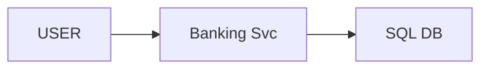

#### 1 Maine Ravi ko 500 bheje, beech me server gira
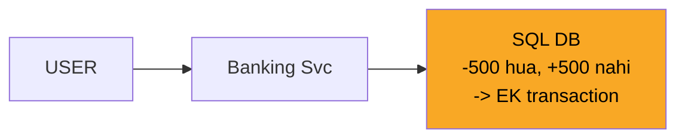
```
DIKKAT     1 tareekh subah 8 baje maine Ravi ko 500 bheje. Mere 500 kate, Ravi ke account me daalne se PEHLE
           server gira. 500 na mere paas, na Ravi ke paas. Gayab.
HAL        EK TRANSACTION (dono account ek DB me): BEGIN; UPDATE Arpan -500; UPDATE Ravi +500; COMMIT;
           DB pehle diary (WAL) me likhta; utha to COMMIT hua tha -> poora, nahi -> ulta. Aadha kabhi nahi.
NAHI       SAGA / queue laga do: ek DB me kaatna aur daalna alag ho jaate, dikkat khud ban jaati.
```
```
AAGE POOCHEGA:
  NIYAM: ek DB me ek transaction; SAGA sirf alag service / DB / bank pe.
  "Arpan aur Ravi alag bank me?"   -> ek transaction nahi ho sakta -> PENDING + SAGA / reconciliation
                                      (payment design wala raasta).
  "CP ya AP?"                      -> transfer / balance = CP (galat balance dikhane se mana karna behtar);
                                      SMS / statement / analytics = AP (2 sec late chalta).
```

#### 2 Send dabaya, network gaya, app ne dobara bheja
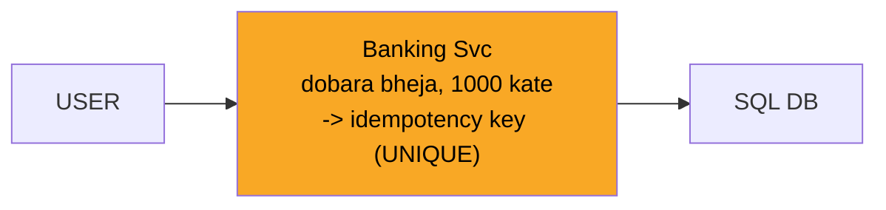
```
DIKKAT     8:30 lift me maine Send dabaya, 500 kat bhi gaye, par jawab aate waqt network gaya. App ne timeout
           pe khud dobara bheja -> 1000 kat gaye, bhejne the 500.
HAL        IDEMPOTENCY KEY: transfer screen khulte app id banata, dobara bhejne pe WAHI; DB me wo id UNIQUE.
           Wahi id aayi -> pehla jawab wapas, paisa doosri baar nahi katta. Send button pehli tap pe band.
NAHI       app me "pehle dekho, phir daalo": dono ne dekha "nahi hai", dono ne daala (race).
```
```
AAGE POOCHEGA:
  NIYAM: @Transactional = "aadha nahi hoga", idempotency = "do baar nahi hoga"; dono chahiye.
  "UNIQUE se kya mila?"            -> UNIQUE insert khud taala jaisa; doosra insert fail.
  "Key wahi, body alag (5000)?"    -> key ke saath request ka hash rakho; mel nahi = 422, purana jawab nahi.
  "Key table hamesha badhegi?"     -> 24-48 ghante baad saaf.
```

#### 3 9 baje Netflix ka auto-debit aur mera UPI ek saath
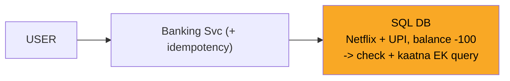
```
DIKKAT     Mere paas 300. 9:00 Netflix ka 200 ka auto-debit chala, usi second maine UPI se Ravi ko 200 bheje.
           Do request, do thread, dono ne balance 300 padha -> dono pass -> dono kate -> mera balance -100.
HAL        CHECK + KAATNA EK QUERY:
             UPDATE account SET balance = balance - 200 WHERE id = 'Arpan' AND balance >= 200
           Row pe taala -> dono line me. Pehla: 300 -> 100. Doosra: 100 >= 200? nahi -> 0 row -> reject.
NAHI       pehle SELECT balance, phir code me check: dono ne 300 dekha, dono pass.
```
```
AAGE POOCHEGA:
  NIYAM: niyam DB me; raaste kai (API / batch / haath se), DB ek.
  "0 row aaya, mujhe kya?"         -> "insufficient balance" (422) + poora transaction wapas.
  "Minus balance ka niyam aur kahan?" -> DB me hi: WHERE balance >= x, ya CHECK.
```

#### 4 Maine poochha: mere 500 kahan gaye, kab?
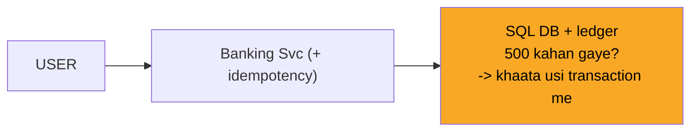
```
DIKKAT     Subah se paisa kai baar hila. Maine support se poochha "mere 500 kahan gaye, kab?" (audit bhi yahi)
           -> har len-den ka pakka khaata chahiye.
HAL        KHAATA (ledger) = DB ki TABLE, USI transaction me: har transfer ki 2 line, Arpan -500, Ravi +500.
           Sirf INSERT, kabhi badla nahi: BEGIN · INSERT ledger x2 · UPDATE balance x2 · COMMIT.
NAHI       khaata Kafka me: DB transaction wapas hua (paisa kam tha), Kafka me "Arpan -500" -> khaata jhooth.
```
```
AAGE POOCHEGA:
  NIYAM: khaata wahin likho jahan paisa hila, usi transaction me; rollback = khaata bhi gaya.
  "Kafka + DB ek transaction?"     -> ho hi nahi sakta; isliye khaata DB ki table me.
```

#### 5 Salary aayi, Ravi ko rent bheja, SMS service giri
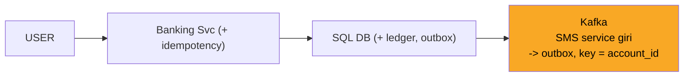
```
DIKKAT     10 baje salary 50,000 aayi, 1 min baad Ravi ko 20,000 rent bheja. Har transfer ke baad SMS, fraud,
           statement chahiye. Par SMS service giri hui hai -> transfer na ruke, aur SMS khoye bhi nahi.
HAL        OUTBOX: har khaata line ki ek row, usi transaction me: E-77a Arpan debit, E-77b Ravi credit,
           sent = false. COMMIT ke BAAD relay har ~1 sec: sent = false -> Kafka (acks=all) -> sent = true.
NAHI       commit ke baad seedha Kafka: commit aur bhejne ke beech app gira = event gayab, SMS kabhi nahi.
```
```
AAGE POOCHEGA:
  NIYAM: Kafka sirf commit ke BAAD, outbox se; outbox usi transaction me hai, kho nahi sakta.
  "SMS ulte (pehle 20,000 kata)?"  -> har khaata line ka apna event, Kafka key = account_id: mere sab event
                                      ek partition me, kram se; Ravi ke apne partition me.
  "Relay sent = true se pehle gira?" -> event dobara jaata -> SMS service eventId dekh ke skip.
  "Relay ke bina?"                 -> CDC / Debezium: DB ki diary padh ke seedha Kafka.
  "Outbox table bhar jaayegi?"     -> sent wali rows roz saaf / partition drop.
```

#### 6 Salary ke baad maine balance khola
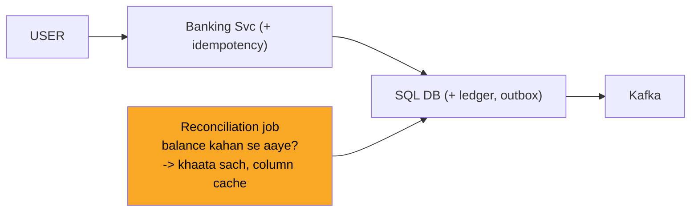
```
DIKKAT     Maine balance khola. Har baar khaata jodo = hamesha sach, par 10 saal ki 50,000 line = dheema.
           Sirf balance column = ek row, tez, par kabhi galat bhi ho sakta.
HAL        DONO: KHAATA = SACH, balance column = uska jod (CACHE), dono EK transaction me. Dekhna = column.
           Raat ko RECONCILIATION job: mera khaata jod = 4,500, column me 4,500 -> theek.
```
```
AAGE POOCHEGA:
  NIYAM: farak mile to khaata jeetega, par pehle KYUN.
  "Raat ko farak (4,500 vs 5,000)?" -> alert + account rok ke dekho; chupchaap theek MAT karo (bug zinda),
                                      pehle KYUN, phir khaata jeetega.
  "Chal raha hai, kaise pata?"     -> reconciliation + p99 + error rate + queue lag + DB connection pe alert
                                      + har transfer ka trace id.
```

#### 7 11 baje sabki salary aa gayi, ek Banking service bhar gayi
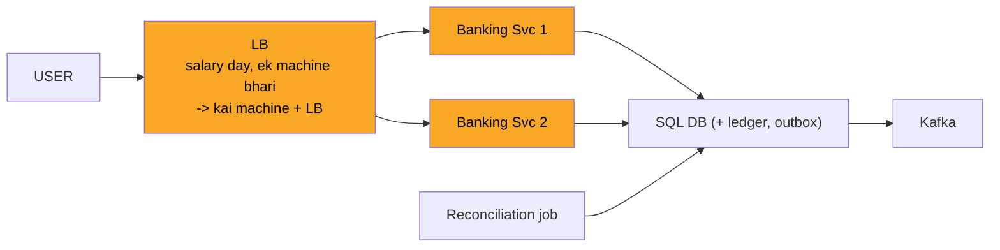
```
DIKKAT     11 baje tak sabki salary aa gayi, sab ek saath transfer kar rahe. Ek Banking service machine bhar
           gayi. Wo giri to poora bank band.
HAL        KAI MACHINE + LB: Banking service kuch yaad nahi rakhti -> kai machine + LB, mari hui list se bahar.
```
```
AAGE POOCHEGA:
  NIYAM: service kuch yaad nahi rakhti, sach sirf DB me; DB ki copy pakki (sync).
  "Main DB hi gir gaya?"           -> SYNC copy doosri building me, har transfer copy me bhi likh ke "done".
                                      Patroni / RDS Multi-AZ: copy promote, DB ka pata nayi pe, ~1-2 min.
  "Sync = har transfer dheema?"    -> haan, ek network chakkar; paise me theek. Async me aakhri kho sakta.
  "Failover ke 1-2 min me?"        -> error -> app dobara bheje, same idempotency key -> do baar nahi katega.
  "Ravi: 'Arpan ke account se 500'?" -> OWNER CHECK har request pe: userId JWT se (body / URL se nahi);
                                      from_account ka maalik yahi? nahi -> 403. Balance / history pe bhi.
```

#### 8 Salary ki bheed me sab balance dekh rahe, transfer dheeme
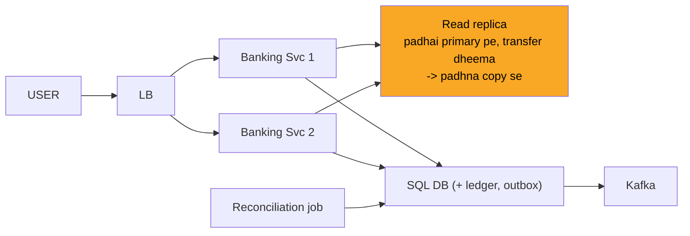
```
DIKKAT     Salary ki bheed: har koi balance + "pichhle 3 mahine" history dekh raha, upar se mahine ka
           statement job. Ye bhaari padhai primary pe -> transfer dheeme.
HAL        READ REPLICA: padhna DB ki copy se, likhna (transfer) sirf primary pe. Primary ki diary (WAL) copy
           tak jaati, copy wahi badlaav lagati. Primary sirf likhne ke liye free.
```
```
AAGE POOCHEGA:
  NIYAM: copy thodi peeche hoti; jisne abhi likha, wo kuch der primary se padhe.
  "Copy 5 sec peeche, purana balance?" -> maine 1000 bheje, purana dikha -> sochunga gaya hi nahi -> dobara!
                                      Read-your-own-writes: mere ACCOUNT pe last_write_at (Redis, phone nahi)
                                      -> kuch second kisi bhi phone se mera padhna PRIMARY se.
  "Copy minute bhar peeche?"       -> lag pe alert; had paar -> us copy ko padhne wali list se hatao.
```

#### 9 Ravi ki dukaan ko paisa, usi second dukaan se refund (deadlock)
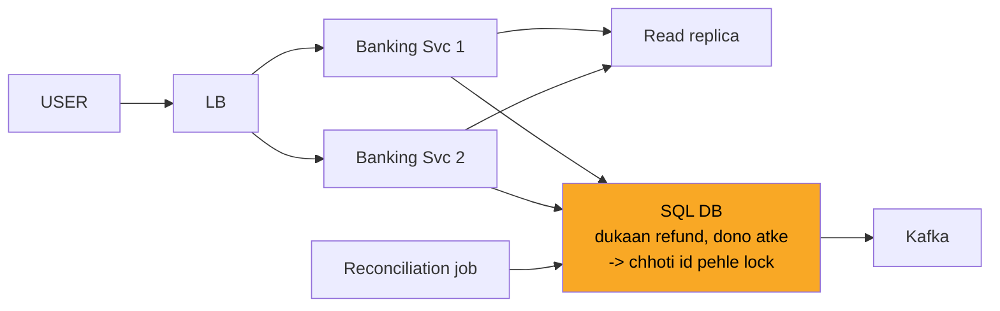
```
DIKKAT     Dopahar maine Ravi ki dukaan ko 500 bheje, usi second dukaan ke refund batch ne mera 200 lautaya.
           Txn1 ne mujh pe taala, Ravi ka intezaar · Txn2 ne Ravi pe, mera intezaar -> deadlock (MySQL 1213).
HAL        CHHOTI ACCOUNT ID PEHLE LOCK: dono transfer same kram me, dono pehle wahi ek account maangte
           -> ek ruka, doosra poora, phir pehla. Gol ghera banta hi nahi.
```
```
AAGE POOCHEGA:
  NIYAM: taala hamesha tay kram me (id sort).
  "Kram ke bawajood deadlock?"     -> DB ek ko wapas kar deta -> app ruk ke dobara (same idempotency key).
```

#### 10 Shaam ko dukaan ke CA ka export, page 5000 pe atka
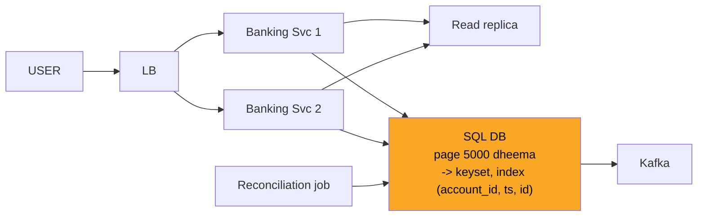
```
DIKKAT     Ravi ki dukaan: roz ~500 UPI, 3 saal = ~5 lakh line. CA ka tool 20-20 ke page maangta. Page 5000 pe
           LIMIT 20 OFFSET 100000 -> DB 1,00,020 line PADH ke phenkta. Beech me nayi line -> ek line dobara.
HAL        KEYSET: pichhle page ki aakhri line ka (ts, id) yaad, agla page "isse purani 20":
             WHERE account_id = ? AND (ts, id) < (:last_ts, :last_id) ORDER BY ts DESC, id DESC LIMIT 20
           Index (account_id, ts DESC, id DESC) se seedha wahan -> page 1 ho ya 5000, ek jaisa tez.
NAHI       OFFSET: chhode hue sab padh ke phenko, aur khiskne pe line dobara.
```
```
AAGE POOCHEGA:
  NIYAM: "kahan tak dekha" yaad rakho, "kitne chhode" nahi.
  "Same ts pe do line?"            -> isliye (ts, id) dono; id barabari todti.
  "Seedha page 500 pe jao?"        -> keyset me nahi, sirf agla / pichhla; statement ke liye theek.
  "Cursor app ko kaise?"           -> (ts, id) ko base64 karke next_cursor.
```

#### 11 Raat ko: 5 saal ka khaata ek hi table me
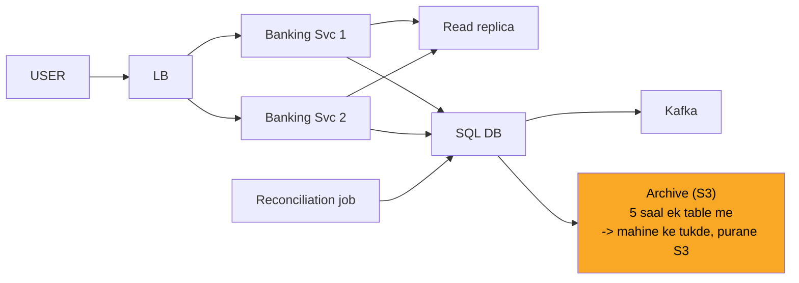
```
DIKKAT     5 saal ka khaata (~36 arab line) ek table me. Log roz sirf 3 mahine dekhte, par har query / backup
           arabon line ke saath. Aur kanoon (PMLA / RBI) kam se kam 5 saal rakhwata, bank 8-10.
HAL        MAHINE KE TUKDE: khaata mahine ke partition me; band mahina DETACH -> sasti jagah (S3).
           Had (PMLA min 5 saal) se pehle delete nahi.
NAHI       "archive = sharding": archive jagah ghatata, shard likhne ka bojh baantta.
```
```
AAGE POOCHEGA:
  NIYAM: jod = mahine ke aakhir ka balance (snapshot) + uske baad ki line; poora kabhi nahi.
  "Tukde S3 gaye / 22 arab ka SUM?" -> SNAPSHOT: har mahine ke aakhir ka balance likh ke rakho (31-Mar Arpan
                                      = 45,000) + uske baad ki line; statement ka "opening balance" isiliye.
  "RBI ne 2021 ka statement maanga?" -> S3 Parquet pe Athena query, ya us mahine ka tukda wapas laao.
  "Archive file koi badal na de?"  -> S3 Object Lock (WORM): na delete na badal, saalon tak.
```

---

## AAKHRI DABBA + WRAP (ek hi baar)

```
User -> LB -> Banking Svc (stateless, idempotency check)
-> SQL DB: EK transaction (dono khaata line + dono balance + idempotency key + outbox)
-> Kafka (commit ke BAAD, outbox se: SMS / fraud / analytics / statement) · Read replica = balance / history
Reconciliation (raat ko: snapshot + baad ki line vs balance -> ALERT)
Archive S3 (band mahine, had se pehle delete nahi)

DB:  SQL -> paisa na khoye na bane: EK transaction (ek DB me SAGA nahi)
     khaata = SACH (sirf jodo, double-entry, mahine ke tukde) · balance = CACHE (jod, usi transaction me)
```
```
JAWAB:    Ek transfer ka sab kuch (dono khaata line, dono balance, id, SMS wali khabar) ek transaction
          me, SQL me. Paisa na khota na banta.
          Khaata sach, balance uska jod, raat ko milaan. Balance check aur lock ka kram DB me.
          Padhai copy se, history 'pichhli line ke baad se', purane mahine sasti jagah, SMS commit ke
          baad Kafka se.
```
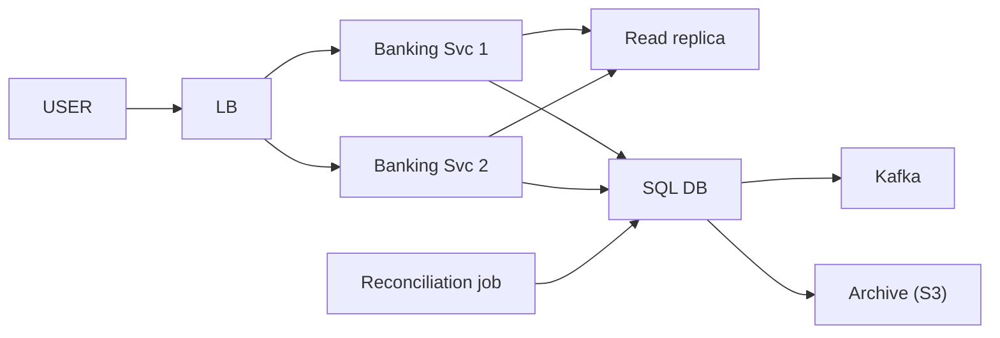

---

## 10 GUNA TRAFFIC — har dabba alag se

```
KRAM:  sasta pehle, SHARD aakhir me
  1. READ REPLICA (pehla kadam, padhna >> likhna) · keemat: thoda peeche -> apna abhi-kiya transfer PRIMARY se
  2. MAHINE ke tukde (archive + query dono ke liye)
  3. SHARD by account_id = AAKHRI, keemat badi: Arpan shard-1, Ravi
     shard-2 -> transfer ek transaction NAHI -> wapas SAGA / 2PC
     -> beech me crash wali dikkat wapas · hamare 120 / sec pe ye sawaal hi nahi; pehle badi machine + replica
  LIKHAI se DB maar kha raha (replica ke baad bhi):
     cache / index = sirf PADHAI ka ilaaj (har naya index INSERT dheema karta) -> likhai ke liye SHARD
     by account_id: ek account ki KHAATA LINE ek shard pe; do shard ke beech transfer -> SAGA
     · zaroori-nahi wali likhai (statement, SMS) queue pe
  BADI TABLE (jagah) -> mahine ke tukde + archive (had se pehle DELETE nahi)
  ✗ "badi transaction chhoti karo" = galat: kaatna + daalna EK transaction me hi
  replica sirf PADHAI baantti, likhai ke liye SHARD · desh / date = bura key (ek garam)

POOCHEGA: "Replicas are in, but writes are still killing the DB. What now?"
          (Copy laga di, par likhai abhi bhi DB ko maar rahi. Ab?)

JAWAB:    Copy sirf padhai ka bojh baantti, likhai sab main DB pe hi jaati. Index bhi sirf padhai tez
          karta, likhai ulta dheemi.
          Likhai bahut ho to account id se baanto: Arpan ki saari khaata line ek tukde pe. Do tukdon ke
          beech transfer -> SAGA. SMS / statement jaisa kaam line me daal do.
          Jagah ke liye mahine ke tukde, purane sasti jagah. Kanoon ki had (5+ saal) se pehle delete nahi.
POOCHEGA: "How would you scale this to 10x?"      -> pehle jo toote
          (padhai -> replica, jagah -> tukde, likhai -> shard)
POOCHEGA: "What's the single point of failure?"   -> DB primary (sync copy), Banking Svc (LB + kai machine)
```

---

## POOCHE TO (gehra sawaal aaye tab)

```
API:      GET /accounts/{id}/balance · GET /accounts/{id}/transactions?cursor=...&limit=20
          POST /transfers { from, to, amount }
          POST /accounts/{id}/deposit { amount } · POST /accounts/{id}/withdraw { amount }
          har POST me Idempotency-Key header

DB:       ledger_entries (SACH, sirf jodo, mahine ke tukde) · accounts.balance (CACHE, jod)
          idempotency_keys (UNIQUE) · outbox · account_balance_snapshot (mahine ke aakhir ka balance)
```

---

ARCHETYPE C · CONCEPTS: [db-what-when](../../FOUNDATIONS/09_databases_what_when.md) · [CAP](../../FOUNDATIONS/08_cap_theorem.md) · [saga/ms-comm](../../FOUNDATIONS/10_ms_communication.md) · [caching](../../FOUNDATIONS/04_caching.md) · saath: [payment-system](../06_payment_system/06_payment_system.md) (iska bada bhai) · [stock-broker](../05_stock_broker_trading/05_stock_broker_trading.md) · [← MASTER SHEET](../../00_MASTER_SHEET.md)
