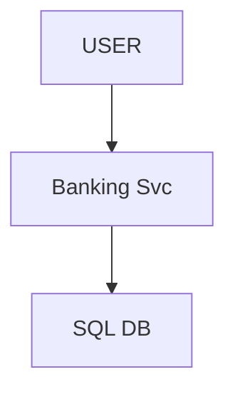
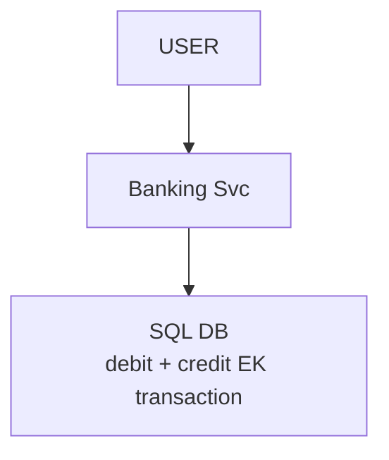
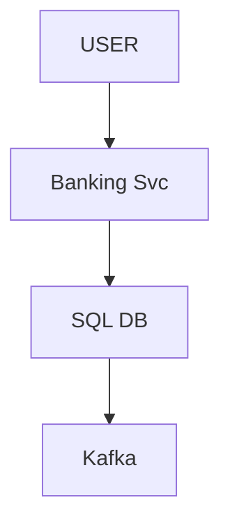
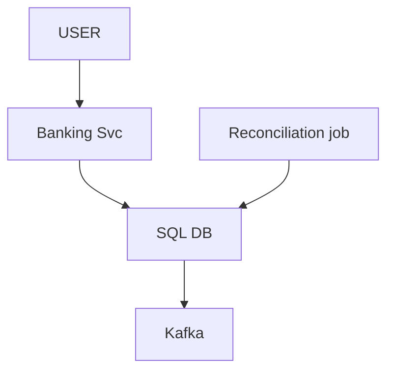
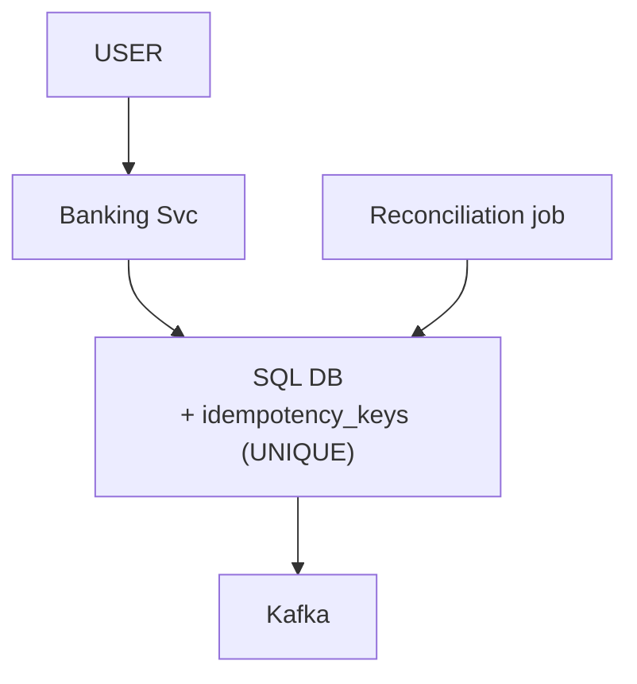
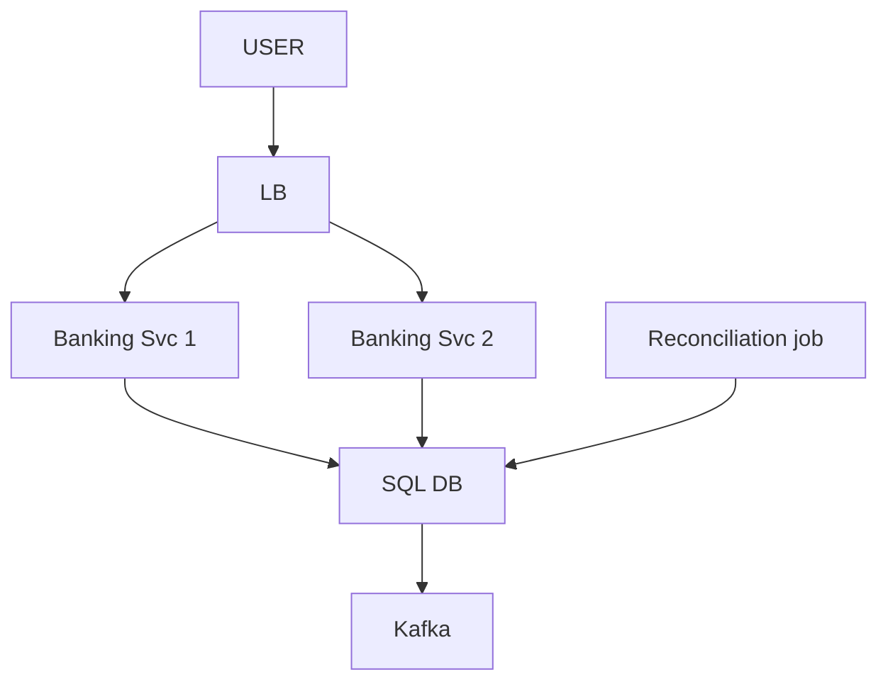
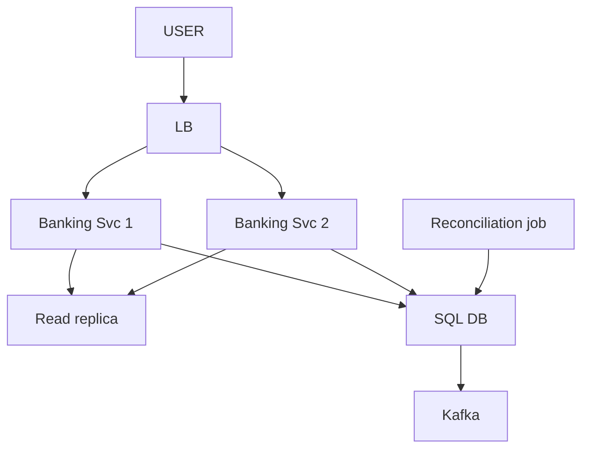
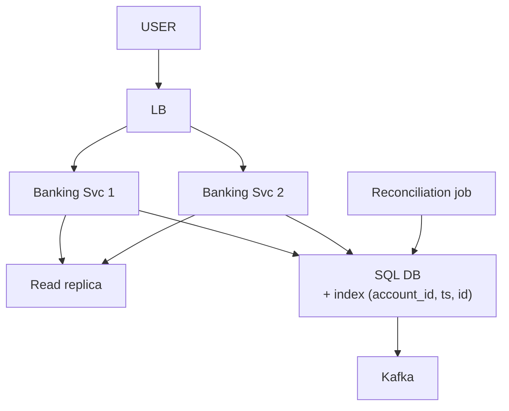
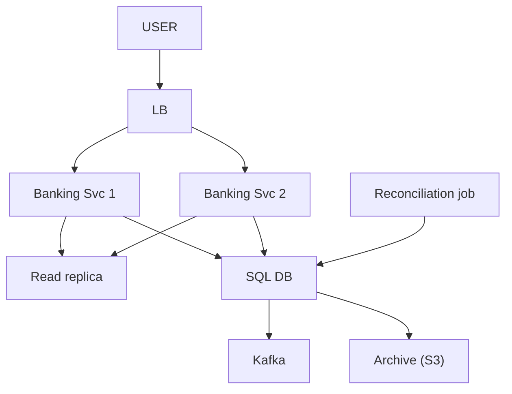

# Mini Banking System (accounts · transactions · balances)

> Ek bank ke andar accounts, un pe paisa daalo / nikaalo / bhejo, aur balance dikhao.
> Is design ka dil: **khaata (ledger) SACH hai, balance sirf uska jod (nateeja)** + paisa na bane na gayab ho.
> KYUN YE DESIGN: candidates batate: payment flow · transaction ledger · ATM · do account ke beech
> bank ke andar transfer. JP ka sabse sambhavit HLD.

```
PAANCH CHEEZ JINPE YE ROUND TAY HOTA (source: "ye interview INHI se tay hote hain"):
   IDEMPOTENCY · TRANSACTIONS · QUEUES · RECONCILIATION · AUDIT
   + ACID vs eventual (network toote to SAHI hona chuno, chalte rehne ki keemat pe)
   + asli khaate ke liye RELATIONAL DB, NoSQL nahi
```

---

## TASVEER (ByteByteGo / Alex Xu · CC BY-NC-ND 4.0)


Source: [Read Replica Pattern](https://bytebytego.com/guides/read-replica-pattern/)
(card 8 — transfer ke baad purana balance = replica peeche -> turant wala padhna PRIMARY se)

---

## SHURU: pehle poocho, phir numbers

```
POOCHO:  "Bahut bada hai — use-cases baandh lete hain. Ek hi bank ke andar, ya doosre bank ko bhi?"
         ("let's discuss use cases first" — scope pehle,
          warna interviewer jitna bada system chaahe sar pe daal dega)

KYA KARE (FR):    user ke ek / kai ACCOUNT · DEPOSIT · WITHDRAW ·
                  TRANSFER A -> B (DONO isi bank) · BALANCE · HISTORY
                  ★ "dono isi bank" — ye ek shabd poora design badalta (card 1)
                  bahar: doosra bank · loan · byaaj · card · KYC
KAISA CHALE (NFR): SAHI hona sabse upar (paisa na GUM, na BANE, hisaab
                   har waqt barabar) · har paisa TRACE ho (audit)
                   dobara bhejne pe DOBARA na kate (idempotent) · balance dekhna TEZ (sabse zyada padha jaata)

NUMBERS (andaaza):
   50 lakh account · 1 crore transaction / din, din me ~86,400 second -> ~120 likhai / second
   padhna >> likhna (log balance baar-baar dekhte)
   120 / second = ek theek-thaak Postgres machine ka DASVA hissa
       -> SHARDING KI ZAROORAT NAHI, primary + replica kaafi
   khaata: 1 crore x 2 line x 365 = ~730 crore line / saal -> 3 saal ~22 arab · 5 saal ~36 arab

DATA SE TEEN SAWAAL (jawab card me):
   1. transfer me DO row badalti -> dono ya koi nahi, kaun sambhalega?   (card 1)
   2. ek account pe do transfer ek saath -> kaun rokega?                 (card 5)
   3. balance minus me na jaaye -> niyam kahan likha?                    (card 5)
```

---

## ════ MOCK SE PEHLE: SIRF YE CARD PADHO ════

> Har card: DIKKAT 1 (kya toota) -> HAL (kya kiya) -> diagram -> DIKKAT 2, 3 ... (interviewer ke
> agle sawaal) har ek ke neeche uska HAL. Revise: sirf baayein column padho.

#### DABBA 0: SABSE SIMPLE (yahan se shuru, phir "kahan tootega")
```
Banking Service (saara niyam / logic) -> SQL DB. Jaan-boojh ke seedha.
```


#### 1 TRANSFER KE BEECH SERVER GIRA: ARPAN -500 HUA, RAVI +500 NAHI
```
DIKKAT 1   Arpan ne Ravi ko 500 bheje. Arpan ke 500 kat gaye, Ravi ke account me daalne se PEHLE server gir
           gaya. 500 na Arpan ke paas, na Ravi ke paas. Gayab.
HAL        Dono account ek hi DB me -> kaatna aur daalna EK transaction me:
             BEGIN; UPDATE Arpan -500; UPDATE Ravi +500; COMMIT;
           DB har badlaav pehle diary (WAL) me likhta. Gira aur utha -> diary dekh ke: COMMIT ho chuka tha to
           poora karta, nahi hua tha to ulta. Aadha kabhi nahi bachta.
```

```
DIKKAT 2   SAGA / queue laga do?
HAL        Ek DB me NAHI. Kaatna aur daalna alag-alag ho jaate, dikkat khud ban jaati. SAGA sirf alag
           service / DB / bank pe.

DIKKAT 3   Arpan aur Ravi alag bank me?
HAL        Ek transaction nahi ho sakta -> PENDING + SAGA / reconciliation (payment design wala raasta).

DIKKAT 4   CP ya AP?
HAL        Transfer / balance = CP (galat balance dikhane se mana karna behtar). SMS / statement /
           analytics = AP (2 sec late chalta).
```

#### 2 KHAATA (LEDGER) KAHAN LIKHO, KAFKA KAB? (GALTI WAPAS wala)
```
DIKKAT 1   RBI poochhta "Arpan ke 500 kahan se aaye, kahan gaye, kab?" -> har len-den ka pakka khaata
           chahiye.
HAL        KHAATA (ledger) = DB ki ek TABLE, USI transaction me jisme paisa hila.
           Har transfer ki 2 line: Arpan -500, Ravi +500 (jod 0). Sirf INSERT, kabhi badla nahi.
             BEGIN
               INSERT ledger (Arpan -500), INSERT ledger (Ravi +500)
               UPDATE balance Arpan, UPDATE balance Ravi
             COMMIT
```

```
DIKKAT 2   Transfer ke baad SMS, fraud check, statement chahiye. Par SMS service giri to transfer na ruke?
HAL        OUTBOX = DB ki ek aur table, usi transaction me, har khaata line ki ek row:
             INSERT outbox (E-77a Arpan debit, sent = false), (E-77b Ravi credit, sent = false)
           COMMIT ke BAAD relay har ~1 sec: sent = false -> Kafka (acks=all) -> sent = true.
           (ya CDC / Debezium: DB ki diary padh ke seedha Kafka.)
           Relay "sent = true" se pehle gira -> event dobara jaata -> SMS service eventId dekh ke skip.

DIKKAT 3   Khaata pehle Kafka me likh diya, phir DB transaction wapas hua (Arpan ke paas paisa kam tha)?
HAL        Kafka me "Arpan -500" chala gaya, asal me kuch hua hi nahi -> khaata jhooth bolega.
           Kafka aur DB ek transaction me ho hi nahi sakte.
           DB table me rakha tha to rollback = khaata bhi gaya.

DIKKAT 4   Commit ke baad seedha Kafka ko kyun nahi bhej dete?
HAL        Commit aur bhejne ke beech app gira = event gayab, SMS kabhi nahi. Outbox usi transaction me hai,
           kho nahi sakta.

DIKKAT 5   Arpan ki salary 50,000 aayi, 1 min baad usne 20,000 rent bheja. SMS ulte aaye: pehle
           "20,000 kata", phir "50,000 aaya" -> beech wale SMS ka balance galat dikha?
HAL        Har khaata line ka apna event (upar E-77a, E-77b), Kafka key = account_id:
           Arpan ke saare event ek partition me, kram se. Ravi ke apne partition me.

DIKKAT 6   Outbox table bhar jaayegi?
HAL        Sent wali rows roz saaf / partition drop.
```

#### 3 BALANCE AATA KAHAN SE? (is design ka asli sawaal)
```
DIKKAT 1   Do raaste:
           (a) balance ek column me: padhna sasta (ek row), par kabhi galat bhi ho sakta.
           (b) har baar khaata jodo: hamesha sach, par 10 saal ki 50,000 line har baar jodna = dheema.
HAL        DONO: KHAATA = SACH, balance column = uska jod (cache). Dono EK transaction me badalte.
           Arpan balance dekhe -> sirf balance column (ek row, tez).
           Raat ko RECONCILIATION job: Arpan ka khaata jod = 4,500, column me 4,500 -> theek.
```

```
DIKKAT 2   Raat ko farak mila (khaata 4,500, column 5,000)?
HAL        Alert + account rok ke dekho. Chupchaap theek MAT karo: pehle KYUN hua (bug abhi bhi zinda hai).
           Phir khaata jeetega.

DIKKAT 3   22 arab line pe raat ka SUM?
HAL        Pichhle mahine ke aakhir ka balance (snapshot) + sirf uske baad ki line. Poora nahi.

DIKKAT 4   Chal raha hai, kaise pata?
HAL        Reconciliation + p99 + error rate + queue lag + DB connection pe alert + har transfer ka trace id.
```

#### 4 "SEND" DO BAAR DABA / APP NE DOBARA BHEJA
```
DIKKAT 1   Arpan ne Send dabaya, app ghooma, phir daba diya. Ya app ne khud dobara bheja -> 1000 kat gaye,
           bhejne the 500.
HAL        App har transfer ke saath ek id (idempotency key) bhejta, DB me wo id UNIQUE.
           Dobara bheja to wahi id -> pehla jawab wapas, paisa doosri baar nahi katta.
           App me "pehle dekho, phir daalo" = race (dono ne dekha "nahi hai", dono ne daala).
           UNIQUE insert khud taala jaisa.
           @Transactional = "aadha nahi hoga". Idempotency = "do baar nahi hoga". Dono chahiye.
```

```
DIKKAT 2   Key wahi, par body alag (500 ki jagah 5000)?
HAL        Key ke saath request ka hash bhi rakho. Mel nahi = 422, purana jawab nahi.

DIKKAT 3   Key table hamesha badhti rahegi?
HAL        24-48 ghante baad saaf.
```

#### 5 AUTO-DEBIT AUR UPI EK SAATH (DOUBLE SPEND)
```
DIKKAT 1   Arpan ke paas 300. 1 tareekh subah 9:00 Netflix ka 200 ka auto-debit chala, usi second Arpan
           ne phone se UPI pe Ravi ko 200 bheje. Do request, do thread, dono ne balance padha (300)
           -> dono pass -> dono kate -> Arpan = -100.
HAL        Hisaab DB ke andar, check + kaatna EK hi query me:
             UPDATE account SET balance = balance - 200 WHERE id = 'Arpan' AND balance >= 200
           UPDATE row pe taala leta -> dono transfer line me lagte.
           Pehla: 300 -> 100. Doosra: 100 >= 200? nahi -> 0 row badli -> reject.
```

```
DIKKAT 2   0 row aaya, Arpan ko kya?
HAL        "insufficient balance" (422) + poora transaction wapas (Ravi ko daalna bhi nahi).

DIKKAT 3   Niyam code me kyun nahi?
HAL        Raaste kai (API / batch / haath se), DB ek. Niyam DB me.
```

#### 6 ARPAN -> RAVI KI DUKAAN AUR DUKAAN -> ARPAN EK SAATH (DEADLOCK)
```
DIKKAT 1   Ravi ki dukaan. Arpan ne dukaan ko 500 bheje, usi second dukaan ke system ne Arpan ke purane
           order ka 200 refund chalaya (refund batch).
           Txn1 ne Arpan pe taala liya, Ravi ka intezaar · Txn2 ne Ravi pe taala, Arpan ka intezaar
           -> dono hamesha atke (deadlock, MySQL 1213).
HAL        Hamesha CHHOTI account id pehle lock karo, dono transfer same kram me.
           Dono pehle wahi ek account maangte -> ek ruka, doosra poora, phir pehla. Gol ghera banta hi nahi.
```

```
DIKKAT 2   Kram ke bawajood deadlock?
HAL        DB ek ko wapas kar deta -> app thoda ruk ke dobara (same idempotency key, do baar nahi katega).
```

#### 7 SALARY DAY, EK SERVICE BHAR GAYI
```
DIKKAT 1   1 tareekh, sabki salary aayi, sab ek saath transfer kar rahe. Ek hi Banking service machine bhar
           gayi. Wo giri to poora bank band.
HAL        Banking service kuch yaad nahi rakhti -> kai machine + load balancer, mari hui list se bahar.
```

```
DIKKAT 2   Main DB hi gir gaya?
HAL        Main DB ki SYNC copy doosri building me: har transfer copy me bhi likh ke hi "done".
           Patroni / RDS Multi-AZ: primary mara -> copy promote -> DB ka pata nayi pe -> ~1-2 min.
           Nayi primary ke paas har pakka transfer.

DIKKAT 3   Sync = har transfer dheema?
HAL        Haan, ek network chakkar. Paise me ye keemat theek. Async me aakhri transfer kho sakta.

DIKKAT 4   Failover ke us 1-2 min me transfer aaya?
HAL        Error -> app dobara bheje, same idempotency key -> do baar nahi katega.

DIKKAT 5   Ravi ne apne login se "Arpan ke account se 500 bhejo" bheja (ya Arpan ka balance maanga)?
HAL        OWNER CHECK har request pe: userId JWT se lo (body / URL se nahi, wahan koi kuch bhi likh de).
           from_account ka maalik yahi user hai? Nahi -> 403. Balance / history pe bhi wahi check.
```

#### 8 SAB BALANCE PRIMARY SE PADH RAHE, TRANSFER DHEEME
```
DIKKAT 1   Salary day subah 9-10: har koi app khol ke balance + "pichhle 3 mahine" history dekh raha,
           upar se mahine ka statement job chal raha. Ye bhaari padhai primary pe -> transfer dheeme.
HAL        Padhna DB ki COPY (read replica) se, likhna (transfer) sirf primary pe.
           Primary ki diary (WAL) copy tak jaati, copy wahi badlaav lagati. Primary sirf likhne ke liye free.
```

```
DIKKAT 2   Salary day ki bheed me copy ~5 sec peeche. Arpan ne 1000 bheje, success screen se turant
           balance khola -> purana 5000 dikha (asal 4000). Arpan sochega paisa gaya hi nahi -> dobara!
HAL        Jisne abhi paisa bheja uska balance kuch second PRIMARY se (read-your-own-writes):
           Arpan ke ACCOUNT pe last_write_at (Redis, phone pe nahi) -> kuch second tak kisi bhi phone se
           Arpan ka padhna primary se.

DIKKAT 3   Copy minute bhar peeche?
HAL        Lag pe alert. Had paar -> us copy ko padhne wali list se hatao.
```

#### 9 DUKAAN KI 5 LAKH LINE, EXPORT KA PAGE 5000
```
DIKKAT 1   Ravi ki dukaan: roz ~500 UPI, 3 saal = ~5 lakh line. CA ka export tool 20-20 karke page
           maangta. Page 5000 pe: LIMIT 20 OFFSET 100000 -> DB 1,00,020 line PADH ke phenkta, 20 deta.
           Bahut dheema. Beech me nayi line aayi -> sab ek khisak gaya -> ek line dobara dikhi.
HAL        Pichhle page ki aakhri line ka (time, id) yaad rakho, agla page "isse purani 20" (keyset):
             WHERE account_id = ? AND (ts, id) < (:last_ts, :last_id) ORDER BY ts DESC, id DESC LIMIT 20
           Index (account_id, ts DESC, id DESC) se seedha wahan -> page 1 ho ya 5000, ek jaisa tez.
```

```
DIKKAT 2   Same ts pe do line, ek chhoot jaaye?
HAL        Isliye (ts, id) dono. id barabari todti.

DIKKAT 3   "Seedha page 500 pe jao"?
HAL        Keyset me nahi hota, sirf agla / pichhla. Statement ke liye theek.

DIKKAT 4   Cursor app ko kaise do?
HAL        (ts, id) ko base64 karke next_cursor.
```

#### 10 5 SAAL KA DATA EK HI TABLE ME
```
DIKKAT 1   5 saal ka khaata (~36 arab line) ek table me. Log roz sirf 3 mahine dekhte, par har query /
           backup arabon line ke saath. Aur kanoon (PMLA / RBI) kam se kam 5 saal rakhwata, bank 8-10.
HAL        Khaata MAHINE ke tukdon (partition) me. Band mahine sasti jagah (S3), had se pehle delete nahi.
```

```
DIKKAT 2   Purane tukde S3 gaye -> raat ka reconciliation khaata jodega to adhoora -> har account me farak?
HAL        Har mahine ke aakhir ka balance (snapshot) likh ke rakho. Jod = snapshot (31-Mar Arpan = 45,000)
           + uske baad ki line. (Bank statement ke upar "opening
           balance" isi wajah se likha hota.)

DIKKAT 3   RBI ne 2021 ka statement maanga?
HAL        S3 Parquet pe Athena query, ya us mahine ka tukda wapas laao.

DIKKAT 4   Archive file koi badal na de?
HAL        S3 Object Lock (WORM): na delete na badal, saalon tak.

DIKKAT 5   Archive aur sharding ek hi cheez?
HAL        Nahi. Archive jagah ghatata, shard likhne ka bojh baantta.
```

```
AAKHRI DABBE (sab dikkat ke baad):
  User -> LB -> Banking Svc (stateless, idempotency check)
  -> SQL DB: EK transaction (dono khaata line + dono balance + idempotency key + outbox)
  -> Kafka (commit ke BAAD: SMS / fraud / analytics / statement) · Read replica = balance / history
  Reconciliation (raat ko: snapshot + baad ki line vs balance -> ALERT)
                           · Archive S3 (band mahine, had se pehle delete nahi)

DB:  SQL -> paisa na khoye na bane: EK transaction (ek DB me SAGA nahi)
     khaata = SACH (sirf jodo, double-entry, mahine ke tukde) · balance = CACHE (jod, usi transaction me)

END ME POOCHEGA:
  "Khaata kahan, Kafka kab?" -> khaata SQL me usi transaction me; Kafka sirf commit ke baad (outbox se)
  "Minus balance / ulte transfer?" -> check DB me (WHERE balance >= x) · taala id ke kram me -> deadlock nahi
  "Likhai DB maar rahi (replica ke baad bhi)?" -> replica / cache sirf padhai; likhai -> SHARD by account_id
                       (aakhri kadam, keemat: transfer ek transaction nahi rehta -> SAGA)
  "10x?"            -> pehle jo toote: padhai -> replica · jagah -> mahine ke tukde · likhai -> shard
  "SPOF?"           -> DB primary (sync copy) · Banking Svc (LB + kai machine)
```

AAKHRI DABBE ki tasveer:


---

## 10 GUNA TRAFFIC — har dabba alag se

```
KRAM:  sasta pehle, SHARD aakhir me
  1. READ REPLICA (pehla kadam, padhna >> likhna) · keemat: thoda peeche -> apna abhi-kiya transfer PRIMARY se
  2. MAHINE ke tukde (archive + query dono ke liye)
  3. SHARD by account_id = AAKHRI, keemat badi: Arpan shard-1, Ravi
     shard-2 -> transfer ek transaction NAHI -> wapas SAGA / 2PC
     -> card 1 ki saari dikkat wapas · hamare 120 / sec pe ye sawaal hi nahi; pehle badi machine + replica
  LIKHAI se DB maar kha raha (replica ke baad bhi):
     cache / index = sirf PADHAI ka ilaaj (har naya index INSERT dheema karta) -> likhai ke liye SHARD
     by account_id: ek account ki KHAATA LINE ek shard pe; do shard ke beech transfer -> SAGA
     · zaroori-nahi wali likhai (statement, SMS) queue pe
  BADI TABLE (jagah) -> mahine ke tukde + archive (had se pehle DELETE nahi)
  ✗ "badi transaction chhoti karo" = galat: kaatna + daalna EK transaction me hi
  replica sirf PADHAI baantti, likhai ke liye SHARD · desh / date = bura key (ek garam)

POOCHEGA: "Replicas are in, but writes are still killing the DB. What now?"
          (Copy laga di, par likhai abhi bhi DB ko maar rahi. Ab?)

JAWAB:    Copy sirf padhai ka bojh baantti, likhai sab main DB pe hi jaati. Index bhi sirf padhai tez
          karta, likhai ulta dheemi.
          Likhai bahut ho to account id se baanto: Arpan ki saari khaata line ek tukde pe. Do tukdon ke
          beech transfer -> SAGA. SMS / statement jaisa kaam line me daal do.
          Jagah ke liye mahine ke tukde, purane sasti jagah. Kanoon ki had (5+ saal) se pehle delete nahi.
POOCHEGA: "How would you scale this to 10x?"      -> pehle jo toote
          (padhai -> replica, jagah -> tukde, likhai -> shard)
POOCHEGA: "What's the single point of failure?"   -> DB primary (sync copy), Banking Svc (LB + kai machine)
```

---

## POOCHE TO (gehra sawaal aaye tab)

```
API:      GET /accounts/{id}/balance · GET /accounts/{id}/transactions?cursor=...&limit=20
          POST /transfers { from, to, amount }
          POST /accounts/{id}/deposit { amount } · POST /accounts/{id}/withdraw { amount }
          har POST me Idempotency-Key header

DB:       ledger_entries (SACH, sirf jodo, mahine ke tukde) · accounts.balance (CACHE, jod)
          idempotency_keys (UNIQUE) · outbox · account_balance_snapshot (mahine ke aakhir ka balance)
```

---

## AAKHRI DABBA + WRAP

```
LB · Banking Svc = stateless, idempotency check · SQL DB = EK transaction (khaata + balance + key + outbox)
Kafka = commit ke BAAD (SMS / fraud / analytics / statement)
Read replica = balance / history (apna transfer primary se)
Reconciliation = snapshot + baad ki line vs balance -> ALERT
Archive (S3) = band mahine, had se pehle delete nahi
```
```
beech me crash        -> ek transaction (@Transactional), ek DB me SAGA nahi
dobara tap / retry    -> Idempotency-Key + DB UNIQUE
paisa kahan gaya      -> sirf-jodo KHAATA, double-entry (jod zero)
balance tez           -> balance = khaate ka CACHE, usi transaction me
cache vs sach         -> raat ka RECONCILIATION, khaata jeetega
minus balance         -> check DB me (WHERE balance >= x / CHECK)
ulte kram ke transfer -> taala TAY KRAM me (id sort) -> deadlock nahi
arabon line history   -> CURSOR + index (account_id, ts DESC, id DESC)
purana data           -> mahine ke TUKDE -> DETACH -> S3, had se pehle DELETE nahi
archive ke baad       -> OPENING BALANCE snapshot
bojh badha            -> replica -> tukde -> (aakhir me) shard
```
```
JAWAB:    Ek transfer ka sab kuch (dono khaata line, dono balance, id, SMS wali khabar) ek transaction
          me, SQL me. Paisa na khota na banta.
          Khaata sach, balance uska jod, raat ko milaan. Balance check aur lock ka kram DB me.
          Padhai copy se, history 'pichhli line ke baad se', purane mahine sasti jagah, SMS commit ke
          baad Kafka se.
```


ARCHETYPE C · CONCEPTS: [db-what-when](../../FOUNDATIONS/09_databases_what_when.md) · [CAP](../../FOUNDATIONS/08_cap_theorem.md) · [saga/ms-comm](../../FOUNDATIONS/10_ms_communication.md) · [caching](../../FOUNDATIONS/04_caching.md) · saath: [payment-system](../06_payment_system/06_payment_system.md) (iska bada bhai) · [stock-broker](../05_stock_broker_trading/05_stock_broker_trading.md) · [← MASTER SHEET](../../00_MASTER_SHEET.md)
