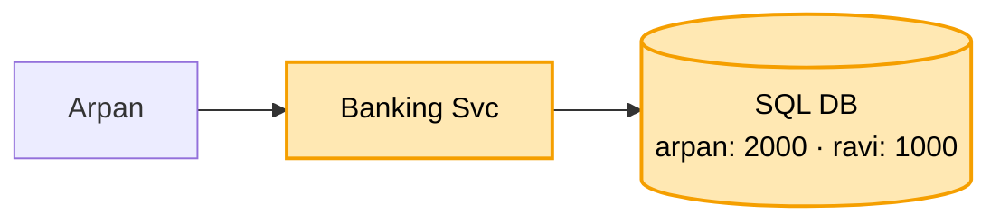
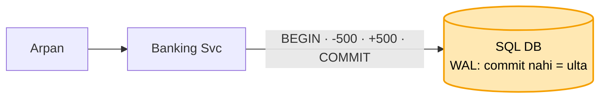
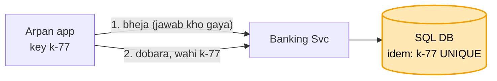

# Mini banking: shuru se, ek kahani

Kram: **FR -> NFR -> numbers -> design**. Design sabse seedhe dabbe se shuru, har dikkat pe ek dabba judta.
Peela = abhi juda. Kahani ek hi: Arpan ne Ravi ko 500 bheje.

---

## 1. FR: kya karna hai

```
1. account: deposit, withdraw, balance, history
2. transfer A se B (DONO isi bank me)
scope ke bahar (poochh ke hatao): doosra bank, loan, byaaj, card, KYC
```

"Dono isi bank" ye ek shabd poora design badalta. Pehle poochho.

## 2. NFR: kaisa chalna chahiye

```
- SAHI sabse upar : paisa na gum ho, na bane. Hisaab har waqt barabar
- har paisa trace ho (audit)
- dobara bhejne pe dobara na kate
- balance dekhna tez ho
```

## 3. Numbers

```
- 50 lakh account, roz 1 crore transaction -> ~120 likhai / sec, padhna kahin zyada
- 120 / sec = ek Postgres ka dasva hissa
```

Bheed badi dikkat nahi, SAHI hona badi dikkat. Isliye shard nahi, ek SQL DB kaafi. (URL se ulta: wahan speed
+ size.)

---

## 4. Design

### Kadam 1: sabse seedha (Banking Svc + SQL DB)

Arpan ne Ravi ko 500 bheje:

```
UPDATE account SET balance = balance - 500 WHERE id = arpan
UPDATE account SET balance = balance + 500 WHERE id = ravi
```



SQL kyun, NoSQL kyun nahi? Ek transfer me DO row ek saath badalni: dono ya koi nahi. Kai row ek saath pakka
badalna SQL ka seedha kaam (ACID). Bheed bhi chhoti, NoSQL ki "bahut bada data" taakat chahiye hi nahi.

Par pehla UPDATE hua (Arpan -500), doosre se pehle server gira. Arpan ke 500 kate, Ravi ko kuch nahi. Paisa
gayab.

### Kadam 2: beech me gira, paisa gayab (ek transaction)

Ilaaj: dono UPDATE ek **transaction** me. Dono ya koi nahi.

```
BEGIN
  UPDATE account SET balance = balance - 500 WHERE id = arpan
  UPDATE account SET balance = balance + 500 WHERE id = ravi
COMMIT
COMMIT se pehle gira -> DB pehla UPDATE bhi ulta (rollback). 2000 wapas 2000, paisa na gaya na bana
```

DB ko kaise pata kya ulta karna? **WAL (write-ahead log)**: table badalne se pehle har badlaav log me.
Restart pe log padhta: COMMIT nahi hua = ulta, COMMIT ho gaya = pakka (bijli jaane pe bhi).



```
saga kyun nahi?          -> saga = paisa DO alag DB me (doosra bank). Yahan ek DB, ek transaction seedha
                            (payment file me doosra bank = saga)
App khud ulta kare?      -> App hi gira to yaad kaun rakhe? WAL ye pehle se karta
```

Par Send dabaya, transaction ho gaya, jawab se pehle metro me network gaya. App ne socha fail, dobara bheja.
1000 kate.

### Kadam 3: network gaya, app ne dobara bheja (idempotency key)

Server ke liye dono request alag thi, pata hi nahi chala ki doosri pehli ka dobara bhejna hai.

Ilaaj: **idempotency key**. App Send screen KHULTE hi ek id (UUID, `k-77`). Har request ke saath wahi,
dobara bhi wahi. Server usi transaction me table me likhta, table pe **UNIQUE**.

```
BEGIN
  INSERT INTO idem (key, result) VALUES ('k-77', ...)    <- UNIQUE
  -500 Arpan · +500 Ravi
COMMIT
dobara k-77 -> INSERT fail (UNIQUE) -> paisa nahi kata, purana jawab ("ho gaya")
```



```
screen khulte kyun?          -> retry app karti. Id pehle bani ho tabhi dobara pe wahi.
                                Send pe nayi = naya payment
UNIQUE kyun, pehle dekho?    -> do retry ek saath "nahi hai" dekhte, dono kaat dete.
                                UNIQUE = DB khud lagata, ek hi jeete
same amount 1 min me block?  -> sach me do baar 500 bhejna bhi rukta. Pehchaan id se, amount se nahi
wahi k-77, amount 5000?      -> key ke saath request ka hash (amount + kisko).
                                Key same, hash alag -> mana (422)
```

Par wallet me 600. Raat 9 baje Netflix ka 500 auto-debit aur Arpan ka 500 UPI ek saath. Dono ne padha 600,
dono ko "chalega", dono kate. Balance -400.

