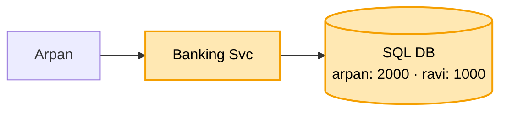

# Mini banking: shuru se, ek kahani

Kram: **FR -> NFR -> numbers -> design**. Design sabse seedhe dabbe se shuru, har dikkat pe ek dabba judta.
Peela = abhi juda. Kahani ek hi: Arpan ne Ravi ko 500 bheje.

---

## 1. FR: kya karna hai

```
1. account: deposit, withdraw, balance, history
2. transfer A se B (DONO isi bank me)
scope ke bahar (poochh ke hatao): doosra bank, loan, byaaj, card, KYC
```

"Dono isi bank" ye ek shabd poora design badalta. Pehle poochho.

## 2. NFR: kaisa chalna chahiye

```
- SAHI sabse upar : paisa na gum ho, na bane. Hisaab har waqt barabar
- har paisa trace ho (audit)
- dobara bhejne pe dobara na kate
- balance dekhna tez ho
```

## 3. Numbers

```
- 50 lakh account, roz 1 crore transaction -> ~120 likhai / sec, padhna kahin zyada
- 120 / sec = ek Postgres ka dasva hissa
```

Bheed badi dikkat nahi, SAHI hona badi dikkat. Isliye shard nahi, ek SQL DB kaafi.
(URL se ulta: wahan speed + size.)

---

## 4. Design

### Kadam 1: sabse seedha (Banking Svc + SQL DB)

Arpan ne Ravi ko 500 bheje:

```
UPDATE account SET balance = balance - 500 WHERE id = arpan
UPDATE account SET balance = balance + 500 WHERE id = ravi
```



SQL kyun, NoSQL kyun nahi? Ek transfer me DO row ek saath badalni: dono ya koi nahi. Kai row ek saath
pakka badalna SQL ka seedha kaam (ACID). Bheed bhi chhoti, NoSQL ki "bahut bada data" taakat chahiye hi nahi.

Par pehla UPDATE hua (Arpan -500), doosre se pehle server gira.
Arpan ke 500 kate, Ravi ko kuch nahi. Paisa gayab.
