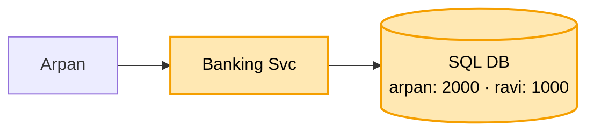
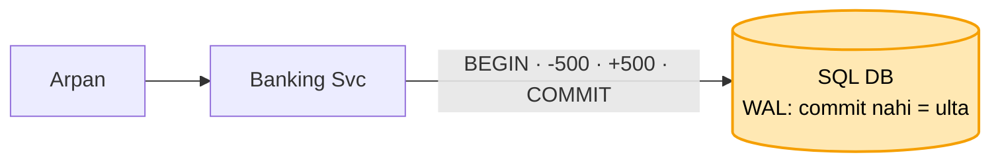
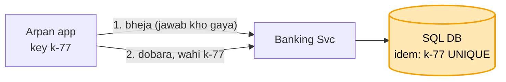
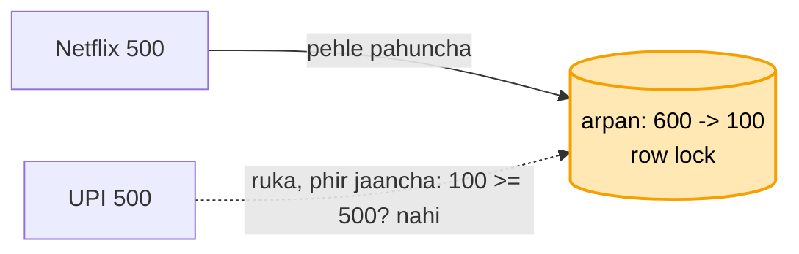
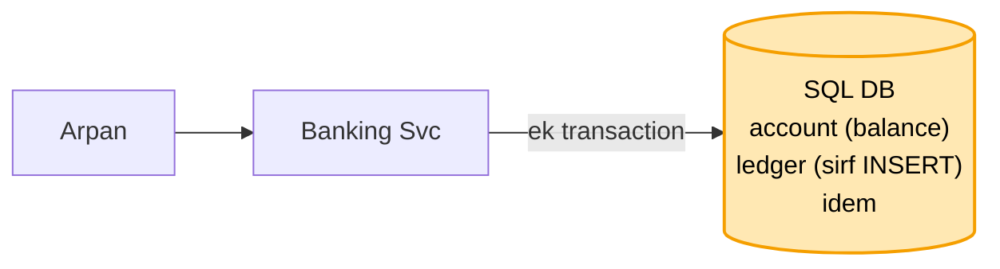
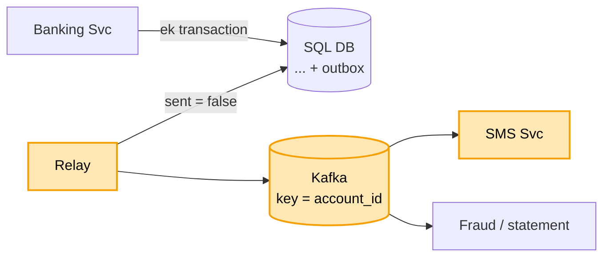
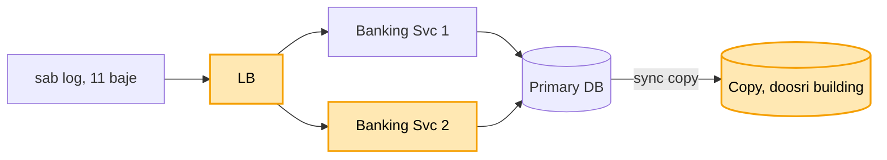
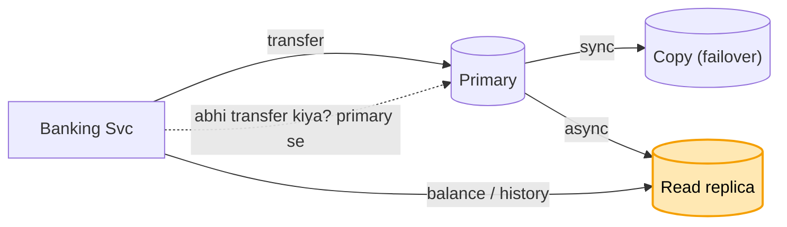

# Mini banking: shuru se, ek kahani

Kram: **FR -> NFR -> numbers -> design**. Design sabse seedhe dabbe se shuru, har dikkat pe ek dabba judta.
Peela = abhi juda. Kahani ek hi: Arpan ne Ravi ko 500 bheje.

---

## 1. FR: kya karna hai

```
1. account: deposit, withdraw, balance, history
2. transfer A se B (DONO isi bank me)
scope ke bahar (poochh ke hatao): doosra bank, loan, byaaj, card, KYC
```

"Dono isi bank" ye ek shabd poora design badalta. Pehle poochho.

## 2. NFR: kaisa chalna chahiye

```
- SAHI sabse upar : paisa na gum ho, na bane. Hisaab har waqt barabar
- har paisa trace ho (audit)
- dobara bhejne pe dobara na kate
- balance dekhna tez ho
```

## 3. Numbers

```
- 50 lakh account, roz 1 crore transaction -> ~120 likhai / sec, padhna kahin zyada
- 120 / sec = ek Postgres ka dasva hissa
```

Bheed badi dikkat nahi, SAHI hona badi dikkat. Isliye shard nahi, ek SQL DB kaafi. (URL se ulta: wahan speed
+ size.)

---

## 4. Design

### Kadam 1: sabse seedha (Banking Svc + SQL DB)

Arpan ne Ravi ko 500 bheje:

```
UPDATE account SET balance = balance - 500 WHERE id = arpan
UPDATE account SET balance = balance + 500 WHERE id = ravi
```



SQL kyun, NoSQL kyun nahi? Ek transfer me DO row ek saath badalni: dono ya koi nahi. Kai row ek saath pakka
badalna SQL ka seedha kaam (ACID). Bheed bhi chhoti, NoSQL ki "bahut bada data" taakat chahiye hi nahi.

Par pehla UPDATE hua (Arpan -500), doosre se pehle server gira. Arpan ke 500 kate, Ravi ko kuch nahi. Paisa
gayab.

### Kadam 2: beech me gira, paisa gayab (ek transaction)

Ilaaj: dono UPDATE ek **transaction** me. Dono ya koi nahi.

```
BEGIN
  UPDATE account SET balance = balance - 500 WHERE id = arpan
  UPDATE account SET balance = balance + 500 WHERE id = ravi
COMMIT
COMMIT se pehle gira -> DB pehla UPDATE bhi ulta (rollback). 2000 wapas 2000, paisa na gaya na bana
```

DB ko kaise pata kya ulta karna? **WAL (write-ahead log)**: table badalne se pehle har badlaav log me.
Restart pe log padhta: COMMIT nahi hua = ulta, COMMIT ho gaya = pakka (bijli jaane pe bhi).



```
saga kyun nahi?          -> saga = paisa DO alag DB me (doosra bank). Yahan ek DB, ek transaction seedha
                            (payment file me doosra bank = saga)
App khud ulta kare?      -> App hi gira to yaad kaun rakhe? WAL ye pehle se karta
```

Par Send dabaya, transaction ho gaya, jawab se pehle metro me network gaya. App ne socha fail, dobara bheja.
1000 kate.

### Kadam 3: network gaya, app ne dobara bheja (idempotency key)

Server ke liye dono request alag thi, pata hi nahi chala ki doosri pehli ka dobara bhejna hai.

Ilaaj: **idempotency key**. App Send screen KHULTE hi ek id (UUID, `k-77`). Har request ke saath wahi,
dobara bhi wahi. Server usi transaction me table me likhta, table pe **UNIQUE**.

```
BEGIN
  INSERT INTO idem (key, result) VALUES ('k-77', ...)    <- UNIQUE
  -500 Arpan · +500 Ravi
COMMIT
dobara k-77 -> INSERT fail (UNIQUE) -> paisa nahi kata, purana jawab ("ho gaya")
```



```
screen khulte kyun?          -> retry app karti. Id pehle bani ho tabhi dobara pe wahi.
                                Send pe nayi = naya payment
UNIQUE kyun, pehle dekho?    -> do retry ek saath "nahi hai" dekhte, dono kaat dete.
                                UNIQUE = DB khud lagata, ek hi jeete
same amount 1 min me block?  -> sach me do baar 500 bhejna bhi rukta. Pehchaan id se, amount se nahi
wahi k-77, amount 5000?      -> key ke saath request ka hash (amount + kisko).
                                Key same, hash alag -> mana (422)
```

Par wallet me 600. Raat 9 baje Netflix ka 500 auto-debit aur Arpan ka 500 UPI ek saath. Dono ne padha 600,
dono ko "chalega", dono kate. Balance -400.

### Kadam 4: do kataai ek saath, balance -400 (check + kaato ek query me)

Dono ne pehle padha (600), phir jaancha ("500 hai"), phir kaata. Teen alag kadam, beech me doosra ghus gaya.

Ilaaj: jaanch + kataai **EK query** me:

```
UPDATE account SET balance = balance - 500
WHERE id = 'arpan' AND balance >= 500
-> 1 row badli = kat gaya · 0 row badli = paisa kam, mana
```

Kyun chalta: UPDATE jis row ko chhuta, us pe lock (row lock). Netflix pehle: 600 -> 100. UPI ruk ke
intezaar, lock khulne pe `balance >= 500` NAYE number (100) pe jaanchti: fail, 0 row, mana.



```
do transfer ulti disha me ek saath (Arpan -> dukaan, dukaan -> Arpan) = deadlock?
-> jo SQL DB liya (kadam 1) wahi khud pakad ke todta (ek fail, error 1213). App dobara chalaye,
   idempotency key (kadam 3) se dohra nahi. Hone hi na de: chhoti account id pehle lock
```

Par Arpan ne app kholi: "mere 500 kahan gaye, kab?" DB me sirf `balance = 100`. Kab, kisko, kuch pata nahi.
NFR "har paisa trace ho" toota.

### Kadam 5: "mere 500 kahan gaye, kab?" (khaata = ledger)

Balance sirf aakhri number, itihaas nahi.

Ilaaj: har paisa hilne pe **khaata (ledger)** me line, usi transaction me, **double-entry** (ek se gaya, ek
me aaya):

```
txn   account  amount  time       kisko / kisse
t-91  arpan    -500    21:00:03   ravi
t-91  ravi     +500    21:00:03   arpan

BEGIN
  idem k-77 · arpan -500 (check ke saath) · ravi +500
  INSERT ledger (t-91, arpan, -500) · INSERT ledger (t-91, ravi, +500)
COMMIT
```

```
sirf INSERT       -> kabhi UPDATE / DELETE nahi. Galti = ulti line (+500 wapas), purani nahi mitti.
                     Audit isi se
double-entry kyun -> har transfer ki dono line jod = 0. Poore khaate ka jod 0 nahi = galti.
                     Paisa na bana na gaya
khaata = sach      -> balance = us account ki saari lines ka jod. Balance column bas tez padhne ki copy
```



Par Ravi ko SMS jaana chahiye ("500 aaye"). SMS service transaction ke andar call ki, aur wo giri hui thi.
Ya poora transfer ruke, ya transfer ho aur SMS kabhi na jaaye.

### Kadam 6: SMS service giri (outbox + Kafka)

```
SMS transaction ke ANDAR    -> SMS dheema / gira = transfer bhi ruka
COMMIT ke BAAD seedha SMS   -> COMMIT hua, SMS se pehle server gira = SMS kabhi nahi gaya
```

Ilaaj: **outbox**. SMS ki khabar usi transaction me DB ki outbox table me. **Relay** outbox se utha ke
**Kafka** me, SMS Svc Kafka se padh ke bhejta.

```
BEGIN
  idem · arpan -500 · ravi +500 · ledger 2 line
  INSERT outbox ("ravi ko 500 aaye", sent = false)
COMMIT
relay -> sent = false -> Kafka -> SMS Svc -> SMS

transfer hua = khabar bhi pakki (ek saath)
SMS Svc gira  -> khabar Kafka me padi, uthne pe bhejega. Transfer pe asar nahi
key = account_id -> Ravi ki SMS kram se ("500 aaye", phir "200 gaye")
wahi khabar     -> fraud jaanch, analytics, statement bhi padhte
```



Wahi outbox jo Kafka file me (wahan Order Svc, yahan Banking Svc).

Par 11 baje sabki salary ek saath. Ek Banking Svc machine nahi jheli. Aur DB ek hi: gira to poora bank band.

### Kadam 7: salary ki bheed + ek hi DB (kai machine + DB ki sync copy)

Ilaaj 1: kai Banking Svc + aage LB. Chalta kyunki Banking Svc kuch yaad nahi rakhta (**stateless**), sach DB
me.

Ilaaj 2: DB ki **copy doosri building me** (RDS Multi-AZ). Primary gira -> copy primary.

```
ASYNC copy  -> primary "ho gaya" turant, copy baad me.
               Primary gira = aakhri transfer copy tak nahi = hisaab gaya
SYNC copy   -> "ho gaya" tabhi jab copy pe bhi likha.
               Thoda dheema, par ek bhi transfer nahi khota  <- ISLIYE YE
paise me "thoda dheema" chalta, "transfer kho gaya" nahi. Likhai sirf 120 / sec, dheemapan dikhta bhi nahi
```



Par salary aate hi sab balance + history dekh rahe. Padhna likhne se kahin zyada, aur sab primary pe.
Primary bhara, transfer dheeme.

### Kadam 8: sab balance dekh rahe, transfer dheeme (read replica)

Ilaaj: **read replica** = primary ki ek aur copy, sirf padhne ke liye. Balance / history wahan se, primary
sirf transfer.

```
ye copy ASYNC        -> kuch ms peeche chal sakti. Sirf padhai, to chalta, aur primary dheema nahi
                        (kadam 7 wali SYNC copy failover ke liye, ye alag)
padhai aur badhi     -> replica 2-3
pench                -> Arpan ne abhi 500 bheje, turant balance: replica peeche, purana 600 dikha. Ghabraya
read-your-own-writes -> jisne abhi transfer kiya, uska balance kuch sec PRIMARY se. Ya jawab me naya balance
```



Par balance ek column, khaata alag lines. Kisi bug / haath ke galat UPDATE se dono me farak:
balance 600 dikha raha, khaate ka jod 100. Kisi ko pata nahi chala.
