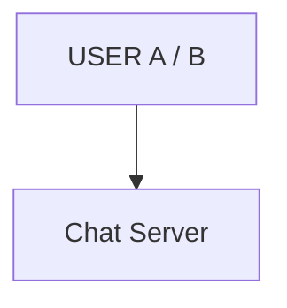
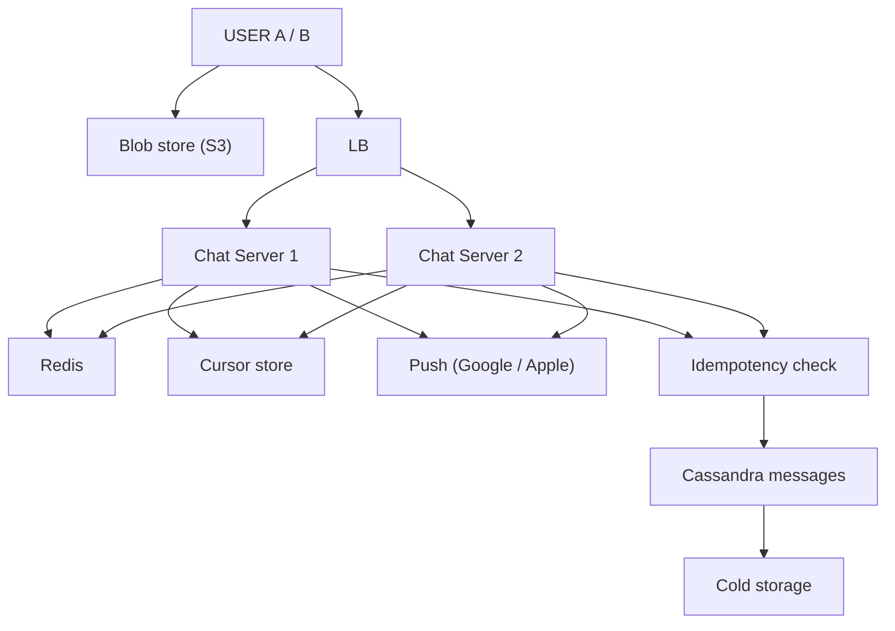
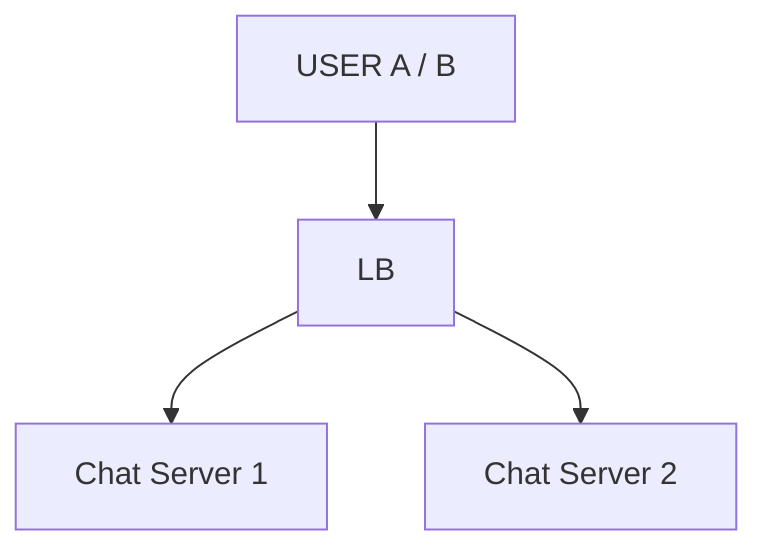
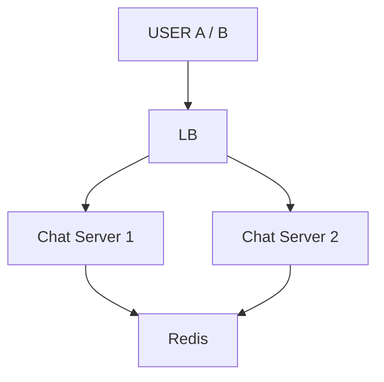
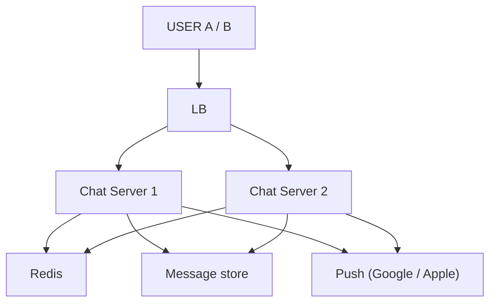
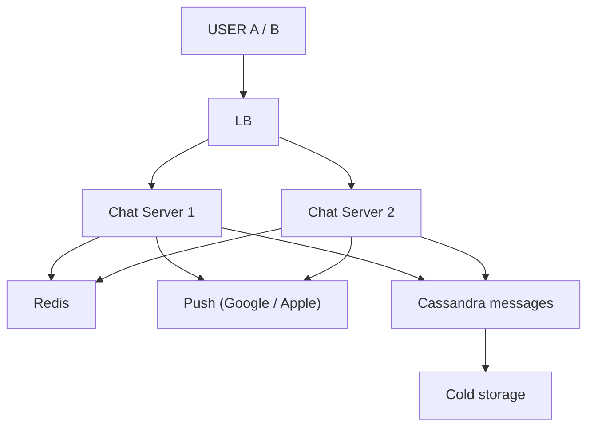
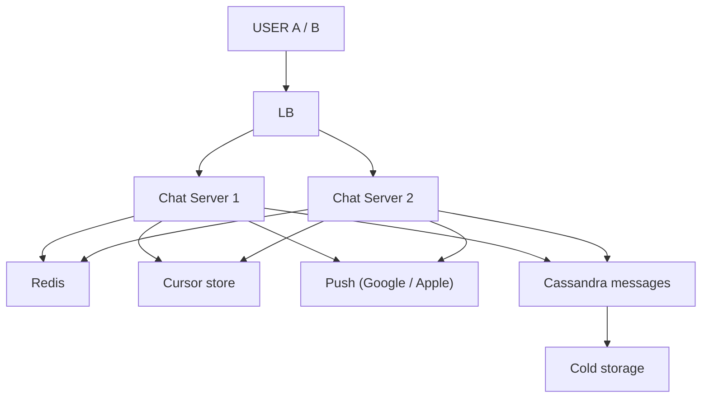
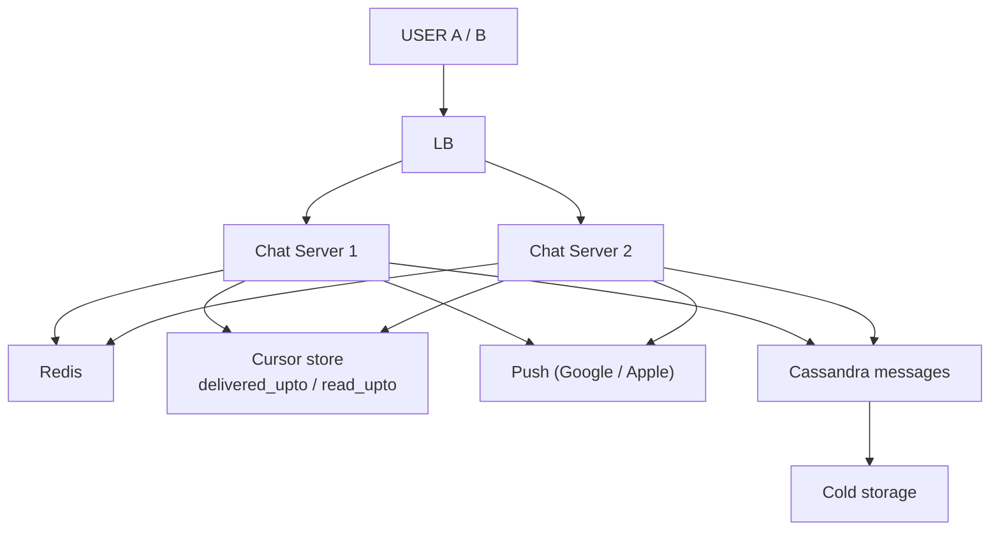
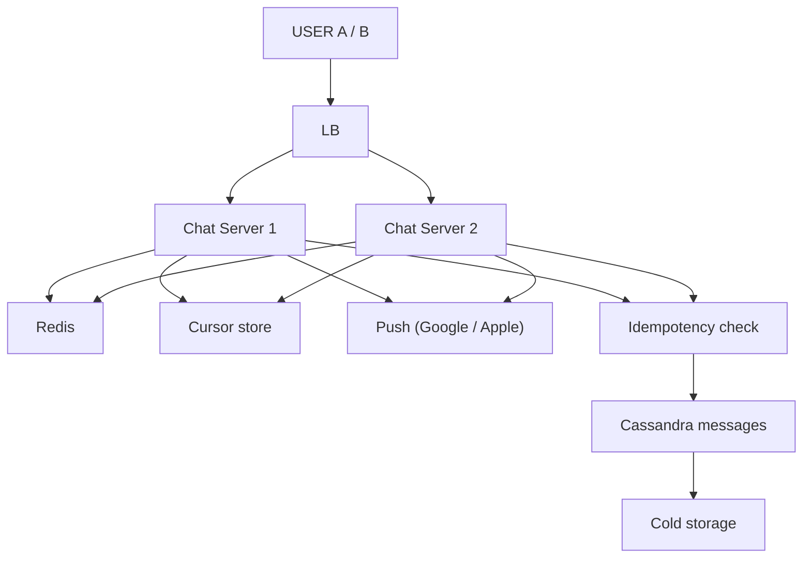
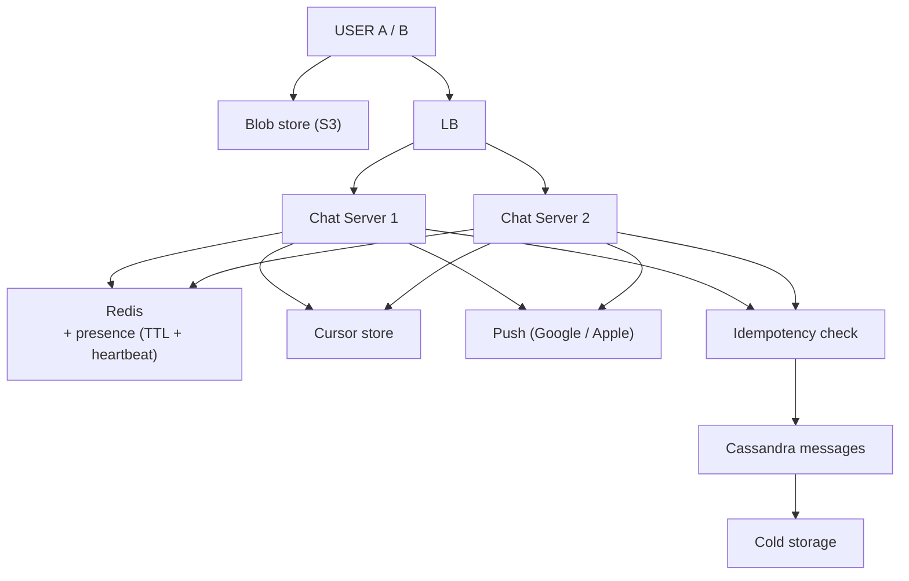

# Chat / Messaging System

> Arpan ne message bheja -> Ravi tak TURANT, chahe Ravi ne kuch na maanga ho · Ravi offline ho to baad me mile · kuch na khoye.
> Is design ka dil: **"banda KAHAN juda hai"** (baaki designs me "data kahan rakhein") + **khuli connection**.
> Ye design ek chhota server aur do browser tab chala ke bana. Jahan aankh se dekha, wahan **★ DEKHA:**

```
JAD KI BAAT — chat baaki har design se KYUN alag:
   ab tak (url shortener, feed, payment, banking): user ne MAANGA -> server ne diya -> connection BAND
   chat: Arpan ne bheja -> Ravi ne kuch nahi maanga -> phir bhi Ravi tak TURANT
   HTTP me server sirf JAWAB de sakta, khud AWAAZ nahi laga sakta -> do nayi cheez:
   1. CONNECTION KHULI rakhni (WebSocket — ek baar judo, dono taraf baat)
   2. REGISTER "kaun kis server se juda hai" (200 chat server, Ravi kis se?) -> yahi chat ka DIL
```

---

## TASVEER (ByteByteGo / Alex Xu · CC BY-NC-ND 4.0)


Source: [What is the Journey of a Slack Message?](https://bytebytego.com/guides/what-is-the-journey-of-a-slack-message/)
(ek message bhejne wale se lene wale tak — WebSocket, server, fan-out)


Source: [Short/long polling, SSE, WebSocket](https://bytebytego.com/guides/shortlong-polling-sse-websocket/)
(chat me WebSocket kyun — polling / long polling / SSE se farak)

---

## SHURU: pehle poocho, phir numbers

```
POOCHO (6, inme 2 poora design badalte):
   1. 1-to-1 ya GROUP? (group = ek message, 500 jagah pahunchana)
   2. ★ HISTORY kahan, kitni der? WhatsApp = phone pe, pahunchte hi server se DELETE (server = DAAK-GHAR)
                                  Slack = server pe HAMESHA, 3 saal purana bhi search
                                  -> ye EK jawab jagah 100 GB se 100 TB kar deta
   3. ★ END-TO-END encryption? haan -> server message PADH hi nahi sakta -> server pe search khatam · naya member
        purane message nahi dekh sakta · chaabi ka poora system — sabse bada scope badalne wala
   4. TICK? ek tick (server tak) · do tick (phone tak) · neeli (padh li) · online / last-seen
      har tick ek ULTA message -> traffic kai guna
   5. MEDIA? message ke saath nahi, alag S3 me, message me sirf PATA
   6. OFFLINE banda? message kahan ruke, kab tak, push notification?

MAAN KE CHALO (bol ke): 1-to-1 + chhote group (500 tak) · history SERVER pe (Slack jaisa, design zyada dikhta)
                        · E2E abhi NAHI ("scope se bahar") · tick: bheja / pahuncha / padha

KYA KARE (FR):    1-to-1 · group 500 · offline ko baad me · purani history · tick · online / last-seen
                  scope bahar: E2E · voice / video · bade broadcast group
KAISA CHALE (NFR): TURANT (<1 sec) · KABHI na khoye · ek chat ke andar KRAM na bigde · DO BAAR na dikhe
                   · 2 crore EK SAATH jude · server gire to doosra sambhale

NUMBERS (andaaza):
   50 crore user, 10 crore roz · har ek 40 message / din -> ~400 crore / din
   LIKHNA: 400 crore / 86,400 second ~ 46,000 / second (bheed me 2-3 guna ~1.5 lakh)
   ONLINE ek waqt ~2 CRORE KHULI CONNECTION  <- ★ asli paimana ("kitni request / second" nahi,
          "kitni connection KHULI" — har khuli connection memory khaati, message aaye ya na aaye)
   JAGAH: 400 crore x ~300 byte ~ 1.2 TB / din -> 1 saal ~440 TB (Slack jaisa) · WhatsApp jaisa ~ZERO

TEEN FAISLE:
   1. CONNECTION ki apni line: 2 crore / ~1 lakh har machine = ~200 CHAT SERVER (sirf taar pakadte)
      -> API / business server se ALAG · event loop (Netty jaisa), "ek connection = ek thread" nahi
   2. JAGAH ek machine ki NAHI (banking ka ulta: wahan 120 / sec, yahan 46,000 / sec + 1.2 TB roz) — DB card 4 me
   3. HISTORY kahan (sawaal 2) se jagah ka dhaancha tay hota — yahan SLACK jaisa

DO CHEEZ JO DESIGN CHALATI:
   CONNECTION (khuli) = har online user ka taar, isi raaste server user tak pahunchta
   REGISTER (kaun kis taar ke peeche) = MEMORY me, DB me nahi (taar khud memory me hai)
```

---

## ════ MOCK SE PEHLE: SIRF YE CARD PADHO ════

> Har dikkat ek card: KAHANI (kya hua, kaun, kitna) -> ILAAJ -> ANDAR KAISE (ilaaj kyun kaam karta) ->
> ISKE BAAD KYA TOOTEGA (interviewer yahin ghusta hai: dabba lagaya, ab kya?).

#### DABBA 0: SABSE SIMPLE, EK SERVER DO USER (yahan se shuru, phir "kahan tootega")
```
KAHANI:  Ek hi chat server. Arpan aur Ravi dono usse jude.
         Ravi ne kabhi nahi poochha "koi message aaya?", phir bhi Arpan ka "hi" Ravi ki screen pe aa gaya. Kaise?

ANDAR KAISE:
         Arpan ne /connect?user=Arpan khola -> ye connection BAND NAHI hota -> server ki register me: Arpan -> penArpan
         Ravi ne /connect?user=Ravi khola -> register: Ravi -> penRavi
         Arpan ne /send?to=Ravi&text=hi (normal request) -> server: register.get("Ravi") -> penRavi me likho
         -> Ravi ki screen pe "Arpan: hi".
         pen = data nahi, Ravi tak PAHUNCHNE KA RAASTA. Message Ravi ke PURANE khule taar se gaya.
★ DEKHA:  Ravi ki screen pe message aa gaya, Ravi ne kuch maanga hi nahi. Screen pe "JUD GAYA — ye connection ab khuli padi hai",
          console pe `[JUDA] Ravi   register ab = [Arpan, Ravi]`

ISKE BAAD KYA TOOTEGA:
  - "Client aur server thodi-thodi der me baat karte rehte" bola to?
      -> ye POLLING hai, galat shabd. WebSocket = ek baar judo, connection KHULA rehta,
         server ko jab bhi dena ho usi taar pe TURANT bhej deta.
  - WebSocket kyun, polling / long polling / SSE kyun nahi?
      -> polling = har 5 sec "kuch aaya?", 100 me 1 kaam ki · long polling = har message ke baad naya request
         · SSE = sirf server -> user (ek taraf) · chat me dono taraf, turant -> WebSocket
  - Net chupchaap chala gaya, server ko kaise pata?
      -> ping / pong (dhadkan); jawab na aaye to connection band, register se hatao
```


#### [1](#d1) 2 CRORE CONNECTION KHULI, MEMORY KHATAM
```
KAHANI:  Har online user ka connection hamesha khula. Ek connection ~30 KB -> 1 lakh connection = ~3 GB sirf pakad ke rakhne me.
         Aur purane tareeke me har connection ka ek thread (~1 MB) -> 1 lakh = ~100 GB. Server khatam.
★ DEKHA:  server ki thread ginti jaan-boojh ke TEEN rakhi. Teen connection ne jagah bhar di, chautha "send" server tak pahuncha hi nahi.

ILAAJ:   WEBSOCKET + EVENT LOOP (Netty jaisa): kuch hi thread, lakhon connection. ~200 chat server, aage LB.

ANDAR KAISE:
         Event loop: OS (epoll) batata "in 5 connection pe data aaya" -> thread sirf unpe kaam karta.
         Baaki 99,995 chup baithe connection ka koi kharcha nahi (sirf thodi memory).

ISKE BAAD KYA TOOTEGA:
  - Ek chat server gir gaya?
      -> uske 1 lakh user ek saath dobara judenge -> RUK-RUK ke + thoda random (backoff + jitter), warna sab ek saath doosre server pe tootein.
         Message DB me pehle se hai, dobara jud ke "meri aakhri id ke baad ka do".
  - Naya code deploy karna?
      -> thode-thode server, pehle unke connection dheere hatao (DRAINING). Sab ek saath restart = lakh log ek saath toote.
  - LB lambi connection kaise bithata?
      -> connection ek baar kisi server pe baitha, phir wahi rehta. Naya connection = naya chunaav.
```

#### [2](#d2) ARPAN SERVER-1 PE, RAVI SERVER-7 PE
```
KAHANI:  Ab 200 chat server. Arpan server-1 se juda, Ravi server-7 se.
         Arpan ne "hi" bheja -> server-1 ne apni register dekhi -> usme sirf apne log -> bola "Ravi OFFLINE", jabki Ravi online tha.
★ DEKHA:  wahi program do port pe chalaya. Arpan ki screen `(server bola: Ravi OFFLINE hai)`, Ravi us waqt online.

ILAAJ:   SAANJHI REGISTER (Redis): "Ravi -> server-7". Server-1 Redis se poochhe, server-7 ko seedha bole,
         server-7 apne khule taar pe Ravi ko de.

ANDAR KAISE:
         Connection (zinda taar) kabhi Redis me nahi ja sakta, wo sirf server-7 ki memory me hai. Redis me sirf PATA.
         Server-7 mar gaya aur Redis me "Ravi -> server-7" pada reh gaya? -> entry pe TTL + dhadkan se badhti rahe.
         (har message pe saare 200 server se "Ravi tumhare paas hai?" poochhna = bekaar.)

ISKE BAAD KYA TOOTEGA:
  - Register me Ravi ka server galat (Ravi abhi doosre pe khiska)?
      -> server-7 pe Ravi nahi mila -> koi baat nahi, message DB me hai -> Ravi naye server pe judte hi le lega.
  - Redis hi gir gaya?
      -> copy pe switch. Beech me seedha bhejna ruka, par message DB me -> push + dobara judne pe pahunchega.
  - Pub-sub se kyun nahi bhejte?
      -> pub-sub bhej ke bhool jaata. Offline wale ka bharosa uspe nahi.
```

#### [3](#d3) RAVI OFFLINE, MESSAGE KAHAN JAAYE?
```
KAHANI:  Ravi ka phone band, koi connection hi nahi. Galat soch: "pehle Ravi ko bhejo, na pahunche to DB me daal do"
         -> bhejne aur DB ke beech server gira = message gaya.

ILAAJ:   PEHLE DB me LIKHO (id ke saath), PHIR bhejne ki koshish. Ravi nahi mila -> DB me pada rahe + PUSH notification.

ANDAR KAISE:
         Ravi wapas aaya: "meri aakhri id 4417, uske BAAD ke do" (nishaan Ravi ka app rakhta, Kafka offset jaisa).
         Server 4418 se aage sab bhej deta.
         Push: login pe phone ka device token (FCM / APNs) save -> Google / Apple ke through phone tak, app band ho tab bhi ghanti.

ISKE BAAD KYA TOOTEGA:
  - Ravi ke 3 device (phone, laptop, tab)?
      -> har device ka apna connection + apna nishaan. Message sab pe, ek pe padha to baaki pe bhi neeli.
  - Push me poora message bhejo?
      -> chhota preview / "naya message" (privacy). Asli message app khulne pe server se.
  - Kuch na khoye, poora jawab?
      -> DB pehle + Kafka ho to acks=all, kaam ke baad offset, message id se dobara-safe, fail -> DLQ.
```

#### [4](#d4) ROZ 1.2 TB, 46,000 LIKHAI / SECOND
```
KAHANI:  Roz ~1.2 TB message, 46,000 likhai / second. Ek DB machine nahi jhelegi. Kis cheez se baantein?

ILAAJ:   Cassandra / Scylla. PARTITION KEY = chat_id, uske andar kram = message_id (SNOWFLAKE).

ANDAR KAISE:
         Padhna hamesha "IS CHAT ke aakhri 50" -> chat_id se ek hi jagah, ek baar padhna:
           WHERE chat_id = ? AND id < 4417 ORDER BY id DESC LIMIT 50 (keyset, OFFSET nahi).
         Snowflake 64 bit = [time ms | machine id | us ms me ginti] -> har server khud bana leta, time ke saath badhta.
         Cassandra likhne me tez: pehle commit log (sirf neeche jodna) + RAM (memtable).

ISKE BAAD KYA TOOTEGA:
  - Partition user_id se kyun nahi?
      -> Arpan-Ravi ki ek chat do jagah (Arpan ke bheje Arpan ke paas, Ravi ke Ravi ke) -> "aakhri 50" ke liye do jagah jodo. Group = 500 jagah.
  - message_id se partition?
      -> har message alag dabba -> aakhri 50 = 50 jagah se. message_id andar ka kram hai, partition nahi.
  - Ek bahut active group (ek partition garam)?
      -> key me random tukda (chat_id + 0..9), padhte waqt jodo. Ya group size / speed pe had.
  - Ek group ki partition saalon me bahut badi?
      -> key = (chat_id, mahina) -> size bandha. (Bojh nahi baantta, sirf size.)
  - 3 saal baad?
      -> pehle poochho: WhatsApp jaisa (pahunchte hi delete) ya Slack jaisa (sab rakho -> purana sasti jagah).
  - SQL kyun nahi?
      -> ek message ek row, kai row ka transaction / rishte chahiye hi nahi. Likhai bahut.
```

#### [5](#d5) 500 KA GROUP, EK MESSAGE 500 BAAR LIKHEIN?
```
KAHANI:  "College Gang" group me 500 log. Arpan ne ek message bheja -> kya 500 logon ke inbox me 500 baar likhein?

ILAAJ:   EK hi copy, group ki chat ke neeche (fanout on READ). Sab wahi ek padhein.
         Bhejna = connection pe (sasta), DB me likhai sirf ek.

ANDAR KAISE:
         Twitter se ulta kyun: Twitter ki feed 200 logon ka milan + crore follower, har user ki alag.
         Group sabke liye ek jaisa, aur sirf 500 member -> ek copy kaafi.

ISKE BAAD KYA TOOTEGA:
  - 500 me 300 online, unhe bhejna kaise?
      -> register se members ke servers nikaalo, har SERVER ko EK baar "ye message, in members ko" (300 alag call nahi).
  - Naya member juda, purane message dikhein?
      -> judne ke waqt ki id se pehle wale nahi (nishaan judne wali id pe), ya group ki setting ke hisaab.
```

#### [6](#d6) KISKE KITNE UNREAD?
```
KAHANI:  500 member. "Kiske kitne unread" ke liye har message x har member ka record = 500 x 50 = 25,000 likhai. Bekaar.

ILAAJ:   Har member ka EK NISHAAN (cursor): "Arpan is group me 4417 tak padh chuka". 500 row, bas.

ANDAR KAISE:
         Arpan ke unread = group ka aakhri number - Arpan ka nishaan (GHATAO, gino nahi).
         Nishaan har chat ke apne +1 number (seq, card 10) pe. Snowflake me beech me gap hote, isliye seq.

ISKE BAAD KYA TOOTEGA:
  - Nishaan kahan rakhoge?
      -> Cassandra (user_id, chat_id) -> read_upto. Jo baar-baar chahiye wo Redis me.
```

#### [7](#d7) DO TICK AUR NEELI TICK: SERVER KO PATA KAISE?
```
KAHANI:  Ek tick = message server tak pahuncha. Do tick = Ravi ke phone ne "mil gaya" bola. Neeli = Ravi ne chat khol ke dekha.
         Har message ke liye alag "mil gaya / padh liya" message? Bahut traffic.

ILAAJ:   Wahi NISHAAN, do number: delivered_upto ("yahan tak mila") + read_upto ("yahan tak padha").

ANDAR KAISE:
         Ravi ne chat kholi, 50 message padhe -> ek hi baat: "read_upto 4467" -> Arpan ko EK push -> 50 neeli ek saath.
         (50 alag "padh liya" nahi.)
         Tick + unread + offline ke baad wapas lena = ek hi cheez: ek nishaan aage khisakta.

ISKE BAAD KYA TOOTEGA:
  - Ravi ka "mil gaya" raaste me kho gaya?
      -> Ravi agli baar judta to apna delivered_upto bhejta -> nishaan aage, Arpan ko tick.
  - Group me do tick kab?
      -> sab members ka delivered_upto >= message id -> sabse CHHOTA nishaan dekho.
```

#### [8](#d8) 10 LAKH KA BROADCAST GROUP: TICK KA KYA?
```
KAHANI:  10 lakh ka broadcast group. Har member ka nishaan + tick 500 pe chalta, 10 lakh pe nahi (har message pe 10 lakh tick).

ILAAJ:   Feature utna hi jitna scale jhele: group ka size bandha (~1000). Channel / broadcast me tick band.

ANDAR KAISE:
         Slack channel me sirf channel ka unread (ek nishaan), "kisne padha" nahi.

ISKE BAAD KYA TOOTEGA:
  - Channel me 10 lakh tak pahunchana kaise?
      -> fanout workers (Kafka se) members tak. Online ko push, baaki jab judein tab lein.
  - Ye had kaun tay kare?
      -> product + engineering saath: feature ki keemat batao (10 lakh x tick = kitni likhai).
```

#### [9](#d9) ARPAN KA NET DHEEMA, APP NE DOBARA BHEJA, RAVI KO DO BAAR
```
KAHANI:  Arpan ka net dheema. App ne "hi" bheja, jawab nahi aaya (timeout), to dobara bheja. Pehla pahunch chuka tha.
         Ravi ko "hi" do baar dikha.

ILAAJ:   clientMsgId: Arpan ka APP har message ki id banata, dobara bhejne pe WAHI. Pehle aa chuki -> purana message lautao.

ANDAR KAISE:
         "pehle aaya?" + daalna = EK atomic kadam: (chat_id, clientMsgId) UNIQUE, ya Redis SET NX EX 3600.
         Server id banata to har dobara bhejna = nayi id = duplicate.

ISKE BAAD KYA TOOTEGA:
  - Kitni der yaad rakhoge?
      -> jitni der me koi dobara bhejta (minute-ghante).
  - Dobara bhejne pe kaunsi id lautegi?
      -> pehli baar wali server id -> Arpan ke app me ek hi bubble.
```

#### [10](#d10) KRAM KISKE TIME SE?
```
KAHANI:  Arpan ke phone ki ghadi 5 min aage chal rahi. Uske message chat me upar chadh gaye, Ravi ke jawab se pehle dikhne lage.

ILAAJ:   Kram SERVER ki id se (snowflake, ek chat ek partition). Phone ki ghadi sirf dikhane ke liye.
         + har chat ka apna +1 number (SEQ) -> 15, 17 aaya, 16 nahi -> gap pakda -> server se maango.

ANDAR KAISE:
         Seq: Redis INCR seq:chat123 (atomic), ya chat ka maalik server memory me ginta.
         Kafka beech me ho -> key = chatId -> ek chat kram me, alag chat ek saath.
         Jaan-boojh ke: pakka kram = pehla atka to doosra bhi roko (head-of-line). Chuna: thoda idhar-udhar chalega, par ruke nahi.

ISKE BAAD KYA TOOTEGA:
  - 16 nahi aaya, app kya kare?
      -> thoda ruko (raaste me ho sakta), phir server se "15 ke baad ke do".
  - Seq wala Redis restart, ginti 0 se?
      -> DB se chat ka sabse bada seq padh ke wahan se aage (ya Redis persistence).
  - Do server ki ghadi alag, snowflake ka kya?
      -> ms ka farak ho sakta. Ek chat ka pakka kram per-chat seq se.
```

#### [11](#d11) 5 MB KA VIDEO BHI ISI RAASTE SE?
```
KAHANI:  Arpan ne 5 MB video bheja chat server ke raaste se -> connection aur thread atak gaye, baaki message bhi ruke.

ILAAJ:   App file seedha S3 me (PRESIGNED URL). Message me sirf PATA: { type, S3 KEY, size, thumbnail }.

ANDAR KAISE:
         Server sign kare (PUT, key, 10 min) -> app seedha S3 pe. Thumbnail app khud banata (kuch KB) -> turant dikhe.
         Group me file ek baar upload, 500 ko wahi pata.

ISKE BAAD KYA TOOTEGA:
  - Message me kya rakhoge, URL?
      -> NAHI, S3 KEY. URL 10 min me khatam -> kal link mara. Kholne pe server naya chhota URL banaye.
  - Wahi video 1000 log forward karein?
      -> file ka hash -> pehle se hai to wahi file (dedup), naya upload nahi.
  - End-to-end encryption me thumbnail?
      -> server dekh nahi sakta. App encrypt karke upload, chaabi message ke saath.
```

#### [12](#d12) ONLINE / LAST-SEEN: SABKO SABKA STATUS
```
KAHANI:  Har baar koi juda / gaya, uske saare contacts ko batao = crore x 500 = bakwaas.

ILAAJ:   Redis me "Ravi online" chhoti umar (30 sec), app ki dhadkan (har 15 sec) se badhti rahe.
         App band -> umar khatam -> apne aap offline.
         POOCHHO, batao mat: Ravi ka status tabhi jab Arpan ne Ravi ki chat kholi ho.

ANDAR KAISE:
         "offline" ka message bhejna hi nahi padta. Last seen = usi key ka aakhri update. Ravi ne chhupaya hai to mat dikhao.

ISKE BAAD KYA TOOTEGA:
  - 2 crore / 15 sec = 13 lakh dhadkan / second Redis pe?
      -> dhadkan chat server tak (connection pe ping). Server apne users ka status BATCH me Redis me daale.
  - "typing..." live?
      -> sirf khuli chat ke liye. Typing = chhota event, store nahi, bhej ke bhool jao.
```

```
AAKHRI DABBE (sab dikkat ke baad):
  User -> LB -> Chat Server (khuli WebSocket + apni register, event loop)
  -> dobara-safe (clientMsgId) -> Cassandra (chat_id partition, pehle LIKHO phir bhejo)
  -> Redis (kaun kis server pe: umar + dhadkan, pub-sub) -> lene wale ka Chat Server -> lene wala
  offline -> Push (app band pe ghanti) · dobara judne pe "aakhri id ke baad sab" maango
  Nishaan = delivered_upto / read_upto · media -> S3, message me sirf pata · purana -> sasti jagah

DB:  message = Cassandra (chat_id partition, server ki id time ke saath badhti) -> ek chat ek jagah, kram bana rahe
     zinda taar (connection) = server ki memory · pakka maal (message) = DB

END ME POOCHEGA:
  "Kram?"           -> server ki sequence id, phone ki ghadi nahi · Kafka key = chat_id
  "Tick / unread?"  -> har user har chat ka nishaan (delivered_upto / read_upto)
  "10x?"            -> ~200 chat server, event loop · Redis register umar ke saath · dobara judne pe backoff + jitter
                       · garam group -> tukde (chat_id + 0..9) · Push ka apna retry / queue
  "SPOF?"           -> chat server (dobara judo), Redis (copy)
  "Chal raha, kaise pata?" -> pahunchne ka p99 · har machine pe khuli connection · dobara judne ki dar · push fail · alert
```

AAKHRI DABBE ki tasveer:



---

## ════ DETAIL: HAR DIKKAT KI INTERVIEW LINE + TASVEER ════

> Card me poori kahani hai. Yahan har dikkat ki ek English line (interview me bolne ke liye) aur us waqt tak ka diagram.

---

<a id="d1"></a>

## DIKKAT 1 — 2 crore connection khuli, memory khatam

```
BOL: "Connections live on a separate tier of about 200 chat servers that use an event loop instead of a thread per connection, so a few threads hold hundreds of thousands of idle sockets; reconnects use backoff with jitter and deploys drain connections slowly."
```


---

<a id="d2"></a>

## DIKKAT 2 — Arpan server-1 pe, Ravi server-7 pe

```
BOL: "Each chat server keeps its own connections in memory, and Redis holds a shared registry of which server each user is on, with a TTL refreshed by heartbeats; the sender's server looks it up and forwards to that server."
```


---

<a id="d3"></a>

## DIKKAT 3 — Ravi offline, message kahan

```
BOL: "Every message is written to the database first and only then delivered; if the receiver is offline it waits there and a push notification goes out, and on reconnect the client asks for everything after its last message id."
```


---

<a id="d4"></a>

## DIKKAT 4 — roz 1.2 TB, 46,000 likhai / sec

```
BOL: "Messages go to Cassandra partitioned by chat id and ordered by a snowflake id, so loading the last fifty messages of a chat is one partition read with keyset pagination."
```


---

<a id="d5"></a>

## DIKKAT 5 — 500 ka group, 500 baar likhein

```
BOL: "A group message is stored once under the group's chat id and read by every member, and delivery sends one call per chat server that has online members, not one per member."
```


---

<a id="d6"></a>

## DIKKAT 6 — kiske kitne unread

```
BOL: "Each member has one read cursor per chat, so unread count is just the chat's latest sequence minus the member's cursor, instead of a row per message per member."
```


---

<a id="d7"></a>

## DIKKAT 7 — do tick aur neeli tick

```
BOL: "Delivered and read ticks are two cursors per user per chat; when the receiver reads fifty messages it sends one read-up-to update and the sender gets one push."
```


---

<a id="d8"></a>

## DIKKAT 8 — 10 lakh ka broadcast group

```
BOL: "Per-member ticks don't scale to a million members, so I cap group size and turn off ticks for broadcast channels, which keep a single unread cursor."
```


---

<a id="d9"></a>

## DIKKAT 9 — net dheema, dobara bheja, do baar dikha

```
BOL: "The client generates a message id and reuses it on retry; a unique constraint on chat id and client message id makes the retry return the original message instead of a duplicate."
```


---

<a id="d10"></a>

## DIKKAT 10 — kram kiske time se

```
BOL: "Order comes from the server's sequence per chat, never the phone's clock, and gaps in the sequence tell the client to fetch what it missed."
```


---

<a id="d11"></a>

## DIKKAT 11 — 5 MB ka video isi raaste se

```
BOL: "Media is uploaded straight to S3 with a presigned URL, and the message only carries the S3 key, size and a small thumbnail; a fresh short-lived URL is generated whenever someone opens it."
```


---

<a id="d12"></a>

## DIKKAT 12 — online / last-seen

```
BOL: "Presence is a Redis key with a short TTL kept alive by heartbeats batched by the chat servers, and status is fetched only when someone opens that chat instead of being broadcast to every contact."
```


---
## 10 GUNA TRAFFIC — har dabba alag se

```
Chat Server   -> 2 crore khuli = ~200 machine sirf taar pakadne · event loop, warna thread khatam
REGISTER      -> memory me, server gira to gaya -> Redis me umar wali entry + dhadkan
DOBARA JUDNA  -> ek server gira = 1 lakh ek saath -> ruk-ruk ke + random (backoff + jitter) · deploy pe draining
Cassandra     -> chat_id partition · garam group -> tukde (chat_id + 0..9) / had · purana sasti jagah
Push          -> Google / Apple bahar ki cheez -> apna retry / queue
Redis         -> copy, ALAG AZ · message store ki bhi copy, alag AZ

POOCHEGA: "How would you scale this to 10x?"      -> user ka raasta chalo, pehle jo toote
POOCHEGA: "What's the single point of failure?"   -> chat server (dobara judo), Redis (copy)
POOCHEGA: "How do you know it's working?"         -> pahunchne ka p99 · har machine pe khuli connection · dobara judne ki dar · push fail · alert
```

---

## POOCHE TO (gehra sawaal aaye tab)

```
API:      GET /connect (BAND nahi hoti — WebSocket / SSE) · POST /messages { chatId, text, clientMsgId }
          GET /messages?chatId=&before= (wapas lena + history, cursor) · POST /messages/{id}/read (tick)

DO DUNIYA:  ZINDA TAAR (memory, ek server ki, mar sakti) = register / pen
            PAKKA MAAL (DB, sab jagah se dikhta) = message
            pen ko Redis me rakhne ki koshish — ho hi nahi sakta
            ek user -> KAI pen (phone + laptop + tab) — ★ dekha
```

---

## AAKHRI DABBA + WRAP

```
LB = connection ko chat server pe bithaye · Chat Server = khuli connection + apni register (pen), event loop
Redis = kaun kis server (umar + dhadkan) + pub-sub + online status · Push = app band pe ghanti (phone OS se)
Idempotency = clientMsgId · Cassandra = chat_id / message_id, pehle LIKHO phir bhejo · Cold storage = purana
Cursor store = delivered_upto / read_upto · Blob store = media, message me sirf pata
```
```
BOL: "Each user holds an open WebSocket to one of ~200 chat servers, and Redis records which server each user is on.
      A message is deduped on clientMsgId, written first to Cassandra partitioned by chat id with a snowflake id,
      then routed to the receiver's server; if they're offline it waits and a push notification goes out, and on
      reconnect they ask for everything after their last id. Receipts and unread counts are just cursors per user per
      chat, presence is a TTL key kept alive by heartbeats, and media goes to S3 with only a link in the message."
```


[← SYSTEM_DESIGNS](..) · [← Home README](../../../README.md) · [← MASTER SHEET](../../00_MASTER_SHEET.md)
