# Chat / messaging (WhatsApp jaisa): shuru se, ek kahani

Kram wahi jo interview me hota hai: **FR, phir NFR, phir numbers, phir design**. Design sabse seedhe dabbe
se shuru hota hai, aur har dikkat aane pe ek naya dabba judta hai. Diagram me peela dabba = abhi juda. Poori
file me ek hi kahani hai: Arpan apne dost Ravi ko message bhejta hai.

**CUE (yahi shabd yaad rakhne hain, kram se):**
WebSocket -> 200 server + event loop -> Redis map (kaun kahan) -> pehle DB + ack + push -> Cassandra (chat_id)
-> clientMsgId (do baar nahi) -> server ka number (kram) -> group ek baar likho -> "kahan tak" number (tick)
-> video S3 -> online (umar wali entry)

---

## 1. FR: kya karna hai

```
1. 1-to-1 chat aur chhote group (500 log tak)
2. purani history server pe rahe (naya phone liya to bhi purane message mil jaayein)
3. tick: bheja / pahuncha / padha
4. Ravi offline ho to message baad me mile
5. photo / video bhejna, online / last seen dikhana
scope ke bahar (poochh ke hata do): end-to-end encryption, voice / video call, lakhon wale broadcast
```

End-to-end encryption (E2E) zaroor poochhna. Haan bola to server message padh hi nahi sakta: server pe
search khatam ho jaata hai, aur poora design badal jaata hai.

## 2. NFR: kaisa chalna chahiye

```
- message turant pahunche (1 second se kam)
- kabhi na khoye
- ek chat ke andar kram na bigde (mera sawaal, phir Ravi ka jawab)
- do baar na dikhe
```

## 3. Numbers

```
- 50 crore user, roz 10 crore log x 40 message = ~400 crore message roz -> ~46,000 likhai har second
- ek waqt pe ~2 crore log app khol ke baithe hain = 2 crore khuli connection
- ek message ~300 byte -> roz ~1.2 TB
```

Ye URL aur banking se alag hai. Wahan asli paimana tha "har second kitni request". Yahan asli paimana hai
"kitni connection ek saath khuli hain", kyunki har khuli connection server ki memory khaati hai, chahe
message aaye ya na aaye.

---

## 4. Design

### Kadam 1: sabse seedha, aur pehli dikkat (server khud nahi bol sakta)

Ek chat server aur ek DB. Arpan ne "hi" bheja, server ne DB me likh diya.

Ab Ravi ko ye "hi" kaise mile? Ab tak ke saare design me user maangta tha aur server deta tha (link kholo,
balance dekho). Yahan Ravi ne kuch nahi maanga, phir bhi message turant pahunchna chahiye. Normal HTTP me
server sirf jawab de sakta hai, khud se awaaz nahi laga sakta.

Teen raaste hain, aur ye asli choice hai:

```
POLLING       Ravi ka app har 2 sec poochhe "kuch aaya?"
              -> 2 crore log x har 2 sec = bekaar ki bheed, aur message 2 sec late
LONG POLLING  Ravi poochhe, server tab tak jawab rok ke rakhe jab tak kuch aaye
              -> behtar, par har message ke baad nayi request, aur ek taraf ki hi baat
WEBSOCKET     Ravi ek baar connection khole, wo band hi na ho, dono taraf baat ho sake
              -> server jab chahe Ravi ko bhej de, turant
```

**Isliye WebSocket.**

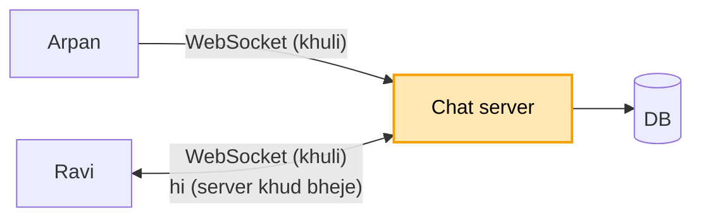

Par subah 2 crore log ek saath app khol ke baithe hain. Har ek ki connection khuli hai, aur ek server ki
memory itni connection nahi sambhal paati.

### Kadam 2: 2 crore khuli connection (kai chat server + event loop)

Ilaaj 1: kai chat server. Ek machine ~1 lakh khuli connection sambhal leti hai, to 2 crore / 1 lakh = ~**200
chat server**, aur aage LB. Ye chat server sirf ek kaam karte hain: connection pakad ke rakhna aur message
idhar-udhar karna. Baaki kaam (profile, group banana) alag API server pe hota hai.

Ilaaj 2: har connection ke liye ek thread mat do. Normal server har connection ko ek thread deta hai: 1 lakh
connection = 1 lakh thread. Har thread memory khaata hai, aur zyadatar thread khaali baithe intezaar karte
rehte hain, kyunki log har second message nahi bhejte. Isliye **event loop** lagao (jaise Netty ya Node):
kuch hi thread, aur wo jis connection pe message aaya sirf usi ko sambhalte hain. Baaki connection bas khuli
padi rehti hain, un pe koi thread nahi baitha.

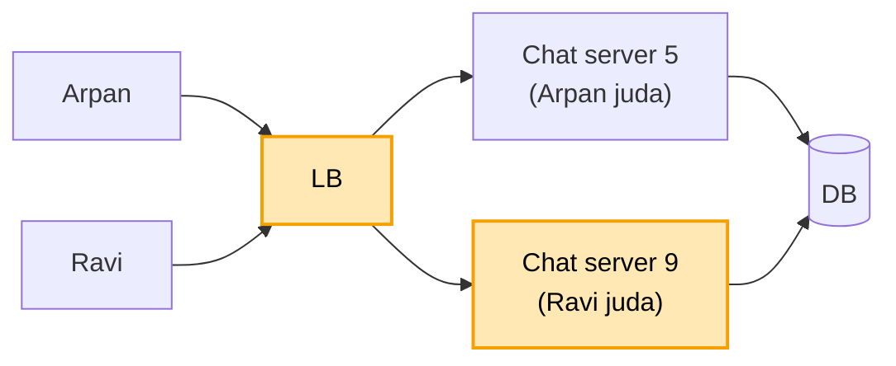

Par Arpan chat server 5 se juda hai, aur Ravi chat server 9 se. Arpan ka "hi" server 5 pe aaya. Ab server 5
ko kaise pata ki Ravi 200 me se kis server pe baitha hai?

### Kadam 3: Ravi kis server pe hai? (map Redis me)

200 chat server hain, aur har server sirf apne jude logon ko jaanta hai:

```
server 5 ki memory:  arpan, mohan, sita      (ye log server 5 se jude hain)
server 9 ki memory:  ravi, geeta             (ye log server 9 se jude hain)
```

Arpan ka "hi" server 5 pe aaya. Server 5 apni memory me dekhta hai "ravi?", nahi milta, kyunki Ravi server 9
se juda hai. Server 5 ko ye pata hi nahi ki Ravi server 9 pe hai. 200 server me se har ek se poochhe "ravi
tumhare paas hai?", to bahut dheema.

Ilaaj: ek **sabka saanjha register**, jahan har server likhe ki uske paas kaun juda hai. Ye register
**Redis** me hai. Jaise bade hotel me har floor ka receptionist sirf apne floor ke mehmaanon ko jaanta hai,
aur kisi aur floor ka mehmaan dhoondhna ho to neeche main reception ka register dekhte hain. Redis wahi main
register hai.

```
Ravi ne app khola, server 9 se juda  -> Redis me likho:  ravi -> server 9
Arpan ka "hi" server 5 pe aaya       -> server 5 Redis se poochhe "ravi kahan?" -> server 9
server 5 "hi" server 9 ko bheje      -> server 9 Ravi ki khuli connection pe bhej de
```

Server 9 achanak gir gaya to? Redis me abhi bhi likha hai "ravi -> server 9", jo ab galat hai. Isliye har
entry ki **umar** rakho (TTL, jaise 60 sec). Ravi ka app har 30 sec ek chhota "main zinda hoon" bhejta hai
(**heartbeat**), aur server us entry ki umar badha deta hai. Server gira to heartbeat band, aur 60 sec me
entry apne aap mit jaati hai. Ravi ka app dobara kisi aur server se judta hai aur nayi entry likh deta hai.

Ek user ke kai device ho sakte hain (phone bhi, laptop bhi). To map me list rakho: `ravi -> [server 9
(phone), server 14 (laptop)]`, aur "hi" dono pe jaata hai.

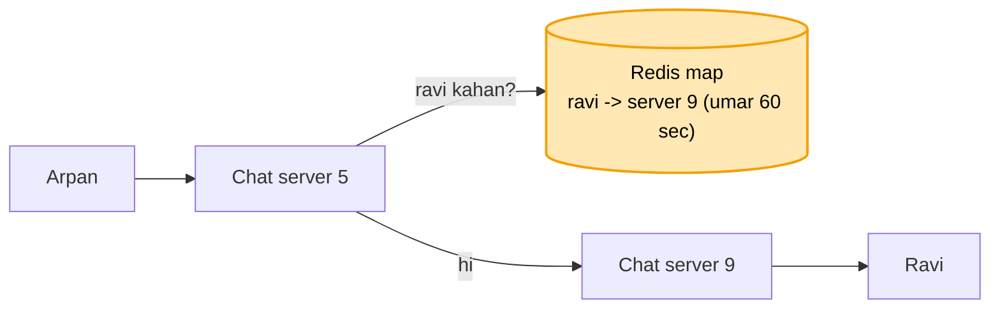

Par Ravi ka phone band hai. Redis me Ravi ki koi entry hi nahi. Arpan ka "hi" kahan jaaye? Phone 2 ghante
baad on hoga, tab use ye message milna chahiye.

### Kadam 4: Ravi ka phone band (pehle DB, phir bhejo + push)

Ravi offline hai, Redis me uski entry nahi. Arpan ka "hi" kahin to rukna chahiye, warna kho jaayega.

Ilaaj 1: har message **pehle DB me likho, phir bhejo**.

```
"hi" aaya -> PEHLE DB me likho (chat arpan-ravi, message number 42)
          -> phir Redis dekho: Ravi online? -> haan: uske server pe bhejo
                                            -> nahi: DB me pada rahega
```

Pehle DB kyun, pehle bhejna kyun nahi? Agar pehle Ravi ko bheja aur DB me likhne se pehle server gir gaya,
to message kahin pakka nahi raha, aur Ravi ka phone band tha to message hamesha ke liye gaya. Pehle DB me
likha to message pakka hai, chahe aage kuch bhi gire. NFR "kabhi na khoye" yahi kehta hai.

DB me likhne se bhi pehle server gir gaya to? Tab bhi message khota nahi, kyunki wo Arpan ke phone pe hai.
Arpan ne Send dabaya to app message phone me rakhti hai aur uske paas ghadi ka nishaan dikhati hai ("bheja
ja raha hai"). Server DB me likh ke hi app ko jawab (ack) deta hai, tab ghadi hat ke ek tick banti hai
(WhatsApp ka ek grey tick = server ke paas pakka pahuncha). Server ack se pehle gira to app ko ack kabhi
nahi milta, aur app khud thodi der me dobara bhejti hai (kisi aur server pe). Arpan ko kuch nahi karna
padta.

Ilaaj 2: **push notification**. Ravi offline hai, to uske phone pe notification bhejo ("Arpan: hi"). Ye
Google (FCM) aur Apple (APNs) ki service se jaata hai, jo band app tak bhi pahunchti hai.

Ilaaj 3: **wapas judne pe baaki sab**. Har chat ke message ko ek badhta number milta hai. 2 ghante baad Ravi
ka phone on hua aur app judi, to app bolti hai "is chat me mere paas aakhri message number 41 hai, uske baad
ke sab do", aur server DB se 42, 43, 44 ... bhej deta hai.

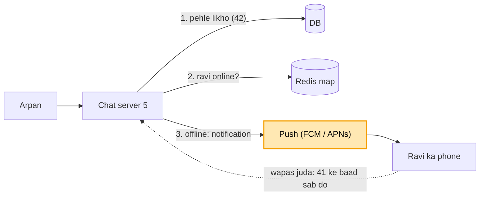

Par ab har message DB me jaata hai: roz ~400 crore message, yaani roz ~1.2 TB. Ek DB itna likhna aur
rakhna nahi jhel paayega.

### Kadam 5: roz 1.2 TB (Cassandra, chat ke hisaab se baanto)

Roz ~400 crore message, ~46,000 likhai har second, roz ~1.2 TB. Ek DB machine ye nahi jhel paayegi.

Pehle data dekho. Ek message likha jaata hai aur phir kabhi badalta nahi. Padhai hamesha ek hi tarah se hoti
hai: "is chat ke aakhri 50 message do" ya "number 41 ke baad wale do". Na join chahiye, na bank jaisa
transaction.

Ilaaj: **Cassandra**, aur data **chat ke hisaab se baanto (chat_id)**. Chat arpan-ravi ke saare message ek
hi machine pe, number ke kram me rakhe hote hain. "41 ke baad sab do" ek machine se, ek jagah se seedha padh
liya.

### DB kaunsa: SQL ya NoSQL?

Data dekho: messages. Har second ~46,000 naye message aate hain, aur roz ~1.2 TB data badhta hai. Kaam:
"is chat ke aakhri 50 message" do, bas. Koi join nahi, koi transaction nahi.

SQL ki taakat (join, transaction) yahan chahiye hi nahi, aur itni likhai ke liye SQL ko kai machine me haath se
baantna padta. Cassandra isi kaam ke liye bana hai: tez likhai, kai machine me khud baantna, aur har cheez ki
copy. Isliye Cassandra. Ye URL wali soch hi hai.

chat_id se hi kyun baanta? Ek chat ke saare message ek jagah rahein, to "aakhri 50 do" ek hi machine se mil
jaata hai. User id se baant-te to Arpan aur Ravi ki ek hi chat do machine me batt jaati.

Cassandra kab lagta hai, ek niyam: likhai bahut zyada + padhai ek key se (jaise chat_id, code) + transaction
nahi chahiye. Chat ke message, URL ke link, notification ki history, sensor / log data. Kab nahi: paisa
(banking, payment = SQL), join wali query, aur shabd dhoondhna (search = Elasticsearch).

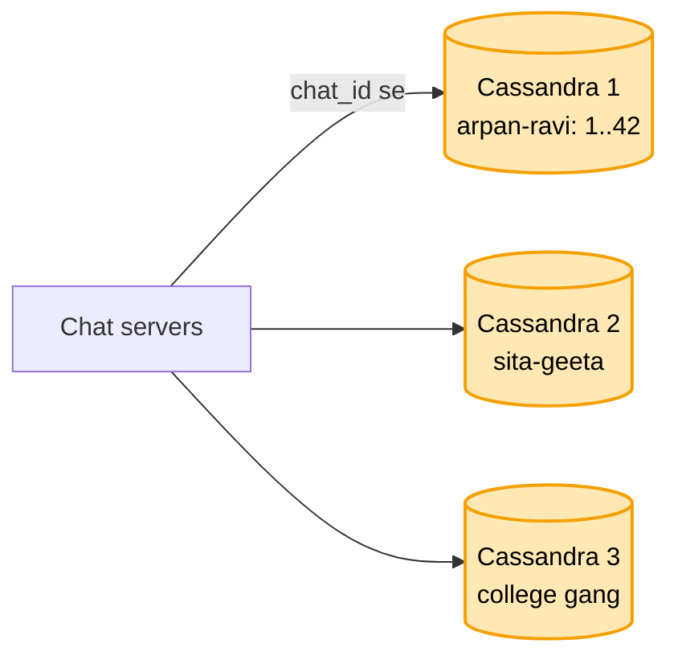

Par server ne DB me likh liya, aur ack bhejne se pehle gira. App ne dobara bheja,
aur Ravi ko "hi" do baar dikha.

### Kadam 6: Ravi ko "hi" do baar dikha (message ki apni id)

Ye sawaal kadam 4 ke sawaal se hi khula: "DB se pehle server gira to?" ka jawab tha "app dobara bhejti hai".
Ab us dobara bhejne se nayi dikkat aati hai. Server do alag jagah gir sakta hai, aur dono me farak hai:

```
HAALAT A: DB me likhne se PEHLE gira
  Arpan ne bheja -> server ko mila -> [GIRA] -> DB me kuch nahi
  app ko ack nahi mila -> app dobara bhejti -> is baar DB me likha -> Ravi ko 1 baar "hi"     SAHI

HAALAT B: DB me likhne ke BAAD, ack bhejne se PEHLE gira
  Arpan ne bheja -> server ne DB me likh diya ("hi" #42) -> [GIRA] -> ack nahi gaya
  app ko lagta "pahuncha nahi" (ack nahi aaya) -> app dobara bhejti
  server ke liye ye naya message -> DB me phir likha ("hi" #43)
  Ravi ke phone pe:  hi
                     hi          <- DO BAAR. Yahi dikkat
```

"hi" Arpan ke phone pe hai, isliye khota nahi. Dikkat khone ki nahi, Ravi ko do baar dikhne ki hai. Haalat B
me Arpan ki app ko pata hi nahi ki pehla "hi" DB me pahunch chuka hai, kyunki ack nahi aaya. Aur server ko
pata nahi ki ye wahi purana "hi" hai.

Ilaaj: har message ki apni id, jo **phone banata hai**, Send dabate hi (`clientMsgId`, jaise `m-501`).
Dobara bhejne pe bhi wahi `m-501` jaata hai. Server pehle dekhta hai "m-501 pehle aa chuka?":

```
pehli baar:  m-501 aaya -> pehle aaya? nahi -> DB me likho (#42), yaad rakho "m-501 = #42" -> ack
dobara:      m-501 aaya -> pehle aaya? haan, #42 -> DB me dobara NAHI likho, bas ack wapas
```

"Pehle aaya?" wali yaad Redis me rakhte hain, 1 din ki umar ke saath. Dobara bhejna kuch second ya minute me
hi hota hai, to 1 din kaafi hai.

Id phone kyun banaye, server kyun nahi? Dobara phone hi bhejta hai. Id pehle se phone pe hogi tabhi dobara
bhejne pe wahi jaayegi. Server banata to har baar nayi id deta, aur dobara bhejna naya message ban jaata. Ye
banking ki idempotency key hi hai: wahan paisa do baar kat-ta, yahan message do baar dikhta.

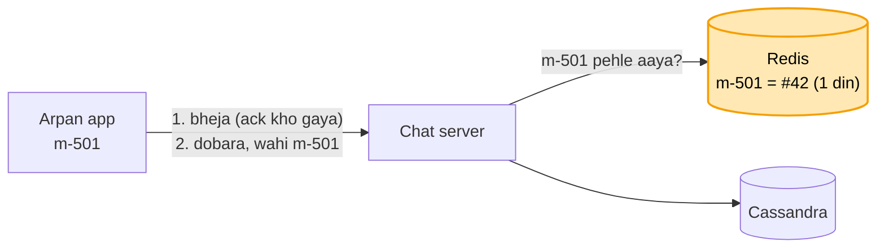

Par Arpan ki ghadi 5 minute aage chal rahi thi. Usne sawaal poochha, phir Ravi ne jawab diya. Message ka
kram phone ke time se lagaya, to Arpan ka sawaal Ravi ke jawab ke neeche chala gaya. Chat ulti padh rahi
hai.

### Kadam 7: kram ulta ho gaya (phone ki ghadi nahi, server ka number)

Message ka kram phone ke time se lag raha tha. Arpan ki ghadi 5 minute aage thi:

```
10:00  Arpan: "kal milein?"     -> phone ne time daala 10:05 (ghadi aage)
10:02  Ravi:  "haan, 5 baje"    -> phone ne time daala 10:02
time se lagaya: Ravi ka jawab upar, Arpan ka sawaal neeche. Ulta
```

Har phone ki ghadi alag hoti hai, isliye phone ke time pe bharosa nahi kar sakte.

Ilaaj: kram **server** de. Message server pe pahunchte hi us chat ka agla number milta hai (`INCR
seq:arpan-ravi` Redis me): "kal milein?" = 44, "haan, 5 baje" = 45. Kram number se lagta hai, phone ki ghadi
kuch bhi kahe. Number har chat ka alag hai, kyunki kram sirf ek chat ke andar chahiye. Kadam 4 ka "mere paas
aakhri 41 hai, uske baad ke do" isi number se chalta hai.

Server kram ke liye time dekhta hi nahi. Wo dekhta hai ki message uske paas pehle kaun pahuncha. Jo pehle
pahuncha, use agla number:

```
server pe pahuncha   message                  number (INCR seq:arpan-ravi)
pehle                Arpan: "kal milein?"     44
uske baad            Ravi:  "haan, 5 baje"    45
```

Ghadi ki zaroorat hi nahi, bas ek counter hai jo har message pe +1 hota hai. Dono ek hi pal me pahunche to
bhi Redis ek baar me ek hi kaam karta hai, ek ko 44 milega aur doosre ko 45, kabhi same nahi (rate limiter
ki Lua wali baat).

Message ke neeche jo "10:02" dikhta hai, wo sirf dikhane ke liye hai. Server message pe apna time likhta
hai, aur server ki ghadi internet se mila ke sahi rakhi jaati hai (NTP), to wo phone ki ghadi se zyada
bharose ki hai. Par kram number se lagta hai, time se nahi.

Arpan ne pehle bheja par uska net dheema tha, aur Ravi ka message server pe pehle pahunch gaya, to Ravi ko
chhota number milega. Server ke liye "pehle" ka matlab hai "jo mere paas pehle aaya". Ye chalta hai, kyunki
dono ko ek hi kram dikhta hai, aur ulta-pulta sirf ek-do second ka hota hai.

WhatsApp pe kabhi-kabhi message aage-peeche dikhte hain. Wo andar se kram kaise lagata hai, ye kisi ke paas
pakka nahi hai. Wahan end-to-end encryption hai, to server message dekh hi nahi sakta. Hamare design me E2E
scope se bahar hai, to server khud kram de sakta hai. Interview me itna hi bolo.

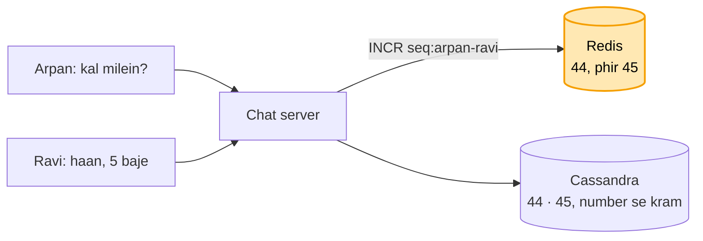

Par "College Gang" group me 500 log hain. Arpan ne ek message bheja. Kya ye 500 baar DB me likhein, har
member ke liye ek?

### Kadam 8: 500 logon ka group (message ek baar likho)

Har member ke liye alag copy likhein to ek message = 500 likhai. Roz hazaaron group me hazaaron message, DB
bhar jaayega.

Ilaaj: message DB me **sirf ek baar** likho, group ki chat me (`chat_id = college-gang`, number 980). Group
bhi bas ek chat hai, bas usme 2 ki jagah 500 log hain.

Server ko 500 members kaise pata? Group banate waqt hi members ek alag table me likh dete hain:
`group_members: college-gang -> arpan, ravi, sita ... (500)`. Message ke saath `chat_id = college-gang` aata
hai, server us id se list nikaalta hai. Ye list har message pe chahiye, aur badalti kam hai, isliye Redis me
bhi rakh lete hain. Koi member juda ya nikla to dono jagah badal do.

```
1. DB me EK baar:  college-gang, #980, "kal party?"
2. college-gang ke 500 members ki list lo (Redis / group_members)
3. har member ke liye Redis map dekho (kadam 3):
     online  -> uske server pe bhejo
     offline -> push notification, aur wapas aane pe "979 ke baad sab do" (kadam 4)
```

Likhai ek baar hui, sirf bhejna 500 jagah. Har member khud yaad rakhta hai ki usne kahan tak padha.

500 hi tak kyun? Har message pe sabko bhejna hota hai. Lakhon logon ka group (broadcast channel) alag design
hai, jo humne FR me scope se bahar rakha tha.

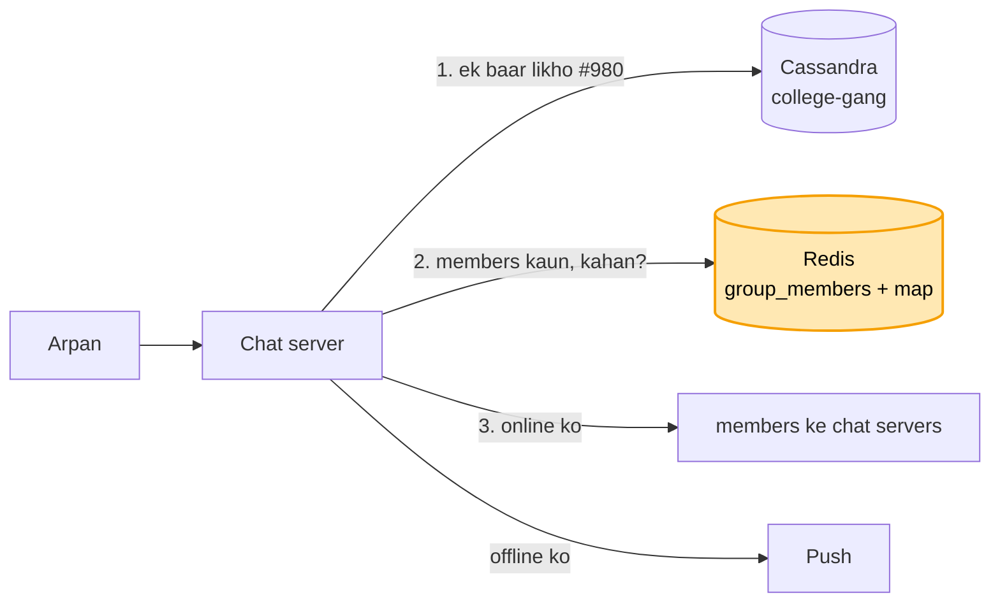

Par Ravi ne message padh liye. Arpan ke phone pe neeli tick kaise aaye? Aur Ravi ki app pe "College Gang (50
unread)" kaise gina jaaye?

### Kadam 9: neeli tick aur unread ginti (har user ka "kahan tak" nishaan)

Har message pe "padha / nahi padha" likhna bahut bhaari hai: group ke 980 message x 500 member = 4.9 lakh
nishaan.

Ilaaj: har user ka har chat me bas **ek number**, ki wo kahan tak pahuncha aur kahan tak padha:

```
Ravi, chat arpan-ravi:   pahuncha_upto = 45    padha_upto = 41
```

Ek tick (server ke paas pahuncha) kadam 4 wala ack hai. Do grey tick: Ravi ki app ne bola "45 tak mil gaye",
to `pahuncha_upto = 45`, aur Arpan ko batate hain ki 45 tak ke message pe do tick. Neeli tick: Ravi ne chat
kholi aur 45 tak dekhe, to `padha_upto = 45`, aur Arpan ko 45 tak neela. Unread ginti: College Gang ka aakhri number
980, wahan Ravi ka `padha_upto` 930, to 980 - 930 = 50 unread. Kuch ginna nahi pada, bas ek ghatana.

Kadam 7 ka number yahan bhi kaam aaya: ek number se "kahan tak" bata dete hain, har message ke liye alag
nishaan nahi chahiye.

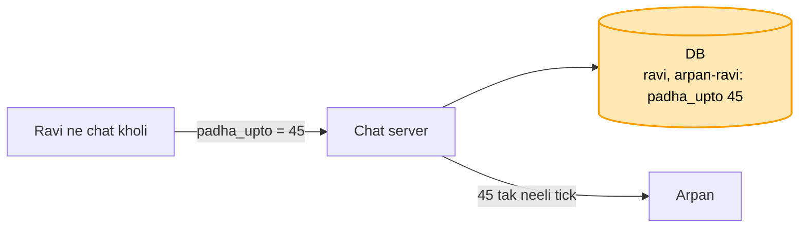

Par Arpan ne shaadi ka 200 MB ka video bheja. Ye chat server aur Cassandra ke raaste gaya, to dono bhar
jaayenge, aur baaki sabke message atak jaayenge.

### Kadam 10: 200 MB ka video (S3 me, message me sirf link)

Video chat server ke raaste mat bhejo. App video seedha **S3** me daalti hai (server ek presigned URL deta
hai, yaani 10 minute ki chaabi), aur message me sirf uska link jaata hai. Ravi tap karta hai tab video CDN
se aata hai. Chat server ke raaste bas chhota message gaya, aur group ke 500 log bhi dekhein to video ki
copy ek hi hai.

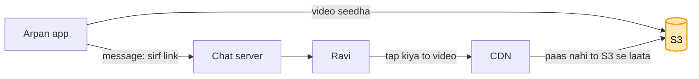

Par Ravi ki app pe "Arpan online" ya "last seen 10:30" kaise dikhe? 2 crore log hain, aur har ek ka online /
offline badalta rehta hai.

### Kadam 11: online aur last seen (heartbeat + umar wali entry)

Kadam 3 wala heartbeat hi kaam aata hai. Arpan ki app har 30 sec "main zinda hoon" bhejti hai, aur Redis me
`online:arpan` ki entry 60 sec ki umar ke saath rehti hai (har heartbeat pe umar wapas 60). Arpan ne app
band ki to heartbeat band, 60 sec me entry gayab, yaani offline. `last_seen` har heartbeat ke saath likhte hain, to aakhri heartbeat ka time (10:30) hi last seen hai.
Ravi Arpan ki chat kholta hai to Redis se poochhta hai: entry hai to "online", nahi to "last seen 10:30".

Har badlaav sabko kyun nahi batate? Arpan ke 500 contact hain. Uska har online / offline sab 500 ko bhejte,
to 2 crore log x 500 = bahut bheed. Isliye online sirf tab poochho jab koi Arpan ki chat kholta hai.

Redis gira to? Redis ki copy (replica) hai. Koi dabba akela nahi.

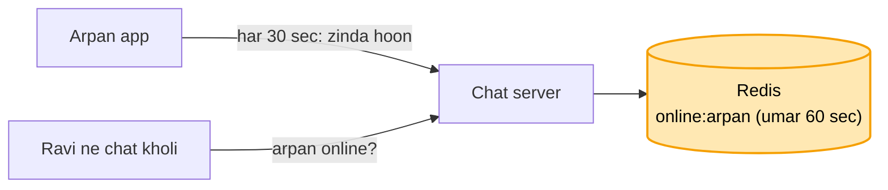

---

## 5. Wrap (30 second me poora design, NFR se milao)

Har user ~200 chat server me se kisi ek se WebSocket se juda hai (event loop), aur Redis me likha hai kaun
kis server pe hai. Arpan ne message bheja: phone ki id (clientMsgId) se dohra nahi, server ne us chat ka
agla number diya, pehle Cassandra me likha (chat_id se baanta), ack bheja (ek tick), phir Redis se dekh ke
Ravi ke server tak. Ravi offline ho to push, aur wapas aane pe "aakhri number ke baad sab". Group me message
ek baar likho, members ko bhejo. Tick aur unread har user ka ek "kahan tak" number. Video S3 me, message me
sirf link. Online = Redis me umar wali entry.

```
turant pahunche   -> WebSocket, Redis map se seedha Ravi ke server tak
kabhi na khoye    -> pehle DB phir bhejo, ack aur app ka dobara bhejna, push + "aakhri ke baad sab"
kram na bigde     -> har chat ka server wala number (time nahi)
do baar na dikhe  -> clientMsgId
```

---

## Pooche to (design nahi badalta, bas ek baar dekh lo)

```
API                -> GET /connect (WebSocket, band nahi hoti) ·
                      POST /messages { chatId, text, clientMsgId } · GET /messages?chatId=&after=41 ·
                      POST /chats/{chatId}/read { padha_upto }
chat server gira?  -> uske 1 lakh log dobara judte hain kisi aur server se. Sab ek saath na aayein, isliye
                      ruk-ruk ke aur thoda random (backoff + jitter).
                      Deploy pe server dheere-dheere khaali karo
Redis gira?        -> Redis ki copy (replica), alag zone me
push fail?         -> Google / Apple bahar ki service hai, apna retry + line (queue)
E2E chahiye?       -> server message padh hi nahi sakta: server pe search khatam, naya member purane message
                      nahi dekh sakta, chaabiyon ka poora system. Sabse bada scope badalne wala sawaal
chal raha, kaise pata? -> message pahunchne ka p99 (100 me se 99 kitni der me), har server pe khuli connection, dobara judne ki dar,
                      push fail, alert
AWS naam           -> Cassandra = Keyspaces / EC2 · Redis = ElastiCache · video = S3 + CloudFront
```

Hands-on: ye design ek chhota server aur do browser tab chala ke bana tha (21-Sep). Demo ka code repo me
nahi rakha.

