# Chat / Messaging System

> Arpan ne message bheja -> Ravi tak TURANT, chahe Ravi ne kuch na maanga ho · Ravi offline ho to baad me mile · kuch na khoye.
> Is design ka dil: **"banda KAHAN juda hai"** (baaki designs me "data kahan rakhein") + **khuli connection**.
> Ye design ek chhota server aur do browser tab chala ke bana (21-Sep; demo ka code repo me nahi rakha).

---

## KAHANI (ek din, main aur Ravi; har dikkat se design me ek dabba judta)

```
    KYA HUA                                   ILAAJ                                DABBA JUDA
1   subah 2 crore jude, memory khatam      -> EVENT LOOP, kuch thread, lakhon conn   Chat Server x200 + LB
2   Ravi doosre server pe, "offline" bola  -> MAP Redis me (kaun kahan)            Redis
3   Ravi ka phone band                     -> pehle DB, phir bhejo; PUSH           Message DB + Push
4   roz 1.2 TB message                     -> chat_id se baanto                    Cassandra
5   net dheema, "hi" do baar               -> IDEMPOTENCY (clientMsgId)            Idempotency check
6   meri ghadi 5 min aage                  -> SEQ, server ka +1                    Seq (Redis INCR)
7   College Gang (500) me message          -> group ka EK copy                     (Cassandra me group chat)
8   Ravi ne 50 padhe: unread / tick        -> NISHAAN read_upto                    Nishaan store
9   200 MB shaadi ka video                 -> S3 PRESIGNED URL, message me pata    S3
10  raat ko online / last seen             -> UMAR 30 sec (TTL)                    Presence

POORA DESIGN (upar ke dabbe kram se):
   User -> LB -> Chat Server (event loop) -> Idempotency -> Cassandra (chat_id, seq)
   Redis: kaun kis server · Seq: +1 · Push: offline ghanti · Nishaan: read_upto · S3: video · Presence: TTL
```

---

## TASVEER (ByteByteGo / Alex Xu · CC BY-NC-ND 4.0)


Source: [What is the Journey of a Slack Message?](https://bytebytego.com/guides/what-is-the-journey-of-a-slack-message/)
(ek message bhejne wale se lene wale tak — WebSocket, server, fan-out)


Source: [Short/long polling, SSE, WebSocket](https://bytebytego.com/guides/shortlong-polling-sse-websocket/)
(chat me WebSocket kyun — polling / long polling / SSE se farak)

---

## SHURU: pehle poocho, phir numbers

```
POOCHO (6, inme 2 poora design badalte):
   1. 1-to-1 ya GROUP? (group = ek message, 500 jagah pahunchana)
   2. ★ HISTORY kahan, kitni der? WhatsApp = phone pe, pahunchte hi server se DELETE (server = DAAK-GHAR)
                                  Slack = server pe HAMESHA, 3 saal purana bhi search
                                  -> ye EK jawab jagah ~zero se ~440 TB / saal kar deta
   3. ★ END-TO-END encryption? haan -> server message PADH
      hi nahi sakta -> server pe search khatam · naya member
        purane message nahi dekh sakta · chaabi ka poora system — sabse bada scope badalne wala
   4. TICK? ek tick (server tak) · do tick (phone tak) · neeli (padh li) · online / last-seen
      har tick ek ULTA message -> traffic kai guna
   5. MEDIA? message ke saath nahi, alag S3 me, message me sirf PATA
   6. OFFLINE banda? message kahan ruke, kab tak, push notification?

MAAN KE CHALO (bol ke): 1-to-1 + chhote group (500 tak) · history SERVER pe (Slack jaisa, design zyada dikhta)
                        · E2E abhi NAHI ("scope se bahar") · tick: bheja / pahuncha / padha

KYA KARE (FR):    1-to-1 · group 500 · offline ko baad me · purani history · tick · online / last-seen
                  scope bahar: E2E · voice / video · bade broadcast group
KAISA CHALE (NFR): TURANT (<1 sec) · KABHI na khoye · ek chat ke andar KRAM na bigde · DO BAAR na dikhe
                   · 2 crore EK SAATH jude · server gire to doosra sambhale

NUMBERS (andaaza):
   50 crore user, 10 crore roz · har ek 40 message / din -> ~400 crore / din
   LIKHNA: 400 crore / 86,400 second ~ 46,000 / second (bheed me 2-3 guna ~1.5 lakh)
   ONLINE ek waqt ~2 CRORE KHULI CONNECTION  <- ★ asli paimana ("kitni request / second" nahi,
          "kitni connection KHULI" — har khuli connection memory khaati, message aaye ya na aaye)
   JAGAH: 400 crore x ~300 byte ~ 1.2 TB / din -> 1 saal ~440 TB (Slack jaisa) · WhatsApp jaisa ~ZERO

TEEN FAISLE:
   1. CONNECTION ki apni line: 2 crore / ~1 lakh har machine = ~200 CHAT SERVER (sirf connection pakadte)
      -> API / business server se ALAG · event loop (Netty jaisa), "ek connection = ek thread" nahi
   2. JAGAH ek machine ki NAHI (banking ka ulta: wahan 120 /
      sec, yahan 46,000 / sec + 1.2 TB roz)
   3. HISTORY kahan (sawaal 2) se jagah ka dhaancha tay hota — yahan SLACK jaisa

DO CHEEZ JO DESIGN CHALATI:
   CONNECTION (khuli) = har online user se juda, isi raaste server user tak pahunchta
   MAP (kaun kis connection pe) = MEMORY me, DB me nahi (connection khud memory me hai)
```

---

## ════ MOCK SE PEHLE: SIRF YE CARD PADHO ════

> Har card: pehle PEELA DABBA dekho (scene + ilaaj). Yaad aa gaya -> aage. Nahi aaya -> neeche
> DIKKAT / HAL / NAHI padho. AAGE POOCHEGA sirf jab interviewer aage kuch poochhe.

#### DABBA 0: SABSE SIMPLE, EK SERVER DO USER (yahan se shuru, phir "kahan tootega")
```
Ek chat server. Main aur Ravi dono usse jude, message server ke raaste Ravi tak.
```
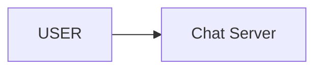

#### SHURU: KHULA CONNECTION (WEBSOCKET) AUR MAP
```
DIKKAT     Ravi ne kabhi nahi poochha "koi message aaya?", phir bhi mera "hi" uski screen pe turant chahiye.
           HTTP me server sirf jawab deta, khud awaaz nahi laga sakta.
HAL        Ravi ek baar /connect khole, connection band nahi hota (WEBSOCKET, dono taraf). Server ka map:
           "Ravi -> uska connection"; "hi" aaya -> map me Ravi ka connection dhoondh ke usi se bhejo.
```
```
TASVEER: connection aur map
Ravi: GET /connect -> connection khula, band nahi hota (WebSocket)
map (server ki memory):  Ravi -> conn-7 · Arpan -> conn-3
main "hi" bheju -> map me Ravi -> conn-7 -> usi connection se turant Ravi ki screen
connection = data nahi, Ravi tak pahunchne ka RAASTA
```
```
AAGE POOCHEGA:
  NIYAM: user ek baar jude, connection khula rahe: server khud bhej sake; map batata kaun kis connection pe.
         Connection toota to map se hatao; user dobara jude to naya connection, map me nayi entry.
  SAFAR (mera "hi" Ravi tak):
  sab theek                -> map me Ravi -> conn-7 -> usi connection se "hi", turant
  net chupchaap gaya       -> ping / pong (dhadkan); jawab nahi to connection band, map se hatao
  Ravi wapas juda          -> naya /connect -> naya connection, map me Ravi -> naya connection
```

#### 1 Subah 2 crore log jude, server ki memory khatam
```
DIKKAT     Subah 9 baje 2 crore log jude, sabka connection khula. Ek connection = ek thread (~1 MB)
           -> 1 lakh connection = ~100 GB. Server khatam.
```
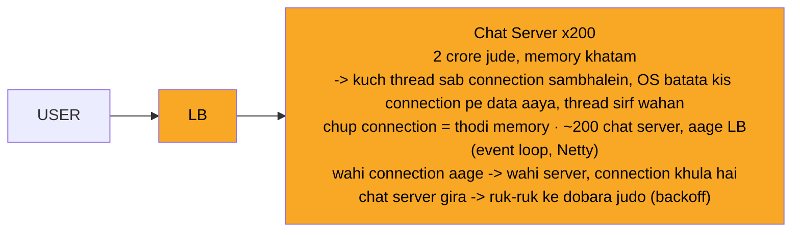
```
NAHI       badi machine lo (zyada RAM): thread ka kharcha wahi, bas thodi der baad tootega.
```
```
AAGE POOCHEGA:
  NIYAM: connection kholo, thread mat do; server gira to log ruk-ruk ke judein; bheja hua khota nahi.
  SAFAR (ek connection, subah se raat):
  app khula                  -> LB server pe bithata, connection khula (event loop, thread nahi)
  connection chup            -> thodi memory; data aaya tabhi thread (epoll batata)
  wahi connection aage       -> wahi server: connection khula hai, naya connection = naya chunaav
  chat server gira           -> ruk-ruk ke, random waqt pe dobara judo (backoff + jitter)
                                bheja hua khota nahi
  naya code deploy           -> thode-thode server khaali (draining): sab ek saath na judein
```

#### 2 Maine Ravi ko "hi" bheja, server bola Ravi offline
```
DIKKAT     Main server-1 pe, Ravi server-7 pe. Maine "hi" bheja, server-1 ke map me sirf apne log
           -> bola "Ravi offline", jabki Ravi online tha.
```
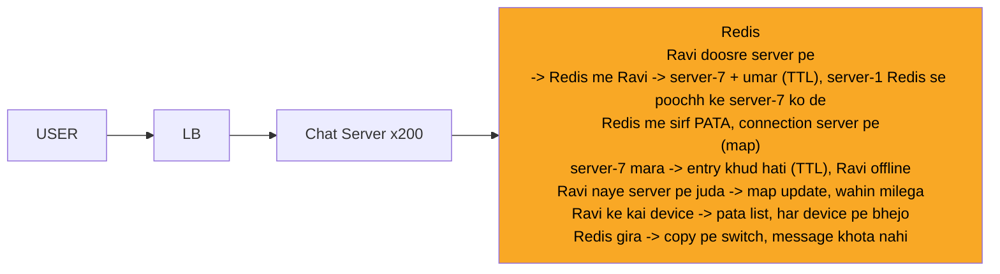
```
NAHI       har 200 server ko bhej do: 199 bekaar jaagte.
```
```
AAGE POOCHEGA:
  NIYAM: Redis me sirf PATA (umar ke saath); pata galat ya Redis gira, message khota nahi.
  SAFAR (mera "hi", Ravi tak):
  Ravi online, server-7 pe   -> Redis se pata "Ravi -> server-7" -> server-7 -> Ravi
  server-7 zinda             -> dhadkan se entry ki umar badhti (TTL)
  server-7 mara              -> umar khatam, entry khud hati -> Ravi offline maana
  Ravi ke kai device         -> pata ek nahi, list (device -> server): har device pe bhejo
  pata galat, Ravi khiska    -> message khota nahi: naye server pe judte hi milega
  Redis hi gira              -> copy pe switch: message khota nahi, judne pe milega
```

#### 3 Ravi ka phone band tha, message kahan jaaye
```
DIKKAT     Ravi ka phone band, connection nahi. "Pehle bhejo, na pahunche to DB me daalo" -> beech me server
           gira = message gaya.
```
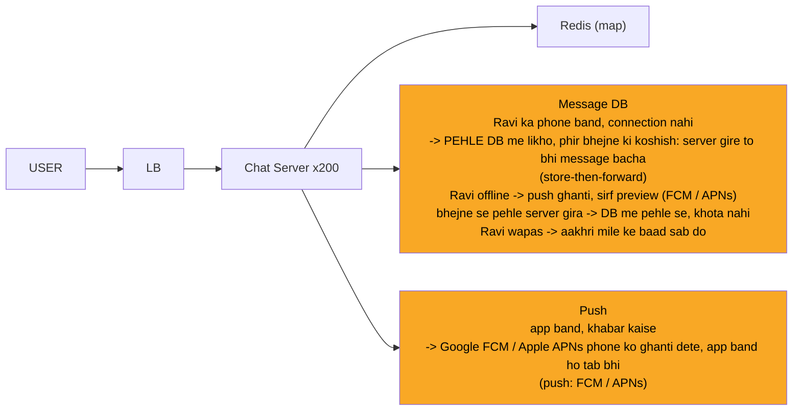
```
NAHI       sirf Push bhej do, DB nahi: push sirf ghanti hai, pahunchne ki guarantee nahi, history bhi nahi.
```
```
AAGE POOCHEGA:
  NIYAM: DB pehle, bhejna baad; push sirf ghanti; DB me hai wo khota nahi, wapas aaya to "aakhri ke baad" sab.
  SAFAR (Ravi ka phone band):
  mera hi aaya              -> PEHLE DB me likho, phir bhejne ki koshish
  Ravi offline               -> push ghanti (FCM / APNs), sirf preview: raasta Google ka
  bhejne se pehle server gira -> DB me pehle se: kuch nahi khota
  Ravi wapas aaya            -> "aakhri jo mila, uske baad sab do" -> server baaki deta
```

#### 4 Roz 1.2 TB message, ek DB nahi jhelta
```
DIKKAT     Roz ~1.2 TB message, 46,000 likhai / second. Ek DB machine nahi jhelegi. Kis cheez se baantein?
```
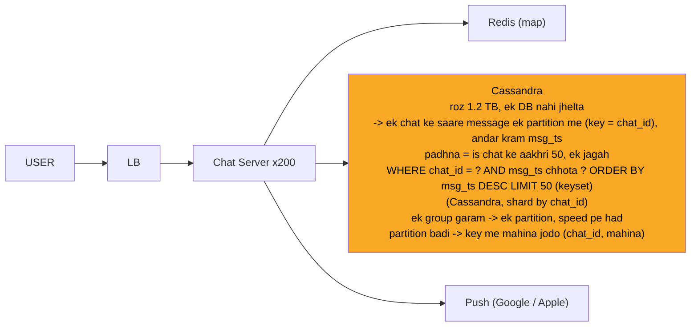
```
NAHI       user_id se baanto: ek chat do jagah, group 500 jagah.
```
```
AAGE POOCHEGA:
  NIYAM: jo saath padha jaata wo saath rakho (ek chat ek partition); partition badi ho to key me mahina jodo.
  SAFAR (ek message, Cassandra tak):
  likha                      -> partition = chat_id: ek chat ke saare message ek jagah
  chat khuli                 -> "aakhri 50" = ek jagah, ek baar (keyset, OFFSET nahi)
  ek group bahut garam       -> ek chat ek partition hi rahega: group ki speed pe had
  saalon me partition badi   -> key (chat_id, mahina): size bandhta, bojh nahi baant-ta
  3 saal purane              -> sasti jagah (cold storage): kabhi-kabhi hi khulte
```

#### 5 Net dheema, app ne dobara bheja, Ravi ko "hi" do baar
```
DIKKAT     Metro me net dheema. App ne "hi" bheja, timeout aaya, dobara bheja. Pehla pahunch chuka tha
           -> Ravi ko "hi" do baar.
```
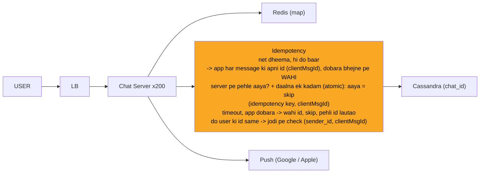
```
NAHI       server id banaye: har dobara bhejna = nayi id = duplicate.
```
```
AAGE POOCHEGA:
  NIYAM: id APP banata, server sirf "pehle dekha?" (ek kadam); dobara bhejna safe, wahi id = wahi message.
  SAFAR (ek "hi", dobara bheja):
  pehli baar                 -> app ki id (clientMsgId) -> "pehle aaya?" nahi -> daalo
  timeout, app dobara        -> WAHI id -> "pehle aaya?" haan -> skip, pehli wali id lautao
  dono ek saath pahunche     -> dekhna + daalna ek kadam (Cassandra LWT / Redis SET NX)
  do user ki id same nikli   -> check jodi pe (sender_id, clientMsgId): alag log = alag message
```

#### 6 Meri ghadi 5 min aage, mere message upar chadh gaye
```
DIKKAT     Meri phone ki ghadi 5 min aage. Mere message chat me upar chadh gaye, Ravi ke jawab se pehle.
```
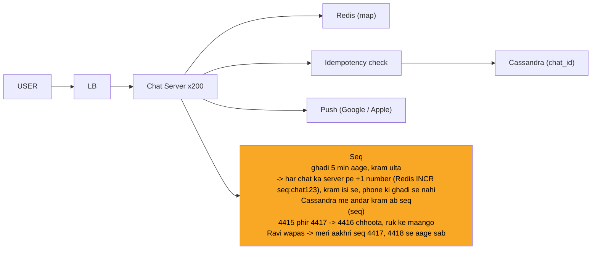
```
NAHI       Snowflake id se kram: do server ki ghadi me ms ka farak.
```
```
TASVEER: seq + chhed pakdo
Redis INCR seq:chat123 -> 4415, 4416, 4417 ...   (har message +1, server deta, ghadi nahi)
app ko mila 4415, phir 4417  -> 4416 nahi aaya = CHHED -> thoda ruko -> "4415 ke baad ke do"
Ravi wapas aaya: "meri aakhri 4417" -> server 4418 se aage sab
```
```
AAGE POOCHEGA:
  NIYAM: kram = server ka +1 number (har chat alag), ghadi nahi; ginti me chhed = kuch chhoota, wo maango.
  SAFAR (mera message, chat me jagah):
  message aaya               -> server deta +1 number (Redis INCR seq:chat123), ghadi nahi
  meri ghadi 5 min aage      -> farak nahi: kram seq se, phone ke waqt se nahi
  app ko 4415, phir 4417     -> 4416 chhoota (chhed) -> thoda ruko -> "4415 ke baad ke do"
  seq wala Redis restart     -> Cassandra me har message ka seq: sabse bade se aage
  Ravi wapas aaya            -> "meri aakhri 4417" -> 4418 se aage sab
```

#### 7 College Gang (500) me ek message, 500 baar likhein?
```
DIKKAT     "College Gang" me 500 log. Maine ek message bheja -> 500 logon ke inbox me 500 baar likhein?
```
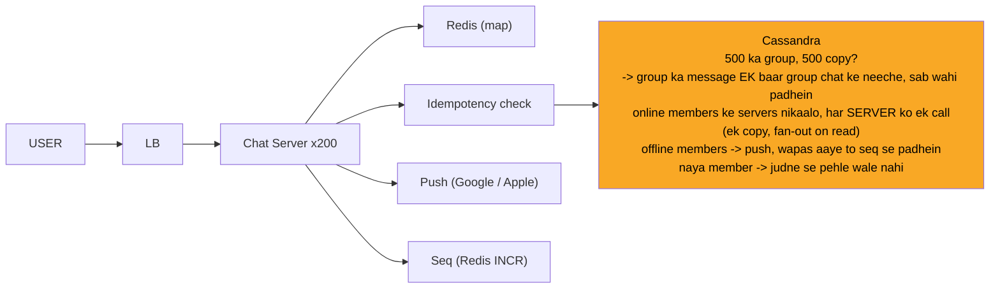
```
NAHI       Twitter jaisa har inbox me copy: wahan feed sabki alag + crore follower, group sabka ek.
```
```
TASVEER: ek copy, server-wise
"College Gang" (500): message EK baar -> group chat ke neeche (Cassandra)
online members kis server pe? -> Redis map: server-3, server-7 ...
har SERVER ko ek baar: "ye message, in members ko" -> wo apne connection se apne members ko
offline members -> push ghanti; wapas aaye to seq se aage padh lenge
```
```
AAGE POOCHEGA:
  NIYAM: sabke liye ek jaisa = ek copy, har kisi ka alag = alag copy; bhejna server-wise, member-wise nahi.
  SAFAR (College Gang me ek message):
  bheja                      -> EK baar likho, group chat ke neeche: sab wahi padhte
  300 online                 -> Redis se unke server -> har SERVER ko ek call
  offline members            -> push ghanti; wapas aaye to seq se aage padh lenge
  naya member juda           -> judne ke seq se pehle wale nahi (tab group me tha hi nahi)
```

#### 8 Ravi ne 50 padhe: unread aur neeli tick kaise
```
DIKKAT     Shaam ko Ravi ne chat khol ke 50 message padhe. Har message x har member ka "padha" record
           = 500 x 50 = 25,000 likhai. Bekaar.
```
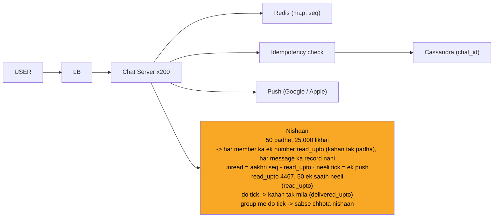
```
NAHI       unread COUNT column badhao-ghatao: har message pe 500 member x 1 UPDATE, phir bhi 25,000 likhai.
```
```
TASVEER: ek nishaan, ginti nahi
chat seq:  ... 4417 4418 ...... 4467 | aage ke message
Ravi:      read_upto = 4467 (neeli tick tak)   ·   delivered_upto >= read_upto (do tick)
unread = aakhri seq - 4467   (ghatao, gino nahi)
Ravi ne 50 padhe -> ek push "read_upto 4467" -> 50 ek saath neeli
```
```
AAGE POOCHEGA:
  NIYAM: nishaan khisakta, ginti nahi hoti; unread, tick, offline ke baad lena sab isi se; khoya to agli baar.
  SAFAR (Ravi ne chat kholi):
  50 padhe                   -> nishaan khiska: read_upto = 4467, ek likhai, ginti nahi
  unread                     -> aakhri seq - nishaan (ghatao, gino nahi)
  neeli tick                 -> mujhe ek push "read_upto 4467" -> 50 ek saath neeli
  do tick (mila)             -> "kahan tak mila" (delivered_upto), Ravi ka phone bhejta
  wo "mila" raaste me khoya  -> agli baar judte hi phone dobara bhejta: nishaan sirf aage
  group me do tick           -> sabse chhota nishaan: sab ka delivered_upto >= seq
```

#### 9 Shaadi ka 200 MB video chat ke raaste
```
DIKKAT     Maine College Gang me 200 MB shaadi ka video chat server se bheja -> 2 min connection atka,
           server 500 x 200 MB = ~100 GB bheje.
```
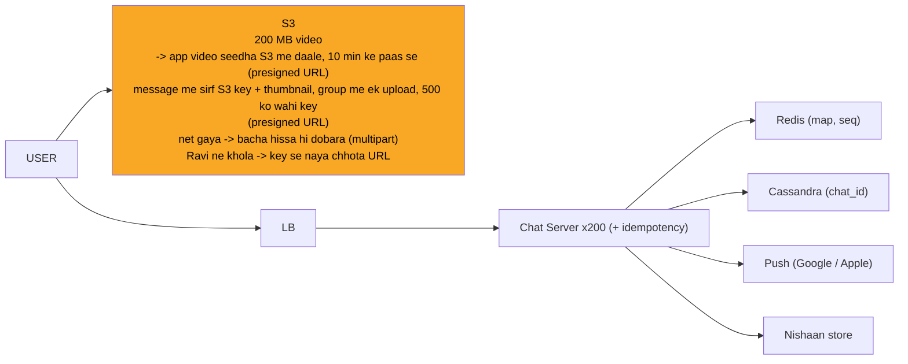
```
NAHI       message me URL rakho: 10 min me khatam, kal link mara; KEY rakho.
```
```
AAGE POOCHEGA:
  NIYAM: bhaari maal S3 me, message me sirf KEY (URL marta hai); ek upload, sabko wahi key.
  SAFAR (200 MB video):
  bhejna                     -> app seedha S3 me (10 min ka paas, presigned URL)
  200 MB me net gaya         -> tukdon me (multipart): bacha hissa hi dobara
  message                    -> sirf S3 key + thumbnail; group me ek upload, 500 ko wahi key
  Ravi ne khola              -> key se naya chhota URL (URL marta hai, key nahi)
  wahi video 1000 baar forward -> file ka hash: pehle se hai to wahi file, upload nahi
```

#### 10 Raat ko online / last seen sabko kaise
```
DIKKAT     Raat ko main online aaya, gaya. Har baar mere saare contacts ko batao = crore x 500 message.
```
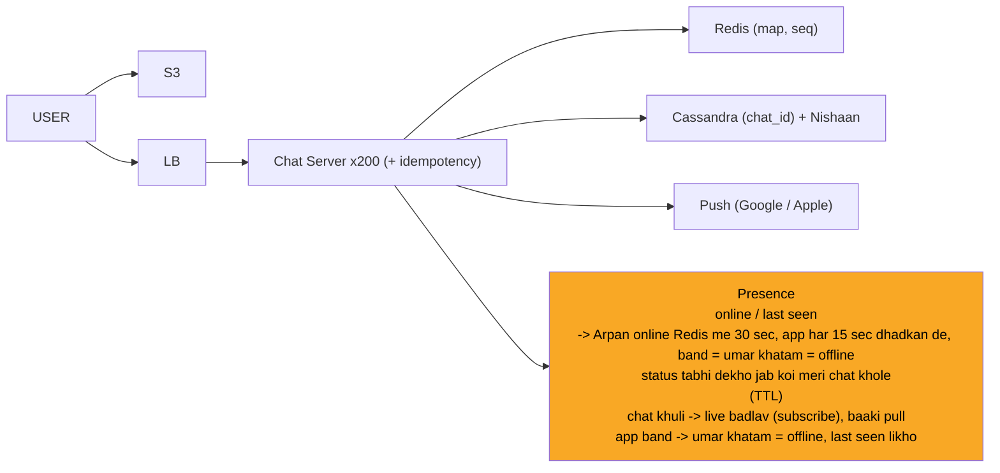
```
NAHI       DB me online column, har dhadkan pe UPDATE: crore log x har 15 sec = DB baith jaata.
```
```
AAGE POOCHEGA:
  NIYAM: status maango tab dekho, khud mitne wali key; thoda purana status chalta (paisa nahi hai).
  SAFAR (main online aaya, gaya):
  app khula                  -> Redis "Arpan online" 30 sec; app har 15 sec "hoon"
  Ravi ne meri chat kholi    -> tabhi status dekho: sabko batana nahi
  chat khuli, main gaya      -> khuli chat = subscribe (live badlav); baaki chat pull
  crore dhadkan / sec        -> chat server ikattha karke Redis me (batch)
  app band                   -> umar khatam = offline; server us waqt last seen alag likhe
  Ravi ne last seen chhupaya -> mat dikhao
```

---

## AAKHRI DABBA + WRAP (ek hi baar)

```
User -> LB -> Chat Server (khuli WebSocket, event loop)
-> Idempotency (clientMsgId) -> Cassandra (chat_id partition, andar seq; pehle LIKHO phir bhejo)
-> Redis (kaun kis server: umar + dhadkan) -> lene wale ka Chat Server -> lene wala
offline -> Push · wapas jude to "aakhri seq ke baad sab" · nishaan = delivered_upto / read_upto
media -> S3, message me sirf pata · online = Presence (TTL) · purana -> sasti jagah

DB:  message = Cassandra (partition chat_id, andar seq; message_id = Snowflake sirf pehchaan)
     zinda connection = server ki memory · pakka maal (message) = DB
```
```
JAWAB:    Har user ~200 me se ek server se juda, Redis me likha kaun kahan.
          Message ki id se do baar nahi, pehle DB me (chat ke hisaab se baanta), phir lene wale ke
          server tak. Offline ho to DB me pada + push, jude to 'aakhri seq ke baad'.
          Tick aur unread = har user ka nishaan, online = umar wali Redis key, video S3 me, message me
          sirf pata.
```
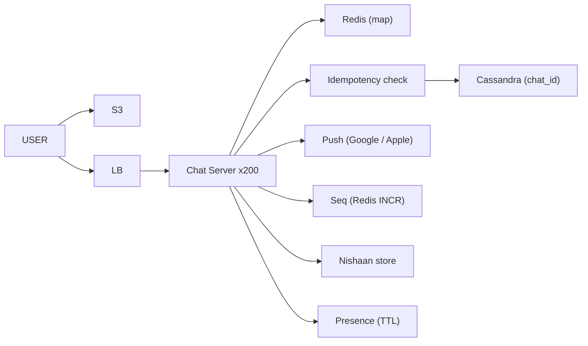

---

## 10 GUNA TRAFFIC — har dabba alag se

```
Chat Server   -> 2 crore khuli = ~200 machine sirf connection pakadne · event loop, warna thread khatam
MAP           -> memory me, server gira to gaya -> Redis me umar wali entry + dhadkan
DOBARA JUDNA  -> ek server gira = 1 lakh ek saath -> ruk-ruk ke + random (backoff + jitter)
                 · deploy pe draining
Cassandra     -> chat_id partition · garam group -> speed ki had · purana sasti jagah
Push          -> Google / Apple bahar ki cheez -> apna retry / queue
Redis         -> copy, ALAG AZ · message store ki bhi copy, alag AZ

POOCHEGA: "How would you scale this to 10x?"      -> user ka raasta chalo, pehle jo toote
POOCHEGA: "What's the single point of failure?"   -> chat server (dobara judo), Redis (copy)
POOCHEGA: "How do you know it's working?"
          -> pahunchne ka p99 · har machine pe khuli connection · dobara judne ki dar · push fail · alert
```

---

## POOCHE TO (gehra sawaal aaye tab)

```
API:      GET /connect (BAND nahi hoti — WebSocket) · POST /messages { chatId, text, clientMsgId }
          GET /messages?chatId=&before= (wapas lena + history, cursor)
          POST /chats/{chatId}/read { read_upto } (tick)

(SHURU) "Polling (har 5 sec poochho)?" -> 100 me 1 kaam ki; WebSocket = ek baar judo, turant.
(SHURU) "SSE kyun nahi?"             -> SSE sirf server -> user; chat me dono taraf chahiye.
"Redis pub-sub se kyun nahi?"      -> chal sakta, par kuch rakhta nahi: sunne wala na ho to message gaya.
"message_id se partition kyun nahi?" -> aakhri 50 = 50 jagah se; jo saath padha jaata wo saath nahi.
"SQL kyun nahi?"                   -> rishte / transaction chahiye nahi; bas bahut likhai (46,000 / sec).
"Snowflake id kis kaam ki?"        -> sirf pehchaan (message_id); kram nahi, do server ki ghadi me ms farak.
"10 lakh ka broadcast group?"      -> tick band, sirf unread: 10 lakh nishaan milana mehnga.
"E2E hai to thumbnail?"            -> app khud encrypt kare, chaabi message ke saath; server dekh nahi sakta.
"Aur 'typing...'?"                 -> sirf khuli chat me, store nahi: 2 sec ki khabar.
"Purana message search?"          -> DB ke baad search index me bhi likho (Elasticsearch): ES id de,
                                     message Cassandra se (card 4).
"clientMsgId kab tak yaad?"       -> jitni der me dobara aata: retry minute me, 1 ghanta kaafi (card 5).

DO DUNIYA:  ZINDA CONNECTION (memory, ek server ki, mar sakti) = map
            PAKKA MAAL (DB, sab jagah se dikhta) = message
            connection ko Redis me rakhne ki koshish — ho hi nahi sakta, Redis me sirf PATA
            ek user -> KAI connection (phone + laptop + tab)

JAD KI BAAT — chat baaki har design se KYUN alag:
   ab tak (url shortener, feed, payment, banking): user ne MAANGA -> server ne diya -> connection BAND
   chat: Arpan ne bheja -> Ravi ne kuch nahi maanga -> phir bhi Ravi tak TURANT
   HTTP me server sirf JAWAB de sakta, khud AWAAZ nahi laga sakta -> do nayi cheez:
   1. CONNECTION KHULI rakhni (WebSocket — ek baar judo, dono taraf baat)
   2. MAP "kaun kis server se juda hai" (200 chat server, Ravi kis se?) -> yahi chat ka DIL
```

---

ARCHETYPE D (real-time) · CONCEPTS: [message-queues](../../FOUNDATIONS/07_message_queues.md) · [sharding](../../FOUNDATIONS/06_database_sharding.md) · [Snowflake id](../../FOUNDATIONS/13_distributed_id_snowflake.md) · [CAP](../../FOUNDATIONS/08_cap_theorem.md) · [← SYSTEM_DESIGNS](..) · [← Home README](../../../README.md) · [← MASTER SHEET](../../00_MASTER_SHEET.md)
