# Chat / Messaging System

> Arpan ne message bheja -> Ravi tak TURANT, chahe Ravi ne kuch na maanga ho · Ravi offline ho to baad me mile · kuch na khoye.
> Is design ka dil: **"banda KAHAN juda hai"** (baaki designs me "data kahan rakhein") + **khuli connection**.
> Ye design ek chhota server aur do browser tab chala ke bana (21-Sep; demo ka code repo me nahi rakha).

---

## KAHANI (ek din, main aur Ravi; har dikkat se design me ek dabba judta)

```
    KYA HUA                                   ILAAJ                                DABBA JUDA
1   subah 2 crore jude, memory khatam      -> EVENT LOOP, kuch thread lakhon taar  Chat Server x200 + LB
2   Ravi doosre server pe, "offline" bola  -> REGISTER Redis me (kaun kahan)       Redis
3   Ravi ka phone band                     -> pehle DB, phir bhejo; PUSH           Message DB + Push
4   roz 1.2 TB message                     -> chat_id se baanto                    Cassandra
5   net dheema, "hi" do baar               -> IDEMPOTENCY (clientMsgId)            Idempotency check
6   meri ghadi 5 min aage                  -> SEQ, server ka +1                    Seq (Redis INCR)
7   College Gang (500) me message          -> group ka EK copy                     (Cassandra me group chat)
8   Ravi ne 50 padhe: unread / tick        -> NISHAAN read_upto                    Nishaan store
9   200 MB shaadi ka video                 -> S3 PRESIGNED URL, message me pata    S3
10  raat ko online / last seen             -> UMAR 30 sec (TTL)                    Presence

POORA DESIGN (upar ke dabbe kram se):
   User -> LB -> Chat Server (event loop) -> Idempotency -> Cassandra (chat_id, seq)
   Redis: kaun kis server · Seq: +1 · Push: offline ghanti · Nishaan: read_upto · S3: video · Presence: TTL
```

---

## TASVEER (ByteByteGo / Alex Xu · CC BY-NC-ND 4.0)


Source: [What is the Journey of a Slack Message?](https://bytebytego.com/guides/what-is-the-journey-of-a-slack-message/)
(ek message bhejne wale se lene wale tak — WebSocket, server, fan-out)


Source: [Short/long polling, SSE, WebSocket](https://bytebytego.com/guides/shortlong-polling-sse-websocket/)
(chat me WebSocket kyun — polling / long polling / SSE se farak)

---

## SHURU: pehle poocho, phir numbers

```
POOCHO (6, inme 2 poora design badalte):
   1. 1-to-1 ya GROUP? (group = ek message, 500 jagah pahunchana)
   2. ★ HISTORY kahan, kitni der? WhatsApp = phone pe, pahunchte hi server se DELETE (server = DAAK-GHAR)
                                  Slack = server pe HAMESHA, 3 saal purana bhi search
                                  -> ye EK jawab jagah ~zero se ~440 TB / saal kar deta
   3. ★ END-TO-END encryption? haan -> server message PADH
      hi nahi sakta -> server pe search khatam · naya member
        purane message nahi dekh sakta · chaabi ka poora system — sabse bada scope badalne wala
   4. TICK? ek tick (server tak) · do tick (phone tak) · neeli (padh li) · online / last-seen
      har tick ek ULTA message -> traffic kai guna
   5. MEDIA? message ke saath nahi, alag S3 me, message me sirf PATA
   6. OFFLINE banda? message kahan ruke, kab tak, push notification?

MAAN KE CHALO (bol ke): 1-to-1 + chhote group (500 tak) · history SERVER pe (Slack jaisa, design zyada dikhta)
                        · E2E abhi NAHI ("scope se bahar") · tick: bheja / pahuncha / padha

KYA KARE (FR):    1-to-1 · group 500 · offline ko baad me · purani history · tick · online / last-seen
                  scope bahar: E2E · voice / video · bade broadcast group
KAISA CHALE (NFR): TURANT (<1 sec) · KABHI na khoye · ek chat ke andar KRAM na bigde · DO BAAR na dikhe
                   · 2 crore EK SAATH jude · server gire to doosra sambhale

NUMBERS (andaaza):
   50 crore user, 10 crore roz · har ek 40 message / din -> ~400 crore / din
   LIKHNA: 400 crore / 86,400 second ~ 46,000 / second (bheed me 2-3 guna ~1.5 lakh)
   ONLINE ek waqt ~2 CRORE KHULI CONNECTION  <- ★ asli paimana ("kitni request / second" nahi,
          "kitni connection KHULI" — har khuli connection memory khaati, message aaye ya na aaye)
   JAGAH: 400 crore x ~300 byte ~ 1.2 TB / din -> 1 saal ~440 TB (Slack jaisa) · WhatsApp jaisa ~ZERO

TEEN FAISLE:
   1. CONNECTION ki apni line: 2 crore / ~1 lakh har machine = ~200 CHAT SERVER (sirf taar pakadte)
      -> API / business server se ALAG · event loop (Netty jaisa), "ek connection = ek thread" nahi
   2. JAGAH ek machine ki NAHI (banking ka ulta: wahan 120 /
      sec, yahan 46,000 / sec + 1.2 TB roz)
   3. HISTORY kahan (sawaal 2) se jagah ka dhaancha tay hota — yahan SLACK jaisa

DO CHEEZ JO DESIGN CHALATI:
   CONNECTION (khuli) = har online user ka taar, isi raaste server user tak pahunchta
   REGISTER (kaun kis taar ke peeche) = MEMORY me, DB me nahi (taar khud memory me hai)
```

---

## ════ MOCK SE PEHLE: SIRF YE CARD PADHO ════

> Har card: pehle PEELA DABBA dekho (scene + ilaaj). Yaad aa gaya -> aage. Nahi aaya -> neeche
> DIKKAT / HAL / NAHI padho. AAGE POOCHEGA sirf jab interviewer aage kuch poochhe.

#### DABBA 0: SABSE SIMPLE, EK SERVER DO USER (yahan se shuru, phir "kahan tootega")
```
Ek chat server. Main aur Ravi dono usse jude, message server ke raaste Ravi tak.
```
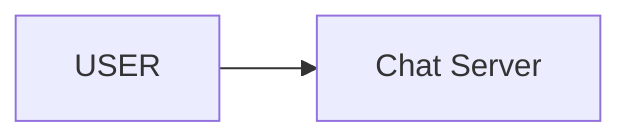

#### 0 SHURU: KHULA TAAR (WEBSOCKET) AUR REGISTER
```
SCENE      Ravi ne kabhi nahi poochha "koi message aaya?", phir bhi mera "hi" uski screen pe.
           Ravi ne /connect khola -> ye connection BAND nahi hota (WEBSOCKET).
           Server ki register: "Ravi -> uska taar". Maine "hi" bheja -> server register me Ravi ka taar
           dhoondh ke usi khule taar se Ravi tak. Taar = data nahi, Ravi tak pahunchne ka RAASTA.

DIKKAT 1   "Thodi-thodi der me poochte rehte" (polling)?
HAL        Galat shabd. Polling = har 5 sec "kuch aaya?", 100 me 1 kaam ki. WebSocket = ek baar judo, turant.

DIKKAT 2   SSE kyun nahi?
HAL        SSE sirf server -> user. Chat me dono taraf chahiye.

DIKKAT 3   Net chupchaap gaya, server ko kaise pata?
HAL        Ping / pong (dhadkan); jawab nahi to taar band, register se hatao.
```

#### 1 Subah 2 crore log jude, server ki memory khatam
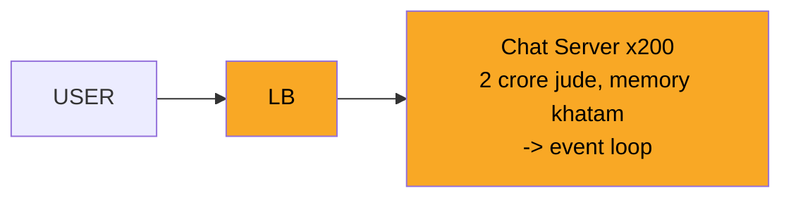
```
DIKKAT     Subah 9 baje 2 crore log app khol ke jude, sabka taar hamesha khula. Ek taar = ek thread (~1 MB)
           -> 1 lakh taar = ~100 GB. Server khatam.
HAL        EVENT LOOP (Netty jaisa): kuch hi thread, lakhon taar. OS (epoll) batata "in 5 taar pe data aaya"
           -> thread sirf unpe kaam karta; baaki chup baithe taar ka kharcha sirf thodi memory.
           ~200 chat server (sirf taar pakadte), aage LB.
NAHI       badi machine lo (zyada RAM): thread ka kharcha wahi, bas thodi der baad tootega.
```
```
AAGE POOCHEGA:
  NIYAM: taar kholo, thread mat do; server gira to log ruk-ruk ke judein.
  "Chat server gira?"              -> log ruk-ruk ke, random waqt pe judein (backoff + jitter); message DB me.
  "Naya code deploy?"              -> thode-thode server, unke taar dheere hatao (draining).
  "LB lambi connection?"           -> ek baar baitha to wahi server; naya connection = naya chunaav.
```

#### 2 Maine Ravi ko "hi" bheja, server bola Ravi offline
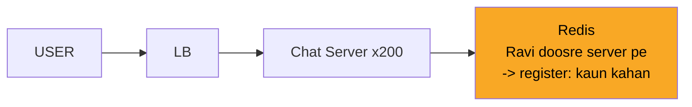
```
DIKKAT     Main server-1 pe, Ravi server-7 pe. Maine "hi" bheja, server-1 ki register me sirf apne log
           -> bola "Ravi offline", jabki Ravi online tha.
HAL        REGISTER (kaun kis server se juda) Redis me: "Ravi -> server-7". Har server apne jude log likhta,
           umar (TTL) ke saath; server zinda to dhadkan se umar badhata, mara to entry khud hat jaati.
           Server-1 Redis se poochhta, server-7 ko deta, server-7 Ravi ko. Redis me sirf PATA, taar nahi.
NAHI       har 200 server ko bhej do: 199 bekaar jaagte.
```
```
AAGE POOCHEGA:
  NIYAM: Redis me sirf PATA, taar nahi; message DB me pakka, pata galat ho to bhi kuch nahi khota.
  "Pata galat (Ravi khiska)?"      -> message DB me hai; Ravi naye server pe judte hi le lega.
  "Redis gira?"                    -> copy pe switch; message DB me, push + dobara judne pe milega.
  "Redis pub-sub kyun nahi?"       -> chal sakta, par kuch rakhta nahi; Cluster me har publish sab node pe.
  "Mara server, entry kaise hate?" -> umar (TTL): zinda server dhadkan se badhata, mara to khud hat jaati.
```

#### 3 Ravi ka phone band tha, message kahan jaaye
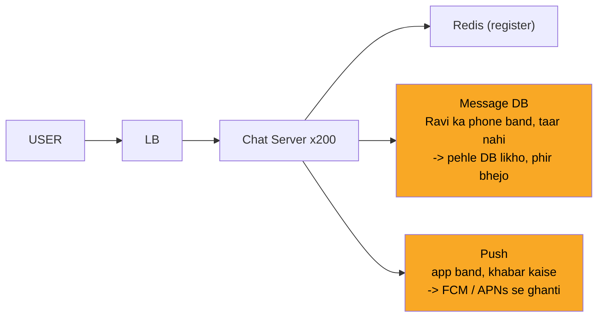
```
DIKKAT     Ravi ka phone band, koi taar nahi. "Pehle bhejo, na pahunche to DB me daalo" -> beech me server
           gira = message gaya.
HAL        PEHLE DB me likho, phir bhejne ki koshish. Ravi offline -> PUSH (Google FCM / Apple APNs) se
           ghanti, app band ho tab bhi. Ravi wapas: "aakhri jo mila, uske baad sab do" -> server baaki deta.
NAHI       sirf Push bhej do, DB nahi: push sirf ghanti hai, pahunchne ki guarantee nahi, history bhi nahi.
```
```
AAGE POOCHEGA:
  NIYAM: DB pehle, bhejna baad me; jo DB me hai wo kabhi nahi khota.
  "Ravi ke 3 device?"              -> har device ka apna taar + nishaan; ek pe padha to sab pe neeli.
  "Push me poora message?"         -> nahi, chhota preview (privacy); asli message app khulne pe.
  "Kuch na khoye, poora jawab?"    -> DB pehle + Kafka acks=all, kaam ke baad offset, id se dobara-safe, DLQ.
```

#### 4 Roz 1.2 TB message, ek DB nahi jhelta
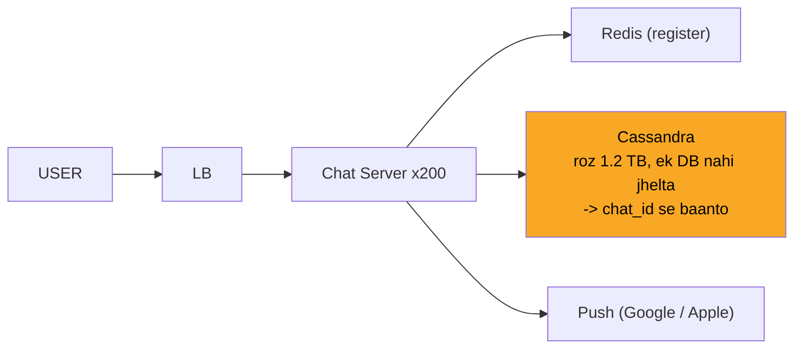
```
DIKKAT     Roz ~1.2 TB message, 46,000 likhai / second. Ek DB machine nahi jhelegi. Kis cheez se baantein?
HAL        CASSANDRA, partition (kis machine pe jaaye) = chat_id, andar kram = msg_ts (phone ka waqt).
           Ek chat ke saare message ek jagah. Padhna hamesha "is chat ke aakhri 50" = ek jagah, ek baar:
             WHERE chat_id = ? AND msg_ts < ? ORDER BY msg_ts DESC LIMIT 50   (keyset, OFFSET nahi)
NAHI       user_id se baanto: ek chat do jagah, group 500 jagah.
```
```
AAGE POOCHEGA:
  NIYAM: jo saath padha jaata, wo saath rakho: ek chat ek partition.
  "message_id se partition?"       -> har message alag jagah; aakhri 50 = 50 jagah se.
  "Purana search (Slack)?"         -> Kafka se Elasticsearch me bhi; ES id deta, message Cassandra se.
  "Ek group bahut garam?"          -> asli ilaaj group ki speed pe had; (chat_id, ghanta) bas tukda chhota.
  "Partition saalon me badi?"      -> key (chat_id, mahina) by default; size bandha, bojh nahi baant-ta.
  "3 saal purana?"                 -> purane mahine sasti jagah (cold storage).
  "SQL kyun nahi?"                 -> rishte / transaction chahiye hi nahi; likhai bahut.
```

#### 5 Net dheema, app ne dobara bheja, Ravi ko "hi" do baar
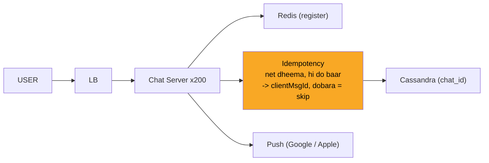
```
DIKKAT     Metro me net dheema. App ne "hi" bheja, timeout aaya, dobara bheja. Pehla pahunch chuka tha
           -> Ravi ko "hi" do baar.
HAL        IDEMPOTENCY: app har message ki apni id (clientMsgId), dobara bhejne pe WAHI.
           Server pe "pehle aaya?" + daalna EK kadam -> dobara aaya to naya message nahi.
NAHI       server id banaye: har dobara bhejna = nayi id = duplicate.
```
```
AAGE POOCHEGA:
  NIYAM: id APP banata, server sirf "pehle dekha?" poochhta.
  "Ek kadam kaise?"                -> Cassandra INSERT ... IF NOT EXISTS ("pehle nahi hai tabhi daalo", LWT),
                                      ya Redis SET NX (wahi kaam Redis me).
  "Kitni der yaad rakhoge?"        -> jitni der me koi dobara bhejta, jaise Redis EX 3600 = 1 ghanta.
  "Dobara pe kaunsi id lautegi?"   -> pehli baar wali; mere app me ek hi bubble.
```

#### 6 Meri ghadi 5 min aage, mere message upar chadh gaye
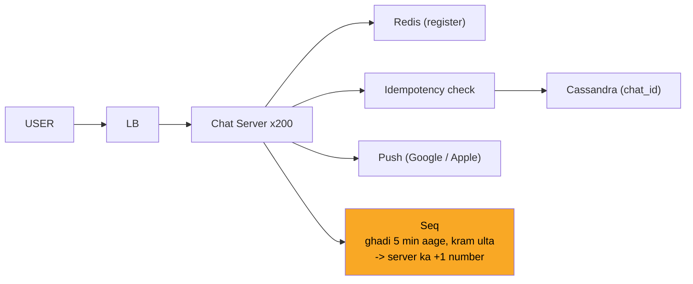
```
DIKKAT     Meri phone ki ghadi 5 min aage. Mere message chat me upar chadh gaye, Ravi ke jawab se pehle.
HAL        SEQ: kram server ka number tay karta, phone ki ghadi (msg_ts) nahi. Har chat ka apna +1 number:
           Redis INCR seq:chat123 (atomic: do message ek saath aayein to bhi dono ko alag number).
           Cassandra me andar kram ab seq; Ravi wapas: "meri aakhri seq 4417" -> 4418 se aage sab.
NAHI       Snowflake id se kram: do server ki ghadi me ms ka farak.
```
```
AAGE POOCHEGA:
  NIYAM: kram = server ka +1 number, har chat ka alag.
  "16 nahi aaya, app kya kare?"    -> 15 ke baad 17 = 16 chhoota; thoda ruko, phir "15 ke baad ke do".
  "Seq wala Redis restart?"        -> DB se chat ka sabse bada seq padh ke aage.
  "Kafka beech me?"                -> key = chatId; ek chat ka kram pakka, alag chat ka chahiye nahi.
  "Snowflake kis kaam?"            -> sirf pakki pehchaan (message_id), kram nahi.
```

#### 7 College Gang (500) me ek message, 500 baar likhein?
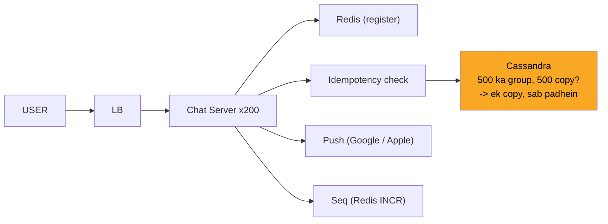
```
DIKKAT     "College Gang" me 500 log. Maine ek message bheja -> 500 logon ke inbox me 500 baar likhein?
HAL        Group ka message EK baar, group chat ke neeche. Sab wahi padhte.
           Online members: unke servers nikaalo, har SERVER ko ek baar "ye message, in members ko".
NAHI       Twitter jaisa har inbox me copy: wahan feed sabki alag + crore follower, group sabka ek.
```
```
AAGE POOCHEGA:
  NIYAM: sabke liye ek jaisa = ek copy; har kisi ka alag = alag copy.
  "300 online ko kaise?"           -> har server ko EK call, 300 alag call nahi.
  "Naya member, purane message?"   -> judne ke seq se pehle wale nahi (ya group setting).
```

#### 8 Ravi ne 50 padhe: unread aur neeli tick kaise
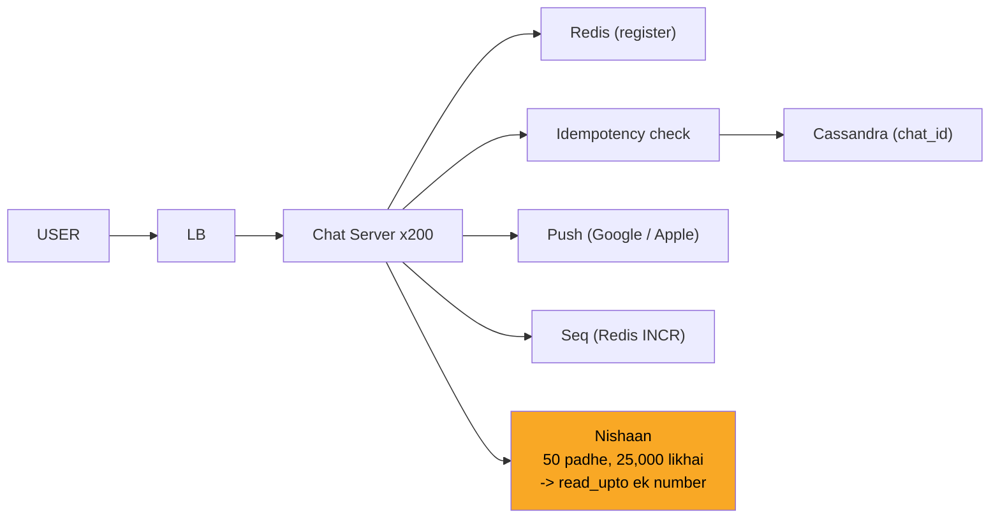
```
DIKKAT     Shaam ko Ravi ne chat khol ke 50 message padhe. Har message x har member ka "padha" record
           = 500 x 50 = 25,000 likhai. Bekaar.
HAL        NISHAAN: read_upto 4467 ("kahan tak padha"). Unread = aakhri seq - nishaan (ghatao, gino nahi).
           Neeli tick = ek push "read_upto 4467" -> 50 ek saath neeli.
NAHI       unread COUNT column badhao-ghatao: har message pe 500 member x 1 UPDATE, phir bhi 25,000 likhai.
```
```
AAGE POOCHEGA:
  NIYAM: nishaan khisakta hai, ginti nahi hoti; unread, tick, offline ke baad lena sab isi se.
  "Nishaan kahan?"                 -> Cassandra (user_id, chat_id) -> read_upto; baar-baar wala Redis me.
  "Do tick kaise?"                 -> delivered_upto: Ravi ka phone bolta "kahan tak mila".
  "'Mil gaya' raaste me kho gaya?" -> agli baar judte hi delivered_upto bhejta, nishaan aage.
  "Group me do tick kab?"          -> sab members ka delivered_upto >= seq; sabse chhota nishaan dekho.
  "10 lakh ka broadcast group?"    -> tick band, sirf unread; size ki had (product + engineering).
```

#### 9 Shaadi ka 200 MB video chat ke raaste
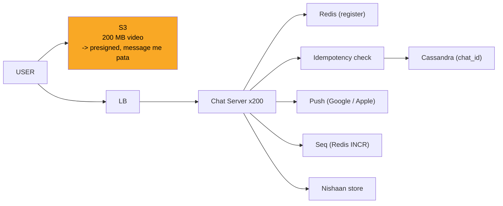
```
DIKKAT     Maine College Gang me 200 MB shaadi ka video chat server se bheja -> 2 min taar atka,
           server 500 x 200 MB = ~100 GB bheje.
HAL        PRESIGNED URL (server ka sign kiya 10 min ka paas): app video seedha S3 me daalta.
           Message me sirf S3 key + thumbnail. Group me ek upload, 500 ko wahi key.
NAHI       message me URL rakho: 10 min me khatam, kal link mara; KEY rakho.
```
```
AAGE POOCHEGA:
  NIYAM: bhaari maal S3 me, message me sirf pata.
  "Kholne pe link?"                -> server key se naya chhota URL banaye.
  "Wahi video 1000 forward?"       -> file ka hash; pehle se hai to wahi file (dedup).
  "E2E me thumbnail?"              -> server dekh nahi sakta; app encrypt kare, chaabi message ke saath.
```

#### 10 Raat ko online / last seen sabko kaise
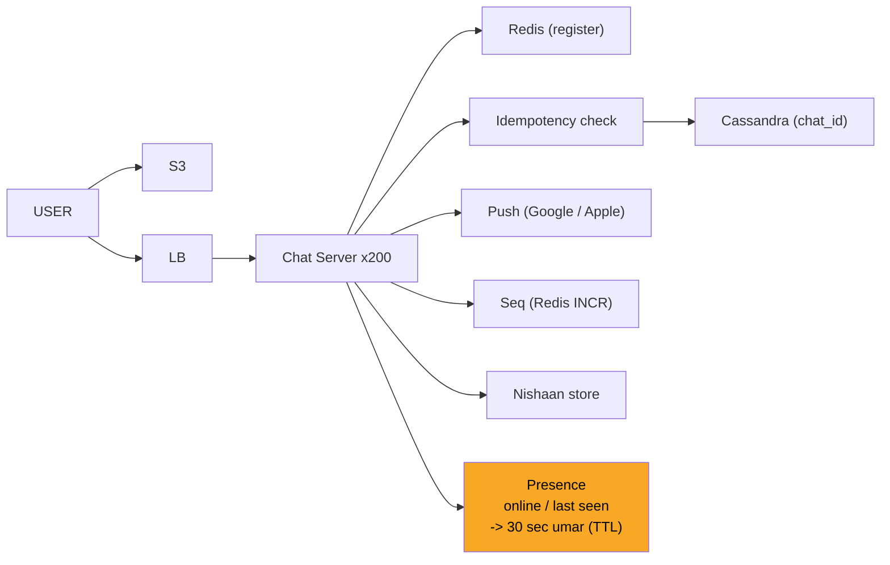
```
DIKKAT     Raat ko main online aaya, gaya. Har baar mere saare contacts ko batao = crore x 500 message.
HAL        UMAR (TTL): "Arpan online" Redis me 30 sec; app har 15 sec "hoon". Band = umar khatam = offline.
           Status tabhi dekho jab koi meri chat khole.
NAHI       DB me online column, har dhadkan pe UPDATE: crore log x har 15 sec = DB baith jaata.
```
```
AAGE POOCHEGA:
  NIYAM: status maango tab dekho; khud mitne wali key.
  "13 lakh dhadkan / sec Redis pe?" -> dhadkan chat server tak; server batch me Redis me daale.
  "Last seen?"                     -> usi key ka aakhri update; Ravi ne chhupaya to mat dikhao.
  "typing...?"                     -> sirf khuli chat; chhota event, store nahi.
```

---

## AAKHRI DABBA + WRAP (ek hi baar)

```
User -> LB -> Chat Server (khuli WebSocket, event loop)
-> Idempotency (clientMsgId) -> Cassandra (chat_id partition, andar seq; pehle LIKHO phir bhejo)
-> Redis (kaun kis server: umar + dhadkan) -> lene wale ka Chat Server -> lene wala
offline -> Push · wapas jude to "aakhri seq ke baad sab" · nishaan = delivered_upto / read_upto
media -> S3, message me sirf pata · online = Presence (TTL) · purana -> sasti jagah

DB:  message = Cassandra (partition chat_id, andar seq; message_id = Snowflake sirf pehchaan)
     zinda taar (connection) = server ki memory · pakka maal (message) = DB
```
```
JAWAB:    Har user ~200 me se ek server se juda, Redis me likha kaun kahan.
          Message ki id se do baar nahi, pehle DB me (chat ke hisaab se baanta), phir lene wale ke
          server tak. Offline ho to DB me pada + push, jude to 'aakhri seq ke baad'.
          Tick aur unread = har user ka nishaan, online = umar wali Redis key, video S3 me, message me
          sirf pata.
```
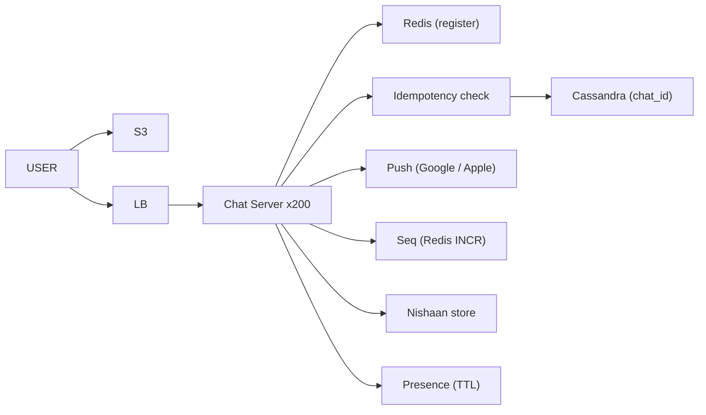

---

## 10 GUNA TRAFFIC — har dabba alag se

```
Chat Server   -> 2 crore khuli = ~200 machine sirf taar pakadne · event loop, warna thread khatam
REGISTER      -> memory me, server gira to gaya -> Redis me umar wali entry + dhadkan
DOBARA JUDNA  -> ek server gira = 1 lakh ek saath -> ruk-ruk ke + random (backoff + jitter)
                 · deploy pe draining
Cassandra     -> chat_id partition · garam group -> speed ki had · purana sasti jagah
Push          -> Google / Apple bahar ki cheez -> apna retry / queue
Redis         -> copy, ALAG AZ · message store ki bhi copy, alag AZ

POOCHEGA: "How would you scale this to 10x?"      -> user ka raasta chalo, pehle jo toote
POOCHEGA: "What's the single point of failure?"   -> chat server (dobara judo), Redis (copy)
POOCHEGA: "How do you know it's working?"
          -> pahunchne ka p99 · har machine pe khuli connection · dobara judne ki dar · push fail · alert
```

---

## POOCHE TO (gehra sawaal aaye tab)

```
API:      GET /connect (BAND nahi hoti — WebSocket) · POST /messages { chatId, text, clientMsgId }
          GET /messages?chatId=&before= (wapas lena + history, cursor)
          POST /chats/{chatId}/read { read_upto } (tick)

DO DUNIYA:  ZINDA TAAR (memory, ek server ki, mar sakti) = register
            PAKKA MAAL (DB, sab jagah se dikhta) = message
            taar ko Redis me rakhne ki koshish — ho hi nahi sakta, Redis me sirf PATA
            ek user -> KAI taar (phone + laptop + tab)

JAD KI BAAT — chat baaki har design se KYUN alag:
   ab tak (url shortener, feed, payment, banking): user ne MAANGA -> server ne diya -> connection BAND
   chat: Arpan ne bheja -> Ravi ne kuch nahi maanga -> phir bhi Ravi tak TURANT
   HTTP me server sirf JAWAB de sakta, khud AWAAZ nahi laga sakta -> do nayi cheez:
   1. CONNECTION KHULI rakhni (WebSocket — ek baar judo, dono taraf baat)
   2. REGISTER "kaun kis server se juda hai" (200 chat server, Ravi kis se?) -> yahi chat ka DIL
```

---

ARCHETYPE D (real-time) · CONCEPTS: [message-queues](../../FOUNDATIONS/07_message_queues.md) · [sharding](../../FOUNDATIONS/06_database_sharding.md) · [Snowflake id](../../FOUNDATIONS/13_distributed_id_snowflake.md) · [CAP](../../FOUNDATIONS/08_cap_theorem.md) · [← SYSTEM_DESIGNS](..) · [← Home README](../../../README.md) · [← MASTER SHEET](../../00_MASTER_SHEET.md)
