# Chat / messaging: Arpan, Ravi aur college-gang ki kahani

Arpan apne dost Ravi ko "kahan hai?" bhejta hai, aur dono "college-gang" group me hain jisme 500 log hain. Kaam:
message turant pahunche, Ravi ka phone band ho to bhi baad me mile, kram na bigde, do baar na dikhe, aur tick,
unread, video, online sab chale.

Har kadam = **kahani** (dikkat aur hal, bolne wali bhasha) -> **Asli naam** (interview me yahi shabd) -> tasveer
(kahani ka shabd, bracket me asli naam).

---

## FR / NFR / Numbers (interview me pehle 2 minute)

```
FR      1-to-1 chat + group (500 tak) · Ravi offline ho to baad me mile · tick (pahuncha / padha) + unread
        · photo / video · online / last seen (E2E encryption, call: scope se bahar)
NFR     message turant (1 sec se kam) · kabhi na khoye · ek chat me kram na bigde · do baar na dikhe
Numbers 50 crore user, ek waqt ~10 crore online = 10 crore khule taar -> ~100 chat server
        roz ~400 crore message = ~46,000 likhai / sec, ek message ~300 byte -> roz ~1.2 TB
```

---

## 1. Ravi ka phone har second poochh raha (beech ka dabba, khula taar)

Arpan ne Ravi ko "kahan hai?" bheja. Ravi ka phone har second server se poochhta "mere liye kuch aaya?". 10 crore log
aise poochh rahe, 99% baar jawab "kuch nahi", server poochne walon se hi dab gaya. To server ko poochne ka mauka hi na
do. Kisi ne kuch bheja to seedha bhej do, bas kaam khatam. Beech me aisa dabba rakh do jo jaise hi kuch aaya, turant
doosre bande ko bhej de. Phone band, net nahi, aise pench aage dekhte.

**Asli naam:** har second poochhna = polling (band), beech ka dabba = chat server, khula taar = WebSocket (ek baar
khula, band nahi hota, server khud push karta). Server pe har khula taar memory khaata hai, isliye event loop (Netty):
kuch hi thread, sirf jis taar pe message aaya use sambhalo.

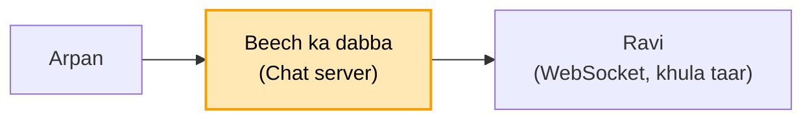

## 2. Ravi ka phone band, 2 ghante baad on (dabbe me sanjo lo)

Arpan ne "kahan hai?" bheja, par Ravi ka phone band, 2 ghante baad on hoga. Taar toota pada hai, server ke haath me
message hai, bhejne ki jagah nahi. To server se bol do, ise thodi der apne paas aisi jagah rakh le jahan baad me dekh
paaye. Ek dabba bana le, usme rakh lo: "Arpan ne Ravi ko ye bheja hai." Ravi online hoga to use bhej denge, sanjo lo.
Jaise papa ne mujhe paise de ke kahin bheja, aur uncle ji mile nahi, to main paise apne paas hi rakhunga, kharch ya
phenk thodi dunga.

**Asli naam:** dabba = message store (har message pehle DB me save, phir bhejo; pehle bhejte aur save se pehle gira
to message gaya), online hoga to bhej denge = offline delivery. DB = Cassandra, `chat_id` se baanta: likhai bahut
(46,000 / sec, roz 1.2 TB), padhai hamesha ek chat ki ("aakhri 50 do"), na join na transaction. Ek chat ke saare
message ek machine pe, kram me.

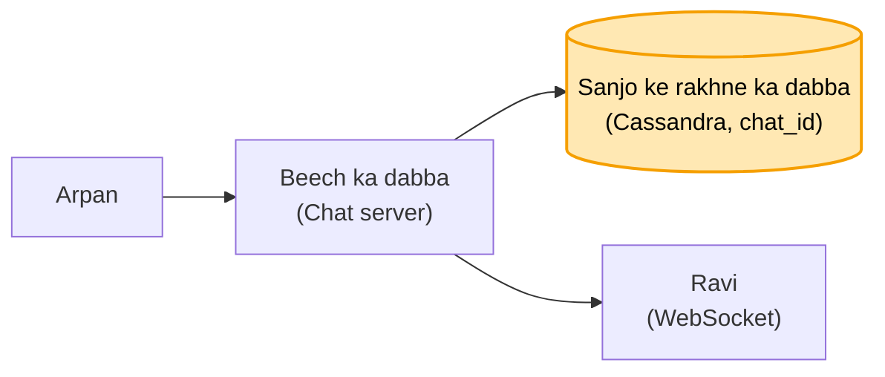

## 3. 100 server, Ravi kis pe? (DSA wala map)

10 crore log, ek server sabke taar nahi pakad sakta, 100 server lage. Arpan ka taar server 3 pe, Ravi ka server 71
pe. Server 3 ko pata hi nahi Ravi kis server pe. To ek map rakh le apne paas, DSA wala map: ye is server pe hai, ye us
server pe. Dhoondhne ki zaroorat nahi, O(1) time me mil gaya. Key-value pe rakh lo.

**Asli naam:** DSA wala map = session map Redis me (`ravi -> server 71`, userId -> server), O(1) me mil gaya = seedha
lookup. Taar toota to server 71 map se Ravi ki entry mita deta.

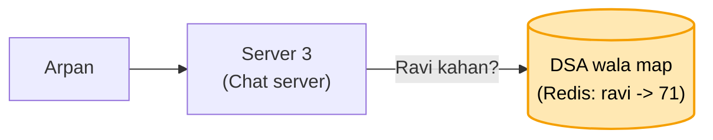

## 4. Server 71 tak message kaise? 100 x 99 taar (chhota ladka)

Server 3 ko pata chal gaya Ravi server 71 pe. Par message 71 tak pahunche kaise? Har server baaki 99 se seedha taar
jode to 100 x 99 taar, kal 500 server to aur zyada. Ravi online hai, hume pata hai wo kis server pe. To maan le
saamne 10 ladke khade, maine ek chhote ladke ko kaha: "jo address tere paas hai, use le ke chala ja, wahan koi aadmi
hoga, use ye pakda de." Wo dekhega "haan bhai, ye wo ladka hai", aur message pakda dega.

**Asli naam:** chhota ladka = Redis pub/sub: har server apne naam ka channel sunta (`server-71`), server 3 us channel
pe publish karta. Wahan wale ko pakda de = server 71 apne channel se le ke Ravi ke taar pe bhejta.

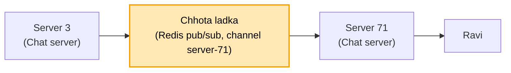

## 5. 500 logon ka group, ek message ke 500 kaam (ek dabbe me ek baar)

Arpan ne 500 logon ke group me "kal party hai" bheja. 500 log 60 server pe bikhre. Har member ke liye alag message
likhein to ek message ke peeche 500 kaam, aur aise messages har second. To use ek dabbe me rakh lo, 500 log khud
aayenge sunne. Kahin rakh do, 500 log jab chahe apna aake sunte rahenge.

**Asli naam:** ek dabba = group message DB me sirf ek baar (`chat_id = college-gang`), 500 log khud aayenge sunne =
members wahi ek message padhte, 500 copy nahi. Group bhi bas ek chat hai jisme 2 ki jagah 500 log; members ki list se
online walon ko map + pub/sub se bhejo, baaki wapas aayein to dabbe se.

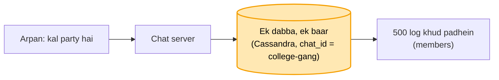

## 6. Lift me "hi" dobara gaya, Ravi ko "hi hi" (ek key)

Arpan lift me, Ravi ko "hi" bheja. Message server pe save ho gaya, par "pahuncha" wala jawab lift me kho gaya. Phone
ko laga gaya hi nahi, "hi" dobara bheja, Ravi ko "hi hi". Message Ravi ke paas chala gaya, par hum lift me the to jawab
hamare paas nahi aaya. To jab network aaye tab bol do "haan bhai, chala gaya", double tick dikha do. Aur message ek
baar issue karwao, doosri baar discard kar do. Ek key rakh lo: "hi" aaya, iske paas ek key hai. Doosra aaya, same
person ko ja raha aur key same hai, to mana kar do: "ye message chahiye nahi, tera pehla ho gaya."

**Asli naam:** key = `clientMsgId` (idempotency key; phone Send dabate hi banata, jaise `m-501`, dobara bhejne pe
wahi; ye banking wali idempotency key hi hai). Key same = dupe copy chhodo, DB me dobara mat likho. Network aaye to
double tick = "pahuncha" ka jawab (ack) dobara bhejo.

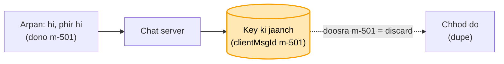

## 7. Group me "kahan?" pehle dikha, "kal party" baad me (server lagayega number)

Group me Arpan ne "kal party" bheja, usi second Ravi ne "kahan?". Kuch members ko "kahan?" pehle dikha, aur dono phone
ki ghadiyan bhi 2 second aage-peeche. To numbering kar do: jisne pehle bheja uska pehla aayega, saaf seedhi baat. Par
number phone nahi lagayega, phone lagayega to clash ho jaayega. Phone ko thodi pata kaunsa message pehle aaya, phone
to bas message bhejne wala banda hai. Server ko pata hai kaunsa pehle aaya, kis time aaya. Server lagayega number.

**Asli naam:** numbering = sequence number, server ka, har chat ka apna (`#980`, `#981`; Redis `INCR seq:college-gang`,
ek saath aaye to bhi do alag number). Phone ko thodi pata = phone ki ghadi pe bharosa nahi. Wapas jude Ravi ko jo
nahi gaya wo sab server apne record se deta (neeche "Maan lo #980"), aur phone isi number se sort karta. Redis restart hua to ginti peeche se shuru na ho: us chat ka
aakhri number Cassandra se padh ke wahin se aage.

**Maan lo #980 ka DB save atka, #981 pehle pahunch gaya, Ravi ka phone "aakhri #981" yaad rakhe aur reconnect pe "#981 ke
baad do" bole:** #980 chhoot jaata. Par server chootiya nahi: har user ka record rakhta, ye gaya ye nahi gaya. Ravi wapas
aaya to server apne record se jo nahi gaya wo sab bhejta, phone ke aakhri number se nahi. Message milega hi; kram thoda
hile to phone number dekh ke sort kar de. Kram kitna strict chahiye, FR me pehle tay (WhatsApp me ek aage-peeche chalega).
**Asli naam:** har user ka delivery record (store-and-forward, pending list), reconnect pe pending sab, sequence number se
client-side ordering, ordering = requirement ka faisla.

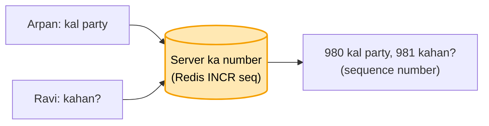

## 8. "12 naye message" (ek ginti)

Ravi ko unread ginti dikhani hai, "12 naye message", group me 980 message, 500 member. To ek ginti rakh lo, Redis me ya
map me ya DB me: Ravi ne itne message padh liye. 968 tak padh liye, aakhri 980 hai, to neeche 12 aur hain, wo 12 ke 12
turant uske phone me daal do.

**Asli naam:** ginti = `last_read_seq` (kahan tak padha, har member ka har chat me ek number), 12 aur hain = unread =
aakhri number minus `last_read_seq` (980 - 968 = 12).

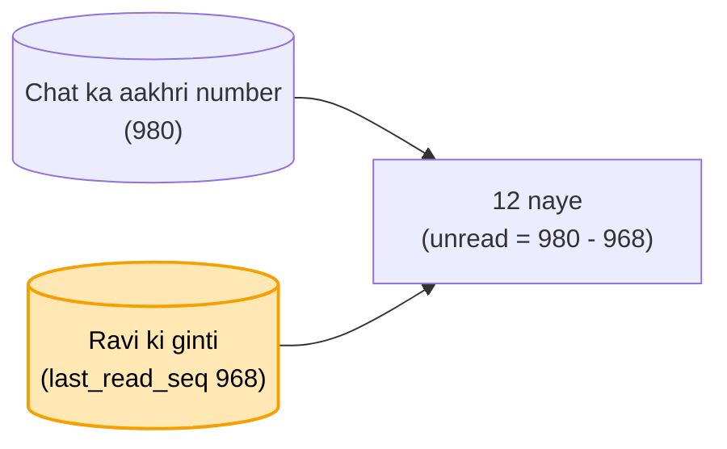

## 9. #975 kisne padha? 4.9 lakh line (number ghata lo)

Arpan ne #975 "kal party" bheja, Info me dekhna kis-kis ne padha. Har message x har member ki line = 980 x 500 = 4.9
lakh entry. Group me double tick aata hai, Info me jaake dekhte hain kisne padha. Sita ka number 978, iska matlab Sita
ne 975 padha, tabhi uski ginti 978 hui. Ravi ka 968, matlab wo bahut der se offline hai, ya pahuncha to usne ye message
read nahi kiya. Number ghata lo, isse pata pad jaayega kisne padha, kisne nahi.

**Asli naam:** ginti 978 matlab 975 padha = read watermark (number >= 975 to padha), number ghata lo = har member ka
bas ek number, 4.9 lakh ki jagah 500 number. Neeli tick tab jab sabka number >= 975.

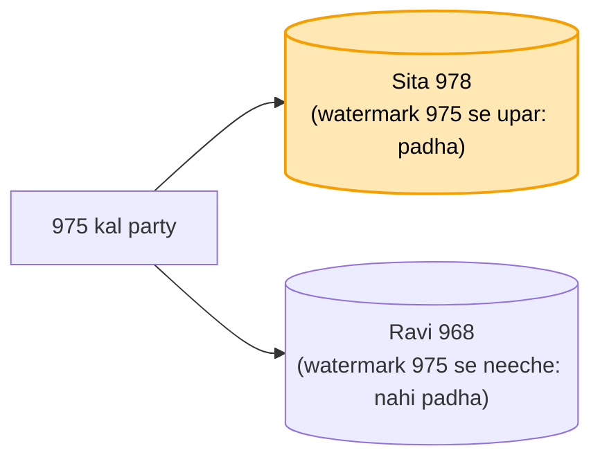

## 10. 200 MB ka video, chat ke taar jam (alag raasta, chhota URL)

Arpan ne group me party ka 200 MB ka video bheja. Ye chat server ke raaste DB me save hota aur 500 ko isi raaste
jaata. Taar chhote text ke liye bane the, video ne sab jam kar diya. Aaj 200 MB, kal koi 500 MB ya 1 GB bhi bhej
sakta. To ise yahan se hatao, alag raaste pe bhej do. Ek alag machine rakh lo: "tu video hai, tu idhar ja", hamari
chat block na kare. Video wahin pada rahe, uska ek chhota URL bana ke sabme bhej do, wo wahin se dekh lenge. Ek insaan
bitha do: "video aayi, mere paas aa ja, main chhota URL bana ke bhej deta hoon", chat server pe koi dikkat nahi.

**Asli naam:** alag machine = S3 (chat server ke bahar), "video aayi, mere paas aa ja" wala insaan = Media Service
(app ko S3 ka presigned upload URL deta, app video seedha S3 me daalti, phir chhota link banta), chhota URL = message
me sirf link, wahin se dekh lenge = video S3 / CDN se. 500 log dekhein to bhi video ki copy ek hi.

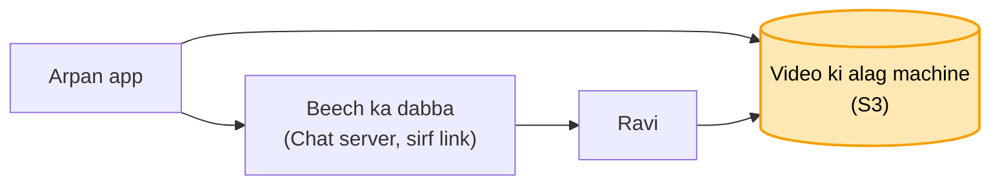

## 11. Phone band par "online" dikh raha (register + hilao)

Ravi ke naam ke neeche "online". Ravi ka phone lift me band, taar tootne ka signal server tak pahuncha hi nahi, 2
ghante se Ravi "online" dikh raha, phone band pada. To ek register me likh liya "Ravi online hai". Ab har 3-5 second
baad Ravi ko hilaunga, haath maarunga: "Ravi, tu online hai?" "Haan bhai, online hoon, pareshaan mat kar." Phir haath
maara, jawab nahi diya. Phir maara, phir nahi. 2-3 baar hilaya aur jawab nahi diya, to register se Ravi ka naam kaat
diya, ab wo offline.

**Asli naam:** register = presence entry (Redis), har 3-5 second hilana = heartbeat, 2-3 baar jawab nahi to naam
kaato = entry ki umar (TTL), heartbeat chhoote to apne aap mite. Aakhri heartbeat ka time = "last seen".

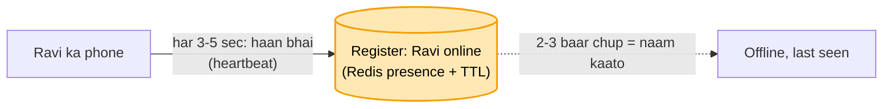

## 12. "Nahi, parso" pehle, "kal milte hain" baad me (phone number se kram lagaye)

Ravi ne Arpan ko "kal milte hain" phir "nahi, parso" bheja. Pehla server S1 se gaya, doosra S2 se, S1 dheema tha.
Arpan ke phone pe pehle "nahi, parso" aaya, phir "kal milte hain", Arpan galat samjha. To pehle to koshish karo ki ek
chat ke dono message ek hi server se jaayein. Phir bhi alag server se gaye, to bhi hume pata hai server pe pehle kaun
aaya tha: "kal milte hain" pehla, "nahi, parso" doosra. Pehle aaya wo pehle dikhe, aisa mat rakho. Jab dono phone pe
pahunch jaayein, phone unhe sahi kram me laga ke dikhaye. Aur S1 bahut dheema ho to S2 wale ko rok ke nahi rakhenge,
message to jaana hi hai. Thodi der ulta dikh sakta hai, phir apne aap theek ho jaata, WhatsApp me bhi aisa dekha hai.
Perfect jawab nahi hai.

**Asli naam:** server pe pata kaun pehle aaya = har chat ka sequence number (kadam 7), phone sahi kram me lagaye =
client number se sort kare, aane ke kram se nahi. Dheeme ke liye doosra mat roko = deliver turant, baad me reorder.

**Maan lo interviewer kheeche: number kaun lagayega, aur ye kabhi khatam to nahi hoga:** message server pe jis time
aaya, usi time ko number bana do; time hamesha badhta hai, to number bhi, aur phone usi se kram lagata hai. Par "kabhi
khatam nahi hoga" jaisa daava mat karo: interviewer "maan lo 50 saal me bhar gaya to?" kheench sakta hai aur point
wapas lena padta hai. Seedha dhaancha bolo: har message ko ek kram number, phone usi se lagata hai. Asli naam: time se
number = Snowflake ID (time + machine + chhota counter, FOUNDATIONS 13), ya har chat ka sequence number. Had yaad ho
to bonus: long (64-bit) me lagbhag 92 lakh crore crore (9.2 x 10^18), counter har chat ka alag; warna "padhte waqt
dekha tha, baaki net se dekh lete".

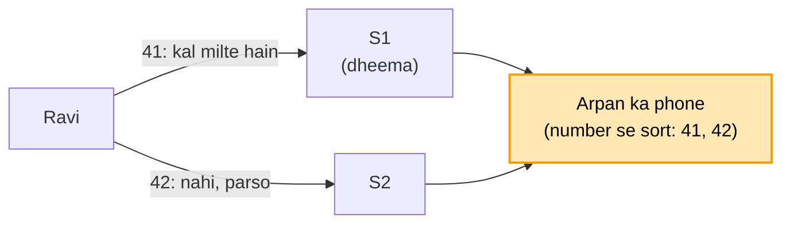

---

Notes (Arpan ke shabd) = [CHAT_HAND_NOTES.md](CHAT_HAND_NOTES.md)
