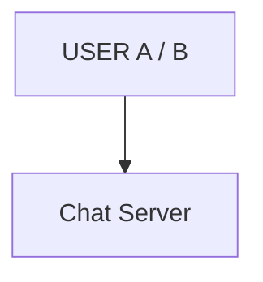
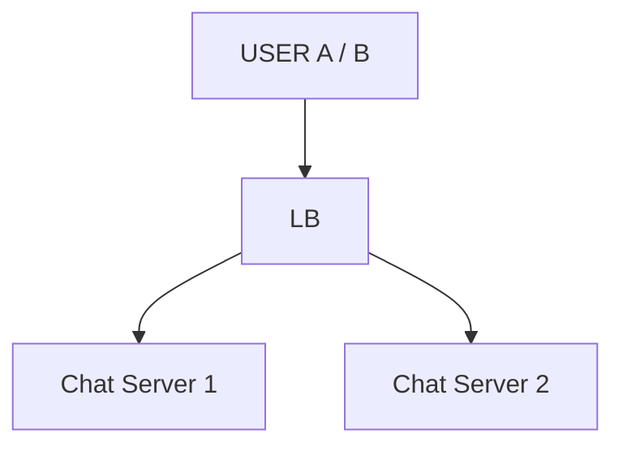
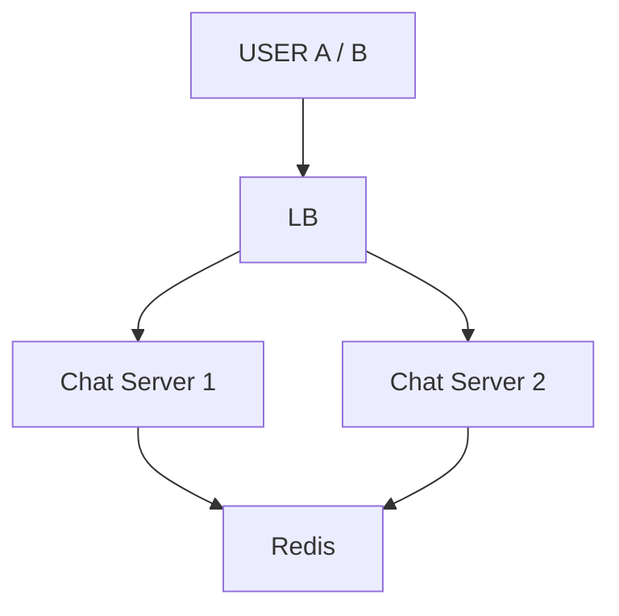
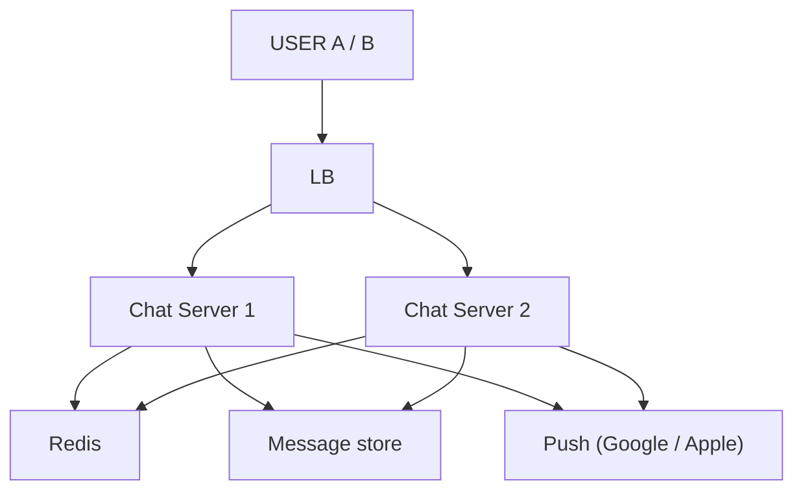
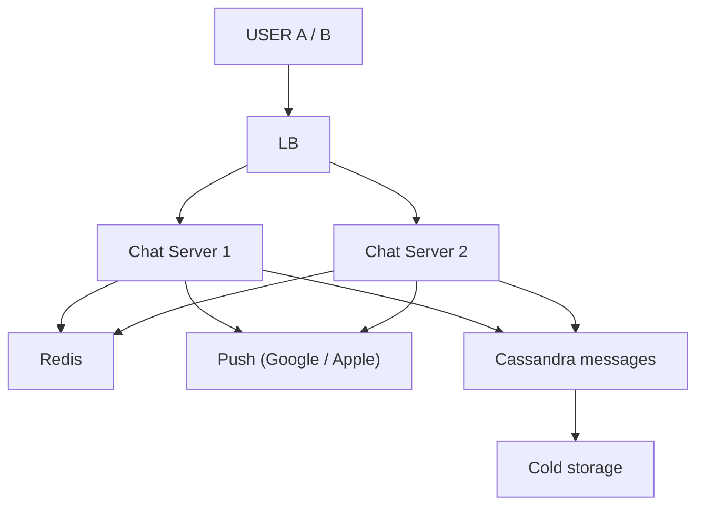
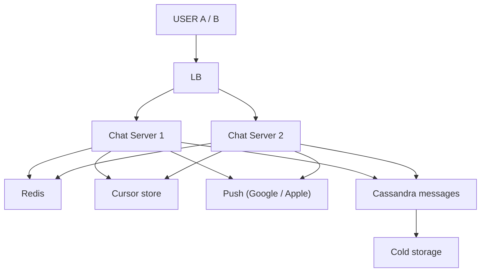
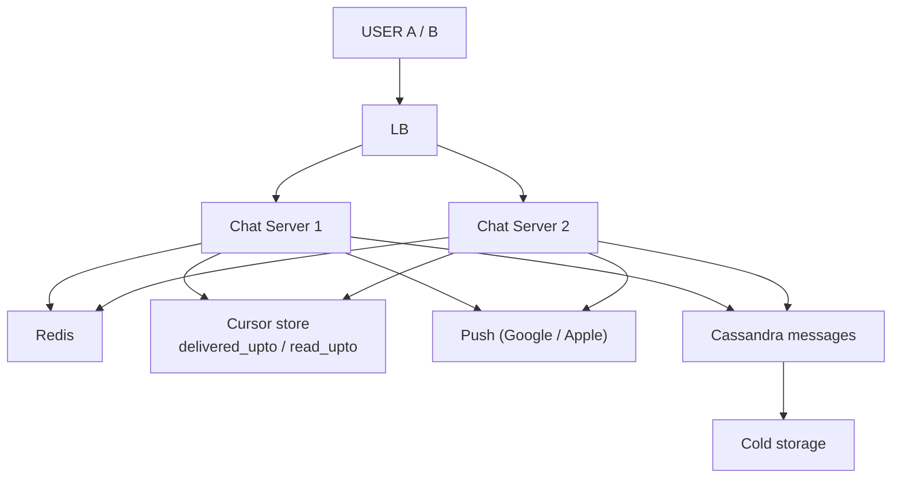
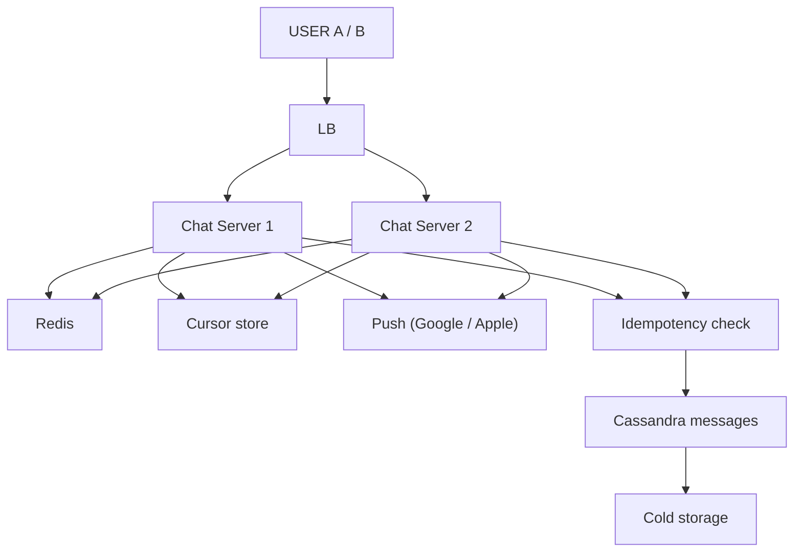
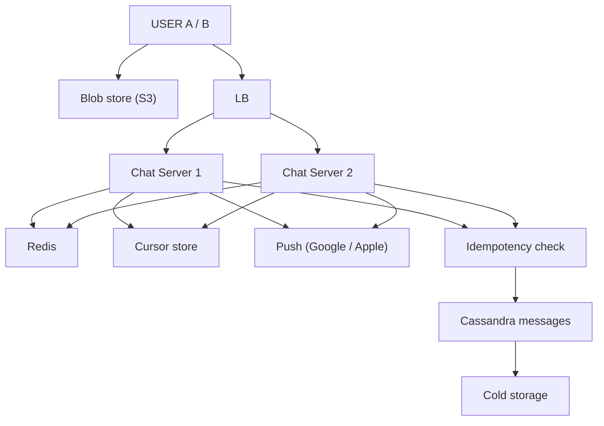
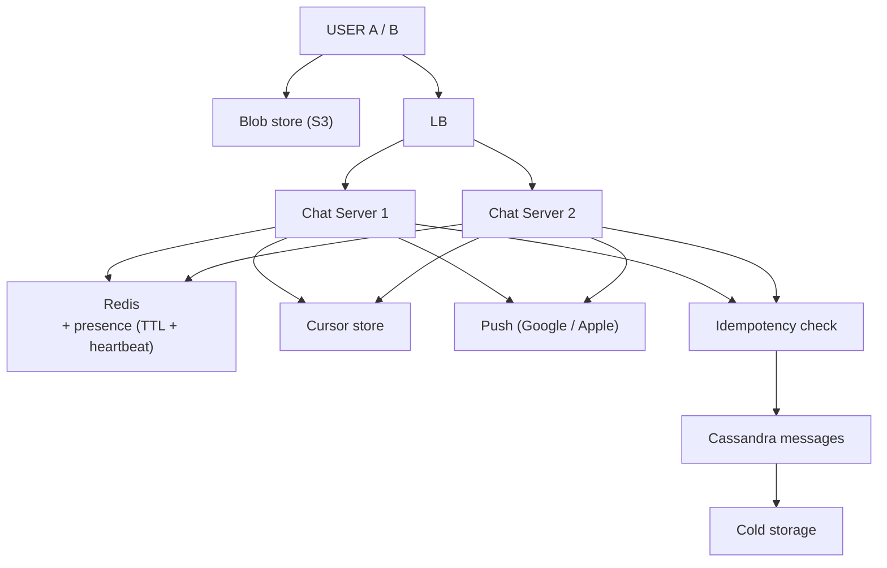

# Chat / Messaging System

> Arpan ne message bheja -> Ravi tak TURANT, chahe Ravi ne kuch na maanga ho · Ravi offline ho to baad me mile · kuch na khoye.
> Is design ka dil: **"banda KAHAN juda hai"** (baaki designs me "data kahan rakhein") + **khuli connection**.
> Ye design ek chhota server aur do browser tab chala ke bana (21-Sep; demo ka code repo me nahi rakha). Jahan aankh se dekha, wahan **★ DEKHA:**

```
JAD KI BAAT — chat baaki har design se KYUN alag:
   ab tak (url shortener, feed, payment, banking): user ne MAANGA -> server ne diya -> connection BAND
   chat: Arpan ne bheja -> Ravi ne kuch nahi maanga -> phir bhi Ravi tak TURANT
   HTTP me server sirf JAWAB de sakta, khud AWAAZ nahi laga sakta -> do nayi cheez:
   1. CONNECTION KHULI rakhni (WebSocket — ek baar judo, dono taraf baat)
   2. REGISTER "kaun kis server se juda hai" (200 chat server, Ravi kis se?) -> yahi chat ka DIL
```

---

## TASVEER (ByteByteGo / Alex Xu · CC BY-NC-ND 4.0)


Source: [What is the Journey of a Slack Message?](https://bytebytego.com/guides/what-is-the-journey-of-a-slack-message/)
(ek message bhejne wale se lene wale tak — WebSocket, server, fan-out)


Source: [Short/long polling, SSE, WebSocket](https://bytebytego.com/guides/shortlong-polling-sse-websocket/)
(chat me WebSocket kyun — polling / long polling / SSE se farak)

---

## SHURU: pehle poocho, phir numbers

```
POOCHO (6, inme 2 poora design badalte):
   1. 1-to-1 ya GROUP? (group = ek message, 500 jagah pahunchana)
   2. ★ HISTORY kahan, kitni der? WhatsApp = phone pe, pahunchte hi server se DELETE (server = DAAK-GHAR)
                                  Slack = server pe HAMESHA, 3 saal purana bhi search
                                  -> ye EK jawab jagah ~zero se ~440 TB / saal kar deta
   3. ★ END-TO-END encryption? haan -> server message PADH
      hi nahi sakta -> server pe search khatam · naya member
        purane message nahi dekh sakta · chaabi ka poora system — sabse bada scope badalne wala
   4. TICK? ek tick (server tak) · do tick (phone tak) · neeli (padh li) · online / last-seen
      har tick ek ULTA message -> traffic kai guna
   5. MEDIA? message ke saath nahi, alag S3 me, message me sirf PATA
   6. OFFLINE banda? message kahan ruke, kab tak, push notification?

MAAN KE CHALO (bol ke): 1-to-1 + chhote group (500 tak) · history SERVER pe (Slack jaisa, design zyada dikhta)
                        · E2E abhi NAHI ("scope se bahar") · tick: bheja / pahuncha / padha

KYA KARE (FR):    1-to-1 · group 500 · offline ko baad me · purani history · tick · online / last-seen
                  scope bahar: E2E · voice / video · bade broadcast group
KAISA CHALE (NFR): TURANT (<1 sec) · KABHI na khoye · ek chat ke andar KRAM na bigde · DO BAAR na dikhe
                   · 2 crore EK SAATH jude · server gire to doosra sambhale

NUMBERS (andaaza):
   50 crore user, 10 crore roz · har ek 40 message / din -> ~400 crore / din
   LIKHNA: 400 crore / 86,400 second ~ 46,000 / second (bheed me 2-3 guna ~1.5 lakh)
   ONLINE ek waqt ~2 CRORE KHULI CONNECTION  <- ★ asli paimana ("kitni request / second" nahi,
          "kitni connection KHULI" — har khuli connection memory khaati, message aaye ya na aaye)
   JAGAH: 400 crore x ~300 byte ~ 1.2 TB / din -> 1 saal ~440 TB (Slack jaisa) · WhatsApp jaisa ~ZERO

TEEN FAISLE:
   1. CONNECTION ki apni line: 2 crore / ~1 lakh har machine = ~200 CHAT SERVER (sirf taar pakadte)
      -> API / business server se ALAG · event loop (Netty jaisa), "ek connection = ek thread" nahi
   2. JAGAH ek machine ki NAHI (banking ka ulta: wahan 120 /
      sec, yahan 46,000 / sec + 1.2 TB roz) — DB card 4 me
   3. HISTORY kahan (sawaal 2) se jagah ka dhaancha tay hota — yahan SLACK jaisa

DO CHEEZ JO DESIGN CHALATI:
   CONNECTION (khuli) = har online user ka taar, isi raaste server user tak pahunchta
   REGISTER (kaun kis taar ke peeche) = MEMORY me, DB me nahi (taar khud memory me hai)
```

---

## ════ MOCK SE PEHLE: SIRF YE CARD PADHO ════

> Har card: DIKKAT 1 (kya toota) -> HAL (kya kiya) -> diagram -> DIKKAT 2, 3 ... (interviewer ke
> agle sawaal) har ek ke neeche uska HAL. Revise: sirf baayein column padho.

#### DABBA 0: SABSE SIMPLE, EK SERVER DO USER (yahan se shuru, phir "kahan tootega")
```
DIKKAT 1   Ek hi chat server. Arpan aur Ravi dono usse jude.
           Ravi ne kabhi nahi poochha "koi message aaya?", phir bhi Arpan ka "hi"
           Ravi ki screen pe aa gaya. Kaise?
HAL        Arpan ne /connect?user=Arpan khola -> ye connection BAND
           NAHI hota -> server ki register me: Arpan -> penArpan
           Ravi ne /connect?user=Ravi khola -> register: Ravi -> penRavi
           Arpan ne /send?to=Ravi&text=hi (normal request) -> server: register.get("Ravi") -> penRavi me likho
           -> Ravi ki screen pe "Arpan: hi".
           pen = data nahi, Ravi tak PAHUNCHNE KA RAASTA. Message Ravi ke PURANE khule taar se gaya.
           ★ DEKHA: Ravi ki screen pe message aa gaya, Ravi ne kuch maanga hi nahi.
           Screen pe "JUD GAYA — ye connection ab khuli padi hai", console pe
           `[JUDA] Ravi   register ab = [Arpan, Ravi]`
```

```
DIKKAT 2   "Client aur server thodi-thodi der me baat karte rehte" bola to?
HAL        Ye POLLING hai, galat shabd. WebSocket = ek baar judo, connection KHULA rehta, server ko jab bhi
           dena ho usi taar pe TURANT bhej deta.

DIKKAT 3   WebSocket kyun, polling / long polling / SSE kyun nahi?
HAL        Polling = har 5 sec "kuch aaya?", 100 me 1 kaam ki · long polling =
           har message ke baad naya request
           · SSE = sirf server -> user (ek taraf) · chat me dono taraf, turant -> WebSocket

DIKKAT 4   Net chupchaap chala gaya, server ko kaise pata?
HAL        Ping / pong (dhadkan); jawab na aaye to connection band, register se hatao
```

#### 1 DO CRORE CONNECTION KHULI, MEMORY KHATAM
```
DIKKAT 1   Har online user ka connection hamesha khula. Ek connection ~30 KB -> 1 lakh connection = ~3 GB
           sirf pakad ke rakhne me. Purane tareeke me har connection ka ek thread (~1 MB) -> 1 lakh =
           ~100 GB. Server khatam.
           ★ DEKHA: server ki thread ginti jaan-boojh ke TEEN rakhi. Teen connection ne jagah bhar di,
           chautha "send" server tak pahuncha hi nahi.
HAL        WEBSOCKET + EVENT LOOP (Netty jaisa): kuch hi thread, lakhon connection. ~200 chat server, aage LB.
           OS (epoll) batata "in 5 connection pe data aaya" -> thread sirf unpe kaam karta.
           Baaki 99,995 chup baithe connection ka koi kharcha nahi (sirf thodi memory).
```

```
DIKKAT 2   Ek chat server gir gaya?
HAL        Users RUK-RUK ke + thoda random time pe dobara judein (backoff + jitter), warna 1 lakh ek saath
           doosre server pe tootein. Message to bhejne se pehle DB me likha jaata (aage card 3), to jud ke
           "aakhri mile message ke baad wale do".

DIKKAT 3   Naya code deploy karna?
HAL        Thode-thode server, pehle unke connection dheere hatao (DRAINING). Sab ek saath restart = lakh log
           ek saath toote.

DIKKAT 4   LB lambi connection kaise bithata?
HAL        Connection ek baar kisi server pe baitha, phir wahi rehta. Naya connection = naya chunaav.
```

#### 2 ARPAN SERVER-1 PE, RAVI SERVER-7 PE
```
DIKKAT 1   Ab 200 chat server. Arpan server-1 se juda, Ravi server-7 se. Arpan ne "hi" bheja -> server-1 ne
           apni register dekhi -> usme sirf apne log -> bola "Ravi OFFLINE", jabki Ravi online tha.
           ★ DEKHA: wahi program do port pe chalaya. Arpan ki screen `(server bola: Ravi OFFLINE hai)`,
           Ravi us waqt online.
HAL        Redis me SAANJHA REGISTER: "Ravi -> server-7" (har server apne jude users wahan likhta).
           Arpan ka server Redis se poochhta Ravi kahan, server-7 ko message deta, server-7 Ravi ko.
           Entry ki umar (TTL): server zinda hai to dhadkan se badhata rehta, server mara to entry khud hat
           jaati. Connection (zinda taar) Redis me ja hi nahi sakta, Redis me sirf PATA.
```

```
DIKKAT 2   Register me Ravi ka server galat (Ravi abhi doosre pe khiska)?
HAL        Koi baat nahi: message DB me hai -> Ravi naye server pe judte hi le lega.

DIKKAT 3   Redis hi gir gaya?
HAL        Copy pe switch. Beech me seedha bhejna ruka, par message DB me
           -> push + dobara judne pe pahunchega.

DIKKAT 4   Redis pub-sub se kyun nahi bhejte?
HAL        Chal sakta (har user ka channel, sirf server-7 sunta). Par pub-sub kuch rakhta nahi, aur Redis
           Cluster me har publish sab node pe ghoomta. Register se seedha server-7, message DB me pakka.
```

#### 3 RAVI OFFLINE, MESSAGE KAHAN JAAYE?
```
DIKKAT 1   Ravi ka phone band, koi connection hi nahi. Galat soch: "pehle Ravi ko bhejo, na pahunche to DB
           me daal do" -> bhejne aur DB ke beech server gira = message gaya.
HAL        Message PEHLE DB me likho, phir Ravi ko bhejne ki koshish.
           Ravi offline -> message DB me pada, Ravi ke phone pe PUSH (login pe device token save -> FCM /
           APNs ke through, app band ho tab bhi ghanti).
           Har chat me har message ka ek +1 number (SEQ, server deta). Ravi wapas aaya: "meri aakhri seq 4417,
           uske BAAD ke do" (nishaan Ravi ka app rakhta, Kafka offset jaisa) -> server 4418 se aage bhejta.
```

```
DIKKAT 2   Ravi ke 3 device (phone, laptop, tab)?
HAL        Har device ka apna connection + apna nishaan. Message sab pe, ek pe padha to baaki pe bhi neeli.

DIKKAT 3   Push me poora message bhejo?
HAL        Chhota preview / "naya message" (privacy). Asli message app khulne pe server se.

DIKKAT 4   Kuch na khoye, poora jawab?
HAL        DB pehle + Kafka ho to acks=all, kaam ke baad offset, message id se dobara-safe, fail -> DLQ.
```

#### 4 ROZ 1.2 TB, 46,000 LIKHAI / SECOND
```
DIKKAT 1   Roz ~1.2 TB message, 46,000 likhai / second. Ek DB machine nahi jhelegi. Kis cheez se baantein?
HAL        Cassandra, CHAT ke hisaab se baanta: partition = chat_id, andar kram = seq (har chat ka +1
           number, server deta). Likhai sab machines pe bat jaati.
           Padhna hamesha "IS CHAT ke aakhri 50" -> ek jagah, ek baar:
             WHERE chat_id = ? AND seq < 4417 ORDER BY seq DESC LIMIT 50 (keyset, OFFSET nahi)
           message_id = Snowflake [time ms | machine id | us ms me ginti] -> sirf pakki pehchaan, kram nahi.
           Cassandra likhne me tez: commit log (sirf neeche jodna) + RAM (memtable).
```

```
DIKKAT 2   Partition user_id se kyun nahi?
HAL        Arpan-Ravi ki ek chat do jagah (Arpan ke bheje Arpan ke paas, Ravi ke Ravi ke) -> "aakhri 50" ke
           liye do jagah jodo. Group = 500 jagah.

DIKKAT 3   message_id se partition?
HAL        Har message alag dabba -> aakhri 50 = 50 jagah se. Partition chat_id, andar kram seq.

DIKKAT 4   Slack jaisa 3 saal purana message search?
HAL        Cassandra me shabd se search nahi. Har message Kafka se Elasticsearch me bhi (chat_id + text).
           Search ES me, wo sirf message ki pehchaan deta, poora message Cassandra se.
           (WhatsApp jaisa end-to-end lock ho to server text padh hi nahi sakta -> search phone pe.)

DIKKAT 5   Ek bahut active group (ek partition garam)?
HAL        Asli ilaaj = group ki message speed pe had. (chat_id, ghanta) wala tukda sirf partition chhota
           rakhta, bojh nahi baant-ta: us ghante ki saari likhai phir bhi ek hi jagah.

DIKKAT 6   Ek group ki partition saalon me bahut badi?
HAL        Partition key = (chat_id, mahina) by default -> size bandha. (Bojh nahi baantta, sirf size.)

DIKKAT 7   3 saal baad?
HAL        Humne Slack jaisa maana (sab rakho) -> purane mahine sasti jagah (cold storage).

DIKKAT 8   SQL kyun nahi?
HAL        Ek message ek row, kai row ka transaction / rishte chahiye hi nahi. Likhai bahut.
```

#### 5 500 KA GROUP, EK MESSAGE 500 BAAR LIKHEIN?
```
DIKKAT 1   "College Gang" group me 500 log. Arpan ne ek message bheja -> kya 500 logon ke inbox me 500 baar
           likhein?
HAL        Group ka message ek hi baar likho, group ki chat ke neeche. Sab wahi padhte.
           Twitter se ulta kyun: wahan har user ki feed alag (200 logon ka milan) + crore follower.
           Group sabke liye ek jaisa, aur sirf 500 member -> ek copy kaafi.
```

```
DIKKAT 2   500 me 300 online, unhe bhejna kaise?
HAL        Register se members ke servers nikaalo, har SERVER ko EK baar "ye message, tere paas jude in
           members ko" (300 alag call nahi).

DIKKAT 3   Naya member juda, purane message dikhein?
HAL        Judne ke waqt ke seq se pehle wale nahi (nishaan judne wale seq pe), ya group ki setting ke hisaab.
```

#### 6 KISKE KITNE UNREAD?
```
DIKKAT 1   500 member. "Kiske kitne unread" ke liye har message x har member ka record = 500 x 50 = 25,000
           likhai. Bekaar.
HAL        Har member ka har chat me ek NISHAAN: "Arpan 4417 tak padh chuka".
           Unread = chat ka aakhri seq - Arpan ka nishaan (GHATAO, gino nahi).
           Nishaan seq pe, kyunki seq har chat me +1 badhta. Snowflake me beech me gap hote.
```

```
DIKKAT 2   Nishaan kahan rakhoge?
HAL        Cassandra (user_id, chat_id) -> read_upto. Jo baar-baar chahiye wo Redis me.
```

#### 7 DO TICK AUR NEELI TICK: SERVER KO PATA KAISE?
```
DIKKAT 1   Ek tick = message server tak. Do tick = Ravi ke phone ne "mil gaya" bola. Neeli = Ravi ne chat
           khol ke dekha. Har message ke liye alag "mil gaya / padh liya" message? Bahut traffic.
HAL        Do nishaan: delivered_upto ("kahan tak mila") aur read_upto ("kahan tak padha").
           Ravi ne chat kholi, 50 message padhe -> ek hi baat "read_upto 4467" -> Arpan ko EK push
           -> 50 neeli ek saath. Tick + unread + offline ke baad wapas lena = ek hi cheez: nishaan khisakta.
```

```
DIKKAT 2   Ravi ka "mil gaya" raaste me kho gaya?
HAL        Ravi agli baar judta to apna delivered_upto bhejta -> nishaan aage, Arpan ko tick.

DIKKAT 3   Group me do tick kab?
HAL        Sab members ka delivered_upto >= us message ka seq -> sabse CHHOTA nishaan dekho.
```

#### 8 10 LAKH KA BROADCAST GROUP: TICK KA KYA?
```
DIKKAT 1   Interviewer ne scope badhaya: 10 lakh ka broadcast group. Har message pe 10 lakh tick
           (har member ka nishaan) chalega?
HAL        Nahi. Group size ki had + bade channel me tick band, sirf unread ginti.
           Slack channel me sirf channel ka unread (ek nishaan), "kisne padha" nahi.
```

```
DIKKAT 2   Channel me 10 lakh tak pahunchana kaise?
HAL        Fanout workers (Kafka se) members tak. Online ko push, baaki jab judein tab lein.

DIKKAT 3   Ye had kaun tay kare?
HAL        Product + engineering saath: feature ki keemat batao (10 lakh x tick = kitni likhai).
```

#### 9 ARPAN KA NET DHEEMA, APP NE DOBARA BHEJA, RAVI KO DO BAAR
```
DIKKAT 1   Arpan ka net dheema. App ne "hi" bheja, jawab nahi aaya (timeout), to dobara bheja. Pehla pahunch
           chuka tha. Ravi ko "hi" do baar dikha.
HAL        App har message ki apni id (clientMsgId) banata, dobara bhejne pe WAHI id.
           "Pehle aaya?" + daalna = EK atomic kadam: Cassandra INSERT ... IF NOT EXISTS
           (LWT), ya Redis SET NX.
           Pehle dekh chuka -> naya message nahi banta. Ravi ko "hi" ek hi baar.
           (Server id banata to har dobara bhejna = nayi id = duplicate.)
```

```
DIKKAT 2   Kitni der yaad rakhoge?
HAL        Jitni der me koi dobara bhejta (minute-ghante), jaise Redis EX 3600 = 1 ghanta.

DIKKAT 3   Dobara bhejne pe kaunsi id lautegi?
HAL        Pehli baar wali server id -> Arpan ke app me ek hi bubble.
```

#### 10 KRAM KISKE TIME SE?
```
DIKKAT 1   Arpan ke phone ki ghadi 5 min aage. Uske message chat me upar chadh gaye, Ravi ke jawab se pehle
           dikhne lage.
HAL        Kram SERVER ka number (seq) tay karta, phone ki ghadi nahi. Har chat ka +1 number:
           Redis INCR seq:chat123 (atomic), ya chat ka maalik server memory me ginta.
           Kafka beech me ho -> key = chatId -> ek chat ke andar seq pakka. Alag chat ke beech kram nahi
           chahiye (ek chat atki to doosri na ruke).
```

```
DIKKAT 2   16 nahi aaya, app kya kare?
HAL        15 ke baad 17 mila = 16 chhoota. Thoda ruko (raaste me ho sakta),
           phir server se "15 ke baad ke do".

DIKKAT 3   Seq wala Redis restart, ginti 0 se?
HAL        DB se chat ka sabse bada seq padh ke wahan se aage (ya Redis persistence).

DIKKAT 4   Do server ki ghadi alag, Snowflake ka kya?
HAL        Ms ka farak ho sakta. Ek chat ka pakka kram per-chat seq se.
```

#### 11 200 MB KA VIDEO BHI ISI RAASTE SE?
```
DIKKAT 1   Arpan ne "College Gang" (500) me 200 MB shaadi ka video chat server ke raaste se bheja
           -> 2 min us connection pe upload, uske peeche Arpan ke baaki message atke; server 500 baar
           200 MB bheje = ~100 GB ek message ke liye.
HAL        App file seedha S3 me (PRESIGNED URL: server sign kare PUT + key + 10 min).
           Message me sirf file ka pata, size aur thumbnail (thumbnail app khud banata, kuch KB).
           Group me file ek baar upload, 500 ko wahi pata.
```

```
DIKKAT 2   Message me kya rakhoge, URL?
HAL        NAHI, S3 KEY. URL 10 min me khatam -> kal link mara. Kholne pe server naya chhota URL banaye.

DIKKAT 3   Wahi video 1000 log forward karein?
HAL        File ka hash -> pehle se hai to wahi file (dedup), naya upload nahi.

DIKKAT 4   End-to-end encryption me thumbnail?
HAL        Server dekh nahi sakta. App encrypt karke upload, chaabi message ke saath.
```

#### 12 ONLINE / LAST-SEEN: SABKO SABKA STATUS
```
DIKKAT 1   Har baar koi juda / gaya, uske saare contacts ko batao = crore x 500 = bakwaas.
HAL        "Ravi online" Redis me 30 sec ki umar ke saath. App har 15 sec "hoon" -> umar badhti.
           App band = umar khatam = apne aap offline ("offline" message bhejna hi nahi padta).
           Sabko batate nahi: Arpan ne Ravi ki chat kholi tabhi Ravi ka status dekho.
           Last seen = usi key ka aakhri update. Ravi ne chhupaya hai to mat dikhao.
```

```
DIKKAT 2   2 crore / 15 sec = 13 lakh dhadkan / second Redis pe?
HAL        Dhadkan chat server tak (connection pe ping). Server apne users ka status BATCH me Redis me daale.

DIKKAT 3   "typing..." live?
HAL        Sirf khuli chat ke liye. Typing = chhota event, store nahi, bhej ke bhool jao.
```

```
AAKHRI DABBE (sab dikkat ke baad):
  User -> LB -> Chat Server (khuli WebSocket + apni register, event loop)
  -> dobara-safe (clientMsgId) -> Cassandra (chat_id partition, pehle LIKHO phir bhejo)
  -> Redis (kaun kis server pe: umar + dhadkan) -> lene wale ka Chat Server -> lene wala
  offline -> Push (app band pe ghanti) · dobara judne pe "aakhri seq ke baad sab" maango
  Nishaan = delivered_upto / read_upto · media -> S3, message me sirf pata · purana -> sasti jagah

DB:  message = Cassandra (partition = chat_id, andar kram = seq; message_id = Snowflake sirf pehchaan)
     -> ek chat ek jagah, kram bana rahe
     zinda taar (connection) = server ki memory · pakka maal (message) = DB

END ME POOCHEGA:
  "Kram?"           -> server ki sequence id, phone ki ghadi nahi · Kafka key = chat_id
  "Tick / unread?"  -> har user har chat ka nishaan (delivered_upto / read_upto)
  "10x?"            -> ~200 chat server, event loop · Redis register umar ke saath
                       · dobara judne pe backoff + jitter · garam group -> (chat_id, ghanta) tukde
                       · Push ka apna retry / queue
  "SPOF?"           -> chat server (dobara judo), Redis (copy)
  "Chal raha, kaise pata?" -> pahunchne ka p99 · har machine pe khuli connection · dobara judne ki dar
                              · push fail · alert
```

AAKHRI DABBE ki tasveer:


---

## 10 GUNA TRAFFIC — har dabba alag se

```
Chat Server   -> 2 crore khuli = ~200 machine sirf taar pakadne · event loop, warna thread khatam
REGISTER      -> memory me, server gira to gaya -> Redis me umar wali entry + dhadkan
DOBARA JUDNA  -> ek server gira = 1 lakh ek saath -> ruk-ruk ke + random (backoff + jitter)
                 · deploy pe draining
Cassandra     -> chat_id partition · garam group -> (chat_id, ghanta) tukde / had · purana sasti jagah
Push          -> Google / Apple bahar ki cheez -> apna retry / queue
Redis         -> copy, ALAG AZ · message store ki bhi copy, alag AZ

POOCHEGA: "How would you scale this to 10x?"      -> user ka raasta chalo, pehle jo toote
POOCHEGA: "What's the single point of failure?"   -> chat server (dobara judo), Redis (copy)
POOCHEGA: "How do you know it's working?"
          -> pahunchne ka p99 · har machine pe khuli connection · dobara judne ki dar · push fail · alert
```

---

## POOCHE TO (gehra sawaal aaye tab)

```
API:      GET /connect (BAND nahi hoti — WebSocket) · POST /messages { chatId, text, clientMsgId }
          GET /messages?chatId=&before= (wapas lena + history, cursor)
          POST /chats/{chatId}/read { read_upto } (tick)

DO DUNIYA:  ZINDA TAAR (memory, ek server ki, mar sakti) = register / pen
            PAKKA MAAL (DB, sab jagah se dikhta) = message
            pen ko Redis me rakhne ki koshish — ho hi nahi sakta
            ek user -> KAI pen (phone + laptop + tab) — ★ dekha
```

---

## AAKHRI DABBA + WRAP

```
LB = connection ko chat server pe bithaye · Chat Server = khuli connection + apni register (pen), event loop
Redis = kaun kis server (umar + dhadkan) + online status · Push = app band pe ghanti (phone OS se)
Idempotency = clientMsgId · Cassandra = chat_id partition, andar seq, pehle LIKHO phir bhejo
Cold storage = purana
Cursor store = delivered_upto / read_upto · Blob store = media, message me sirf pata
```
```
JAWAB:    Har user ~200 me se ek server se juda, Redis me likha kaun kahan.
          Message ki id se do baar nahi, pehle DB me (chat ke hisaab se baanta), phir lene wale ke
          server tak. Offline ho to DB me pada + push, jude to 'aakhri seq ke baad'.
          Tick aur unread = har user ka nishaan, online = umar wali Redis key, photo S3 me, message me
          sirf naam.
```


[← SYSTEM_DESIGNS](..) · [← Home README](../../../README.md) · [← MASTER SHEET](../../00_MASTER_SHEET.md)
