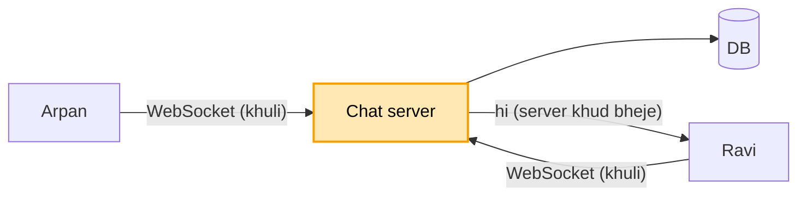
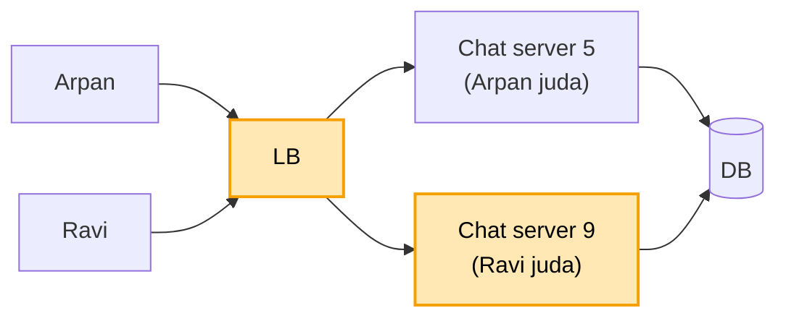
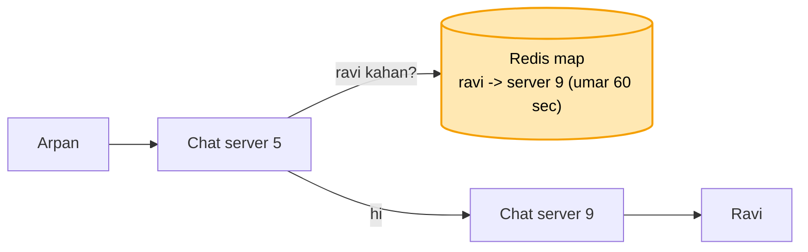
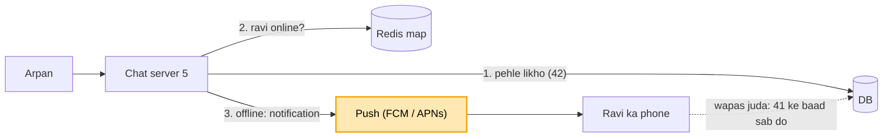
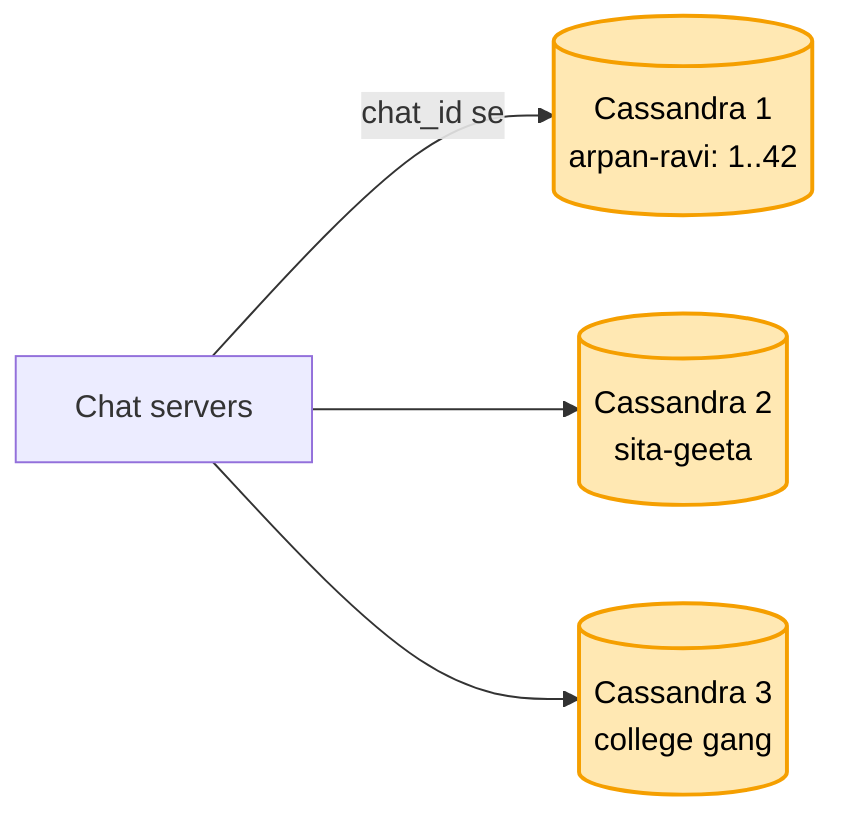

# Chat / messaging (WhatsApp jaisa): shuru se, ek kahani

Kram wahi jo interview me hota hai: **FR, phir NFR, phir numbers, phir design**. Design sabse seedhe dabbe
se shuru hota hai, aur har dikkat aane pe ek naya dabba judta hai. Diagram me peela dabba = abhi juda. Poori
file me ek hi kahani hai: Arpan apne dost Ravi ko message bhejta hai.

---

## 1. FR: kya karna hai

```
1. 1-to-1 chat aur chhote group (500 log tak)
2. purani history server pe rahe (naya phone liya to bhi purane message mil jaayein)
3. tick: bheja / pahuncha / padha
4. Ravi offline ho to message baad me mile
scope ke bahar (poochh ke hata do): end-to-end encryption, voice / video call, lakhon wale broadcast
```

End-to-end encryption (E2E) zaroor poochhna. Haan bola to server message padh hi nahi sakta: server pe
search khatam ho jaata hai, aur poora design badal jaata hai.

## 2. NFR: kaisa chalna chahiye

```
- message turant pahunche (1 second se kam)
- kabhi na khoye
- ek chat ke andar kram na bigde (mera sawaal, phir Ravi ka jawab)
- do baar na dikhe
```

## 3. Numbers

```
- 50 crore user, roz 10 crore log x 40 message = ~400 crore message roz -> ~46,000 likhai har second
- ek waqt pe ~2 crore log app khol ke baithe hain = 2 crore khuli connection
- ek message ~300 byte -> roz ~1.2 TB
```

Ye URL aur banking se alag hai. Wahan asli paimana tha "har second kitni request". Yahan asli paimana hai
"kitni connection ek saath khuli hain", kyunki har khuli connection server ki memory khaati hai, chahe
message aaye ya na aaye.

---

## 4. Design

### Kadam 1: sabse seedha, aur pehli dikkat (server khud nahi bol sakta)

Ek chat server aur ek DB. Arpan ne "hi" bheja, server ne DB me likh diya.

Ab Ravi ko ye "hi" kaise mile? Ab tak ke saare design me user maangta tha aur server deta tha (link kholo,
balance dekho). Yahan Ravi ne kuch nahi maanga, phir bhi message turant pahunchna chahiye. Normal HTTP me
server sirf jawab de sakta hai, khud se awaaz nahi laga sakta.

Teen raaste hain, aur ye asli choice hai:

```
POLLING       Ravi ka app har 2 sec poochhe "kuch aaya?"
              -> 2 crore log x har 2 sec = bekaar ki bheed, aur message 2 sec late
LONG POLLING  Ravi poochhe, server tab tak jawab rok ke rakhe jab tak kuch aaye
              -> behtar, par har message ke baad nayi request, aur ek taraf ki hi baat
WEBSOCKET     Ravi ek baar connection khole, wo band hi na ho, dono taraf baat ho sake
              -> server jab chahe Ravi ko bhej de, turant
```

**Isliye WebSocket.**



Par subah 2 crore log ek saath app khol ke baithe hain. Har ek ki connection khuli hai, aur ek server ki
memory itni connection nahi sambhal paati.

### Kadam 2: 2 crore khuli connection (kai chat server + event loop)

Ilaaj 1: kai chat server. Ek machine ~1 lakh khuli connection sambhal leti hai, to 2 crore / 1 lakh = ~**200
chat server**, aur aage LB. Ye chat server sirf ek kaam karte hain: connection pakad ke rakhna aur message
idhar-udhar karna. Baaki kaam (profile, group banana) alag API server pe hota hai.

Ilaaj 2: har connection ke liye ek thread mat do. Normal server har connection ko ek thread deta hai: 1 lakh
connection = 1 lakh thread. Har thread memory khaata hai, aur zyadatar thread khaali baithe intezaar karte
rehte hain, kyunki log har second message nahi bhejte. Isliye **event loop** lagao (jaise Netty ya Node):
kuch hi thread, aur wo jis connection pe message aaya sirf usi ko sambhalte hain. Baaki connection bas khuli
padi rehti hain, un pe koi thread nahi baitha.



Par Arpan chat server 5 se juda hai, aur Ravi chat server 9 se. Arpan ka "hi" server 5 pe aaya. Ab server 5
ko kaise pata ki Ravi 200 me se kis server pe baitha hai?

### Kadam 3: Ravi kis server pe hai? (map Redis me)

200 chat server hain, aur har server sirf apne jude logon ko jaanta hai:

```
server 5 ki memory:  arpan, mohan, sita      (ye log server 5 se jude hain)
server 9 ki memory:  ravi, geeta             (ye log server 9 se jude hain)
```

Arpan ka "hi" server 5 pe aaya. Server 5 apni memory me dekhta hai "ravi?", nahi milta, kyunki Ravi server 9
se juda hai. Server 5 ko ye pata hi nahi ki Ravi server 9 pe hai. 200 server me se har ek se poochhe "ravi
tumhare paas hai?", to bahut dheema.

Ilaaj: ek **sabka saanjha register**, jahan har server likhe ki uske paas kaun juda hai. Ye register
**Redis** me hai. Jaise bade hotel me har floor ka receptionist sirf apne floor ke mehmaanon ko jaanta hai,
aur kisi aur floor ka mehmaan dhoondhna ho to neeche main reception ka register dekhte hain. Redis wahi main
register hai.

```
Ravi ne app khola, server 9 se juda  -> Redis me likho:  ravi -> server 9
Arpan ka "hi" server 5 pe aaya       -> server 5 Redis se poochhe "ravi kahan?" -> server 9
server 5 "hi" server 9 ko bheje      -> server 9 Ravi ki khuli connection pe bhej de
```

Server 9 achanak gir gaya to? Redis me abhi bhi likha hai "ravi -> server 9", jo ab galat hai. Isliye har
entry ki **umar** rakho (TTL, jaise 60 sec). Ravi ka app har 30 sec ek chhota "main zinda hoon" bhejta hai
(**heartbeat**), aur server us entry ki umar badha deta hai. Server gira to heartbeat band, aur 60 sec me
entry apne aap mit jaati hai. Ravi ka app dobara kisi aur server se judta hai aur nayi entry likh deta hai.

Ek user ke kai device ho sakte hain (phone bhi, laptop bhi). To map me list rakho: `ravi -> [server 9
(phone), server 14 (laptop)]`, aur "hi" dono pe jaata hai.



Par Ravi ka phone band hai. Redis me Ravi ki koi entry hi nahi. Arpan ka "hi" kahan jaaye? Phone 2 ghante
baad on hoga, tab use ye message milna chahiye.

### Kadam 4: Ravi ka phone band (pehle DB, phir bhejo + push)

Ravi offline hai, Redis me uski entry nahi. Arpan ka "hi" kahin to rukna chahiye, warna kho jaayega.

Ilaaj 1: har message **pehle DB me likho, phir bhejo**.

```
"hi" aaya -> PEHLE DB me likho (chat arpan-ravi, message number 42)
          -> phir Redis dekho: Ravi online? -> haan: uske server pe bhejo
                                            -> nahi: DB me pada rahega
```

Pehle DB kyun, pehle bhejna kyun nahi? Agar pehle Ravi ko bheja aur DB me likhne se pehle server gir gaya,
to message kahin pakka nahi raha, aur Ravi ka phone band tha to message hamesha ke liye gaya. Pehle DB me
likha to message pakka hai, chahe aage kuch bhi gire. NFR "kabhi na khoye" yahi kehta hai.

DB me likhne se bhi pehle server gir gaya to? Tab bhi message khota nahi, kyunki wo Arpan ke phone pe hai.
Arpan ne Send dabaya to app message phone me rakhti hai aur uske paas ghadi ka nishaan dikhati hai ("bheja
ja raha hai"). Server DB me likh ke hi app ko jawab (ack) deta hai, tab ghadi hat ke ek tick banti hai
(WhatsApp ka ek grey tick = server ke paas pakka pahuncha). Server ack se pehle gira to app ko ack kabhi
nahi milta, aur app khud thodi der me dobara bhejti hai (kisi aur server pe). Arpan ko kuch nahi karna
padta.

Ilaaj 2: **push notification**. Ravi offline hai, to uske phone pe notification bhejo ("Arpan: hi"). Ye
Google (FCM) aur Apple (APNs) ki service se jaata hai, jo band app tak bhi pahunchti hai.

Ilaaj 3: **wapas judne pe baaki sab**. Har chat ke message ko ek badhta number milta hai. 2 ghante baad Ravi
ka phone on hua aur app judi, to app bolti hai "is chat me mere paas aakhri message number 41 hai, uske baad
ke sab do", aur server DB se 42, 43, 44 ... bhej deta hai.



Par isse ek aur cheez khulti hai: server ne DB me likh liya, aur ack bhejne se pehle gira. App ne dobara
bheja, aur Ravi ko "hi" do baar dikha. Ye agle kisi kadam me aayega. Usse pehle, roz ~400 crore message,
yaani roz ~1.2 TB. Ek DB itna likhna aur rakhna nahi jhel paayega.

### Kadam 5: roz 1.2 TB (Cassandra, chat ke hisaab se baanto)

Roz ~400 crore message, ~46,000 likhai har second, roz ~1.2 TB. Ek DB machine ye nahi jhel paayegi.

Pehle data dekho. Ek message likha jaata hai aur phir kabhi badalta nahi. Padhai hamesha ek hi tarah se hoti
hai: "is chat ke aakhri 50 message do" ya "number 41 ke baad wale do". Na join chahiye, na bank jaisa
transaction.

Ilaaj: **Cassandra**, aur data **chat ke hisaab se baanto (chat_id)**. Chat arpan-ravi ke saare message ek
hi machine pe, number ke kram me rakhe hote hain. "41 ke baad sab do" ek machine se, ek jagah se seedha padh
liya.

SQL kyun nahi, Cassandra kyun? Yahan likhai bahut zyada hai, data roz badhta hai, aur padhai seedhi hai.
Cassandra isi kaam ke liye bana hai: tez likhai, kai machine me khud baantna, aur har cheez ki copy. SQL ki
taakat (join, transaction) yahan chahiye hi nahi, aur itni likhai ke liye SQL me baantna haath se karna
padta. Ye URL wali soch hi hai.

chat_id se hi kyun baanta? Ek chat ke saare message ek jagah rahein, to "aakhri 50 do" ek hi machine se mil
jaata hai. User id se baant-te to Arpan aur Ravi ki ek hi chat do machine me batt jaati.

Cassandra kab lagta hai, ek niyam: likhai bahut zyada + padhai ek key se (jaise chat_id, code) + transaction
nahi chahiye. Chat ke message, URL ke link, notification ki history, sensor / log data. Kab nahi: paisa
(banking, payment = SQL), join wali query, aur shabd dhoondhna (search = Elasticsearch).



Par wo jo kadam 4 me khula tha: server ne DB me likh liya, ack bhejne se pehle gira. App ne dobara bheja,
aur Ravi ko "hi" do baar dikha.

