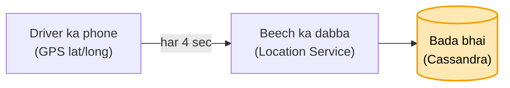
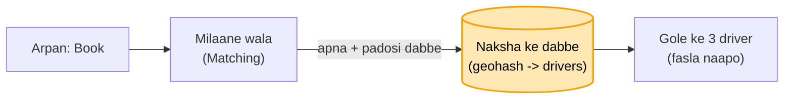
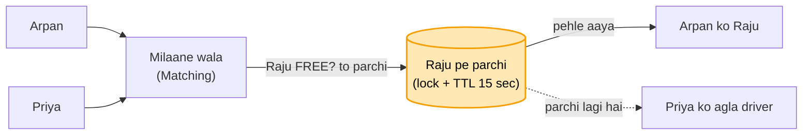

# Uber: Connaught Place se ghar ki kahani

Arpan shaam 7 baje Connaught Place pe khada hai aur ghar ke liye Uber book karna hai. Sheher me 5 lakh driver
gaadi chala rahe hain, sab har second jagah badal rahe. Kaam: "Book" dabate hi paas ka khaali driver, ek driver ek
hi sawari, aur bheed me bhi app na atke.

Har kadam = **kahani** (dikkat aur hal, bolne wali bhasha) -> **Asli naam** (interview me yahi shabd) -> tasveer
(kahani ka shabd, bracket me asli naam).

---

## FR / NFR / Numbers (interview me pehle 2 minute)

```
FR      driver ki jagah lo · paas ka khaali driver do · ek driver ek sawari
NFR     driver turant mile (kuch second) · ek driver do jagah kabhi nahi · bheed (concert) me bhi chale
Numbers 5 lakh driver, har 4 sec jagah -> ~1.25 lakh likhai / sec · booking shaam ko hazaaron / sec
        -> likhai bahut zyada (jagah), booking pe paas wale jaldi chhaantne hain
```

---

## 1. Driver kahan hai, server ko pata hi nahi (beech ka dabba)

"Book" dabaya, par server ko pata hi nahi kaunsa driver abhi kahan hai. Jagah to phone me khud hai, GPS ka
latitude-longitude. To phone khud bheje, har hilne pe nahi, thodi-thodi der me. Beech me ek dabba rakh lo jiska kaam
sirf ek hai: har driver ki sabse taaza jagah batana.

**Asli naam:** beech ka dabba = Location Service; driver ka phone har ~4 sec lat/long bhejta.

## 2. 1.25 lakh likhai / sec, DB ghut gaya (bada bhai)

5 lakh driver, har 4 sec, normal DB disk pe har update likh raha, aur jagah 30 sec peeche chal rahi. Do raaste the:
chhoti parchi, kaat ke nayi jagah likho; ya bada dabba jo likhne me tez ho. Crore-crore likhai pe parchi dheemi ho
sakti, gir sakti, aur kab tak replica lagaunga, kal driver aur badhenge. To bada bhai bulao jo isi kaam ke liye bana
hai aur apni copies khud rakhta.

**Asli naam:** bada bhai = Cassandra (likhai tez, apni copies, machine jodo to badhta). Driver ki row driver_id pe,
nayi jagah aate hi upar likh do (sirf taaza chahiye).



## 3. 5 lakh ka fasla naapna, 40 sec ghoomna (naksha dabbon me)

Book pe server saare 5 lakh driver ka Arpan se fasla naap raha, aur Arpan 40 sec se "driver dhoondh rahe hain" dekh
raha. Connaught Place pe khade ko ISBT ka driver kyun? Sirf 8-9 km ke andar wale chahiye. Aur 5 lakh me se chhaanto
mat: naksha pehle se dabbon me kata ho, driver ki jagah aate hi wo apne dabbe me. Server sirf usi dabbe me dekhe
jahan Arpan khada. Usme 3 driver, unme jo khaali wo Arpan ko. Baaki 5 lakh kahin bhi ghoomein, lena-dena nahi.

**Asli naam:** naksha dabbon me = geohash (grid); dabbe ki chaabi se driver list, 5 lakh ki jagah gine-chune.

**Maan lo Arpan dabbe ke kinare pe, aur 200 meter door bagal wale dabbe me khaali driver:** dabbe ki seema pe mat
chalo. Arpan jahan khada wahan se 8 km ka gola khincho; jin dabbon ko gola chhoota, unke driver bhi dekho, phir asli
fasla naap ke sabse paas wala.
**Asli naam:** apna geohash + aas-paas ke dabbe, phir distance.

**Maan lo register sirf driver ke naam se laga ho ("Raju -> Connaught Place"):** "Connaught Place me kaun-kaun" ke
liye phir 5 lakh line. To jagah ke hisaab se panna rakho: Connaught Place me itne, Janpath me itne. Raju us jagah se
nikla to wahan se hata do aur naye panne me daal do; U-turn le ke wapas aaya to phir purane me. Booked hai to list se
bahar, sawari khatam (Connaught Place pe utaari) to wapas list me.
**Asli naam:** har geohash ka Redis set (sirf khaali driver), har location update pe purane set se remove + naye me add
(driver ki row me pichhla dabba), booked = set se bahar.



## 4. Raju ek, Arpan aur Priya do (BMS wali parchi)

Gole me ek khaali driver Raju. Arpan aur Priya ne ek hi second me "Book" dabaya, aur Raju ke phone pe do ride aa gayi.
BMS wali parchi lagao: "Raju khaali hai to Arpan ka", dekhna aur parchi lagana ek hi kadam me. Jiski request pehle
pahunchi uski parchi lagi, doosre ko "Raju chala gaya" aur uske liye agla driver. Parchi ki umar rakho: Raju 15 sec
me accept na kare to parchi hatao, Arpan ke liye agla driver.

**Asli naam:** parchi = driver pe hold / lock (atomic: sirf FREE ho to lagao), umar = TTL. Taala har driver ka alag,
to bheed me bhi sab ek taale pe nahi toot-te.

**Maan lo Raju ne 14.9 sec pe accept dabaya, server pe 16 sec pe pahuncha, tab tak Priya ko de diya:** ghadi server
ki. 15 sec tak ruka, phir chala gaya; der se aaya to accept radd, Raju ko "ride kisi aur ko chali gayi". Uber me bhi
aise booking cancel hoti dikhti hai.
**Asli naam:** TTL ka faisla server ki ghadi se, der se aaya accept reject.

**Maan lo Raju Connaught Place ke dabbe se Janpath ke dabbe me chala gaya, purane dabbe me naam pada:** sach wahi jo
GPS ne abhi bheja, Raju Janpath me. Book pe Raju ki taaza jagah dekho; Arpan ke gole me nahi to use mat do, Arpan ke
liye CP me koi aur. Dono ek saath dabaayein to wahi taala.
**Asli naam:** assign se pehle driver ki latest location check (ek driver ki ek sach jagah), lock double se bachata.



## 5. Concert khatam, 50 hazaar log, 500 cab (line + surge)

Diljit ka concert khatam hua, 50 hazaar log ek saath book kar rahe, aas-paas cab sirf 500. BMS jaisa: 500 cab hain
to 500 log andar, baaki line me, agli baari. 50 hazaar ko server pe bitha ke ghumaane ka fayda nahi. Pehle 500
sambhalo, phir kiraya badha ke door ki cab bulao: 30 km door ka driver bhi kamaai dekh ke aa jaata, aur jinhe zaroori
nahi wo ruk jaate ya metro le lete.

**Asli naam:** 500 andar, baaki line = virtual queue (waiting room), kiraya badhao = surge pricing (cab badhti,
bheed ghatti).


## 6. Gaadi naksha pe khisakti dikhe (khula taar + seedha raasta)

Raju aa raha, Arpan ko gaadi khisakti dikhni chahiye. Phone har second "Raju kahan?" poochhe to shaam 7 baje 10 lakh
phone har second, 99% jawab "wahin", server poochne walon se dab gaya. To poochne ka mauka hi mat do: Raju hila to
turant Arpan ko dikha do. Par Arpan ka taar server 12 pe hai aur Raju ki jagah server 57 pe aati. 100 me dhoondhna
nahi: store karwa lo "Arpan server 12 pe", "Raju ki ride Arpan ke saath", aur seedha usi raaste bhejo.

**Asli naam:** push = WebSocket (polling band), session map (user -> server, Redis) + ride map (driver -> rider),
server 57 seedha server 12 ko = pub/sub channel. Chat wala DSA map + chhota ladka hi.


## 7. 250 dikha, 500 kate (jo dikhaya wahi + tip)

Book pe ₹250 dikha, Arpan ne haan kiya. Ride ke beech surge 2 guna, aakhir me ₹500. Jo dikhaya wahi lena meri
zimmedari: 250 hi lo. Traffic me phase aur mehnat zyada lagi to rider ki marzi pe tip, 50-100 de de, na de to jitna
dikhaya utna. (Uber / Rapido asal me badha deti hain, par main banata to aise.)

**Asli naam:** upfront fare: book pe quote banta aur ride ki row me save (lock), aakhir me wahi kaato; tip alag,
rider ki marzi.


## 8. Trip khatam, wallet me ₹40 (poora ya kuch nahi, ride tab tak khuli)

Ghar pahunch ke ₹250 kaatne gaye, wallet me ₹40. Kaatna hai to poora kaato, aadha mat kaato, warna log jaan-boojh ke 1
rupaya rakhenge. Paisa nahi to app me saaf dikhao "payment nahi hua", Raju ke phone pe bhi. Arpan GPay se de, warna
cash. Jab tak paisa nahi aaya, ride khatam hi nahi hogi.

**Asli naam:** atomic charge (partial nahi), ride status PAYMENT_PENDING jab tak SUCCESS, fallback payment (GPay / cash),
dono app pe status.

**Maan lo (socha hua) ride ke beech Raju ka phone hi switch off, GPS band, naksha pe Raju gayab:** phone band hona Uber
ke haath me nahi, ye design ki dikkat nahi. Phone apni location khud bhejta hai, server poochhta nahi; location aani
band hui to server ek-do baar dekhega, phir apni taraf se bhi band. Jahan tak aaye utne paise Arpan ki app me dikhte,
wo de do, aur Uber support ko phone: "driver ka phone band ho gaya". Support ride band kar de, DB me update, Raju
kahin nahi dikhega.
**Asli naam:** location timeout (phone push karta, server sirf intezaar), manual close support se, ride status DB me
update, driver available list se bahar.

---

Notes (Arpan ke shabd) = [UBER_HAND_NOTES.md](UBER_HAND_NOTES.md)
