# Uber: Connaught Place se ghar ki kahani

Arpan shaam 7 baje Connaught Place pe khada hai aur ghar ke liye Uber book karna hai. Sheher me 5 lakh driver
gaadi chala rahe hain, sab har second jagah badal rahe. Kaam: "Book" dabate hi paas ka khaali driver, ek driver ek
hi sawari, aur bheed me bhi app na atke.

Har kadam = **kahani** (dikkat aur hal, bolne wali bhasha) -> **Asli naam** (interview me yahi shabd) -> tasveer
(kahani ka shabd, bracket me asli naam).

---

**Ek nazar: dhaancha + dikkat chain (round me sabse pehle ye, phir FR / NFR isi se):**
```
Raju (phone har 4 sec)  -->  Location Service  -->  Redis (abhi ki jagah, geohash dabbe) + Kafka -> raasta batch me Cassandra
                                                          |
Arpan "Book"  -->  matching: apna + aas-paas ke dabbe, sadak ki doori (ETA), 15-20 sec ki booking saath (batch)
                    driver pe parchi (hold, 15 sec umar, ghadi server ki) · bheed me line + surge
                    Raju live dikhe: WebSocket + pub/sub · trip khatam: kiraya jo dikhaya, poora kaato

 1   server ko pata nahi driver kahan            ->  phone khud bheje (Location Service)
 2   1.25 lakh update / sec, DB ghuta            ->  Cassandra; abhi ki jagah Redis, raasta Kafka (2b)
 2c  matching ko abhi chahiye, bhare ka raasta     ->  Redis se matching; sawari ka raasta Cassandra (SOS)
 3   5 lakh driver ka fasla naap raha            ->  naksha dabbon me (geohash)
 4   dabbe ke kinare, bagal me driver            ->  aas-paas ke dabbe bhi; nadi ke us paar = sadak se doori (4b)
 5   Raju pe ek second me do ride                ->  parchi, ek kadam me (hold / lock); 15 sec umar, net atka = wahi booking id
 6   concert khatam, 50 hazaar, cab 500          ->  line (virtual queue) + kiraya badhao (surge); stadium dabba = 2-3 extra
 6c  dabba toda, Arpan ke tukde me driver nahi   ->  aas-paas ke tukde bhi (scatter-gather)
 7   14.9 pe accept, server pe 16 pe             ->  ghadi server ki; 7b sabko bajao ya 20-25 sec
 8   Raju Janpath me, purana naam pada           ->  sach wahi jo GPS ne abhi bheja
 9   register driver ke naam se                  ->  jagah ke hisaab se (geohash Redis set), dabba badla to hatao + daalo
10   10 lakh phone "Raju kahan?"                 ->  push, WebSocket
11   Arpan server 12 pe, Raju 57 pe              ->  pub/sub
12   250 dikha, aakhir me 500 kate               ->  jo dikhaya wahi (upfront fare)
12b  900 dikha, traffic 2.5 ghante, 1400 kate     ->  laal batti pe nahi, sach me der to +100 / 30 min
13   wallet me 40, gateway chup                  ->  poora kaato; ride id key; 30-55 sec phir GPay / cash; PAYMENT_PENDING
13b  cash diya, 5 min baad GPay se bhi kata       ->  "kitni der baad kata" column, raat ki job lautaye
14   Raju ka phone band, naksha pe gayab         ->  location timeout
15   Car A Arpan se 2 km, Ravi se 1 km           ->  sab saath milao, kul doori kam (batch matching, 15-20 sec window)
15b  Arpan 7:00:00, Ravi 7:00:02                 ->  turant mat do, 15-20 sec ruk ke sab saath milao
15c  Arpan baar-baar peeche                      ->  aging, agli gaadi usi ki
15d  cancel karke turant dobara book             ->  Redis me "pehle kab ruka" + 30 sec umar, warna peeche
16   signal pe khada, har 4 sec wahi jagah       ->  15-20 sec (adaptive ping); 16b-d chhat pe / nadi paar / tunnel / basement
```

## FR / NFR / Numbers (interview me pehle 2 minute)

```
FR      driver ki jagah lo · paas ka khaali driver do · ek driver ek sawari
        · Arpan ko Raju live dikhe · kiraya pehle dikhe · trip khatam pe pay
        · bheed me (concert) kiraya badh sakta hai, aur wo pehle hi dikh jaaye
        · ek saath kai booking aayein to aisi gaadi do ki sabki milake doori kam · jo der se ruka wo baar-baar peeche na rahe
        · traffic me sach me bahut der fanse to kiraya badh sakta, laal batti pe nahi (kadam 12 doosri kahani)
        (pehle sawaal: trip ka paisa PSP (Razorpay jaisa) kaatta; uska andar ka kaam design ka hissa nahi.
         Interviewer se poochho: PSP ka timeout kitna, ya PSP scope se bahar? Wo bole "30-60 sec bahut" to wahi timeout,
         uske baad FAILED aur alag column "kitni der baad kata" (kadam 13b))
NFR     driver turant mile (kuch second) · ek driver do jagah kabhi nahi
        · ride ke beech driver gaya to sambhalo
        · sawari wali ride ka poora raasta pakka rahe (SOS / shikayat), khaali driver ka zaroori nahi (kadam 2)
        · gateway chup ho to customer / driver atke nahi (30 sec, phir doosra raasta) (kadam 13)
        · concert jaisi bheed ho to bhi sambhle (kadam 6)
Numbers 5 lakh driver, har 4 sec jagah -> ~1.25 lakh likhai / sec · booking shaam ko hazaaron / sec
        -> likhai bahut zyada (jagah), booking pe paas wale jaldi chhaantne hain
        ~50 million user · peak (concert) 50-60 hazaar ek saath, normal din me bheed badi baat nahi
        ("driver tez aaye" na FR na NFR: traffic hamare haath me nahi)
API     GET  aas-paas ke driver  -> app khulte hi naksha pe    (FR driver ki jagah, paas ka khaali)
                       POST book                -> kahan jaana, kiraya dikhe  (FR ek driver ek sawari, kiraya pehle)
                       POST pay                 -> trip khatam pe paisa       (FR trip khatam pe pay)
        driver ki jagah = phone ka har 4 sec wala bhejna, pehle se design me (kadam 1)
```

**Dhaancha (round):** Arpan ne app khola -> aas-paas ke driver dikhe; Book -> server -> process -> DB me likha
-> wapas Arpan ko ride. Bahut saare server, DB ki replica. CDN / S3 ki zaroorat nahi. Redis aage jahan lage.
**Asli naam:** client -> kai app server (LB) -> DB + read replica; CDN / S3 nahi.

**FR / NFR -> kadam (Arpan: "theek lag raha, achha lag raha"):** driver ki jagah = 1, 2, 2b, 8, 14, 16 · paas ka khaali driver =
3, 4, 4b, 6c, 9 · ek driver ek sawari = 5, 7 · Raju live = 10, 11, 16b-16d · kiraya pehle = 12 · trip khatam pe pay = 13 ·
bheed me kiraya = 6 · sabki milake doori kam = 15, 15b · der se ruka peeche na rahe = 15c, 15d · NFR turant mile = 3, 4, 7b ·
ek driver do jagah nahi = 5, 7 · ride ke beech driver gaya = 14, 16d.

---

## 1. Driver kahan hai, server ko pata hi nahi (beech ka dabba)

"Book" dabaya, par server ko pata hi nahi kaunsa driver abhi kahan hai. Location to phone me khud hai, GPS ka
latitude-longitude. To phone khud bheje, har hilne pe nahi, thodi-thodi der me. Beech me ek dabba rakh lo jiska kaam
sirf ek hai: har driver ki sabse taaza jagah batana.

**Asli naam:** beech ka dabba = Location Service; driver ka phone har ~4 sec (maan lo) lat/long bhejta.

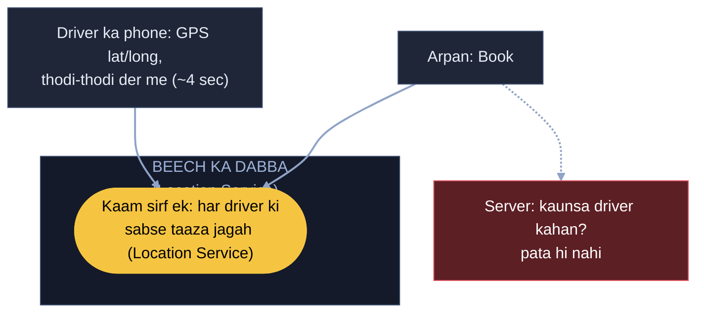

## 2. 1.25 lakh likhai / sec, DB ghut gaya (bada bhai)

Har 4 sec, 5 lakh driver = 1.25 lakh update / sec. Normal DB ghut gaya, aur jagah 30 sec peeche chal rahi. Do raaste
the: ya to chhoti parchi, kaat ke nayi jagah likho; ya bada dabba jo likhne me tez ho. Crore-crore likhai pe parchi
dheemi ho sakti, gir sakti, aur kab tak replica lagaunga, kal driver aur badhenge. To bada bhai bulao, jo isi kaam ke
liye bana hai, apni copies khud rakhta.

**Asli naam:** bada bhai = Cassandra (likhai tez, apni copies, machine jodo to badhta; andar ring = consistent hashing, nayi machine jude to sirf paas ka hissa hile). Driver ki row driver_id pe,
nayi jagah aate hi upar likh do (sirf taaza chahiye).

**Aur neeche (Zomato wali reel se):** location DB me likhna faltu; DB me sirf kaam ki cheez (order delivered, pending).
Abhi ki jagah ek parchi (Redis) pe, har 4 second purani kaat ke nayi, delivery ke baad hata do. Company ko poora raasta
chahiye to saari location Kafka me (bheed ka jawab), wahan se batch me alag storage box me ("10 minute yahan khada tha").
**Asli naam:** Redis me sirf aakhri jagah (overwrite), history = Kafka -> batch write alag storage, DB = sirf status.

**Maan lo is doosri kahani me (location Kafka + batch se):** matching ko abhi ke abhi chahiye, Kafka -> Cassandra batch me der se, isliye matching Redis
se (har baar kaat ke latitude-longitude). Ride book hui tab raasta pakka chahiye (SOS / support: "Whitefield se kahan le gaya"),
isliye Cassandra me wo jo important hai. Khaali aur bhara (sawari wala) driver alag: bhare ka raasta Kafka se batch me Cassandra,
khaali ka padhai ke liye alag. Aage purane raaston se "airport ka sabse achha 9va raasta" bhi nikaal sakte.
**Asli naam:** matching = Redis (overwrite), trip location history = Kafka -> batch -> Cassandra (SOS / audit), idle vs on-trip alag store, raaste ki padhai.

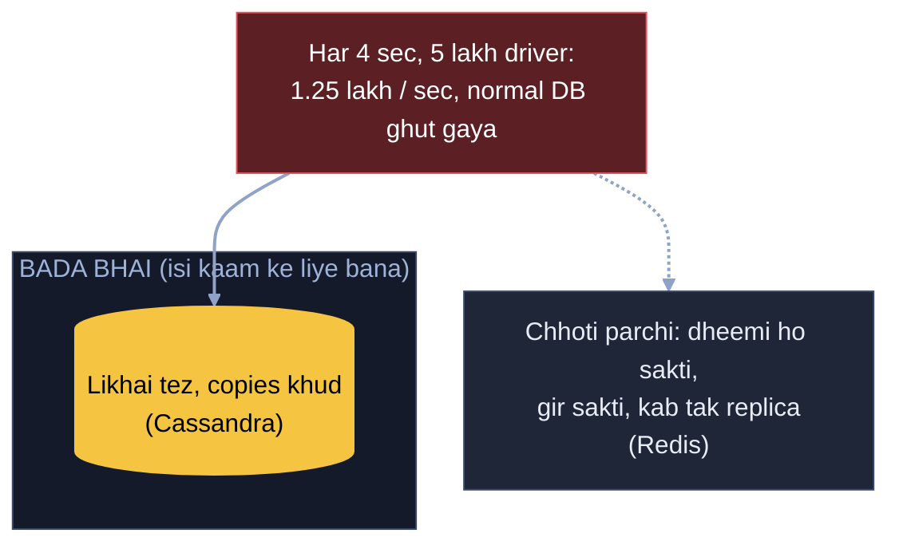

## 3. 5 lakh ka fasla naapna, 40 sec ghoomna (naksha dabbon me)

Book pe server saare 5 lakh driver ka Arpan se fasla naap raha, aur Arpan 40 sec se "driver dhoondh rahe hain" dekh
raha. Connaught Place pe khade ko ISBT ka driver kyun? Sirf 8-9 km ke andar wale chahiye. Aur 5 lakh me se chhaanto
mat: naksha pehle se dabbon me kata ho, server sirf usi dabbe me dekhe jahan Arpan khada. Usme 3 driver, unme jo
khaali wo Arpan ko. Baaki 5 lakh kahin bhi ghoomein, lena-dena nahi.

**Asli naam:** naksha dabbon me = geohash (grid), sirf apna dabba = 5 lakh ki jagah gine-chune driver.

**Jaankari (sirf jaankari hai, design wahi; reel se):** Uber ke khaane square nahi, chhatte jaise 6-kone wale (hexagon),
naam H3, Uber ne khud banaya. Square kyun nahi: square me bagal wale padosi paas, kone wale ~40% zyada door; hexagon me
6 ke 6 padosi barabar door, to har disha me ek jaisa dhoondhna. Apna khaana + 6 padosi = 7, driver na mile to ek ring
aur (19). **Asli naam:** geohash = square khaane, H3 = hexagon khaane.

**21-Nov round (Whitefield):** Whitefield bada; ITPL, Agrahara, Nexus Forum mall alag-alag chhote hisse. Lakhon cab phone pe
dikhana namumkin, sirf apna hissa. Bheed wali jagah dabba chhota-bada baad me (6c).
**Asli naam:** geohash cell, adaptive cell size.

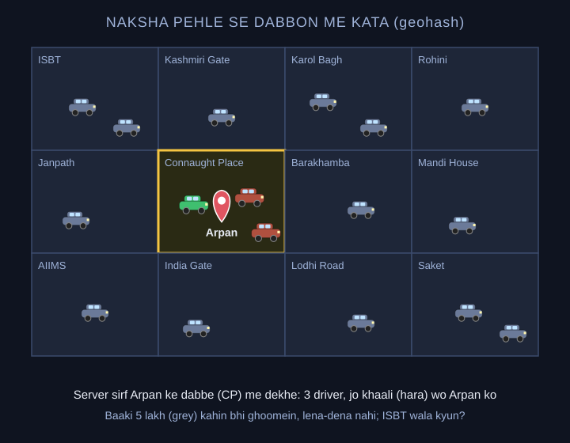

**Maan lo gole ke teeno booked:** thodi der wait, jaise Uber 15 minute wait karwata. **Asli naam:** intezaar / dobara dhoondo.

## 4. Arpan dabbe ke kinare pe, 200 meter door khaali driver (gola khincho)

Arpan dabbe ke kinare pe khada hai, aur 200 meter door bagal wale dabbe me khaali driver, par app bola "koi nahi".
Dabbe ki seema pe mat chalo. Arpan jahan khada wahan se 8 km ka gola khincho; jin dabbon ko gola chhoota, unke driver
bhi dekho, phir asli fasla naap ke sabse paas wala.

**Asli naam:** gola + chhoote dabbe = apna geohash + aas-paas ke dabbe (neighbours), phir asli distance.

**21-Nov round (Raju border paar Agrahara):** Arpan se 5 km gola (7-8 bhi), driver aate-jaate rahenge. Sirf khaali driver,
sabka phone bajao ("ITPL se airport"), request ki umar ~30 sec, jo accept kare uski.
**Asli naam:** neighbour cells + asli fasla, available filter, broadcast dispatch, request TTL.

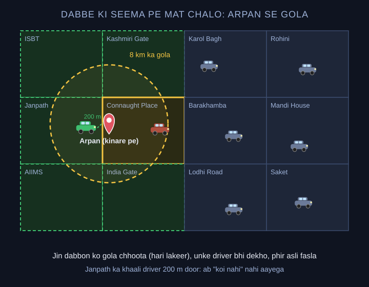

(Yahan se kadam 6 ke Maan lo tak scene Lucknow ke: Gomti nadi, Ekana stadium. Shehar badla, Uber ki baat wahi.)

**Maan lo (reel se aaya) seedhi lakeer pe sabse paas Raju 500 meter, par Gomti nadi ke us paar, pul 4 km door; isi kinare Shyam 1.5 km:** Sirf map pe kaun paas
dikh raha ye nahi dekhna. Gole ke driver ki asli doori nikaalo: sadak se kitni door, kitni der lagegi. Nadi wala sadak se 8 km,
peeche wala 2 km, to Arpan ko peeche wala. Achanak jaam alag baat, wo pehle se nahi pata.
**Asli naam:** map pe paas = seedhi lakeer (straight-line) doori, sadak se kitni door = road distance / ETA (routing se, sirf gole ke kuch paas wale driver pe).

**Maan lo normal din bhi gole me cab nahi:** gola bada karo, phir aur bada. **Asli naam:** expanding search radius.

## 5. Raju ek, Arpan aur Priya do (BMS wali parchi)

Gole me ek khaali driver Raju. Arpan aur Priya ne ek hi second me "Book" dabaya, aur Raju ke phone pe do ride aa gayi.
BMS wali parchi lagao: "Raju khaali hai to Arpan ka", ek kadam me. Jiski pehle pahunchi uski parchi, doosre ko "Raju
chala gaya" aur uske liye agla driver. Parchi ki umar rakho: Raju 15 sec me accept na kare to parchi hatao, agla
driver.

**Asli naam:** parchi = driver pe hold / lock (atomic: sirf FREE ho to lagao), umar = TTL. Taala har driver ka alag,
to bheed me bhi sab ek taale pe nahi toot-te.

**21-Nov round (Samudra tower gate 3 / gate 1):** pehle dekha phir alag se book kiya to beech me dono ko wahi driver.
Dekhna + book ek saath (lock, select + update ek kadam). Alag-alag tod ke kiya to server faltu chakkar, din me hazaron baar.
**Asli naam:** atomic conditional update / lock (WHERE driver FREE), read-then-write race se bachao.

**Maan lo net atka, Arpan ne Book do baar daba diya:** Payment wali idempotency key: phone Book dabate hi booking id banaye, dono request me wahi. Server pehle id dekhe, pehle aa chuki to nayi ride nahi, wahi purani ride lauta do.
**Asli naam:** idempotency key (wahi ID dobara aaye to chhodo).

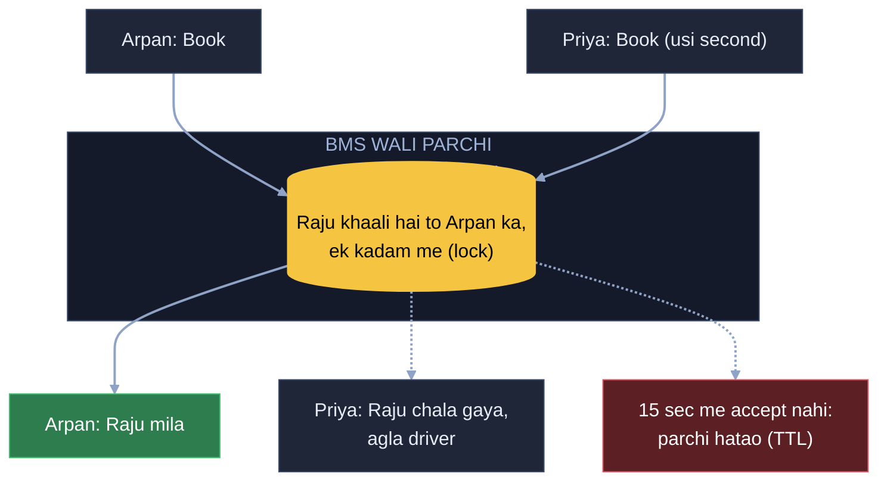

## 6. Concert khatam, 50 hazaar log, 500 cab (line + surge)

Diljit ka concert khatam hua, 50 hazaar log ek saath book kar rahe, aas-paas cab sirf 500. BMS jaisa: 500 cab hain
to 500 log andar, baaki line me, agli baari. 50 hazaar ko server pe bitha ke kya karunga. Pehle 500 sambhalo, phir
kiraya badha ke door ki cab bulao.

**Asli naam:** 500 andar, baaki line = virtual queue (waiting room), kiraya badhao, door ki cab aaye = surge pricing.

**21-Nov round (Palace Grounds, Arijit Singh concert, 50-60 hazaar):** garam jagah pe server badhao (autoscale), dayra
5 -> 20-30 -> 50 km, door se driver + kiraya badhao, Palace Grounds ko khaano me kaat ke alag server (ek server pe dhaava nahi),
laut ke aayi cab turant available, bagal ke khaane ki khaali cab ke liye dayra badhao. Sach: intezaar hoga hi.
**Asli naam:** autoscaling, search radius, surge, cell-wise baantna (thundering herd se bachao), scatter-gather, NFR me "bheed me turant ka vaada nahi".

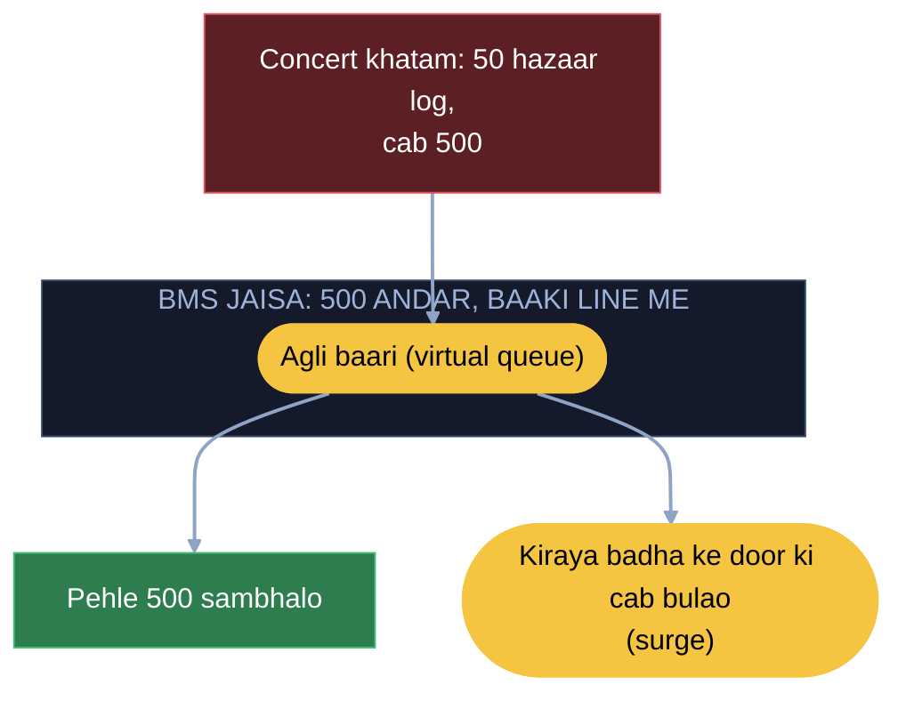

**Maan lo (reel se aaya) Ekana stadium me match khatam, 2 minute me 15,000 booking ek hi dabbe se, us dabbe wale server ka CPU 100%, baaki
shehar ke server khaali:** Driver kam pade to gola bada karo, Gomti Nagar, Chinhat se gaadi aaye. Server ka bojh: us ilaake ke liye 2-3
dabbe extra, load ek machine pe na rahe. Stadium, Connaught Place jaise hotspot pata hain, wahan pehle se 2-3 extra dabbe; 40-50 hazaar
booking ki had paar ho to system apne aap dabbe badha de.
**Asli naam:** ek dabbe pe saara bojh = hot cell (hot shard), 2-3 dabbe extra = hot cell ko chhote dabbon me tod ke kai shard pe, pehle se = pre-scaling, had paar to apne aap = auto-scaling.

**Maan lo India-Pakistan match, 2 lakh log, server badhane se kaam nahi chala to dabba tukdon me toda. Arpan ke tukde
me koi khaali driver nahi, 300 meter door neeche wale tukde me 5, par doosre server pe:** Pehle server badhao, kaam na chale tab hi
todo. Toda to ek papa ji (bada aadmi) jo sab tukde dekhe: Arpan ka tukda + uske upar, neeche, bagal wale tukde, unke khaali driver
Arpan ko. Har tukde ke liye yahi. Phir bhi bheed to gola bada.
**Asli naam:** pehle scale out, zaroorat pe split, papa ji = coordinator jo kai server se poochh ke jode (scatter-gather), aas-paas ke tukde = neighbour cells.

## 7. Raju ne 14.9 sec pe accept dabaya, server pe 16 sec pe pahuncha (ghadi server ki)

Wapas Delhi, Connaught Place, wahi shaam 7 baje wali booking. Raju ne 14.9 sec pe accept dabaya, par server pe 16 sec pe pahuncha, tab tak Priya ko de diya. Ghadi server ki hai. 15
sec tak ruka, phir chala gaya; der se aaya to uski parchi phaad do, accept radd. Uber me bhi aise booking cancel hoti
dikhti hai.

**Asli naam:** ghadi server ki = TTL ka faisla server pe, der se aaya accept reject.

**21-Nov round:** umar 30 sec; 29.3 pe accept par server dheema, 30 nikla -> ride nahi, agla driver (lakhon me ek). Ya
jab tak koi accept na kare sabka phone bajta rahe. Uber asal me kaise, pakka nahi pata; dono raaste.
**Asli naam:** request TTL (server ki ghadi), re-dispatch, TTL ke bina broadcast.

Isi pe ek aur raasta (sabke paas ek saath, jo pehle pahuncha): aakhri ice-cream, do bachche daude, pehle shuru karne wala gir gaya; ice-cream usko jo pehle pahuncha.
Server pe Suresh ka accept pehle aaya to ride Suresh ki. Raju ko "request nahi pahunchi" nahi, bas "tumse pehle kisi aur
ne le li".
**Asli naam:** server pe pehle pahuncha accept jeeta (first-write-wins), Raju ko ride taken message.

**Maan lo ek-ek driver ki jagah aas-paas ke saare driver ke phone ek saath bajao:** jo pehle accept kare uski ride.
**Asli naam:** broadcast dispatch; do ne ek saath accept kiya to BMS wali parchi, jo server pe pehle pahuncha wo jeeta.
Window 20-25 sec bhi kar sakte, par faisla phir bhi server ki ghadi.

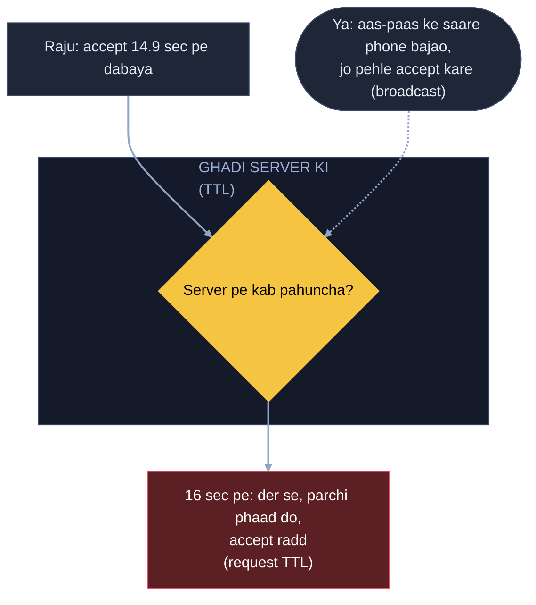

## 8. Raju Janpath gaya, naam CP ke dabbe me pada (taaza jagah dekho)

Raju Connaught Place ke dabbe se Janpath ke dabbe me gaya, par purane dabbe me naam pada hai; Arpan aur Priya dono ko
dikh raha. Sach wahi jo GPS ne abhi bheja: Raju Janpath me. Book pe Raju ki taaza jagah dekho; Arpan ke gole me nahi
to use mat do, Arpan ke liye CP me koi aur. Dono ek saath dabaayein to wahi taala.

**Asli naam:** taaza jagah dekho = assign se pehle driver ki latest location check (ek driver ki ek sach jagah), lock
double se bachata.

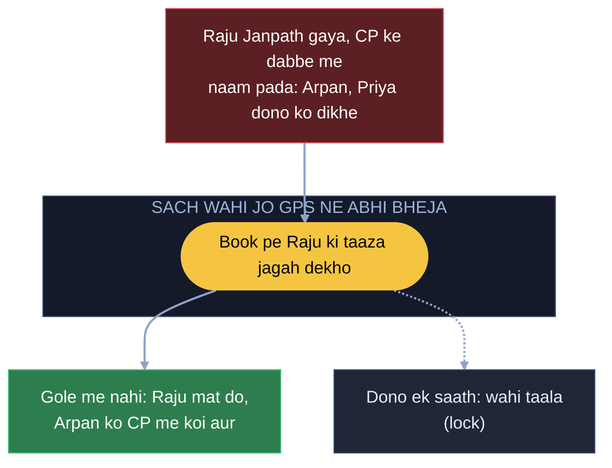

## 9. Register driver ke naam se, chahiye jagah ke naam se (jagah ka panna)

Dabbe kadam 3 me bana liye, par register abhi bhi driver ke naam se laga hai ("Raju -> Connaught Place"). Booking pe chahiye "Connaught Place me kaun-kaun", to
phir 5 lakh line. Aur Raju dabba badle to purane panne me naam pada rehta, shaam tak 2,000 purane naam. To jagah ke
hisaab se baant do: Connaught Place me itne driver, Janpath me itne, AIIMS ke paas itne. 5 lakh ki jagah utni hi line
jitne us jagah me. Raju us jagah se nikla to wahan se hata do, naye panne me daal do. Raju booked hai to list se
nikaal do, ab wo kisi ko nahi milna. Booked nahi aur ghoom raha to kaat ke nayi list me, U-turn le ke wapas aaya to
phir purani list me. Booked Raju ne Connaught Place pe sawari utaari to pata hai thodi der me khaali hoga, phir list me
daal do.

**Asli naam:** jagah ke hisaab se panna = geohash -> drivers (Redis set har dabbe ka), nikla to hata do, naye me daal
do = har location update pe purane set se remove + naye me add (driver ki row me pichhla dabba yaad), booked to list
se bahar = sirf khaali driver set me, sawari khatam pe wapas.

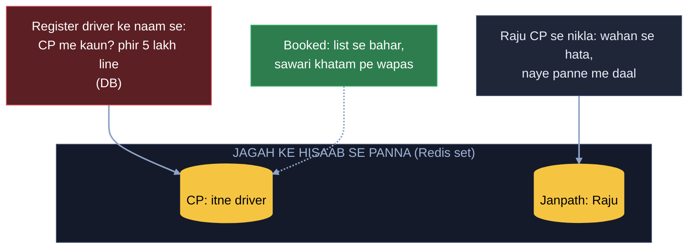

## 10. 10 lakh phone "Raju kahan?" poochh rahe (poochne ka mauka mat do)

Raju aa raha, Arpan ko gaadi naksha pe khisakti dikhni chahiye. 10 lakh phone har second "Raju kahan?" poochh rahe,
99% jawab "wahin", server dab gaya. Server poochh kyun raha, poochne ka mauka hi mat do. Ek aisa dabba bitha do ki Raju
hila to turant Arpan ko dikha de, hila to dikha de. Asal me hilta hai, jhooth nahi dikhate.

**Asli naam:** poochne ka mauka mat do, khud dikha do = push (WebSocket, khula taar), polling band.

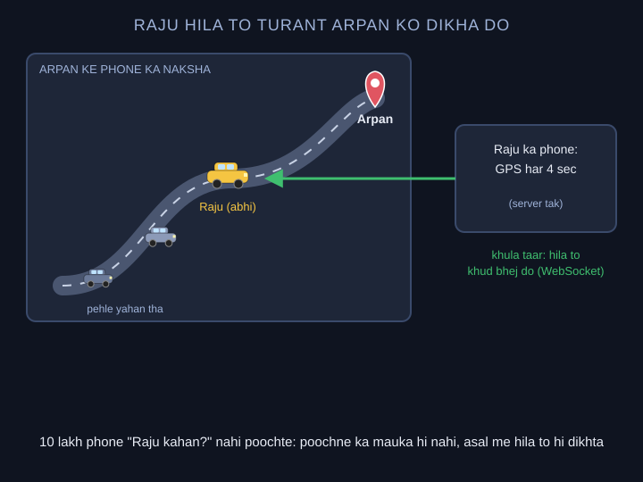

## 11. Arpan server 12 pe, Raju ki jagah server 57 pe (store karwa lo, seedha raasta)

Arpan ka taar server 12 pe hai, aur Raju ki jagah server 57 pe aati. 57 ko pata hi nahi Arpan kahan. 100 server me
dhoondhna nahi. Store karwa lo: Arpan server 12 pe, Raju ki ride Arpan ke saath. Raju aur Arpan ke taar jodo, Raju ko
sirf Arpan se lena-dena. Jaise ghar ka raasta pata ho to seedha usi raaste.

**Asli naam:** store karwa lo = session map (user -> server, Redis) + ride map (driver -> rider), seedha usi raaste =
server 57 seedha server 12 ko (pub/sub channel), wahan se Arpan ke taar pe. Chat wala DSA map + chhota ladka hi.

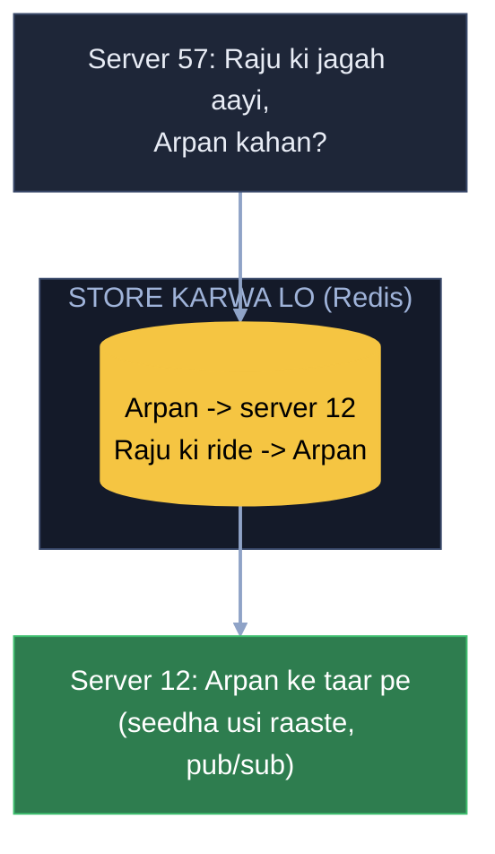

## 12. 250 dikha, 500 kate (jo dikhaya wahi + tip)

Book pe ₹250 dikha, Arpan ne haan kiya. Ride ke beech surge 2 guna, aakhir me ₹500 kate. Arpan: "maine 250 dekh ke
haan kiya tha." Jo dikhaya wahi lena meri zimmedari: 250 hi lo. Traffic me phase aur driver ki mehnat zyada lagi to
rider ki marzi pe tip, 50-100 de de, na de to jitna dikhaya utna. (Uber / Rapido asal me badha deti hain, par main
banata to aise.)

**Asli naam:** jo dikhaya wahi = upfront fare: quote ride ke saath save (lock), aakhir me wahi kaato; zyada mehnat =
tip alag, rider ki marzi.

**Aur neeche (surge nahi, traffic se raasta lamba):** concert se Whitefield, 900 dikha, traffic me 1 ghante ka raasta 2.5 ghante, 1400 kate.
Teen nazar: driver ka 1.5 ghanta gaya (3-4 ride ya ek airport wali), Uber ka nuksaan, customer ka gussa jaayaz. Aage ka traffic
pehle se nahi pata (Bangalore bhida shahar), pehle hi 1400 bol diya aur traffic nahi laga to bharosa gaya. Normal laal batti
pe nahi badhao (buffer), sach me der (1.5 ghante se upar) to har extra 30 minute +100 / 150.
**Asli naam:** time-based fare / waiting charge, buffer = free waiting; pehli kahani (upfront + tip) aur ye, dono raaste.

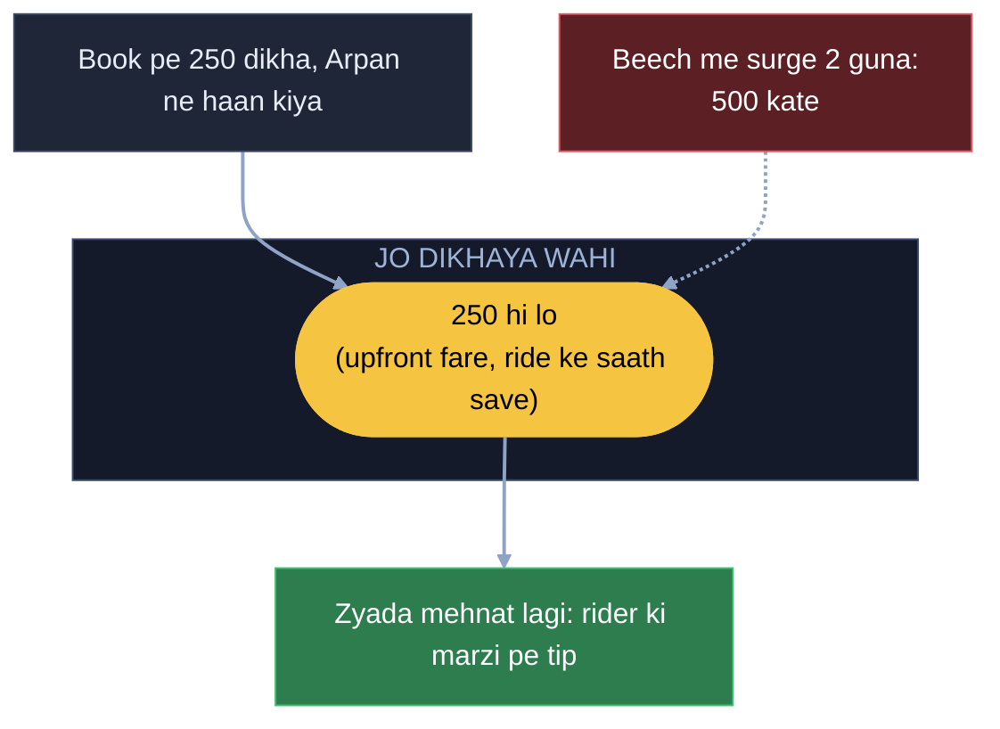

## 13. Trip khatam, wallet me ₹40 (poora ya kuch nahi, ride tab tak khuli)

Trip khatam, ₹250 kaatne gaye, Arpan ke wallet me sirf ₹40. Payment fail, Arpan gaadi me hi baitha, Raju saamne, aur Raju ka petrol aur
40 minute gaye. Kaatna hai to poora kaato, aadha mat kaato: 40 kaat ke chhod diya to log jaan-boojh ke 1 rupaya
rakhenge. Wallet me 250 nahi to app me saaf dikhao "payment nahi hua", aur Raju ke phone pe bhi dikhe. Arpan GPay se
de, warna cash, kaise bhi. Jab tak paisa nahi aaya, ride khatam hi nahi hogi.

**Asli naam:** poora ya kuch nahi = atomic charge (partial nahi), ride tab tak khatam nahi = ride status
PAYMENT_PENDING jab tak SUCCESS, GPay / cash = fallback payment method, dono app pe dikhe.

**Maan lo 250 kaatne gaye, gateway chup, pata nahi kata ya nahi:** Dobara kaatne pe ride id hi key: gateway pehchaan
lega ki ye wahi charge hai, do baar nahi katega. Dobara bhejne se pehle gateway se poochh lo kya hua (Payment wala
status job).

**Asli naam:** idempotency key (wahi ID dobara aaye to chhodo).

**Maan lo poochhte raho aur gateway ka jawab aaye hi na, Arpan aur Raju dono gaadi me intezaar kar rahe. Kab tak
rokoge? (BookMyShow 6c wala hi jawab):** Gateway kitni der lega, hamare haath me nahi, to hum apni ghadi
rakhte: 30 se 55 second, phir dono app pe "payment nahi hua, paisa kata to wapas aa jaayega", Arpan GPay / cash se de.
Paisa katte hi gateway chhota sa event bhejta, jaise S3 bhejta; aaya to "mil gaya". Baad me kata nikla aur cash de chuka,
to gateway ko bolo "lautao". Onboard pe SLA lo: uptime aur down hone pe khabar; bank ki der nahi.

**Asli naam:** 30-55 sec = hamara client timeout, event = webhook (PSP callback), "mil gaya" = ack (2xx), baad me kata to
lautao = REFUND_PENDING + raat ki refund job (BMS 6e) + refund API (Razorpay ko bolo lautao), REFUNDED sirf pakke jawab pe, onboard pe SLA = uptime SLA + incident response.

**Maan lo 30 second jawab nahi, Arpan ne cash de diya, 5 minute baad GPay se bhi kat gaya:** DB me FAILED,
raaste: Uber wallet / doosra PSP / cash. Table me "kitni der baad kata" column, raat ki cron job pakde aur Razorpay ko bole
lautao. Kaise diya (cash / GPay + transaction id) bhi rakho. Wallet se kat gaya aur event aa gaya to Arpan ko mat roko.
**Asli naam:** client timeout -> FAILED, PSP failover + cash fallback, late debit column -> reconciliation job, payment method + transaction id.

**Isi pe ek aur misaal (Uber me kaun Pay dabata):** Uber me app apne aap paisa nahi kaatta, trip khatam pe rider khud Pay dabata. Jab tak pay nahi hua, driver utarne hi nahi dega.
**Asli naam:** rider khud payment shuru kare, SUCCESS tak PAYMENT_PENDING.

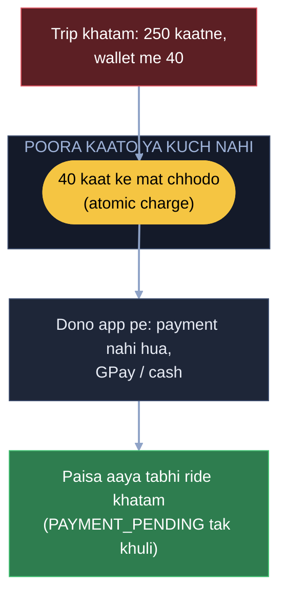

## 14. (Socha hua) Ride ke beech Raju ka phone band (location timeout + support)

Ride ke beech Raju ka phone switch off, GPS bhi band, naksha pe Raju gayab. Ride khatam kaun karega? Phone band hona
Uber ke haath me nahi, ye design ki dikkat nahi. Phone apni location khud bhejta hai, server poochhta nahi. Location
aani band hui to server ek-do baar dekhega, phir apni taraf se bhi band. Jahan tak aaye utne paise Arpan ki app me
dikhenge, wo de do. Phir Uber support ko phone: "driver ka phone band ho gaya". Support wahan se ride band kar dega,
DB me update, Raju kahin nahi dikhega.

**Asli naam:** location aani band, ek-do baar dekha = location timeout (phone push karta, server sirf intezaar karta),
utne paise = jahan tak ka kiraya / jo dikhaya, support ride band kare = manual close, ride status DB me update, driver
available list se bahar.

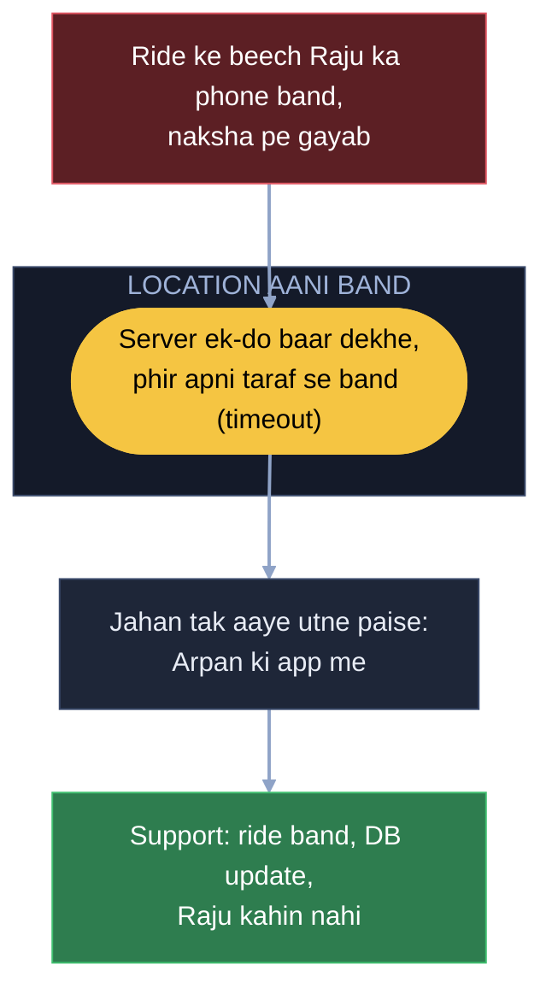

---

## 15. Arpan aur Ravi saath, beech wali gaadi galat ko gayi (batch matching + aging)

Arpan aur Ravi ne saath me book kiya. Do gaadi hain: Car B Arpan se 3 km, Car A Arpan se 2 km aur Ravi se 1 km, aur
Car B Ravi se 6 km. Arpan ki booking pehle pahunchi, to purane niyam se paas wali Car A Arpan ko mili aur Ravi ke liye
Car B bachi, 6 km door. Kul 8 km. Ek booking ko akele mat dekho: dono user aur dono gaadi ki jagah rakh ke har jodi ki
doori nikaalo, phir jodi aisi do ki sabki milake doori kam aaye. Ravi ko beech wali Car A (1 km), Arpan ko bahar wali
Car B (3 km), kul 4 km. Doori km me naapo, minute traffic se ghat-badh jaate hain. Aur ek baar driver ne accept kar liya
to gaadi pakki, use todna nahi; driver khud cancel kare tabhi dobara doori nikaalo.

**Asli naam:** dono ko saath milao, kul doori kam = batch matching (kai booking aur kai gaadi ek saath, sabka milake
pickup kam).

**Maan lo Arpan ki booking 7:00:00 pe aayi aur Ravi ki 7:00:02 pe, aur server ne turant Car A Arpan ko de di:** Booking
aate hi gaadi mat do. Maan lo 15-20 second ruko, user itna ruk lega (Uber me bhi driver dhoondhne me itna lagta hai). Us beech
jitni booking aayi, sab ko saath milao, phir gaadi do, taaki jaldbaazi me galat gaadi kisi ko na jaaye. Upar se dekho: 5-10 second me Ravi aaya aur wahi gaadi Ravi se 1 km, to wo Ravi ko, Arpan ko agli gaadi.
**Asli naam:** 15-20 second ruko, sab saath milao = batching window.

**Maan lo office chhutne ka waqt, har baar koi naya banda gaadi ke paas mil jaata, aur Arpan 7:05 tak "finding driver" pe:**
Gaadi extra ho to dikkat hi nahi. Gaadi ek hi ho aur Arpan ke saath 1-2 baar aisa ho chuka, to agli gaadi Arpan ki hi,
chahe wo kisi aur ke zyada paas ho. Paas wale bande se bol do "thodi der aur dekh le, tere liye aur gaadi aa rahi". Arpan line
me hi nahi to ye niyam lagta hi nahi.
**Asli naam:** baar-baar peeche reh gaya = starvation, jitna ruka utni baari upar = aging (gaadi nahi badhti, sirf baari
tay hoti).

**Maan lo Arpan ne 5 minute ruk ke gusse me cancel kiya aur turant dobara book kiya, server ne ginti 7:05 se shuru kar di:**
Do raaste. (1) Cancel kiya to line se hata do, dobara aaye to peeche lage, kyunki beech me aur log aa gaye. (2) Redis me
parchi "Arpan 5 minute ruka tha", 30 second ki umar; 30 second ke andar wapas aaya to uske 5 minute chalte rahenge,
warna parchi khatam aur line me peeche. Sabka dekhna hai: 30 second ke baad bhi Arpan aage rahe to beech me aaye logon ka
nuksaan; cancel Arpan ne kiya, to peeche lagna uski galti ka nateeja, baaki koi pareshaan nahi.
**Asli naam:** parchi = Redis me pehle tap ka waqt (intezaar pehle tap se gino), umar = TTL.

**Aur neeche (asli Uber accept ke baad nahi todta):** Asli Uber ka design public nahi. Customer ke naate itna dekha ki accept ke baad hamesha "driver ne cancel kiya" aata, "Uber ne cancel kiya" kabhi nahi; matlab accept ke baad Uber khud nahi todta. Par main Uber banata to accept se pehle dono ki doori dekh ke gaadiyan badal deta; ye do alag nazar hain, takraav nahi.
**Asli naam:** accept ke baad assignment pakka; batch se badalna sirf accept se pehle.

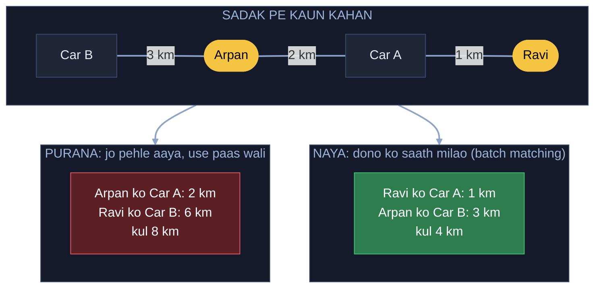

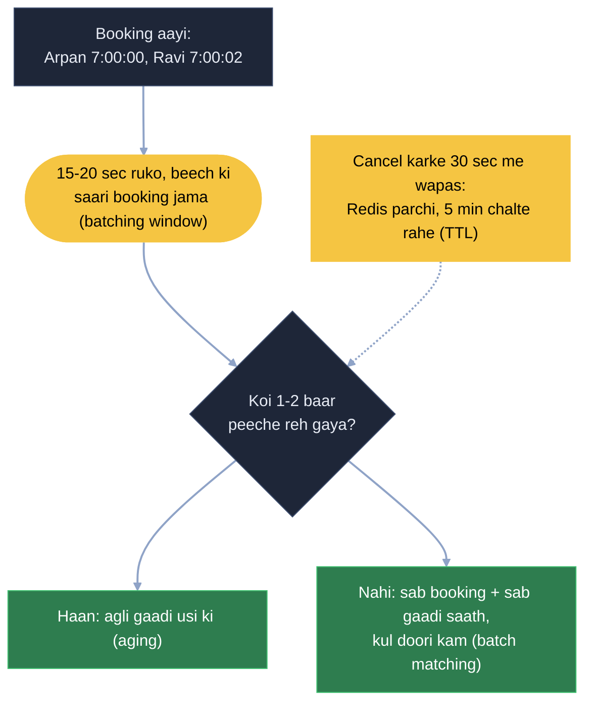

---

## 16. Arpan ke map pe Raju ki gaadi live (adaptive ping, map matching, dead reckoning)

Ye Zomato wali reel se aaya (Aman ki biryani, Raju ki bike), par Uber me bhi wahi: Arpan map pe Raju ki gaadi apni taraf
aati dekhta hai. Raju signal pe 15-20 minute khada hai aur phone phir bhi har 4 second wahi jagah bhej raha, battery 15%.
Driver hil hi nahi raha to baar-baar location ka kya kaam; jaise sote aadmi ke kamre me baar-baar nahi jaate, jagega tab
jaate. Khada dikhe to 4 second ki jagah 10, 15-20 second pe bhejo; location band nahi, bas der se. Gaadi chali to phir
har 4 second.
**Asli naam:** khada hai to der se, chala to jaldi = adaptive ping (speed ke hisaab se location ka waqt, battery bachti).

**Maan lo Raju Connaught Place ki oonchi buildings ke beech hai, GPS takra ke galat jagah bata raha, gaadi map pe ek
building ki chhat pe dikh rahi (ghost bike):** Server pe dikha location building ke upar aa rahi; asli jagah pe neeche
sadak hai, signal buildings me ulajhta. Hamein pata hai Raju is building ke aas-paas hai aur wahan sadak kaunsi hai, to
chhat pe dikhe to use paas wali sadak pe wapas utaar do.
**Asli naam:** paas wali sadak pe chipka do = map matching (GPS ka galat point sabse paas ki sadak pe, raaste ke hisaab se).

**Aur neeche (GPS ek second me nadi paar):** GPS ne bike 1 second me nadi ke us paar dikha di. Network theek nahi to app kahin bhi phenk sakta,
ye rok nahi sakte (Uber, Rapido me hota); animation se use wapas isi road pe le aao. Wahi map matching.

**Maan lo location har 4 second aati hai, beech me gaadi khadi, phir achanak aage koodti (teleport):** Har pal ki asli
jagah dene wali technology nahi, ho bhi to bahut mehngi. Bike chalaane wala seedha aage hi jaata, to map pe gudde ko
halka-halka aage chalate raho; nayi location aaye to sahi jagah pe rakh do. Par flyover ke neeche Raju ne U-turn le liya
aur hum gudde ko aage chala rahe the; signal aaya to asli jagah peeche, gudda uth ke wahan teleport. Ye Uber, Rapido,
Zomato, Swiggy sab me dikhta hai.
**Asli naam:** gudde ko andaze se aage = dead reckoning (speed + sadak se andaza), nayi aayi to sahi jagah = correction,
U-turn pe kooda = andaza galat nikla.

**Aur neeche (tunnel me net gaya, flyover jaisi hi):** Raju raaste me tunnel me ghusa, net 1 minute gaya, phone ne 15 jagah note
ki par bhej nahi paaya; map pe bike ek jagah khadi (basement se alag: wahan pahunch chuka, yahan raaste me). Net poora
gaya to driver ruka dikhega, chalta nahi dikha sakte (pata nahi kya kar raha); ya aage-aage badhao, par galat gudda nahi,
mod ke peeche nikla to flyover jaisa seedha wahan. Dono ho sakte. Net aaya to Redis me aakhri jagah, aur bike
animation se tair ke wahan (PG ki lift jaisa): last write wins. Tunnel ke andar ki 15 jagah map ke kaam ki nahi, Kafka
me, worker / consumer tasveer banaye "Raju yahan ruka tha". Khada ho to location 4 ki jagah 8 second.
**Asli naam:** last write wins, animation se jump, history ke liye Kafka, adaptive ping.

**Maan lo Raju Arpan ki society ki basement parking me ghusa, phone 5 minute bilkul offline; andaze se chalate rahe to
gaadi shehar ke bahar, ruki dikhi to lage Raju bhaag gaya:** Aakhri location pata hai, Raju building ke paas pahunch
gaya. Gaadi wahin rok do aur map ki jagah dikha do "Raju tumhari building pahunch gaya"; Arpan ko shaanti, map dekhna
band. Zomato me Raju khana le ke upar bhi aata hai, isliye wahan do status: pehle "building tak pahuncha", phir haath me
diya tab "order mil gaya". Uber me Arpan neeche aata hai, "Raju pahunch gaya" kaafi.
**Asli naam:** aakhri jagah pe roko = last known location (andaze se aage nahi), map ki jagah status = status update
(arrived / delivered), jagah se pata chala pahuncha = geofence.

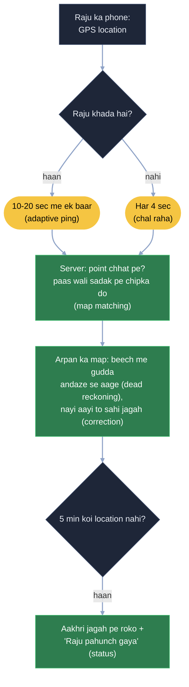

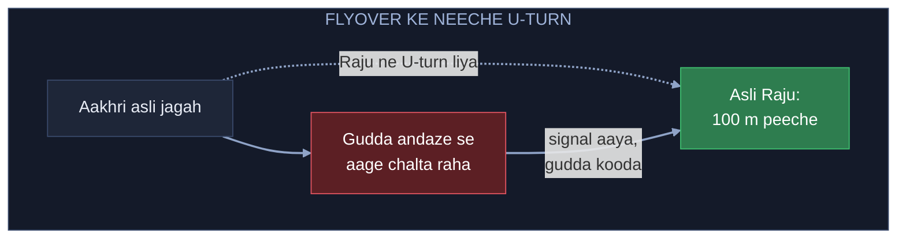

---

## Poora dhaancha ek nazar me

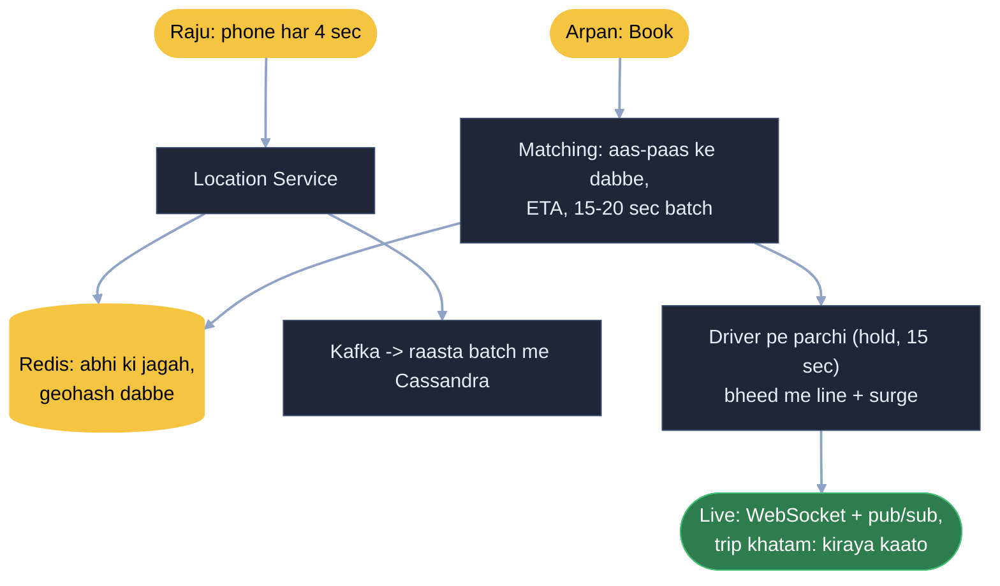

---

Notes (Arpan ke shabd) = [UBER_HAND_NOTES.md](UBER_HAND_NOTES.md)
