# Uber: Connaught Place se ghar ki kahani

Arpan shaam 7 baje Connaught Place pe khada hai aur ghar ke liye Uber book karna hai. Sheher me 5 lakh driver
gaadi chala rahe hain, sab har second jagah badal rahe. Kaam: "Book" dabate hi paas ka khaali driver, ek driver ek
hi sawari, aur bheed me bhi app na atke.

Har kadam = **kahani** (dikkat aur hal, bolne wali bhasha) -> **Asli naam** (interview me yahi shabd) -> tasveer
(kahani ka shabd, bracket me asli naam).

---

## FR / NFR / Numbers (interview me pehle 2 minute)

```
FR      driver ki jagah lo · paas ka khaali driver do · ek driver ek sawari
NFR     driver turant mile (kuch second) · ek driver do jagah kabhi nahi · bheed (concert) me bhi chale
Numbers 5 lakh driver, har 4 sec jagah -> ~1.25 lakh likhai / sec · booking shaam ko hazaaron / sec
        -> likhai bahut zyada (jagah), booking pe paas wale jaldi chhaantne hain
```

---

## 1. Driver kahan hai, server ko pata hi nahi (beech ka dabba)

"Book" dabaya, par server ko pata hi nahi kaunsa driver abhi kahan hai. Location to phone me khud hai, GPS ka
latitude-longitude. To phone khud bheje, har hilne pe nahi, thodi-thodi der me. Beech me ek dabba rakh lo jiska kaam
sirf ek hai: har driver ki sabse taaza jagah batana.

**Asli naam:** beech ka dabba = Location Service; driver ka phone har ~4 sec lat/long bhejta.

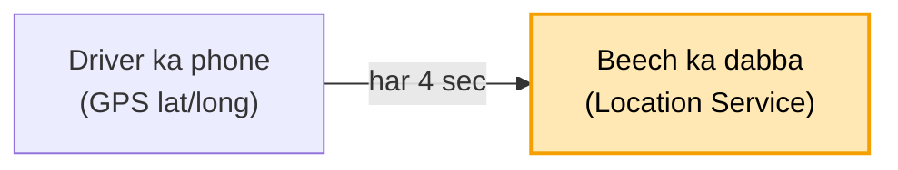

## 2. 1.25 lakh likhai / sec, DB ghut gaya (bada bhai)

Har 4 sec, 5 lakh driver = 1.25 lakh update / sec. Normal DB ghut gaya, aur jagah 30 sec peeche chal rahi. Do raaste
the: ya to chhoti parchi, kaat ke nayi jagah likho; ya bada dabba jo likhne me tez ho. Crore-crore likhai pe parchi
dheemi ho sakti, gir sakti, aur kab tak replica lagaunga, kal driver aur badhenge. To bada bhai bulao, jo isi kaam ke
liye bana hai, apni copies khud rakhta.

**Asli naam:** bada bhai = Cassandra (likhai tez, apni copies, machine jodo to badhta). Driver ki row driver_id pe,
nayi jagah aate hi upar likh do (sirf taaza chahiye).

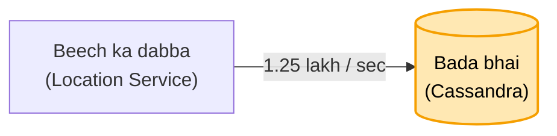

## 3. 5 lakh ka fasla naapna, 40 sec ghoomna (naksha dabbon me)

Book pe server saare 5 lakh driver ka Arpan se fasla naap raha, aur Arpan 40 sec se "driver dhoondh rahe hain" dekh
raha. Connaught Place pe khade ko ISBT ka driver kyun? Sirf 8-9 km ke andar wale chahiye. Aur 5 lakh me se chhaanto
mat: naksha pehle se dabbon me kata ho, server sirf usi dabbe me dekhe jahan Arpan khada. Usme 3 driver, unme jo
khaali wo Arpan ko. Baaki 5 lakh kahin bhi ghoomein, lena-dena nahi.

**Asli naam:** naksha dabbon me = geohash (grid), sirf apna dabba = 5 lakh ki jagah gine-chune driver.

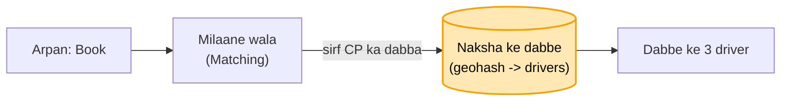

## 4. Arpan dabbe ke kinare pe, 200 meter door khaali driver (gola khincho)

Arpan dabbe ke kinare pe khada hai, aur 200 meter door bagal wale dabbe me khaali driver, par app bola "koi nahi".
Dabbe ki seema pe mat chalo. Arpan jahan khada wahan se 8 km ka gola khincho; jin dabbon ko gola chhoota, unke driver
bhi dekho, phir asli fasla naap ke sabse paas wala.

**Asli naam:** gola + chhoote dabbe = apna geohash + aas-paas ke dabbe (neighbours), phir asli distance.

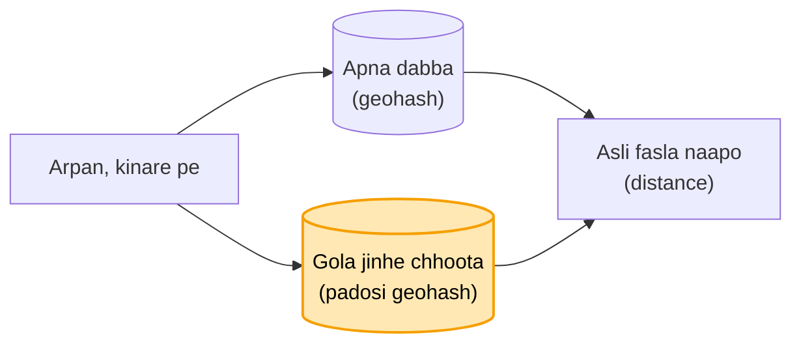

## 5. Raju ek, Arpan aur Priya do (BMS wali parchi)

Gole me ek khaali driver Raju. Arpan aur Priya ne ek hi second me "Book" dabaya, aur Raju ke phone pe do ride aa gayi.
BMS wali parchi lagao: "Raju khaali hai to Arpan ka", ek kadam me. Jiski pehle pahunchi uski parchi, doosre ko "Raju
chala gaya" aur uske liye agla driver. Parchi ki umar rakho: Raju 15 sec me accept na kare to parchi hatao, agla
driver.

**Asli naam:** parchi = driver pe hold / lock (atomic: sirf FREE ho to lagao), umar = TTL. Taala har driver ka alag,
to bheed me bhi sab ek taale pe nahi toot-te.

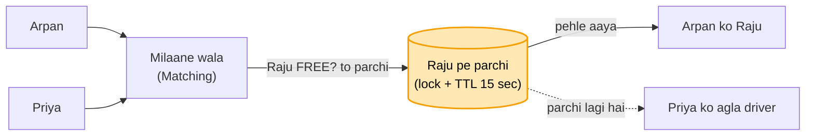

## 6. Concert khatam, 50 hazaar log, 500 cab (line + surge)

Diljit ka concert khatam hua, 50 hazaar log ek saath book kar rahe, aas-paas cab sirf 500. BMS jaisa: 500 cab hain
to 500 log andar, baaki line me, agli baari. 50 hazaar ko server pe bitha ke kya karunga. Pehle 500 sambhalo, phir
kiraya badha ke door ki cab bulao: 30 km door ka driver bhi kamaai dekh ke aa jaata, aur jinhe zaroori
nahi wo ruk jaate ya metro le lete.

**Asli naam:** 500 andar, baaki line = virtual queue (waiting room), kiraya badhao, door ki cab aaye = surge pricing.

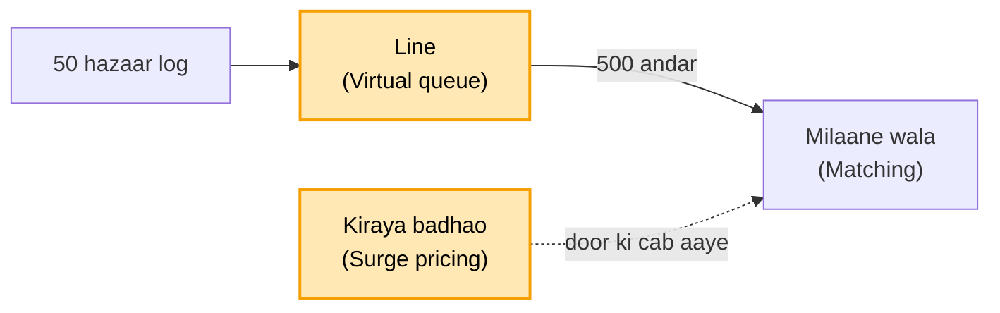

## 7. Raju ne 14.9 sec pe accept dabaya, server pe 16 sec pe pahuncha (ghadi server ki)

Raju ne 14.9 sec pe accept dabaya, par server pe 16 sec pe pahuncha, tab tak Priya ko de diya. Ghadi server ki hai. 15
sec tak ruka, phir chala gaya; der se aaya to uski parchi phaad do, accept radd. Uber me bhi aise booking cancel hoti
dikhti hai.

**Asli naam:** ghadi server ki = TTL ka faisla server pe, der se aaya accept reject.

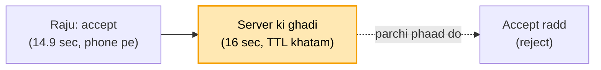

## 8. Raju Janpath gaya, naam CP ke dabbe me pada (taaza jagah dekho)

Raju Connaught Place ke dabbe se Janpath ke dabbe me gaya, par purane dabbe me naam pada hai; Arpan aur Priya dono ko
dikh raha. Sach wahi jo GPS ne abhi bheja: Raju Janpath me. Book pe Raju ki taaza jagah dekho; Arpan ke gole me nahi
to use mat do, Arpan ke liye CP me koi aur. Dono ek saath dabaayein to wahi taala.

**Asli naam:** taaza jagah dekho = assign se pehle driver ki latest location check (ek driver ki ek sach jagah), lock
double se bachata.

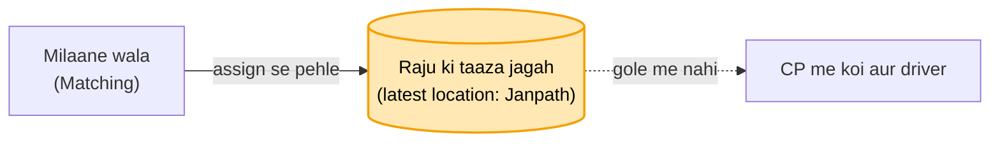

## 9. Register driver ke naam se, chahiye jagah ke naam se (jagah ka panna)

Register driver ke naam se laga hai ("Raju -> Connaught Place"). Booking pe chahiye "Connaught Place me kaun-kaun", to
phir 5 lakh line. Aur Raju dabba badle to purane panne me naam pada rehta, shaam tak 2,000 purane naam. To jagah ke
hisaab se baant do: Connaught Place me itne driver, Janpath me itne, AIIMS ke paas itne. 5 lakh ki jagah utni hi line
jitne us jagah me. Raju us jagah se nikla to wahan se hata do, naye panne me daal do. Raju booked hai to list se
nikaal do, ab wo kisi ko nahi milna. Booked nahi aur ghoom raha to kaat ke nayi list me, U-turn le ke wapas aaya to
phir purani list me. Booked Raju ne Connaught Place pe sawari utaari to pata hai thodi der me khaali hoga, phir list me
daal do.

**Asli naam:** jagah ke hisaab se panna = geohash -> drivers (Redis set har dabbe ka), nikla to hata do, naye me daal
do = har location update pe purane set se remove + naye me add (driver ki row me pichhla dabba yaad), booked to list
se bahar = sirf khaali driver set me, sawari khatam pe wapas.

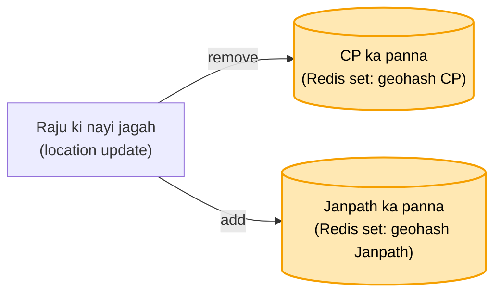

## 10. 10 lakh phone "Raju kahan?" poochh rahe (poochne ka mauka mat do)

Raju aa raha, Arpan ko gaadi naksha pe khisakti dikhni chahiye. 10 lakh phone har second "Raju kahan?" poochh rahe,
99% jawab "wahin", server dab gaya. Server poochh kyun raha, poochne ka mauka hi mat do. Ek aisa dabba bitha do ki Raju
hila to turant Arpan ko dikha de, hila to dikha de. Asal me hilta hai, jhooth nahi dikhate.

**Asli naam:** poochne ka mauka mat do, khud dikha do = push (WebSocket, khula taar), polling band.

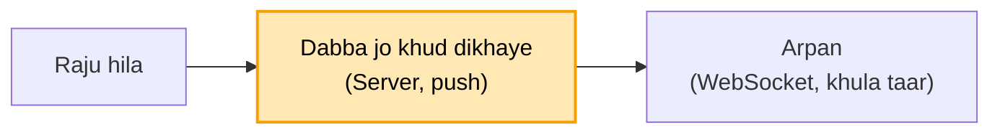

## 11. Arpan server 12 pe, Raju ki jagah server 57 pe (store karwa lo, seedha raasta)

Arpan ka taar server 12 pe hai, aur Raju ki jagah server 57 pe aati. 57 ko pata hi nahi Arpan kahan. 100 server me
dhoondhna nahi. Store karwa lo: Arpan server 12 pe, Raju ki ride Arpan ke saath. Raju aur Arpan ke taar jodo, Raju ko
sirf Arpan se lena-dena. Jaise ghar ka raasta pata ho to seedha usi raaste.

**Asli naam:** store karwa lo = session map (user -> server, Redis) + ride map (driver -> rider), seedha usi raaste =
server 57 seedha server 12 ko (pub/sub channel), wahan se Arpan ke taar pe. Chat wala DSA map + chhota ladka hi.

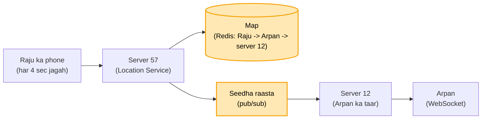

## 12. 250 dikha, 500 kate (jo dikhaya wahi + tip)

Book pe ₹250 dikha, Arpan ne haan kiya. Ride ke beech surge 2 guna, aakhir me ₹500 kate. Arpan: "maine 250 dekh ke
haan kiya tha." Jo dikhaya wahi lena meri zimmedari: 250 hi lo. Traffic me phase aur driver ki mehnat zyada lagi to
rider ki marzi pe tip, 50-100 de de, na de to jitna dikhaya utna. (Uber / Rapido asal me badha deti hain, par main
banata to aise.)

**Asli naam:** jo dikhaya wahi = upfront fare: quote ride ke saath save (lock), aakhir me wahi kaato; zyada mehnat =
tip alag, rider ki marzi.

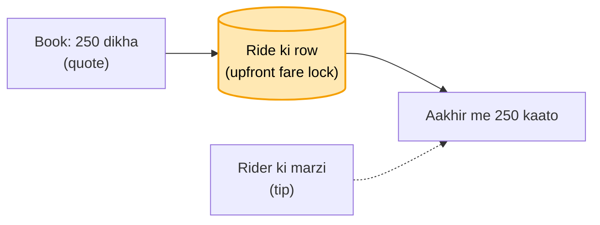

## 13. Trip khatam, wallet me ₹40 (poora ya kuch nahi, ride tab tak khuli)

Trip khatam, ₹250 kaatne gaye, Arpan ke wallet me sirf ₹40. Payment fail, Arpan ghar ke andar, aur Raju ka petrol aur
40 minute gaye. Kaatna hai to poora kaato, aadha mat kaato: 40 kaat ke chhod diya to log jaan-boojh ke 1 rupaya
rakhenge. Wallet me 250 nahi to app me saaf dikhao "payment nahi hua", aur Raju ke phone pe bhi dikhe. Arpan GPay se
de, warna cash, kaise bhi. Jab tak paisa nahi aaya, ride khatam hi nahi hogi.

**Asli naam:** poora ya kuch nahi = atomic charge (partial nahi), ride tab tak khatam nahi = ride status
PAYMENT_PENDING jab tak SUCCESS, GPay / cash = fallback payment method, dono app pe dikhe.

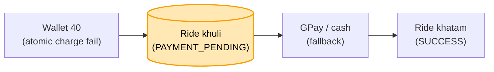

## 14. (Socha hua) Ride ke beech Raju ka phone band (location timeout + support)

Ride ke beech Raju ka phone switch off, GPS bhi band, naksha pe Raju gayab. Ride khatam kaun karega? Phone band hona
Uber ke haath me nahi, ye design ki dikkat nahi. Phone apni location khud bhejta hai, server poochhta nahi. Location
aani band hui to server ek-do baar dekhega, phir apni taraf se bhi band. Jahan tak aaye utne paise Arpan ki app me
dikhenge, wo de do. Phir Uber support ko phone: "driver ka phone band ho gaya". Support wahan se ride band kar dega,
DB me update, Raju kahin nahi dikhega.

**Asli naam:** location aani band, ek-do baar dekha = location timeout (phone push karta, server sirf intezaar karta),
utne paise = jahan tak ka kiraya / jo dikhaya, support ride band kare = manual close, ride status DB me update, driver
available list se bahar.

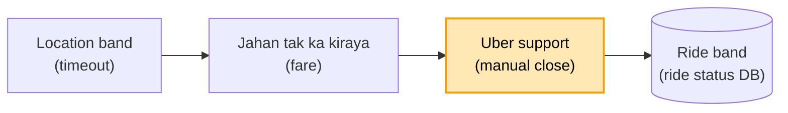

---

Notes (Arpan ke shabd) = [UBER_HAND_NOTES.md](UBER_HAND_NOTES.md)
